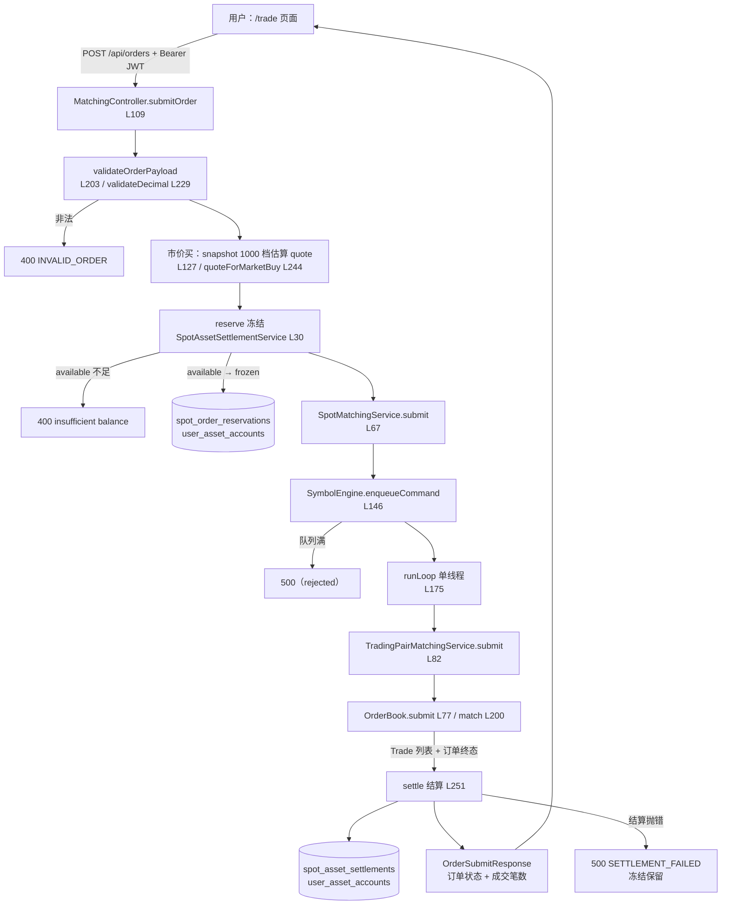
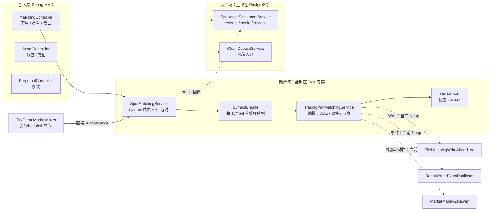
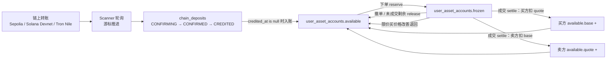

# 油条 CEX 现货撮合 · 源码学习大纲

> **面向**：有多年 Java 后端经验、正在补 Solidity / Go / Web3 的开发者。
> **关注点**：Java 后端的业务建模、并发模型、账务一致性；前端页面与链上合约只讲边界，不逐行展开。
> **证据基准**：当前工作区源码（首次勘察时间 2026-10-25）。行号会随代码演进漂移，读到时以函数名为锚点重新定位。
> **结论分级**：**已证实**（源码直接可见）／**合理推断**（符合证据但未完全验证）／**待验证**（缺关键证据，见第 5.5 节）。

**这份大纲不做什么**：不按目录逐个介绍文件，不做安全审计，不重复 `docs/现货撮合面试手册.md` 的面试题；它只解决一件事——**带你把"一笔现货订单从点击到结算"的主线，用真实调用链走通**。

---

## 1. 项目业务全景

### 1.1 它解决什么问题

一句话：在一个可本地运行的 Spring Boot 单体里，演示中心化交易所（CEX）**现货**业务的完整闭环——

```text
用户下单 → 冻结资金 → 单交易对串行撮合 → 数据库结算 → 查询/撤单
```

它要回答的三个真实工程问题：

| # | 问题 | 项目给出的答案 | 证据 |
| :-- | :--- | :--- | :--- |
| 1 | 多线程 HTTP 请求如何不把订单簿写乱 | 每个交易对一个单线程 `SymbolEngine` + 有界队列，同 symbol 串行、跨 symbol 并行 | `matching/engine/SymbolEngine.java:146`、`:175` |
| 2 | 撮合的数据结构与价格/时间优先怎么落 | 跳表管价格档（O(log n) 插入/删除、O(1) 取最优），同档用 `ArrayDeque` 保证 FIFO，成交价取 maker 价 | `matching/domain/OrderBook.java:200`、`domain/PriceLevel.java:11` |
| 3 | 钱什么时候锁、什么时候扣、失败怎么办 | 下单先写 `spot_order_reservations` 并 `available→frozen`；成交按 `spot_asset_settlements` 逐笔结算；撤单/剩余量退回 | `asset/service/SpotAssetSettlementService.java:30`、`:251` |

它**不是**生产级交易所：订单簿只在内存、无手续费、无自成交防护、无风控与限频、无提现、订单不落库。把这一点先记牢，后面读代码才不会被 README 里的"目标链路"带偏（见第 08 章）。

### 1.2 参与者与职责

| 参与者 | 在业务里的职责 | 源码位置 |
| :--- | :--- | :--- |
| 交易用户 | 用 Supabase 账号登录，下单/撤单/看盘/看资产 | 前端 `web/src/pages/trade.tsx`；鉴权 `auth/security/` |
| 撮合引擎（内存） | 维护订单簿、决定成交价与成交量、产生成交记录 | `matching/domain/OrderBook.java`、`matching/service/TradingPairMatchingService.java` |
| 接入层 | 鉴权、参数校验、冻结、编排、异常映射 | `matching/controller/MatchingController.java:109` |
| 资产/结算 | 冻结、成交划转、撤单解冻、充值入账 | `asset/service/SpotAssetSettlementService.java`、`ChainDepositService.java` |
| 演示做市商 | 每 3 秒按 OKX 公共报价重建盘口并自成交，制造"有深度"的假象 | `matching/marketmaker/OkxDemoMarketMaker.java:61` |
| 链上扫链 | 轮询三条测试网的充值交易，确认后入账 | `asset/service/*ChainDepositScanner.java` |
| Supabase | 身份提供方（JWT/JWKS）+ PostgreSQL 宿主 | `auth/security/SupabaseJwtVerifier.java`、`application.yaml` |
| 永续 / 跨链桥 | 与现货隔离的第二、第三条业务线，可作为选读 | `perpetual/`、`asset/service/CrossChainBridgeService.java` |

### 1.3 三条核心业务主线

| 主线 | 一句话 | 学习价值 |
| :--- | :--- | :--- |
| **A. 下单 → 撮合 → 结算** | 用户提交订单，资金先冻结，进入 symbol 队列撮合，成交后在数据库完成 base/quote 交换 | 全项目最核心；并发模型 + 撮合算法 + 账务一致性都在这里 |
| **B. 撤单 / 改单 / 查询** | 撤单解冻剩余资金；改单本质是"撤旧单 + 下新单"；查询靠内存索引 | 理解订单状态机与"内存订单 vs 数据库预留"的对应关系 |
| **C. 链上充值 → 内部余额** | 扫链发现转账 → `chain_deposits` 记确认数 → 满足 3 确认后加 `available` | 理解 CEX 的资产从哪来，以及幂等入账怎么做 |

行情读取（`GET /api/market/snapshot`、`/trades`）不算独立主线，它和下单共用同一队列，是理解"读写一致性"的好素材。

### 1.4 关键状态与数据存放位置

这是本项目最需要先建立的一张地图——**同一笔订单的状态，同时存在于内存和数据库，而且两边不是强一致的**。

| 状态 | 存放位置 | 主要写入者 | 生命周期 |
| :--- | :--- | :--- | :--- |
| 订单本身（价格/数量/剩余/状态） | **JVM 内存**：`OrderBook.openOrders`、`allOrders`、`ordersByClientOrderKey`（`OrderBook.java:30-32`） | `OrderBook.submit/cancel/modify` | 进程重启即丢失 |
| 订单簿（价格档 + FIFO 队列） | **JVM 内存**：`bids`/`asks` 跳表（`OrderBook.java:28-29`） | `OrderBook.addOpenOrder/removeFromBook/match` | 进程重启即丢失 |
| 最近成交 | **JVM 内存**：`TradingPairMatchingService.recentTrades`，上限 50 条（`:27`、`:144`） | `rememberTrade` | 重启丢失 |
| 资金冻结 | **PostgreSQL** `spot_order_reservations`（`V14`） | `SpotAssetSettlementService.reserve` | 持久，`OPEN → RELEASED` |
| 用户余额 | **PostgreSQL** `user_asset_accounts`（`V2`） | `reserve` / `settleOrder` / `releaseInternal` | 持久 |
| 成交账本 | **PostgreSQL** `spot_asset_settlements`（`V14`，主键 `settlement_key`） | `settleOrder` | 持久、不可变 |
| 链上充值 | **PostgreSQL** `chain_deposits`（`V8`） | `ChainDepositService.recordChainDeposit` | 持久，`CONFIRMING → CONFIRMED → CREDITED` |
| WAL / 快照 | 本机文件（`./data/wal`、`./data/snapshot`，`application.yaml:110`、`:117`） | `FileMatchingWriteAheadLog`、`SnapshotManager` | **代码已写，运行时未接线**（第 08 章） |
| 撮合队列指标 | JVM 内存 `AtomicLong` / 延迟窗口 | `SymbolEngine` | 重启归零，仅供观测 |

> 这张表推出两个关键结论：
> 1. **订单不在数据库里**。`spot_orders`、`spot_trades`、`outbox_events` 三张表存在，但 Java 代码没有写入方（已证实：全仓库 `spot_orders` 仅出现在 SQL 迁移中）。
> 2. **撮合与结算是两个世界**。撮合结果只存在于内存和本次 HTTP 响应里；把它变成余额变化的是紧接着的 `settle()`，两者之间没有事务，也没有消息兜底（第 03、08 章）。

### 1.5 资产从哪里来、流向哪里

```text
链上转账（测试网）
   └─ Scanner 扫到 → chain_deposits（确认数≥3）→ user_asset_accounts.available
                                                        │
                                        下单 reserve   ↓
                                              user_asset_accounts.frozen
                                                        │
                        成交 settle ──→ 买方：available.base 增加，frozen.quote 扣减
                                    └─→ 卖方：available.quote 增加，frozen.base 扣减
                                                        │
                              撤单 / 未成交剩余 / 限价买价格改善 → 退回 available
```

要点（都已证实）：

- **资产是账本概念，不是链上事实**。`SpotAssetSettlementService.assetLocation`（`:559`）把 `SOL` 固定映射到 `SOLANA/DEVNET`、`TRX` 映射到 `TRON/NILE`、**其余全部映射到 `EVM/SEPOLIA`**。所以 `BTC-USDT` 里的 BTC 只是 `EVM/SEPOLIA` 上的一行余额，没有真实 BTC 链。
- **谁控制资产**：托管钱包私钥由后端生成并以 AES-256-GCM 加密存库（`asset/service/CustodialWalletService.java`、`Aes256PrivateKeyCipher.java`）；用户没有私钥，只有站内余额。
- **演示做市商的"钱"是凭空来的**：`demo-okx-market-maker` 用户没有 `spot_order_reservations` 记录，结算时该侧直接跳过（`SpotAssetSettlementService.java:294-301`）。所以它的挂单不消耗任何资金——这是教学道具，不是资金流。

### 1.6 链上与链下的职责边界

| 环节 | 在哪 | 说明 |
| :--- | :--- | :--- |
| 下单、撮合、订单簿、成交 | **链下（Java 内存）** | 完全不碰链；延迟最低，但无持久化 |
| 冻结、结算、余额 | **链下（PostgreSQL）** | 交易所内部账本；SQL 事务 + 行锁保证单库一致 |
| 充值收款 | 链上（EVM/Solana/Tron 测试网）→ 链下扫链入账 | 链上只发生"用户转账给托管地址" |
| 提现 | **未实现**，只在文档里讨论 | 无提现 Controller；仅遗留一个内存版 `UserAssetService.withdraw`（不在 Spring 容器、无接口暴露、只被单测引用） |
| 跨链桥 | 链上 LayerZero OFT + 链下轮询状态 | 测试网演示，和现货撮合主线无关 |
| 永续合约 | 纯链下（PostgreSQL） | 不撮合用户对手单，按 OKX 报价成交（第 10 章） |

---

## 2. 核心业务主线（带源码入口）

### 2.1 主线 A：一笔限价买单从提交到结算

假设用户 A 在 `ETH-USDT` 下了一笔限价买单，对手盘已有卖单。

| # | 步骤 | 入口（文件:行） | 做了什么 | 状态变化 |
| :-- | :--- | :--- | :--- | :--- |
| 1 | 鉴权 | `auth/security/SupabaseAuthenticationFilter` + `SecurityConfig.java:36-40` | 校验 `Authorization: Bearer <Supabase JWT>`；`/api/market/**` 等 GET 放行，其余需登录 | 无 |
| 2 | 参数校验 | `MatchingController.java:203`（`validateOrderPayload`）、`:229`（`validateDecimal`） | symbol 必须是已启动的 engine；数量/价格必须为正，`scale ≤ 12`、`precision ≤ 24` | 无（非法直接 400） |
| 3 | 生成幂等键 | `MatchingController.java:113` | 服务端生成 `clientOrderId = "web-" + UUID`——注意：**HTTP 请求体不接受 clientOrderId** | 无 |
| 4 | 冻结 | `MatchingController.java:129` → `SpotAssetSettlementService.java:30` | 卖单冻 base 数量；限价买冻 `price × quantity`；市价买先按盘口 1000 档估算 quote（`:127`、`:244`） | `available → frozen`；插入 reservation（`OPEN`） |
| 5 | 入队 | `SpotMatchingService.java:67` → `SymbolEngine.java:146` | 包装成 `PlaceOrderCommand`，投入该 symbol 的有界队列；调用线程阻塞等待，超时 3 秒 | 队列长度 +1 |
| 6 | 撮合 | `SymbolEngine.java:175`（runLoop）→ `TradingPairMatchingService.java:82` → `OrderBook.java:77`、`:200` | 幂等检查（同 key 返回原单）→ POST_ONLY/FOK 预检 → 从对手盘最优价逐档撮合 → 剩余量按 GTC/IOC/市价处理 | 内存订单簿变化；产生 `Trade`；订单状态 `NEW/PARTIALLY_FILLED/FILLED/CANCELED/REJECTED` |
| 7 | 结算 | `SpotMatchingService.java:76` → `SpotAssetSettlementService.java:251` | 对每笔成交，taker 与 maker 各结算一次；扣 frozen、给对方加 available、限价买退回价差 | `spot_asset_settlements` 插一行/方；`user_asset_accounts` 变化；终态订单剩余冻结释放 |
| 8 | 响应 | `MatchingController.java:131-132` | 返回订单快照 + 内部成交笔数 + 外部成交笔数 | 无 |
| 9 | 查询 | `MatchingController.java:69`（盘口）、`:77`（成交）、`:141`（我的订单） | 盘口/成交同样排进 symbol 队列，读到的是与撮合严格一致的内存状态 | 无 |

**成交价规则**（易错点）：`OrderBook.match` 用 `maker.price()` 记成交价（`OrderBook.java:229`），不是 taker 价。所以买单出价 100、卖一价 99 时，成交价是 99——这就是"价格改善"，差价在结算时退回买方（`:351-357`）。

### 2.2 主线 B：撤单与改单

| 步骤 | 入口 | 关键逻辑 |
| :--- | :--- | :--- |
| 按 orderId 撤单 | `MatchingController.java:261` → `SpotMatchingService.java:87` | 先查 `findOpenOrder` 校验归属，再入队 `CancelOrderCommand`；`OrderBook.cancel`（`:144`）从队列和跳表移除，状态置 `CANCELED`；随后 `settlementGateway.release(order)` 解冻 |
| 按 clientOrderId 撤单 | `MatchingController.java:184` | 在自己订单里找 open 的那笔；找不到就直接释放 reservation（兼容"冻结了但没挂上"的情况） |
| 改单 | `SpotMatchingService.java:102` → `TradingPairMatchingService.java:105` → `OrderBook.modify`（`:123`） | **本质是撤旧单 + 用同一 clientOrderId 重新下单**；会重新排队、重新定价、可能立刻成交；旧单进 `allOrders` 但不再可撤。注意：**没有 HTTP 入口**（只有引擎/测试可达），且**不调用 `release`**，沿用原 reservation |

注意：撤单接口**不会**校验"订单是否已成交"以外的状态；改单没有"新数量必须 ≥ 已成交量"的检查，靠 `newQuantity` 直接替换（待验证：真实交易所通常要求改单后数量不小于已成交数量）。

### 2.3 主线 C：链上充值如何变成余额

| # | 步骤 | 入口 | 说明 |
| :-- | :--- | :--- | :--- |
| 1 | 生成托管地址 | `AssetController` → `CustodialWalletService` | 登录后按链生成 EVM/Solana/Tron 地址，私钥加密入库 |
| 2 | 扫链 | `EvmChainDepositScanner.java:83`、`SolanaChainDepositScanner.java:65`、`TronChainDepositScanner.java:73` | `@Scheduled` 轮询，游标存 `chain_scan_cursors`，失败不推进游标 |
| 3 | 记录 | `ChainDepositService.java:159` | 按 `tx_hash` upsert；确认数 ≥ 3 才 `CONFIRMED` |
| 4 | 入账 | `ChainDepositService.java:251` | `update ... where credited_at is null` 天然幂等；成功后状态 `CREDITED` |
| 5 | 教学捷径 | `POST /api/assets/deposits/simulate` → `:97` | 跳过扫链，直接造一笔已确认充值，便于课堂演示 |

充值链默认关闭（`CHAIN_SCANNER_ENABLED:false`，`application.yaml:175`），所以**默认启动时余额只能靠模拟充值或种子数据**。这是新手最容易困惑的点之一。

---

## 3. 业务流程图

### 3.1 下单主链路（主线 A）



### 3.2 模块协作（实线＝运行时已接线；虚线＝代码存在但未装配）



> 读图提示：凡是虚线，都意味着"测试里有、主链路没接"。这正是第 08 章要讲的内容，也是读这个项目最容易误判的地方。

### 3.3 资金状态流转



---

## 4. 学习章节目录

### 4.1 总览

| 章 | 标题 | 一句话目标 | 优先级 |
| :-- | :--- | :--- | :--- |
| 01 | 一个 Spring Boot 单体如何装下一家交易所：骨架与状态地图 | 知道进程怎么起、有哪些模块、状态分别在哪 | 必读 |
| 02 | 用户点"买入"之后：鉴权、校验、冻结估算与提交 | 能复述 HTTP 入口到入队前的每一步 | 必读 |
| 03 | 钱怎么被锁住、怎么结清：reserve / settle / release | 能解释三张账本表的读写与幂等 | 必读（核心） |
| 04 | 为什么每个交易对只有一个线程：串行化、超时与幂等 | 能讲清单线程 actor 的收益与代价 | 必读（核心） |
| 05 | 订单簿如何撮合：跳表 + FIFO + 四种时效 | 能手推一笔撮合的成交量与成交价 | 必读（核心） |
| 06 | 成交之后：状态机、撤单、改单与查询 | 能画出订单状态迁移并指出资金影响 | 必读 |
| 07 | 内部簿不够时：外部流动性与演示做市 | 能区分两套"市商"机制 | 可选深入 |
| 08 | 设计目标 vs 运行时：WAL / Outbox / RabbitMQ / Snapshot 的真实状态 | 不被 README 的目标链路误导 | 必读（防坑） |
| 09 | 资产从哪里来：三链托管钱包与充值扫链 | 能说清充值入账链路与幂等点 | 选读（与现货主线弱相关） |
| 10 | 现货之外：永续合约与跨链桥 | 知道它们与现货的账本、撮合完全隔离 | 可跳过 |

> 章节号从 01 开始，与后续单独成文的章节文件一一对应（建议命名 `NN-短名.md`，如 `03-冻结与结算.md`）；跨章引用统一写"第 05 章"。
>
> **生成进度**：01 → `01-系统骨架与状态地图.md`；02 → `02-下单入口与资金冻结.md`；03 → `03-冻结与结算.md`；04 → `04-单线程撮合队列与超时.md`；05 → `05-订单簿与撮合算法.md`；06 → `06-订单状态与撤单.md`；07 → `07-外部流动性与演示做市.md`；08 → `08-未接线的可靠性组件.md`；09 → `09-资产从哪里来.md`；10 → `10-永续合约与跨链桥.md`；**全部 10 章已完成**。附录 A → `90-附录A-术语与面试速查.md`。

### 4.2 章节详情

#### 第 01 章：一个 Spring Boot 单体如何装下一家交易所

- **优先级**：必读
- **业务位置**：全局地图。后面每一章都会回到这里定位"我现在在哪"。
- **前置依赖**：无。
- **输入与输出**：输入是仓库目录与 `application.yaml`；输出是一张"模块—状态—存储"的对照表。
- **关键状态**：启动的 engine 列表（默认 6 个交易对，`application.yaml:74`）、19 个 SQL 迁移的执行结果、内存 vs DB 的边界。
- **核心调用**：`YoutiaoCexApplication.java`（`@EnableScheduling`）→ `SchemaMigrationRunner.run`（`:31`，按 `V<数字><字母>__` 排序，所以 `V9a` 排在 `V9` 之后、`V10` 之前）→ `MatchingSpringConfig.spotMatchingService`（`:16`）→ `SpotMatchingService.createRuntime`（`:177`）→ `OkxDemoMarketMaker` 构造时 `startSymbols`。
- **学习重点**：
  - 为什么撮合放在内存而不是数据库（延迟、确定性），代价是什么（重启丢单）。
  - 为什么数据库里有 `spot_orders` 却没人写（教学设计未完成，第 08 章）。
  - `SymbolEngine` 的线程何时创建（每个 symbol 首次使用时 `computeIfAbsent`）。
- **可跳过**：`perpetual/`、`asset/service/CrossChain*`、`web/`。

#### 第 02 章：用户点"买入"之后

- **优先级**：必读
- **业务位置**：主线 A 的第 1–4 步，负责"把外部请求翻译成内部命令"。
- **前置依赖**：第 01 章（知道有哪几个 engine、余额在哪张表）。
- **输入与输出**：输入 `SubmitOrderPayload`（symbol/side/type/price/quantity/allowExternalLiquidity）；输出 `OrderRequest` + 已冻结的资金。
- **关键状态**：`spot_order_reservations`（新增 `OPEN` 行）、`user_asset_accounts.available/frozen`。
- **核心调用**：`MatchingController.submitOrder:109` → `validateOrderPayload:203` → `assetSettlementService.reserve:30` → `spotMatchingService.submit:67`；异常映射 `:292`（超时 504）、`:298`（非法 400）、`:303`（结算失败 500）。
- **学习重点**：
  - 市价买为什么要先读盘口：`quoteForMarketBuy` 走完 1000 档仍不够就直接拒绝（`:255-257`），避免"冻了钱却买不到"。
  - 冻结金额公式：卖＝数量；限价买＝价×量；市价买＝估算 quote。
  - **HTTP 层不接受调用方传入 `clientOrderId`**（`:113` 服务端生成 UUID），所以 README 说的"用同一 clientOrderId 安全重试"在 REST 上无法使用；这是理解第 04 章幂等语义的前提。
- **可跳过**：前端下单表单细节、Supabase OAuth 流程。

#### 第 03 章：钱怎么被锁住、怎么结清

- **优先级**：必读（核心）
- **业务位置**：主线 A 的"账务"部分，也是全项目最像真实交易所账务的代码。
- **前置依赖**：第 02 章（知道谁调用 reserve）。
- **输入与输出**：输入 `OrderRequest`/`MatchResult`；输出三张表的行与余额变化。
- **关键状态**：`spot_order_reservations.status`（`OPEN/RELEASED`）、`remaining_amount`、`user_asset_accounts.available/frozen`、`spot_asset_settlements`（不可变流水）。
- **核心调用**：`reserve:30`、`settle:251`、`release:270`、`reservationAmount:274`、`settleOrder:287`、`consumeFrozen:392`、`creditAvailable:427`、`releaseByOrder:446`、`releaseInternal:453`。
- **学习重点**：
  - 三重幂等：reservation 唯一键 `(user_id, client_order_id)`；settlement 主键 `settlement_key = symbol:takerCid:makerCid:userCid:role`；入账 `where credited_at is null`。
  - 为什么限价买按"限价"冻结、按"成交价"扣款，并把差价退回（`:347-357`）。
  - `consumeFrozen` 里 `frozen >= amount` 的条件更新 + 影响行数校验，是防超扣的关键（`:396-415`）。
  - maker 没有 reservation 时直接跳过（`:294-301`）——演示做市商因此可以"无限流动性"。
  - 结算失败时抛 `SpotSettlementException`，冻结**故意保留**用于人工恢复（`SpotMatchingService.java:79-82`）。
- **易混点**：项目里有两套"资产"代码——`asset/service/UserAssetService.java` 是早期纯内存实现（无 `@Service`、无调用方、仅单测引用），真正的主链路是 `SpotAssetSettlementService` + `user_asset_accounts`。读代码时不要被前者误导。
- **可跳过**：`tradingActivity` 的四段查询 SQL（`:101-247`）只需知道它拼资产页数据。

#### 第 04 章：为什么每个交易对只有一个线程

- **优先级**：必读（核心）
- **业务位置**：主线 A 的第 5–6 步，决定"顺序"和"并发边界"。
- **前置依赖**：第 02 章。
- **输入与输出**：输入内部命令（下单/撤单/改单/查询）；输出 `CommandResult` 与撮合结果。
- **关键状态**：`BlockingQueue` 长度、`submitted/processed/rejected/failed` 计数、p50/p95/p99 延迟窗口、健康状态。
- **核心调用**：`SpotMatchingService.submit:67`、`await:194`（3 秒超时 + `future.cancel(false)`）、`createRuntime:177`；`SymbolEngine.submit:71`、`enqueueCommand:146`、`enqueue:158`、`runLoop:175`、`stats:112`。
- **学习重点**：
  - 为什么"单线程 + 队列"能让订单簿不用锁，且跨 symbol 并行。
  - 队列满时下单返回 `rejected` → `IllegalStateException` → **HTTP 500**（不是 429/503）；读请求队列满则直接异常。
  - 超时的真实语义：`future.cancel(false)` 只取消等待，**不阻止任务执行**（`QueuedTask.complete` 仍会 `task.get()`）；而控制器在超时后会把冻结释放掉（`MatchingController:135-137` 的 `catch (RuntimeException)`）。这会导致"订单已成交但结算没跑、预留已释放"的风险（详见第 06 节风险表）。
  - `snapshot(1000)` 与下单共用同一队列，市价买估价会额外占用撮合线程时间。
- **可跳过**：延迟窗口的分位数实现（`:319` 起）与健康阈值常量。

#### 第 05 章：订单簿如何撮合

- **优先级**：必读（核心）
- **业务位置**：全项目核心。所有业务价值最终由这 300 行决定。
- **前置依赖**：第 04 章（知道它在单线程里跑，不用担心并发）。
- **输入与输出**：输入 `OrderRequest`；输出 `MatchResult`（taker 订单 + 成交列表）。
- **关键状态**：`bids/asks` 跳表、每个 `PriceLevel` 的 FIFO 队列与 `totalQuantity`、订单的 `remainingQuantity/status`。
- **核心调用**：`OrderBook.submit:77` → `canCross:258` / `canFullyFill:266` → `match:200` → `crosses:249` → `addOpenOrder:281` / `removeFromBook:287`；数据结构 `SkipListPriceLevelIndex:33`（`firstEntry`）、`PriceLevel:23`（`add/peek/poll/decrease/remove`）。
- **学习重点**：
  - 买盘用倒序 comparator、卖盘用正序，双方都取 `firstEntry()`，撮合代码只写一套（`OrderBook:60-62`）。
  - 同价 FIFO 的执行细节：`peek → fill → decrease →（maker 成交完）poll`；部分成交的 maker 留在队头。
  - 四种时效的差异只用三处代码表达：POST_ONLY 预检（`:97`）、FOK 预检（`:102`）、剩余量处理（`:109-118`）。
  - 市价单 `crosses` 恒真（`:250`），但只在有对手盘时才能成交；剩余量走外部流动性或取消。
  - 成交价取 maker 价；`Trade` 记录 takerSide。
- **可跳过**：`TreePriceLevelIndex`（红黑树备选实现）只需知道它能和跳表产出同样结果（`OrderBookTest:254` 有对照测试）。

#### 第 06 章：成交之后

- **优先级**：必读
- **业务位置**：主线 A 的收尾与主线 B，负责"状态可见、资金可退"。
- **前置依赖**：第 03、05 章。
- **输入与输出**：输入订单查询/撤单/改单请求；输出订单视图、盘口快照、解冻后的余额。
- **关键状态**：`OrderStatus` 11 个枚举值（`domain/OrderStatus.java`）、`Order.remainingQuantity`、`spot_order_reservations.status`。
- **核心调用**：`Order.fill/restOnBook/cancel/reject`（`Order.java:101-139`）、`OrderBook.modify:123`、`cancel:144`、`snapshot:154`、`ordersForUser:177`；`MatchingController` 的 `GET /orders:141`、`POST /orders/client/{id}/cancel:184`、`POST /orders/{id}/cancel:261`。
- **学习重点**：
  - 状态机：`NEW → PARTIALLY_FILLED → FILLED`；挂单失败 `REJECTED`；撤单 `CANCELED`；外部流动性分支的 4 个额外状态（当前未启用）。
  - 撤单必须同时做两件事：内存移除 + 解冻剩余（`SpotMatchingService:97-98`）。
  - 改单 = 撤 + 重下，沿用同一 `clientOrderId`，因此 `ordersByClientOrderKey` 被覆盖，旧订单只在 `allOrders` 里留痕；它**不走结算网关**，冻结金额仍是旧单预留的那笔，若新价×量更大，后续结算会因"超出预留"而失败。当前没有 REST 入口，所以这条路径只在引擎/测试里成立。
  - 查询是内存扫描：`ordersForUser` 遍历所有 clientOrderKey（`:177-183`）全量排序，控制器再截断 `limit`，没有真正的分页，也没有清理。
- **可跳过**：`RecentTrades` 上限 50 的细节、响应 VO 的字段拼装。

#### 第 07 章：内部簿不够时

- **优先级**：可选深入
- **业务位置**：主线 A 的兜底分支，理解"交易所为什么需要外部流动性"。
- **前置依赖**：第 05 章。
- **输入与输出**：输入 taker 的剩余量；输出外部成交（`MarketMakerExecution`）或"继续挂单"。
- **关键状态**：`OrderStatus` 的 `ROUTING_EXTERNAL / PARTIALLY_FILLED_EXTERNAL / EXTERNAL_REJECTED / EXTERNAL_TIMEOUT`。
- **核心调用**：`TradingPairMatchingService.routeRemainingToMarketMaker:165`、`MarketMakerGateway`、`MockMarketMakerAdapter`、`OkxDemoMarketMaker.refresh:61` / `rebuildBookAndTrade:168`。
- **学习重点**：
  - **两套"市商"不是一回事**：`MarketMakerGateway` 是"吃掉剩余量"的路由（当前 `marketMakerGateway == null`，从不生效）；`OkxDemoMarketMaker` 是"定时往簿里塞 12 档 + 自成交"的演示脚本（默认开启），走的是普通下单命令。
  - 演示做市商用固定用户 `demo-okx-market-maker`（`:34`），每轮先撤旧单再挂新单，制造 K 线与深度。
  - 若自己接线 `MarketMakerGateway`，剩余量会以 `allowExternalLiquidity=true` 进入 `routeExternal` 状态；网关返回空时还会 `restRemaining` 重新挂单（`OrderBook:113-114`、`TradingPairMatchingService:174-177`）。
- **可跳过**：OKX ticker 解析、价格档位/数量随价格缩放的细节（`:228-267`）。

#### 第 08 章：设计目标 vs 运行时

- **优先级**：必读（防坑）
- **业务位置**：全项目的"阅读防坑章"。读完能解释为什么 README 描述的链路在运行时看不到。
- **前置依赖**：第 03、04 章。
- **输入与输出**：输入 README 第 8 节 + WAL/Outbox/RabbitMQ 代码；输出一张"哪些真的在跑"的清单。
- **关键状态**：WAL 文件、`outbox_events` 表（V4 文件名叫 `matching_outbox_events`，表名却是 `outbox_events`）、RabbitMQ 队列——**运行时都没有数据**。
- **核心调用**：`SpotMatchingService.createRuntime:177`（`new TradingPairMatchingService(symbol)` → 无参构造 → Noop WAL + Noop publisher + null MM）；`TradingPairMatchingService` 的 5 参构造（`:60`）；`FileMatchingWriteAheadLog.appendSubmit:47`、`readAll:155`；`recoverFromWriteAheadLog:153`；`RabbitOrderEventPublisher`；`PostgresOrderEventRepository`（全仓库无引用）；`SnapshotManager`。
- **学习重点**：
  - 为什么"代码写了、测试过了、运行时没接"是这类教学仓库的常见状态。
  - 如果要接线，只需改 `createRuntime` 一个位置（把它换成注入 WAL/publisher/MM 的构造），以及补一个 replay 顺序（先 snapshot 再 WAL）。
  - 由此可以理解：**当前重启会丢订单，`spot_order_reservations` 会留下无法自动释放的冻结**（业务后果，比代码细节更重要）。
- **可跳过**：WAL 的 CRC 校验与行格式（`:282-318`）、Rabbit 的反射调用实现。

#### 第 09 章：资产从哪里来

- **优先级**：选读（与现货主线弱相关）
- **业务位置**：主线 C。与现货撮合弱相关，但解释了"用户账上的币是谁给的"。
- **前置依赖**：第 01、03 章。
- **输入与输出**：输入链上转账/模拟充值；输出 `chain_deposits` 与 `user_asset_accounts.available`。
- **关键状态**：`chain_deposits.status`、`confirmations`、`credited_at`；`chain_scan_cursors`；`hot_wallet_addresses.encrypted_private_key`。
- **核心调用**：`ChainDepositService.recordChainDeposit:159`、`creditConfirmedDeposit:251`、`simulateDeposit:97`；`CustodialWalletService`；三个 Scanner 的 `@Scheduled` 方法。
- **学习重点**：
  - 幂等点：`chain_deposits` 幂等键是 `tx_hash`；入账用 `credited_at is null` 做条件更新。
  - 游标语义：扫描失败不推进游标（`chain_scan_cursors`），避免漏扫。
  - 私钥加密落库、密钥版本字段；前端永不接触私钥。
  - **默认 `CHAIN_SCANNER_ENABLED=false`**，想看到真实充值必须配 RPC 并打开开关，否则只能用 simulate 接口。
- **可跳过**：EVM log 解析、Solana 签名分页、TronGrid 分页、Base58/Ed25519 工具类。

#### 第 10 章：现货之外

- **优先级**：可跳过
- **业务位置**：附录。理解边界即可，不影响现货主线。
- **前置依赖**：第 03 章（理解账本独立性）。
- **输入与输出**：输入永续下单/桥接请求；输出独立的永续账户与桥流水。
- **关键状态**：`perpetual_accounts/positions/orders/fills/ledger_entries`（`V15`）；`bridge_*` 相关表（`V16`–`V18`）。
- **核心调用**：`PerpetualTradingService.submit:104`、`processContract:308`（按 OKX 最优买卖价触发限价成交、结算资金费率、强平）；`CrossChainBridgeService` 的轮询任务（`:214` 为 `@Scheduled` 注解）。
- **学习重点**：
  - 永续是**独立账本**：`perpetual_accounts` 与 `user_asset_accounts` 不共享余额；首次访问会发演示 USDT（`PERPETUAL_INITIAL_DEMO_BALANCE:10000`）。
  - 永续**不是用户间撮合**：`processContract` 用 OKX `bestAsk/bestBid` 判断限价单能否成交，成交价取挂单价（`perpetual/service/PerpetualTradingService.java:317-338`），交易所是唯一对手方。
  - 跨链桥是 LayerZero OFT 的测试网演示，与撮合无调用关系。
- **可跳过**：整个 `contracts/layerzero-oft/`、桥的手续费计算、永续强平公式。

---

## 5. 阅读路径建议

### 5.1 推荐顺序

**赶时间（约半天）**：01 → 02 → 03 → 04 → 05 → 06 → 08

理由：这七章就是"一笔订单的一生"加上"为什么它不持久"。先能完整讲一遍主线，再看任何细节都有挂靠点。

**完整学习（约 2–3 天）**：
1. 01 建立地图，顺手 `mvn test` 跑一遍 23 个测试，把测试名当目录读。
2. 02 → 03：跟着一次下单看两张表怎么变（建议本地起 Postgres，实际执行 `curl` 观察）。
3. 04 → 05：这是最有嚼头的两章，建议手写伪代码复现一次"部分成交 + 剩余入簿"。
4. 06：把 `OrderStatus` 的 11 个状态画成状态机，标注哪些当前永远不会出现。
5. 08：对着 `createRuntime` 想清楚"要接 WAL 该改哪一行"。
6. 07、09、10 按兴趣选读。

### 5.2 必须认真理解的内容

| 内容 | 为什么必须 |
| :--- | :--- |
| `OrderBook.submit/match/crosses/canFullyFill` | 全部业务规则的浓缩；面试与实战都绕不开 |
| `SpotAssetSettlementService.reserve/settle/release` | 交易所最核心的"钱不能错"部分 |
| `SymbolEngine` 的单线程 + 队列 + 超时 | 理解交易所为什么这样设计并发 |
| 内存 vs 数据库的状态边界 | 决定你对"重启会怎样""能撑多大"的判断 |
| 三重幂等键 | 金融系统里所有"重试/重复消息"问题的基础 |

### 5.3 可以暂时略过

- `web/` 全部页面与组件（除非要调接口联调）。
- `contracts/`、`scripts/`、`verification/`（合约与部署工具链）。
- `asset/service/EvmKeyUtils`、`SolanaKeyUtils`、`TronKeyUtils`、`Base58`（密码学工具）。
- `matching/infrastructure/wal` 的文件格式细节（先知道"未接线"即可）。
- `perpetual/` 的强平与资金费率公式（第 10 章给结论即可）。

### 5.4 理解业务所必需的技术原理

1. **跳表**：为什么有序链表加索引层能 O(log n)，以及"价格档"和"订单"为什么要分两层。
2. **单线程 actor / 队列**：串行化换确定性；背压与超时。
3. **数据库条件更新 + 影响行数校验**：`update ... where available >= ?` 如何在无悲观锁的情况下防超扣。
4. **幂等键设计**：业务唯一键 vs 数据库唯一索引 vs 条件更新的区别。
5. **BigDecimal 精度**：scale/precision、比较用 `compareTo` 而非 `equals`、DB `numeric(38,18)` 的舍入行为。
6. **事务边界**：`@Transactional` 只覆盖数据库，不覆盖"内存撮合"。

### 5.5 暂时无法确认的问题（待验证）

| # | 问题 | 缺什么证据 | 影响 |
| :-- | :--- | :--- | :--- |
| 1 | 超时后订单仍被执行，最终账务会漂移到什么程度 | 需要压测/故障注入实测；当前只有代码路径推导 | 影响"第 04 章风险"的严重性判断 |
| 2 | `numeric(38,18)` 对超过 18 位小数的输入是四舍五入还是报错 | HTTP 入口已限制 scale ≤ 12（`MatchingController:229-242`），只有绕过 HTTP 的调用（引擎/测试/未来后台）可能触发；DB 舍入行为未验证 | 影响"精度"风险的边界，不影响 REST 路径 |
| 3 | 演示做市商与真实用户成交时，用户侧结算是否总是成功 | 需要跑起来观察 `Skipping unreserved user order settlement` 日志 | 影响对"教学流动性"的理解 |
| 4 | `outbox_events` 是否曾打算由外部 Worker 消费 | 仓库内无消费者代码，无文档说明 | 影响第 08 章的"目标架构"描述 |
| 5 | Supabase 上的 RLS 是否会拦截后端 `postgres` 用户 | 需要实际数据库权限；迁移里 `revoke ... from anon, authenticated` | 影响部署可行性，不影响业务理解 |
| 6 | `docs/现货撮合面试手册.md` 的表述是否与当前实现完全一致 | 未逐条对照（32KB） | 若冲突，以源码为准 |

---

## 6. 学习导向的风险与边界提示

只列"读代码时容易误解、且影响业务理解"的点，不做安全审计。

| # | 现象 | 源码位置 | 为什么重要 | 状态 |
| :-- | :--- | :--- | :--- | :--- |
| 1 | 无自成交防护（STP） | `OrderBook.match:200-247` 只按价格/队列取 maker，不比较 `userId` | 同一用户可自己和自己成交，余额左手倒右手，但会产生真实成交流水；本项目无手续费，所以更像账面噪声，真实交易所必须拦截 | 已证实 |
| 2 | 无手续费 | `settleOrder:287-360` 只交换 base/quote | 不要把 `spot_asset_settlements` 当完整账本；平台收入维度缺失 | 已证实 |
| 3 | 超时会释放冻结，但命令仍会执行 | `SpotMatchingService.await:194`（`:198` 调 `cancel(false)`）+ `MatchingController:135-137`（`catch RuntimeException` 释放） | 可能出现"订单成交但未结算、预留已退"的账实不一致；也解释了为什么超时提示不要盲目重试 | 机制已证实；最终漂移程度待验证 |
| 4 | 市价买冻结估算与真实成交存在竞态 | `MatchingController:127`（快照）与 `:131`（提交）是两条队列命令；`SpotAssetSettlementService:352-354` 会抛 "trade cost exceeds reserved quote balance" | 深度被吃掉时市价买会 500 且冻结保留，是"先估价后成交"模型的固有问题 | 已证实 |
| 5 | 内存订单永不淘汰 | `OrderBook.allOrders`、`ordersByClientOrderKey`（`:30-32`）只增不减；`ordersForUser:177` 全量扫描 | 长跑会内存膨胀、查询变慢；真实系统需要归档/分页 | 已证实 |
| 6 | 订单不落库，重启即丢 | `createRuntime:177` 用 Noop WAL；`spot_orders` 无写入方 | 不能把本项目当"可恢复的撮合"来理解；冻结资金会留在 DB 里 | 已证实 |
| 7 | 精度只做上限校验，无最小变动价位 | `validateDecimal:229`（scale ≤ 12、precision ≤ 24）；无 tick/lot size | 真实交易所的价格档会被"千奇百怪的小数"打散，跳表档位数暴涨；也影响与 DB `numeric(38,18)` 的对齐 | 已证实（缺失）；DB 舍入行为待验证 |
| 8 | 演示做市商无资金约束 | `settleOrder:294-301` 对无 reservation 的订单直接跳过；`OkxDemoMarketMaker:34` 固定用户 | 盘口深度与成交量是"凭空"的，不要用它推断真实流动性 | 已证实 |

---

## 7. 与仓库现有文档的关系

| 文档 | 关系 | 使用建议 |
| :--- | :--- | :--- |
| `README.md` | 业务概念讲得最全，但第 8 节的 WAL/Outbox 链路是**目标态** | 先读第 141 行起的"现货撮合教学文档"，再用第 08 章校正 |
| `docs/matching-skip-list.md` | 跳表与订单簿的图文版，和本项目实现一致 | 第 05 章的配套读物 |
| `docs/现货撮合面试手册.md` | 面试题组织，覆盖面广 | 学完第 03–06 章后当自测 |
| `docs/钱包微服务设计.md` | 偏设计愿景，部分内容超出当前代码 | 只读与托管钱包/扫链相关的章节 |
| `docs/3链热钱包充值完善.md` | 与 `ChainDepositService`/Scanner 对应 | 第 09 章配套 |
| `docs/perpetual-api.md` | 永续接口清单 | 第 10 章配套 |
| `AGENTS.md` | 引用了作者本机的 skill 路径（`/Users/zhujie/...`），在本机不存在 | 不影响源码学习；按"只读检查、不打印密钥"执行即可 |
| `source-code-guide/90-附录A-术语与面试速查.md` | 术语、默认值、十问十答、常见误解的压缩版 | 面试前或复习时用；系统学习仍按章节 |

---

## 8. 本轮勘察说明（透明性）

已实际阅读/检索：入口与配置（`YoutiaoCexApplication`、`application.yaml`、`MatchingSpringConfig`、`SchemaMigrationRunner`）、撮合域全部核心类（`OrderBook`、`PriceLevel`、`SkipListPriceLevelIndex`、`SymbolEngine`、`SpotMatchingService`、`TradingPairMatchingService`、`Order`、`OrderStatus`、`OrderRequest`）、账务域（`SpotAssetSettlementService`、`ChainDepositService`）、控制器（`MatchingController`、`PerpetualController`、`AssetController` 的路由）、迁移 SQL（V1–V18 的表名与 V14/V2 字段）、测试清单（23 个）、README/AGENTS 与 docs 目录。

未逐行展开：前端全部代码、LayerZero OFT 脚手架、密钥工具类、永续强平与资金费率的细节、`PublicMarketTickerService`、`CrossChainBridgeService` 的 809 行实现。这些都在章节里标注了"可跳过"或"选读"，不影响主线成立。
