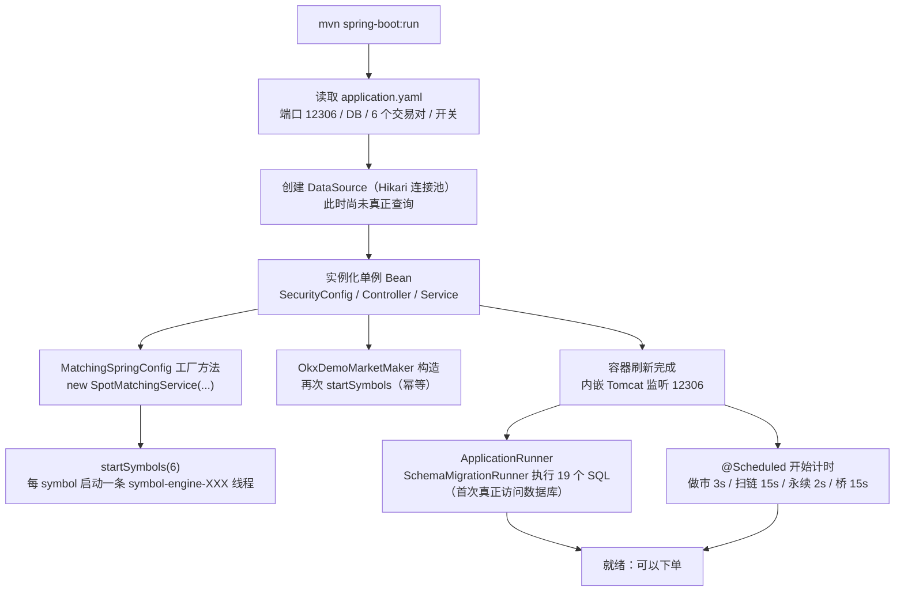
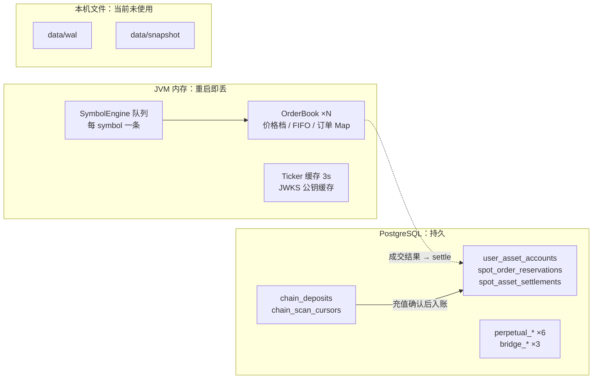

# 第 01 章 · 一个 Spring Boot 单体如何装下一家交易所：骨架与状态地图

> **所属大纲**：第 01 章（必读）
> **前置章节**：无
> **下游章节**：第 02 章（下单入口）、第 03 章（冻结与结算）、第 08 章（未接线的 WAL/Outbox）
> **证据基准**：当前工作区源码，2026-10-25 复核；行号以函数名为锚点，代码变动后请重新定位。

---

## 1. 本章导读

**业务场景**：你拿到源码，执行 `mvn spring-boot:run`，看到 6 个交易对同时可以挂单、盘口每 3 秒自己刷新、数据库里多出 28 张业务表。你会自然产生三个问题：这些线程是谁起的？表是谁建的？为什么下单后数据库里找不到订单？

**本章作用**：回答这三个问题，并交付一张后续每一章都要用到的"状态地图"——**哪些状态在 JVM 内存、哪些在 PostgreSQL、哪些在文件里但根本没启用**。

- **上游**：`application.yaml` 中的配置（端口、数据库、交易对、开关）。
- **本章输出**：一组带状态的单例 Bean（6 个 `SymbolEngine` 线程 + `OrderBook`）、一份已建好的数据库 schema、一组正在运行的定时任务。
- **下游**：第 02 章的下单入口直接操作这些 Bean 和表；第 03 章在 `user_asset_accounts` / `spot_order_reservations` 上做冻结结算。

**学习边界**：
- **必须理解**：Bean 装配顺序、`SymbolEngine` 线程从哪来、迁移的执行语义、内存与数据库的边界。
- **只需了解**：Spring Boot 自动配置细节、扫链/永续的具体业务（第 09、10 章）。
- **可以跳过**：前端工程、合约与 LayerZero 脚手架。

> **一句话定位**：如果本章这一环不存在，系统连"可以下单"的状态都到不了——没有 engine 就没有订单簿，没有迁移就没有余额表，后面所有业务都无从谈起。

---

## 2. 核心业务流程

### 2.1 启动时间线



> 顺序说明：端口在容器刷新阶段就已监听，迁移在随后执行的 `ApplicationRunner` 里完成；定时任务在容器刷新事件时开始计时。因此启动瞬间存在一个"端口已开、表还没建完、定时任务已开始计时"的窗口（属于 Spring Boot 框架行为，非本项目代码，标记为**合理推断**）。

### 2.2 状态分层



三层里只有中间一层是持久的；这正是第 08 章"重启会丢什么"的根源。

---

## 3. 核心代码拆解

### 3.1 启动入口：一个注解打开了所有定时任务

**业务目的**：让"撮合"之外的后台动作（演示做市、扫链、永续风控、桥状态轮询）随进程自动运行，不需要外部调度器。

**源码位置**：`src/main/java/com/zood/cex/YoutiaoCexApplication.java:7-10`

```java
@SpringBootApplication
@EnableScheduling
public class YoutiaoCexApplication {
    public static void main(String[] args) {
        SpringApplication.run(YoutiaoCexApplication.class, args);
    }
}
```

**执行过程**：
1. 标准 Spring Boot 启动，`@SpringBootApplication` 触发组件扫描（包根为 `com.zood.cex`）。
2. `@EnableScheduling` 注册 `ScheduledAnnotationBeanPostProcessor`，扫描所有 `@Scheduled` 方法；这些方法在容器刷新完成后开始按 `fixedDelay` 计时。
3. 启动阶段还会创建 `DataSource`（`spring-boot-starter-jdbc` + Hikari），并触发 `ApplicationRunner`。

**设计原因**：把"后台循环"放在同一个进程里，教学时只需启动一个 JVM 就能看到完整业务；代价是定时任务与 API 共享同一个 JVM，一个 RPC 卡顿会影响其他任务——所以配置里给调度池单独开了 6 个线程（`application.yaml:17`）。

> **必须理解**：`@EnableScheduling` 是本项目"链上扫链、做市、永续强平"能跑起来的前提。没有它，代码里的 `@Scheduled` 方法一个都不会执行。

### 3.2 配置即架构：默认值决定你能看到什么

**业务目的**：项目的"业务形态"几乎全部由 `application.yaml` 的默认值决定，读代码前先读配置，能少走很多弯路。

**源码位置**：`src/main/resources/application.yaml`

| 配置项 | 默认值 | 直接后果 | 相关章节 |
| :--- | :--- | :--- | :--- |
| `server.port` | `12306` | 前端代理与接口地址都指向这里 | 本章 |
| `spring.datasource.url` | 项目自带的 Supabase 测试库地址 | **不配环境变量时会连项目测试库**（能否连通取决于网络与库状态） | 本章 |
| `app.matching.engine.symbols` | 6 个交易对 | 启动即创建 6 个撮合线程与 6 个订单簿 | 本章、第 04 章 |
| `app.matching.engine.command-queue-size` | `100000` | 每个 symbol 队列上限；满了直接拒绝 | 第 04 章 |
| `app.matching.engine.command-timeout-ms` | `3000` | API 等待撮合结果的上限 | 第 04 章 |
| `app.matching.demo-market-maker.enabled` | `true` | 启动 1 秒后开始"造市"，盘口看起来始终有深度 | 第 07 章 |
| `app.chain-scanner.enabled` | `false` | 扫链 Bean 存在但每轮直接 return；真实充值不会入账 | 第 09 章 |
| `app.wal.dir` / `app.snapshot.dir` | `./data/...` | 目录配置存在，但主链路没有实例化 WAL（第 08 章） | 第 08 章 |

**关键片段**（`application.yaml:69-82`，节选）：

```yaml
app:
  matching:
    engine:
      symbols: ${MATCHING_SYMBOLS:BTC-USDT,ETH-USDT,SOL-USDT,TRX-USDT,LINK-USDT,USDC-USDT}
      command-queue-size: ${MATCHING_COMMAND_QUEUE_SIZE:100000}
      command-timeout-ms: ${MATCHING_COMMAND_TIMEOUT_MS:3000}
    demo-market-maker:
      enabled: ${DEMO_MARKET_MAKER_ENABLED:true}
```

**设计原因**：教学项目把"可观察性"放在第一位——默认开启做市，让空库也有盘口可看；默认关闭扫链，避免没有 RPC Key 时启动就报错。代价是"默认配置 ≠ 生产配置"，直接拿去部署会把测试网地址和演示行为一起带上去。

### 3.3 表结构从哪来：`SchemaMigrationRunner` 而不是 Flyway

**业务目的**：让仓库自包含——克隆代码、给一个空库，启动后自动得到完整的表结构，不依赖外部迁移工具。

**源码位置**：`src/main/java/com/zood/cex/config/SchemaMigrationRunner.java:31`（`run`）、`:60`（`compareMigrationFilenames`）、`:105`（`splitStatements`）

```java
// run() 核心循环（:44-58）
Arrays.sort(resources, Comparator.comparing(Resource::getFilename, SchemaMigrationRunner::compareMigrationFilenames));
for (Resource resource : resources) {
    String filename = resource.getFilename();
    if (filename == null || alreadyApplied(filename)) {
        continue;
    }
    String sql = resource.getContentAsString(StandardCharsets.UTF_8);
    for (String statement : splitStatements(sql)) {
        if (!statement.isBlank()) {
            jdbcTemplate.execute(statement);
        }
    }
    jdbcTemplate.update("insert into schema_migrations(version) values (?)", filename);
}
```

**执行过程**：
1. 先建 `schema_migrations(version, applied_at)`（`:36`）。
2. 扫描 `classpath:db/migration/*.sql`，用**数字主版本 + 字母后缀**排序（不是文件名字典序）。
3. 已记录的文件跳过（`alreadyApplied`，`:47`）。
4. 未记录的按 `;` 拆成单条语句，逐条 `jdbcTemplate.execute`。
5. 整个文件执行完，才把文件名写入 `schema_migrations`（`:56`）。

**为什么必须自己实现排序**：文件系统与 `String` 的字典序会把 `V10` 排在 `V2` 前面（`'1' < '2'`）。项目用 `V9a` 补丁 `V9`，又新增了 `V10`，字典序会得到 `V1, V10, V11, ..., V2, V3...` 这种灾难顺序。`SchemaMigrationRunnerTest` 就是专门锁这个行为的：

```java
// src/test/java/com/zood/cex/config/SchemaMigrationRunnerTest.java:10
void sortsNumericMigrationVersionsBeforeLexicographicNames() { ... }
```

**设计原因**：零外部依赖、SQL 可读、课堂上能直接改文件看效果。代价也很明显：**没有事务、没有 checksum、没有回滚**（见第 6 节黄色问题 1）。如果按字典序把 `V10` / `V13` 排在 `V9` 之前，`V10` 的 `comment on column ... wallet_scheme` 会直接报"列不存在"，因为 `wallet_scheme` 与 `encrypted_private_key` 是 `V9` 才 `alter table` 加上的（`V9__custodial_wallets_and_chain_scanner.sql:1-5`）。

### 3.4 撮合域如何装配：一个 `@Bean` 决定 6 条线程

**业务目的**：把"交易对"变成运行时的隔离单元——每个 symbol 一个订单簿、一条线程、一个队列。

**源码位置**：
- `src/main/java/com/zood/cex/matching/config/MatchingSpringConfig.java:16-29`
- `src/main/java/com/zood/cex/matching/service/SpotMatchingService.java:51-65`（构造）、`:147-153`（`startSymbols`）、`:174`（`computeIfAbsent`）、`:177-181`（`createRuntime`）
- `src/main/java/com/zood/cex/matching/engine/SymbolEngine.java:58-65`（构造并启动线程）

```java
// MatchingSpringConfig.java:16-28（节选）
@Bean
public SpotMatchingService spotMatchingService(
        @Value("${app.matching.engine.command-queue-size:100000}") int commandQueueSize,
        @Value("${app.matching.engine.command-timeout-ms:3000}") long commandTimeoutMs,
        @Value("${app.matching.engine.symbols:BTC-USDT,ETH-USDT,SOL-USDT}") String symbols,
        SpotSettlementGateway settlementGateway
) {
    SpotMatchingService service = new SpotMatchingService(
            commandQueueSize, Duration.ofMillis(commandTimeoutMs), settlementGateway);
    service.startSymbols(configuredSymbols(symbols));
    return service;
}
```

```java
// SpotMatchingService.java:177-181
private SymbolRuntime createRuntime(String symbol) {
    TradingPairMatchingService matchingService = new TradingPairMatchingService(symbol);
    SymbolEngine engine = new SymbolEngine(symbol, matchingService, commandQueueSize);
    return new SymbolRuntime(matchingService, engine);
}
```

```java
// SymbolEngine.java:63-64
this.worker = new Thread(this::runLoop, "symbol-engine-" + this.symbol);
this.worker.start();
```

**执行过程**：
1. Spring 调用 `@Bean` 方法，传入队列大小、超时、symbol 列表、结算网关。
2. `startSymbols` 对每个 symbol 调 `runtime()`；`computeIfAbsent` 触发 `createRuntime`。
3. `createRuntime` 里 `new TradingPairMatchingService(symbol)` 创建订单簿（无参构造 = Noop WAL + Noop 事件发布 + 无市商），再 `new SymbolEngine(...)`。
4. `SymbolEngine` 构造时直接 `new Thread(...).start()`，线程名形如 `symbol-engine-ETH-USDT`，循环从队列取任务。
5. 6 个 symbol → 6 条线程，随进程启动而存在，直到 `SpotMatchingService.close()`（`AutoCloseable`，容器关闭时由 Spring 调用）。

**设计原因**：
- **为什么用 `@Bean` 手写而不是 `@Component`**：需要在构造后立即执行 `startSymbols`，还要把 `SpotSettlementGateway` 显式传进去；用工厂方法最直观。
- **为什么线程在启动时就建**：避免"第一笔订单到来时才初始化"带来的首单延迟与并发初始化问题；代价是空转 6 条线程（可接受）。
- **副作用**：正因为这里是手写 `new TradingPairMatchingService(symbol)`，WAL、RabbitMQ 发布器、市商网关都**没有**被注入——这是第 08 章的核心结论，也是本章最容易被忽略的一行代码。

### 3.5 结算网关：一个接口把撮合域和账务域隔开

**业务目的**：撮合发生在内存、结算是数据库操作。用一个接口把两者解耦，使撮合代码不需要知道 JDBC，也让单元测试能用空实现。

**源码位置**：
- 接口：`src/main/java/com/zood/cex/matching/service/SpotSettlementGateway.java:8-11`
- 实现：`src/main/java/com/zood/cex/asset/service/SpotAssetSettlementService.java:22`（`implements SpotSettlementGateway`）
- 装配：`MatchingSpringConfig.java:16-20` 的 `SpotSettlementGateway settlementGateway` 参数

```java
public interface SpotSettlementGateway {
    void settle(MatchResult result, OrderLookup orderLookup);
    void release(Order order);

    @FunctionalInterface
    interface OrderLookup {
        Optional<Order> find(String symbol, long orderId);
    }
}
```

**执行过程**：
1. Spring 发现 `SpotAssetSettlementService` 是 `@Service` 且实现了该接口，于是把它注入 `@Bean` 方法。
2. `SpotMatchingService` 保存引用（`:64`），在 `submit` 成功后调用 `settle(...)`（`:77`），在撤单后调用 `release(...)`（`:98`）。
3. 接口里还定义了 `OrderLookup` 回调，让结算服务能按 `orderId` 反查订单——因为订单只存在内存里，结算必须回到撮合域取数据。

**设计原因**：如果让撮合服务直接依赖 `SpotAssetSettlementService`，撮合包就会拖上 Spring JDBC 和 SQL，单元测试也必须造数据库。用接口 + 回调（`this::findOrder`）后，`SpotMatchingServiceTest` 之类的纯内存测试可以继续用 `noop()`（`SpotMatchingServiceTest.java:76`）。

> **必须理解**：这个接口就是第 02 章与第 03 章的分界线——入口层调用 `reserve`，撮合层回调 `settle`，两者都不在对方包里。

### 3.6 定时任务：进程起来 1 秒后就开始"造市"

**业务目的**：空库也要有盘口和成交可看，否则教学演示第一步就卡住。

**源码位置**：
- `src/main/java/com/zood/cex/matching/marketmaker/OkxDemoMarketMaker.java:25-31`（注解）、`:43-55`（构造）、`:57-63`（`@Scheduled`）
- 扫链：`EvmChainDepositScanner.java:83`、`SolanaChainDepositScanner.java:65`、`TronChainDepositScanner.java:73`
- 永续：`PerpetualLifecycleScheduler.java:9-15`（条件注解）、`:24-28`（`@Scheduled`）
- 桥：`CrossChainBridgeService.java:214`

```java
// OkxDemoMarketMaker.java:25-31
@Component
@ConditionalOnProperty(
        prefix = "app.matching.demo-market-maker",
        name = "enabled",
        havingValue = "true",
        matchIfMissing = true
)
```

```java
// 构造末行（:53）——注意它在 Bean 创建阶段就执行
matchingService.startSymbols(this.markets.keySet());
```

**执行过程**：
1. 配置默认 `enabled=true`，Bean 被创建；构造时把做市覆盖的 symbol 也 `startSymbols` 一遍（`computeIfAbsent` 保证与 3.4 的 6 个 symbol 复用同一批 engine，不会重复建簿）。
2. 容器刷新完成后，`refresh()` 按 `fixedDelay=3000ms`、`initialDelay=1000ms` 开始执行：撤销上一轮挂单 → 按 OKX 报价挂 12 档 → 自成交一笔。
3. 三个扫链任务同样是 `@Scheduled`，但默认 `enabled=false`，方法第一行就 `return`，所以**不会发起任何 RPC**。
4. 永续调度器默认开启，每 2 秒遍历活跃合约；桥的轮询只处理 DB 中"在途"的转账，默认没有数据，等价于空转。

**设计原因**：把"演示数据"做成后台任务而不是种子数据，盘口会随外部行情变化，演示更真实；但这也意味着**你看到的深度与成交不是真实用户产生的**（第 07 章展开）。

### 3.7 安全骨架：无状态 JWT，而不是 Session

**业务目的**：交易所 API 天然面向多端（Web、可能的量化客户端），不能依赖 Cookie/Session；身份由 Supabase 签发，后端只验签。

**源码位置**：`src/main/java/com/zood/cex/auth/security/SecurityConfig.java:26-44`

```java
.csrf(AbstractHttpConfigurer::disable)
.sessionManagement(session -> session.sessionCreationPolicy(SessionCreationPolicy.STATELESS))
.authorizeHttpRequests(auth -> auth
        .requestMatchers(HttpMethod.OPTIONS, "/api/**").permitAll()
        .requestMatchers(HttpMethod.GET, "/api/health", "/api/market/**", "/api/auth/config").permitAll()
        .requestMatchers(HttpMethod.GET, "/api/perpetual/contracts", "/api/perpetual/ticker").permitAll()
        .requestMatchers(HttpMethod.GET, "/api/matching/engines").permitAll()
        .anyRequest().authenticated()
)
.addFilterBefore(supabaseAuthenticationFilter, UsernamePasswordAuthenticationFilter.class)
```

**执行过程**：
1. 所有 `/api/**` 先过 CORS（显式白名单，测试 `SecurityConfigTest` 锁定行为）。
2. `SupabaseAuthenticationFilter` 从 `Authorization: Bearer` 取 JWT，交给 `SupabaseJwtVerifier` 验签（RS256/ES256、iss、aud、exp、role）。
3. 放行清单里的 GET 无需登录；其余请求必须有合法身份，否则 401。
4. 校验通过后把 `SupabaseUserPrincipal`（`sub` = Supabase user id）放进 `SecurityContext`，控制器通过 `Authentication` 取用户。

**设计原因**：后端不存密码、不发 token，把身份外包给 Supabase；代价是**首次验签需要拉 JWKS**（`SupabaseJwtVerifier` 按 kid 缓存公钥，缓存未命中时走 HTTP），所以离线环境下登录态不可用。

### 3.8 状态地图（本章交付物）

**表结构规模**：19 个迁移文件共创建 **28 张业务表**（另有 `schema_migrations` 由 runner 自建）。但**不是每张表都在用**：

| 分类 | 数量 | 表 | 说明 |
| :--- | :--- | :--- | :--- |
| 运行中确实读写的 | 18 | `users`、`user_asset_accounts`、`hot_wallet_addresses`、`spot_order_reservations`、`spot_asset_settlements`、`chain_deposits`、`chain_scan_cursors`、`chain_scan_address_cursors`、`chain_tokens`、`perpetual_*`（6）、`cross_chain_bridge_routes`、`cross_chain_bridge_transfers`、`bridge_protocol_deployments` | 被运行中的 Bean 直接读写 |
| 仅被未装配代码引用 | 1 | `matching_order_events` | 只有 `PostgresOrderEventRepository` 引用，而它没有进主链路（第 08 章） |
| 完全没人引用 | 9 | `spot_orders`、`spot_trades`、`spot_order_events`、`outbox_events`、`market_maker_config`、`market_maker_quotes`、`external_orders`、`external_trades`、`market_maker_audit_logs` | 设计残留；读代码时不要去找写入方 |

> **读代码陷阱**：`V4__matching_outbox_events.sql` 创建的表叫 `outbox_events`（外加 `spot_order_events`），**没有** `matching_outbox_events` 这张表。按文件名搜表名会搜不到。

| 状态 | 存放位置 | 谁持有/写入 | 生命周期 |
| :--- | :--- | :--- | :--- |
| 订单与订单簿 | JVM：`OrderBook`（`SpotMatchingService` 内部的 `SymbolRuntime`） | `OrderBook.submit/cancel/match` | 随进程；重启即丢 |
| 撮合队列 | JVM：每个 `SymbolEngine.commandQueue` | `enqueueCommand` | 随进程 |
| Tick 行情缓存 | JVM：`PublicMarketTickerService.cache`，TTL 3 秒 | 按需刷新 | 3 秒 |
| 余额/冻结/成交 | PostgreSQL：`user_asset_accounts`、`spot_order_reservations`、`spot_asset_settlements` | `SpotAssetSettlementService` | 持久 |
| 充值/游标 | PostgreSQL：`chain_deposits`、`chain_scan_*` | Scanner + `ChainDepositService` | 持久 |
| WAL/快照 | 本机 `data/wal`、`data/snapshot` | 无（未接线） | 不存在 |

---

## 4. Web3 特有机制与风险提示

本章是纯链下装配，**没有任何合约调用、签名或交易提交**。与链相关的只有两点边界：

1. **链上能力默认是关闭的**。三个扫链 Bean 虽然被创建，但 `app.chain-scanner.enabled=false` 时方法第一行就返回（`EvmChainDepositScanner.java:85`、`SolanaChainDepositScanner.java:67`、`TronChainDepositScanner.java:75`），启动阶段不会发起任何 RPC。
2. **链上资产不会"同步"进内存**。所有余额读取都走 `user_asset_accounts`；链上交易只通过 `chain_deposits` 入账（第 09 章）。托管钱包私钥由后端 AES-256-GCM 加密后存 `hot_wallet_addresses`，启动阶段只创建加解密组件，不参与撮合或账务逻辑。

**值得注意的环境边界**：`application.yaml` 里数据库 URL、Supabase project ref、Infura key 都带默认值（指向项目自带的测试环境）。这意味着"启动成功"本身依赖外部网络与第三方库状态，而不是一个纯本地可复现的环境。学习时建议显式设置 `DB_URL` 等变量（配置项见 `application.yaml:22-27`），避免误连。

---

## 5. 本章小结与思考题

**本章完成了什么**：
- 把"进程启动"翻译成一串可验证的动作：配置 → DataSource → Bean → 6 条撮合线程 → 迁移 → 定时任务。
- 建立了贯穿全书的状态地图：**撮合在内存、账本在数据库、WAL 在文件但未启用**。

**最重要的调用链**：

```text
YoutiaoCexApplication.main
  → MatchingSpringConfig.spotMatchingService(:16)
  → new SpotMatchingService(...)(:51)
  → startSymbols(:151) → computeIfAbsent(:174) → createRuntime(:177)
  → new SymbolEngine(...)(:58) → new Thread(...).start()(:63-64)
  → SchemaMigrationRunner.run(:31) 执行 19 个 SQL
```

**状态变化**：无业务状态变化；本章产生的是"运行时空结构"（线程、订单簿、表）。

**与下游衔接**：第 02 章从这个结构出发，解释一次 `POST /api/orders` 如何找到对应 engine、先冻结再入队。

### 思考题

**Q1：为什么 6 个交易对的撮合线程在应用启动时就创建，而不是等第一笔订单到来再创建？这样做有什么代价？**

参考答案：`MatchingSpringConfig.spotMatchingService` 在 `@Bean` 方法里显式调用 `service.startSymbols(configuredSymbols(symbols))`（`MatchingSpringConfig.java:27`），`startSymbols` 对每个 symbol 调 `runtime()`，`computeIfAbsent` 触发 `createRuntime`（`SpotMatchingService.java:174-181`），构造 `SymbolEngine` 时直接启动线程（`SymbolEngine.java:63-64`）。好处是首单没有初始化延迟、线程创建发生在单线程的启动阶段（不存在并发初始化竞态）、`/api/matching/engines` 一开始就能看到全部分片。代价是即使没有交易也有 6 条线程空转占用栈与调度资源，且 symbol 列表变化必须重启进程（`startSymbols` 只在启动与做市构造时调用，运行中没有动态增删入口）。

**Q2：如果 `SchemaMigrationRunner` 在执行 `V14` 时，第一条 `create table` 成功、第二条失败，`schema_migrations` 会是什么状态？下次启动会怎样？**

参考答案：`run()` 是"逐个文件执行完所有语句后才插入版本记录"（`SchemaMigrationRunner.java:49-57`），且方法上没有 `@Transactional`，每条 `jdbcTemplate.execute` 各自提交。因此 `V14` 不会出现在 `schema_migrations` 里，但第一张表已经建好。下次启动会重新执行整个 `V14`；因为迁移普遍使用 `create table if not exists` / `create index if not exists`，通常能继续推进，但任何非幂等语句（如不带 `if not exists` 的 `alter table`）都会让迁移永久卡住，需要人工修库或补幂等判断。这也是第 6 节黄色问题 1 的具体后果。

---

## 6. 设计与实现问题提示

| 级别 | 问题 | 源码依据 | 影响 |
| :--- | :--- | :--- | :--- |
| 黄色 | 迁移无事务、版本记录在文件末尾 | `SchemaMigrationRunner.java:45-57`，类上无 `@Transactional` | 中途失败会留下"部分 DDL 已生效、版本未记录"的状态；依赖 `if not exists` 才能重跑 |
| 黄色 | 启动强依赖外部 PostgreSQL，且默认指向项目测试库 | `application.yaml:22-27` 的 `${DB_URL:jdbc:postgresql://db.znxjbcjpe...}` | 无网/无权时应用起不来；本地复现需显式覆盖环境变量 |
| 黄色 | 端口先监听、迁移后执行，定时任务同时开始计时 | `SchemaMigrationRunner` 是 `ApplicationRunner`；`application.yaml:17` 调度池 6 线程 | 启动瞬间可能出现"接口可访问但表不存在"或"做市先于建表"的窗口（框架行为，合理推断），排障时容易误判 |
| 绿色 | 19 个迁移、28 张业务表，只有 18 张在跑 | 见 3.8 表；`spot_orders`/`spot_trades`/`outbox_events` 等 9 张零引用 | 读代码时不要寻找不存在的写入方；也说明项目"设计过、未实现完" |
| 绿色 | 撮合服务用 `@Bean` 手工装配，导致 WAL/事件/市商未接线 | `SpotMatchingService.java:177-181` 调无参构造 | 决定了第 08 章的全部结论；想补 WAL 只需改这一处 |
| 绿色 | 种子用户 `provider='demo'`，与 Supabase 用户隔离 | `V6__seed_demo_data.sql`（文首插入两条 `demo` 用户）；鉴权按 `provider='supabase'` 查用户（`ChainDepositService.java:312` 起） | 登录后看不到种子余额，容易误判"充值没到账"；种子数据主要用于看表结构与演示做市 |

本章未发现红色级别（核心资金安全/关键权限）问题；这不代表已完成安全审计。

---

## 7. 下一章

第 02 章从这里继续：用户点击"买入"后，`MatchingController` 如何完成鉴权、参数校验、市价买估算、冻结，并把订单交给本章创建的 `SymbolEngine`。

---

### 修订记录

| 日期 | 变更 |
| :--- | :--- |
| 2026-10-25 | 首版：基于当前源码复核启动装配、迁移语义与表使用情况；修正大纲/索引中 `matching_outbox_events` 的表名错误（实际为 `outbox_events`） |
