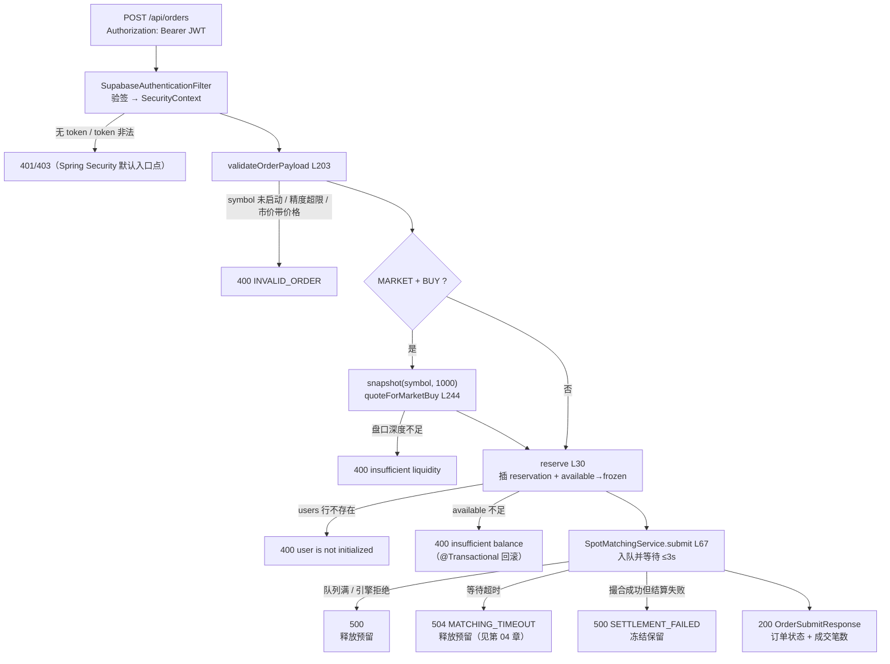

# 第 02 章 · 用户点"买入"之后：鉴权、校验、冻结估算与提交

> **所属大纲**：第 02 章（必读）
> **前置章节**：第 01 章（engine、数据库表已就绪）
> **下游章节**：第 03 章（成交后的结算）、第 04 章（队列、超时与幂等）、第 07 章（外部流动性）
> **证据基准**：当前工作区源码，2026-10-25 复核；行号以函数名为锚点。

---

## 1. 本章导读

**业务场景**：用户在 `/trade` 页面填好价格和数量，点下"买入"。几毫秒后，他要么看到"已成交 / 挂单中 / 拒绝"，要么看到余额被冻结。中间发生了什么？

**本章作用**：把"HTTP 请求"翻译成"内部命令 + 已冻结资金"。这是全项目唯一同时接触**身份、参数、资金、撮合队列**的环节，也是后面三章（结算、队列、撮合算法）共同的起点。

- **上游**：第 01 章创建的 6 个 `SymbolEngine`、`user_asset_accounts`、`spot_order_reservations`。
- **本章输出**：一条 `OrderRequest`（含服务端生成的 `clientOrderId`）、一条 `OPEN` 的冻结预留、以及一次进入 symbol 队列的撮合调用。
- **下游**：第 03 章消费成交结果做结算；第 04 章解释这条命令在队列里如何被串行执行、超时如何表现；第 07 章处理"内部簿吃不下"的剩余量。

**学习边界**：
- **必须理解**：冻结金额怎么算、为什么冻结必须在撮合之前、几类失败路径分别留下什么状态、HTTP 层能表达和不能表达哪些订单类型。
- **只需了解**：JWT 验签的具体算法、前端表单校验。
- **可以跳过**：Supabase OAuth 登录流程、CORS 细节。

> **一句话定位**：如果这一环不存在，撮合引擎永远收不到订单，资金也不会被锁定——后面所有成交都无从发生。

---

## 2. 核心业务流程



**冻结金额的三个公式**（`SpotAssetSettlementService.reservationAmount:274-285`）：

| 方向 / 类型 | 冻结什么 | 冻结多少 | 依据 |
| :--- | :--- | :--- | :--- |
| 卖单（不限类型） | base 资产 | `quantity` | `:275-277` |
| 限价买 | quote 资产 | `price × quantity` | `:278-280` |
| 市价买 | quote 资产 | 按盘口 1000 档估算的 `quote` | `:281-284` |

---

## 3. 核心代码拆解

### 3.1 鉴权：先确认"你是谁"，再谈订单

**业务目的**：交易所的每个写操作都必须绑定到确定的主体；订单的 `userId` 必须来自可信 token，而不是请求体。

**源码位置**：
- `src/main/java/com/zood/cex/auth/security/SupabaseAuthenticationFilter.java:23-39`
- `src/main/java/com/zood/cex/auth/security/SupabaseJwtVerifier.java:49`
- `src/main/java/com/zood/cex/auth/security/SecurityConfig.java:36-41`
- `src/main/java/com/zood/cex/matching/controller/MatchingController.java:279-284`

```java
// SupabaseAuthenticationFilter.java:26-38
if (authorization != null && authorization.startsWith("Bearer ")) {
    try {
        SupabaseUserPrincipal principal = verifier.verify(authorization.substring("Bearer ".length()));
        UsernamePasswordAuthenticationToken authentication = new UsernamePasswordAuthenticationToken(
                principal, null, List.of(new SimpleGrantedAuthority("ROLE_" + principal.role().toUpperCase())));
        SecurityContextHolder.getContext().setAuthentication(authentication);
    } catch (RuntimeException exception) {
        SecurityContextHolder.clearContext();
    }
}
filterChain.doFilter(request, response);
```

**执行过程**：
1. 过滤器只处理带 `Authorization: Bearer ` 的请求；没有就什么都不做，继续往下走。
2. 验签失败（格式、算法、iss、aud、exp、签名、role 任一不合法）时**静默清空** `SecurityContext`，不直接返回错误。
3. 继续执行过滤链，最终由 `SecurityConfig` 的 `.anyRequest().authenticated()` 拒绝。具体状态码取决于 Spring Security 的默认 `AuthenticationEntryPoint`（本项目没有显式配置），可能是 401 或 403——标记为**待验证**。
4. 控制器调用 `authenticatedUserId(authentication)` 取 `principal.userId()`（即 JWT 的 `sub`，Supabase 用户 UUID）；取不到则抛 `ResponseStatusException(401)`。

**设计原因**：把"验签"和"授权决策"分层——过滤器只负责识别身份，是否放行交给 `SecurityConfig` 的规则。这样新增公开接口只需改放行清单，不必改过滤器。

> **必须理解**：订单归属只认 token 里的 `sub`。`SubmitOrderPayload` 里虽然有个 `userId` 字段（`:315-323`），但控制器从未读取它（全文件只有 `order.userId()` 出现在响应与校验里，见 `:269`、`:393`）。客户端伪造 `userId` 不会生效。

### 3.2 请求体：HTTP 层能表达什么、不能表达什么

**业务目的**：把外部 JSON 收敛成引擎认识的 `OrderRequest`，并补上引擎需要、但客户端不该决定的信息（订单号、时效）。

**源码位置**：`MatchingController.submitOrder:109-124`、`SubmitOrderPayload:315-323`

```java
// :111-123（节选）
String userId = authenticatedUserId(authentication);
OrderType type = payload.type();
String clientOrderId = "web-" + UUID.randomUUID();
OrderRequest request = new OrderRequest(
        clientOrderId,
        userId,
        payload.symbol(),
        payload.side(),
        type,
        type == OrderType.LIMIT ? OrderTimeInForce.GTC : OrderTimeInForce.IOC,
        type == OrderType.MARKET ? null : payload.price(),
        payload.quantity(),
        Boolean.TRUE.equals(payload.allowExternalLiquidity())
);
```

这里有三个必须记住的事实：

1. **`clientOrderId` 由服务端生成**（`:113`）。HTTP 请求体里没有这个字段，客户端拿不到"重试同一个订单号"的能力——引擎层虽然支持幂等（第 04 章），但 REST 入口没有暴露它。
2. **时效被硬编码**（`:121`）：限价单只能是 `GTC`，市价单只能是 `IOC`。`FOK`、`POST_ONLY`、限价 `IOC` 这三种引擎能力**无法通过 HTTP 触发**，只能在测试或直接调用服务时出现（第 05 章会讲它们的语义）。
3. **`allowExternalLiquidity` 的默认值是 `false`**（`:123` 的 `Boolean.TRUE.equals(...)`）。注意：`OrderRequest` 自身对市价单/IOC/FOK 默认是 `true`（`OrderRequest.java:100-102`），但控制器在传参前把 `null` 变成了 `false`，所以**只要客户端不显式传 `true`，HTTP 订单就不会回落到引擎按类型推导的默认值**。更关键的是：市商网关为 `null` 时，`TradingPairMatchingService.submit` 会调用 `request.withoutExternalLiquidity()` 把该字段**强制改成 `false`**（`TradingPairMatchingService.java:83`、`OrderRequest.java:88-90`），所以当前运行时即使客户端传 `true` 也不会进入外部流动性分支。

**设计原因**：把"客户端不该决定的"统一收口到服务端，避免前端构造出引擎无法安全处理的组合（例如市价 + POST_ONLY）。代价是 API 表达力受限——想支持 FOK 必须扩展请求体。

### 3.3 入口校验：在花钱之前先挡掉明显错误

**业务目的**：把无效请求挡在冻结与撮合之外，避免"先占资源再失败"。

**源码位置**：`validateOrderPayload:203-227`、`validateDecimal:229-242`

```java
// :203-227（节选）
String symbol = payload.symbol().trim().toUpperCase();
boolean supported = matchingService.engineStats().stream().anyMatch(stats -> stats.symbol().equals(symbol));
if (!supported) {
    throw new IllegalArgumentException("unsupported symbol: " + symbol);
}
if (payload.side() == null) { throw new IllegalArgumentException("side is required"); }
if (payload.type() == null) { throw new IllegalArgumentException("type is required"); }
validateDecimal(payload.quantity(), "quantity", true);
if (payload.type() == OrderType.LIMIT) {
    validateDecimal(payload.price(), "price", true);
} else if (payload.price() != null) {
    throw new IllegalArgumentException("market order price must be omitted");
}
```

```java
// :229-242
if (value.signum() <= 0) { throw new IllegalArgumentException(field + " must be positive"); }
if (value.scale() > 12 || value.precision() > 24) {
    throw new IllegalArgumentException(field + " precision is too large");
}
```

**执行过程**：
1. symbol 必须是**已经启动的 engine**（`engineStats()` 返回的就是第 01 章创建的 6 个分片）；大小写不敏感。
2. `side` / `type` 必填。
3. 数量必须为正；限价单价格必须为正；市价单**不允许**带价格。
4. 数字上限：小数位 ≤ 12、总有效位 ≤ 24。
5. 通过后再交给 `OrderRequest` 的紧凑构造器（`OrderRequest.java:21-48`）做二次校验（它还会把 symbol 转大写、补默认时效）。

**设计原因**：控制器做"面向 HTTP 的校验"（必填、拒绝市价带价格），`OrderRequest` 做"面向领域的不变量"（数量/价格为正、市价不能 POST_ONLY）。两层都保留，是因为引擎还可能被非 HTTP 路径调用。

> **注意**：这里没有**最小变动价位（tick size）**和**最小下单量（lot size）**校验。任意 12 位小数的价格都会进入订单簿，成为独立价格档——这是第 05 章"跳表档位数"讨论的前提，也是与真实交易所的主要差距之一。

### 3.4 市价买为什么要先"估算"：`quoteForMarketBuy`

**业务目的**：市价买没有价格，无法直接算 `price × quantity`。必须先知道"大概要花多少 quote"，才能冻结。

**源码位置**：`quoteForMarketBuy:244-259`，调用点 `:126-128`

```java
// :244-259（节选）
BigDecimal remaining = quantity;
BigDecimal quote = BigDecimal.ZERO;
for (BookLevel ask : snapshot.asks()) {
    if (remaining.signum() == 0) { break; }
    BigDecimal filled = ask.quantity().min(remaining);
    quote = quote.add(ask.price().multiply(filled));
    remaining = remaining.subtract(filled);
}
if (remaining.signum() > 0) {
    throw new IllegalArgumentException("market buy has insufficient sell-side liquidity");
}
return quote;
```

**执行过程**：
1. 只有 `type == MARKET && side == BUY` 才估算（`:126`）。
2. 先 `matchingService.snapshot(symbol, 1000)` 取卖盘前 1000 档。
3. 逐档吃到数量耗尽，累加 `price × filled` 得到 quote。
4. 如果 1000 档吃完仍不够，直接 400，**不冻结、不入队**。

**设计原因**：冻结必须覆盖最坏成交成本，否则结算时会"钱不够"。用盘口快照估算是最直观的做法；代价是**它和真正的撮合是两条队列命令**（`snapshot:114` 与 `submit:67`），中间可能被别的订单吃掉深度，导致实际成本高于估算——结算时会抛 "trade cost exceeds reserved quote balance"（第 03 章详述）。

> **注意**：市价**卖**不估算（储备的是 base 数量），但卖出后如果买单不足，剩余量会被取消并解冻（`OrderBook.java:109-118` + 结算的终态释放），这属于正常路径。

### 3.5 冻结：先写预留，再改余额

**业务目的**：把"这笔钱已经被这笔订单占用"记录成可审计的事实，并原子地把 `available` 划到 `frozen`。

**源码位置**：`SpotAssetSettlementService.reserve:29-91`

```java
// :30-39（节选）
Long userId = internalUserId(providerUserId);
if (userId == null) {
    throw new IllegalArgumentException("authenticated user is not initialized");
}
TradingPair pair = tradingPair(request.symbol());
AssetLocation lockedAsset = request.side() == Side.SELL
        ? assetLocation(pair.baseAsset())
        : assetLocation(pair.quoteAsset());
BigDecimal lockedAmount = reservationAmount(request, marketBuyQuote);
```

```java
// :68-90（节选）
ensureAccount(userId, lockedAsset);
int updated = jdbcTemplate.update("""
        update user_asset_accounts
           set available = available - ?, frozen = frozen + ?, updated_at = now()
         where user_id = ? and asset = ? and chain = ? and network = ? and available >= ?
        """, lockedAmount, lockedAmount, userId, ...);
if (updated != 1) {
    throw new IllegalArgumentException("insufficient " + lockedAsset.asset() + " available balance");
}
```

**执行过程**（顺序很关键）：
1. 用 `provider_user_id` 查内部 `users.user_id`；查不到直接 400（见第 6 节黄色问题 1）。
2. 解析交易对 `BASE-QUOTE`，决定锁哪个资产：卖锁 base，买锁 quote。
3. 先 `insert into spot_order_reservations ... status='OPEN'`（`:42-63`），带 `on conflict(user_id, client_order_id) do nothing`。
4. 若预留已存在（同一用户同一 clientOrderId），直接返回，不重复冻结（`:64-66`）——HTTP 层每次都是新 UUID，所以这条分支实际很少走。
5. `ensureAccount` 保证余额行存在（`:538-549`），再执行**带 `available >= ?` 条件的 UPDATE**。
6. 影响行数为 0 → 抛 `IllegalArgumentException`；`@Transactional` 让第 3 步的预留插入一起回滚，不会留下"有预留、没冻结"的脏数据。

**设计原因**：
- **为什么先插预留再改余额**：预留行是业务事实（订单要占用多少钱），余额是账户事实；先写业务事实、再用条件更新扣钱，失败时整体回滚。这样即使并发，也只有一个事务能扣成功（`available >= ?` 是数据库层的原子判断）。
- **为什么用条件更新而不是"先查再改"**：`select` 与 `update` 之间可能被其他事务插入，条件更新把"检查 + 扣减"合并成一条原子语句。
- **`assetLocation` 的硬编码**（`:559-565`）：`SOL → SOLANA/DEVNET`、`TRX → TRON/NILE`、**其余全部 → EVM/SEPOLIA**。所以 `BTC-USDT` 冻结的是 `EVM/SEPOLIA` 上名为 BTC 的余额行，与真实 BTC 链无关（第 09 章）。

### 3.6 提交与失败处理：四类失败，四种资金结局

**业务目的**：撮合可能成功、可能失败、可能"做了但没来得及告诉你"。入口层必须为每种情况决定**冻结资金是退还是留**。

**源码位置**：`MatchingController.submitOrder:129-138`、`SpotMatchingService.submit:67-85`、异常处理器 `:292-306`

```java
// :129-138
assetSettlementService.reserve(userId, request, marketBuyQuote);
try {
    MatchResult result = matchingService.submit(request);
    return OrderSubmitResponse.from(result);
} catch (SpotSettlementException exception) {
    throw exception;
} catch (RuntimeException exception) {
    assetSettlementService.releaseReservation(userId, clientOrderId);
    throw exception;
}
```

| 失败点 | 异常类型 | 冻结资金 | HTTP 响应 |
| :--- | :--- | :--- | :--- |
| 参数/余额/用户不存在 | `IllegalArgumentException` | 未冻结或事务回滚 | 400 `INVALID_ORDER` |
| 队列满 / 引擎返回 rejected | `IllegalStateException` | **释放**（`catch RuntimeException`） | 500（无专用处理器） |
| 等撮合结果超时 | `MatchingCommandTimeoutException` | **释放** | 504 `MATCHING_TIMEOUT` |
| 撮合成功但结算失败 | `SpotSettlementException` | **保留**（专门 rethrow，不释放） | 500 `SETTLEMENT_FAILED` |

**设计原因**：
- 结算失败时保留冻结，是为了让"已成交但账没算完"有据可查，等待人工/补偿（`SpotMatchingService.java:79-82` 的异常信息写得很明确）。
- 其他失败释放冻结，保证用户不会因为一次失败请求永久损失可用余额。
- 但**超时**这一类有个陷阱：释放冻结发生在客户端，而命令可能仍在队列里继续执行（`future.cancel(false)` 不阻止任务运行）。第 04 章会展开；本章第 6 节先把它标记为风险。

### 3.7 响应：客户端能拿到什么

**业务目的**：让客户端立即知道"订单现在是什么状态、成交了几笔"，而不必再查一次。

**源码位置**：`OrderSubmitResponse:365-373`、`OrderResponse:375-405`

```json
{
  "order": {
    "orderId": 1024,
    "clientOrderId": "web-7f3c...",
    "symbol": "ETH-USDT",
    "side": "BUY",
    "type": "LIMIT",
    "price": "3000.00",
    "quantity": "1.5",
    "filledQuantity": "0.5",
    "remainingQuantity": "1.0",
    "status": "PARTIALLY_FILLED",
    "createdAt": "2026-10-25T09:00:00Z"
  },
  "internalTrades": 1,
  "externalExecutions": 0
}
```

- `status` 来自引擎的 `OrderStatus`（11 个枚举值，`OrderStatus.java:3-15`）。REST 入口可达的是 `NEW`（挂单）、`PARTIALLY_FILLED`、`FILLED`、`CANCELED`（市价/IOC 剩余）；`REJECTED` 需要 `POST_ONLY`/`FOK` 预检失败，而这两种时效无法从 HTTP 传入（见 3.2）。
- `internalTrades` 是本次撮合产生的成交笔数。
- `externalExecutions` 当前恒为 0：市商网关没有装配（第 07、08 章）。

---

## 4. Web3 特有机制与风险提示

本章**没有任何链上交互**：不签名、不发交易、不读 RPC。但它划定了两个容易混淆的边界：

1. **身份来自 Supabase，不来自钱包**。`sub` 是 Supabase 用户 UUID，不是以太坊地址；本项目没有"连接钱包签名登录"的能力。托管钱包地址是后端生成的收款地址，与登录身份无关。
2. **冻结的是数据库余额，不是链上资产**。`reserve` 只改 `user_asset_accounts`，链上资产仍留在托管地址里（第 09 章才讨论充值入账）。所以"下单冻结"在链上没有任何对应交易。

**值得注意的资产边界**：`assetLocation` 把除 SOL/TRX 外的所有资产都映射到 `EVM/SEPOLIA`（`:559-565`）。这意味着冻结 `BTC-USDT` 的 BTC 时，实际操作的是 `(BTC, EVM, SEPOLIA)` 这一行——资产是账本标签，不是链上事实。

---

## 5. 本章小结与思考题

**本章完成了什么**：把一个带 JWT 的 HTTP 请求，变成一条已冻结资金的内部订单命令。

**最重要的调用链**：

```text
POST /api/orders
  → SupabaseAuthenticationFilter(:23) → SupabaseJwtVerifier.verify(:49)
  → MatchingController.submitOrder(:109)
      → validateOrderPayload(:203) / validateDecimal(:229)
      → [MARKET+BUY] snapshot(:114) → quoteForMarketBuy(:244)
      → SpotAssetSettlementService.reserve(:30)
          → insert spot_order_reservations(:42-63)
          → update user_asset_accounts ... available >= ?(:69-87)
      → SpotMatchingService.submit(:67) → SymbolEngine 队列
      → OrderSubmitResponse(:365)
```

**状态变化**：
- `spot_order_reservations` 新增一行 `OPEN`，记录锁定资产与金额；
- `user_asset_accounts`：`available` 减少、`frozen` 增加；
- 内存中新增一条订单（第 04、05 章展开）。

**与上下游衔接**：第 03 章从"这笔冻结怎么被扣掉/退回"继续；第 04 章解释 `submit` 里那 3 秒等待、队列与超时。

### 思考题

**Q1：为什么必须先冻结、再提交撮合？如果反过来（先撮合成功、再冻结）会怎样？**

参考答案：撮合在内存中完成，无法像数据库那样回滚；如果先撮合再冻结，一旦冻结失败（余额不足），成交已经发生且无法撤销：卖方资产已按成交划出，买方却扣不到钱，只能由平台垫付或人工冲正，账实必然不一致。当前顺序（`MatchingController.java:129` 在 `:131` 之前）保证"钱先被锁住"，撮合阶段最坏也只是"锁了钱但没成交"，可以通过撤单/解冻恢复。冻结本身用 `update ... where available >= ?` 的原子条件更新（`SpotAssetSettlementService.java:69-87`），避免了并发下的超扣。

**Q2：为什么通过 HTTP 下不出 `FOK` 或 `POST_ONLY` 订单？如果确实需要，现有代码从哪里能触发？**

参考答案：`SubmitOrderPayload`（`MatchingController.java:315-323`）没有 `timeInForce` 字段，控制器把时效写死为"限价→GTC、市价→IOC"（`:121`）。因此 REST 层只能表达这两种组合。要触发 `FOK` / `POST_ONLY` / 限价 `IOC`，只能绕过控制器直接调用 `SpotMatchingService.submit` 或 `TradingPairMatchingService.submit`（单元测试就是这么做的，见 `OrderBookTest` 的 `fok/postOnly/ioc` 用例），或者修改请求体与控制器映射。这也是"引擎能力 > API 能力"的典型例子。

---

## 6. 设计与实现问题提示

| 级别 | 问题 | 源码依据 | 影响 |
| :--- | :--- | :--- | :--- |
| 黄色 | 新用户直接下单会 400：`users` 行不存在 | `reserve:32-35` 抛 "authenticated user is not initialized"；创建用户只发生在 `ChainDepositService.ensureUser:312`（资产页/钱包 bootstrap） | 前端登录后会调 `bootstrapWallets`（`web/src/pages/auth-callback.tsx:20`），所以页面可用；但纯 API 客户端首次下单会失败，且错误信息不直观 |
| 黄色 | 超时会释放冻结，但命令可能已经执行 | `SpotMatchingService.await:198` 的 `future.cancel(false)`；`MatchingController:135-137` 的 `catch (RuntimeException)` 释放 | 可能出现"已成交但结算没跑、预留已退"的账实不一致；需故障注入验证最终状态（第 04 章展开） |
| 黄色 | 市价买"先估后买"存在竞态 | `MatchingController:127` 的 snapshot 与 `:131` 的 submit 是两条队列命令；`settleOrder:352-354` 在成本超出预留时抛错 | 深度被抢走时市价买会 500 且冻结保留；属于"估算式冻结"的固有代价 |
| 绿色（升级风险） | `allowExternalLiquidity` 字段当前被服务层强制关闭，但接线市商后会变成客户端可控的真实开关 | `TradingPairMatchingService.java:83` 在 gateway 为 null 时调用 `withoutExternalLiquidity()`；接线后 `OrderBook:113-114` 才会进入外部路由 | 当前运行时不进入该分支，因此不存在"卡在 `ROUTING_EXTERNAL`"；但未来若接入市商，需重新评估该字段的权限与失败处理（第 07 章） |
| 绿色 | 无 tick size / lot size，只校验上限 | `validateDecimal:229-242`（scale ≤ 12、precision ≤ 24），无最小价格步长 | 任意小数价格都会生成新的跳表价格档，档位膨胀；真实交易所会先做精度归一 |
| 绿色 | API 无客户端幂等键，且 `payload.userId` 是无用字段 | `:113` 每次生成 `web-UUID`；`payload.userId` 全文件未被读取 | 网络重试会变成两笔真实订单；`userId` 字段容易让调用方误以为可以代下单（实际以 JWT 为准） |

本章未发现红色级别问题；第 2 条（超时释放）在真实故障下会影响资金一致性，建议按红色预案对待。这不是完整安全审计。

---

## 7. 下一章

第 03 章接着回答：这笔 `OPEN` 预留和成交结果，如何变成 `available/frozen` 的最终数字？`settle` 为什么对 taker 和 maker 各调用一次？结算失败时资金停在哪里？

---

### 修订记录

| 日期 | 变更 |
| :--- | :--- |
| 2026-10-25 | 首版：复核下单入口、校验、市价买估算、冻结与四类失败的资金处理；记录新用户初始化前提与 HTTP 时效硬编码 |
| 2026-10-25 | 修正：市商网关为 null 时 `withoutExternalLiquidity()` 会强制关闭外部流动性，原"卡在 ROUTING_EXTERNAL"结论不成立，改为升级风险 |
