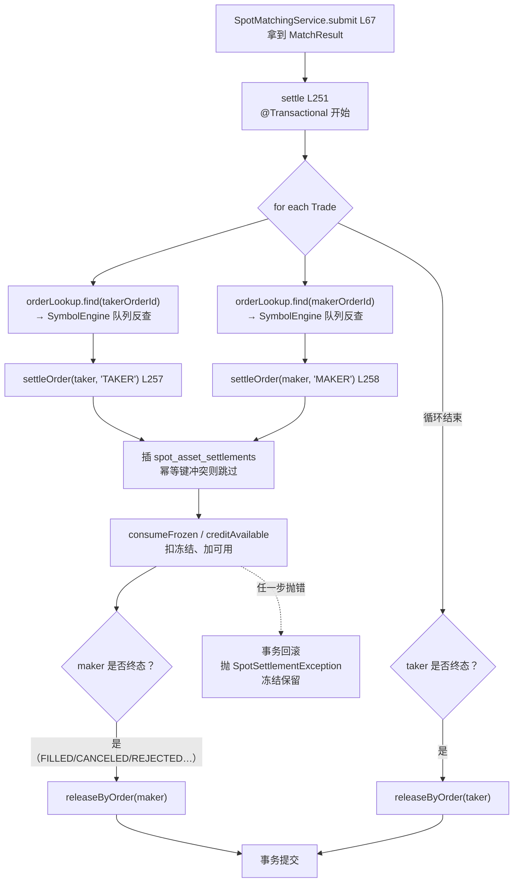

# 第 03 章 · 钱怎么被锁住、怎么结清：reserve / settle / release

> **所属大纲**：第 03 章（必读，核心）
> **前置章节**：第 02 章（下单入口完成冻结）
> **下游章节**：第 05 章（成交结果从哪来）、第 06 章（撤单与状态机）、第 08 章（重启后冻结怎么办）
> **证据基准**：当前工作区源码，2026-10-25 复核。

---

## 1. 本章导读

**业务场景**：同一时刻，用户 A 的买单和用户 B 的卖单在内存里成交了。撮合引擎只知道自己"配对成功"，它不碰数据库、也不改余额。真正让 A 的 USDT 变少、ETH 变多，让 B 相反的，是紧随其后的 `settle`。

**本章作用**：讲清交易所账务的三件事——**冻结（reserve）、结算（settle）、解冻（release）**，以及它们如何用三张表保证"钱不会凭空多、也不会凭空少"。

- **上游**：第 02 章写入的 `OPEN` 预留（`spot_order_reservations`）、第 05 章产生的 `MatchResult`（含 `Trade` 列表与 taker 订单）。
- **本章输出**：`spot_asset_settlements` 的成交流水、`user_asset_accounts` 的最终余额、`spot_order_reservations` 的消费/释放状态。
- **下游**：第 06 章的资产页/订单查询直接读这些表；第 08 章讨论"结算失败或进程崩溃后，冻结的钱停在哪"。

**学习边界**：
- **必须理解**：为什么一笔成交要结算两次、结算幂等键怎么构造、条件更新如何防超扣、结算失败为什么保留冻结。
- **只需了解**：`tradingActivity` 的四段查询 SQL、手续费（本项目没有）。
- **可以跳过**：读写放大与索引细节（只在本章末尾作为性能提示）。

> **一句话定位**：如果这一环不存在，撮合就只是内存里的数字游戏——订单状态会变，但用户余额永远不动，交易所也就没有"资产"可言。

---

## 2. 核心业务流程

### 2.1 结算调用链



### 2.2 一笔成交的账务示例（限价买 vs 限价卖）

场景：taker 以 3000 USDT 的限价买 1 ETH；对手盘 maker 的卖单价是 2990。

| 步骤 | 账户 | 变化 | 依据 |
| :--- | :--- | :--- | :--- |
| 下单冻结 | taker | USDT `available -3000`，`frozen +3000` | 第 02 章 `reserve` |
| 成交 | 成交价取 maker 价 = 2990 | — | `OrderBook.java:229` |
| taker 结算 | taker | `frozen -3000`、`available +10`（价格改善）、`available +1 ETH` | `settleOrder:347-358` |
| maker 结算 | maker | `frozen -1 ETH`、`available +2990 USDT` | `settleOrder:343-345` |
| 双方终态 | 双方 | 预留 `remaining_amount = 0`，状态 `RELEASED` | `releaseInternal:480-491` |

净效果：taker 用 2990 买到 1 ETH（省下的 10 退回可用）；maker 卖出 1 ETH 得到 2990。**冻结时按限价锁 3000，结算时按成交价扣 2990**，差价必须退回，否则用户会"多付"。

---

## 3. 核心代码拆解

### 3.1 三张表与三个入口：账务域的全部对外能力

**业务目的**：用尽量少的表和入口表达"钱被占用 → 钱被花掉 → 钱被退回"这一套生命周期。

**源码位置**：
- 表结构：`src/main/resources/db/migration/V14__spot_asset_settlement.sql:1-42`
- 入口：`src/main/java/com/zood/cex/asset/service/SpotAssetSettlementService.java:30`（`reserve`）、`:251`（`settle`）、`:270`（`release`）、`:94`（`releaseReservation`）

```sql
-- V14:1-21（节选）
create table if not exists public.spot_order_reservations (
    id bigserial primary key,
    user_id bigint not null references public.users(user_id),
    client_order_id text not null,
    symbol text not null,
    locked_asset text not null,
    reserved_amount numeric(38, 18) not null check (reserved_amount > 0),
    remaining_amount numeric(38, 18) not null check (remaining_amount >= 0 and remaining_amount <= reserved_amount),
    status text not null default 'OPEN' check (status in ('OPEN', 'RELEASED')),
    ...
    unique (user_id, client_order_id)
);
```

| 表 | 角色 | 关键约束 |
| :--- | :--- | :--- |
| `spot_order_reservations` | 每笔订单"占用了多少钱"的凭证 | `(user_id, client_order_id)` 唯一；`reserved_amount > 0`；`remaining_amount` 只能递减 |
| `spot_asset_settlements` | 成交流水（只插不改） | `settlement_key` 主键（幂等键）；`base_delta <> 0`、`quote_delta <> 0` |
| `user_asset_accounts` | 最终余额 | 主键 `(user_id, asset, chain, network)`；`available/frozen >= 0` 两个 check |

**设计原因**：把"占用"和"成交"拆成两张表，而不是在订单表上记一个 `frozen` 字段。这样：
- 每笔订单的冻结金额、已消耗金额都可独立追踪（`remaining_amount`）；
- 成交流水只追加，可用于对账、重放、资产页明细；
- 订单本身可以留在内存（第 01 章），账务事实留在数据库。

> **必须理解**：`status` 只有 `OPEN` / `RELEASED` 两个值，**没有"部分释放"状态**。部分成交靠 `remaining_amount` 递减表达，"剩余全部退回"发生在订单进入终态时（`releaseInternal`）。

### 3.2 `settle`：为什么一笔成交要结算两次

**业务目的**：成交是双方的事。一笔 `Trade` 同时改变买方和卖方的资产，而这两方各有自己的预留、自己的账户行，必须分别记账。

**源码位置**：`settle:249-266`

```java
// :251-265
public void settle(MatchResult result, OrderLookup orderLookup) {
    for (Trade trade : result.trades()) {
        Order taker = orderLookup.find(trade.symbol(), trade.takerOrderId())
                .orElseThrow(() -> new IllegalStateException("taker order is missing during settlement"));
        Order maker = orderLookup.find(trade.symbol(), trade.makerOrderId())
                .orElseThrow(() -> new IllegalStateException("maker order is missing during settlement"));
        settleOrder(trade, taker, maker, taker, "TAKER");
        settleOrder(trade, taker, maker, maker, "MAKER");
        if (isTerminal(maker.status())) {
            releaseByOrder(maker);
        }
    }
    if (isTerminal(result.order().status())) {
        releaseByOrder(result.order());
    }
}
```

**执行过程**：
1. 遍历本次撮合产生的每一笔成交。
2. 通过 `orderLookup` 反查 taker / maker 的完整订单对象（为什么必须反查见 3.6）。
3. 先结算 taker，再结算 maker——各自生成一条 `spot_asset_settlements`。
4. maker 如果因为这笔成交变成终态（通常是完全成交），立刻释放它剩余的冻结（通常是 0）。
5. 循环结束后，如果 taker 是终态（完全成交、或市价剩余被取消），释放它的剩余冻结。
6. 整个方法在一个数据库事务里：任何一步抛异常，全部回滚。

**设计原因**：
- **为什么不写一个"双边转账"函数**：taker 和 maker 的预留资产可能不同（一个锁 base、一个锁 quote），价格改善只发生在买方，逻辑分支不同；拆成两次调用比在一个函数里 `if (isBuyer) ... else ...` 更清晰。
- **为什么在循环里释放 maker**：maker 可能在本次撮合的某一笔成交后完全成交，剩余冻结应为 0；此时 `releaseByOrder` 只是把预留标记为 `RELEASED`，顺带处理"部分成交后剩余"的极端情况。
- **为什么 taker 的释放放在循环外**：taker 可能吃掉多个 maker，只有全部成交处理完才知道它是否终态。

### 3.3 `settleOrder`：幂等键 + 预约查找 + 买卖分支

**业务目的**：对"某一方"完成一次记账：校验预留、写流水、扣冻结、给对方加钱。

**源码位置**：`settleOrder:287-360`

```java
// :303-312（幂等键与金额）
String settlementKey = String.join(":",
        trade.symbol(), taker.clientOrderId(), maker.clientOrderId(),
        userOrder.clientOrderId(), role);
BigDecimal quoteQuantity = trade.price().multiply(trade.quantity());
BigDecimal baseDelta = userOrder.side() == Side.BUY ? trade.quantity() : trade.quantity().negate();
BigDecimal quoteDelta = userOrder.side() == Side.BUY ? quoteQuantity.negate() : quoteQuantity;
```

```java
// :340-358（资金方向）
if (userOrder.side() == Side.SELL) {
    consumeFrozen(reservation, trade.quantity());
    creditAvailable(reservation.userId(), quote, quoteQuantity);
} else {
    BigDecimal frozenReduction = userOrder.type() == OrderType.LIMIT
            ? userOrder.price().multiply(trade.quantity())
            : quoteQuantity;
    consumeFrozen(reservation, frozenReduction);
    BigDecimal priceImprovement = frozenReduction.subtract(quoteQuantity);
    if (priceImprovement.signum() < 0) {
        throw new IllegalStateException("trade cost exceeds reserved quote balance");
    }
    if (priceImprovement.signum() > 0) {
        creditAvailable(reservation.userId(), quote, priceImprovement);
    }
    creditAvailable(reservation.userId(), base, trade.quantity());
}
```

**执行过程**：
1. 按 `(provider_user_id, client_order_id)` 查预留，`for update` 加行锁（`:362-390`）。
2. 查不到预留时：真实用户打一条 warn 并**跳过**（`:294-301`）；演示做市商（不是 `users` 表用户）静默跳过。
3. 计算幂等键 `symbol:takerCid:makerCid:userCid:role`，插入流水；`on conflict do nothing` 若冲突则说明这笔已结算过，直接返回（`:313-338`）。
4. 卖出方：扣冻结的 base，给 available 加 quote。
5. 买入方：按"限价 × 成交数量"（限价单）或"实际成交额"（市价单）扣冻结，把差价退回，再给 available 加 base。
6. 任何一步的条件更新失败都会抛异常，最终回滚整个 `settle`。

**设计原因**：
- **幂等键放在流水主键上**：把"是否已处理"交给数据库唯一约束，而不是先查后插（并发下会有窗口）。插入成功才继续改余额，天然形成"只记一次账"的闸门。
- **买入按限价扣、按成交价补差**：冻结是按限价算的，成交价可能更优；不补差就等于多收用户的钱。
- **卖出方不做价格改善**：卖单冻结的是 base 数量，与价格无关，成交价高低只影响收到的 quote，不存在补差。

> **易错点**：买入分支里 `priceImprovement < 0` 会直接抛错（`:352-354`）。这是"市价买估算不足"的兜底（第 02 章 3.4）：实际成交额超过冻结额时，结算拒绝执行，冻结保留。

### 3.4 `consumeFrozen` / `creditAvailable`：余额是"条件更新"出来的

**业务目的**：在没有分布式锁的前提下，保证并发结算不会把 `frozen` 扣成负数、也不会把 `available` 加错。

**源码位置**：`consumeFrozen:392-425`、`creditAvailable:427-444`

```java
// consumeFrozen:396-424（节选）
int accountUpdated = jdbcTemplate.update("""
        update user_asset_accounts
           set frozen = frozen - ?, updated_at = now()
         where user_id = ? and asset = ? and chain = ? and network = ? and frozen >= ?
        """, amount, ...);
if (accountUpdated != 1) {
    throw new IllegalStateException("frozen balance is inconsistent with reservation");
}
jdbcTemplate.update("""
        update spot_order_reservations
           set remaining_amount = remaining_amount - ?, updated_at = now()
         where id = ?
        """, amount, reservation.id());
```

**执行过程**：
1. 先用 Java 侧比较：`reservation.remainingAmount() < amount` → 直接抛错（`:392-395`），避免发一条注定失败的 SQL。
2. `update ... where frozen >= ?`，用影响行数判断是否成功（0 行 = 余额不足或行不存在）。
3. 成功后再递减预留的 `remaining_amount`。
4. 加钱侧（`creditAvailable`）先 `ensureAccount` 再 `available + ?`，不设上限。

**设计原因**：
- **为什么用条件更新**：`frozen >= ?` 把"检查"和"扣减"合并成一条原子 SQL；即使两个请求同时结算同一账户，也只有一个能把 frozen 扣成功，另一个拿到 0 行并抛错回滚。
- **为什么先扣账户再减预留**：账户是资金事实，预留是订单事实；先保证钱够扣，再更新订单的已用额度。两步在同一事务里，失败一起回滚。
- **为什么 `creditAvailable` 不校验**：加钱不会让余额变负，只需保证账户行存在。

> **必须理解**：这里没有 `synchronized`、没有 Redis 锁。并发安全完全依赖数据库的行锁 + 条件更新 + 事务。这是本项目和"内存撮合"最不一样的地方：**撮合靠单线程，账务靠数据库**。

### 3.5 `release`：撤单、失败、终态时把钱退回去

**业务目的**：订单没有完全成交时，未使用的冻结必须回到 `available`，否则用户的钱会被永久占用。

**源码位置**：`release:268-272`、`releaseReservation:93-99`、`releaseByOrder:446-451`、`releaseInternal:453-524`

```java
// releaseInternal:480-523（节选）
if (reservation.remainingAmount().signum() == 0) {
    // 已经全部消耗，只标记状态
    update ... set status = 'RELEASED', released_at = coalesce(released_at, now()) ...
    return;
}
int accountUpdated = jdbcTemplate.update("""
        update user_asset_accounts
           set frozen = frozen - ?, available = available + ?, updated_at = now()
         where user_id = ? and asset = ? and chain = ? and network = ? and frozen >= ?
        """, remaining, remaining, ...);
if (accountUpdated != 1) {
    throw new IllegalStateException("unable to release reserved balance");
}
update ... set remaining_amount = 0, status = 'RELEASED', released_at = now() ...
```

**执行过程**：
1. 按 `(user_id, client_order_id)` 查预留，`for update`。
2. 没有预留（或用户不存在）→ 直接返回，幂等。
3. `remaining_amount == 0` → 只更新状态为 `RELEASED`，不动余额。
4. 否则把 `remaining_amount` 从 `frozen` 移回 `available`，再把预留清零并标 `RELEASED`。
5. 条件 `frozen >= remaining` 失败 → 抛异常，事务回滚。

**触发时机**（三类）：
- 撤单成功：`SpotMatchingService.cancel:97-98` 调 `settlementGateway.release(order)`；
- 下单失败但不是结算失败：`MatchingController:136` 调 `releaseReservation(userId, clientOrderId)`；
- 结算时发现订单终态：`settle` 内部的 `releaseByOrder`（完全成交、市价剩余取消、拒单）。

**设计原因**：`releaseInternal` 用"先判断剩余是否为 0"来区分"纯状态收尾"和"真的退钱"，避免对已全部成交的订单执行一次无意义的余额更新（也避免 `frozen >= 0` 恒真带来的误导）。`released_at` 只写一次（`coalesce`），保证重复释放不会覆盖首次时间。

### 3.6 与撮合域的回调：订单在内存，结算要反查

**业务目的**：结算需要订单的 `clientOrderId`、方向、类型、限价——这些只存在内存的 `Order` 对象里，数据库没有订单表。

**源码位置**：`SpotSettlementGateway`（接口 `:8-29`，`OrderLookup:25-28`）、`SpotMatchingService.findOrder:142-145`、`SpotMatchingService.submit:77`

```java
// SpotMatchingService.java:77
settlementGateway.settle(matchResult, this::findOrder);

// :142-145
public Optional<Order> findOrder(String symbol, long orderId) {
    SymbolRuntime runtime = runtimes.get(normalize(symbol));
    return runtime == null ? Optional.empty() : await(runtime.engine().findOrder(orderId));
}
```

**执行过程**：
1. `settle` 拿到 `MatchResult`，里面只有 `trade.takerOrderId()` / `makerOrderId()`。
2. 通过回调 `findOrder` 把查询**重新投进该 symbol 的引擎队列**，等引擎线程从 `OrderBook.allOrders` 里取。
3. 得到 `Order` 后才能拿 `clientOrderId`（关联预留）、`side`（决定买卖分支）、`type`/`price`（决定冻结扣减额）。

**设计原因**：不把订单快照塞进 `Trade`，可以避免撮合层与账务层的对象耦合；代价是每笔成交、每一方都要一次队列往返（见第 6 节绿色问题）。

> **边界**：如果进程在"撮合完成"与"结算完成"之间崩溃，内存订单消失，数据库只剩 `OPEN` 预留——这笔钱会在重启后一直冻结。这正是第 08 章要讲的"没有 WAL 的代价"。

### 3.7 事务边界与失败语义

**业务目的**：明确"失败时钱停在哪"，这是排查资金问题的第一手信息。

**源码位置**：`settle:250-251`（`@Transactional`）、`SpotMatchingService.submit:76-83`

| 失败点 | 事务结果 | 资金状态 | 用户看到 |
| :--- | :--- | :--- | :--- |
| 结算前（参数/余额/用户） | `reserve` 回滚 | 未冻结 | 400 |
| 撮合失败/超时 | 无结算 | 第 02 章决定释放或保留 | 500/504 |
| `settle` 内部任一步抛错 | **整个 settle 回滚** | 冻结保留，流水不落 | 500 `SETTLEMENT_FAILED` |
| 进程崩溃在 settle 前/中 | 未提交的事务回滚（若已开始） | 冻结保留 | 连接断开 |

**设计原因**：结算失败时不自动解冻，是因为"订单可能已经成交"。自动解冻会让用户拿回钱却仍持有成交仓位（如果后续有人工补偿），或让对手方收不到钱。保留冻结 + 抛错，把决定权交给人工/补偿流程——这是教学项目里最接近真实交易所"挂账"的处理方式。

---

## 4. Web3 特有机制与风险提示

本章没有链上调用：`settle` 只改数据库，不发生任何链上转账。三个需要明确的边界：

1. **"结算"不等于"上链"**。用户看到的余额是交易所内部账本；真正的链上资产仍在托管地址（第 09 章）。提现功能未实现，所以账本与链上之间没有出口。
2. **资产坐标是账本标签**。`assetLocation`（`:559-565`）把非 SOL/TRX 资产统一映射到 `EVM/SEPOLIA`；结算按 `(asset, chain, network)` 精确匹配账户行，映射错了就会扣错行（当前是硬编码，不存在用户输入）。
3. **精度最终由 PostgreSQL 决定**。Java 侧用 `BigDecimal` 计算，落库是 `numeric(38,18)`；超过 18 位小数会被舍入。HTTP 入口限制 scale ≤ 12，但**两个 12 位小数相乘会得到 24 位**（见第 6 节黄色问题 1）。

---

## 5. 本章小结与思考题

**本章完成了什么**：把内存里的成交，变成数据库里不可变的流水和最终余额。

**最重要的调用链**：

```text
SpotMatchingService.submit(:77)
  → SpotAssetSettlementService.settle(:251)
      → orderLookup.find(:142)  [每笔成交 × 2]
      → settleOrder(:287)
          → reservation(:362) → insert spot_asset_settlements(:313)
          → consumeFrozen(:392) / creditAvailable(:427)
      → releaseByOrder(:446) → releaseInternal(:453)
```

**状态变化**：
- `spot_asset_settlements`：每笔成交、每一方各一行（不可变）；
- `user_asset_accounts`：`frozen` 减少、`available` 增减；
- `spot_order_reservations`：`remaining_amount` 递减，终态置 `RELEASED`。

**与上下游衔接**：第 05 章解释 `MatchResult` 里的成交价与数量怎么来的；第 06 章解释撤单如何触发 `release`；第 08 章解释"结算没跑完"时这些 `OPEN` 预留的下场。

### 思考题

**Q1：`settle` 为什么对同一笔 `Trade` 调用两次 `settleOrder`？如果只结算 taker 会怎样？**

参考答案：一笔成交同时改变买卖双方的资产，而双方各有独立的预留和账户行（`settle:257-258`）。只结算 taker 的话，taker 的冻结被扣、资产被加，但 maker 的冻结永远不会被消耗、也收不到钱——`spot_asset_settlements` 会缺一半流水，`spot_order_reservations` 里 maker 的 `remaining_amount` 永远不减，资金永久冻结。更严重的是资产守恒被破坏：taker 拿到的 base 没有对应的 maker 扣减。

**Q2：结算幂等键是怎么构造的？如果重复调用 `settle`，会不会重复扣钱？**

参考答案：键是 `symbol:takerClientOrderId:makerClientOrderId:userClientOrderId:role`（`settleOrder:303-309`），写入 `spot_asset_settlements.settlement_key` 主键。重复结算时 `insert ... on conflict do nothing` 返回空（`:313-338`），代码在改余额**之前**就 `return`，所以不会重复扣钱；`releaseByOrder` 也是幂等的（`remaining_amount` 已为 0 时只重复标记状态）。这也是"先插流水、再改余额"的顺序原因：流水主键充当了幂等闸门。

---

## 6. 设计与实现问题提示

| 级别 | 问题 | 源码依据 | 影响 |
| :--- | :--- | :--- | :--- |
| 黄色 | 精度：价格与数量各 12 位小数时，乘积可达 24 位，超过 `numeric(38,18)` | `validateDecimal:229-242`（scale ≤ 12）；`settleOrder:310` 的 `price.multiply(quantity)`；V14 的 `numeric(38,18)` 与 `base_delta <> 0` / `quote_delta <> 0` 约束 | 极小金额可能被舍入为 0，触发 check 失败 → 结算 500、冻结保留；也可能出现"Java 侧金额 > DB 舍入后的剩余额"，导致 `consumeFrozen` 抛错。PostgreSQL 的舍入行为未实测，标记**待验证** |
| 黄色 | 预留缺失时静默/告警跳过，导致单边记账 | `settleOrder:294-301`：查不到 reservation 就 return，但同一笔成交的另一方仍会结算 | 一个可触发路径是第 02 章的"超时释放冻结"：订单仍成交，但预留已退。结果是一方资产变动、另一方不变，守恒被破坏。机制已证实，实际发生概率需故障注入验证 |
| 黄色 | 结算在 HTTP 线程执行，且每笔成交要做 2 次引擎查询 | `settle:252-262`；`findOrder:142-145` 每次 `await` 最长 3 秒；`settle` 全程持有数据库事务 | 大单吃掉大量 maker 时，结算可能超时或长时间占用连接；队列繁忙时 `findOrder` 超时会让整笔结算失败（第 04 章） |
| 黄色 | 撤单时"内存已撤、解冻失败"没有补偿 | `SpotMatchingService.cancel:97-98` 先撤销再 `release`，异常直接上抛；控制器无 try/catch | 用户看到 500、订单已不在簿、冻结仍在；需要人工重放 `release`。属于跨内存/数据库的固有边界 |
| 绿色 | 预留只有 `OPEN/RELEASED` 两态，没有"部分释放" | V14:16；`remaining_amount` 承担部分语义 | 对账时需要同时看状态与剩余金额；无法直接从状态区分"部分成交中"与"完全未动" |
| 绿色 | 结算对每笔成交做多次单行 UPDATE（无批量） | `settleOrder` 每次 1 次 insert + 2~4 次 update；`releaseInternal` 再查一次 | 成交笔数多时 SQL 次数线性增长；教学规模可接受，生产需要批量或异步化 |

本章未发现红色级别问题；第 1、2 条在极端输入或故障路径下可能造成资金挂账，建议按红色预案对待。这不是完整安全审计。

---

## 7. 下一章

第 04 章会解释：这条结算链为什么在 HTTP 线程里跑、`submit` 的 3 秒等待到底等什么、超时后命令为什么还可能执行，以及 `symbol:userId:clientOrderId` 幂等键在什么范围内有效。

---

### 修订记录

| 日期 | 变更 |
| :--- | :--- |
| 2026-10-25 | 首版：复核 reserve/settle/release 三入口、两次结算、幂等键与条件更新；记录精度、预留缺失、同步结算三类风险 |
