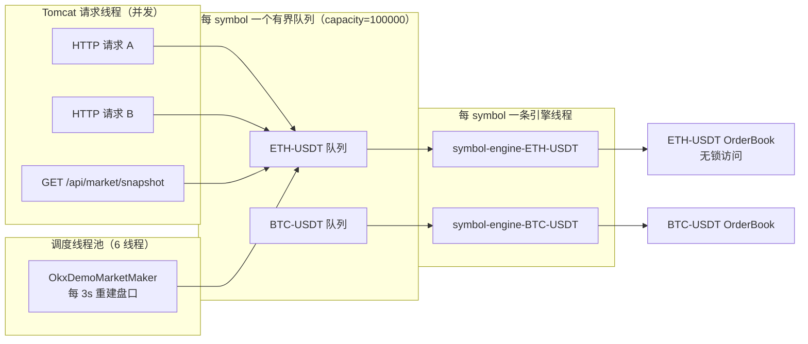
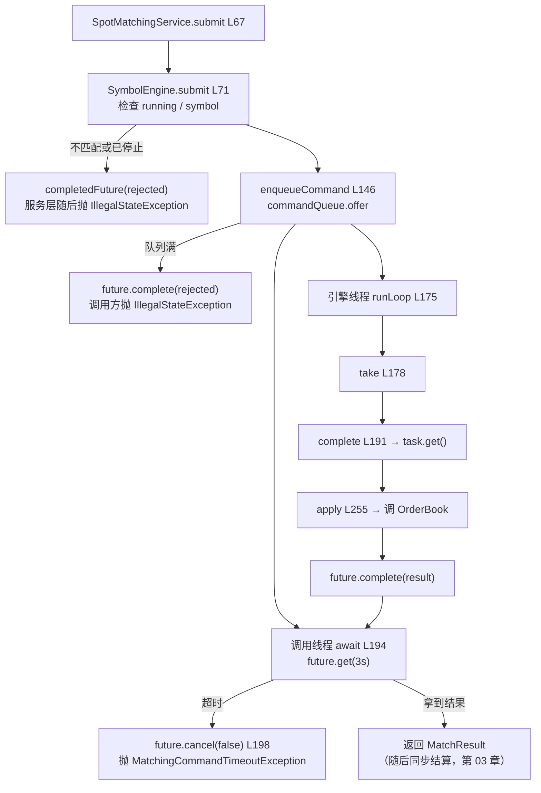

# 第 04 章 · 为什么每个交易对只有一个线程：串行化、超时与幂等

> **所属大纲**：第 04 章（必读，核心）
> **前置章节**：第 02 章（入口把命令交给引擎）、第 03 章（结算在引擎之外）
> **下游章节**：第 05 章（引擎线程里跑的订单簿算法）、第 06 章（撤单/查询也走这条队列）、第 08 章（没有 WAL 时串行化能保住什么）
> **证据基准**：当前工作区源码，2026-10-25 复核。

---

## 1. 本章导读

**业务场景**：8 个用户同时点"买入"，目标都是 `ETH-USDT`。如果这 8 个请求各自在 Tomcat 线程里直接改订单簿，`HashMap`、跳表、`ArrayDeque` 会立刻出现并发写坏、成交顺序随机、同一笔钱被吃两次等问题。

**本章作用**：解释项目用**"每个交易对一条线程 + 一个有界队列"**把并发请求变成顺序命令的做法，以及由此带来的三个必须理解的副作用：**读也要排队、超时不可怕但不能当失败、幂等只在引擎内有保证**。

- **上游**：第 02 章的 `SpotMatchingService.submit`、`cancel`，第 06 章的查询请求，演示做市商的定时任务。
- **本章输出**：一条条按到达顺序执行的命令，以及 `SymbolEngineStats` 这组运行指标。
- **下游**：第 05 章的 `OrderBook` 算法在引擎线程里被调用，因此**不需要任何锁**；第 08 章讨论"队列里的命令没落盘，重启会丢"。

**学习边界**：
- **必须理解**：为什么单线程能换来确定性、读写共用队列的收益与代价、超时后命令为什么还可能执行、`clientOrderId` 幂等的真实生效范围。
- **只需了解**：`LatencyWindow` 的分位数实现、健康阈值的具体数字。
- **可以跳过**：`ExternalRoute/Fill/...` 这些"仅审计"命令（第 07 章）。

> **一句话定位**：如果这一环不存在，订单簿会被并发写坏、成交顺序无法复现，第 03 章的结算也会建立在不确定的成交结果上。

---

## 2. 核心业务流程

### 2.1 线程与队列模型



**不同 symbol 完全并行，同一 symbol 严格串行**。这是本项目并发设计的全部内容。

### 2.2 一条命令的旅程



> 关键：**超时分支只是"调用方不等了"，并不会把队列里的任务删掉**。图里 `D → T` 与 `E → G` 是两条互不影响的路径——这是第 6 节黄色问题 1 的根源。

---

## 3. 核心代码拆解

### 3.1 为什么是"每 symbol 一条线程"

**业务目的**：用"顺序"换"确定性"，让订单簿的实现可以完全不加锁。

**源码位置**：`SymbolEngine.java:58-65`、`SpotMatchingService.java:173-181`

```java
// SymbolEngine.java:58-65
public SymbolEngine(String symbol, TradingPairMatchingService matchingService, int commandQueueSize) {
    this.symbol = requireText(symbol, "symbol").toUpperCase();
    this.matchingService = Objects.requireNonNull(matchingService, "matchingService");
    this.commandQueueCapacity = commandQueueSize;
    this.commandQueue = new LinkedBlockingQueue<>(commandQueueSize);
    this.worker = new Thread(this::runLoop, "symbol-engine-" + this.symbol);
    this.worker.start();
}
```

**执行过程**：
1. 每个 symbol 创建时，构造一个有界 `LinkedBlockingQueue`（默认 10 万）。
2. 启动一条普通（非守护）线程，名字是 `symbol-engine-<SYMBOL>`，循环从队列取任务。
3. 所有对订单簿的读写都在**这条线程**里执行，因此 `OrderBook` 内部的 `HashMap`、跳表、`ArrayDeque` 不需要任何同步。

**设计原因**：
- **对比"全局一把锁"**：`synchronized(orderBook)` 也能保证安全，但会把"读盘口"和"下单"耦合在同一把锁上，且不同交易对互相阻塞。
- **对比"每个请求一个线程直接撮合"**：无法保证同价订单的 FIFO 顺序（谁先抢到锁谁先成交），而这在交易所是硬性要求。
- **对比"全局单线程"**：实现简单，但 BTC 的撮合会阻塞 ETH 的撮合，无法按交易对扩容。
- **代价**：每个 symbol 一条常驻线程，空转也要占资源；单 symbol 的吞吐上限就是这条线程的处理速度（队列只是缓冲）。

**为什么读请求也要排队**（见 3.3）：如果读直接访问 `OrderBook`，就会与引擎线程并发读写，前面"不用锁"的前提立刻失效。

### 3.2 引擎的组成：队列、线程、指标

**业务目的**：让一个"串行执行器"既可观测、又可拒绝、还可优雅关闭。

**源码位置**：`SymbolEngine.java:39-56`（字段）

| 组成 | 实现 | 作用 |
| :--- | :--- | :--- |
| 命令队列 | `LinkedBlockingQueue<QueuedTask<?>>`，容量来自配置 | 缓冲突发请求；满了就拒绝 |
| 工作线程 | `Thread(this::runLoop, "symbol-engine-" + symbol)` | 唯一修改订单簿的线程 |
| 计数 | `submitted/processed/rejected/failed` 四个 `AtomicLong` | 观测吞吐与失败 |
| 延迟窗口 | `LatencyWindow(512)` | 记录最近 512 次任务耗时，算 p50/p95/p99 |
| 最近状态 | `lastProcessedAt`、`lastFailureMessage`、`maxObservedQueueSize` | 健康判断与排障 |

**设计原因**：把指标放在引擎内部，而不是靠外部 APM。教学项目没有 Prometheus，`GET /api/matching/engines` 直接把这些字段序列化出去（第 3.8 节），是观察"队列是否积压"的最快方式。

### 3.3 读与写共用一条队列：一致性的代价

**业务目的**：让"盘口快照"和"刚成交的订单"在同一个顺序里被读取，避免读到"成交了但盘口没更新"的中间态。

**源码位置**：`SymbolEngine.java:88-110`（所有读方法都走 `enqueue`）、`SpotMatchingService.java:114-124`、`OrderBook.java:154`

```java
// SymbolEngine.java:88-102（节选）
public CompletableFuture<OrderBookSnapshot> snapshot(int depth) {
    return enqueue(() -> matchingService.snapshot(depth));
}
public CompletableFuture<List<Trade>> recentTrades(int limit) {
    return enqueue(() -> matchingService.recentTrades(limit));
}
public CompletableFuture<Optional<Order>> findOrder(long orderId) {
    return enqueue(() -> matchingService.findOrder(orderId));
}
```

**执行过程**：
1. `GET /api/market/snapshot` → `SpotMatchingService.snapshot` → `engine.snapshot(depth)`。
2. `enqueue` 把 `() -> matchingService.snapshot(depth)` 包成任务，投入**同一条命令队列**。
3. 引擎线程按顺序执行：如果前面还有 50 笔下单，这次的快照会等它们全部处理完。
4. 返回的盘口一定反映了"它之前所有已提交命令"的结果。

**设计原因**：
- **收益**：读写线性一致，不需要额外的版本号或读写锁；`snapshot` 里遍历跳表时不会有并发修改。
- **代价 1**：读会占用撮合线程。一次 `snapshot(1000)`（市价买估价用，第 02 章）会先把**全部**价格档复制成列表再截断到 1000（`OrderBook.levels:299-311`、`SkipListPriceLevelIndex.entries:99-106`），这段时间所有下单都在排队。
- **代价 2**：`findOrder` 在结算时被调用（第 03 章），每笔成交要 2 次队列往返，进一步放大队列压力。
- **代价 3**：读请求超时也会抛 `MatchingCommandTimeoutException`，对查询接口来说错误语义有点重。

### 3.4 入队与拒绝：两种失败，两种表现

**业务目的**：队列满或引擎停止时，快速失败，而不是让请求无限等待。

**源码位置**：`SymbolEngine.java:71-86`（`submit`）、`:146-156`（`enqueueCommand`）、`:158-173`（`enqueue`）

```java
// :146-156
private CompletableFuture<CommandResult> enqueueCommand(MatchingCommand command) {
    CompletableFuture<CommandResult> future = new CompletableFuture<>();
    if (!commandQueue.offer(new QueuedTask<>(() -> apply(command), future))) {
        rejectedTasks.incrementAndGet();
        future.complete(CommandResult.rejected(command.commandId(), "symbol engine command queue is full"));
    } else {
        submittedTasks.incrementAndGet();
        observeQueueSize();
    }
    return future;
}
```

**执行过程**：
1. `submit` 先检查 `running` 和 symbol 是否匹配；不满足时返回**已完成的 rejected future**，不抛异常。
2. `enqueueCommand` 用 `offer`（非阻塞）入队；失败说明队列满，直接完成一个 rejected 结果。
3. `SpotMatchingService.submit` 收到 rejected → 抛 `IllegalStateException(reason)`（`SpotMatchingService.java:72-74`）。
4. 读路径 `enqueue` 队列满/停止时，直接 `completeExceptionally`（`:160-167`），异常沿 `await` 抛给调用方。

**差异**：
| 场景 | 写命令（`submit`） | 读查询（`enqueue`） |
| :--- | :--- | :--- |
| 引擎已停止 | rejected 结果 | `IllegalStateException` |
| symbol 不匹配 | rejected 结果 | 不适用（按 symbol 取 engine） |
| 队列满 | rejected 结果 | `IllegalStateException` |
| 调用方看到 | `IllegalStateException` → 500 | 500 |

**设计原因**：写命令返回结构化结果（`CommandResult.rejected`），方便未来区分"业务拒绝"与"系统拒绝"；读查询没有业务语义，直接用异常更简单。

> **注意**：队列容量默认 10 万，正常情况下几乎不会满。一旦满了，说明引擎线程已经严重落后（或卡死），此时**不是"慢"，而是"病了"**。

### 3.5 执行循环：任务如何被执行与收尾

**业务目的**：保证入队的任务最终都会被执行并给出结果，同时支持优雅停机。

**源码位置**：`SymbolEngine.java:175-204`、`:301-311`

```java
// :175-189
private void runLoop() {
    while (running || !commandQueue.isEmpty()) {
        try {
            QueuedTask<?> queued = running ? commandQueue.take() : commandQueue.poll();
            if (queued != null) {
                complete(queued);
            }
        } catch (InterruptedException exception) {
            running = false;
            if (commandQueue.isEmpty()) {
                Thread.currentThread().interrupt();
            }
        }
    }
}
```

```java
// :301-311
private record QueuedTask<T>(Supplier<T> task, CompletableFuture<T> future) {
    private RuntimeException complete() {
        try {
            future.complete(task.get());
            return null;
        } catch (RuntimeException exception) {
            future.completeExceptionally(exception);
            return exception;
        }
    }
}
```

**执行过程**：
1. 运行中：`take()` 阻塞等待；拿到任务后执行 `task.get()`。
2. 停机中：`running=false` 后改用 `poll()` 把剩余任务排干，避免"队列里还有任务但线程退出"。
3. 任务抛 `RuntimeException`：`complete` 捕获，`future.completeExceptionally`，并返回异常给调用方记录 `failedTasks` 与 `lastFailureMessage`。
4. 任务抛 `Error`：**不在捕获范围**，会穿出 `complete` 与 `runLoop` 的 `try`，导致引擎线程死亡（见第 6 节绿色问题）。

**设计原因**：`take`/`poll` 的切换让 `close()` 既能立即唤醒线程，又不丢已入队的任务。代价是 `close()` 的 `join(5_000)` 只等 5 秒，队列很长时线程可能在 `close()` 返回后继续跑（非守护线程会拖住 JVM 退出）。

### 3.6 等待与超时：`future.cancel(false)` 到底取消了什么

**业务目的**：调用方不能无限等待，否则 Tomcat 线程会被慢撮合拖死；但又不能"超时即失败"。

**源码位置**：`SpotMatchingService.java:194-221`、`MatchingCommandTimeoutException.java:3`

```java
// :194-202
private <T> T await(CompletableFuture<T> future) {
    try {
        return future.get(commandTimeout.toMillis(), TimeUnit.MILLISECONDS);
    } catch (TimeoutException exception) {
        future.cancel(false);
        throw new MatchingCommandTimeoutException(
                "matching command timed out after " + commandTimeout.toMillis()
                        + "ms; retry with the same clientOrderId to avoid duplicate orders"
        );
    }
    // ...
}
```

**执行过程**：
1. 调用线程（Tomcat 或调度线程）最多等 3 秒（`command-timeout-ms:3000`）。
2. 超时后执行 `future.cancel(false)`：**只把 `CompletableFuture` 标记为取消**，参数 `false` 表示"不中断正在执行的任务"。
3. 抛 `MatchingCommandTimeoutException`，控制器映射为 **504 MATCHING_TIMEOUT**（`MatchingController.java:292-296`）。
4. 与此同时，队列里的 `QueuedTask` 还在，引擎线程仍会执行 `task.get()` 并尝试 `future.complete(...)`——只是这次 `complete` 会返回 `false`（future 已取消），结果被丢弃。

**设计原因**：
- **为什么要 cancel**：让等待中的线程立即返回，且明确"这个 future 不要了"，避免后续重复完成。
- **为什么不能停止任务**：任务已经在队列里，删除它需要额外的取消协议；而且任务可能已经开始执行，删了反而不知道执行到哪。
- **因此 504 的语义是"结果未知"，不是"操作失败"**：订单可能已成交、可能刚入簿、也可能还在队列里。

> **必须理解**：README 和异常信息都建议"用同一 `clientOrderId` 重试"，但第 02 章已经说明 **REST 不接受 `clientOrderId`**。所以在 HTTP 层，这个建议目前无法执行；真正的安全做法是查询订单状态或人工核对。

### 3.7 幂等：`symbol:userId:clientOrderId` 与命令 ID 的区别

**业务目的**：客户端/网关重试时，不能重复下单；但每次命令又需要唯一标识用于日志和结果匹配。

**源码位置**：
- 幂等键：`OrderBook.java:323-325`、`TradingPairMatchingService.java:82-87`、`OrderBook.java:82-86`
- 命令 ID：`SpotMatchingService.java:183-185`

```java
// OrderBook.java:323-325
private String clientOrderKey(OrderRequest request) {
    return request.symbol() + ":" + request.userId() + ":" + request.clientOrderId();
}

// TradingPairMatchingService.java:82-87
Optional<Order> existingOrder = orderBook.findByClientOrder(effectiveRequest);
if (existingOrder.isPresent()) {
    return new MatchResult(existingOrder.get(), List.of());
}
```

**执行过程**：
1. `SpotMatchingService` 为每条命令生成 `place-ETH-USDT-1`、`cancel-ETH-USDT-2` 这样的 `commandId`（自增），仅用于日志与结果匹配。
2. `TradingPairMatchingService.submit` 先用 `symbol:userId:clientOrderId` 查幂等索引；命中则直接返回已有订单，**不写 WAL、不撮合、不产生成交**。
3. `OrderBook.submit` 内部还有一层同样的检查（`:82-86`），防止绕过服务层直接调用订单簿。
4. 因此：**同一 `clientOrderId` 重复提交是安全的；不同 `clientOrderId` 的相同订单会被当成两笔真实订单**。

**设计原因**：把幂等键放在"订单簿"而不是"命令 ID"上，是因为业务幂等应该由业务唯一键决定（一个客户的一次下单意图），而 `commandId` 每次调用都不同，天然无法幂等。`ordersByClientOrderKey` 是一个只增不减的 `HashMap`（第 01 章），所以幂等只在**进程生命周期内**有效。

> **边界**：幂等键包含 `symbol` 和 `userId`，所以不同交易对、不同用户可以使用相同的 `clientOrderId`。REST 层每次生成 UUID，导致这个能力目前只对"直接调用引擎"的代码（测试、未来内部服务）有意义。

### 3.8 观测：`/api/matching/engines` 到底在看什么

**业务目的**：不接监控系统也能判断"撮合是否健康"。

**源码位置**：`SymbolEngine.java:112-144`（`stats`）、`:225-253`（`health`）、`MatchingController.java:104-107`

| 字段 | 含义 | 判断价值 |
| :--- | :--- | :--- |
| `queueSize` / `remainingQueueCapacity` / `queueUtilizationBps` | 当前积压与水位（bps，10000=100%） | 持续 > 70% 说明消费跟不上 |
| `maxObservedQueueSize` | 启动以来最高水位 | 判断是否发生过突发 |
| `submitted/processed/rejected/failed` | 入队、完成、拒绝、异常计数 | `rejected` 增长 = 队列满/停止 |
| `last/average/maxTaskDurationMicros` | 单次任务耗时 | 定位慢命令（如大 depth 快照） |
| `p50/p95/p99TaskDurationMicros` | 最近 512 次耗时分位数 | p95 是健康阈值依据 |
| `healthStatus` | `OK / BUSY / DEGRADED / STOPPED` | 直接看这个 |
| `healthReasons` | 具体原因列表 | 排障第一手信息 |
| `lastFailureMessage` | 最近一次任务异常 | 引擎内部错误 |

**健康阈值**（`health`，`:225-253`）：
- `DEGRADED`：队列 ≥ 90%，或 p95 ≥ 500ms，或最近有失败；
- `BUSY`：队列 ≥ 70%，或 p95 ≥ 100ms；
- `STOPPED`：引擎已关闭。

**设计原因**：把"健康"定义成队列与延迟的组合，而不是简单的"线程活着"。线程活着但队列积压 90%，对交易来说已经不可用。

### 3.9 关闭：`close()` 做了什么

**源码位置**：`SymbolEngine.java:283-292`、`SpotMatchingService.java:167-171`

```java
// SymbolEngine.java:284-292
public void close() {
    running = false;
    worker.interrupt();
    try {
        worker.join(5_000);
    } catch (InterruptedException exception) {
        Thread.currentThread().interrupt();
    }
}
```

**执行过程**：
1. `running=false`，中断工作线程（若正阻塞在 `take()`）。
2. `runLoop` 捕获中断后改为 `poll()` 排空队列。
3. 主线程最多等 5 秒；`SpotMatchingService.close()` 遍历所有 engine 依次关闭并清空 `runtimes`。
4. `SpotMatchingService` 实现 `AutoCloseable`，Spring 关闭容器时会调用（第 01 章）。

**设计原因**：先停新任务、再排空旧任务、最后限时等待，是标准的优雅停机顺序。限时 5 秒是权衡：等太久会拖慢发布，等太短可能留下未完成任务。

---

## 4. Web3 特有机制与风险提示

本章没有链上调用，也没有钱包/合约交互。但"顺序"这件事在 Web3 里有对应物，值得建立类比：

- **链上用 nonce 保证同一账户交易顺序**；本项目用"每 symbol 单线程 + FIFO 队列"保证同一交易对的命令顺序。
- **链上交易一旦上链不可撤销**；本项目命令一旦入队，即使调用方超时也仍会执行——两者都要求调用方**不要用"超时"推断"未发生"**。
- **链上事件可重放/可审计**；本项目命令只有内存队列 + 计数指标，没有持久化，重启即丢（第 08 章），这是它与链上最大的差别。

---

## 5. 本章小结与思考题

**本章完成了什么**：把并发 HTTP 请求变成按交易对串行的命令流，并给出"队列满/超时/停止"三种边界行为。

**最重要的调用链**：

```text
SpotMatchingService.submit(:67)
  → SymbolEngine.submit(:71) → enqueueCommand(:146)
  → await(:194)  [调用线程阻塞 ≤3s]
  → runLoop(:175) → take(:178) → complete(:191) → apply(:255)
  → OrderBook.*（第 05 章）
  → future.complete → await 返回 → settle（第 03 章）
```

**状态变化**：
- 队列长度、`submitted/processed/rejected/failed` 计数、延迟窗口；
- 内存订单簿（在引擎线程内）；
- 超时/拒绝时，第 02 章的冻结可能被释放（`MatchingController:135-137`）。

**与上下游衔接**：第 05 章进入引擎线程内部，看 `OrderBook` 如何在没有锁的前提下撮合；第 06 章解释撤单/查询为什么也走这条队列。

### 思考题

**Q1：为什么连"看盘口"这种读请求也要排进撮合队列？好处和代价分别是什么？**

参考答案：因为 `OrderBook` 内部的 `HashMap`/跳表/`ArrayDeque` **完全不加锁**，前提是"只有引擎线程访问它"（`SymbolEngine.java:88-110` 把所有读也 `enqueue`）。好处是读到的盘口与之前所有已提交命令严格一致，不会出现"成交已发生但盘口未更新"的中间态。代价是读会占用撮合线程：`snapshot(1000)` 会先把全部价格档复制成列表再截断到 1000（`OrderBook.levels:299-311`、`SkipListPriceLevelIndex.entries:99-106`），期间所有下单排队；结算时每笔成交还要 2 次 `findOrder` 队列往返（第 03 章），进一步放大延迟。

**Q2：调用方收到 504 后，能断定"订单没下成功"吗？应该怎么处理？**

参考答案：不能。`await` 超时只执行 `future.cancel(false)`（`SpotMatchingService.java:198`），队列里的 `QueuedTask` 不会被移除，引擎线程仍会执行并尝试完成 future（`QueuedTask.complete:302-310`），只是结果被丢弃。因此订单可能已经入簿甚至成交，而结算（在 `submit` 返回之后才执行）可能根本没跑。正确做法是**查询订单状态**（`GET /api/orders`）或依赖业务幂等键重试；但当前 REST 不接受 `clientOrderId`（第 02 章 3.2），所以只能查询核对，不能"安全重试"。

---

## 6. 设计与实现问题提示

| 级别 | 问题 | 源码依据 | 影响 |
| :--- | :--- | :--- | :--- |
| 黄色 | 超时只取消等待，不取消执行；调用方却可能已释放冻结 | `await:198`（`cancel(false)`）；`QueuedTask.complete:302-310` 仍执行 `task.get()`；`MatchingController:135-137` 释放预留 | 订单可能成交但结算未执行、预留已退；与第 03 章的"预留缺失跳过"叠加会造成单边记账（需故障注入验证概率） |
| 黄色 | 读命令与写命令共享队列，读会阻塞撮合 | `SymbolEngine.java:88-110`、`snapshot(1000)`（第 02 章市价买）、结算的 `findOrder` 往返 | 大 depth 快照或大单结算期间，下单延迟升高；p95 上升会直接把健康状态推到 BUSY/DEGRADED |
| 黄色 | 队列满/引擎停止时下单返回 500，而非 429/503 | `enqueueCommand:146-156` → `IllegalStateException`；`MatchingController` 无对应处理器 | 客户端无法区分"系统过载"与"服务端 bug"，也没有 `Retry-After`；重试可能继续打满队列 |
| 黄色 | 超时与队列满路径没有测试覆盖 | `SpotMatchingServiceTest` 只覆盖并发串行、启动装配、构造函数参数校验（`:28`、`:69`、`:87`），没有超时/队列满的行为测试 | 行为只能靠读代码推断，重构时容易回归 |
| 绿色 | `commandId` 与幂等键容易混淆 | `nextCommandId:183-185` 自增；幂等键是 `symbol:userId:clientOrderId`（`OrderBook:323`） | 误以为命令 ID 能去重；实际每次调用都生成新 ID |
| 绿色 | 引擎线程只捕获 `RuntimeException`，`Error` 会终止线程 | `QueuedTask.complete:302-310`；`runLoop` 仅捕获 `InterruptedException` | 线程死后队列无人消费、`running` 仍为 true，表现为"全部请求超时"；无自动重启 |
| 绿色 | `ordersForUser` 串行等待所有 symbol | `SpotMatchingService.java:126-135`：`runtimes.values().stream().flatMap(await...)` | 6 个 symbol 最坏 6×3s；订单页在引擎繁忙时明显变慢 |

本章未发现红色级别问题；第 1 条在真实故障下会影响资金一致性，建议按红色预案对待。这不是完整安全审计。

---

## 7. 下一章

第 05 章进入引擎线程内部：`OrderBook` 如何在"只有一个线程"的前提下，用跳表 + FIFO 完成价格优先、时间优先的撮合，以及 `GTC/IOC/FOK/POST_ONLY` 的差异到底写在哪儿。

---

### 修订记录

| 日期 | 变更 |
| :--- | :--- |
| 2026-10-25 | 首版：复核队列/线程模型、读写同队列、入队拒绝、超时语义、幂等键与健康指标；记录超时释放、读阻塞、错误码与测试缺口 |
