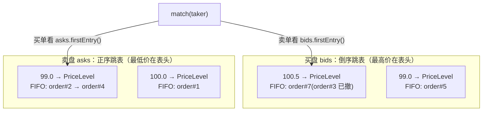
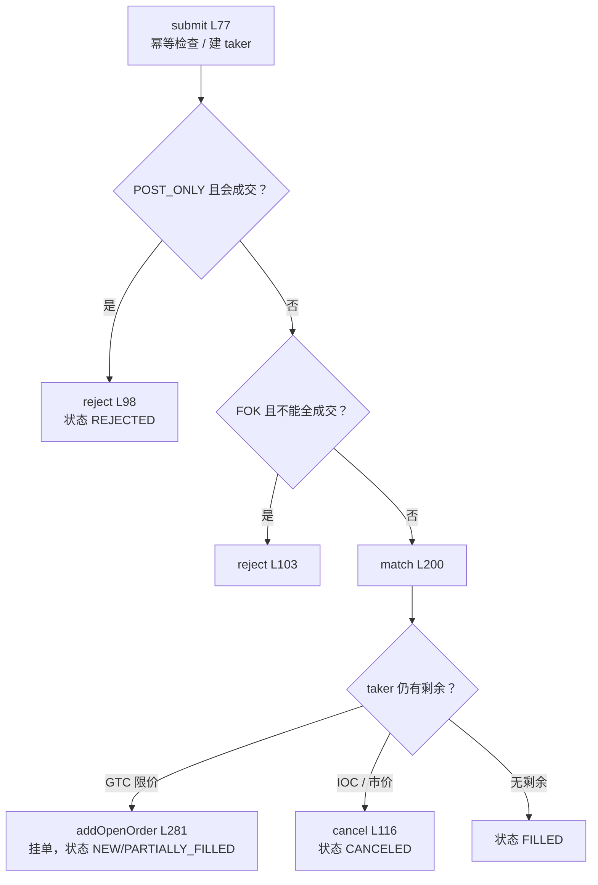

# 第 05 章 · 订单簿如何撮合：跳表 + FIFO + 四种时效

> **所属大纲**：第 05 章（必读，核心）
> **前置章节**：第 04 章（命令在单线程里串行执行）
> **下游章节**：第 03 章（成交结果如何结算）、第 06 章（订单状态与撤单）
> **证据基准**：当前工作区源码，2026-10-25 复核。

---

## 1. 本章导读

**业务场景**：卖盘上挂着 `100@1`、`99@1`、`99@1` 三笔单。一个新买单 `101@2.5` 进来，应该先吃谁、按什么价成交、剩下的 0.5 怎么办？这三个问题分别对应**价格优先、成交价规则、剩余量处理**，也是交易所最核心的公平性保证。

**本章作用**：把 `OrderBook` 的 300 行代码拆成"数据结构 + 撮合循环 + 四种时效"三块，让你能手推任意一笔订单的成交结果。

- **上游**：第 04 章的引擎线程调用 `TradingPairMatchingService.submit` → `OrderBook.submit`。
- **本章输出**：`MatchResult`（taker 订单 + `Trade` 列表），交给第 03 章结算、第 06 章查询。
- **下游**：成交价与数量决定资金划转金额；订单状态决定撤单/释放逻辑。

**学习边界**：
- **必须理解**：两层数据结构（价格档索引 + 同价 FIFO）、成交价取 maker 价、GTC/IOC/FOK/POST_ONLY 的差异、部分成交后 maker 的剩余量。
- **只需了解**：跳表的随机层高与指针维护（知道它是有序索引即可）、红黑树备选实现。
- **可以跳过**：`PriceLevel.pruneCanceledHead` 的防御性清理、`snapshot` 的 VO 拼装。

> **一句话定位**：如果这一环不存在，订单只会排队，不会产生任何成交、价格或资金划转——交易所就退化成一个订单登记簿。

---

## 2. 核心业务流程

### 2.1 两层数据结构



- **第一层**：`PriceLevelIndex` 管"价格 → 价格档"，默认实现是跳表（`SkipListPriceLevelIndex`），备选红黑树（`TreePriceLevelIndex`）。
- **第二层**：`PriceLevel` 管"同一价格下的订单队列"，用 `ArrayDeque` 保证 FIFO（时间优先）。

### 2.2 撮合主循环



---

## 3. 核心代码拆解

### 3.1 为什么要把"价格"和"订单"拆成两层

**业务目的**：盘口查询只关心"每个价格有多少量"，撮合只关心"最优价的队头是谁"。把两者混在一个结构里，会让插入、删除、快照都变复杂。

**源码位置**：`OrderBook.java:28-32`、`PriceLevel.java:8-13`、`OrderBook.java:44-63`

```java
// OrderBook.java:28-32
private final PriceLevelIndex bids;
private final PriceLevelIndex asks;
private final Map<Long, Order> openOrders = new HashMap<>();
private final Map<Long, Order> allOrders = new HashMap<>();
private final Map<String, Order> ordersByClientOrderKey = new HashMap<>();
```

```java
// OrderBook.java:60-62（买盘倒序、卖盘正序）
this.bids = createPriceIndex(indexType, Comparator.reverseOrder());
this.asks = createPriceIndex(indexType, Comparator.naturalOrder());
```

**执行过程**：
1. 买卖两侧各一个价格索引；`bids` 用**倒序** comparator，`asks` 用**正序** comparator。
2. 因此两边都可以用同一句 `firstEntry()` 拿到"最优价"（买=最高、卖=最低），撮合代码只写一套。
3. `openOrders` 只存**当前挂在簿上**的订单（用于撤单/查询），`allOrders` 存所有订单（用于结算反查），`ordersByClientOrderKey` 存幂等索引。

**设计原因**：如果只用"一个按价格排序的订单列表"，同价订单的时间顺序要靠额外字段维护，且盘口聚合（每个价位总量）每次都要扫描。拆成两层后：
- 价格档用跳表：插入/删除 `O(log n)`、取最优 `O(1)`、按序遍历 `O(depth)`；
- 同价订单用 `ArrayDeque`：入队/出队 `O(1)`，天然 FIFO；
- 价格档还维护 `totalQuantity`（`PriceLevel.java:13`），快照不需要遍历队列。

> **必须理解**：`n` 是**价格档数量**，不是订单数量。同一价格挂 1 万笔单，仍然只是一个价格档。

### 3.2 跳表：为什么有序链表要加"快速通道"

**业务目的**：在内存里维护一个"可按价格方向排序、可快速插入删除、可取最小/最大"的结构。

**源码位置**：`SkipListPriceLevelIndex.java:9-157`

```java
// :11-13、:19-21
private static final int MAX_LEVEL = 32;
private static final double PROMOTION_PROBABILITY = 0.5;
private final Node head = new Node(null, null, MAX_LEVEL);
private int level = 1;
private int size;
```

```java
// :33-36
public PriceLevelEntry firstEntry() {
    Node first = head.next[0];
    return first == null ? null : new PriceLevelEntry(first.price, first.priceLevel);
}
```

**执行过程**（插入一个新价格档）：
1. `predecessors(price)` 从最高层往下，记录每一层"应该插在谁后面"（`update[]`）。
2. `randomLevel()` 抛硬币决定层高：50% 升到第 2 层、25% 到第 3 层……最高 32 层。
3. 创建 `PriceLevel` 与 `Node`，在每一层把前驱的 `next` 指向新节点。
4. 删除时反向操作：找到每层前驱，跨过待删节点，并回收变空的顶层。

**设计原因**：
- **对比有序数组**：插入/删除 `O(n)`，盘口频繁增删价位时不可接受。
- **对比红黑树**：跳表实现更短、无旋转、范围遍历天然有序；代价是随机化（最坏情况理论上是 `O(n)`，概率极低）。项目同时提供 `TreePriceLevelIndex`，并用测试保证两者结果一致（`OrderBookTest:254`）。
- **`BigDecimal` 的 comparator**：默认按 `compareTo`，**忽略 scale**——所以 `100.0` 和 `100.00` 会落在同一个价格档（重要，见第 6 节）。

### 3.3 `submit`：先做两次"预检"，再进入撮合

**业务目的**：`POST_ONLY` 和 `FOK` 的语义是"要么完全不成交，要么按规则成交"，必须在真正吃单之前判断。

**源码位置**：`OrderBook.java:77-121`

```java
// :82-107（节选）
Order existingOrder = ordersByClientOrderKey.get(clientOrderKey);
if (existingOrder != null && !replaceExistingClientOrder) {
    return new MatchResult(existingOrder, List.of());
}
Order taker = new Order(orderIds.incrementAndGet(), sequences.incrementAndGet(), request, Instant.now(clock));
allOrders.put(taker.orderId(), taker);
ordersByClientOrderKey.put(clientOrderKey, taker);

if (request.timeInForce() == OrderTimeInForce.POST_ONLY && canCross(taker)) {
    taker.reject();
    return new MatchResult(taker, List.of());
}
if (request.timeInForce() == OrderTimeInForce.FOK && !canFullyFill(taker)) {
    taker.reject();
    return new MatchResult(taker, List.of());
}
List<Trade> trades = match(taker);
```

**执行过程**：
1. 同 `symbol:userId:clientOrderId` 已存在 → 直接返回原订单（第 04 章的幂等）。
2. 创建 taker：分配自增 `orderId` 和 `sequence`（时间优先的序号），先放进 `allOrders` 与幂等索引——**即使随后被拒绝，也能被查询到**。
3. `POST_ONLY`：如果对手盘最优价与它交叉（`canCross`），直接 `REJECTED`，不入簿、不成交。
4. `FOK`：如果对手盘在可成交价位上的总量不够（`canFullyFill`），直接 `REJECTED`。
5. 通过预检后进入 `match(taker)`。

**设计原因**：
- **先建订单再预检**：这样被拒绝的订单也有 `orderId`、状态和创建时间，方便审计和"用同一 `clientOrderId` 重试时返回原结果"。
- **预检与撮合在同一线程**：`canCross`/`canFullyFill` 与随后的 `match` 之间没有并发修改，预检结论一定成立（第 04 章的单线程模型）。

### 3.4 `match`：价格优先、时间优先、maker 定价

**业务目的**：这是全项目唯一"决定成交"的地方。

**源码位置**：`OrderBook.java:200-247`

```java
// :200-247（节选）
PriceLevelIndex opposite = taker.side() == Side.BUY ? asks : bids;
while (taker.remainingQuantity().signum() > 0 && !opposite.isEmpty()) {
    PriceLevelEntry bestLevel = opposite.firstEntry();           // 对手盘最优价
    if (bestLevel == null || !crosses(taker, bestLevel.price())) break;
    PriceLevel level = bestLevel.level();
    while (taker.remainingQuantity().signum() > 0 && !level.isEmpty()) {
        Order maker = level.peek();                              // 同价队头
        BigDecimal matchedQuantity = taker.remainingQuantity().min(maker.remainingQuantity());
        maker.fill(matchedQuantity);
        taker.fill(matchedQuantity);
        level.decrease(matchedQuantity);
        trades.add(new Trade(tradeIds.incrementAndGet(), symbol,
                taker.orderId(), maker.orderId(), taker.side(),
                maker.price(), matchedQuantity, Instant.now(clock)));
        if (maker.remainingQuantity().signum() == 0) {
            level.poll();                                        // 成交完的 maker 出队
            openOrders.remove(maker.orderId());
        }
    }
    if (level.isEmpty()) {
        opposite.remove(bestLevel.price());                      // 价位空了删档
    }
}
```

**执行过程**（用导读里的例子：卖盘 `100@1`、`99@1(ask-2)`、`99@1(ask-3)`，买单 `101@2.5`）：
1. `opposite = asks`，`firstEntry()` = 99 档。
2. `crosses(买 101, 卖 99)` → `101 >= 99` 成立，进入该档。
3. 队头 ask-2：成交 `min(2.5, 1) = 1`，**成交价 99**；ask-2 成交完，`poll` 出队。
4. 队头 ask-3：同样成交 1，成交价 99；出队。
5. 99 档空了 → `opposite.remove(99)`。
6. 回到外层：`firstEntry()` = 100 档，`crosses(101, 100)` 成立；ask-1 成交 `min(0.5, 1) = 0.5`，成交价 100。
7. ask-1 还剩 0.5，留在队头；价位未空，不删档。
8. taker 剩余 0 → `FILLED`。

结果：3 笔成交，价格依次 `99, 99, 100`，与 `OrderBookTest:106` 的断言完全一致。

**三个必须记住的规则**：
| 规则 | 代码 | 含义 |
| :--- | :--- | :--- |
| 价格优先 | `opposite.firstEntry()` | 买单选最低卖价、卖单选最高买价 |
| 时间优先 | `level.peek()` / `ArrayDeque` | 同价按进入顺序 FIFO |
| maker 定价 | `maker.price()` 写入 `Trade` | 成交价是**挂单方**的价格，taker 出价只决定"能否成交" |

**设计原因**：
- **为什么用 maker 价**：这是连续撮合市场的通行规则，保证挂单方拿到自己挂出的价格；taker 出价更高（买）或更低（卖）的部分形成"价格改善"，由第 03 章结算时退回。
- **为什么成交后立刻 `decrease` 再 `poll`**：`decrease` 维护价格档总量，`poll` 只负责出队；`poll` 对已成交完的单减 0，不会重复扣减。
- **为什么 maker 部分成交时留在队头**：FIFO 语义要求它继续排队，后面的 maker 不能插队。

### 3.5 四种时效：差异只在三处代码

**业务目的**：同一个撮合引擎支持不同交易所常见的订单时效，而不需要复制多套撮合逻辑。

**源码位置**：`OrderBook.java:97-118`、`Order.java:101-139`

| 时效 | 预检 | 会立即成交吗 | 剩余量处理 | 最终状态 |
| :--- | :--- | :--- | :--- | :--- |
| `GTC`（限价） | 无 | 价格交叉就吃单 | 挂入订单簿 | `NEW` 或 `PARTIALLY_FILLED` |
| `IOC`（限价/市价） | 无 | 价格交叉就吃单 | 立即取消 | `CANCELED`（或全成 `FILLED`） |
| `FOK` | `canFullyFill` | 只有能全成就吃 | 不能全成 → 拒绝 | `REJECTED` |
| `POST_ONLY` | `canCross` | 会成交就拒绝 | 不成交则挂单 | `REJECTED` / `NEW` |

**代码位置**（就三处）：
```java
// 1) POST_ONLY 预检（:97-100）
if (request.timeInForce() == OrderTimeInForce.POST_ONLY && canCross(taker)) { taker.reject(); ... }
// 2) FOK 预检（:102-105）
if (request.timeInForce() == OrderTimeInForce.FOK && !canFullyFill(taker)) { taker.reject(); ... }
// 3) 剩余量处理（:109-118）
if (LIMIT && GTC && !allowExternal) rest;
else if (allowExternal && TIF != POST_ONLY) routeExternal;
else cancel;
```

**执行过程说明**：
- `canCross`（`:258-264`）：对手盘为空返回 false；否则用 `crosses` 判断。
- `canFullyFill`（`:266-279`）：按价格顺序累加可成交档位的 `totalQuantity`，够则 true。由于是单线程，随后 `match` 一定能吃完。
- `crosses`（`:249-256`）：`MARKET` 恒 true；限价买 `price >= makerPrice`；限价卖 `price <= makerPrice`。

**设计原因**：把"时效"降维成"预检 + 剩余处理"，撮合主循环完全不需要知道 TIF。这样新增一种时效（比如 GTD）只需增加一个预检和一种剩余处理，不用改 `match`。

> **注意**：REST 入口只暴露 `LIMIT→GTC` 和 `MARKET→IOC`（第 02 章），所以 `FOK`/`POST_ONLY`/限价 IOC 只能通过服务层或测试触发；本节的语义仍然是理解引擎行为的必备知识。
>
> 另外，GTC 剩余量挂单的条件里还有 `!allowExternalLiquidity`（`:110`）。当前运行时该字段被服务层强制置为 false（第 02 章），所以剩余量一定会挂单；若未来接入市商网关，剩余量可能改走外部路由（第 07 章）。

### 3.6 订单状态与 `Trade`：成交后谁变成什么

**业务目的**：让每笔订单在任何时刻都有明确状态，供撤单、查询、结算使用。

**源码位置**：`Order.java:101-139`、`OrderStatus.java:3-15`、`Trade.java:6-19`

```java
// Order.java:101-112
void fill(BigDecimal matchedQuantity) {
    remainingQuantity = remainingQuantity.subtract(matchedQuantity);
    status = remainingQuantity.signum() == 0 ? OrderStatus.FILLED : OrderStatus.PARTIALLY_FILLED;
}
void restOnBook() {
    status = remainingQuantity.compareTo(quantity) == 0
            ? OrderStatus.NEW : OrderStatus.PARTIALLY_FILLED;
}
```

**状态迁移**（生产路径实际会出现的）：

```text
NEW ──成交(部分)──> PARTIALLY_FILLED ──成交(剩余)──> FILLED
 │                        │
 └──撤单/剩余取消──> CANCELED <──┘
NEW ──POST_ONLY/FOK 预检失败──> REJECTED
```

**`Trade` 记录什么**：`tradeId`、`symbol`、`takerOrderId`、`makerOrderId`、`takerSide`、`price`（maker 价）、`quantity`、`tradedAt`。它**不记录** maker 侧方向（可由 taker 方向推出）和手续费（本项目没有手续费）。

**执行过程**：
1. maker 与 taker 都调用 `fill`，各自扣减 `remainingQuantity`。
2. 完全成交 → `FILLED`；部分成交 → `PARTIALLY_FILLED`。
3. 挂单时 `restOnBook` 会区分"完全没成交"（`NEW`）与"部分成交后挂单"（`PARTIALLY_FILLED`）。
4. 第 03 章结算时靠 `Order` 的 `clientOrderId`、`side`、`type`、`price` 计算资金，因此这些字段必须在内存里保留。

### 3.7 盘口快照：为什么深度查询不是 `O(depth)`

**业务目的**：给前端 `/api/market/snapshot` 返回前 N 档。

**源码位置**：`OrderBook.java:154-160`、`:299-311`、`SkipListPriceLevelIndex.java:99-107`

```java
// OrderBook.java:299-311
private List<BookLevel> levels(PriceLevelIndex sideBook, int depth) {
    List<BookLevel> levels = new ArrayList<>();
    for (PriceLevelEntry entry : sideBook.entries()) {   // 先把全部价格档复制成 List
        BigDecimal quantity = entry.level().totalQuantity();
        if (quantity.signum() > 0) {
            levels.add(new BookLevel(entry.price(), quantity));
            if (levels.size() >= depth) break;
        }
    }
    return List.copyOf(levels);
}
```

**执行过程**：
1. `snapshot(depth)` 分别对 bids/asks 调 `levels`。
2. `entries()` 会**遍历整条底层链表并复制成 `ArrayList`**（`SkipList:99-107`），然后 `levels` 再截断到 `depth`。
3. 因此一次 `snapshot(10)` 的真实成本是 `O(总档位数)`，不是 `O(10)`。

**设计原因**：实现简单、快照不可变（复制后返回，调用方不会看到后续修改）。代价是大盘口 + 高频快照时开销明显；第 02 章的市价买估价用 `snapshot(1000)`，会放大这个问题。

> **边界**：`depth <= 0` 时仍会返回 1 档（先 `add` 再判断 `size >= depth`），属于小瑕疵，实际调用方都传正数。

### 3.8 复杂度与选型

| 操作 | 跳表实现 | 说明 |
| :--- | :--- | :--- |
| 取最优价 | `O(1)` | `head.next[0]` |
| 插入/删除价格档 | 期望 `O(log n)` | `n` = 价格档数 |
| 同价入队/出队 | `O(1)` | `ArrayDeque` |
| 撤单（任意位置） | `O(k)` | `ArrayDeque` 迭代查找，`k` = 该档订单数 |
| FOK 预检 / 快照 | `O(n)` | 都会先 `entries()` 复制全部档位 |

**设计原因**：真实盘口的热点价格档订单多、价格档相对少，所以"价格索引用跳表、订单用队列"是常见组合。教学项目没有再优化 `entries()`（例如维护累计量或双向迭代器），因为可读性优先。

---

## 4. Web3 特有机制与风险提示

本章是纯链下撮合，没有合约调用或资产转移。值得建立的对比是**排序规则**：

- 链上订单簿（如某些 L2 DEX）用 gas 竞价决定交易打包顺序；本项目用**价格优先 + 时间优先**决定成交顺序。
- 链上成交即结算（同一笔交易内完成资产转移）；本项目**撮合与结算分离**（第 03 章），中间存在失败与挂账的可能。
- 链上价格由 AMM 曲线或撮合合约决定；这里的价格由**内存订单簿 + maker 挂单价**决定，外部行情只用于演示做市（第 07 章）。

---

## 5. 本章小结与思考题

**本章完成了什么**：把"订单"变成"成交"，并给出成交价、成交量与剩余量的确定规则。

**最重要的调用链**：

```text
OrderBook.submit(:77)
  → canCross(:258) / canFullyFill(:266)   [POST_ONLY / FOK 预检]
  → match(:200)
      → opposite.firstEntry()             [价格优先]
      → level.peek()                      [时间优先]
      → Trade(maker.price(), min(qty))    [maker 定价]
      → level.decrease / poll / remove    [维护价格档]
  → addOpenOrder(:281) / taker.cancel()   [剩余量处理]
```

**状态变化**：
- `bids/asks` 跳表：价格档增删；
- `PriceLevel`：FIFO 队列与 `totalQuantity`；
- `Order`：`remainingQuantity` 与 `status`；
- `MatchResult.trades`：本次产生的成交列表（交给第 03 章）。

**与上下游衔接**：第 06 章解释 `CANCELED`/`FILLED` 之后订单如何被查询与撤单；第 03 章解释 `Trade` 如何变成余额。

### 思考题

**Q1：为什么成交价用 maker 的挂单价，而不是 taker 的出价？用本章的例子说明。**

参考答案：连续撮合市场的惯例是"挂单方报什么价，就按什么价成交"（`OrderBook.java:229` 写入 `maker.price()`）。例子中 taker 出价 101，但卖一价是 99，于是前两笔按 99 成交、最后一笔 0.5 按 100 成交，合计 `1×99 + 1×99 + 0.5×100 = 248`，而不是按 taker 价计算的 `101×2.5 = 252.5`；冻结按 101 预扣，差额 4.5 在结算时作为价格改善退回（第 03 章 `priceImprovement`）。如果按 taker 价成交，taker 会多付、maker 会多收，挂单方的报价就失去意义，也会产生不公平的滑点。

**Q2：同价订单的"时间优先"在代码里由谁保证？如果把 `PriceLevel` 换成按 `orderId` 排序的 `PriorityQueue` 会怎样？**

参考答案：由 `PriceLevel` 的 `ArrayDeque` + `addLast`/`peekFirst`/`pollFirst` 保证（`PriceLevel.java:11`、`:23-40`）。`orderId` 是全局自增的，按它排序在单进程内与"进入顺序"一致，但会引入两个问题：一是撤单后重新下单（`modify`）会拿到新 `orderId`，从而排到队尾——这与当前实现一致但语义上更隐晦；二是跨重启/多进程时 `orderId` 不再单调，FIFO 会被破坏。更稳妥的是像现在这样依赖队列的插入顺序，并把"时间"显式记录在 `sequence` 上（`Order.java:10`）。

---

## 6. 设计与实现问题提示

| 级别 | 问题 | 源码依据 | 影响 |
| :--- | :--- | :--- | :--- |
| 黄色 | 无自成交防护（STP）：同一用户的买卖单可以直接成交 | `match:200-247` 只按价格/队列取 maker，从不比较 `userId` | 用户可自己和自己成交，制造虚假成交量（wash trading）；本项目无手续费所以没有直接资金损失，但真实交易所必须按账户/自成交组拦截。若未来加手续费/返佣，会变成资金漏洞 |
| 黄色 | 无 tick size / lot size，任意小数价格都会生成新价格档 | 第 02 章 `validateDecimal` 只校验 scale ≤ 12；`getOrCreate` 收到新价格就建档（`SkipList:51-76`） | 档位数量膨胀，`entries()` / FOK / snapshot 的 `O(档位数)` 成本上升；盘口也会出现 99.9999999999 这类无意义价位 |
| 黄色 | `BigDecimal` 的 scale 不统一，成交金额可能超出数据库精度 | 价格档比较用 `compareTo`（忽略 scale，`SkipList:142-144`）；`Trade.price` 保留 maker 的原始 scale；结算 `price × quantity` 可达 24 位小数（第 03 章） | 同价不同写法（100.0/100.00）会合并到一档，但成交价字符串与结算金额按各自 scale 计算；极小金额可能触发 `numeric(38,18)` 舍入问题 |
| 绿色 | `modify` 会丢失时间优先 | `OrderBook.modify:123-142` 先 `cancel` 再 `submit`，新订单拿新的 `orderId`/`sequence` | 改单后排到同价队尾；真实交易所通常保留优先级或要求用户明确接受降级。当前 REST 没有改单入口（第 06 章） |
| 绿色 | 快照/FOK 每次复制全部价格档 | `entries():99-107` 返回 `ArrayList`；`levels:299-311`、`canFullyFill:266-279` 都基于它 | 大盘口下 `snapshot(10)` 与 FOK 预检成本与档位数成正比；可改为迭代器 + 提前终止 |
| 绿色 | `depth <= 0` 仍返回 1 档 | `levels:299-311` 先 `add` 再判断 `size >= depth` | 边界行为不直观；当前调用方都传正数 |

本章未发现红色级别问题；第 1 条在有手续费/返佣的交易所会成为红色。这不是完整安全审计。

---

## 7. 下一章

第 06 章会接着讲：成交/挂单/撤单之后，订单状态如何被查询、撤单如何同时影响内存与冻结、`modify` 为什么在生产入口里不存在。

---

### 修订记录

| 日期 | 变更 |
| :--- | :--- |
| 2026-10-25 | 首版：复核两层订单簿、跳表插入/删除、撮合循环、四种时效与盘口快照；记录 STP、tick size、BigDecimal scale 三类风险 |
