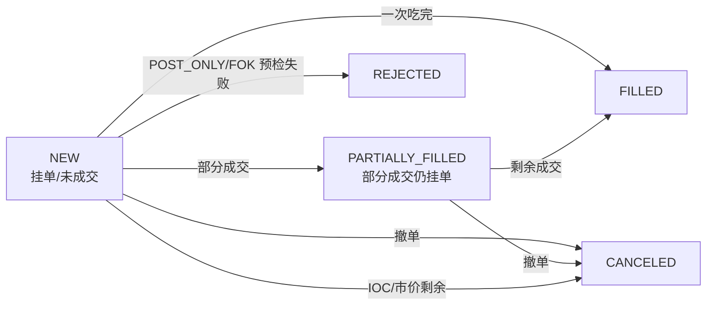
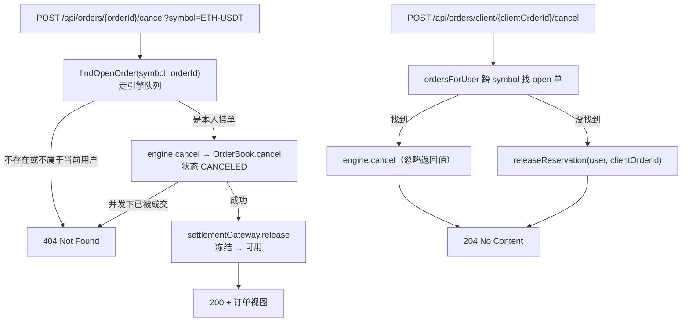

# 第 06 章 · 成交之后：状态机、撤单、改单与查询

> **所属大纲**：第 06 章（必读）
> **前置章节**：第 03 章（冻结与结算）、第 05 章（成交结果）
> **下游章节**：第 07 章（外部流动性留下的状态）、第 08 章（重启后订单去哪了）
> **证据基准**：当前工作区源码，2026-10-25 复核。

---

## 1. 本章导读

**业务场景**：用户下完单，刷新订单页看到"部分成交"；过了一会儿想撤单，点"撤单"后余额里的冻结回来了。另一些用户直接关掉页面，第二天再登录，发现订单列表空了，但资产页还能看到前一天的成交流水。

**本章作用**：讲清订单的**状态机**（谁能变成谁）、**撤单的两条路径**（按 orderId / 按 clientOrderId）、**改单的真实语义**，以及**两套订单视图**（内存 `/orders` vs 数据库 `/account/trading-activity`）为什么会不一致。

- **上游**：第 05 章产生的状态与成交；第 03 章写入的预留与流水。
- **本章输出**：`/api/orders` 的订单视图、`/api/account/trading-activity` 的资产视图、撤单后的解冻。
- **下游**：第 08 章解释"为什么第二天 `/orders` 是空的"；第 07 章解释几个当前不可达的外部状态。

**学习边界**：
- **必须理解**：状态迁移、撤单的顺序（先内存后数据库）、部分成交后撤单释放多少、两套视图的数据来源差异。
- **只需了解**：过滤参数与排序、前端如何拼 symbol 参数。
- **可以跳过**：`tradingActivity` 的四段 SQL 细节、`OrderResponse` 字段拼装。

> **一句话定位**：如果这一环不存在，用户看不见自己的订单、也撤不了单，冻结的钱只能靠成交或人工释放——交易闭环就断了。

---

## 2. 核心业务流程

### 2.1 订单状态机



> 图中只画了**当前生产路径可达**的状态。`OrderStatus` 里还有 5 个外部流动性状态（`ROUTING_EXTERNAL`、`PARTIALLY_FILLED_INTERNAL/EXTERNAL`、`EXTERNAL_REJECTED/TIMEOUT`），因为市商网关未接线，实际不会出现（第 07 章）。

### 2.2 撤单的两条路径



---

## 3. 核心代码拆解

### 3.1 状态机：11 个枚举，生产路径只有 5 个

**业务目的**：用一个显式状态机表达订单生命周期，避免"用 `boolean filled/canceled` 组合出非法态"。

**源码位置**：`OrderStatus.java:3-15`、`Order.java:101-139`

```java
// OrderStatus.java:3-15
public enum OrderStatus {
    NEW, PARTIALLY_FILLED_INTERNAL, ROUTING_EXTERNAL, PARTIALLY_FILLED_EXTERNAL,
    EXTERNAL_REJECTED, EXTERNAL_TIMEOUT, PARTIALLY_FILLED, FILLED, CANCELED, REJECTED, FAILED
}
```

| 方法 | 触发场景 | 结果状态 |
| :--- | :--- | :--- |
| `fill(qty)` | 每次成交 | `remaining == 0 ? FILLED : PARTIALLY_FILLED`（`Order.java:101-104`） |
| `restOnBook()` | GTC 剩余入簿 | 完全没成交 `NEW`，部分成交 `PARTIALLY_FILLED`（`:106-112`） |
| `cancel()` | 撤单 / IOC 剩余 | `CANCELED`（`:133-135`） |
| `reject()` | POST_ONLY/FOK 预检失败 | `REJECTED`（`:137-139`） |
| `routeExternal()` / `applyExternalFill()` / `externalRejected()` / `externalTimedOut()` | 外部市商分支 | 5 个外部状态（当前不可达） |

**设计原因**：状态只由 `OrderBook` 内部调用（方法都是包级私有），外部只能通过命令改变订单，避免控制器或结算代码"随手改状态"（第 01 章的状态地图）。`FAILED` 枚举存在但没有赋值路径，属于预留。

### 3.2 查询：`GET /api/orders` 读的是内存，不是数据库

**业务目的**：让用户看到当前订单和最近历史，字段与下单响应一致。

**源码位置**：`MatchingController.java:141-170`、`SpotMatchingService.java:126-135`、`OrderBook.java:177-183`

```java
// SpotMatchingService.java:130-134
return runtimes.values().stream()
        .flatMap(runtime -> await(runtime.engine().ordersForUser(userId)).stream())
        .sorted(Comparator.comparing(Order::createdAt).reversed()
                .thenComparing(Comparator.comparingLong(Order::orderId).reversed()))
        .toList();
```

```java
// OrderBook.java:177-183
public List<Order> ordersForUser(String userId) {
    return ordersByClientOrderKey.values().stream()
            .filter(order -> order.userId().equals(userId))
            .sorted(...)
            .toList();
}
```

**执行过程**：
1. 控制器先校验 `limit ∈ [1,200]`、`state ∈ {ALL, OPEN, HISTORY}`。
2. `matchingService.ordersForUser` 依次向**每个 symbol 引擎**发查询命令（第 04 章的读队列），合并结果。
3. 全局按 `createdAt` 倒序、再按 `orderId` 倒序。
4. 控制器再按 symbol / side / type / state 过滤，最后 `limit` 截断。
5. `OrderResponse` 序列化：`orderId/clientOrderId/userId/symbol/side/type/price/quantity/filled/remaining/status/createdAt`（`:375-405`）。

**设计原因**：
- **为什么读 `ordersByClientOrderKey` 而不是 `openOrders`**：用户既想看到挂单，也想看到已成交/已撤销的单，所以用"全量订单索引"。
- **代价 1**：过滤在内存里做，且发生在**全量拉取之后**；没有分页，`limit` 只是截断。
- **代价 2**：跨 6 个引擎串行等待，每个最多 3 秒（第 04 章）。
- **代价 3**：数据源是内存，**重启后为空**；真正的历史在 `spot_order_reservations` / `spot_asset_settlements`（3.7 节）。

### 3.3 撤单（一）：按 orderId，先校验归属

**业务目的**：让用户撤掉自己的挂单，并把未成交部分的冻结退回。

**源码位置**：`MatchingController.java:261-276`、`SpotMatchingService.java:87-100`、`OrderBook.java:144-152`

```java
// MatchingController.java:261-275
@PostMapping("/orders/{orderId}/cancel")
public ResponseEntity<OrderResponse> cancelOrder(
        @PathVariable("orderId") long orderId,
        @RequestParam(name = "symbol", defaultValue = "ETH-USDT") String symbol,
        Authentication authentication) {
    String userId = authenticatedUserId(authentication);
    Optional<Order> existing = matchingService.findOpenOrder(symbol, orderId);
    if (existing.isEmpty() || !existing.get().userId().equals(userId)) {
        return ResponseEntity.notFound().build();
    }
    Optional<Order> canceled = matchingService.cancel(symbol, orderId);
    return canceled.map(order -> ResponseEntity.ok(OrderResponse.from(order)))
            .orElseGet(() -> ResponseEntity.notFound().build());
}
```

**执行过程**：
1. 取当前用户，按 `symbol + orderId` 在 `openOrders` 里查（`findOpenOrder` 也走引擎队列）。
2. 不存在、或订单不属于当前用户 → **404**（不区分"不存在"和"不是你的"，避免订单枚举）。
3. 入队 `CancelOrderCommand`；引擎线程执行 `OrderBook.cancel`：从 `openOrders` 移除、`removeFromBook` 从价格档队列删除、状态置 `CANCELED`。
4. 返回 `Optional<Order>`；成功则 `settlementGateway.release(order)` 解冻剩余（第 03 章）。
5. 若在第 1 步与第 3 步之间订单被成交（并发），`cancel` 返回空 → 再次 **404**。

**设计原因**：
- **为什么先 `findOpenOrder` 再 `cancel`**：为了做归属校验；`OrderBook.cancel` 只按 `orderId` 操作，不知道用户。
- **为什么两次都查**：第一次查的是"可撤且属于你"，第二次的结果才是"撤成功"；两者之间可能被成交，所以第二次仍要判空。
- **为什么 404 而不是 403**：不泄露"这个订单存在但不属于你"。

> **陷阱**：`symbol` 参数**默认 `ETH-USDT`**。如果客户端撤 BTC-USDT 的订单却漏传 `symbol`，第 1 步就会查不到 → 404。前端显式传了 symbol（`web/src/services/market.ts:340`），但纯 API 调用方很容易踩到。

### 3.4 撤单（二）：按 clientOrderId，跨交易对搜索 + 兜底解冻

**业务目的**：客户端可能只记得自己生成的 `clientOrderId`，不知道 `orderId`；同时兼容"冻结了但订单没挂上"的异常情况。

**源码位置**：`MatchingController.java:184-200`

```java
// :189-199
Optional<Order> liveOrder = matchingService.ordersForUser(userId).stream()
        .filter(order -> order.clientOrderId().equals(clientOrderId))
        .filter(order -> isOpen(order.status()))
        .findFirst();
if (liveOrder.isPresent()) {
    Order order = liveOrder.get();
    matchingService.cancel(order.symbol(), order.orderId());
} else {
    assetSettlementService.releaseReservation(userId, clientOrderId);
}
return ResponseEntity.noContent().build();
```

**执行过程**：
1. 跨所有 symbol 找当前用户、`clientOrderId` 匹配、且状态是"未结束"的订单。
2. 找到 → 调 `cancel`，但**忽略返回值**；没找到 → 直接 `releaseReservation`（按 `clientOrderId` 找预留并退回）。
3. 无论结果如何都返回 **204**。

**设计原因**：
- **为什么允许"找不到订单也解冻"**：下单流程是"先冻结、再入队"，如果入队失败/超时，数据库里可能只有预留没有订单（第 02 章），这时撤单接口就是唯一的自救入口。
- **为什么返回 204**：撤单是幂等操作，重复调用不应报错。
- **代价**：如果 `cancel` 因为引擎超时/停止返回空，接口仍然 204，用户以为撤了，实际没撤（见第 6 节绿色问题）。且这里不像 3.3 那样检查返回值。

> **边界**：`isOpen`（`:286-291`）把 `ROUTING_EXTERNAL` 也算"未结束"，但该状态当前不可达（第 07 章）。若未来接线市商，这条路径需要重新设计。

### 3.5 部分成交后撤单：释放的是"剩余"，不是"全部"

**业务目的**：部分成交的订单撤单时，只能退回没成交的那部分冻结。

**源码位置**：`Order.java:101-104`（`remainingQuantity`）、`SpotAssetSettlementService.java:453-524`（`releaseInternal`）

**执行过程**（买 2 ETH，成交 0.5，剩余 1.5 后撤单）：
1. 撮合时 `Order.fill(0.5)` → `remaining = 1.5`、状态 `PARTIALLY_FILLED`。
2. 结算已按成交扣掉对应冻结（第 03 章）。
3. 撤单 → `OrderBook.cancel` → 状态 `CANCELED`；`releaseInternal` 读预留的 `remaining_amount`（已经减过 0.5 对应的金额）。
4. 只把**剩余冻结**退回 `available`，预留 `remaining_amount = 0`、状态 `RELEASED`。

**设计原因**：预留的 `remaining_amount` 是"还没花掉的额度"，结算和撤单都以它为准；这样部分成交与撤单可以任意交错，不会多退或少退。

### 3.6 改单：本质是"撤旧单 + 用同一 clientOrderId 重下"

**业务目的**：让用户改价格/数量，而不用先撤再下（对客户端更友好）。

**源码位置**：`OrderBook.java:123-142`、`SpotMatchingService.java:102-112`

```java
// OrderBook.java:123-142（节选）
Order existing = openOrders.get(request.orderId());
if (existing == null || !existing.userId().equals(request.userId()) || !existing.symbol().equals(request.symbol())) {
    return Optional.empty();
}
cancel(request.orderId());
OrderRequest replacement = new OrderRequest(
        existing.clientOrderId(), existing.userId(), existing.symbol(),
        existing.side(), existing.type(), existing.timeInForce(),
        request.newPrice(), request.newQuantity(), existing.allowExternalLiquidity());
return Optional.of(submit(replacement, true));
```

**执行过程**：
1. 校验订单在簿上、属于该用户、symbol 一致。
2. 直接 `cancel(orderId)`（只改内存，**不触发结算解冻**）。
3. 用原订单的 `clientOrderId`、方向、类型、时效，加新的价格/数量，构造替换订单。
4. `submit(replacement, true)`：`replaceExistingClientOrder=true` 表示"即使幂等索引里已有同 key，也继续创建新订单"。
5. 新订单拿到新的 `orderId` 和 `sequence`，重新参与撮合；旧订单留在 `allOrders`（状态 `CANCELED`）。

**三个必须知道的事实**：
- **没有 REST 入口**：`MatchingController` 里没有任何 modify 路由，只有服务层和测试能调用（`SpotMatchingService.modify`）。
- **不释放旧预留**：`OrderBook` 的 `cancel` 不碰数据库；服务层 `modify` 也没调 `release`。新订单沿用同一 `clientOrderId`，所以预留继续被复用——如果新价×量超过原预留，后续结算会因"超出预留"失败。
- **丢时间优先**：新 `sequence` 一定排在同价队尾（第 05 章）。

> **设计原因**：复用 `clientOrderId` 可以保持"一个客户订单意图"的身份，避免产生两条互不相关的订单；但"撤+重下"意味着改单不是原子的——如果替换订单因价格/数量非法（`OrderRequest` 校验失败）被拒绝，旧单已经撤掉，用户会看到"改单失败且原单没了"（当前无入口，所以影响有限）。

### 3.7 另一套视图：`/account/trading-activity` 读数据库

**业务目的**：提供"重启后仍然存在"的资产与流水视图，供资产页使用。

**源码位置**：`MatchingController.java:172-182`、`SpotAssetSettlementService.java:101-247`

**执行过程**：
1. 从 `user_asset_accounts` 读可用/冻结余额。
2. 从 `spot_order_reservations` 读订单，左连 `spot_asset_settlements` 汇总成交量、成交额，推导展示状态。
3. 从 `spot_asset_settlements` 读成交明细。
4. 从 `chain_deposits` + `spot_asset_settlements` 拼资金流水。
5. 每段都有自己的 `limit`（≤200）。

**与 `/orders` 的对比**：

| 维度 | `GET /api/orders` | `GET /api/account/trading-activity` |
| :--- | :--- | :--- |
| 数据源 | JVM 内存（`ordersByClientOrderKey`） | PostgreSQL（reservations + settlements） |
| 重启后 | **为空** | 仍在 |
| 状态精度 | 引擎的 11 态之一 | 只有 `OPEN / FILLED / RELEASED`（推导） |
| 分页 | 无（全量后截断） | 无（SQL `limit`） |
| 用途 | 交易页订单列表 | 资产页历史与流水 |

**状态推导的坑**（`SpotAssetSettlementService.java:138-142`）：

```sql
case
  when reservation.status = 'OPEN' and reservation.remaining_amount > 0 then 'OPEN'
  when count(settlement.settlement_key) > 0 then 'FILLED'
  else reservation.status
end as display_status
```

- 部分成交后**撤单**（`RELEASED`、`remaining=0`、有成交）→ 显示 **`FILLED`**（实际只成交了一部分）。
- 完全未成交就撤单（`RELEASED`、无成交）→ 显示 **`RELEASED`**（而不是用户熟悉的 `CANCELED`）。
- 部分成交仍在挂单 → 显示 `OPEN`（没有 `PARTIALLY_FILLED` 这个粒度）。

**设计原因**：资产页面向"钱有没有回来"，而不是"订单状态机"，所以用预留状态投影出一个粗粒度视图；代价是与交易页的订单状态对不上时，用户会困惑。

### 3.8 竞态与顺序：为什么撤单总是"先内存、后数据库"

**业务目的**：避免"钱退了但单没撤掉"这种最坏情况。

**源码位置**：`SpotMatchingService.java:92-99`

```java
CommandResult result = await(runtime.engine().submit(new CancelOrderCommand(...)));
Optional<Order> canceled = result.optionalCanceledOrder();
canceled.ifPresent(settlementGateway::release);
return canceled;
```

**执行过程**：
1. 撤单命令进入引擎队列；引擎保证它和成交命令**串行**（第 04 章）。
2. 如果成交先执行，撤单会拿到"订单不在簿上"→ 返回空，不释放（钱已经按成交结算）。
3. 如果撤单先执行，订单被移除，随后结算不会再看到它（成交不可能发生）。
4. 只有撤单成功，才调用 `release` 解冻。

**反过来会怎样**：如果先解冻再撤单，而撤单时发现订单刚被成交，就会出现"钱退了、单也成交了"——用户既拿回冻结又得到资产，交易所凭空亏钱。当前顺序把最坏情况压成"单撤了但解冻失败"（用户资金偏保守，可人工修复）。

**设计原因**：以引擎（内存）为"订单是否存在"的权威，数据库只做资金跟随。跨两个存储无法原子，只能选择"宁可少退、不可多退"。

---

## 4. Web3 特有机制与风险提示

本章没有链上调用。可以建立一个概念对比：**撤单在链下只是状态变更，在链上是一笔需要 gas 和确认的交易**。

- 本项目撤单：改内存状态 + 改数据库余额，毫秒级，没有"失败后仍可能上链"的问题。
- 链上撤单：需要发交易、等打包；在交易确认前，原订单仍可能被撮合（除非合约有防重放/随机数机制）。
- 因此链上订单簿通常要设计"取消延迟/防抢跑"，而本项目不需要——这是链下撮合的一个结构性优势。

---

## 5. 本章小结与思考题

**本章完成了什么**：把订单的"后半生"讲完——状态如何变、怎么查、怎么撤、改单是什么、两套视图差在哪。

**最重要的调用链**：

```text
撤单（按 id）：
MatchingController.cancelOrder(:261)
  → SpotMatchingService.findOpenOrder(:137) → engine 队列
  → SpotMatchingService.cancel(:87) → engine → OrderBook.cancel(:144)
  → settlementGateway.release(:98) → releaseInternal(:453)

查询：
MatchingController.userOrders(:141)
  → SpotMatchingService.ordersForUser(:126) → 各 engine 查询
  → 过滤 → limit → OrderResponse
```

**状态变化**：
- `OrderBook.openOrders` 移除、价格档队列移除、`Order.status = CANCELED`；
- `spot_order_reservations.remaining_amount → 0`、`status = RELEASED`；
- `user_asset_accounts`：`frozen → available`。

**与上下游衔接**：第 07 章解释 `ROUTING_EXTERNAL` 等外部状态；第 08 章解释"重启后为什么 `/orders` 空了，而资产页还在"。

### 思考题

**Q1：撤单为什么必须"先在引擎里撤掉，再解冻数据库"？如果顺序反过来会怎样？**

参考答案：引擎是订单是否存在的权威，且撤单与成交在同一队列里串行（`SpotMatchingService.cancel:92-98`）。先撤后解冻，最坏情况是"撤成功但 `release` 抛错"——订单没了、钱还冻着，可人工补偿（第 03 章）。如果先解冻再撤单，而撤单时订单刚被成交，就会出现"冻结已退回 + 成交已发生"，用户既拿回钱又拿到资产，交易所凭空亏钱。跨内存与数据库无法原子，所以选择"宁可少退，不可多退"。

**Q2：为什么同一个用户，`GET /api/orders` 重启后是空的，而 `/api/account/trading-activity` 还能看到前一天的成交？**

参考答案：两者数据源不同。`/orders` 读 `SpotMatchingService.ordersForUser`，最终来自 `OrderBook.ordersByClientOrderKey`（JVM 内存，`OrderBook:177-183`），重启即丢；`trading-activity` 读 `spot_order_reservations` 与 `spot_asset_settlements`（`SpotAssetSettlementService:101-247`），是持久化账本。这也意味着"订单状态机"和"资产流水"是两套事实：前者用于交易操作，后者用于对账。

---

## 6. 设计与实现问题提示

| 级别 | 问题 | 源码依据 | 影响 |
| :--- | :--- | :--- | :--- |
| 黄色 | 按 orderId 撤单的 `symbol` 默认 `ETH-USDT`，漏传就 404 | `MatchingController:264`；`findOpenOrder(symbol, orderId)` | 其他交易对的订单无法通过"只传 orderId"撤销；前端显式传了 symbol，API 调用方容易踩 |
| 黄色 | 撤单成功但解冻失败时没有补偿 | `SpotMatchingService.cancel:97-98` 先撤后 `release`，异常直接上抛；控制器无 try/catch | 订单已不在簿、冻结仍在；用户看到 500，需要人工重放 `release`（第 03 章） |
| 黄色 | 资产页状态推导与交易页不一致 | `SpotAssetSettlementService:138-142`：有成交且 `remaining=0` 一律 `FILLED`；无成交撤单显示 `RELEASED` | "部分成交后撤单"被显示成完全成交；"撤单"显示成内部状态名，用户难以理解 |
| 绿色 | `GET /orders` 全量聚合 + 内存过滤 + 截断，无分页 | `SpotMatchingService:126-135`、`MatchingController:162-168` | 订单多时每次翻页都全量拉取；6 个 engine 串行等待，最坏 6×3s（第 04 章） |
| 绿色 | 按 clientOrderId 撤单忽略 `cancel` 结果 | `MatchingController:191-197`：`cancel` 返回值未检查，仍返回 204 | 引擎超时/停止时用户以为撤单成功，实际订单仍在；与 3.3 的处理不一致 |
| 绿色 | 改单丢时间优先、旧单从列表消失、且不释放预留 | `OrderBook.modify:123-142`（撤+重下、新 sequence）；`ordersForUser` 读 `ordersByClientOrderKey`（旧单被覆盖） | 当前无 REST 入口所以不可达；一旦开放，用户会看到"改单后排队到队尾"和"历史订单少了原单"，且新价×量超预留会导致结算失败 |

本章未发现红色级别问题；第 2 条在故障路径下会造成资金挂账，建议按红色预案对待。这不是完整安全审计。

---

## 7. 下一章

第 07 章会讲：`ROUTING_EXTERNAL`、`PARTIALLY_FILLED_EXTERNAL` 这些状态本来是为谁准备的、`MarketMakerGateway` 如何接管剩余量，以及为什么当前运行时它们一个都不会出现。

---

### 修订记录

| 日期 | 变更 |
| :--- | :--- |
| 2026-10-25 | 首版：复核状态机、两种撤单路径、改单语义与两套订单视图；记录 symbol 默认值、解冻补偿、资产页状态推导等差异 |
