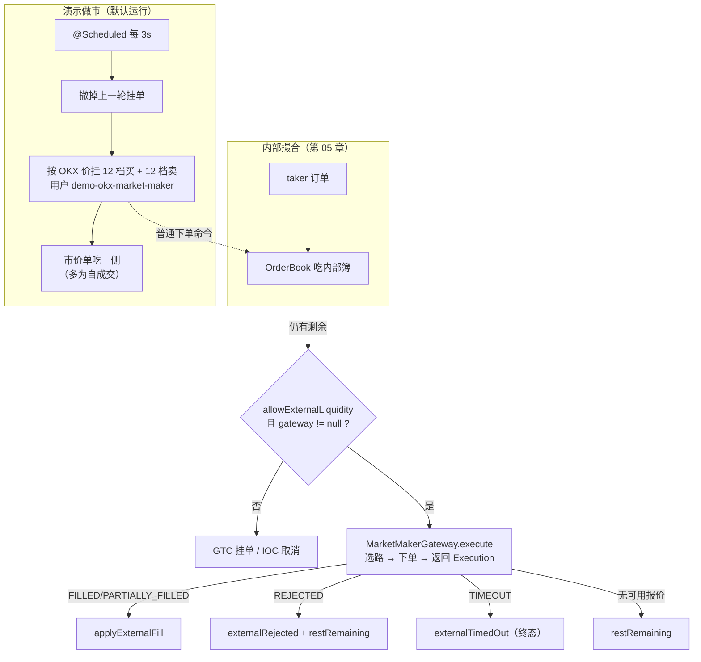
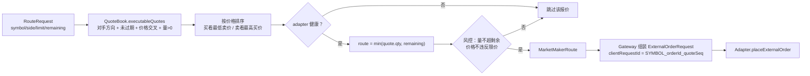

# 第 07 章 · 内部簿不够时：外部流动性与演示做市

> **所属大纲**：第 07 章（可选深入）
> **前置章节**：第 05 章（内部撮合）、第 02 章（`allowExternalLiquidity` 字段）
> **下游章节**：第 03 章（做市订单无预留时的结算）、第 08 章（未接线的装配）
> **证据基准**：当前工作区源码，2026-10-25 复核。

---

## 1. 本章导读

**业务场景**：一个刚上线的交易对，订单簿是空的。用户点"市价买入 2 BTC"，内部没有任何卖单。交易所要么拒绝，要么去外部找流动性；而教学演示如果盘口空着，前端第一屏就没什么可看。

**本章作用**：讲清项目里**两套完全不同的"外部流动性"机制**——一套是写好但没接线的市商网关（`MarketMakerGateway`），一套是默认运行、每 3 秒往订单簿里塞单的演示做市（`OkxDemoMarketMaker`）。混淆这两者，是读这个项目最容易产生的误解之一。

- **上游**：第 05 章的撮合结果（taker 有剩余量）、第 02 章的 `allowExternalLiquidity` 字段。
- **本章输出**：要么是外部成交（`MarketMakerExecution`），要么是一批真实的限价单进入订单簿（演示做市）。
- **下游**：第 03 章的结算（演示做市用户没有预留，会被跳过）；第 08 章解释为什么网关没有接线。

**学习边界**：
- **必须理解**：两套机制的区别、网关的选路流程、演示做市为什么能"凭空"提供流动性。
- **只需了解**：OKX ticker 解析、价格档位与数量缩放公式。
- **可以跳过**：`AggregatedLevel` / `LiquiditySource`（未被主链路使用）、`OkxMarketDataClient.fetchSpotTickers`（行情页用）。

> **一句话定位**：如果这一环不存在，空簿上的市价单只能被取消，演示环境也没有盘口可看——但现货主链路（限价单撮合）仍然完整。

---

## 2. 核心业务流程

### 2.1 两套机制，两条路径



> 关键区别：**网关是"吃掉 taker 剩余量"**；**演示做市是"往簿里塞普通订单"**。前者是路由，后者是造市。

### 2.2 网关内部选路



---

## 3. 核心代码拆解

### 3.1 先分清：网关 vs 演示做市

| 维度 | 市商网关（`MarketMakerGateway`） | 演示做市（`OkxDemoMarketMaker`） |
| :--- | :--- | :--- |
| 触发方式 | taker 有剩余量时，由 `TradingPairMatchingService` 调用 | `@Scheduled` 每 3 秒主动执行 |
| 是否接线 | **没有**：不是 Spring Bean，`createRuntime` 里 `gateway=null` | **默认开启**：`@Component + @ConditionalOnProperty(matchIfMissing=true)` |
| 作用对象 | 当前 taker 的剩余量 | 整个订单簿（撤旧挂新） |
| 资金约束 | 由 adapter 承担（Mock 直接成交） | 用普通用户 `demo-okx-market-maker` 下单，**没有数据库预留** |
| 主要用途 | 设计演示 / 单元测试 | 让空库也有盘口和成交可看 |
| 相关配置 | `app.market-maker.*`（**全项目无读取方**） | `app.matching.demo-market-maker.*`（真正生效） |

**结论先记住**：当前运行时只有演示做市在跑；`ROUTING_EXTERNAL`、`PARTIALLY_FILLED_EXTERNAL` 等状态一个都不会出现（第 06 章）。

### 3.2 网关的入口：`OrderBook` 置状态，服务层做路由

**业务目的**：内部簿吃不下时，把剩余量交给外部市商，而不是直接取消。

**源码位置**：`OrderBook.java:109-118`（剩余量处理）、`TradingPairMatchingService.java:165-195`

```java
// OrderBook.java:109-118
if (taker.remainingQuantity().signum() > 0) {
    if (taker.type() == OrderType.LIMIT && taker.timeInForce() == OrderTimeInForce.GTC && !taker.allowExternalLiquidity()) {
        addOpenOrder(taker);
        taker.restOnBook();
    } else if (taker.allowExternalLiquidity() && taker.timeInForce() != OrderTimeInForce.POST_ONLY) {
        taker.routeExternal();          // 状态 = ROUTING_EXTERNAL / PARTIALLY_FILLED_INTERNAL
    } else {
        taker.cancel();
    }
}
```

```java
// TradingPairMatchingService.java:167-193（节选）
if (marketMakerGateway == null || !order.allowExternalLiquidity()
        || order.remainingQuantity().signum() <= 0 || order.timeInForce() == POST_ONLY) {
    return internalResult;
}
Optional<MarketMakerExecution> execution = marketMakerGateway.execute(RouteRequest.from(order));
if (execution.isEmpty()) {
    orderBook.restRemaining(order);     // 没有可用报价 → 退回挂单
    return internalResult;
}
...
if (status == FILLED || status == PARTIALLY_FILLED) { order.applyExternalFill(fillQuantity); }
else if (status == REJECTED) { order.externalRejected(); orderBook.restRemaining(order); }
else if (status == TIMEOUT) { order.externalTimedOut(); }
```

**执行过程**：
1. 内部撮合结束，taker 仍有剩余且 `allowExternalLiquidity=true` → `OrderBook` 置 `ROUTING_EXTERNAL`（部分成交则 `PARTIALLY_FILLED_INTERNAL`），**不挂单**。
2. 服务层调 `gateway.execute(RouteRequest)`。
3. 网关返回空（没有报价/风控拒绝）→ `restRemaining` 尝试把剩余量挂回订单簿。注意它只处理 `LIMIT + GTC`（`OrderBook:192-195`）：限价单会变回 `NEW/PARTIALLY_FILLED`，而**市价/IOC 不满足条件，会停留在 `ROUTING_EXTERNAL`**（网关接线后才会暴露的潜在问题）。
4. 有执行结果 → 按状态更新订单：成交、拒绝（挂回）、超时（终态 `EXTERNAL_TIMEOUT`）。
5. 结果通过 `MatchResult.withExternalExecution` 带回控制器；结算仍只结算内部 `trades` 与 `externalExecutions` 的账面（第 03 章）。

**设计原因**：把"路由决策"放在服务层而不是 `OrderBook`，让订单簿只负责"内部撮合 + 标记剩余量"，不依赖具体的市商实现；`MarketMakerGateway` 内部再拆 Router/Registry/Adapter，方便替换真实市商。

### 3.3 选路：报价簿 + 健康检查 + 风控

**业务目的**：在多个市商报价中选一个"价格可接受、量够、健康"的。

**源码位置**：`MarketMakerRouter.java:15-34`、`MarketMakerQuoteBook.java:31-44`、`BasicMarketMakerRiskManager.java:10-23`

```java
// MarketMakerRouter.java:15-30（节选）
for (ExternalQuote quote : quoteBook.executableQuotes(request)) {
    if (registry.find(quote.marketMakerId()).filter(MarketMakerAdapter::isHealthy).isEmpty()) continue;
    MarketMakerRoute route = new MarketMakerRoute(
            quote.marketMakerId(), quote.price(),
            quote.quantity().min(request.remainingQuantity()), quote.quoteSeq(), RoutingStrategy.BEST_PRICE);
    if (route.quantity().compareTo(BigDecimal.ZERO) > 0 && riskManager.checkBeforeRoute(request, route).allowed()) {
        return Optional.of(route);
    }
}
return Optional.empty();
```

**执行过程**：
1. `QuoteBook.executableQuotes`：取**对手方向**（用户买→看卖价）、未过期、量 > 0、且与用户限价不冲突的报价，按价格排序（买看最低、卖看最高）。
2. 逐条检查 adapter 是否存在且 `isHealthy()`；不健康跳过。
3. 路由量取 `min(报价量, 剩余量)`。
4. 风控 `BasicMarketMakerRiskManager` 校验两点：路由量不超过剩余量；限价单的报价不劣于用户限价。
5. 第一条通过的就返回（`BEST_PRICE`）。

**设计原因**：路由只做"选一条最优"，不负责撮合；幂等、资金、状态仍由订单簿负责。`RoutingStrategy` 枚举留了 5 种策略，但当前只实现 `BEST_PRICE`（其余是占位）。

### 3.4 Mock 适配器：为测试而生的"永远成交"

**业务目的**：让网关路径可以在无外部依赖的情况下被测试。

**源码位置**：`adapter/MockMarketMakerAdapter.java:35-57`

```java
// :35-48（节选）
public ExternalQuote getQuote(String symbol, Side quoteSide, BigDecimal quantity) {
    BigDecimal price = quoteSide == Side.SELL ? new BigDecimal("100.00") : new BigDecimal("99.50");
    return new ExternalQuote(marketMakerId, symbol, quoteSide, price, quantity,
            quoteSequences.incrementAndGet(), now, now.plusSeconds(1));
}
public ExternalOrderResponse placeExternalOrder(ExternalOrderRequest request) {
    if (!healthy) return ExternalOrderResponse.rejected(request, "UNHEALTHY", "...");
    return ExternalOrderResponse.filled(request, "ext-" + request.clientRequestId());
}
```

- 报价固定 99.50/100.00，有效期 1 秒。
- `placeExternalOrder` 永远返回 `FILLED`（除非手动设为不健康）。
- `cancelExternalOrder` 直接抛 `UnsupportedOperationException`。

**设计原因**：测试关心的是"路由、状态迁移、WAL 审计事件"，不是真实成交；固定价让断言可读。`OrderBookTest` 用它验证两件事：空簿市价单可由外部成交（`:377`）、限价单先用内部流动性再用外部（`:397`）。

### 3.5 为什么网关在运行时"不存在"

**业务目的**：理解"代码存在"与"装配生效"是两件事。

**证据**：
- `MarketMakerGateway`、`MarketMakerRouter`、`MarketMakerQuoteBook`、`MarketMakerRegistry` 都**没有** `@Component` / `@Bean`（全仓库只有测试里 `new`）。
- `SpotMatchingService.createRuntime`（`:177-181`）用 `new TradingPairMatchingService(symbol)`，走的是无 gateway 的构造器。
- `application.yaml:132-142` 的 `app.market-maker.*`（enabled、strategy、quote-ttl、mock adapter）**没有任何 `@Value` 读取**。

**结论**：网关是一套"可运行但未安装"的零件；第 08 章的"装配决定能力"在这里再次出现。

**设计原因**：教学项目希望展示"生产级市商路由长什么样"，又不想让本地运行依赖外部市商服务，于是把它留在测试里，运行时用演示做市替代。

### 3.6 演示做市：每 3 秒重建一次盘口

**业务目的**：让空库也有 12 档买卖盘和成交记录，前端一打开就有内容。

**源码位置**：`OkxDemoMarketMaker.java:25-31`（条件装配）、`:43-55`（构造）、`:57-64`（调度）、`:168-201`（重建）、`:228-243`（价格档位）

```java
// :57-64
@Scheduled(
        fixedDelayString = "${app.matching.demo-market-maker.refresh-interval-ms:3000}",
        initialDelayString = "${app.matching.demo-market-maker.initial-delay-ms:1000}"
)
public synchronized void refresh() {
    markets.values().parallelStream().forEach(this::refreshMarket);
}
```

```java
// :175-200（重建逻辑）
cancelRestingOrders(market);
for (int level = 0; level < market.depthLevels; level++) {
    BigDecimal offset = bands.levelStep().multiply(BigDecimal.valueOf(level));
    BigDecimal bidPrice = bands.bestBid().subtract(offset).setScale(bands.priceScale(), RoundingMode.DOWN);
    BigDecimal askPrice = bands.bestAsk().add(offset).setScale(bands.priceScale(), RoundingMode.UP);
    placeResting(market, OrderRequest.limitBuy(nextClientOrderId(market, "bid"), MARKET_MAKER_USER, market.symbol, bidPrice, quantityFor(...)));
    placeResting(market, OrderRequest.limitSell(nextClientOrderId(market, "ask"), MARKET_MAKER_USER, market.symbol, askPrice, quantityFor(...)));
}
OrderRequest taker = cycle % 2 == 0
        ? OrderRequest.marketSell(..., MARKET_MAKER_USER, market.symbol, takerQuantity)
        : OrderRequest.marketBuy(..., MARKET_MAKER_USER, market.symbol, takerQuantity);
matchingService.submit(taker.withoutExternalLiquidity());
```

**执行过程**（每个 symbol、每 3 秒）：
1. `fetchTicker(okxInstrumentId)` 拉 OKX 公共 ticker（超时 5 秒）。
2. 成功 → 用 `lastPrice/bestBid/bestAsk`；失败 → 用上一次报价或配置里的 `fallback-reference-prices`。
3. 撤销上一轮自己挂的所有单（`cancelRestingOrders`）。
4. 以 `bestBid`/`bestAsk` 为起点，每档偏移 `max(last × 0.00005, tick)`，向下挂 12 档买、向上挂 12 档卖。
5. 数量按"名义金额 / 参考价"算（120–639 USDT 左右），保留 8 位小数。
6. 再用一个市价单吃掉最优价挂单（偶数轮卖、奇数轮买）。正常情况下对手就是自己刚挂的单（**自成交**）；如果用户挂了更优价的单，会先与用户成交。
7. 状态写入 `MarketState.status`，通过 `/api/market/demo-market-maker` 暴露。

**设计原因**：
- **固定节奏 + 撤旧挂新**：实现简单，盘口始终围绕最新外部价；代价是每轮都会产生大量撤单/下单（见 3.8）。
- **用 OKX 公共行情**：不需要账户和密钥，避免把交易所 API key 放进教学仓库。
- **自成交一笔**：让 `/api/market/trades` 有数据、K 线能画出来；代价是成交量是假的。

### 3.7 演示做市的资金后果：账本不守恒

**业务目的**：理解"做市用户没有预留"在结算时意味着什么。

**源码位置**：`SpotAssetSettlementService.java:294-301`

```java
// :294-301
Reservation reservation = reservation(userOrder);
if (reservation == null) {
    if (internalUserId(userOrder.userId()) != null) {
        LOGGER.warn("Skipping unreserved user order settlement: ...");
    }
    return;
}
```

**执行过程**：
1. 演示做市用户是字符串 `"demo-okx-market-maker"`（`:34`），不在 `users` 表里。
2. 用户与它成交时，`settle` 会对用户侧正常结算（扣冻结、加资产），对做市侧查不到预留 → **直接跳过**。
3. 结果：用户买 → 用户 `quote -`、`base +`，但做市方既不扣 base 也不收 quote；用户卖 → 用户 `base -`、`quote +`，做市方不动。

**后果**：每一笔与演示做市的成交都会**凭空创造一种资产、销毁另一种资产**（按成交价对应）。账面总量不守恒。因为项目没有提现出口、也没有手续费，用户无法把它变成真实收益；但这份账本不能用于对账，也不能直接演化为生产系统。

**设计原因**：演示做市要在"没有任何初始资金"的前提下提供无限流动性，最省事的做法就是让它不参与账务。这是一个明确的教学取舍（第 03 章也提到"无预留则跳过"）。

> **如果开放提现**：用户可以把"卖 give 给做市商换来的 quote"提走，等于凭空印钱。届时必须给做市账户建预留/额度，或把做市成交排除在用户可提现余额之外。

### 3.8 负载与降级：每 3 秒近 300 条撮合命令

**业务目的**：理解演示做市对撮合线程的实际压力。

**源码位置**：`OkxDemoMarketMaker.java:57-64`、`:168-201`、`OkxMarketDataClient.java:59-79`

**数量级**（默认 6 个 symbol、12 档）：
- 每 symbol 每轮：撤销上一轮最多 24 单 + 新挂 24 单 + 1 笔市价单 ≈ 49 条命令；
- 6 个 symbol ≈ **294 条命令 / 3 秒**，全部走同一批 symbol 引擎队列（第 04 章）；
- 每条命令 `await` 最长 3 秒；`refresh` 是 `synchronized`，用 `parallelStream` 并行刷各 symbol。

**降级行为**：
- OKX 不可用 → 用上一次报价继续重建（`refreshMarket:91-115`），状态里带 `lastError`；
- 从没成功过 → 用配置的 `fallback-reference-prices`（`:89`），来源标记 `CONFIGURED_FALLBACK`；
- 两者都没有 → 状态 `running=false`，不挂单，等下一轮。

**设计原因**：外部行情是弱依赖，不能因为 OKX 抖动就让演示盘口消失；用旧价/配置价保证"总能看到东西"。代价是**陈旧价格**：如果 OKX 长时间不可用，盘口会围绕一个过时价格，且没有"最大偏离/熔断"。

---

## 4. Web3 特有机制与风险提示

本章没有链上调用，但有两个 Web3 视角的对照：

1. **外部价格 = 链下预言机**。演示做市把 OKX ticker 当成参考价，和 DeFi 里"预言机喂价"的角色相同；差别是本项目没有价格有效性校验（只判断能否拉到），而链上协议通常要检查时间戳、偏离阈值、多源聚合。
2. **做市商 = 中心化对手方**。链上 AMM 用公式定价、任何人可当 LP；这里是一个特权账户按外部价挂单，用户无法审计它的库存与盈亏——这也是 CEX 与 DEX 的结构性差异。

---

## 5. 本章小结与思考题

**本章完成了什么**：区分了"写好但没装"的市商网关与"默认在跑"的演示做市，并解释了后者对账本的影响。

**最重要的调用链**：

```text
网关（未接线）：
TradingPairMatchingService.routeRemainingToMarketMaker(:165)
  → MarketMakerGateway.execute(:14) → Router.selectRoute(:15)
  → QuoteBook.executableQuotes(:31) → Registry/Adapter.placeExternalOrder(:42)
  → Execution → Order.applyExternalFill / externalRejected / externalTimedOut

演示做市（默认）：
OkxDemoMarketMaker.refresh(:61) → refreshMarket(:82)
  → cancelRestingOrders(:216) → placeResting(:208) × 24
  → matchingService.submit(taker.withoutExternalLiquidity)  [通常自成交]
```

**状态变化**：
- 订单簿：演示做市的 24 档挂单 + 每轮一笔市价成交；
- 订单状态：外部分支会写 `ROUTING_EXTERNAL/PARTIALLY_FILLED_EXTERNAL/...`（当前不可达）；
- 账本：与演示做市成交时只有用户侧结算，演示侧被跳过。

**与上下游衔接**：第 08 章解释为什么网关、WAL、Outbox 都没接线；第 03 章解释"无预留则跳过"的账务后果。

### 思考题

**Q1：为什么演示做市能让"空库也有盘口"，但它的成交量不能当真实成交量？**

参考答案：它用普通下单命令往订单簿里挂单（`OkxDemoMarketMaker:180-193`），所以盘口是真的；但挂单用户 `demo-okx-market-maker`（`:34`）不在 `users` 表、没有资金预留，结算时做市侧被跳过（`SpotAssetSettlementService:294-301`）。它每轮还会用市价单吃最优价挂单（`:196-200`），通常形成自成交（用户挂单更优时会先与用户成交）。因此盘口深度和成交量都是"演示数据"，只有用户与它成交时用户侧的资产变动是真实的账本变化。

**Q2：当前 HTTP 下单为什么不会走到 `MarketMakerGateway`？需要哪几层同时成立？**

参考答案：需要三个条件同时成立：① 请求的 `allowExternalLiquidity=true`；② 服务层没有把它剥掉——当前 `TradingPairMatchingService.submit:83` 在 `gateway == null` 时会 `withoutExternalLiquidity()`，所以必须同时给 `TradingPairMatchingService` 注入非空 gateway；③ `gateway.execute` 找到可用报价并通过风控。当前 Spring 装配只满足"② 的否定"（gateway 为 null），所以 ① 无论在 payload 里传什么都不会触发路由（第 02 章、第 06 章）。

---

## 6. 设计与实现问题提示

| 级别 | 问题 | 源码依据 | 影响 |
| :--- | :--- | :--- | :--- |
| 黄色（潜在红色） | 演示做市无资金约束，成交后账本不守恒 | `OkxDemoMarketMaker:34` 固定用户；`SpotAssetSettlementService:294-301` 无预留直接跳过 | 每笔与做市成交都会净创造/销毁一种资产；当前无提现出口，无法直接套利，但账本不可对账。若开放提现或计费，会变成真实资金漏洞 |
| 黄色 | 演示做市（多为自成交）+ 每 3 秒撤挂，制造虚假深度与成交量 | `OkxDemoMarketMaker:175-200`：撤旧挂新后立即用市价单吃一侧 | 前端看到的深度/成交/K 线都不是真实用户行为；对外演示时容易被误读 |
| 黄色 | 每 3 秒约 294 条撮合命令，集中在同一批 symbol 队列 | `refresh:61-64`、`rebuildBookAndTrade:168-201`；默认 6 symbol × 12 档 | 与真实用户订单竞争撮合线程；引擎繁忙时演示刷新本身也会变慢（第 04 章） |
| 黄色 | 行情失败时用旧价/配置价继续挂单，没有偏离保护 | `refreshMarket:91-115`；`fallback-reference-prices`（`application.yaml:89`） | OKX 长期不可用时会围绕过时价格造市；没有"偏离超过 X% 就停止"的熔断 |
| 绿色 | `app.market-maker.*` 是死配置 | `application.yaml:132-142`；全仓库无 `@Value("${app.market-maker...` | 容易让人以为可以配置市商路由/策略；实际只有 `app.matching.demo-market-maker.*` 生效 |
| 黄色（潜在） | 网关返回空时，市价/IOC 剩余量会卡在 `ROUTING_EXTERNAL` | `TradingPairMatchingService:175-177` 调 `restRemaining`；`OrderBook:192-195` 只处理 `LIMIT + GTC`，其他类型直接 return | 网关接线后，市价单遇到"无可用报价"会既不挂单也不终结，冻结无法释放；当前 gateway 为 null，不可达 |
| 绿色 | 网关的 `ExternalOrderStatus` 只有 4 个值，且没有 default 分支 | `TradingPairMatchingService:183-193`；`ExternalOrderStatus` | 若未来适配器返回新状态（如 `ACCEPTED`），订单会停留在 `ROUTING_EXTERNAL`，既不挂单也不终结（当前无实现，待验证） |

本章未发现必然触发资金损失的红色问题；第 1 条在开放提现后会升级为红色。这不是完整安全审计。

---

## 7. 下一章

第 08 章会回答：为什么网关、WAL、RabbitMQ 发布器、Outbox、Snapshot 这些"看起来很重要"的组件，都在源码里却不在运行时？以及"要接线需要改哪一行"。

---

### 修订记录

| 日期 | 变更 |
| :--- | :--- |
| 2026-10-25 | 首版：区分市商网关与演示做市，复核选路/风控/Mock 适配器、演示做市重建与结算跳过；记录账本不守恒、自成交、死配置等差异 |
