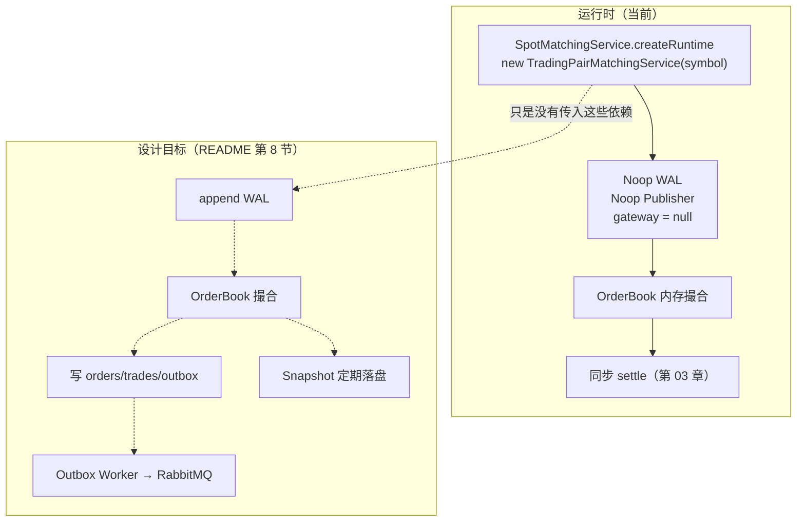

# 第 08 章 · 设计目标 vs 运行时：WAL / Outbox / RabbitMQ / Snapshot 的真实状态

> **所属大纲**：第 08 章（必读，防坑）
> **前置章节**：第 03 章（结算）、第 04 章（队列）、第 07 章（网关未接线）
> **下游章节**：第 09 章（资产从哪来）、第 01 章（状态地图）
> **证据基准**：当前工作区源码，2026-10-25 复核。

---

## 1. 本章导读

**业务场景**：你重启了一次服务。数据库里那些 `OPEN` 的冻结还在，但 `/api/orders` 空了，盘口也空了；README 说"下单 → WAL → 撮合 → PostgreSQL → Outbox → RabbitMQ"，可你在日志里既没看到 WAL 文件，也没看到消息被发出去。

**本章作用**：把"**代码里写了的可靠性组件**"和"**运行时真正生效的**"彻底分开，解释每个组件的设计意图、它与主链路的距离，以及为什么"代码存在 + 测试通过"不等于"系统具备该能力"。

- **上游**：第 03 章的同步结算、第 04 章的队列、第 07 章的网关。
- **本章输出**：一份"哪些在跑、哪些没装、要接线改哪里"的清单。
- **下游**：第 09 章讲资产入账（唯一真正持久化的资金入口）；第 06 章讲重启后订单为什么消失。

**学习边界**：
- **必须理解**：唯一的装配点、WAL 的恢复边界（只恢复订单簿）、Outbox/RabbitMQ 为什么等于不存在、配置项与实现的落差。
- **只需了解**：WAL 的文本格式与 CRC 细节、RabbitMQ 的反射调用。
- **可以跳过**：Snapshot 的文件解析、RabbitMQ 的 topic 语义。

> **一句话定位**：如果误解了这一章，你会以为"订单簿可恢复、事件会到达下游、冻结会自动释放"——而这三件事在当前运行时**一件都不成立**。

---

## 2. 核心业务流程

### 2.1 设计链路 vs 运行时链路



> 实线是实际发生的；虚线是"代码存在但没接上"。两条链路在 `createRuntime` 这一行分叉。

### 2.2 WAL 的样子（如果接线）


---

## 3. 核心代码拆解

### 3.1 唯一的装配点：一行 `new` 决定了有没有可靠性

**业务目的**：把所有可靠性组件的开关收在一个地方（工厂方法），而不是散落在各个类里。

**源码位置**：`SpotMatchingService.java:177-181`

```java
private SymbolRuntime createRuntime(String symbol) {
    TradingPairMatchingService matchingService = new TradingPairMatchingService(symbol);
    SymbolEngine engine = new SymbolEngine(symbol, matchingService, commandQueueSize);
    return new SymbolRuntime(matchingService, engine);
}
```

**执行过程**：
1. 调用 `TradingPairMatchingService(String symbol)` 单参构造。
2. 构造函数链（`TradingPairMatchingService.java:35-72`）依次落到 `eventPublisher = noop()`、`writeAheadLog = noop()`、`marketMakerGateway = null`。
3. 因此下单时：`appendSubmit` 是空方法、`publish` 是空 lambda、`routeRemaining` 因 gateway 为 null 直接返回。
4. 结果：撮合、结算照常，**但没有任何持久化与事件**。

**设计原因**：构造器注入让"要不要 WAL/事件/市商"成为装配决策，而不是业务代码里的 `if`；代价是**一旦装配点写死无参构造，所有能力一起消失**。这正是第 07 章网关、本章 WAL/Event 的共同原因。

> **必须理解**：要接线，只需要改这一处（以及补上关闭逻辑），不需要动 `OrderBook` 或 `TradingPairMatchingService`。

### 3.2 WAL 的实现：逐条 fsync 的文本日志

**业务目的**：在内存撮合之前先落一条"命令日志"，崩溃后能按顺序重放。

**源码位置**：`FileMatchingWriteAheadLog.java:31-45`（构造）、`:172-181`（`append`）、`:282-292`（`body`）、`:308-312`（`checksum`）

```java
// :172-181
private void append(String body) {
    try {
        String line = body + "\t" + checksum(body) + "\n";
        file.write(line.getBytes(StandardCharsets.UTF_8));
        file.getFD().sync();
    } catch (IOException exception) {
        throw new IllegalStateException("failed to append matching wal " + path, exception);
    }
}
```

**执行过程**：
1. 每条记录是"`v1 \t 自增序号 \t 操作类型 \t 字段… \t CRC32`"的一行文本；字符串字段用 Base64URL 编码（避免分隔符冲突）。
2. `append` 写完立刻 `getFD().sync()`——**每条命令一次 fsync**，保证落盘后才返回。
3. 启动时 `readLastSequence` 把整个文件读一遍，恢复自增序号；文件不存在则从 0 开始。
4. `readRecords` 用 `Files.readString` 一次性读入内存再切分（`:190-208`），并逐行校验 CRC。

**设计原因**：教学项目优先"可读、可手工检查"——文本格式能直接用编辑器打开；代价是体积大、解析慢、每条 fsync 吞吐低。生产实现通常用二进制 + 分段 + 组提交。

> **配置落差**：`application.yaml:108-113` 提供 `segment-size-mb`、`flush-interval-ms`、`group-commit-size`，但**没有任何 Java 代码读取**（全仓库 grep 无命中）。`FileMatchingWriteAheadLog` 的构造只接受 `Path`，没有分段、没有组提交，固定每条 fsync。

### 3.3 恢复：只重建订单簿，不碰数据库

**业务目的**：让"订单簿状态"在重启后回到崩溃前，避免用户挂单凭空消失。

**源码位置**：`TradingPairMatchingService.java:153-163`

```java
private void recoverFromWriteAheadLog() {
    for (MatchingWalRecord record : writeAheadLog.readAll()) {
        switch (record.operation()) {
            case SUBMIT -> orderBook.submit(record.orderRequest());
            case CANCEL -> orderBook.cancel(record.orderId());
            case MODIFY -> orderBook.modify(record.modifyOrderRequest());
            case EXTERNAL_ROUTE, EXTERNAL_FILL, EXTERNAL_REJECT, EXTERNAL_TIMEOUT -> { }
        }
    }
}
```

**执行过程**：
1. 构造 `TradingPairMatchingService` 时、引擎线程启动前，同步重放所有记录。
2. 直接调用 `OrderBook` 的方法（绕开服务层），因此**不会再写 WAL、不会再发事件、不会再路由市商**。
3. 外部流动性记录（`:161`）被显式忽略——它们只用于审计，不改变内部订单簿。
4. 重放完成后，订单簿恢复；随后才创建 `SymbolEngine` 线程开始接单。

**必须知道的三个边界**：
- **只恢复订单簿，不恢复资金**。数据库里的 `spot_order_reservations` / `spot_asset_settlements` 已经是"事实"，重放不会也不能再结算。
- **订单号会重新分配**。WAL 里没有 `orderId`/`sequence`，重放时从 1 重新自增；只要日志从空开始、顺序一致，结果通常与原来一致（测试 `OrderBookTest:272/303/332` 验证了这一点），但**不能依赖 orderId 跨重启稳定**。
- **`allowExternalLiquidity` 没有入日志**（`appendSubmit` 不写该字段，解析时传 `null` 走默认值）。当前运行时该字段恒为 false，所以无影响；接线市商后需要补。

> **崩溃窗口**：WAL 在撮合**之前**写，结算在撮合**之后**做。如果在两者之间崩溃，重启后订单会回来，但对应成交没有写进 `spot_asset_settlements`，冻结还停在 `spot_order_reservations` —— 需要人工对账。第 03 章的"预留缺失/单边记账"就是这类问题的下游表现。

### 3.4 Snapshot：只存盘口档位，不能替代 WAL

**业务目的**：减少启动时需要重放的 WAL 量。

**源码位置**：`SnapshotManager.java:22-60`、`MatchingSnapshot.java:8-13`

```java
// MatchingSnapshot.java:8-13
public record MatchingSnapshot(
        String symbol,
        long lastSequence,
        OrderBookSnapshot orderBook,   // 只有 price + quantity
        Instant createdAt
) { ... }
```

**执行过程**：
1. `save` 把 symbol、最后序号、时间、以及买卖各档的 `price/quantity` 写成文本文件。
2. `loadLatest` 按文件名里的序号挑最大的一份，解析回 `MatchingSnapshot`。
3. **没有**任何代码调用 `save` 或 `loadLatest`（全仓库 grep 仅在 `SnapshotManager` 内部）。

**设计原因与缺口**：
- **快照只存聚合档位**，不存订单号、`clientOrderId`、`userId`、`remainingQuantity`、FIFO 顺序。即使接线，也只能恢复"盘口看起来像"，**无法恢复可撮合的订单簿**（谁先排队、订单属于谁、剩余多少都不知道）。
- 真要用于恢复，必须存"每个价格档下的订单列表"或存"命令序列"，并在加载后继续 replay 尾部 WAL。
- 配置 `interval-seconds` / `command-count-threshold` 同样没有任何读取方。

### 3.5 事件发布：Noop，以及一个"只声明 exchange"的 Rabbit 实现

**业务目的**：把订单/成交事件推给下游（行情、风控、通知、数据仓库）。

**源码位置**：`OrderEventPublisher.java:5-16`、`RabbitOrderEventPublisher.java:18-70`、`:73-81`、`TradingPairMatchingService.java:90-94`

```java
// TradingPairMatchingService.java:90-94
eventPublisher.publish(OrderEvent.orderAccepted(result.order()));
for (Trade trade : result.trades()) {
    rememberTrade(trade);
    eventPublisher.publish(OrderEvent.tradeExecuted(trade));
}
```

```java
// OrderEventPublisher.java:9-13
static OrderEventPublisher noop() {
    return event -> { };
}
```

**执行过程（如果接线）**：
1. 下单成功 → 发布 `ORDER_ACCEPTED`；每笔成交 → `TRADE_EXECUTED`；撤单 → `ORDER_CANCELED`。
2. `RabbitOrderEventPublisher` 通过反射创建连接/通道，`exchangeDeclare(exchange, "topic", true)`，开启 publisher confirm。
3. routing key 规则（`RabbitOrderEventPublisher.java:73-81`）：`order.created.<symbol>`、`order.canceled.<symbol>`、`trade.created.<symbol>`。
4. 每条消息 `waitForConfirms()` 同步等待确认；失败抛异常。

**缺口**：
- 当前装配是 `noop()`，**一条消息都不会发**。
- 即使接线，`RabbitOrderEventPublisher` **只声明 exchange，不声明队列、不做绑定**；仓库里也没有 `@RabbitListener` 消费者。消息会进入 exchange，但没有队列接收（topic exchange 无匹配绑定即丢弃）。
- `application.yaml:121-131` 的 `order-events-queue`、`dead-letter-*` 没有代码读取，属于"设计中的拓扑"。
- 发布是**同步**的，且在撮合线程内执行：如果 Rabbit 挂掉，`publish` 抛异常会向上冒泡——订单已经成交，但控制器会尝试释放冻结（第 02 章），造成新的不一致。接线时必须把"发布失败"与"撮合失败"分开处理（例如 Outbox）。

### 3.6 Outbox：表设计完整，写入方为零

**业务目的**：解决"数据库事务提交了，但消息没发出去"的一致性问题——先把事件写进同一个数据库事务，再由后台 Worker 投递。

**源码位置**：`V4__matching_outbox_events.sql:32-45`、`PostgresOrderEventRepository.java:16-29`

```sql
-- V4:32-45（节选）
create table if not exists outbox_events (
    ...
    payload jsonb not null,
    status text not null default 'PENDING',
    retry_count integer not null default 0,
    next_retry_at timestamptz,
    ...
    check (status in ('PENDING', 'SENT', 'FAILED'))
);
```

**执行过程（按设计）**：
1. 结算事务内，把要发的事件插入 `outbox_events`（`PENDING`）。
2. 独立 Worker 轮询 `PENDING` 且 `next_retry_at` 到期的记录，投递 RabbitMQ。
3. 收到 confirm 后置 `SENT`；失败则 `retry_count + 1`、`next_retry_at` 退避，超过上限置 `FAILED`。

**实际状态**：
- **没有任何 Java 代码写 `outbox_events`**（全仓库仅在 SQL 与注释中出现）。
- **没有 Worker**（无 `@Scheduled` 扫 outbox 的类）。
- `PostgresOrderEventRepository`（写 `matching_order_events`）也没有调用方，且每次 `DriverManager.getConnection` 新建连接。
- `matching_order_events` 同样只有这张表和一个未装配的仓库类。

**结论**：Outbox 是"建好了仓库、没进货也没发货"。

### 3.7 配置项全是"愿望清单"

验证方法：对每个配置键做一次全仓库 Java 检索。

| 配置 | 期望作用 | 是否有代码读取 |
| :--- | :--- | :--- |
| `app.wal.dir` / `segment-size-mb` / `flush-interval-ms` / `group-commit-size` | WAL 路径与刷盘策略 | **否** |
| `app.snapshot.dir` / `interval-seconds` / `command-count-threshold` | 快照目录与频率 | **否** |
| `app.rabbitmq.matching-exchange` / `order-events-queue` / `dead-letter-*` | 事件拓扑 | **否** |
| `spring.rabbitmq.*`（host/port/confirm/listener） | Spring AMQP 配置 | 未引入 Spring AMQP，代码用反射 + 可选 `amqp-client` |
| `app.market-maker.*` | 市商路由 | **否**（第 07 章） |
| `app.matching.*` | 撮合引擎 | **是** |

> **读代码技巧**：判断一个配置是否生效，不要看它有没有注释，直接 `grep -rn "配置键" src/main/java`。

### 3.8 如果要接线：最小改动清单

不改业务逻辑，只改装配：

1. **WAL**：在 `createRuntime` 里构造 `new FileMatchingWriteAheadLog(Path.of(walDir, symbol + ".wal"))`，传给 5 参构造；`SpotMatchingService.close()` 里关闭它（否则文件句柄泄漏）。
2. **事件**：构造 `RabbitOrderEventPublisher` 传入构造器；同时补队列声明/绑定与消费者，否则消息仍会丢；发布失败要走 Outbox 或异步，不能阻塞撮合返回。
3. **Outbox**：在 `settle` 的同一事务里插入 `outbox_events`；新增 `@Scheduled` Worker 投递并按 confirm 更新状态。
4. **Snapshot**：先改 `MatchingSnapshot` 存订单（而不只是档位），再在启动时先加载快照、从 `lastSequence` 之后 replay WAL；同时加定时保存。
5. **验收**：重启后订单簿与 `clientOrderId` 对齐；崩溃窗口内的成交能被对账任务发现；Rabbit 不可用时下单不受影响。

**顺序建议**：先 WAL（恢复订单簿）→ 再 Outbox（保证事件）→ 最后 Snapshot（优化启动时间）。Snapshot 放最后，因为当前格式不足以恢复状态。

### 3.9 不接线的业务后果

| 后果 | 触发条件 | 用户感知 |
| :--- | :--- | :--- |
| 订单/盘口丢失 | 任意重启 | `/orders` 清空、挂单消失 |
| 冻结资金挂账 | 重启前有 `OPEN` 预留 | 余额里 `frozen` 永久占用，只能人工处理 |
| 成交未结算 | 崩溃发生在 WAL 与 settle 之间（接线后才会出现） | 订单状态与余额不一致 |
| 下游收不到事件 | 任何下单/成交 | 行情、风控、数据仓库没有数据 |
| 启动变慢 | 接线 WAL 且不接 Snapshot | 重放全部历史命令 |

---

## 4. Web3 特有机制与风险提示

本章没有链上调用，但"可靠性"这件事在 Web3 里有直接对应物：

- **WAL ≈ 链上交易日志**：链上交易一旦打包就持久化、可重放；本项目的 WAL 是"链下版"，但**默认未启用**，所以持久性完全依赖数据库里的账本（reservations/settlements），而不是订单簿。
- **Outbox ≈ 事件索引器（indexer）**：链上事件由节点/索引器消费；本项目设计了 outbox 表，但没有生产者与消费者。
- **Snapshot ≈ 状态快照/检查点**：链上轻节点用状态根做检查点；本项目的 snapshot 只存盘口聚合值，连"订单身份"都没有，达不到检查点语义。

**边界**：即使把 WAL/Outbox 全部接上，这套系统仍然是"链下账本 + 测试网充值"，与链上最终性、重组处理无关；不要把"有 WAL"理解为"有链上级持久性"。

---

## 5. 本章小结与思考题

**本章完成了什么**：把"设计目标"和"运行时"对齐，给出每个可靠性组件的真实状态与接线成本。

**最重要的调用链（当前真实发生的）**：

```text
SpotMatchingService.createRuntime(:177)
  → new TradingPairMatchingService(symbol)         [noop WAL + noop publisher + null gateway]
  → SymbolEngine 线程
  → OrderBook 内存撮合
  → settle 同步写数据库
```

**状态变化**：本章没有业务状态变化；它解释的是"为什么内存状态无法恢复、为什么事件不会出现"。

**与上下游衔接**：第 09 章讲唯一真正把外部资产带进系统的链路（充值入账）；第 06 章讲重启后两套订单视图的差异。

### 思考题

**Q1：WAL 恢复时，为什么不能把重放出来的成交再结算一遍？**

参考答案：结算的权威在数据库，不在 WAL。`recoverFromWriteAheadLog`（`TradingPairMatchingService:153-163`）直接调 `OrderBook`，只重建内存订单簿；如果重放后再调 `settle`，会对已经结算过的成交重复扣款/加钱（虽然 `settlement_key` 能挡住重复插入，但崩溃窗口中"WAL 有、结算无"的成交会被错误地按当前余额结算，且缺少当时的 `MatchResult` 上下文）。正确做法是"WAL 恢复订单簿 + 数据库作为账本事实 + 独立对账任务处理缺口"，而不是把 WAL 当成第二套账本。

**Q2：为什么 `SnapshotManager` 即使接线，也不能替代 WAL？**

参考答案：`MatchingSnapshot` 只保存 `OrderBookSnapshot`（每个价格档的 price + quantity，`MatchingSnapshot:8-13`），没有订单号、`clientOrderId`、`userId`、剩余量、FIFO 顺序。恢复后只能得到"看起来一样的盘口"，无法知道某个价位里谁排在前面、每笔单还剩多少，因而**无法继续撮合**。它最多只能作为"减少 WAL 回放量"的优化，并且必须配合"快照存订单 + 从 lastSequence 之后 replay"才有意义。

---

## 6. 设计与实现问题提示

| 级别 | 问题 | 源码依据 | 影响 |
| :--- | :--- | :--- | :--- |
| 黄色（潜在红色） | 重启丢订单、冻结永久挂账 | `SpotMatchingService.createRuntime:177` 用无参构造；`spot_order_reservations` 无自动释放任务 | 用户挂单消失、余额被冻结且无出口；只能人工修库（第 03、06 章） |
| 黄色 | WAL 与结算之间存在崩溃窗口 | WAL 在撮合前写（`TradingPairMatchingService:88-89`），结算在撮合后（第 03 章） | 接线后会出现"订单恢复但未结算"的账实不一致，需要独立对账 |
| 黄色 | WAL 每条 fsync，且配置的组提交/分段未实现 | `FileMatchingWriteAheadLog.append:172-181`；`application.yaml:111-113` 无读取方 | 接线后吞吐受限于磁盘 fsync；配置项给人"已支持批量化"的错觉 |
| 黄色 | Snapshot 不含订单，接线也无法恢复 FIFO | `MatchingSnapshot:8-13`、`SnapshotManager.save:31-47` | 只能恢复盘口外观；若误用于恢复会造成订单丢失/重复 |
| 绿色 | Rabbit 只声明 exchange，不建队列/绑定，无消费者 | `RabbitOrderEventPublisher:18-47`；全仓库无 `@RabbitListener` | 即使接线，消息也会因无绑定队列被丢弃 |
| 绿色 | Outbox 表零写入、零 Worker；`PostgresOrderEventRepository` 每条事件新建连接 | `V4:32-45`、`PostgresOrderEventRepository:16-29` | Outbox 一致性方案完全未落地；未来接线需补事务内写入与投递 Worker |
| 绿色 | 可靠性配置全部未读取 | `application.yaml:108-131`；grep 无命中 | 调参无效，容易误判系统能力 |

本章未发现"必然触发资金损失"的红色问题；第 1 条在真实运营中会直接影响用户资金可用性，建议按红色预案对待。这不是完整安全审计。

---

## 7. 下一章

第 09 章转向资产的来源：托管钱包如何生成、三条测试网如何扫链、充值如何幂等入账，以及为什么"默认启动时余额只能靠模拟充值"。

---

### 修订记录

| 日期 | 变更 |
| :--- | :--- |
| 2026-10-25 | 首版：核对 WAL/事件/Outbox/Snapshot 的装配状态、WAL 格式与恢复边界、配置落差与接线清单；记录重启挂账、崩溃窗口、快照不可恢复等问题 |
