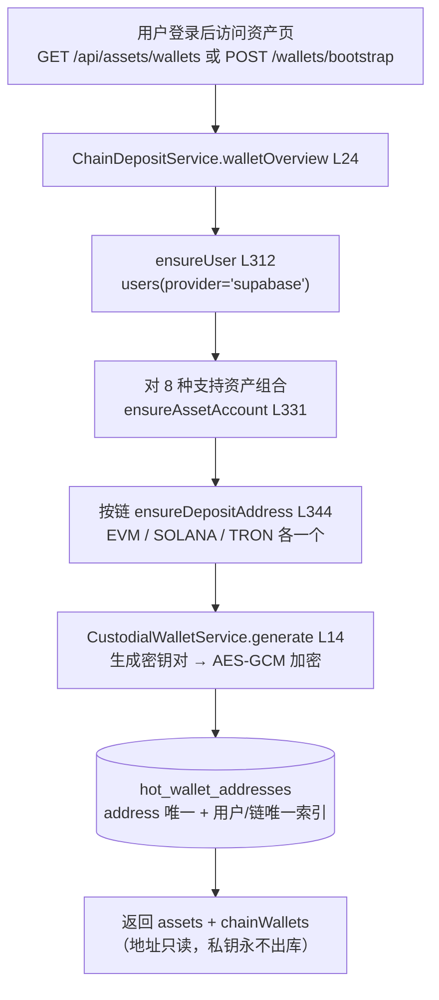
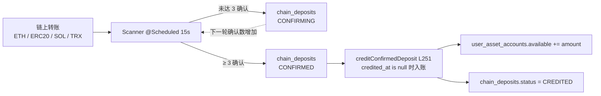

# 第 09 章 · 资产从哪里来：三链托管钱包与充值扫链

> **所属大纲**：第 09 章（选读，与现货主线弱相关）
> **前置章节**：第 01 章（users / user_asset_accounts）、第 03 章（余额如何被花掉）
> **下游章节**：第 10 章（跨链桥）、第 06 章（资产页视图）
> **证据基准**：当前工作区源码，2026-10-25 复核。

---

## 1. 本章导读

**业务场景**：用户第一次登录，资产页出现三个地址（EVM、Solana、Tron），每个地址旁边是 0 余额。他往 EVM 地址转了一点测试 ETH，几秒到几分钟后，站内余额出现了。这笔钱是怎么从链上"变"成数据库里的 `available` 的？

**本章作用**：讲清 CEX 的资产入口——**托管钱包如何生成、地址如何分配、三条测试网如何被扫描、充值如何幂等入账**，以及当前实现的支持矩阵缺口。

- **上游**：第 01 章的 `users` / `user_asset_accounts`；第 08 章的"账本才是持久事实"。
- **本章输出**：`chain_deposits` 的充值记录、`user_asset_accounts.available` 的增加。
- **下游**：第 03 章的冻结与结算消费这些余额；第 10 章的跨链桥是另一条（与撮合无关的）资产通道。

**学习边界**：
- **必须理解**：每链一个钱包、地址复用规则、扫描游标、3 确认入账、`tx_hash` 幂等。
- **只需了解**：EVM JSON-RPC / Solana RPC / TronGrid 的具体请求格式、密钥生成算法。
- **可以跳过**：`Base58`、`EvmKeyUtils`/`SolanaKeyUtils`/`TronKeyUtils` 的密码学细节。

> **一句话定位**：如果这一环不存在，站内余额只能靠种子数据或模拟充值，交易就成了"没有真实资金来源的账本游戏"。

---

## 2. 核心业务流程

### 2.1 钱包与账户的初始化



### 2.2 一笔充值的生命周期



---

## 3. 核心代码拆解

### 3.1 账户初始化：一个用户、8 条资产账户、3 个钱包

**业务目的**：让用户"登录即有地址、有余额行"，不需要先选链再开户。

**源码位置**：`ChainDepositService.java:24-95`（`walletOverview`）、`:312-330`（`ensureUser`）、`:331-342`（`ensureAssetAccount`）、`:432-443`（`supportedAssets`）

```java
// :432-443
private static List<SupportedDepositAsset> supportedAssets() {
    return List.of(
            new SupportedDepositAsset("ETH", "EVM", "SEPOLIA"),
            new SupportedDepositAsset("ETH", "EVM", "BASE_SEPOLIA"),
            new SupportedDepositAsset("USDT", "EVM", "SEPOLIA"),
            new SupportedDepositAsset("USDT", "EVM", "BASE_SEPOLIA"),
            new SupportedDepositAsset("SOL", "SOLANA", "DEVNET"),
            new SupportedDepositAsset("USDT", "SOLANA", "DEVNET"),
            new SupportedDepositAsset("TRX", "TRON", "NILE"),
            new SupportedDepositAsset("USDT", "TRON", "NILE")
    );
}
```

**执行过程**：
1. `ensureUser` 按 `(provider='supabase', provider_user_id=sub)` upsert `users`，返回内部 `user_id`。
2. 遍历 8 种组合，`ensureAssetAccount` 逐条插入 `user_asset_accounts`（`on conflict do nothing`）。
3. 再按 `chain` 调 `ensureDepositAddress`：**同一用户在同一链只生成一个钱包**，EVM 的 ETH/USDT、Sepolia/Base Sepolia 共用同一个地址。
4. 查询资产与钱包返回给前端；私钥字段不在任何返回结构中。

**设计原因**：先建账户行、后建地址，让"展示"和"入账"都不依赖用户主动操作；`on conflict do nothing` 让接口天然幂等，刷新资产页不会重复开户。

> **注意**：`USDT/ SOLANA` 与 `USDT/ TRON` 虽然会建账户、显示地址，但**扫描器并不处理 SPL / TRC20**（见 3.6），这两条充值路径实际不可用。

### 3.2 托管钱包：每链一个，私钥加密存库

**业务目的**：由交易所替用户保管私钥，用户只看到地址和余额。

**源码位置**：`CustodialWalletService.java:14-66`、`Aes256PrivateKeyCipher.java:25-78`

```java
// CustodialWalletService.java:14-21
public GeneratedWallet generate(String asset, String chain, String network) {
    return switch (chain) {
        case "EVM" -> generateEvmWallet(asset, chain, network);
        case "SOLANA" -> generateSolanaWallet(asset, chain, network);
        case "TRON" -> generateTronWallet(asset, chain, network);
        default -> throw new IllegalArgumentException("unsupported custodial wallet chain: " + chain);
    };
}
```

```java
// Aes256PrivateKeyCipher.java:63-75（密钥来源）
if (configuredKey != null && !configuredKey.isBlank()) {
    byte[] decoded = Base64.getDecoder().decode(configuredKey.trim());
    if (decoded.length != 32) throw new IllegalArgumentException(...);
    return decoded;
}
return MessageDigest.getInstance("SHA-256")
        .digest(("dev-custodial-wallet-key:" + projectRef).getBytes(StandardCharsets.UTF_8));
```

**执行过程**：
1. 按链生成密钥对：EVM/Tron 用 secp256k1（地址分别是 `0x…` 与 Base58Check `T…`），Solana 用 Ed25519。
2. 私钥用 AES-256-GCM 加密（12 字节随机 IV、128 位 tag），密文、IV、密钥版本一起写 `hot_wallet_addresses`。
3. 地址作为主键写入；数据库另有 `(assigned_user_id, chain)` 部分唯一索引（`V13`），保证"一人一链一个托管钱包"。
4. 插入冲突时重试最多 3 次，再冲突则抛异常（`:344-414`）。

**设计原因**：
- **每链一个钱包**：EVM 的地址与网络无关，Sepolia/Base Sepolia 必须复用；Solana/Tron 各自独立。
- **加密存储 + 版本号**：为未来轮换密钥留字段（`encryption_key_version`），前端永远读不到私钥列（`V9a` 只授权公开列）。
- **代价**：密钥管理是托管模式最大的风险点——**默认配置下，密钥由 `project-ref` 推导**（`resolveKey:63-78`）。任何拿到仓库和数据库的人都能重建密钥、解密私钥。测试网资产影响有限，但这个模式绝不能用于生产。

### 3.3 地址展示：EVM 地址如何"复用"到多个资产

**业务目的**：资产页要展示"每个资产/网络的充值地址"，但 EVM 只有一个地址。

**源码位置**：`ChainDepositService.java:31-70`

```java
// :31-70（节选）
left join lateral (
    select wallet.address
    from hot_wallet_addresses wallet
    where wallet.assigned_user_id = account.user_id
      and wallet.chain = account.chain
      and wallet.encrypted_private_key is not null
    order by wallet.assigned_at asc
    limit 1
) address on true
```

**执行过程**：
1. 以 `user_asset_accounts` 为主表（8 行）。
2. 对每一行，按 `(user_id, chain)` 找最早分配的托管地址；EVM 的 4 行都会命中同一个地址。
3. `chainWallets` 再单独按链聚合返回 3 个钱包（链、网络、地址、`wallet_scheme`）。
4. 额外用 `spot_asset_settlements` 汇总 30 天成交额，给资产页展示。

**设计原因**：把"资产账户"（资金维度）与"钱包地址"（链维度）分开建模，避免每个 ERC20 都生成一个地址；查询用 `left join lateral` 让没有地址的账户也能显示（地址为空串）。

### 3.4 扫链总览：三个 `@Scheduled`，默认关闭

**业务目的**：持续发现"打到托管地址的转账"，并等待足够确认后入账。

**源码位置**：`EvmChainDepositScanner.java:84`、`SolanaChainDepositScanner.java:66`、`TronChainDepositScanner.java:73`、`application.yaml:175-210`

| 链 | 扫描方式 | 游标 | 支持资产 |
| :--- | :--- | :--- | :--- |
| EVM（Sepolia / Base Sepolia） | 按区块遍历，查原生转账 + ERC20 `Transfer` 日志 | `chain_scan_cursors`（chain+network） | ETH、`chain_tokens` 里的 ERC20（USDT） |
| Solana Devnet | 按地址拉 `getSignaturesForAddress` → `getTransaction` | `chain_scan_address_cursors`（按地址） | 仅 SOL |
| Tron Nile | 按地址拉 TronGrid 交易列表 | `chain_scan_address_cursors`（按地址） | 仅 TRX |

**开关**：三者共用 `app.chain-scanner.enabled`，默认 **false**；关闭时方法第一行直接 `return`（`Evm:85`、`Solana:67`、`Tron:75`），不会发起任何 RPC。

**设计原因**：默认关闭是为了"没有 RPC Key 也能启动课堂环境"；代价是**默认启动时余额只能靠种子数据或模拟充值**（第 01 章）。

### 3.5 EVM：按块推进 + ERC20 日志

**业务目的**：一个 EVM 地址既能收 ETH，也能收 USDT；扫描要同时覆盖两种。

**源码位置**：`EvmChainDepositScanner.java:93-149`（`scanNetwork`）、`:147-176`（原生）、`:178-222`（ERC20）、`:310-339`（游标）

```java
// :104-133（节选）
long currentBlock = hexToLong(rpc(network.rpcUrl(), "eth_blockNumber", ...));
long confirmedHead = currentBlock - Math.max(0, requiredConfirmations);
long lastScanned = cursor(network.network());
if (lastScanned == 0) {
    lastScanned = Math.max(0, confirmedHead - bootstrapLookbackBlocks);
}
long fromBlock = lastScanned + 1;
long toBlock = Math.min(confirmedHead, lastScanned + Math.max(1, maxBlocksPerRun));
for (long block = fromBlock; block <= toBlock; block++) {
    scanNativeEthBlock(network, block, currentBlock, ethAddresses);
    for (Erc20ScanTarget target : erc20Targets) {
        scanErc20Transfers(network, block, block, currentBlock, ...);
    }
    advanceCursor(network.network(), block);
}
```

**执行过程**：
1. 取当前块，减去 `required-confirmations` 得到"安全头"（只扫已确认的块）。
2. 读游标；首次运行（游标 0）时回看 `bootstrap-lookback-blocks`（默认 120 块）。
3. 每轮最多扫 `max-blocks-per-run`（默认 20）块。
4. 每块先查所有交易，找 `to` 命中用户地址的原生 ETH 转账。
5. 再对每个 ERC20 token、每个地址，用 `eth_getLogs` 查 `Transfer(to=address)`。
6. 每处理完一个块就推进游标；某块失败则异常上抛，游标停在上一块。

**幂等键**：原生用 `txHash`；ERC20 用 `txHash:logIndex`（同一交易可能有多条 Transfer 日志）。

**设计原因**：EVM 的 API 是"按块/按日志"设计的，所以游标按 block；每个 token 的每个地址各发一次 `eth_getLogs`。代价是 **RPC 次数 = 块数 × (1 + token 数 × 地址数)**，地址多时压力明显。

### 3.6 Solana / Tron：按地址游标，只处理原生资产

**业务目的**：这两条链的 API 是"按地址查历史"，与 EVM 的块模型不同。

**源码位置**：`SolanaChainDepositScanner.java:90-126`（`scanAddress`）、`:122-176`（签名分页）、`:203-219`（地址过滤）；`TronChainDepositScanner.java:94-126`、`:128-176`（交易分页）、`:235-251`

**执行过程（Solana）**：
1. 取该用户地址的游标（最后处理的签名）。
2. `getSignaturesForAddress` 从新到旧分页，遇到游标签名停止；最多 `max-pages-per-address` 页。
3. 倒序后逐笔 `getTransaction`，跳过失败交易；用 `preBalances/postBalances` 计算该地址的**原生 SOL 净增加**，≤0 跳过。
4. 记录充值（`txHash = signature`），最后把游标推进到最新签名。

**执行过程（Tron）**：
1. 用 TronGrid `/v1/accounts/{address}/transactions?only_confirmed=true&only_to=true` 分页拉取。
2. 只看 `TransferContract` 且 `to_address` 匹配的交易，累加 `amount`（sun）。
3. 记录后推进游标到最新 `txID`。

**设计原因**：两条链的"游标"是**签名/交易 ID**，不是区块号，所以用 `chain_scan_address_cursors` 按地址存；失败时不推进，下一轮补扫。

> **缺口**：`ASSET` 常量固定为 `SOL` / `TRX`（`Solana:34`、`Tron` 同理），扫描器**不处理 SPL / TRC20**。但 3.1 的支持矩阵包含 `USDT/SOLANA`、`USDT/TRON`——用户能在资产页看到 USDT 地址，转账却永远不会入账。

### 3.7 入账：三确认 + 两级幂等

**业务目的**：处理"扫到同一笔多次""确认数从 1 涨到 3""重复调用"等情况，保证只加一次钱。

**源码位置**：`ChainDepositService.java:158-221`（`recordChainDeposit`）、`:251-279`（`creditConfirmedDeposit`）

```java
// :251-279（节选）
update user_asset_accounts account
   set available = account.available + deposit.amount, ...
  from chain_deposits deposit
 where deposit.tx_hash = ?
   and deposit.status = 'CONFIRMED'
   and deposit.credited_at is null
   and account.user_id = deposit.user_id
   and account.asset = deposit.asset ...
returning 1
```

**执行过程**：
1. 按 `(address, chain)` 找 `assigned_user_id`；找不到则抛异常（地址未分配/已解绑）。
2. 计算状态：`confirmations >= REQUIRED_CONFIRMATIONS(3)` → `CONFIRMED`，否则 `CONFIRMING`。
3. 按 `tx_hash` upsert：确认数取 `greatest`；已 `CREDITED` 的保持 `CREDITED`；达到 3 才置 `CONFIRMED`。
4. 同一事务里调 `creditConfirmedDeposit`：只有当 `status='CONFIRMED'` 且 `credited_at is null` 时才加余额，然后置 `CREDITED`。
5. 返回最新记录。

**设计原因**：
- **状态机 + 条件更新**：`credited_at is null` 是入账闸门，重复扫描不会重复加钱；`greatest(confirmations)` 防止确认数回退。
- **`tx_hash` 为幂等键**：同一笔链上交易只有一个 hash（ERC20 用 `txHash:logIndex` 区分同交易多条日志）。
- **入账与确认分离**：先记录（可能 `CONFIRMING`），确认后再加余额，给重组留缓冲。

### 3.8 教学捷径：`/api/assets/deposits/simulate`

**业务目的**：没有 RPC、没有测试币时，也能演示"充值到账"。

**源码位置**：`ChainDepositService.java:96-157`、`AssetController.java:36-40`

**执行过程**：
1. 校验 `txHash` 非空、`amount > 0`、`(asset, chain, network)` 在支持矩阵内。
2. `ensureUser` / `ensureAssetAccount` / `ensureDepositAddress`（没有钱包会顺便创建）。
3. 直接以**调用方指定的确认数**（默认 3）写入 `chain_deposits`，状态 `CONFIRMED`。
4. 立刻调 `creditConfirmedDeposit` 入账。

**设计原因**：课堂演示不需要真实链上交易。**代价**：任何登录用户都能用任意 `txHash`、任意金额给自己"充值"。本项目没有提现出口，所以还不能变现；但这是必须记住的红色边界（第 6 节）。

### 3.9 失败与游标：宁可重扫，不可漏扫

**业务目的**：RPC 抖动、限流、单笔解析失败时，不能把"没扫到"当成"没有"。

**源码位置**：`Evm:135-146`、`Solana:70-76`、`Tron:80-90`

| 场景 | 行为 | 结果 |
| :--- | :--- | :--- |
| EVM 某块失败 | 异常上抛，游标停在上一块 | 下一轮重扫该块 |
| Solana 某地址失败 | 捕获、记日志，不推进该地址游标 | 下一轮补扫 |
| Tron 某地址失败 | 同上（按地址捕获） | 下一轮补扫 |
| 未分配地址的转账 | `recordChainDeposit` 查不到 `assigned_user_id` → 抛异常 | 该块/该地址中断，游标不前进（可能反复失败） |
| 链上重组 | 只靠"3 确认"降低概率，无回滚/冲正逻辑 | 已入账的充值不会被撤销 |

**设计原因**：金融系统里"漏扫"比"重扫"严重得多，所以失败一律不推进游标。代价是某些"毒块/毒地址"会卡住扫描，需要人工介入（当前没有跳过/告警机制）。

---

## 4. Web3 特有机制与风险提示

本章是全项目链上交互最集中的地方，但有三个必须明确的边界：

1. **托管 ≠ 自托管**。用户没有私钥，地址由后端生成、私钥由后端加密保管；"充值"是用户向交易所地址转账，"提现"未实现（第 01 章）。这意味着资产的控制权完全在运营方。
2. **确认数不是最终性**。3 个确认只是降低重组概率；EVM/Solana/Tron 的最终性模型不同（PoS 概率最终性 vs slot 确认），本项目用同一个常量处理，且没有回滚逻辑。
3. **支持矩阵 ≠ 扫描能力**。`supportedAssets` 列了 8 种组合，但扫描器只覆盖 ETH/ERC20、SOL、TRX；USDT 在 Solana/Tron 上没有 SPL/TRC20 扫描。资产页显示的地址可能"收不到账"。

**密钥管理**：默认 `WALLET_AES_KEY_BASE64` 为空时，密钥由 `"dev-custodial-wallet-key:" + projectRef` 的 SHA-256 派生（`Aes256PrivateKeyCipher:63-78`），而 `projectRef` 有默认值并写在配置里。**拿到仓库 + 数据库即可解密托管私钥**——测试网无所谓，生产绝对不可。

---

## 5. 本章小结与思考题

**本章完成了什么**：把"链上转账"变成"站内可用余额"，并给出扫描、确认、幂等的完整路径。

**最重要的调用链**：

```text
GET /api/assets/wallets
  → ChainDepositService.walletOverview(:24)
      → ensureUser(:312) → ensureAssetAccount(:331) ×8
      → ensureDepositAddress(:344) ×3 → CustodialWalletService.generate(:14)

链上转账 → Scanner @Scheduled
  → Evm/Solana/Tron 扫描
  → recordChainDeposit(:158)  [tx_hash 幂等 + 确认数]
  → creditConfirmedDeposit(:251)  [credited_at is null]
  → user_asset_accounts.available
```

**状态变化**：
- `hot_wallet_addresses`：新增 3 个托管地址（私钥加密）；
- `chain_deposits`：`CONFIRMING → CONFIRMED → CREDITED`；
- `user_asset_accounts`：`available += amount`。

**与上下游衔接**：第 03 章的冻结/结算消费这些余额；第 10 章的跨链桥是另一条资产通道，与撮合无调用关系。

### 思考题

**Q1：为什么 ERC20 充值的幂等键要用 `txHash:logIndex`，而不是只用 `txHash`？**

参考答案：一笔 EVM 交易可以包含多条 `Transfer` 日志（例如合约批量转账给多个地址，或同一地址被多次转账）。如果用 `txHash` 做唯一键，同一交易里的第二条转账会被 `on conflict` 丢掉，导致漏记。`scanErc20Transfers` 用 `log.path("transactionHash") + ":" + log.path("logIndex")` 作为 `tx_hash`（`EvmChainDepositScanner:205-216`），既能区分同交易内的多条日志，又能在重复扫描时保持幂等。

**Q2：为什么 EVM 用"区块游标"，而 Solana/Tron 用"地址 + 签名/交易 ID 游标"？**

参考答案：三条链的查询模型不同。EVM 的 `eth_getBlockByNumber` / `eth_getLogs` 天然按区块/日志组织，扫链就是"从上次块扫到安全头"，所以游标是 `chain_scan_cursors.last_scanned_block`（`Evm:310-339`）。Solana 的 `getSignaturesForAddress` 和 TronGrid 的 `/accounts/{address}/transactions` 都是"按地址返回历史"，没有全局块遍历接口，只能用"最后处理的签名/交易 ID"作为游标，并存在 `chain_scan_address_cursors`（按地址一行）。这也决定了失败粒度：EVM 按块回退，Solana/Tron 按地址回退。

---

## 6. 设计与实现问题提示

| 级别 | 问题 | 源码依据 | 影响 |
| :--- | :--- | :--- | :--- |
| 红色 | `/api/assets/deposits/simulate` 允许任意登录用户凭空充值任意金额 | `ChainDepositService.simulateDeposit:96-157`、`AssetController:36-40` | 教学用途明确，但只要部署到共享环境，任何人都能给自己加余额；配合交易/做市可制造虚假资产。生产必须删除或加管理员权限 |
| 红色（潜在） | 托管私钥的 AES 密钥可由 `project-ref` 推导 | `Aes256PrivateKeyCipher.resolveKey:63-78`；`app.supabase.project-ref` 默认值 | 仓库 + 数据库泄露即可解密所有托管私钥。测试网影响有限，生产不可接受；应强制配置 `WALLET_AES_KEY_BASE64` 并做密钥托管 |
| 黄色 | 支持矩阵含 `USDT/SOLANA`、`USDT/TRON`，但扫描器只处理 SOL/TRX 原生资产 | `ChainDepositService:432-443`；`Solana:32` 的 `ASSET="SOL"`；`Tron` 同 | 用户看到 USDT 地址并转账，余额永远为 0；属于"功能未实现但界面已承诺" |
| 黄色 | 确认数配置与实际入账阈值不一致 | EVM 用 `required-confirmations` 计算安全头（`Evm:105`）；入账固定用 `ChainDepositService.REQUIRED_CONFIRMATIONS=3`（`:20`） | 改 `required-confirmations` 只影响扫描范围，不影响入账门槛；运维容易误判 |
| 黄色 | 无重组回滚/冲正 | `recordChainDeposit` 只做 `greatest(confirmations)`；无负向调整 | 3 确认后若发生重组，已入账余额不会撤销；真实 CEX 需要 reorg 检测与冲正 |
| 绿色 | EVM 每地址每 token 每块一次 `eth_getLogs`，且 `assignedAddresses` 忽略 asset/network 参数 | `Evm:178-222`、`:259-272`（`assignedAddresses` 只用 chain/address） | 地址/币种多时 RPC 调用量按乘法增长；公共 RPC 容易限流 |
| 绿色 | 未分配地址的转账会让整块/整地址扫描抛异常 | `recordChainDeposit:159-168` 的 `queryForObject`；扫描器捕获后不推进游标 | "毒块/毒地址"会导致反复失败、长期卡住扫描，需要人工跳过 |

本章的红色问题都是**已知的教学取舍**（模拟充值、开发密钥），但在任何非纯本地环境都必须处理。这不是完整安全审计。

---

## 7. 下一章

第 10 章讲现货之外的两条业务线：永续合约（独立账本、按 OKX 报价成交）与 LayerZero 跨链桥，重点说明它们与现货撮合、现货账本的隔离关系。

---

### 修订记录

| 日期 | 变更 |
| :--- | :--- |
| 2026-10-25 | 首版：复核钱包生成/地址复用、三链扫描与游标、确认数与幂等入账；记录模拟充值、密钥派生、支持矩阵缺口等风险 |
