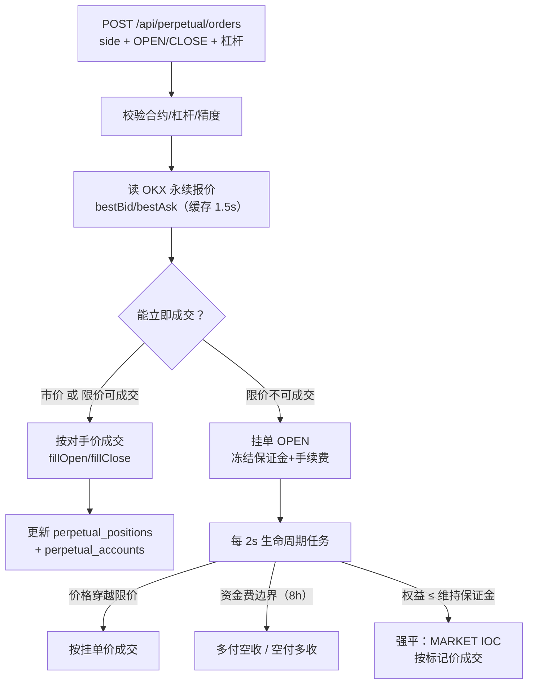
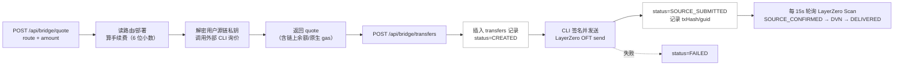

# 第 10 章 · 现货之外：永续合约与跨链桥

> **所属大纲**：第 10 章（可跳过 / 选读）
> **前置章节**：第 01 章（模块边界）、第 03 章（现货账本）、第 09 章（托管钱包）
> **下游章节**：无（全书收束）
> **证据基准**：当前工作区源码，2026-10-25 复核。

---

## 1. 本章导读

**业务场景**：现货页面之外，前端还有 `/futures`（永续合约）和 `/bridge`（跨链桥）。这两块看起来"也是交易所业务"，但它们与前面九章的现货撮合、现货账本**几乎没有共享状态**。

**本章作用**：用尽量短的篇幅讲清两条附加业务线——**永续是独立账本 + 平台对赌**，**跨链桥是钱包到钱包的链上操作、不经过站内账本**；以及它们为什么不能和现货混在一起理解。

- **上游**：第 01 章的 `users`（唯一共享的表）；第 09 章的托管钱包（桥要用它签名）。
- **本章输出**：`perpetual_*` 六张表、`cross_chain_bridge_*` 三张表；与 `user_asset_accounts` **无关**。
- **下游**：没有。现货主线在第 09 章已经闭环。

**学习边界**：
- **必须理解**：两条线各自的账本、成交对手方、与现货的隔离边界。
- **只需了解**：逐仓保证金、资金费率、强平的公式；LayerZero OFT 的概念。
- **可以跳过**：`contracts/layerzero-oft/` 的合约与脚本、`PerpetualCalculator` 的公式推导、桥的 CLI 细节。

> **一句话定位**：即使把这两块全部删掉，现货下单 → 撮合 → 结算的主链路依然完整；它们回答的是"这家交易所在现货之外还卖什么"。

---

## 2. 核心业务流程

### 2.1 永续：平台对赌，不是用户撮合



### 2.2 跨链桥：钱包到钱包，绕开站内余额



> 关键：桥**不写** `user_asset_accounts`，也不扣站内余额；它直接把用户托管钱包里的链上资产发到目的链。站内交易余额与桥是两套系统。

---

## 3. 核心代码拆解

### 3.1 边界：独立表、独立余额、独立服务

**业务目的**：让新业务不污染现货账本。

**源码位置**：`V15__perpetual_contracts.sql:1-145`、`V16__custodial_testnet_bridge.sql`、`V17__layerzero_v2_oft_bridge.sql`（另有 V18 激活脚本）、`PerpetualTradingService.java:25`、`CrossChainBridgeService.java:25`

| 维度 | 现货 | 永续 | 跨链桥 |
| :--- | :--- | :--- | :--- |
| 余额表 | `user_asset_accounts` | `perpetual_accounts` | 无（链上钱包余额） |
| 订单/成交 | 内存 + `spot_*` | `perpetual_orders` / `perpetual_fills` | `cross_chain_bridge_transfers` |
| 对手方 | 其他用户 | **平台**（按 OKX 报价） | 无（链上 OFT） |
| 费用 | 无 | taker 0.05%（合约参数） | 固定费 + 费率 |
| 风险 | 冻结/结算 | 保证金、资金费、强平 | 私钥签名、链上确认 |

**设计原因**：永续与现货的保证金、杠杆、强平语义完全不同，共用余额会导致"现货余额被强平"这类无法解释的状态；桥直接操作链上资产，更不能混进 `available/frozen`。

### 3.2 永续合约模型：五个合约、逐仓保证金

**业务目的**：用数据库参数描述"交易什么、能开多少倍、费用多少、何时强平"。

**源码位置**：`V15:133-145`（种子合约）、`PerpetualCalculator.java:14-83`

| 合约 | 最大杠杆 | 维持保证金率 | taker 费率 | 资金费率 |
| :--- | :--- | :--- | :--- | :--- |
| BTC-USDT-SWAP | 100 | 0.5% | 0.05% | 0.01% |
| ETH-USDT-SWAP | 100 | 0.5% | 0.05% | 0.01% |
| SOL-USDT-SWAP | 50 | 1% | 0.05% | 0.01% |
| TRX-USDT-SWAP | 25 | 2% | 0.05% | 0.01% |
| LINK-USDT-SWAP | 50 | 1% | 0.05% | 0.01% |

**执行过程**：
1. 开仓保证金 = `价格 × 数量 / 杠杆`（向上取位，`initialMargin:18-24`）。
2. 手续费 = `名义价值 × takerFeeRate`（`fee:26-35`）。
3. 未实现盈亏 = `(标记价 - 开仓价) × 数量`（空头反向，`unrealizedPnl:37-49`）。
4. 强平价按逐仓公式计算（`liquidationPrice:58-79`）；当"保证金 + 未实现盈亏 ≤ 维持保证金"时强平（`shouldLiquidate:81-91`）。

**设计原因**：逐仓（每个仓位独立保证金）比全仓简单、风险隔离清晰；代价是同一用户同方向只能有一个仓位（`uq_perpetual_open_position`），无法做多档加仓管理（加仓会合并到同一仓位）。

### 3.3 下单：先冻结，再决定"立即成交还是挂单"

**业务目的**：与现货类似，先锁定保证金，再按外部报价决定成交。

**源码位置**：`PerpetualTradingService.java:104-195`、`:977-998`（`executablePrice` / TIF）

```java
// :977-989
BigDecimal marketPrice = order.side() == Side.BUY ? quote.bestAsk() : quote.bestBid();
if (order.type() == OrderType.MARKET) {
    return marketPrice;
}
boolean marketable = order.side() == Side.BUY
        ? order.price().compareTo(quote.bestAsk()) >= 0
        : order.price().compareTo(quote.bestBid()) <= 0;
return marketable ? marketPrice : null;
```

**执行过程**：
1. 校验：合约 ACTIVE、杠杆 ≤ 上限、数量/价格精度符合合约的 `price_scale/quantity_scale`。
2. `clientOrderId` 幂等：已存在直接返回原订单（`perpetual_orders` 唯一键）。
3. 读 OKX 报价（`bestAsk/bestBid`，缓存 1.5s，失败回退上一口价）。
4. 计算 `executionPrice`：市价单直接取对手价；限价单若与对手价交叉则取**对手价**（不是限价），否则为 `null`（挂单）。
5. 开仓：冻结 `margin + fee`（`reserveAccount`）；平仓：冻结对应仓位数量（`freezePosition`）。
6. 能成交 → `fillOrder`；不能成交且是 IOC → 取消；否则挂单等待生命周期任务。

**设计原因**：
- **为什么限价可成交时按对手价成交**：给 taker 价格改善，思路与现货"成交价取被动方价格"一致；区别是这里没有 maker，对手方是平台。
- **为什么先冻结再成交**：与现货同理，避免成交后扣不到保证金。
- **代价**：限价单的"立即成交价"（对手价）与"延迟成交价"（挂单价）不一致——见第 6 节。

### 3.4 成交：开仓消费预留，平仓按比例释放

**业务目的**：把冻结的保证金变成仓位，把平仓盈亏结算回账户。

**源码位置**：`fillOrder:474-486`、`fillOpen:487-526`、`fillClose:527-610`、`addToPosition:611-650`、`finishOrderAndFill:651-684`

**执行过程（开仓）**：
1. 按成交价重算保证金与手续费；若超过预留 → 抛异常（`execution exceeds reserved perpetual margin`）。
2. `perpetual_accounts`：`wallet_balance -= fee`、`available += 释放的差额`、`locked_margin -= 预留总额`。
3. 仓位：新开或按加权均价加仓，`isolated_margin += 本次保证金`。
4. 写 `perpetual_fills`、更新订单为 `FILLED`、记 `TRADING_FEE` 流水。

**执行过程（平仓）**：
1. 校验冻结数量足够。
2. 按平仓数量占仓位比例释放保证金；计算已实现盈亏，并**把亏损截断在保证金以内**（`rawPnl.max(-proportionalMargin)`）。
3. 手续费取 `min(请求费用, 可释放总额)`，避免把账户扣成负数。
4. 更新仓位数量/均价/已实现盈亏；数量为 0 时仓位 `CLOSED`。

**设计原因**：逐仓的核心是"亏损不超过该仓位的保证金"。代码用 `max(-proportionalMargin)` 做硬截断，意味着**穿仓由平台承担**——教学项目没有保险基金/ADL（自动减仓），这是与真实永续最大的差距之一。

### 3.5 生命周期：每 2 秒做三件事

**业务目的**：让挂单、资金费、强平在无人操作时也能推进。

**源码位置**：`PerpetualLifecycleScheduler.java:24-38`、`processContract:308-350`、`settleFundingIfDue:354-409`、`liquidateIfNecessary:411-472`

**执行过程**（每个活跃合约）：
1. 拉一次 OKX 报价；失败则本轮跳过。
2. **挂单成交**：查 `OPEN` 限价单，买单 `price >= bestAsk` 或卖单 `price <= bestBid` 的，按**挂单价**成交（`processContract:317-338`）。
3. **资金费**：对每个仓位，若跨过 8 小时边界（按 epoch 对齐），按 `名义价值 × fundingRate` 结算；正费率多头付、空头收；单次最多扣到保证金归零。
4. **强平**：若 `shouldLiquidate` 为真，冻结全部可平数量，插入 `source='LIQUIDATION'` 的 `MARKET IOC` 订单，按标记价（last）成交，仓位状态 `LIQUIDATED`。

**设计原因**：用定时任务替代撮合引擎，是因为永续根本不撮合用户订单——只需要"价格是否穿越"和"保证金是否足够"两个判断。代价是成交延迟最多 2 秒，且强平价用的是最新成交价而非独立标记价。

### 3.6 价格与风控：单点依赖 OKX

**业务目的**：用外部永续行情给合约定价，避免自己造价格。

**源码位置**：`PerpetualPriceService.java:27-63`、`PerpetualTradingService.java:130-146`

**执行过程**：
1. `quote(instrumentId)` 先查 1.5 秒缓存；过期则请求 OKX ticker。
2. 请求失败时，如果缓存里还有旧报价，**继续用旧价**（不会报错）。
3. 市价/可立即成交的限价单用对手价成交；资金费与强平用 `lastPrice` 作为 mark price；延迟成交的限价单用挂单价。

**设计原因**：教学环境没有做市深度，用外部价最省事。风险是：**价格来源单点、可能陈旧、可被外部操纵**；真实合约交易需要指数价 + 标记价 + 多源聚合 + 价格保护（如限价带）。

### 3.7 跨链桥：不碰站内账本的"钱包对钱包"

**业务目的**：演示用 LayerZero V2 OFT 把测试 USDT（YTUSDT）从一条测试网转到另一条。

**源码位置**：`CrossChainBridgeService.java:44-118`（查询/报价/faucet）、`:120-214`（转账）、`:215-289`（状态轮询）、`:291-345`（`prepare`）、`CrossChainBridgeCalculator.java:8-38`

**执行过程**：
1. `GET /routes`、`/deployments`：从 `cross_chain_bridge_routes` / `bridge_protocol_deployments` 读可用路线与合约地址（`protocol='LAYERZERO_V2_OFT'`）。
2. `POST /quote`：校验金额（≤6 位小数、在路由 min/max 之间），算手续费（固定费 + 费率），返回预计到账；**同时解密源链私钥**并调用外部 CLI 询价（取链上余额与原生 gas）。
3. `POST /transfers`：`clientTransferId` 幂等 → 插入 `CREATED` 记录 → 解密私钥 → CLI 签名发送 → 更新 `SOURCE_SUBMITTED` + txHash + guid；失败置 `FAILED`。
4. `@Scheduled` 每 15 秒用 LayerZero Scan API 查状态：`SOURCE_CONFIRMED → DVN_VERIFIED → DELIVERED`，写入 `destination_tx_hash`、`completed_at`。
5. `POST /faucet/sepolia`：给用户的 Sepolia 托管地址发 1000 YTUSDT（测试水龙头）。

**关键边界**：
- **不扣站内余额**：`prepare` 只检查**链上** `ytUSDT` 余额和原生 gas（`:320-333`），不查 `user_asset_accounts`。
- **私钥在服务端解密**：`privateKeyCipher.decrypt(...)` 后交给外部 Node 进程签名（`:310-316`），意味着运行桥服务的机器能拿到用户私钥。
- **依赖外部工作目录**：`contracts/layerzero-oft` + node/pnpm + RPC（`application.yaml:212-224`）；缺少任何一项，报价/转账都会失败。

**设计原因**：LayerZero OFT 的跨链消息需要源链交易 + DVN 验证 + 目的链执行，最长可能几十秒到几分钟；把状态托管给官方 Scan API 可以少写一套链上监听。代价是引入了外部服务与"服务端代签"的高风险模式。

### 3.8 三条业务线的隔离矩阵

| 用户动作 | 影响现货余额 | 影响永续账户 | 影响链上钱包 |
| :--- | :--- | :--- | :--- |
| 现货下单/成交 | ✅ `available/frozen` | ❌ | ❌ |
| 永续开仓/平仓 | ❌ | ✅ 保证金 + 盈亏 | ❌ |
| 永续强平 | ❌ | ✅ 仓位清零、保证金扣减 | ❌ |
| 充值（第 09 章） | ✅ `available` | ❌ | ✅ 链上收款 |
| 跨链桥 | ❌ | ❌ | ✅ 链上转出/转入 |
| 提现 | ❌（未实现） | ❌ | ❌（未实现） |

**结论**：用户在永续赚的钱不能拿去现货花，桥过去的资产也不会自动出现在站内余额里——**三本账各自独立**。这是教学项目最容易让人误解的地方之一。

---

## 4. Web3 特有机制与风险提示

1. **LayerZero OFT 不一定是"锁定-铸造"桥**。OFT 常见实现是源链 burn、目的链 mint（也有 lock/unlock 的 Adapter 模式），依赖 DVN 验证消息；本项目通过官方 Scan API 读状态，没有自己监听链上事件。测试网部署与真实跨链桥的安全模型（DVN 集合、速率限制、所有权）不在本章范围。
2. **服务端代签是托管模式的极端形态**。桥请求由后端解密用户私钥并调用 CLI 签名——这与第 09 章"充值只收款"不同，桥是"主动转出"。任何能访问该服务或该机器的人都可能转走用户资产；仅测试网可接受。
3. **价格来自中心化交易所**。永续的标记价直接用 OKX ticker，没有链上预言机，也没有多源校验；这与 DeFi 永续（如 GMX/dYdX）的预言机/订单簿模型完全不同。

---

## 5. 本章小结与思考题

**本章完成了什么**：把现货之外的两条业务线放到正确的位置——独立账本、独立风险、与现货无共享状态。

**最重要的调用链**：

```text
永续：
PerpetualController(:59) → PerpetualTradingService.submit(:104)
  → PerpetualPriceService.quote(:27) → executablePrice(:977)
  → reserveAccount(:803) / freezePosition(:820)
  → fillOrder(:474) → fillOpen(:487) / fillClose(:527)
PerpetualLifecycleScheduler → processContract(:308)
  → settleFundingIfDue(:354) / liquidateIfNecessary(:411)

桥：
CrossChainBridgeController → CrossChainBridgeService.quote(:87) / transfer(:120)
  → prepare(:291) [解密私钥 + CLI 询价] → LayerZeroOftProcessClient.send
  → refreshOnChainStatuses(:215) [Scan API]
```

**状态变化**：
- 永续：`perpetual_accounts` / `perpetual_positions` / `perpetual_orders` / `perpetual_fills` / `perpetual_ledger_entries`；
- 桥：`cross_chain_bridge_transfers`（`CREATED → SOURCE_SUBMITTED → … → DELIVERED/FAILED`）；
- 两者都不改 `user_asset_accounts`。

**与上下游衔接**：这是全书的最后一章；现货主线在第 03、05、09 章闭环，本章解释"现货之外还有什么、为什么不能混着理解"。

### 思考题

**Q1：为什么永续合约不撮合用户之间的对手单？这样做的后果是什么？**

参考答案：永续的成交由 `executablePrice` 决定（`PerpetualTradingService:977-989`）：市价单直接取 OKX 的 `bestAsk/bestBid`，限价单只在价格穿越时按对手价成交；`processContract:317-338` 也只按外部最优价判断挂单能否成交。**平台是唯一对手方**，盈亏由平台账户体系承担。后果有三：① 不存在"盘口深度/排队"，成交量不受其他用户限制；② 平台的敞口完全取决于用户净头寸，需要真实对冲；③ 本项目把亏损截断在保证金内（`fillClose:546`），穿仓由平台承担，没有保险基金/ADL。

**Q2：跨链桥为什么不扣减站内余额？这会带来什么一致性问题？**

参考答案：桥的 `prepare`（`CrossChainBridgeService:291-345`）只检查**链上** ytUSDT 余额和原生 gas，然后解密用户托管私钥、调用 CLI 直接发链上交易；整个过程不读写 `user_asset_accounts`。因此"链上资产"和"站内余额"是两套账：桥转走的资产不会减少站内可用余额，桥转入的资产也不会自动变成站内余额（要靠第 09 章的充值扫描）。一致性问题在于：用户可能"链上已经转出、站内余额还在"，或者反过来；对账必须分别做链上余额核对与站内账本核对。

---

## 6. 设计与实现问题提示

| 级别 | 问题 | 源码依据 | 影响 |
| :--- | :--- | :--- | :--- |
| 红色（仅测试网） | 桥服务端解密用户私钥并代签链上交易；`/quote` 也会解密私钥并调用 CLI | `CrossChainBridgeService.prepare:291-345`、`:120-214` | 服务或运行机器被攻破即可转走用户链上资产；生产不可用。至少要改为用户自签或独立签名服务 |
| 黄色 | 永续没有用户对手盘，平台对赌；价格单点依赖 OKX，失败时回退旧价 | `executablePrice:977-989`、`PerpetualPriceService.quote:27-63` | 平台敞口无法从代码中看到对冲；陈旧价格会导致成交/强平偏离真实市场 |
| 黄色 | 限价单"立即成交按对手价、延迟成交按挂单价"不一致 | 立即：`executablePrice` 返回 `bestAsk/bestBid`；延迟：`processContract:333` 用 `pending.price()` | 同一笔限价单的成交价取决于"当时能不能立即成交"，用户难以预期；价格改善方向也不一致 |
| 黄色 | 资金费率固定写库、按 8h 边界结算 | `V15` 的 `funding_rate` 常量；`settleFundingIfDue:354-409` | 费率不随市场变化，长期可能严重偏离；结算瞬间可能把保证金扣到 0（`walletDelta.max(-isolatedMargin)`） |
| 黄色 | 强平用最新成交价（last）而非标记价/指数价，且无保险基金/ADL | `liquidateIfNecessary:411-472`；`fillOrder(orderId, markPrice, true)` | 价格操纵或瞬时插针可直接触发强平；穿仓损失由平台承担 |
| 绿色 | 永续账户首次访问发放 10000 演示 USDT | `ensureAccount:776-801`；`app.perpetual.initial-demo-balance:10000`（`application.yaml:97`） | 生产必须设为 0，否则等于凭空发钱 |
| 绿色 | 桥依赖外部工作目录、node/pnpm 与 RPC；faucet 固定发 1000 | `application.yaml:212-224`、`claimSepoliaTestTokens:93-118` | 环境不全时桥整体不可用；faucet 可被反复调用刷测试币（测试网无价值） |

本章的红色问题限定在"测试网 + 托管签名"语境；它不是现货主线的风险，但任何对外部署都必须先处理。这不是完整安全审计。

---

## 7. 全书收束

到这里，十条主线已经闭环：

```text
启动装配（01） → 下单冻结（02） → 结算（03）
      ↑                              ↓
  单线程队列（04） → 订单簿撮合（05） → 状态与撤单（06）
      ↑
外部流动性/做市（07）   可靠性缺口（08）   资产入口（09）   附加业务（10）
```

如果只记三句话：

1. **撮合在内存、账本在数据库、两者之间没有事务**。
2. **每 symbol 一条线程换来确定性，代价是读也要排队、超时不可当失败**。
3. **"代码里有"不等于"运行时生效"**——WAL、Outbox、RabbitMQ、市商网关、桥的许多能力都停在装配点之外。

---

### 修订记录

| 日期 | 变更 |
| :--- | :--- |
| 2026-10-25 | 首版：复核永续的独立账本、平台对赌、生命周期与风控；复核桥的链上钱包直转、站内余额隔离与代签风险 |
