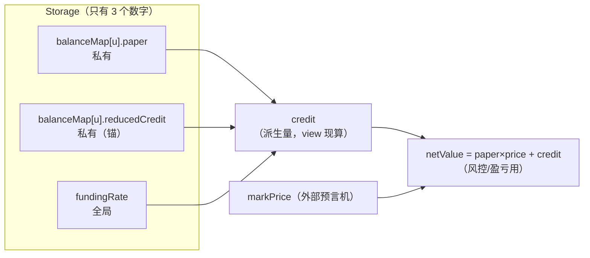
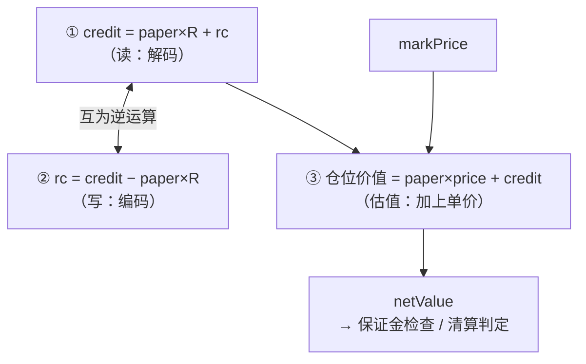

# `credit = paper × R + reducedCredit` 完全解析

> 本文档由一次源码阅读会话整理而成，专门针对**几处反复出现的理解偏差**做纠偏，并给出**一个完整的开仓 → 资金费 → 加仓 → 部分平仓 → 全平的算例**（每一步都附结算明细与回代验算）。
> 
> 相关文件：`src/Perpetual.sol`、`src/libraries/SignedDecimalMath.sol`、`src/libraries/Liquidation.sol`
> 配套阅读：`docs/source-reading-guide.md` 第 4 章

---

## 目录

- [0. 本次会话暴露的 6 个误解（速览）](#0-本次会话暴露的-6-个误解速览)
- [1. 一句话心智模型](#1-一句话心智模型)
- [2. 存储里到底有什么](#2-存储里到底有什么)
- [3. 六个误解逐条纠偏](#3-六个误解逐条纠偏)
- [4. 精确定义与三条公式](#4-精确定义与三条公式)
- [5. 完整算例 A（多头）：开仓 → 加仓 → 部分平仓 → 全平](#5-完整算例-a多头开仓--加仓--部分平仓--全平)
- [6. 完整算例 B（空头）：对照与守恒检查](#6-完整算例-b空头对照与守恒检查)
- [7. 速算公式与代数证明](#7-速算公式与代数证明)
- [8. 自查清单](#8-自查清单)
- [9. 术语与量纲对照表](#9-术语与量纲对照表)
- [附录 A：关于精度与缩放](#附录-a关于精度与缩放)
- [附录 B：代码索引](#附录-b代码索引)

---

## 0. 本次会话暴露的 6 个误解（速览）

| #   | 你的原始疑问                 | ❌ 隐含的错误假设                 | ✅ 正确认知                        | 详见                                |
| --- | ---------------------- | ------------------------- | ----------------------------- | --------------------------------- |
| 1   | "这个公式为什么成立？"           | 把它当成需要证明的**定理**           | 它是**定义/构造**（rc 由 credit 反推而来） | [3.1](#31-误解-1以为公式是需要证明的定理)       |
| 2   | "计算过程为啥没有 paper 的单价？"  | 把 `R` 当成**价格**            | `R` 是累计资金费率；价格在**另一条**公式里     | [3.2](#32-误解-2把-r-当成单价)           |
| 3   | "Rate 是市场属性，应该有值呀"     | 以为 `R` 有**有意义的绝对值**       | `R` 是基准量，**只有 ΔR 有意义**，可任意平移  | [3.3](#33-误解-3以为-r-必须有一个有意义的绝对值)  |
| 4   | "credit 是多少？"          | 以为 `credit` 是**链上存的独立变量** | 存储只有 3 个数字，**没有 credit 字段**   | [3.4](#34-误解-4以为-credit-是独立存储量)   |
| 5   | "是奖励或惩罚用户的资金数？"        | 把 `credit` 当成**奖惩金额/债务**  | 它是**记账余额**，符号无奖惩含义            | [3.5](#35-误解-5把-credit-当成奖惩金额或债务) |
| 6   | "_settle 后资产=负债，像刚开仓？" | 以为 `_settle` 会把账户**清零**   | `_settle` 只刷新**计量基准（锚）**      | [3.6](#36-误解-6以为-_settle-之后账户被清零) |

**共同根源（一句话）**：把**派生的、账面的、相对的**量（`credit`、`R`），当成了**独立存在的、有绝对含义的物理量**。


---

## 1. 一句话心智模型

> **存 3 个数字，`credit` 是第 4 个——它靠公式现算，不落盘。**
> 
> **`_settle` 做的事：按一次"去皮"键（把资金费的计量起点挪到当前 R），而不是把账户清零。**
> 
> **看盈亏永远要 `paper×price + credit` 一起看，单看 `credit` 会骗人。**

---

## 2. 存储里到底有什么

```solidity
// Perpetual.sol
struct balance {
    int128 paper;          // ① 私有：仓位数量（正=多头，负=空头）
    int128 reducedCredit;  // ② 私有：约减后的资金量（"锚"）
}
mapping(address => balance) balanceMap;

int256 fundingRate;        // ③ 全局：累计资金费率（所有用户共享）
```

**整个合约里没有 `credit` 字段。**

```solidity
// Perpetual.sol 第 105-108 行，注意是 view
function balanceOf(address trader) external view returns (int256 paper, int256 credit) {
    paper = int256(balanceMap[trader].paper);
    credit = paper.decimalMul(fundingRate) + int256(balanceMap[trader].reducedCredit);  // ← 现算
}
```



---

## 3. 六个误解逐条纠偏

### 3.1 误解 1：以为公式是需要证明的定理

**❌ 你的问法**："`credit = paper×R + reducedCredit` 这个公式为什么成立？"

**✅ 正解**：它是一条**由定义构造出的恒等式**。看 `_settle` 里 `rc` 是怎么来的：

```solidity
newReducedCredit = SafeCast.toInt128(credit - int256(newPaper).decimalMul(rate));
//                                  ↑ rc := credit − paper×R
```

也就是说，**`reducedCredit` 的定义就是"`credit` 减去 `paper×R` 剩下的余项"**：

$$
\text{rc} \;:=\; \text{credit} - \text{paper}\times R
\;\;\Longrightarrow\;\;
\text{paper}\times R + \text{rc} = \text{credit} \quad\text{（恒等）}
$$

代回去必然相等，**不存在"成立不成立"的问题**。真正该问的是：

> **为什么要这么拆？**

答案只有一个：**让 `updateFundingRate` 只需写 1 个 slot。**

如果直接存 `credit`，费率一更新，全市场每个人的 `credit` 理论上都要变 → keeper 必须遍历全市场逐个 SSTORE → O(N) gas，不可行。

**换个比喻：编码 / 解码**

|             | 公式                      | 作用                            |
| ----------- | ----------------------- | ----------------------------- |
| **编码**（写存储） | `rc = credit − paper×R` | 把"绝对金额 credit"压缩成"相对基准 R 的偏移" |
| **解码**（读存储） | `credit = paper×R + rc` | 还原回绝对金额                       |

一存一取互为逆运算。你觉得它神秘，是因为把它当成了物理定律；其实它只是这对约定的**一半**。

**❓凭什么可以这样"约定"？——因为约定的合法性判据是"可逆"，而不是"为真"。**

先分清两层：

| 层      | 内容                                  | 性质              |
| ------ | ----------------------------------- | --------------- |
| 客观事实   | 成交现金流（成交价 × 数量）                     | 由市场决定，**有真假**   |
| 客观事实   | 累计资金费                               | 经济含义客观，**有真假**  |
| 客观事实   | `credit` = 上面两者之和                   | 由历史唯一确定         |
| **约定** | 把 `credit` 拆成 `paper×R + rc` **来存** | **无真假**，只有好用不好用 |

也就是说：**`credit` 的数值不约定，约定的只是"怎么把它存进 storage"。** 就像"今天的温度"是客观的，只有"用摄氏还是华氏记录"才是约定。

一个编码是否合法，**只看它是否无损可逆**：

$$
\text{decode}\big(\text{encode}(c)\big) = paper\times R + (c - paper\times R) = c \quad ✅
$$

这是代数恒等，不是巧合——所以约定合法。**任何可逆的拆法都合法**；选这一种的原因不是"更正确"，而是"更省"：

| 方案         | 存储什么                     | 可逆  | 费率更新成本                 | 加仓成本    |
| ---------- | ------------------------ | --- | ---------------------- | ------- |
| A          | 直接存 `credit`             | ✅   | **O(N)** 遍历全用户 ❌       | O(1)    |
| B          | (`入场价`, `数量`)            | ✅   | **O(N)** ❌             | 需重算加权均价 |
| **C（本项目）** | (`paper`, `rc`) + 全局 `R` | ✅   | **O(1)** 只写 1 个 slot ✅ | O(1)    |

**三个方案都"正确"，选 C 只因为它最省。** 这本身就说明它是约定而非真理——真理不会有三个都成立的版本。

类比：摄氏/华氏都是合法温标（互相可逆），选哪个是习惯问题；海拔的**高差**客观，而**基准面**是约定——基准面整体平移时所有高差不变，这正是 `R` 可以整体平移的原因。最终"事实"由 `netValue = paper×price + credit` 与 `realizePnl` 落袋的真钱来体现——**任何约定都必须能还原成事实，而可逆性保证了这一点。**

**❓"是不是只有 `reducedCredit` 是定义出来的，其余都是标准数学？"——基本正确，但要补一点：`R` 的零点也是约定的，而且它和 `rc` 是同一个约定。**

| 量        | 身份                            | 能否独立解释 |
| -------- | ----------------------------- | ------ |
| `paper`  | **客观事实**（持币数量，由成交决定）          | ✅      |
| `credit` | **客观事实**（累计现金流 + 累计资金费，由历史决定） | ✅      |
| `R`      | 外部输入；**ΔR 客观**，但**零点可任意**     | 部分     |
| **`rc`** | **纯约定派生量**                    | ❌      |

**检验方法**：问"`rc = −60,010` 是什么意思？"——答不上来，只能说"它是 `credit − paper×R` 的余项"。但"`credit = −60,000`"能立刻解释：**你付出了 60,000**。只有 `rc` 有这种"没有实体含义"的性质。

**要补的一点**：存在一个**规范自由度（gauge freedom）**

$$
R \to R + k \quad\Longrightarrow\quad rc \to rc - paper\cdot k,\qquad credit \text{ 完全不变}
$$

验证（取 k = 100，把 R 起点从 5 挪到 105）：`rc = −60,010 − 2×100 = −60,210`，则 `credit = 2×105 + (−60,210) = 210 − 60,210 = −60,000` ✅ 分毫未动。

所以 `(R, rc)` 这一对里**只有 1 个自由度**，改动 `R` 的零点**等价于**改动 `rc`。**这正是"只有 `rc` 是定义出来的"抓住了本质——`rc` 是这个约定的承载槽位。** 代码固定约定的方式是：`R` 由 keeper 外部给定，`rc` 由 `credit − paper×R` 反推（见上面 `_settle` 那一行：`credit`、`paper`、`fundingRate` 都由外部/客观决定，只有 `rc` 是被算出来的）。

**类比电路**：**"地"是任选的，电位差是客观的**。`credit` 像电位差（客观），`R` 像参考地（任选），`rc` 像节点电位读数（跟着地平移）。你永远无法读出"绝对电势"，同理也永远无法问出"`rc` 的绝对值对不对"——只能问"`credit` 对不对"。

---

### 3.2 误解 2：把 `R` 当成单价

**❌ 你的问法**："`credit = paper×R + reducedCredit` 计算过程为啥没有 paper 的单价？"

**✅ 正解**：`R` **不是价格，是累计资金费率**。价格在**另一条**公式里：

```solidity
// Liquidation.sol 第 118 行（getTotalExposure）
netPositionValue += paperAmount.decimalMul(price) + creditAmount;
//  ↑ 仓位价值 = paper × price + credit  ← 单价在这里
```

**两条公式、两个环节：**

| 公式                             | 位置                                  | 干什么                      |
| ------------------------------ | ----------------------------------- | ------------------------ |
| `credit = paper×R + rc`        | `Perpetual.balanceOf` L107          | **记账**：算"钱的那一半"（含累计资金费）  |
| `value = paper×price + credit` | `Liquidation.getTotalExposure` L118 | **估值**：算这个仓位现在值多少（含价格盈亏） |

**为什么 `credit` 里"不应该"有单价？**

因为 `credit` 是**收付实现制的现金账本**——成交那一刻付/收的钱直接记进去，价格已经被折进了 `creditChange`：

| 成交              | `paperChange` | `creditChange` |
| --------------- | ------------- | -------------- |
| 以 30000 买 1 BTC | `+1`          | `−30000`       |
| 以 30000 卖 1 BTC | `−1`          | `+30000`       |

注意 `creditChange = −(paperChange × 成交价)`。**单价已经乘进去了**，读取时再乘一次就是重复计价。

**数值验证**（A 以 30000 开 2 币多：`paper=2, credit=−60000`，先设 R=0）：

| 现价    | `paper×price + credit`       | 含义             |
| ----- | ---------------------------- | -------------- |
| 30000 | 2×30000 − 60000 = **0**      | 不赚不亏           |
| 35000 | 2×35000 − 60000 = **+10000** | 涨 5000 × 2 币 ✅ |
| 25000 | 2×25000 − 60000 = **−10000** | 跌 5000 × 2 币 ✅ |

**单价一次都没少，只是它出现的时机是"估值"而非"记账"。**

**混淆的根源**：二者量纲**恰好都是 credit/币**，所以都长成 `paper×X` 的样子。

|     | 单价 `price`   | 累计资金费率 `R`            |
| --- | ------------ | --------------------- |
| 单位  | credit / 币   | credit / 币 ← **巧合相同** |
| 含义  | 1 个币**值**多少钱 | 1 个币**累计欠/收**多少资金费    |
| 变化  | 随行情秒级波动      | keeper 定期更新           |
| 角色  | **估值**       | **记账**                |

---

### 3.3 误解 3：以为 `R` 必须有一个有意义的绝对值

**❌ 你的问法**："A、B 做多或做空时，Rate 为什么是 0？Rate 是市场的属性，应该有值呀"

**✅ 正解**：0 只是我为了心算方便**人为选的起点**。`R` 是**基准量**——你可以把它平移任意常数，系统行为完全不变。

**为什么可以随便选？** 因为开仓时 `_settle` 会反推：

$$
\text{rc} := \text{credit} - \text{paper}\times R_{\text{开仓时刻}}
$$

它把**开仓那一刻的累计值整个吸收进锚里**。所以最终：

$$
\text{credit} = \text{开仓 credit} + \text{paper}\times\big(R_{\text{now}} - R_{\text{open}}\big)
$$

**$R_{\text{open}}$ 被抵消掉了**，活下来的只有差值。

**验证：把同一个故事的初始 R 从 0 换成 7**（三段 ΔR 仍为 +8、+5）：

| 时刻                  | R   | 存储 `(paper, rc)`                     | 读出 credit                  |
| ------------------- | --- | ------------------------------------ | -------------------------- |
| 开 2 币 @30000        | 7   | `(2, −60000−2×7) = (2, −60014)`      | 2·7 − 60014 = **−60000** ✓ |
| keeper R 7→15       | 15  | `(2, −60014)` 不动                     | **−59984**（涨 16 = 2×8）✓    |
| 加仓 1 币 @30000（R=15） | 15  | 新 rc = −89984 − 3×15 = `(3, −90029)` | **−89984** ✓               |
| keeper R 15→20      | 20  | `(3, −90029)` 不动                     | **−89969**（涨 15 = 3×5）✓    |
| 全平 3 币 @30000       | 20  | 残值 = 3×20 − 90029 + 90000 = **31**   | `realizePnl(31)`           |

**变的是 rc 的数值（−60014、−90029），不变的是每一步读出的 credit 和最终落袋的 31。** 与初始 R=0 时完全一致。

**现实语义**：你只承担**持仓期间**的资金费，不承担开仓前的历史累计。

**唯一的实践约束（数值而非语义）**：全局平移会改变 `rc` 的大小，而 `_settle` 里 `rc` 要过 `SafeCast.toInt128`，`paper×R` 也必须在 `int256` 内不溢出。平移太远（如 1e30 量级）会溢出或丢精度。**语义无关，数值有关。**

---

### 3.4 误解 4：以为 `credit` 是独立存储量

**❌ 你的隐含假设**："A、B 开仓时 credit 是多少？" —— 读起来像是在查一个存好的字段。

**✅ 正解**：见 [§2](#2-存储里到底有什么)。链上只存 3 个数字，`credit` 是 `view` 函数现算的**派生量**。

这一点直接解释了**为什么费率更新不用遍历全市场**：

- 费率更新只改 `fundingRate`（1 个 slot）；
- 所有人的 `credit` 是**读的时候才算**的，所以他们"自动"跟着变了；
- 只有真正发生成交/清算（`_settle`）的人，才需要重写自己的 `rc`。

**"写操作只属于参与者，读操作把资金费实时补给所有人。"**

---

### 3.5 误解 5：把 `credit` 当成"奖惩金额"或"债务"

**❌ 你的问法**："这里算出来的 credit 是什么？奖励或惩罚用户的资金数？"

**✅ 正解**：它是**记账余额**——这个仓位"钱的那一半"的现算值。**可正可负，符号没有奖惩含义。**

#### credit 由两类现金流凑成

$$
\text{credit} \;=\; \underbrace{\sum \text{creditChange}}_{\text{成交现金流}} \;+\; \underbrace{\sum \text{paper}\times\Delta R}_{\text{累计资金费}}
$$

用 §5 的算例验证：成交现金流 = −60000 − 31000 + 32000 + 66000 = **+7000**；资金费 = 16+15+6 = **+37**；合计 **+7037** = `realizePnl` 落袋金额 ✅

#### 只有"资金费"那一项才是奖惩

- 它可正可负：`Δcredit = paper × ΔR`
  - R 上升 + 多头（paper>0）→ `Δcredit > 0` 收钱
  - R 上升 + 空头（paper<0）→ `Δcredit < 0` 付钱
- 它不是协议发的奖金，是**多空之间的转移**。系统的总变化为 $\sum\Delta\text{credit} = \Delta R \times \sum\text{paper}$，净持仓不为 0 时差额由对手方（AMM / Dealer 侧）承担。

> ⚠️ **方向勘误**：本合约 `R` 上升 = **多头收 credit**，与 CEX 里"资金费率为正时多头付费"的直觉**相反**。多头付费时，keeper 会**下调** `R`。

#### 关键：`credit` 的符号会骗人

做空 1 BTC @30000：`paper = −1, credit = +30000`，账面看着"有 30000"。

| 现价    | `paper×price + credit`       | 结果     |
| ----- | ---------------------------- | ------ |
| 25000 | −1×25000 + 30000 = **+5000** | 赚 5000 |
| 30000 | −1×30000 + 30000 = **0**     | 打平     |
| 35000 | −1×35000 + 30000 = **−5000** | 亏 5000 |

**`credit` 全程 +30000 纹丝不动，人却从赚 5000 变成亏 5000。**

$$
\boxed{\text{盈亏} = \text{paper}\times\text{price} + \text{credit} = \text{价格盈亏} + \text{资金费}}
$$

`credit` 单独一个数字**没有意义**，就像"欠条上的字面金额"不能当收入看。

#### 而且 `credit` 不可提现

- `Perpetual.credit` = 仓位记账（不可提现）
- `Dealer.primaryCredit` = 保证金账户（**真钱，可提现**）
- `netValue` = Σ(`paper×price + credit`) + primaryCredit + secondaryCredit（风控专用）

只有 `paper` 归零（全平）那一刻，残值才经 `Dealer.realizePnl` 流入 `primaryCredit`。

**所以看到很大的正 credit（如空头开仓后的 +30000），别以为是余额——那是"预收的本金 + 尚未买回的仓位"。**

---

### 3.6 误解 6：以为 `_settle` 之后账户被清零

**❌ 你的问法**："是不是每次 `_settle` 刚执行完时，用户的资产（paper×price）和债务（credit）完全相等，就像刚刚开仓一样？"

**✅ 正解**：`_settle` 刷新的是**计量基准（锚）**，不是把你清零重新开仓。

**要点 1：重写锚不产生任何资金跳变。** `rc := credit − paper×R` 只是换一种存法（见 §5 步骤 3 的验算）。除本次成交的 `creditChange` 外，**锚的重写不改变 credit 一分钱**。

**要点 2：净值一般不为 0。**

| 时刻  | 事件                   | `paper` | `rc`            | `credit` | price=30000 时 netValue |
| --- | -------------------- | ------- | --------------- | -------- | ---------------------- |
| t0  | 开 2 币 @30000         | 2       | −60000          | −60000   | **0** ✅ 真·刚开仓          |
| t2  | R 0→8                | 2       | −60000          | −59984   | **+16** ❌              |
| t3  | **`_settle` 加仓 1 币** | 3       | **−90008（锚重写）** | −89984   | **+16** ❌ 仍不是 0        |
| t4  | R 8→13               | 3       | −90008          | −89969   | **+31**                |
| t5  | 全平                   | 0       | 0               | —        | `realizePnl(31)`       |

**只有 t0（真·刚开仓）netValue 才等于 0**；t3 是 `_settle` 刚执行完，净值是 **+16**——那 16 正是已累计的资金费，锚的重写**没有抹掉它**。

**要点 3：你直觉里"对"的部分。**

① **资金费的计量起点被重置**为当前 R——此后 credit 的变化量恒为 `paper×(R′ − R_settle)`，确实"好像从此刻才开始计费"：

$$
\text{credit}(R') = \text{credit}_{\text{settle}} + \text{paper}_{\text{new}}\times\big(R' - R_{\text{settle}}\big)
$$

② **本次成交的那一份按成交价入账，增量部分的 PnL 恰好为 0**（t3 新加的 1 币贡献 `1×30000 − 30000 = 0`）。所以浮盈**只由存量携带，增量永远干净**——但存量那份 PnL 不会被抹掉。

**类比：体重秤的"去皮（tare）"键。** 按下去读数归零，**但你的体重没变**，归零的只是"相对此刻的变化量"。`_settle` 重写 `rc` = 按去皮键：**credit 的绝对值没变，变的是"以后从哪算起"。**

**另一个类比：抄电表。** 抄表员来抄一次 = `_settle`，账单数字（credit）不会因抄表而改变，变的是"下期从 0 开始计"。

> **措辞纠正**：`paper×price` 是"**币那半边的市值**"，`credit` 是"**钱那半边的余额**"（可正可负），**它不是债务**。两者相加才是净值。

---

## 4. 精确定义与三条公式

### 4.1 四个量

| 量                   | 存储位置    | 含义                             | 取值          |
| ------------------- | ------- | ------------------------------ | ----------- |
| `paper`             | 用户私有    | 仓位数量                           | 正=多，负=空     |
| `reducedCredit`（rc） | 用户私有    | **锚**：credit 减去 `paper×R` 后的余项 | 可正可负        |
| `fundingRate`（R）    | 全局      | **累计**资金费率（基准量）                | 可正可负，绝对值无意义 |
| `credit`            | **不存储** | 钱的那一半的余额（派生量）                  | 可正可负        |

### 4.2 三条公式

**① 读（解码）——`Perpetual.balanceOf` L107**

$$
\text{credit} = \text{paper}\times R + \text{rc}
$$

**② 写（编码）——`Perpetual._settle` L264**

$$
\text{rc}_{\text{new}} = \text{credit} - \text{paper}_{\text{new}}\times R
$$

**③ 估值（另一条线）——`Liquidation.getTotalExposure` L118**

$$
\text{仓位价值} = \text{paper}\times\text{price} + \text{credit}
$$

### 4.3 三条公式的关系



**记住：①② 是"记账"（不含价格），③ 是"估值"（才含价格）。**

---

## 5. 完整算例 A（多头）：开仓 → 加仓 → 部分平仓 → 全平

### 5.0 场景设定

- 初始 `fundingRate R = 0`（起点任意，见 §3.3；取 0 只为心算方便）
- 所有数字用**可读单位**（数字直接当 USDC 读）
- 结算公式：

```
① credit     = 旧paper×R + 旧rc + creditChange
② newPaper   = 旧paper + paperChange
③ newRc      = credit − newPaper×R
```

### 5.1 摘要表（全流程）

| #   | 事件                    | R   | 输入 `(paperChange, creditChange)` | 存储 `(paper, rc)`                | credit     | netValue @现价 |
| --- | --------------------- | --- | -------------------------------- | ------------------------------- | ---------- | ------------ |
| 1   | 开多 2 BTC @30000       | 0   | `(+2, −60000)`                   | **(2, −60000)**                 | −60000     | 0 @30000     |
| 2   | keeper: R 0→8         | 8   | —                                | (2, −60000)                     | **−59984** | +16 @30000   |
| 3   | **加仓 1 BTC @31000**   | 8   | `(+1, −31000)`                   | **(3, −91008)**                 | **−90984** | +2016 @31000 |
| 4   | keeper: R 8→13        | 13  | —                                | (3, −91008)                     | **−90969** | +2031 @31000 |
| 5   | **部分平仓 1 BTC @32000** | 13  | `(−1, +32000)`                   | **(2, −58995)**                 | **−58969** | +5031 @32000 |
| 6   | keeper: R 13→16       | 16  | —                                | (2, −58995)                     | **−58963** | +5037 @32000 |
| 7   | **全平 2 BTC @33000**   | 16  | `(−2, +66000)`                   | **(0, 0)** → `realizePnl(7037)` | —          | 落袋 **+7037** |

> 注：若步骤 3 改成"以 30000 加仓"，则新锚为 `−90008`（即前几次会话里出现的数）。本例特意换成 31000 以展示价格盈亏，**算法完全相同**。

---

### 5.2 逐步明细

#### 步骤 1：开仓 2 BTC @ 30000（R = 0）

```
① credit   = 0×0 + 0 + (−60000)            = −60000
② newPaper = 0 + 2                          = 2
③ newRc    = −60000 − 2×0                   = −60000
```

- 存储：`(paper = 2, rc = −60000)`
- 回代验算：`2×0 + (−60000) = −60000` ✅
- `isNewPosition`（旧 paper == 0）→ 调用 `Dealer.openPosition(A)`
- netValue @30000 = `2×30000 − 60000 = 0` ✅ 刚开仓，不赚不亏

#### 步骤 2：keeper 更新 R: 0 → 8（ΔR = 8）

**存储完全不动。** 只改全局 `fundingRate`。

```
credit = 2×8 + (−60000) = 16 − 60000 = −59984
```

- Δcredit = **+16** = `paper×ΔR` = 2×8 ✅（多头、R 上升 → 收钱）
- netValue @30000 = `60000 − 59984 = +16`

#### 步骤 3：加仓 1 BTC @ 31000（R = 8）

输入 `(paperChange, creditChange) = (+1, −31000)`

```
① credit   = 2×8 + (−60000) + (−31000)  = 16 − 60000 − 31000 = −90984
② newPaper = 2 + 1                       = 3
③ newRc    = −90984 − 3×8                = −90984 − 24      = −91008
```

- 存储：`(paper = 3, rc = −91008)`
- 回代验算：`3×8 + (−91008) = 24 − 91008 = −90984` ✅（与 ① 一致 → **锚的重写不改变 credit**）
- 速算公式（见 §7）：`newRc = 旧rc + creditChange − paperChange×R = −60000 + (−31000) − 1×8 = −91008` ✅
- netValue @31000 = `3×31000 − 90984 = 93000 − 90984 = +2016`
  - 拆解：价格盈亏 = `93000 − 91000 = +2000`；资金费 = `+16` → 合计 **+2016** ✅

#### 步骤 4：keeper 更新 R: 8 → 13（ΔR = 5）

**存储不动。**

```
credit = 3×13 + (−91008) = 39 − 91008 = −90969
```

- Δcredit = **+15** = 3×5 ✅（此时持 3 币）
- netValue @31000 = `93000 − 90969 = +2031`

#### 步骤 5：部分平仓 1 BTC @ 32000（R = 13）

输入 `(paperChange, creditChange) = (−1, +32000)`

```
① credit   = 3×13 + (−91008) + 32000 = 39 − 91008 + 32000 = −58969
② newPaper = 3 − 1                    = 2
③ newRc    = −58969 − 2×13            = −58969 − 26       = −58995
```

- 存储：`(paper = 2, rc = −58995)`
- 回代验算：`2×13 + (−58995) = 26 − 58995 = −58969` ✅
- 速算：`newRc = −91008 + 32000 − (−1)×13 = −59008 + 13 = −58995` ✅
- netValue @32000 = `2×32000 − 58969 = 64000 − 58969 = +5031`
  - 拆解：价格盈亏 = `(64000 + 32000) − 91000 = +5000`；资金费 = `16 + 15 = +31` → **+5031** ✅
- 注意：`newPaper = 2 ≠ 0`，所以**不触发** `realizePnl`，盈亏继续悬在凭证里

#### 步骤 6：keeper 更新 R: 13 → 16（ΔR = 3）

**存储不动。**

```
credit = 2×16 + (−58995) = 32 − 58995 = −58963
```

- Δcredit = **+6** = 2×3 ✅（此时持 2 币）
- netValue @32000 = `64000 − 58963 = +5037`

#### 步骤 7：全平 2 BTC @ 33000（R = 16）

输入 `(paperChange, creditChange) = (−2, +66000)`

```
① credit   = 2×16 + (−58995) + 66000 = 32 − 58995 + 66000 = +7037
② newPaper = 2 − 2                   = 0
③ newRc    = 7037 − 0×16             = +7037
```

- 因为 `newPaper == 0` → 触发 `Dealer.realizePnl(A, 7037)`，然后 `rc = 0`
- `A.primaryCredit += 7037`（这才是**真钱**，可提现）

### 5.3 总账验算（两条独立路径，必须一致）

**路径一：现金流 + 资金费**

| 项目      | 明细                                           | 小计        |
| ------- | -------------------------------------------- | --------- |
| 价格相关现金流 | −60000（买 2）−31000（买 1）+32000（卖 1）+66000（卖 2） | **+7000** |
| 累计资金费   | 2×8（步骤2）+ 3×5（步骤4）+ 2×3（步骤6）                 | **+37**   |
| **合计**  |                                              | **+7037** |

**路径二：`realizePnl` 落袋金额** = **+7037**

✅ **完全一致。** 这就是"credit 是记账余额"最直接的证明。

---

## 6. 完整算例 B（空头）：对照与守恒检查

### 6.1 B 的完整轨迹

**开仓：以 30000 卖出 2 BTC**（R = 0），输入 `(paperChange, creditChange) = (−2, +60000)`

```
① credit   = 0 + 0 + 60000         = +60000
② newPaper = 0 + (−2)              = −2
③ newRc    = 60000 − (−2)×0        = +60000
```

存储：`(paper = −2, rc = +60000)`；netValue @30000 = `−2×30000 + 60000 = 0` ✅

**之后只发生费率更新（存储纹丝不动）：**

| 事件      | ΔR  | credit = `−2×R + 60000`   | Δcredit |
| ------- | --- | ------------------------- | ------- |
| R 0→8   | +8  | `−16 + 60000` = **59984** | **−16** |
| R 8→13  | +5  | `−26 + 60000` = **59974** | **−10** |
| R 13→16 | +3  | `−32 + 60000` = **59968** | **−6**  |
|         |     | 累计资金费                     | **−32** |

**若 B 在 33000 平仓**（R=16，输入 `(+2, −66000)`）：

```
① credit = −2×16 + 60000 + (−66000) = −32 + 60000 − 66000 = −6032
② newPaper = 0
③ newRc = −6032 → realizePnl(−6032)
```

验算：价格盈亏 = `60000 − 66000 = −6000`；资金费 = `−32` → **−6032** ✅

### 6.2 多空守恒检查

**方向对照**（同一段 R 上升）：A 多头**收**钱，B 空头**付**钱。

| 区间      | ΔR  | A 的 paper | B 的 paper | A 资金费   | B 资金费   | A+B    | 对手方    |
| ------- | --- | --------- | --------- | ------- | ------- | ------ | ------ |
| R 0→8   | 8   | 2         | −2        | **+16** | **−16** | 0      | 0      |
| R 8→13  | 5   | 3         | −2        | **+15** | **−10** | +5     | −5     |
| R 13→16 | 3   | 2         | −2        | **+6**  | **−6**  | 0      | 0      |
| **合计**  |     |           |           | **+37** | **−32** | **+5** | **−5** |

**恒等式**（数学上必然成立）：

$$
\sum \Delta\text{credit} \;=\; \Delta R \times \sum \text{paper}
$$

- 第一段：`Σpaper = 0` → 总和 0 ✅
- 第二段：`Σpaper = 3 + (−2) = 1`，`ΔR = 5` → 总和 +5 ✅
- 第三段：`Σpaper = 0` → 总和 0 ✅

> **注意**：本项目 `fundingRate` 由链下 `fundingRateKeeper` 直接推送（`MetaNodeOperation.updateFundingRate`），合约**不强制** `Σpaper = 0`。所以严格说资金费**不一定是账内零和**——净持仓不为 0 的那部分由对手方（AMM / Dealer 侧）承担。但"多空互付"的**方向语义**始终成立。

---

## 7. 速算公式与代数证明

### 7.1 一行速算公式

$$
\boxed{\text{newRc} \;=\; \text{旧Rc} \;+\; \text{creditChange} \;-\; \text{paperChange}\times R}
$$

**代入验算**（§5 步骤 3）：`−60000 + (−31000) − 1×8 = −91000 − 8 = −91008` ✅

### 7.2 证明

$$
\begin{aligned}
\text{newRc}
&= \text{credit} - \text{newPaper}\times R \\[2pt]
&= \big(\text{旧paper}\times R + \text{旧rc} + \text{creditChange}\big) - \big(\text{旧paper} + \text{paperChange}\big)\times R \\[2pt]
&= \text{旧rc} + \text{creditChange} + R\times\big(\text{旧paper} - \text{旧paper} - \text{paperChange}\big) \\[2pt]
&= \text{旧rc} + \text{creditChange} - \text{paperChange}\times R
\end{aligned}
$$

`旧paper×R` 被消掉了。

### 7.3 这个公式的直观含义（比死记更重要）

把增量部分单独看：

$$
\Delta\text{rc} = \text{creditChange} - \text{paperChange}\times R
$$

以 §5 步骤 3 为例：`−31000 − 1×8 = −31008`，**注意是 −31008，不是 −31000**。

多减的那个 `8` 是什么？

> **新加入的这 1 个币，在读取公式里会被算上 `1×R = 8` 的资金费**，但它刚进场、不该承担过去的资金费。所以要**把锚多减 8 来抵消它**，让它读出来恰好等于自己真正付的 −31000。

验证：`1×8 + (−31008) = −31000` ✅

**这就是"锚"存在的全部意义**：每一份 `paper` 读取时都会产生 `paper×R` 这一项；谁不想被算上历史资金费，就得在锚里预先把 `paper×R` 减掉。

### 7.4 关于 `decimalMul` 的单位

```solidity
function decimalMul(int256 a, int256 b) internal pure returns (int256) {
    return (a * b) / SignedONE;   // SignedONE = 1e18
}
```

除法 `/1e18` 会**恰好抵消一个操作数的 1e18 缩放**——这里被消掉的是 `paper` 的。

量纲式：

$$
[\text{币}] \times [\text{credit}/\text{币}] = [\text{credit}]
$$

所以 `fundingRate` **不是无量纲百分比**，而是"每持有 1 个币累计应收/应付的 credit 数量"。当 `paper = 1e18`（恰好 1 个币）时，`decimalMul(1e18, rate) = rate`——**rate 的数值可直接读作"每币累计资金费"**。

---

## 8. 自查清单

### 自检法（做完任何计算立刻查这三条）

**① 回代验算时，代入的必须是 `reducedCredit`，不是 `credit`。**

这是最容易犯的错。`credit = paper×R + rc` 里的第二项是**锚**，不是"上一次算出的 credit"。

- ❌ `2×5 + (−60000) = −59,990` ← 把 **credit** 当成了 **rc**
- ✅ `2×5 + (−60,010) = −60,000` ← 用真正的 rc

**② Δcredit 必须恰好等于 `paper × ΔR`**（费率更新区间内 `paper` 不变时）。

- ✅ `−59,994 − (−60,000) = +6 = 2 × (8−5)`
- ❌ `−59,984 − (−60,000) = +16 ≠ 2×3` ← 立刻暴露错误

**③ 「定义式填 credit，速算式填 rc」——两个公式的第一个数不是同一个东西，别串。**

| 公式形式                                             | 第一个数填什么           | 数值示例（§5 步骤 5.1）                         |
| ------------------------------------------------ | ----------------- | --------------------------------------- |
| 定义式 `rc_新 = credit_新 − paper_新×R`                | 成交后的 **`credit`** | `(−58,994) − 2×8 = −59,010`             |
| 速算式 `rc_新 = rc_旧 + creditChange − paperChange×R` | 成交前的 **`rc`**     | `(−80,018) + 21,000 − (−1)×8 = −59,010` |

两者代数等价（把 `credit_新 = paper_旧×R + rc_旧 + creditChange` 代入定义式即得速算式——`paper_旧×R` 被消掉）。
**混淆症状**：看到定义式里的 `(−58,994)` 却以为该填 `−80,018`——那就是把**旧锚**塞进了**余额**的位置。反证：若填 `−80,018`，得 `rc_新 = −80,034`，回代 `2×8 + (−80,034) = −80,018 ≠ −58,994`，公式立刻自相矛盾（因为 `−80,018` 这个锚是配 `paper = 3` 的）。

> **这三条是同一件事的三个方面**：因为 `credit = paper×R + rc`，`rc` 在 Δ 中必须被抵消，剩下的只能是 `paper×ΔR`。**只要 Δcredit 对不上 `paper×ΔR`，几乎一定是回代时用错了对象（或 R 用错了值）。**

### 建模自查（构造例子时）

**成交价 = 当时的市价。** 一笔成交能成立，说明那一刻的 `markPrice` 就在成交价附近。所以不能一边让用户"以 20,000 加仓"，一边认为市价还是 30,000。

- 若用户以 30,000 开多 2 BTC，又以 20,000 加仓 1 BTC，则那一刻市价 ≈ 20,000，**老仓已浮亏 `2×(30,000−20,000) = 20,000`**；
- 此时 `netValue = 3×20,000 + (−79,994) = −19,994`，`exposure = 60,000`，**保证金率为负** → 实践中早已被清算（`Liquidation.isSafe` 要求 `netValue >= exposure × liquidationThreshold`）。

**练习建议**：只想练记账时，所有成交价用同一个数最省心；想练盈亏时，务必让"价格变化"与"成交价"保持一致（成交价即那一刻的市价）。

### 概念题

- [ ] 链上存储了哪 3 个数字？为什么 `credit` 不在其中？
- [ ] `reducedCredit` 是"被定义的"还是"被计算出来的"？定义式是什么？
- [ ] 为什么 `updateFundingRate` 只写 1 个 slot，就能影响全市场所有人的 credit？
- [ ] `paper×R` 和 `paper×price` 的区别是什么？（两者量纲相同！）
- [ ] 把全局 R 平移 +1000，系统里哪些量会变、哪些不会？
- [ ] `_settle` 刷新的是"账户"还是"锚"？为什么净值不归零？
- [ ] 为什么新加入的 1 个币，锚的增量是 `creditChange − paperChange×R` 而不是 `creditChange`？

### 计算题

- [ ] 某用户 `(paper=1, rc=−30000)`，现 `R = 5`，现价 30000。求：credit、netValue。
  
  <details><summary>答案</summary>
  credit = `1×5 − 30000 = −29995`；netValue = `1×30000 − 29995 = +5`（那 5 正是累计资金费）
  </details>

- [ ] 上题用户以 30000 全平 1 币（`creditChange = +30000`）。求 `realizePnl` 金额。
  
  <details><summary>答案</summary>
  ① credit = `1×5 + (−30000) + 30000 = +5`；② newPaper = 0；③ newRc = 5 → `realizePnl(5)`
  **留意**：即使价格没变，也能拿到 5 —— 那是资金费。
  </details>

- [ ] 续上，若该用户不是全平而是加仓 1 币 @30000（R 仍为 5），新锚是多少？
  
  <details><summary>答案</summary>
  `newRc = 旧rc + creditChange − paperChange×R = −30000 + (−30000) − 1×5 = −60005`
  验证：`2×5 + (−60005) = 10 − 60005 = −59995`；加仓前 credit 是 −29995，减 30000 → −59995 ✅
  </details>

- [ ] 用户以 50000 做空 0.5 ETH，`paper`/`credit` 各是多少？ETH 涨到 60000 后 netValue 如何变化（R、rc 均不变）？
  
  <details><summary>答案</summary>
  `paper = −0.5`，`credit = +25000`。netValue @60000 = `−0.5×60000 + 25000 = −30000 + 25000 = −5000`（亏 5000）
  </details>

---

## 9. 术语与量纲对照表

| 术语     | 英文/代码                        | 是否落盘     | 单位       | 一句话                      |
| ------ | ---------------------------- | -------- | -------- | ------------------------ |
| 仓位     | `paper`                      | ✅ 用户私有   | 币        | 正=多头，负=空头                |
| 锚      | `reducedCredit`              | ✅ 用户私有   | credit   | `credit − paper×R` 的余项   |
| 累计资金费率 | `fundingRate`（R）             | ✅ 全局     | credit/币 | 基准量，**只有 ΔR 有意义**        |
| 仓位资金量  | `credit`                     | ❌ **现算** | credit   | 钱的那一半的余额                 |
| 标记价格   | `markPrice`                  | ❌ 外部预言机  | credit/币 | 估值用，**与 R 量纲相同**         |
| 仓位价值   | `paper×price + credit`       | ❌ 现算     | credit   | 含价格盈亏的市值                 |
| 净值     | `netValue`                   | ❌ 现算     | credit   | 仓位价值 + 保证金余额             |
| 结算资产   | `primaryAsset`               | ✅ ERC20  | —        | 真钱（USDC 等）               |
| 保证金账户  | `primaryCredit`              | ✅ 全局     | credit   | `realizePnl` 的落点，可提现     |
| 已实现盈亏  | `realizePnl(trader, amount)` | —        | credit   | 全平时把残值转入 `primaryCredit` |

**方向速记**

| 情形                   | 结果                           |
| -------------------- | ---------------------------- |
| R 上升 + 多头（paper > 0） | 多头收 credit ⬅️ **与 CEX 直觉相反** |
| R 上升 + 空头（paper < 0） | 空头付 credit                   |
| R 下降                 | 方向全部反转                       |
| 多头付费时                | keeper **下调** R              |

---

## 附录 A：关于精度与缩放

读代码时你会遇到两套说法：

| 出处                                 | 说法                                                   |
| ---------------------------------- | ---------------------------------------------------- |
| `IPerpetual.sol` L70               | 资金费率（**1e18 精度**，累计值）                                |
| `IDealer.sol` L185                 | 标记价格（**1e18 精度**）                                    |
| `IPriceSource.sol`                 | markPrice（**1e18 精度**）                               |
| `PythOracleAdaptor.getMarkPrice()` | `(getPrice() * 1e18) / decimalsCorrection`（**1e18**） |
| `Perpetual.sol` L28 注释             | `paper = 1e18, credit = −30000e6`（**1e6**）           |
| `test/init/TradingInit.sol` L307   | `priceSourceList[0].setMarkPrice(30_000e6)`（**1e6**） |

**对你理解本文的所有推导，这一点无关紧要**，原因：

1. `decimalMul` 的 `/1e18` 会**恰好消掉一个操作数的 1e18 缩放**，所以 `paper×R` 与 `credit` **必然同单位**——这是量纲上确定的；
2. 本文全程使用**可读单位**（数字直接当 USDC 读），不依赖具体缩放；
3. 若要确认实际部署的缩放，以 `test/init/TradingInit.sol` 与 `script/DeploySepolia.s.sol` 为准（脚手架用 1e6，与 USDC 6 位小数一致）。

> 阅读技巧：遇到缩放不确定时，**先做量纲分析**（谁和谁能相加），再去看具体数值。

---

## 附录 B：代码索引

| 位置                                           | 内容                                         | 本文对应        |
| -------------------------------------------- | ------------------------------------------ | ----------- |
| `src/Perpetual.sol` L47-54                   | `balance` 结构体（两个 int128）+ `fundingRate`    | §2          |
| `src/Perpetual.sol` L105-108                 | `balanceOf`：`credit = paper×R + rc`        | §4.2 ①      |
| `src/Perpetual.sol` L116-120                 | `updateFundingRate`（只写 1 个 slot）           | §3.1        |
| `src/Perpetual.sol` L250-272                 | `_settle`：算 credit → 算 newPaper → 反推 newRc | §5、§7       |
| `src/Perpetual.sol` L274-280                 | `realizePnl` 与锚清零                          | §5 步骤 7     |
| `src/libraries/SignedDecimalMath.sol` L34-37 | `decimalMul`（`/1e18`）                      | §7.4        |
| `src/libraries/Liquidation.sol` L112-131     | `getTotalExposure`：`paper×price + credit`  | §3.2、§4.2 ③ |
| `src/libraries/Liquidation.sol` L200-280     | 清算价格推导（`price` 出现在这里）                      | §3.2        |
| `src/libraries/Operation.sol` L125-133       | keeper 推送 `updateFundingRate`              | §6.2        |
| `test/init/TradingInit.sol` L307-308         | 测试价格设定（1e6）                                | 附录 A        |

---

## 一页速记（打印用）

```
┌──────────────────────────────────────────────────────────────┐
│  存 3 个数：paper（私有）、reducedCredit（私有）、R（全局）      │
│  credit 不落盘 —— 它就是「解码」出来的视图                      │
│                                                              │
│   编码（写）： rc   = credit − paper×R                        │
│   解码（读）： credit = paper×R + rc        ← 恒等，因为是定义    │
│   估值（另一条）：价值 = paper×price + credit                  │
│                                                              │
│  R 不是价格！R 是累计资金费率的基准量，只有 ΔR 有意义             │
│  Δcredit = paper × ΔR   ← 这才是「资金费」这一项               │
│                                                              │
│  credit 是「钱的那一半」的余额，可正可负，不是奖惩也不是债务      │
│  单看 credit 无意义：盈亏 = paper×price + credit               │
│                                                              │
│  _settle = 按一次「去皮」键：锚刷新，账户不清零                  │
│  newRc = 旧rc + creditChange − paperChange×R                  │
│                                                              │
│  只有 paper 归零时才 realizePnl → 变真钱（primaryCredit）      │
└──────────────────────────────────────────────────────────────┘
```
