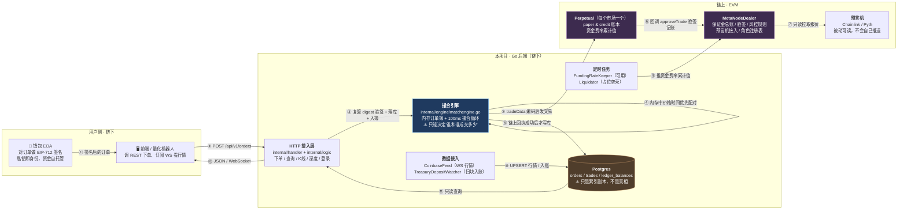
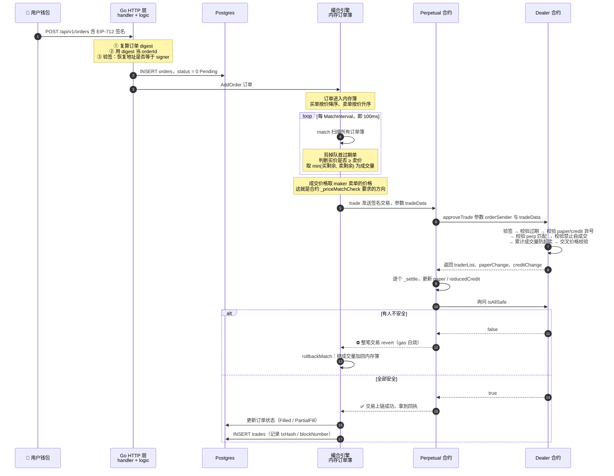
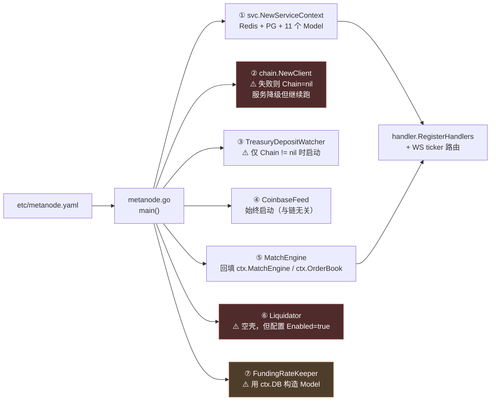

# 第 1 章：从合约到服务端 — 合约不管的那些事，正是这个 Go 后端存在的理由

> 如果你已经读完 Solidity 篇，你脑子里应该已经装着一整套链上账本的运作方式：`paper` 和 `credit` 怎么记、EIP-712 怎么验签、`isSafe` 怎么算保证金、资金费率为什么是"累计值"。
>
> 但读完合约篇，你一定会卡在一个地方：**`Perpetual.trade(bytes tradeData)` 是全项目唯一的成交入口，可它收到的不是"我要买 1 个 BTC"，而是一整包已经配对好的数据。** 那么问题来了——这包 `tradeData` 是谁生成的？谁决定哪两张订单能配对？成交数量是谁定的？谁来判断"现在该结算资金费率了"？
>
> 答案是：**全在链下，全在这个 Go 后端里**。本章不追任何一行具体业务的实现细节，只回答一个架构问题：**合约划走了哪一半，剩下的那一半为什么必须由 Go 来补。**

---

## 1. 本章导读

### 1.1 从一行函数签名倒推：合约留下了什么"坑"

我们先不看 Go 代码，先盯着合约里这个签名看十秒钟：

```solidity
// src/Perpetual.sol
function trade(bytes calldata tradeData) external {
    (address[] memory traderList, int256[] memory paperChangeList, int256[] memory creditChangeList) =
        IDealer(owner()).approveTrade(msg.sender, tradeData);
    ...
}
```

这个函数**不接受订单参数，只接受一坨已经编码好的字节**。这意味着在它被调用的前一刻，链下一定已经完成了下面全部四件事：

1. **收集**：把用户提交的订单收拢起来（用户不会自己去调合约——他要真去调，就得自己付 gas 并且自己找对手盘）；
2. **配对**：决定哪一张买单和哪一张卖单可以成交（这叫"价格发现"，是交易所最核心的功能）；
3. **定量**：决定这一笔成交多少数量（订单可能只成交一部分，这叫"部分成交"）；
4. **编码**：把 `(Order[], bytes[], uint256[])` 三元组按 ABI 规则序列化成 `bytes`。

这四件事，就是本指南要讲的这个 Go 后端的主线。**合约把"计算与验证"留在了链上，把"撮合与调度"整个甩给了链下。** 本章的任务，就是让你彻底想明白这条分界线为什么必须画在这里。

### 1.2 为什么撮合不能放进合约？算一笔经济账

初学者常有的第一个疑问是："既然区块链这么强，为什么不让合约自己维护订单簿、自己撮合？"

技术上做得到，经济上做不起。我们逐条算账：

**第一笔账：Gas 成本。**

以太坊上往一个空存储槽写入数据的 `SSTORE` 操作，首次写入需要约 20,000 gas。这意味着"挂一笔单进订单簿"的成本，和一个简单的 ERC-20 转账（约 21,000 gas）是同一个数量级。而此时用户只是**把一张单子挂进盘口**，还没有产生任何成交。如果撤单也要再花一笔 gas，那么一个做市商一天挂撤 5,000 次单，就要烧掉 5,000 笔交易的 gas —— 这个成本没有任何做市策略能覆盖。

**第二笔账：延迟。**

以太坊主网约 12 秒出一个块（Sepolia 测试网也是同样的量级）。用户点击"下单"，要等下一个区块被打包、再等若干个区块确认，才能在盘口上看到自己的订单。而中心化交易所（CEX）的下单往返是毫秒级。一个延迟 12 秒起步的订单簿，做市商根本没法报价 —— 报价挂上去 12 秒，市场早就变了。

**第三笔账：订单簿的形态本身。**

订单簿要求"价格优先、时间优先"，也就是**头部元素会频繁变化**。合约里的存储是一条条独立的存储槽，没有"有序集合"这种数据结构；要实现优先级队列，得自己写堆、自己维护父子节点指针，每次插入和删除都是 O(log n) 次存储写入。链上存储按槽计费，这个 O(log n) 就是 O(log n) 倍的 gas。

**第四笔账：链上数据的读取体验。**

链上没有"分页查询"。前端要展示"最近 50 笔成交"，链上只能通过 `eth_getLogs` 拉取区块区间内的全部 `OrderFilled` 事件，然后在链下排序、过滤、分页。**也就是说，即便数据都在链上，你还是必须有一个链下的索引器。** 这一条后面会反复出现。

把四笔账合起来看：

| 动作 | 完全链上方案的代价 | 本项目链下方案 |
| --- | --- | --- |
| 挂单 | 一笔交易 + 约 2 万 gas | 一次 HTTP POST，不花 gas |
| 撤单 | 再来一笔交易 + gas | 一次 HTTP POST |
| 看盘口深度 | 需要自己扫链聚合 | 一次 `GET /api/v1/orderbook` |
| 成交延迟 | ≥ 1 个区块（约 12 秒） | 100 毫秒（`MatchInterval` 配置） |
| 历史成交查询 | 拉全量日志本地排序 | 一条 SQL，带索引和分页 |

**结论：合约不是"不能"撮合，而是"撮合"这件事的商业模式不适合上链。** 高频、免费、低延迟，这三个要求和"每次状态变更都要全球共识"是天然矛盾的。

### 1.3 关键反转：链下撮合了，合约凭什么信它？

这是本章最重要的一个认知转折，也是所有刚接触 DeFi 的工程师最容易想歪的地方。

既然撮合跑在链下，撮合程序又是由项目方部署的，那么一个自然的担心是：

> "后端说成交就成交？那它岂不是可以随便操纵价格，把我挂 30000 的买单，按 50000 的价格成交掉？"

**不可以。原因非常朴素：价格写在用户的签名里。**

我们回头看一眼订单结构体（`src/libraries/Types.sol`，Go 侧对应 `internal/chain/tradedata.go` 的 `SolidityOrder`）：

```solidity
struct Order {
    address perp;          // 属于哪个永续市场
    address signer;        // 谁下的单（签名者）
    int128  paperAmount;   // 仓位数量：+1e18 = 做多 1 个，-1e18 = 做空 1 个
    int128  creditAmount;  // 资金数量：做多时为负（花钱），做空时为正（收钱）
    bytes32 info;          // 打包了 maker 费率、taker 费率、过期时间、nonce
}
```

用户签名的是**整张订单的所有字段**。而 `creditAmount / paperAmount` 的比值，就是这张订单的隐含价格：

```text
paperAmount  = +1e18       （做多 1 个 BTC，精度 1e18）
creditAmount = -30000e6    （付出 30000 USDC，精度 1e6）
隐含价格      = |creditAmount| / |paperAmount| = 30000 USDC/BTC
```

所以一张签好名的订单，本质上就是一张**限价委托单**：它同时表达了"方向"、"数量"和"价格上限/下限"。撮合者能动的只有"成交数量"，动不了价格。

这个约束在合约里有四道锁，我们逐一验证。

**第一道锁：签名校验（改任何字段 → 签名失效）。**

```solidity
// src/MetaNodeExternal.sol → approveTrade()
bytes32 orderHash = EIP712._hashTypedDataV4(domainSeparator, Trading._structHash(order));
orderHashList[i] = orderHash;

(address recoverSigner,) = ECDSA.tryRecover(orderHash, signatureList[i]);
if (recoverSigner != order.signer && !state.operatorRegistry[order.signer][recoverSigner]) {
    // 合约钱包走 EIP-1271
    if (Address.isContract(order.signer)) {
        require(IERC1271(order.signer).isValidSignature(orderHash, signatureList[i]) == 0x1626ba7e, ...);
    } else {
        revert(Errors.INVALID_ORDER_SIGNATURE);
    }
}
```

这里有一个**极其重要**的连锁反应，本指南第 7 章会专门展开：`orderHash` 是**对订单全部字段做 EIP-712 哈希**得到的。撮合者只要把 `creditAmount` 从 `-30000e6` 改成 `-50000e6`，`orderHash` 就会变，恢复出来的地址就不再是 `signer`，整笔交易直接 revert。

**换句话说：在链下"篡改订单价格"这件事，在密码学上根本不存在可行性。** 这不是靠"后端有职业道德"保证的，是靠数学保证的。

**第二道锁：累计成交量上限（不许超量成交）。**

```solidity
// 更新订单已成交数量
state.orderFilledPaperAmount[orderHash] += matchPaperAmount[i];
// 检查是否超额成交
require(
    state.orderFilledPaperAmount[orderHash] <= int256(orderList[i].paperAmount).abs(),
    Errors.ORDER_FILLED_OVERFLOW
);
```

`matchPaperAmount[i]` 是撮合者唯一能自己填的数字（成交数量）。合约在这里做累计计数：这张订单历史累计成交了多少，不能超过它自己签的总量。所以撮合者可以"让订单成交得慢"，但不可能凭空多成交。

**第三道锁：价格交叉校验（不许跨价强撮）。**

```solidity
// src/libraries/Trading.sol → _priceMatchCheck()
function _priceMatchCheck(Types.Order memory takerOrder, Types.Order memory makerOrder) private pure {
    int256 temp1 = int256(makerOrder.creditAmount) * int256(takerOrder.paperAmount);
    int256 temp2 = int256(takerOrder.creditAmount) * int256(makerOrder.paperAmount);

    if (takerOrder.paperAmount > 0) {
        require(makerOrder.paperAmount < 0, Errors.ORDER_PRICE_NOT_MATCH); // 买必须配卖
        require(temp1 <= temp2, Errors.ORDER_PRICE_NOT_MATCH);             // 卖价 ≤ 买价
    } else {
        require(makerOrder.paperAmount > 0, Errors.ORDER_PRICE_NOT_MATCH); // 卖必须配买
        require(temp1 >= temp2, Errors.ORDER_PRICE_NOT_MATCH);             // 买价 ≥ 卖价
    }
}
```

这段代码值得多看一眼，因为它藏着一个典型的**定点数编程技巧**。

要比较的是两个价格：`makerPrice = |makerCredit / makerPaper|` 和 `takerPrice = |takerCredit / takerPaper|`。直接做除法在整数运算里会丢精度（而且合约里没有小数），所以作者**把除法改写成了交叉相乘**：

```text
要求： makerPrice ≤ takerPrice
即：   |makerCredit| / |makerPaper|  ≤  |takerCredit| / |takerPaper|
两边同乘 |makerPaper| * |takerPaper|（同为正数，不等号方向不变）：
       |makerCredit| * |takerPaper|  ≤  |takerCredit| * |makerPaper|
```

代码里的 `temp1 = makerCredit * takerPaper`、`temp2 = takerCredit * makerPaper`，正是这个交叉相乘的结果。注意代码里**没有取绝对值**——因为订单的 `paper` 和 `credit` 一定异号（下面第四道锁会讲），符号在交叉相乘后恰好抵消，所以直接乘反而更简洁。这个技巧在 DeFi 合约里非常常见，你要养成条件反射。

有了这道锁，撮合者就不能把"出价 30000 的买单"和"要价 31000 的卖单"强行配在一起 —— 那样买单会以更差的 31000 成交，属于侵占用户利益。合约会直接拒绝。

**第四道锁：成交后全体安全检查。**

```solidity
// src/Perpetual.sol → trade()
require(IDealer(owner()).isAllSafe(traderList), "TRADER_NOT_SAFE");
```

一笔交易结算完所有参与者的余额之后，合约会逐一检查：所有人是否仍然满足维持保证金要求。任何一个人变成不安全，整个交易回滚（revert）。这保证了撮合者不能"撮合出一堆本该被拒绝的仓位来掏空用户保证金"。

**把四道锁合起来，我们得到这个项目最核心的信任模型：**

> **合约不验证"你撮合得对不对"，只验证"每张订单都是本人签的、没有超量成交、没有跨价撮合、成交后所有人都还安全"。**

用一句话概括：**合约是公证处，不是裁判。** 它只确认"交易双方确实事先同意过这些条款"，它既不关心、也无从得知"是谁把双方拉到一起的"。

这个设计有个漂亮的副作用：**后端的可作恶面被压缩到了极小**。它能做的最坏的事，是"不作为"—— 比如故意不撮合你的订单、或者优先撮合自己的订单（这在传统金融里叫"抢跑"，front-running）。但它**偷不走钱、改不了价、超不了量**。第 5 节的思考题会让你更细致地推演这一点。

### 1.4 后端的四大职责：合约"不做"的四件事

现在我们可以正式列出这个 Go 后端的职责清单了。它不是"合约的界面"，它是**四个合约天然做不到的角色**：

| # | 职责 | 主要代码位置 | 为什么合约做不了 |
| --- | --- | --- | --- |
| 1 | **撮合与价格发现** | `internal/engine/matchengine.go` | 需要低延迟与高频状态改写，链上 gas 与出块时间不允许（见 1.2） |
| 2 | **喂价与行情接入** | `internal/listener/coinbasefeed.go`、`internal/chain/client.go` | 链上预言机是**被动可读**的：它无法主动订阅外部行情源，只能等人来 `latestRoundData()` 读一下 |
| 3 | **定时任务与链上运维** | `internal/engine/fundingratekeeper.go`、`internal/engine/liquidator.go`、`internal/listener/treasurydepositwatcher.go` | 合约是**被动**的：没有定时器、没有后台线程，没人调用就永远不动 |
| 4 | **用户体验与查询** | `internal/handler/**`、`internal/logic/**` | 链上没有分页、排序、聚合；查询历史需要扫全量日志 |

第 1 条已经讲透了，我们把 2、3、4 逐条说清楚，因为它们是"为什么必须有后端"的另外三个独立理由。

#### 职责二：喂价 —— 链上的价格是"被读"的，不是"被推"的

很多人以为预言机的模型是"Chainlink 主动把价格推给合约"。不是的。Chainlink 的 `AggregatorV3Interface` 提供的接口是 `latestRoundData()`，这是一个**只读函数**：链上任何合约或链下任何客户端，主动去调用它，才能拿到当前的价格快照。

```solidity
// src/interfaces/internal/IChainlink.sol（Chainlink 标准接口）
function latestRoundData() external view
    returns (uint80 roundId, int256 answer, uint256 startedAt, uint256 updatedAt, uint80 answeredInRound);
```

这带来两个后果：

- 合约侧：`OracleAdaptor` 必须**在每个需要价格的时刻**（计算保证金、判断是否可清算）去主动读取预言机。这属于合约篇第 13 章的内容。
- 链下侧：**后端需要自己去接外部行情源，把数据拿到手里。** 本项目用 `internal/listener/coinbasefeed.go` 通过 WebSocket 订阅 Coinbase 的现货 ticker 频道，收到价格后写入 `market_quotes` 表；同时 `internal/chain/client.go` 里的 `ChainlinkAnswer8()` 提供了链下直接读 Chainlink 聚合器答案的能力，供资金费率结算时计算"指数价"。

两个数据源（Coinbase WS 与 Chainlink 链上读数）在本项目里承担不同角色，第 15 章会详细对比。本章你只需要建立这个认知：**"喂价"这个词在链下是字面意义的——后端真的在把外部世界的价格搬运进来。**

#### 职责三：定时任务 —— 智能合约没有闹钟

这是最容易被初学者忽略、但在工程上最关键的一条。

智能合约是一段**只有在被调用时才会执行**的代码。它没有 `setInterval`、没有 cron、没有后台线程。合约里写着的这些函数：

```solidity
Perpetual.updateFundingRate(int256 newFundingRate) external onlyOwner
Perpetual.liquidate(address liquidator, address liquidatedTrader, ...) external
```

**它们不会自己执行。** 资金费率不会到点自动结算，不安全的仓位不会自动被清算，它们的执行**完全依赖于链下有程序去调用它们**。

所以本项目的后端里有两类"keeper（守夜人）"：

- `FundingRateKeeper`：每 `SettleInterval` 秒（配置里是 28800 秒 = 8 小时）醒来一次，计算资金费率的增量，然后调用 `Dealer.updateFundingRate(perps[], rates[])` 把它推上链；
- `Liquidator`：每 `CheckInterval` 秒（配置里是 10 秒）醒来一次，检查仓位是否安全，然后调用 `Perpetual.liquidate(...)`。（**注意：本项目里的清算机器人是个空壳，第 17 章会专门解剖它。** 本章只需要知道"清算必须由链下触发"这个事实。）

这里有个值得反复咀嚼的工程含义：**链上协议的安全性，一部分是由链下服务的活性（liveness）决定的。** 一个设计再完美的清算合约，如果没人去调用它，坏账一样会发生。这就是为什么成熟的 DeFi 协议里，keeper 是一种有经济激励的角色（清算者有折扣可赚、资金费率 keeper 有手续费分成），而不是项目方免费提供的公共服务。

#### 职责四：用户体验 —— 链上能"存"但不能"查"

链上数据是可验证的、永久的，但它的读取模型对应用层极不友好：

- **没有分页**：合约函数只能一次返回一个数组，你想"第 2 页的 20 条"就得在链下自己切；
- **没有排序与聚合**：没有 `ORDER BY`、没有 `GROUP BY`，想要"按价格聚合的深度"必须在链下算（本项目 `MatchEngine.SnapshotOrderBook` 就是干这个的）；
- **历史查询成本极高**：要查某个用户的所有成交，链上只能 `eth_getLogs` 扫描区块区间内的 `OrderFilled` 事件，节点还有单次查询的日志数量上限。

结论是行业共识：**任何有像样前端的 DApp，背后一定有一个索引器（indexer）**。它监听链上事件、把数据整理成适合查询的结构写进自己的数据库，然后让前端查这个数据库。

本项目里，`orders` 表和 `trades` 表就是这种"索引产物"——它们不是链上数据的权威来源，只是链上数据的一个**方便查询的副本**。这个"副本"的定位会引出本指南后面反复讨论的一致性问题（第 11、12、19 章），这里先埋下伏笔。

### 1.5 一个容易被忽略的设计：后端的收入从哪来？

读到这儿你应该已经接受"后端是链下服务商"这个定位了。但还有一个商业问题没解决：**为什么有人愿意自己掏 gas 跑这个后端？**

答案藏在 `approveTrade` 的末尾：

```solidity
// 收取手续费给订单发送者（撮合引擎）
state.primaryCredit[orderSender] += result.orderSenderFee;
// 如果订单发送者需要支付手续费（负数），检查其账户安全性
if (result.orderSenderFee < 0) {
    require(Liquidation._isSolidIMSafe(state, orderSender), Errors.ORDER_SENDER_NOT_SAFE);
}
```

`orderSender` 就是提交这笔 `tradeData` 的链上地址 —— 在本项目里，就是配置文件中 `Ethereum.PrivateKey` 对应的那个 EOA（外部拥有账户）。**撮合产生的手续费，直接记在它的链上保证金账户里。**

这一行代码回答了两个架构问题：

1. **激励从哪来**：maker 手续费归撮合者。这让"跑一个撮合后端"从成本中心变成了一门生意。也正因如此，链上才有 `validOrderSender` 这个白名单 —— 谁能当撮合者是要审批的，不是随便一个地址都能进场（后端启动时会调 `ValidateOrderSender()` 自检，确认自己的私钥地址确实在白名单里，否则撮合上链必然 revert）。
2. **谁在承担风险**：注意那个 `if` 分支。如果 `orderSenderFee` 是负数（后端需要倒贴手续费），合约会额外检查**后端自己**的保证金是否充足。这句话的潜台词是：**撮合者本身也是一个交易者，它自己也会穿仓。** 一个设计不当的费率模型，是可能把撮合后端自己拖垮的。

### 1.6 本章的一句话总结

> **合约负责"记账和验证"，后端负责"撮合和调度"。**
> 合约用密码学保证用户签过的条款不会被篡改；后端用工程手段保证市场能高效运转。
> 后端动不了钱、改不了价，但它决定了市场的**速度**和**活性**——这恰恰是链上做不到的那一半。

---

## 2. 架构 / 流程图

### 2.1 全景分层图：链上、链下、用户侧的职责边界



**看图要点**：

- 图中只有 ⑤⑨ 两条箭头是**真正改变链上状态**的（也就是要花 gas 的）。
- ⑦⑪ 是只读，不花 gas。
- ⑧ 这条箭头上的注释是本项目最核心的一致性策略：**链上确认成功之后，才允许写数据库**。这条规则会在第 11 章被反复讨论它的边界。
- ⚠️ 记号的三处（撮合引擎、数据库），正是本指南后面要重点拆解的三个"坑"所在。

### 2.2 一笔订单的完整一生（时序图）

这张图把第 1.4 节的四大职责串成一条时间线，是本指南第三部分（第 7~12 章）的总纲：



**这张图里最值得记住的两个细节：**

1. **`orderId` 就是 EIP-712 digest。** 第 ③ 步里，后端不是自己生成一个 UUID，而是**复算一遍订单的 EIP-712 哈希**，拿它当订单 ID。原因是链上 `approveTrade` 里的 `state.orderFilledPaperAmount[orderHash]` 用的也是这个哈希 —— 两边用的必须是同一个值，账才能对上。第 7 章会专门讲这一点。
2. **链上失败必须回滚内存。** 因为撮合是在内存里"预演"的，链上 revert 意味着预演作废，必须把已经在内存中被扣掉的成交量加回去。第 11 章会详细讲 `rollbackMatch` 的边界问题。

### 2.3 `main()` 里的六大组件装配图

一个后端服务的"骨架"，看 `main()` 就够了。本项目 `metanode.go` 的 `main()` 一共只装配了六个组件，但顺序和依赖关系很有讲究：



**三个必须记住的装配细节（第 3 章会逐个展开）：**

- **② `chain.NewClient` 失败不会让服务崩溃**，只是把 `ctx.Chain` 留成 `nil`。这是一种"无链降级"设计：RPC 挂了、私钥错了，你至少还能起 HTTP 服务、查数据库里的历史数据。代价是所有链上相关功能静默失效（第三章会讲清这个代价有多大）。
- **⑤ 撮合引擎与 `ServiceContext` 是互相引用的**：`main` 先把 `ctx` 传给引擎的构造函数（需要 `OrderModel` / `TradeModel`），引擎造好后再回填 `ctx.MatchEngine` 和 `ctx.OrderBook`。这是为了解决"下单接口要往引擎里塞订单、引擎又需要数据库"的循环依赖，第 5 章会讲作者怎么用三个小接口把它解开。
- **⑦ `FundingRateKeeper` 直接拿着 `ctx.DB` 去构造 `model.NewFundingRateModel(db)`**。这意味着如果 Supabase 没配好（`ctx.DB` 为 `nil`），Model 内部就持有 `nil` 连接，8 小时后第一次结算写库时才会爆炸。这是一个典型的"启动时不校验、运行时才崩溃"的陷阱，第 6 节会列为踩坑项。

---

## 3. 核心代码拆解

本章是俯瞰章，所以下面挑的不是"最难的代码"，而是**最能体现链上/链下分工边界**的代码。每段都标注了它在后续哪一章会被深入展开。

### (1) `metanode.go` 的 `main()` —— 一个链下服务商的"全部家当"

```go
func main() {
    flag.Parse()
    var c config.Config
    conf.MustLoad(*configFile, &c)                 // 加载 yaml 配置

    // 允许任意来源跨域（Access-Control-Allow-Origin: *）
    server := rest.MustNewServer(c.RestConf, rest.WithCors())
    defer server.Stop()

    ctx := svc.NewServiceContext(c)                 // ① 依赖容器：Redis + PG + 所有 Model
    if ctx.PG != nil {
        if sqlDB, err := ctx.PG.DB(); err == nil {
            defer sqlDB.Close()                     // 进程退出时关连接池
        }
    }

    // ② 链客户端：失败时 Chain 为 nil，仅 HTTP 可用，撮合/资金费不落链。
    ch, err := chain.NewClient(c.Ethereum, c.Markets, c.Chainlink)
    if err != nil {
        fmt.Println("chain client:", err, "(链上查询/结算将不可用，请检查 RpcUrl、DealerAddress)")
    } else {
        ctx.Chain = ch
        defer ch.Close()
        // 启动自检：配置的市场地址是否符合 Sepolia 预期
        if err := config.ValidateSepoliaMarkets(c.Ethereum.ChainId, c.Markets); err != nil {
            fmt.Println("markets config:", err)
        }
        // 启动自检：私钥地址是否在链上 validOrderSender 白名单里
        // —— 这个检查非常关键，见 (2) 的说明
        if err := ch.ValidateOrderSender(context.Background()); err != nil {
            fmt.Println("validOrderSender:", err)
        }
    }

    // ③ 扫链入账监听器：只有链客户端可用时才启动
    var treasuryWatcher *listener.TreasuryDepositWatcher
    if ctx.Chain != nil {
        treasuryWatcher = listener.NewTreasuryDepositWatcher(ctx)
        treasuryWatcher.Start()
        defer treasuryWatcher.Stop()
    }

    // ④ Coinbase 行情：与链无关，始终启动
    coinbaseFeed := listener.NewCoinbaseFeed(ctx)
    coinbaseFeed.Start()
    ctx.IndexPrice = coinbaseFeed                 // 用接口塞进 ctx，供业务逻辑读取
    defer coinbaseFeed.Stop()

    // ⑤ 撮合引擎与 ServiceContext 互相引用，便于下单 API 入簿。
    matchEngine := engine.NewMatchEngine(c.MatchEngine, ctx.OrderModel, ctx.TradeModel, ctx.Chain)
    ctx.MatchEngine = matchEngine                 // 回填：让 CreateOrder 能往簿里塞单
    ctx.OrderBook = matchEngine                   // 回填：让深度 API 能读簿

    handler.RegisterHandlers(server, ctx)         // 注册所有 REST 路由
    market.RegisterTickerWebSocket(server, ctx)   // 额外注册一个 WS 路由

    perpAddrs := make([]string, 0, len(c.Markets))
    for _, m := range c.Markets {
        perpAddrs = append(perpAddrs, m.Address)
    }
    matchEngine.Start(perpAddrs)                  // 传市场地址是为了从 DB 恢复未成交订单
    defer matchEngine.Stop()

    // ⑥ 清算机器人（⚠️ 当前是占位实现）
    liquidator := engine.NewLiquidator(c.Liquidator, c.Ethereum, ctx.DB)
    liquidator.Start()
    defer liquidator.Stop()

    // ⑦ 资金费率服务
    fundingKeeper := engine.NewFundingRateKeeper(c.FundingRate, c.Markets, ctx.DB, ctx.Chain)
    fundingKeeper.Start()
    defer fundingKeeper.Stop()

    fmt.Printf("Starting server at %s:%d...\n", c.Host, c.Port)
    server.Start()                                // 阻塞在这里，直到进程被杀
}
```

**作者为什么这么设计（设计思想）：**

这段代码体现了链下服务最核心的组织原则：**按"故障域"分组启动，而不是按"功能"分组。**

注意 ② 那个 `if err != nil` 分支 —— 它**没有 `panic`，也没有 `os.Exit`**。这是刻意的：链上 RPC 是最容易出问题的外部依赖（Infura 限流、节点宕机、网络抖动）。如果 RPC 连不上就让整个进程退出，那么"查历史订单"这种完全不需要链的功能也会一起挂掉。所以作者选择让 `Chain` 保持 `nil`，让每个使用它的地方各自判断。

这个决策的**代价**同样明显：`Chain == nil` 时，`CreateOrder` 会**跳过签名验证**（`createorderlogic.go` 里写的是 `if l.svcCtx.Chain != nil { VerifyEOASignature(...) }`）。也就是说，一个没配好 RPC 的服务器，会变成一个"任何订单都收、不做签名校验"的服务器。好在此时撮合引擎也会因为 `chain == nil` 而在 `submitBatch` 里回滚所有成交（见第 (5) 段），不会真的上链 —— 但这依然是一个**危险的默认值**：安全校验不应该依赖"链上服务恰好可用"。这个坑会在第 6 节再提一次。

另一个值得注意的设计是 **`defer` 的使用顺序**。Go 的 `defer` 是后进先出（LIFO），所以进程退出时实际的关闭顺序是：`fundingKeeper` → `liquidator` → `matchEngine` → `coinbaseFeed` → `treasuryWatcher` → `ch`（链客户端）→ `sqlDB` → `server`。这个顺序恰好是"先停生产者、再停消费者、最后关资源"：先停掉那些会持续发交易/写库的定时任务，再去关底层连接。如果反过来先关数据库连接，正在跑的 keeper 就会在写库时拿到一个已关闭的连接池而 panic。

> 📖 **深入章节**：本章只需建立整体印象，启动顺序与降级设计的完整分析见 **第 3 章**。

---

### (2) `chain.Client.ValidateOrderSender` —— 启动时的一次"身份自检"

```go
// ValidateOrderSender 启动时校验配置私钥地址是否为链上 validOrderSender。
func (c *Client) ValidateOrderSender(ctx context.Context) error {
    if c.signerKey == nil {
        return fmt.Errorf("Ethereum.PrivateKey 未配置，无法提交链上成交")
    }
    valid, err := c.IsOrderSenderValid(ctx, c.fromAddr)   // 读链上的白名单映射
    if err != nil {
        return fmt.Errorf("查询 validOrderSender 失败: %w", err)
    }
    if !valid {
        // 这个错误信息写得非常到位：直接告诉你后果是什么
        return fmt.Errorf("PrivateKey 对应地址 %s 不是 Dealer.validOrderSender，撮合上链将 revert", c.fromAddr.Hex())
    }
    return nil
}

// IsOrderSenderValid 查询 Dealer 上 orderSender 是否为 validOrderSender。
func (c *Client) IsOrderSenderValid(ctx context.Context, sender common.Address) (bool, error) {
    data, err := c.dealerABI.Pack("isOrderSenderValid", sender)   // 手工 ABI 编码
    if err != nil {
        return false, err
    }
    out, err := c.callDealer(ctx, data)                           // eth_call，不花 gas
    if err != nil {
        return false, err
    }
    res, err := c.dealerABI.Unpack("isOrderSenderValid", out)
    if err != nil {
        return false, err
    }
    return res[0].(bool), nil
}
```

**作者为什么这么设计（设计思想）：**

这段代码解决的是一个 Web3 后端特有的"**上线前你不知道自己是死的**"问题。

在传统后端里，服务启动成功后，某个功能能不能用，通常靠日志或监控发现。但在链上交互里，有一个**只有在真正发起交易时才会暴露的失败模式**：私钥地址不在白名单里。合约 `approveTrade` 的第一行就是：

```solidity
require(state.validOrderSender[orderSender], Errors.INVALID_ORDER_SENDER);
```

如果这个条件不满足，你的每一笔撮合上链都会 revert。而 revert 的代价是**你真的付了 gas**（交易被打包进区块、执行、然后回滚，gas 不退）。假设撮合循环每秒提交一笔交易，你可能在几分钟内烧掉一大笔钱，而且只有去链上浏览器翻交易，才会发现全部是红的。

`ValidateOrderSender()` 是一次**主动的、零成本的（`eth_call` 不花 gas）"身份自检"**，在服务启动时就把这个致命的配置错误暴露出来。这个模式在本项目里反复出现，是值得抄走的工程习惯：**任何"链上角色授权"型的依赖（orderSender / fundingRateKeeper / liquidator 白名单），都应该在启动时用只读调用验证一遍。**

顺带说明这里的 `callDealer` 为什么用 `eth_call`：

```go
func (c *Client) callDealer(ctx context.Context, data []byte) ([]byte, error) {
    msg := ethereum.CallMsg{To: &c.dealer, Data: data}
    return c.eth.CallContract(ctx, msg, nil)   // nil = 最新区块；不构造交易、不签名、不广播
}
```

`CallContract` 走的是 JSON-RPC 的 `eth_call`：节点在本地 EVM 里执行一次然后丢弃状态，**不消耗 gas、不需要私钥、不需要 nonce**。这是链下读链上数据最标准、最省事的方式，本项目的所有查询（保证金、风险、仓位、标记价）都走这条路。

> 📖 **深入章节**：手写最小 ABI（不用 `abigen`）的取舍、`callDealer` / `callPerp` 的完整封装，见 **第 13 章**。

---

### (3) `chain.BuildMatchTradeData` —— 链下与链上的"数据契约"

这是本章最该逐字读的一个函数。它只有二十来行，但它是**链下撮合结果跨越到链上的唯一一道门**：

```go
// BuildMatchTradeData 将一笔撮合（taker + maker）编码为 tradeData。orderList[0] 必须为 taker。
func BuildMatchTradeData(taker, maker *model.Order, matchPaper *big.Int) ([]byte, error) {
    if taker.Perp != maker.Perp {
        return nil, fmt.Errorf("perp mismatch")        // 市场必须一致
    }
    o0, err := OrderFromModel(taker)                   // DB 模型 → 链上结构（含 info 重新打包）
    if err != nil {
        return nil, fmt.Errorf("taker: %w", err)
    }
    o1, err := OrderFromModel(maker)
    if err != nil {
        return nil, fmt.Errorf("maker: %w", err)
    }
    sigT, err := SignatureForChain(taker.Signature)    // 签名格式归一化（V 改成 27/28）
    if err != nil {
        return nil, err
    }
    sigM, err := SignatureForChain(maker.Signature)
    if err != nil {
        return nil, err
    }
    orders := []SolidityOrder{o0, o1}
    sigs := [][]byte{sigT, sigM}
    amt := new(big.Int).Abs(matchPaper)                // 链上只要数量，不要方向（方向由 paper 符号表达）
    return EncodeTradeData(orders, sigs, []*big.Int{amt, amt})
}
```

以及它调用的编码函数：

```go
var tradeTupleType, _ = abi.NewType("tuple[]", "", []abi.ArgumentMarshaling{
    {Name: "perp", Type: "address"},
    {Name: "signer", Type: "address"},
    {Name: "paperAmount", Type: "int128"},   // ⚠️ 注意是 int128，不是 int256
    {Name: "creditAmount", Type: "int128"},
    {Name: "info", Type: "bytes32"},
})

// EncodeTradeData 生成 perpetual.trade(tradeData) 所需的 abi.encode(orderList, signatureList, matchPaperAmount)。
func EncodeTradeData(orders []SolidityOrder, sigs [][]byte, matchPaper []*big.Int) ([]byte, error) {
    if len(orders) != len(sigs) || len(orders) != len(matchPaper) {
        return nil, fmt.Errorf("trade data length mismatch")
    }
    bt, _ := abi.NewType("bytes[]", "", nil)
    ut, _ := abi.NewType("uint256[]", "", nil)
    args := abi.Arguments{
        {Type: tradeTupleType},
        {Type: bt},
        {Type: ut},
    }
    // ... 把 SolidityOrder 转成匿名 struct 后 Pack ...
    return args.Pack(goOrders, sigs, matchPaper)
}
```

**作者为什么这么设计（设计思想）：**

这段代码里有三处细节，每一处都对应一条链上规则，非常值得逐条对照：

**细节一：`orderList[0]` 必须是 taker —— 数组下标是有语义的位置。**

合约里 `Trading._matchOrders` 从头到尾都在依赖这个约定：

```solidity
result.traderList[0] = orderList[0].signer;                       // 第 0 位是 Taker
for (uint256 i = 1; i < orderList.length;) { /* 第 1..n 位是 Maker */ }
require(matchPaperAmount[0] == totalMakerFilledPaper, ...);       // Taker 量 = 所有 Maker 量之和
```

所以 Go 侧 `BuildMatchTradeData` 的注释特意写了"orderList[0] 必须为 taker"。这不是文档礼貌，而是**接口契约**：传反了，合约会 revert，而且错误信息是 `TAKER_TRADE_AMOUNT_WRONG` 这种不会告诉你"你把数组顺序搞反了"的模糊提示。

这正是本项目"手写最小 ABI"方案的代价：因为不用 `abigen` 生成强类型绑定，Go 侧**没有任何编译期检查**能保证参数顺序正确。第 13 章会讨论这个取舍。

**细节二：`int128` 而不是 `int256` —— 精度与存储的对齐。**

链上 `Order` 结构体里 `paperAmount` 是 `int128`（目的是让 `paper` 和 `reducedCredit` 能塞进同一个存储槽，这个存储优化见 Solidity 篇第 6 章）。而 Go 的 `big.Int` 是任意精度。如果 Go 侧编码时写成 `int256`，ABI 编码出来的字节布局就完全不同（32 字节 vs 32 字节但截断规则不同），合约 `abi.decode` 会解出错乱的数字 —— 而且**不一定报错，可能解出一个看起来合理但完全错误的值**。所以 `abi.ArgumentMarshaling` 里必须严格写 `int128`。

**细节三：`info` 字段要重新打包，而不是直接存原值。**

```go
func OrderFromModel(o *model.Order) (SolidityOrder, error) {
    // ...
    mf, err := ParseFeeInt64(o.MakerFeeRate)
    tf, err := ParseFeeInt64(o.TakerFeeRate)
    info := PackOrderInfo(mf, tf, uint64(o.Expiration), uint64(o.Nonce))
    // ...
}
```

数据库里，`maker_fee_rate` / `taker_fee_rate` / `expiration` / `nonce` 是**四个独立的列**（便于查询和索引）；但链上订单把它们**压进了一个 `bytes32`**。所以从数据库重建链上订单时，必须把四个字段按合约的打包规则重新塞回 32 字节。

这是"链上为省 gas 而压缩存储"与"链下为查询方便而拆列存储"两种设计诉求冲突的典型体现。**后端在这里扮演的角色是"格式转换器"** —— 而且是一个必须**逐位精确**的转换器，因为 `info` 是签名覆盖的字段，打包错一个 bit，用户的签名就对不上，整笔交易 revert。

> 📖 **深入章节**：`info` 的位布局（maker 费率 8 字节 + taker 费率 8 字节 + 过期时间 8 字节 + nonce 8 字节）、费率打包与批量提交策略，见 **第 10 章**。

---

### (4) `MatchEngine.matchOrderBook` —— 撮合的核心循环

这是整个后端最"像交易所"的一段代码。它把 1.3 节讲的合约规则，在内存里**先预演一遍**：

```go
// matchOrderBook 撮合单个订单簿
func (e *MatchEngine) matchOrderBook(book *OrderBook) {
    book.mu.Lock()
    defer book.mu.Unlock()

    for {
        // ① 剪掉队首的过期订单：合约会 require(expiration >= block.timestamp)，
        //    不剪掉的话每次撮合都会撞上 revert，白烧 gas。
        e.pruneExpiredAtHead(book)

        if len(book.BuyOrders) == 0 || len(book.SellOrders) == 0 {
            break                                  // 一边空了，没法撮，退出
        }

        buyOrder := book.BuyOrders[0]              // 买单：价格降序的队首 = 最高买价
        sellOrder := book.SellOrders[0]            // 卖单：价格升序的队首 = 最低卖价

        buyPrice := calculatePrice(buyOrder)       // |credit| / |paper|，1e18 精度
        sellPrice := calculatePrice(sellOrder)

        if buyPrice.Cmp(sellPrice) < 0 {
            break                                  // 买价 < 卖价，价格不交叉，无法成交
        }
        // ⚠️ 注意：这里只判断了"买价 >= 卖价"，没有再做 _priceMatchCheck 里的
        //    paper 符号检查 —— 因为订单入簿时已经按 paper 正负分到了买/卖两侧。

        e.remMu.Lock()
        buyRem := new(big.Int).Set(e.remain[buyOrder.OrderId])    // 拷贝，避免持锁做运算
        sellRem := new(big.Int).Set(e.remain[sellOrder.OrderId])
        e.remMu.Unlock()

        // ② 成交量 = min(买方剩余, 卖方剩余)。这就是"部分成交"的实现机制。
        matchAmount := new(big.Int)
        if buyRem.Cmp(sellRem) < 0 {
            matchAmount.Set(buyRem)
        } else {
            matchAmount.Set(sellRem)
        }
        if matchAmount.Sign() == 0 {
            break
        }

        // ③ 成交价取 maker（卖单）的价格 —— 这是本项目的一个简化假设：
        //    "买单永远是 taker，卖单永远是 maker"。合约支持任意 N 个 maker，
        //    但这里简化为双边各一个。详见第 9 章。
        result := &MatchResult{
            TakerOrder:  buyOrder,
            MakerOrder:  sellOrder,
            MatchAmount: matchAmount.String(),
            MatchPrice:  sellPrice.String(),
        }

        // ④ 把成交结果塞进待提交队列，由另一个 goroutine 负责上链
        e.tradeMu.Lock()
        e.pendingTrades = append(e.pendingTrades, result)
        e.tradeMu.Unlock()

        // ⑤ 扣减双方剩余量；谁扣到 0 谁就出队
        e.remMu.Lock()
        e.remain[buyOrder.OrderId].Sub(e.remain[buyOrder.OrderId], matchAmount)
        e.remain[sellOrder.OrderId].Sub(e.remain[sellOrder.OrderId], matchAmount)
        if e.remain[buyOrder.OrderId].Sign() == 0 {
            book.BuyOrders = book.BuyOrders[1:]              // 出队（切掉头部）
            delete(e.remain, buyOrder.OrderId)
        }
        if e.remain[sellOrder.OrderId].Sign() == 0 {
            book.SellOrders = book.SellOrders[1:]
            delete(e.remain, sellOrder.OrderId)
        }
        e.remMu.Unlock()
        // 循环继续：同一张单可能还要继续吃下一档
    }
}
```

**作者为什么这么设计（设计思想）：**

**设计点一：为什么要有独立的 `remain` 余额簿，而不是直接改订单对象的数量？**

这是本项目一个**很容易被忽略、但非常关键**的设计。看字段注释：

```go
// orderId -> 剩余可撮合 paper 绝对值（与链上累计成交量配合；订单对象仍保留签名时的完整 paper/credit）
remain map[string]*big.Int
```

关键在于——**订单对象上签了名的 `PaperAmount` / `CreditAmount` 是不能改的。** 因为：

1. 签名覆盖了这两个字段，改一个 bit 签名就废了；
2. 更实际的原因是，`submitBatch` 里要用**原始订单**去构造 `tradeData` 发给合约（合约要拿它重算 `orderHash` 来验证签名）。如果订单对象被就地改成了"剩余 0.3 个 BTC"，合约算出来的 `orderHash` 就和用户签的不一样，直接 revert。

所以链下必须**双轨记账**：

| | 订单对象 `model.Order` | 余额簿 `remain` |
| --- | --- | --- |
| 内容 | 用户签名时的**原始** `paper` / `credit` | 还剩多少可成交 |
| 用途 | 发给合约验签与结算 | 链下撮合的"可成交量"判断 |
| 能否修改 | ❌ 绝对不能（签名覆盖） | ✅ 每笔成交后增减 |

这个双轨结构还有一个额外好处：`SnapshotOrderBook` 生成深度快照时，用的是 `remain`（真实可成交量）而不是订单原始数量，所以盘口深度是准确的。

**设计点二：为什么成交量取 `min`？这就是"部分成交"的全部实现。**

一张挂单可能只有部分被吃掉。`min(buyRem, sellRem)` 这个朴素的选择，正是"部分成交"的全部机制 —— 少的那个归零出队，多的那个留在原地等下一个对手盘。合约侧配合的机制是 `state.orderFilledPaperAmount[orderHash]` 的累计计数：链下每次只提交"本次成交多少"，链上自己累加，并保证累计不超过总量。

**设计点三：为什么成交价取 maker 的价格？**

因为合约的 `_priceMatchCheck` 是从"taker 主动、maker 被动"的语义出发校验的。在真实的撮合里，"主动吃单的一方接受被动挂单方的价格"是行业惯例（这也叫"价格改善" —— taker 挂 31000 想吃，遇到 30000 的卖单，实际以 30000 成交，taker 占便宜了）。本项目简化成"买单永远是 taker、卖单永远是 maker"，所以成交价恒等于卖单价格。这个简化与合约的通用模型（1 个 taker + N 个 maker）是有差距的，第 9 章会专门讨论。

**设计点四：为什么 `break` 而不是 `continue`？**

价格不交叉时 `break` 跳出整个循环，而不是继续检查下一档。这是正确的，因为订单簿是**有序的** —— 买单按价格降序排，卖单按价格升序排，所以队首就是"最可能成交的一对"。如果连队首都不能成交，后面的更不可能。这里体现的是"数据结构决定了算法"：正因为入簿时做了排序（`addOrderWithRemain` 里的 `sort.Slice`），撮合时才能用 O(1) 的队首判断代替 O(n) 的全扫描。

> 📖 **深入章节**：订单簿为什么用两个切片而非红黑树/堆、买卖两侧排序方向为什么相反、`paperAmount` 的正负号如何同时承担"多空方向"和"归入哪一侧"两个语义，见 **第 8 章**。`remain` 在恢复与回滚中的角色见 **第 9、12 章**。

---

### (5) `MatchEngine.submitBatch` —— "链上成功才写库"这条铁律

如果说 `match()` 是"预演"，那 `submitBatch()` 就是"落锤"。它是本项目一致性策略的集中体现：

```go
// submitBatch 对每笔撮合：编码 tradeData → Perpetual.trade → 等待收据；链上成功才更新 DB。
func (e *MatchEngine) submitBatch(trades []*MatchResult) {
    if e.orderModel == nil || e.tradeModel == nil {
        logx.Error("order/trade model nil, skip DB updates")
        return
    }
    ctx := context.Background()
    for _, trade := range trades {
        matchAmt, ok := new(big.Int).SetString(trade.MatchAmount, 10)
        if !ok {
            logx.Errorf("bad match amount %s", trade.MatchAmount)
            continue
        }

        // ① 没有链客户端 → 这笔撮合根本无法结算，直接回滚内存
        if e.chain == nil {
            logx.Error("chain client nil, rollback match (no on-chain settle)")
            e.rollbackMatch(trade, matchAmt)
            continue
        }

        // ② 发交易前再查一次过期：合约有 require(expiration >= block.timestamp)，
        //    到这里才过期的话，交易必然 revert，白烧 gas —— 提前拦掉省一笔钱
        now := time.Now().Unix()
        if orderExpired(trade.TakerOrder, now) || orderExpired(trade.MakerOrder, now) {
            logx.Errorf("skip on-chain trade: order expired taker=%s maker=%s", ...)
            e.rollbackMatch(trade, matchAmt)
            continue
        }

        // ③ 编码成合约能 decode 的 tradeData
        td, err := chain.BuildMatchTradeData(trade.TakerOrder, trade.MakerOrder, matchAmt)
        if err != nil {
            logx.Errorf("build trade data: %v", err)
            e.rollbackMatch(trade, matchAmt)
            continue
        }

        // ④ 发交易
        perp := common.HexToAddress(trade.TakerOrder.Perp)
        tx, err := e.chain.SubmitPerpTrade(ctx, perp, td)
        if err != nil {
            logx.Errorf("SubmitPerpTrade failed: %v", err)
            e.rollbackMatch(trade, matchAmt)
            continue
        }

        txHash := tx.Hash().Hex()

        // ⑤ 等交易被打包进区块 —— 这一步可能阻塞数秒到数分钟
        rec, err := bind.WaitMined(ctx, e.chain.RPC(), tx)
        if err != nil {
            logx.Errorf("WaitMined %s: %v", txHash, err)
            e.rollbackMatch(trade, matchAmt)
            continue
        }
        // ⑥ 交易被打包 ≠ 交易成功。必须检查回执状态：Status == 1 才是成功
        if rec == nil || rec.Status != 1 {
            logx.Errorf("trade tx reverted or failed: %s status=%v", txHash, recStatus(rec))
            e.rollbackMatch(trade, matchAmt)
            continue
        }

        // ===== 到这里才确认：链上真的结算完成了。以下才开始写数据库 =====

        blockNum := int64(rec.BlockNumber.Uint64())
        // ⑦ 更新两张订单的累计成交量与状态
        e.applyFillStatus(ctx, trade.TakerOrder.OrderId, trade.TakerOrder.PaperAmount, matchAmt.String())
        e.applyFillStatus(ctx, trade.MakerOrder.OrderId, trade.MakerOrder.PaperAmount, matchAmt.String())

        // ⑧ 插入成交记录（带 txHash 与区块号，便于和链上对账）
        if _, err := e.tradeModel.Insert(ctx, &model.Trade{
            TradeId:      generateTradeId(),
            Perp:         trade.TakerOrder.Perp,
            TakerOrderId: trade.TakerOrder.OrderId,
            MakerOrderId: trade.MakerOrder.OrderId,
            Taker:        trade.TakerOrder.Signer,
            Maker:        trade.MakerOrder.Signer,
            PaperAmount:  trade.MatchAmount,
            Price:        trade.MatchPrice,
            TxHash:       txHash,
            BlockNumber:  blockNum,
            CreateTime:   time.Now(),
        }); err != nil {
            logx.Errorf("insert trade: %v", err)
        } else {
            logx.Infof("trade settled on-chain: tx=%s perp=%s amount=%s", ...)
        }
    }
}
```

**作者为什么这么设计（设计思想）：**

**这是本指南要传递的最重要的一个 Web3 后端心智模型：数据库不是"真相"，链上才是。**

先看反面：如果先写数据库、再发交易，会发生什么？

```text
写库（成交 1 BTC，状态 Filled）
   ↓
发交易 → revert（比如用户保证金不够，isAllSafe 失败）
   ↓
结果：数据库说"成交了"，链上说"没这回事"。用户的真实仓位在链上是 0，
      但前端查询数据库会显示他有仓位。这个不一致永远不会自动修复。
```

而按照本项目的顺序：

```text
发交易 → 等回执 → Status == 1 → 写库
```

无论在哪一步失败，**链上和数据库都不会出现"链上没成交但库里有记录"的情况**。三种失败都走 `rollbackMatch`：把内存里扣掉的 `remain` 加回去、把出队的订单重新插回订单簿。

这个策略的学名叫**"以链上为准的保守写入"（chain-first write）**。它的优点是永远不会产生"幽灵成交"；代价是**吞吐受限** —— 第 ⑤ 步 `WaitMined` 会阻塞，在 Sepolia 上通常要等 12~24 秒。而且注意，这个 `for` 循环是**串行**的：一笔交易确认完，才处理下一笔。所以后端的实际上链吞吐大约是"每 12 秒一笔"（受出块时间限制，`BatchSize` 配置在这里其实**不起作用**，因为每笔撮合都是独立发一笔交易 —— 第 10 章会讲这个配置与实现的脱节）。

**⚠️ 但这个策略有一个著名的漏洞角落，是本指南第 11、12 章的主线：**

```text
链上交易成功（区块已确认）
   ↓
💥 进程在 applyFillStatus 之前崩溃 / 被 kill / OOM
   ↓
结果：链上成交了，数据库里订单状态还是 Pending，成交记录也没有
```

此时 `rollbackMatch` 没有机会执行（进程都没了），而链上的状态已经变了。重启后 `RestorePendingOrders` 从数据库读到的，正是这份"没写准"的数据。**这两章的价值就在于让你看清：所谓"最终一致"，在缺乏链上对账机制时会退化成"永久不一致"。** 一个生产级实现需要补充"按区块范围回扫链上 `OrderFilled` 事件、与本地 trades 表对账"的补偿机制。

**另外一个值得指出的细节**：`rollbackMatch` 只回滚了**内存**（`remain` + 订单簿），**没有回滚数据库**。因为在成功的路径上，数据库本来就是在链上确认之后才写的，失败路径上根本没写过，所以不需要回滚。这个"看起来不完整"的设计其实是**自洽的** —— 只要你接受"数据库写入永远发生在链上确认之后"这个不变式。第 11 章会仔细验证这个不变式在哪些边界上会破。

> 📖 **深入章节**：`rollbackMatch` 的完整边界分析见 **第 11 章**；重启恢复 `RestorePendingOrders` 见 **第 12 章**。

---

### (6) `svc.ServiceContext` —— 依赖容器与三个"解耦接口"

`ServiceContext` 是全项目唯一的依赖容器，所有 handler 和 logic 都通过它拿到需要的东西：

```go
// ServiceContext 服务上下文
type ServiceContext struct {
    Config config.Config

    DB    sqlx.SqlConn      // go-zero 的 SQL 抽象
    PG    *gorm.DB          // GORM 直连 Postgres（Supabase）
    Redis *redis.Redis

    // 数据模型（11 个）
    OrderModel         model.OrderModel
    TradeModel         model.TradeModel
    PositionModel      model.PositionModel
    // ... 其余 8 个 ...

    // Chain 为 nil 时：无 RPC，链上查询接口返回空或零；撮合仍可记库但不会发交易。
    Chain *chain.Client

    // ⚠️ 下面三个字段是"接口"，不是具体类型 —— 这是打破循环依赖的关键
    MatchEngine MatchBookSink       // 由 internal/engine.MatchEngine 实现
    OrderBook   OrderBookSource     // 同一个实例，暴露只读快照能力
    IndexPrice  IndexPriceSource    // 由 listener.CoinbaseFeed 实现
}

// 三个小接口的定义（注意：它们都在 svc 包内，而不是在 engine / listener 包里）
type MatchBookSink interface {
    AddOrder(order *model.Order)
}

type OrderBookSource interface {
    SnapshotOrderBook(perp string, limit int) (bids, asks []OrderBookLevel)
}

type IndexPriceSource interface {
    IndexPrice1e6(perp string) (price string, ok bool)
}
```

**作者为什么这么设计（设计思想）：**

**设计点一：为什么是接口，而不是 `*engine.MatchEngine`？**

因为 Go 不允许循环引用（import cycle）。依赖关系是这样的：

- `engine` 包需要 `svc.ServiceContext` 来拿 `OrderModel` / `TradeModel` / `Chain`；
- `svc.ServiceContext` 又需要持有撮合引擎，才能让 `logic` 包里的下单逻辑把订单塞进订单簿。

如果 `svc` 直接写 `MatchEngine *engine.MatchEngine`，那就是 `svc → engine` 和 `engine → svc` 的双向依赖，**编译直接失败**。

作者的办法是经典的 Go 解法：**在消费者一侧定义小接口**（业界称之为 "accept interfaces, return structs"）。`svc` 包只需要知道"有个东西能 `AddOrder`"，于是定义 `MatchBookSink` 这个只有一个方法的小接口。`engine.MatchEngine` 恰好有 `AddOrder` 方法，于是**它自动满足这个接口**——不需要显式声明 `implements`，也不需要 import 对方。粘合工作交给 `main()`：

```go
matchEngine := engine.NewMatchEngine(c.MatchEngine, ctx.OrderModel, ctx.TradeModel, ctx.Chain)
ctx.MatchEngine = matchEngine    // *MatchEngine 满足 MatchBookSink，隐式赋值成功
ctx.OrderBook = matchEngine      // 同一个实例，同时满足 OrderBookSource
```

这个技巧的妙处在于：**依赖倒置（DIP）在 Go 里不需要额外的抽象层，一个几行的小接口就够了**。注意三个接口都定义在 `svc` 包（消费者侧），而不是 `engine` / `listener` 包（生产者侧）—— 这是有意为之，也符合 Go 社区的最佳实践。

**设计点二：`Chain == nil` 是一个贯穿全项目的"空状态"。**

看这行注释：

```go
// Chain 为 nil 时：无 RPC，链上查询接口返回空或零；撮合仍可记库但不会发交易。
```

这是一个**全局的降级开关**，几乎所有业务代码里都有 `if svcCtx.Chain != nil` 的判断。它让"RPC 不可用"从"服务起不来"变成了"服务能跑但功能受限"。这个设计的完整分析（包括它的代价）是第 3 章的主题。

**设计点三：为什么同时有 `DB sqlx.SqlConn` 和 `PG *gorm.DB`？**

这不是冗余，是被迫的。看 `NewServiceContext` 里的注释：

```go
// 充值 / 链下余额 / 订单 / 成交：Postgres 上必须用 GORM（go-zero sqlx 的 ? 与 pgx 不兼容）
if pgDB != nil {
    svcCtx.DepositModel = model.NewGormDepositModel(pgDB)
    svcCtx.LedgerBalanceModel = model.NewGormLedgerBalanceModel(pgDB)
    svcCtx.OrderModel = model.NewGormOrderModel(pgDB)
    svcCtx.TradeModel = model.NewGormTradeModel(pgDB)
    svcCtx.MarketQuoteModel = model.NewGormMarketQuoteModel(pgDB)
}
```

go-zero 的 `sqlx` 生成的是 MySQL 风格的 `?` 占位符；PostgreSQL 用的是 `$1, $2`。虽然 `sqlx` 内部会做占位符展开，但在某些写法下与 `pgx` 驱动不兼容。作者的处理方式是：**能用的表继续用 `sqlx`（Position、Withdraw、FundingRate…），不能用的表换成 GORM 重写一遍**。于是 `internal/model/` 下就出现了两套并行的数据访问写法。这是第 18 章的主题 —— 本章你只需要知道，这是一个**技术债的具象化现场**，它提醒我们：切换数据库驱动不是"改个连接串"那么简单。

> 📖 **深入章节**：`ServiceContext` 的依赖注入设计与循环依赖破解，见 **第 5 章**；双套数据访问层，见 **第 18 章**。

---

### (7) `FundingRateKeeper.settleFundingRate` —— 一个"keeper"的标准形态

链下 keeper 的代码骨架高度相似，认清一个就够用了：

```go
// Start 启动资金费率服务
func (k *FundingRateKeeper) Start() {
    logx.Info("FundingRateKeeper starting...")
    go k.settleLoop()          // 关键：go 出去，不阻塞 main
}

// settleLoop 标准的 ticker 循环 + 优雅退出
func (k *FundingRateKeeper) settleLoop() {
    interval := time.Duration(k.config.SettleInterval) * time.Second
    if interval <= 0 {
        interval = 8 * time.Hour     // 兜底默认值
    }
    ticker := time.NewTicker(interval)
    defer ticker.Stop()              // 必须 Stop，否则 ticker 泄漏

    for {
        select {
        case <-k.stopCh:
            return                   // 收到停止信号，优雅退出
        case <-ticker.C:
            k.settleFundingRate()    // 到点了，执行一次结算
        }
    }
}

func (k *FundingRateKeeper) settleFundingRate() {
    // 读取各市场旧累计指数，按溢价算出本次 delta，再 newRate = old + delta 批量上链。
    ctx := context.Background()
    if k.chain == nil {
        logx.Info("FundingRateKeeper: chain client nil, skip")
        return                       // 降级：没有链客户端就静默跳过
    }

    // ... 对每个市场：读旧累计值 → 读标记价 → 读指数价 → 算 delta → 累加 ...

    perps := make([]common.Address, len(rows))
    rates := make([]*big.Int, len(rows))
    for i := range rows {
        perps[i] = rows[i].perp
        rates[i] = rows[i].newRate
    }

    // ★ 批量提交：一次交易更新多个市场，摊薄 gas
    tx, err := k.chain.SubmitFundingRateUpdate(ctx, perps, rates)
    if err != nil {
        logx.Errorf("updateFundingRate tx failed: %v (需保证私钥对应链上 fundingRateKeeper)", err)
        return
    }
    logx.Infof("Funding rate update tx: %s", tx.Hash().Hex())

    // 上链成功后才写库 —— 与 submitBatch 同一条铁律
    for _, r := range rows {
        _, _ = k.fundingModel.Insert(ctx, &model.FundingRate{
            Perp:       r.market.Address,
            Rate:       r.newRate.String(),
            MarkPrice:  r.markPrice.String(),
            IndexPrice: r.idx.String(),
            SettleTime: time.Now(),
        })
    }
}
```

**作者为什么这么设计（设计思想）：**

**设计点一：`for { select { case <-stopCh: case <-ticker.C: } }` 是 Go 里定时任务的标准骨架。**

这个模式值得背下来。三个要点：

1. **`go k.settleLoop()`**：`Start()` 必须立即返回，否则会阻塞 `main()` 后续的装配代码，HTTP 服务器根本起不来。本项目的六个组件全部遵循"`Start()` 非阻塞 + 内部起 goroutine"的约定。
2. **`select` 同时等两个 channel**：一个等停止信号，一个等定时器。用 `select` 而不是 `for range ticker.C` 的意义就在于**能及时响应退出**。
3. **`defer ticker.Stop()`**：`time.Ticker` 底层持有一个运行时定时器，不 `Stop` 会泄漏。

**设计点二：批量提交以摊薄 gas。**

```go
tx, err := k.chain.SubmitFundingRateUpdate(ctx, perps, rates)
```

注意 `Dealer.updateFundingRate(address[] perps, int256[] rates)` 接收的是**数组**。这不是接口设计随意，而是 gas 优化：一次交易的基础成本（21,000 gas）是固定的，更新 2 个市场还是 20 个市场，基础成本都一样。把 N 个市场的更新打包成 1 笔交易，比发 N 笔交易省下 N-1 份基础成本。**"批量调用"是智能合约 gas 优化最常用的手段之一**，本项目的 `updateFundingRate` 和 `approveTrade`（一次带 N 张订单）都是这个思路。

**设计点三：`indexPrice` 的降级链。**

```go
func (k *FundingRateKeeper) indexPrice(ctx context.Context, market config.MarketConfig) *big.Int {
    feed := k.chain.IndexPriceForMarket(market.Name)
    if feed != (common.Address{}) {
        px, err := k.chain.ChainlinkAnswer8(ctx, feed)   // 首选：链上 Chainlink
        if err == nil {
            return px
        }
        logx.Errorf("chainlink %s: %v", market.Name, err)
    }
    // 降级：拿不到 Chainlink，就用链上标记价兜底
    mark, err := k.chain.GetMarkPrice(ctx, common.HexToAddress(market.Address))
    if err != nil {
        return big.NewInt(0)
    }
    return mark
}
```

这里体现了"**指数价 → 标记价**"的降级思路：指数价（来自 Chainlink，代表外部现货市场的真实价格）拿不到时，退而使用标记价（合约内部的报价）。**这在理论上是有问题的** —— 用标记价算"标记价与指数价的溢价"，结果必然是 0，资金费率会退化成"永远不结算"。**这是一个静默失效（silent failure）**：不报错、不崩溃，只是业务逻辑悄悄失去了意义。生产系统里，这种降级应该配合告警。第 15 章会详细讨论。

> 📖 **深入章节**：资金费率的 delta 计算、上限裁剪，见 **第 14 章**；指数价的完整数据链路，见 **第 15 章**。

---

### (8) `Liquidator.checkSafeOnChain` —— 一个"反面教材"

本章最后一个代码片段是一个**故意的反面案例**，因为它最能说明"链下服务必须主动做事"这个道理：

```go
// checkSafeOnChain 检查链上安全状态
func (l *Liquidator) checkSafeOnChain(trader string) bool {
    // TODO: 调用 MetaNodeDealer.isSafe(trader)
    // client, _ := ethclient.Dial(l.ethConfig.RpcUrl)
    // dealer, _ := contracts.NewMetaNodeDealer(common.HexToAddress(l.ethConfig.DealerAddress), client)
    // safe, _ := dealer.IsSafe(nil, common.HexToAddress(trader))
    // return safe

    return true // 占位
}
```

以及它的调用方：

```go
func (l *Liquidator) checkAllPositions() {
    ctx := context.Background()

    // TODO: 从链上获取所有有仓位的交易者
    // traders := l.getAllTraders()

    // 模拟交易者列表
    traders := []string{
        // 从数据库查询有仓位的交易者   ← 这个切片永远是空的
    }

    for _, trader := range traders {
        l.checkTraderPosition(ctx, trader)
    }
}
```

**这段代码为什么值得单独讲？**

因为它构成了一条**完美的"看起来在工作"的假象链**：

1. `Start()` 会打印 `"Liquidator starting..."`，日志看起来一切正常；
2. 配置里 `Liquidator.Enabled: true`，说明"已启用"；
3. 每 10 秒真的会执行 `checkAllPositions()`，定时循环是好的；
4. 但 `traders` 是**空切片**，所以循环体一次都不执行；
5. 即便它不为空，`checkSafeOnChain` 也**永远返回 `true`**（"安全"），于是 `checkTraderPosition` 会在第一行 `if isSafe { return }` 直接返回；
6. 即便它返回了 `false`，`executeLiquidation` 的**整个实现体是被注释掉的**。

三道防线，每一道都是空的。**结果是：这个清算机器人永远不会清算任何东西，但它会一直打印"我在运行"。** 这是分布式系统里最危险的一类故障 —— 不是崩溃，而是**静默的失效**（silent failure）。崩溃至少能被监控发现，静默失效会让所有人以为系统是安全的。

**把这个例子和本章的主题连起来：**

1.3 节我们说"合约把撮合甩给了链下"。这里我们看到另一个更严峻的事实：**合约同样把清算甩给了链下**。合约里的 `liquidate()` 函数是完整实现且经过精心设计的（价格保护、坏账处理、保险基金，见 Solidity 篇第 12 章），但它**躺着不动**，等一个永远不会来的调用者。

这引出一条对 Web3 后端工程师非常重要的认知：

> **链上代码的正确性 ≠ 系统的安全性。**
> 一个功能完备的清算合约 + 一个空壳的清算机器人 = **没有清算机制**。
> 链上协议的安全性，最终取决于链下 keeper 的**活性**（liveness）。

顺带一说：正因为"keeper 的活性"是个真问题，DeFi 行业才会出现专门的 keeper 网络（如 Chainlink Keepers、Gelato），用去中心化的方式保证"总会有人来调用"。本项目采用的是最朴素的方案：项目方自己跑一个 keeper。

> 📖 **深入章节**：清算机器人的完整解剖与"生产级应该怎么做"，见 **第 17 章**；对照合约侧的完整清算能力，见 Solidity 篇第 12 章。

---

## 4. Web3 特有机制

本章虽然偏架构，但已经涉及了不少"只有链上开发才会遇到"的机制。把它们归纳成一张清单，方便你建立索引：

### 4.1 合约是被动的：没有定时器、没有后台线程

这是最根本的一条，前面已经反复讲了。工程上的推论是：**任何"到期应当发生"的事情，都必须有一个链下 keeper 去推动。** 本项目里有三类：

| keeper | 触发周期 | 调用的合约函数 | 当前状态 |
| --- | --- | --- | --- |
| `FundingRateKeeper` | `SettleInterval`（8 小时） | `Dealer.updateFundingRate` | ✅ 可用 |
| `Liquidator` | `CheckInterval`（10 秒） | `Perpetual.liquidate` | ❌ 空壳 |
| `TreasuryDepositWatcher` | `PollIntervalSeconds`（12 秒） | 无（只读扫块） | ✅ 可用 |

### 4.2 Gas：三种成本控制手段

链下服务一旦要写链，就必须管理 gas。本项目用了三招：

```go
// 招数一：GasPriceMultiplier —— 主动加价提高打包优先级
if c.gasMultiplier > 0 && c.gasMultiplier != 1 {
    f := big.NewFloat(c.gasMultiplier)
    gp, _ := f.Mul(f, new(big.Float).SetInt(gasPrice)).Int(nil)
    if gp.Sign() > 0 {
        gasPrice = gp                       // 配置里是 1.2，即比建议价高 20%
    }
}

// 招数二：EstimateGas + MaxGasLimit 双保险
msg := ethereum.CallMsg{From: c.fromAddr, To: &perp, Gas: c.maxGas, GasPrice: gasPrice, Data: data}
gasLimit, err := c.eth.EstimateGas(ctx, msg)
if err != nil {
    gasLimit = c.maxGas                     // 预估失败 → 用配置的上限兜底
}
if gasLimit > c.maxGas {
    gasLimit = c.maxGas                     // 预估超过上限 → 截断，防炸
}

// 招数三：批量调用（合约的数组参数），见 FundingRateKeeper
```

**为什么要加价 20%？** 因为 `SuggestGasPrice` 返回的是"当前网络的建议价"，而你构造完交易、签名、广播需要几百毫秒到几秒。这段时间里如果网络拥堵加剧，你的交易就会卡在 mempool 里。加价是一种"用钱买确定性"的做法。反之如果加太多，则是白白多付。`1.2` 是个经验值。

**为什么要有 `MaxGasLimit`？** 因为 `EstimateGas` 本身是通过 `eth_call` 模拟执行来估算的，如果合约逻辑里有依赖状态的分支（比如"如果此时不安全就 revert"），估算结果可能不准。更重要的是**防呆**：如果 `EstimateGas` 返回一个荒谬的大值（比如因为某个 bug 返回了几十亿），你会把全部余额当 gas 烧掉。截断到配置上限是最后一道保险。

### 4.3 Nonce：两个完全不同的 Nonce，别搞混

这是初学者最容易混淆的地方。本项目里同时存在两种 nonce，含义完全不同：

| | **交易 nonce（tx nonce）** | **订单 nonce** |
| --- | --- | --- |
| 属于谁 | 发送交易的账户（后端私钥地址） | 下单的用户 |
| 作用 | 防止交易重放、保证交易顺序 | 防止同一张订单被重复撮合 |
| 存储位置 | 以太坊账户状态的一部分（链上隐式维护） | 打包在订单的 `info` 字段里，被签名覆盖 |
| 代码位置 | `c.eth.PendingNonceAt(ctx, c.fromAddr)` | `model.Order.Nonce` → `PackOrderInfo(...)` |
| 谁来维护 | 节点自动管理，你只需要读一下 | **必须由用户/前端自己维护递增** |

看这段代码里它们是如何各司其职的：

```go
nonce, err := c.eth.PendingNonceAt(ctx, c.fromAddr)   // ← 交易 nonce，链上查的
// ... 构造交易时用 ...
tx := types.NewTx(&types.LegacyTx{
    Nonce:    nonce,        // 交易 nonce
    GasPrice: gasPrice,
    Gas:      gasLimit,
    To:       &perp,
    Value:    big.NewInt(0),
    Data:     data,
})
```

而订单 nonce 是**用户签名时**就写进订单里的：

```go
info := PackOrderInfo(mf, tf, uint64(o.Expiration), uint64(o.Nonce))   // 订单 nonce 被打包进 info
```

**关键在于**：交易 nonce 是"这一笔链上交易在账户交易序列里的序号"，而订单 nonce 是"这一张订单的身份标识的一部分"。**订单 nonce 的作用是让两张内容完全相同的订单产生不同的 `orderHash`** —— 否则用户想在同一价格下两次各买 1 个 BTC，两张订单的字段完全一样，`orderHash` 也一样，链上的 `orderFilledPaperAmount[orderHash]` 会把它们当成同一张订单，总量上限就只有 1 个 BTC 了。

`PendingNonceAt` 里的 `Pending` 也要注意：它返回的是"**包含 mempool 中待打包交易在内**的下一个 nonce"，而不是"已确认交易的下一个 nonce"。为什么要用 Pending？因为如果连续发多笔交易，用已确认的 nonce 会导致第二笔和第一笔撞 nonce（"nonce too low"）。**但代价是：如果有交易卡在 mempool 里，Pending nonce 会把它们算进去，可能导致你的新交易也一起排队。** 本项目在 `submitBatch` 里是串行发交易（发一笔、等确认、再发下一笔），所以不会撞上这个问题 —— 这也是"串行换简单"的一个隐性收益。

### 4.4 交易回执：`WaitMined` 成功 ≠ 交易成功

这是链上交互里最常见的坑之一，本项目处理得很规范：

```go
rec, err := bind.WaitMined(ctx, e.chain.RPC(), tx)     // 等交易被"打包进区块"
if err != nil { /* 网络错误 */ }

if rec == nil || rec.Status != 1 {                     // ← 关键的第二个判断
    logx.Errorf("trade tx reverted or failed: %s status=%v", txHash, recStatus(rec))
    e.rollbackMatch(trade, matchAmt)
    continue
}
```

**为什么必须检查 `rec.Status`？**

在以太坊里，"交易被打包进区块"和"交易执行成功"是**两件事**：

- 你的交易被矿工/验证者打包了 → 这是**必然发生**的（只要你付了 gas），因为矿工只负责把交易塞进区块；
- 你的交易执行时 revert 了 → 状态变更全部回滚，但 **gas 照扣**，交易依然在链上留下一条"失败"的记录（`status = 0`）。

所以 `WaitMined` 返回 `nil` 错误，只说明"交易进块了"，**不代表合约逻辑执行成功**。必须再检查 `rec.Status == 1`。

**这个机制的 Web3 含义是**：链上失败是**要花钱的**。传统后端里，一次 API 调用失败最多是浪费时间；链上一次 revert 是真金白银的 gas 损失。所以后端必须尽可能在**发交易之前**就把必然失败的情况拦下来 —— 这正是 `submitBatch` 里第 ② 步"发交易前再查一次过期"存在的理由。

### 4.5 只读调用（`eth_call`）：不花 gas 的链上查询

本项目里所有的链上查询都走 `CallContract`：

```go
func (c *Client) callDealer(ctx context.Context, data []byte) ([]byte, error) {
    msg := ethereum.CallMsg{To: &c.dealer, Data: data}
    return c.eth.CallContract(ctx, msg, nil)
}
```

`eth_call` 的语义是"**在本地节点上模拟执行一次，然后丢弃结果**"。所以：

- 不需要私钥、不需要签名、不需要 nonce；
- 不消耗 gas、不产生交易、不改变任何链上状态；
- 但它读到的是**你指定的那个区块高度**的状态（本项目的 `nil` 表示"最新区块"）。

这带来一个**重要的应用设计含义**：既然查询是免费的，那么"能读链就读链"是划算的。本项目正是这么做的 —— `ChainTickers`、`GetTraderRisk`、`GetPositions` 这些查询接口，都是**直接调链上视图函数**，而不是查数据库。

```go
// ChainTickers 从链上 Dealer 拉取各市场的标记价格与资金费率（用于 Ticker / WS）。
func ChainTickers(ctx context.Context, svc *svc.ServiceContext) []types.Ticker {
    if svc.Chain == nil {
        return nil
    }
    for _, m := range svc.Config.Markets {
        perp := common.HexToAddress(m.Address)
        mp, err := svc.Chain.GetMarkPrice(ctx, perp)     // 直接读链，不查库
        // ...
    }
}
```

**为什么这样是对的？** 因为标记价是**合约实时计算**出来的，依赖预言机的最新报价和资金费率累计值。如果缓存到数据库里，就有延迟和过期问题。"直接读链"虽然慢一点（每次一个 RPC 往返），但**读到的永远是真相**。

这个策略的代价是：**你的服务可用性被绑在了 RPC 节点的可用性上**。所以本项目才要在 `Chain == nil` 时做降级（返回空数组），而不是让接口报错。第 19 章会详细对比"能读链就读链"与"读本地库"两类接口的取舍。

### 4.6 私钥即身份：后端的链上人格

传统后端里，服务调用外部 API 用的是 API Key 或 OAuth token —— 这些凭证是**可以吊销、可以轮换**的。而在 Web3 里，后端的"身份"就是一个 EOA 的私钥：

```go
if cfg.PrivateKey != "" {
    key, err := crypto.HexToECDSA(strings.TrimPrefix(cfg.PrivateKey, "0x"))
    if err != nil {
        return nil, fmt.Errorf("private key: %w", err)
    }
    c.signerKey = key
    c.fromAddr = crypto.PubkeyToAddress(key.PublicKey)
}
```

这个私钥决定了：

- 后端调用 `Perpetual.trade` 时，合约看到的 `msg.sender` 是谁（必须通过 `validOrderSender` 白名单）；
- 后端在链上赚到的手续费进哪个账户；
- 谁来付 gas。

**由此带来两个工程约束**：

1. **私钥泄露 = 身份被盗，且无法吊销。** 你不能像换 API Key 那样换个私钥了事 —— 你必须去链上执行 `setOrderSender(oldAddr, false)` 把旧地址从白名单摘掉。这意味着密钥管理在 Web3 后端里是**一等公民**的安全问题，不能像配置项那样随手写在 yaml 里（而本项目恰好就写在 yaml 里并提交进了 git —— 见第 6 节的踩坑提示）。
2. **同一个私钥可能承担多个角色，不要混淆。** 本项目的配置注释里写得很清楚：

   ```yaml
   # 私钥：须与链上 validOrderSender 一致，用于撮合成功后调用 Perpetual.trade。
   # 若同时承担资金费结算，还须被设为 fundingRateKeeper（或使用单独运维流程）。
   ```

   也就是说，**同一个私钥同时当订单发送者和资金费率 keeper 是可行的，但必须在链上分别授权。** 生产环境通常会把这两种角色拆成两个独立的密钥和账户，以便独立轮换、独立限额 —— 这也是最小权限原则在链上的体现。

### 4.7 事件：链下索引的原始素材

合约在执行过程中会 `emit` 事件，例如：

```solidity
// src/Perpetual.sol
event BalanceChange(address indexed trader, int256 paperChange, int256 creditChange);
event UpdateFundingRate(int256 oldFundingRate, int256 newFundingRate);

// src/libraries/Trading.sol → _matchOrders
emit OrderFilled(orderHashList[i], orderList[i].signer, msg.sender, paperChange, creditChange - fee, serialNum, fee);
```

事件有几个重要特性，后端工程师必须理解：

- **事件不是状态**。事件写入的是交易的日志（log）区域，合约自己读不到（合约无法访问 log）。它唯一的用途就是给链下读。
- **`indexed` 关键字决定能不能高效过滤**。`event BalanceChange(address indexed trader, ...)` 里的 `indexed trader` 会被放进日志的 topics 里，链下可以用 `eth_getLogs` 按地址过滤；没标 `indexed` 的字段只能全量拉下来在本地过滤。
- **事件是链下索引的标准数据源**。行业里所有索引器（The Graph、Ponder、自研 indexer）都是靠订阅事件来重建链下视图的。

**而本项目有一个很有意思的特点：它几乎不用事件做业务驱动。**

原因很简单：**本项目的所有链上交易都是后端自己发起的**。后端在 `submitBatch` 里发完交易、等到回执，就知道成交结果了 —— 它不需要再去监听 `OrderFilled` 事件来"发现自己成交了"。这是一个"自产自销"的闭环。

这个选择**在当时是合理的（简单、直接），但代价是失去了对账能力**：如果链上状态发生了变化而数据库不知道（比如进程崩溃、或者有人用别的路径调用了 `trade`），后端**没有任何机制能发现**。这正是第 11、12 章要讨论的一致性问题，而"补上事件回扫对账"正是解决方案的方向。

> 补充：`TreasuryDepositWatcher` 是本项目**唯一**一个真正基于链上事件（ERC-20 `Transfer` 日志）工作的监听器 —— 因为充值这件事**不是后端发起的**，用户直接往收款地址转账，后端只能靠扫链发现。第 16 章会详细讲它的游标、确认数与幂等设计。

---

## 5. 本章小结与思考题

### 5.1 核心知识点回顾

| 知识点 | 一句话总结 |
| --- | --- |
| **分工边界** | 合约负责"记账 + 验证"，后端负责"撮合 + 调度" |
| **撮合为什么在链下** | 四笔账：gas 成本、出块延迟、订单簿需要频繁重排、链上没有分页/排序/聚合 |
| **信任模型** | 价格写在用户的签名里。撮合者只能决定"谁和谁成交多少"，**改不了价、超不了量、跨不了价**，且成交后必须全体安全 |
| **四道锁** | ① 签名校验 ② 累计成交量上限 ③ 价格交叉校验（交叉相乘技巧）④ `isAllSafe` |
| **后端四大职责** | 撮合、喂价、定时任务（keeper）、用户体验（查询/索引） |
| **合约是被动的** | 没有定时器，资金费率结算与清算都必须由链下 keeper 主动调用 |
| **收入模型** | `state.primaryCredit[orderSender] += result.orderSenderFee` —— 手续费归撮合者，同时撮合者自己也要满足保证金要求 |
| **`orderId` = EIP-712 digest** | 必须与链上 `orderHash` 完全一致，否则链上链下对不上账 |
| **双轨记账** | 订单对象保留签名时的原始数值（不可改），`remain` 记录剩余可成交量（可改） |
| **一致性策略** | "链上确认成功 → 才写数据库"；失败则 `rollbackMatch` 回滚内存 |
| **降级设计** | `Chain == nil` 时服务仍可启动，链上功能静默失效 |
| **`eth_call` 免费** | 查询走只读调用不花 gas，所以"能读链就读链" |
| **交易回执要查两件事** | `WaitMined` 不等于成功，必须再查 `rec.Status == 1` |
| **静默失效最危险** | `Liquidator` 就是范例：日志说"在运行"，实际什么都不做 |

### 5.2 思考题

#### 思考题 1：如果这个后端的运营者决定作恶（或者后端被黑客完全攻破、拿到了私钥），他最多能对用户造成什么伤害？请尽可能穷举，并指出哪些事他**做不到**。

<details>
<summary>点击查看参考答案</summary>

这道题的目的是让你把 1.3 节的信任模型推演到极限。**把"作恶"分成"能做的"和"做不到的"两列。**

**❌ 他做不到的事（被密码学与合约校验挡住）：**

1. **改不了价格。** 订单的 `paperAmount` / `creditAmount` 被 EIP-712 签名覆盖。改任何一个字段，`orderHash` 变化，`ECDSA.tryRecover` 恢复出的地址就不再等于 `signer`，`approveTrade` 直接 revert。
2. **超不了量。** `state.orderFilledPaperAmount[orderHash] += matchPaperAmount[i]` 累计计数，且 `require(... <= |paperAmount|)`。历史累计成交量不可能超过用户签名授权的总量。
3. **跨不了价。** `_priceMatchCheck` 用交叉相乘验证 `makerPrice <= takerPrice`（taker 买入时），杜绝"把买单按更差的卖价成交"。
4. **转不走钱。** 后端没有用户的私钥，无法构造任何以用户为 `signer` 的新订单。它只能使用**已经签名过的、且仍在有效期内的**订单。
5. **不能撮合出自杀的仓位。** `require(isAllSafe(traderList))` 保证成交后每个人都满足维持保证金要求 —— 后端没法通过"撮合出一个危险仓位"来制造爆仓。
6. **不能自成交。** `require(i == 0 || order.signer != orderList[0].signer, Errors.ORDER_SELF_MATCH)` 禁止一张订单和它自己撮合（这是防"刷量"的）。

**⚠️ 他做得到的事（链下服务的固有权力）：**

1. **审查 / 不作为（censorship）。** 他可以**故意不撮合**某些用户的订单 —— 订单收进来，躺在内存簿里永远不匹配。用户的资金没丢，但订单永远不成交。**这是后端最本质的权力，也是所有"链下撮合"方案的固有弱点。**
2. **抢跑（front-running）。** 因为后端是**第一个看到所有订单**的人，它可以先用自己的账户下一个订单，再撮合用户的订单，从价格差中获利。在传统金融里这叫"抢先交易"，是违法的；在链上世界，这是一个**没有技术手段能阻止**的问题 —— 只能靠声誉、竞争和监管。
3. **选择性地配对（order discrimination）。** 面对多张可成交的订单，它可以选择先和谁成交。虽然价格受 `_priceMatchCheck` 约束（不能跨价），但"和 A 成交而不是和 B 成交"本身会影响谁获得了这次价格改善。
4. **拒绝服务 / 拖延。** 故意拖延提交链上交易，让用户的订单在市场变动后才成交（或者干脆过期）。用户的损失是"错过了机会"，而不是"直接丢钱"。
5. **信息泄露（MEV 提取的原料）。** 后端能看到全部未成交订单（相当于看到了整个订单簿），它可以把这个信息卖给第三方，或者自己用来做方向性交易。**这是"链下撮合"最现实的商业模式风险。**
6. **侵吞自己赚的手续费。** `orderSenderFee` 是记在它自己账户上的，它可以随时提走 —— 但这是它自己的钱。

**🎯 本题的核心结论：**

> **后端的作恶面被压缩到了"活性（liveness）"和"信息优势"两个维度，而不是"资产安全"维度。**

这是这个架构设计得最漂亮的地方：**它把"信任"从"信任对方不会偷钱"降级成了"信任对方会及时干活"。** 前者是致命的，后者是可以用竞争、冗余、声誉来缓解的。

实践中缓解这些风险的手段包括：多家撮合方竞争（用户可以选择把订单发给谁）、订单有效期设短（减少被拖延的时间窗）、把订单广播给多个 relayer（减少抢跑空间）、使用 commit-reveal 或阈值加密隐藏订单内容（防止抢跑）。这些都是行业里的活跃研究方向。

</details>

#### 思考题 2：`CreateOrderLogic` 里，`orderId` 是这么来的：

```go
h, err := chain.OrderDigestWith(dc, order)
orderId := h.Hex()
```

为什么要把订单的 EIP-712 digest 直接当作数据库主键？如果换成 UUID 或数据库自增 ID，会有什么问题？

<details>
<summary>点击查看参考答案</summary>

**先看链上发生了什么。** `approveTrade` 里有两处关键使用：

```solidity
// ① 计算 orderHash
bytes32 orderHash = EIP712._hashTypedDataV4(domainSeparator, Trading._structHash(order));
// ② 用 orderHash 做累计成交量的 key
state.orderFilledPaperAmount[orderHash] += matchPaperAmount[i];
require(state.orderFilledPaperAmount[orderHash] <= int256(orderList[i].paperAmount).abs(), ...);
```

链上唯一能标识"这是同一张订单"的东西，**就是这个 `orderHash`**。合约里没有订单 ID 这个概念，它认的就只有哈希。

**如果后端用 UUID 当主键，会发生什么？**

1. **无法验证"链下累计成交量"和"链上累计成交量"是否一致。** 后端想核对"这张订单成交了多少"，需要拿订单去链上查 —— 但链上要的是 `orderHash`，你得从数据库字段里重新拼出订单结构、算哈希、再查。多一层转换就多一层出错的可能（尤其是 `info` 字段的位打包，错一个 bit 哈希就完全不同）。
2. **同一张订单可能被当成两张。** EIP-712 的签名是**确定性**的：同一组字段永远产生同一个哈希。如果用户（或前端因为网络重试）把同一张签名订单提交了两次，后端用 UUID 就会插入两条记录、当成两张订单。而用 digest 当主键，第二次插入会因为主键冲突被拒绝。本项目的代码正是这么做的：

   ```go
   existOrder, _ := l.svcCtx.OrderModel.FindOne(l.ctx, orderId)
   if existOrder != nil {
       return &types.CreateOrderResp{Code: 400, Message: "Order already exists"}, nil
   }
   ```

   **这个"防重放"能力是免费的，因为主键就是签名哈希。**
3. **无法和链上事件对账。** 链上 `OrderFilled` 事件里带的也是 `orderHash`。如果将来要加事件回扫对账（第 11 章讨论的改进方向），后端必须能拿 `orderHash` 直接查到本地订单 —— 主键就是 `orderHash` 时，这是一次主键查找；主键是 UUID 时，就得在表上给 `order_hash` 加唯一索引，本质上还是绕回了同一个设计。
4. **`tradeData` 的构造会更绕。** `BuildMatchTradeData` 需要把订单还原成链上结构去重算哈希（因为合约会重算），如果 orderId 本身就是哈希，至少有一个交叉验证点可以保证"我本地存的字段和链上看到的一致"。

**🎯 本题的核心结论：**

> **`orderId = EIP-712 digest` 的本质是"让链下主键与链上标识符完全同构"。**

这是一个在链上链下混合系统里非常通用的设计原则：**任何跨越链上链下的实体，它的标识符都应该是"链上能算出来的确定性函数"，而不是链下自己生成的随机值。** 这样做的收益是：

- **防重放**（同一签名 = 同一主键 = 天然幂等）；
- **可对账**（链上事件里的哈希可以直接定位到本地记录）；
- **无歧义**（不需要维护"本地 ID ↔ 链上哈希"的映射关系，少一层可能出错的地方）。

同样的思路你在别的地方也会见到：NFT 项目用 `keccak256(tokenURI)` 当内容标识、跨链桥用交易哈希当唯一键、EIP-712 的 `structHash` 直接当订单标识。**"链上标识符"是这个领域里最重要的设计直觉之一。**

**⚠️ 但要注意一个副作用：** 用 digest 当主键意味着**同一组字段的订单只能存在一张**。用户如果在同一价格下想挂两张独立的 1 BTC 买单，他**必须使用不同的 nonce** —— 因为只有 nonce 不同，`orderHash` 才会不同。这正是 4.3 节里"订单 nonce"存在的意义。前端在生成订单时必须维护一个单调递增的 nonce，这也是为什么很多 DEX 的前端会把 nonce 存在本地或者从合约上读。如果前端偷懒，用户会发现"我明明下了一单，怎么提示订单已存在"。

</details>

---

## 6. 踩坑提示

以下问题按严重程度排列，都是读源码时发现的、值得你提前知道的坑。**带着这些问题去读后续章节，你的理解会深得多。**

### 🔴 严重：私钥明文写在配置文件里，且已提交进 git 仓库

```yaml
# etc/metanode.yaml
Ethereum:
  PrivateKey: "<一串 64 位的十六进制私钥，明文，且已提交进 git>"
```

以及：

```yaml
Supabase:
  DataSource: "postgresql://postgres:<明文数据库密码>@db.<项目ID>.supabase.co:5432/postgres?sslmode=require"
```

> 本指南刻意隐去了这两处真实凭据。如果你想自己核对，请直接去看 `etc/metanode.yaml` —— 但请不要把它们复制到任何其他地方，包括笔记和聊天记录。

**两个问题**：以太坊私钥和数据库密码都是明文，而且这个文件已经在版本库里了（`git log` 能看到）。注释里甚至写了"勿把真实密码提交仓库"，但文件里就是真货。

**为什么这在 Web3 里特别致命**（见 4.6 节）：私钥泄露 = 后端的链上人格被盗用，攻击者可以：

- 用它去调用 `Perpetual.trade` 提交任意合法订单（只要订单签名有效），把手续费算到自己头上；
- 用它去调用 `Dealer.updateFundingRate`（如果它同时也是 fundingRateKeeper 角色）—— **这是最危险的**：攻击者可以把资金费率设成任意值，直接影响所有持仓者的余额；
- 花光它的 gas 余额。

而且**它不能像 API Key 那样"换个新的就完事"**：必须去链上把旧地址从 `validOrderSender` 和 `fundingRateKeeper` 白名单里移除，否则旧私钥依然有效。

**正确做法**：私钥和数据库密码通过环境变量注入，`etc/*.yaml` 只保留占位符并加入 `.gitignore`；如果这个私钥在测试网已经用过（它确实用过，是 Sepolia），**应该立刻在链上撤销其角色并作废**。即使只影响测试网，也要养成习惯 —— 生产事故往往就是从"反正是测试环境"开始的。

### 🔴 严重：`Liquidator` 是空壳，但配置里 `Enabled: true`

已在第 3 节 (8) 详细分析。这里补充几点工程上的观察：

- `Start()` 会打印 `"Liquidator starting..."`，**日志上完全看不出它是空的**；
- `checkAllPositions()` 每 10 秒真的会跑一次（`ticker` 是好的），只是循环体是空的；
- 三个占位点（`checkSafeOnChain` 直接 `return true`、`traders` 空切片、`executeLiquidation` 整体被注释）形成了**三重保险的失效**。

**这个坑的教训不是"作者偷懒"，而是"占位实现必须有显式的、不会被误认为正常的信号"。** 对比一下 `FundingRateKeeper` 在 `chain == nil` 时的 `logx.Info("...skip")`，至少留了痕迹。更好的做法是：要么在 `Start()` 里直接 `logx.Error("NOT IMPLEMENTED")` 并拒绝启动，要么让配置默认 `Enabled: false` 并在注释里写明"未实现"。**"能跑起来但不干活"比"跑不起来"危险得多。**

### 🟠 中等：`Chain == nil` 时，下单接口会跳过签名验证

```go
// internal/logic/order/createorderlogic.go
if l.svcCtx.Chain != nil {
    if err := chain.VerifyEOASignature(dc, order); err != nil {
        return &types.CreateOrderResp{Code: 400, Message: "Invalid signature: " + err.Error()}, nil
    }
}
```

**签名验证被放在了 `Chain != nil` 的判断里面。** 作者的意图可以理解 —— "验签需要 Dealer 地址和 chainId，这些来自链配置"。但结果是：**签名验证这条安全边界，被绑在了一个外部依赖的可用性上。**

具体风险链条是：RPC 连不上 → `Chain = nil` → 服务照常启动、HTTP 照常服务 → 任何人都能往数据库里塞任意订单（`signer` 字段随便填）→ 虽然 `submitBatch` 会因为 `chain == nil` 而回滚所有成交、不会真的上链，但**数据库里会堆积大量伪造的 pending 订单**；而且这些订单会进入内存订单簿、出现在 `/api/v1/orderbook` 深度里，污染行情展示。

**正确的思路**：签名的验证材料（Dealer 地址、chainId）是**配置**，不是**链上查询**。它们完全可以从 `config.Config` 里拿到（代码本来就是这么构造 `dc` 的）—— 「验签」纯粹是本地密码学运算（`crypto.SigToPub`），**根本不需要 RPC 连接**。所以这个 `if` 判断应该是无条件执行的：

```go
// 应该无条件验签：验签是本地密码学运算，不需要 RPC
if err := chain.VerifyEOASignature(dc, order); err != nil {
    return &types.CreateOrderResp{Code: 400, Message: "Invalid signature: " + err.Error()}, nil
}
```

**这是一个通用于所有 Web3 后端的教训：不要让安全校验依赖于外部服务的可用性。** 密码学验证是纯函数，永远应该在本地无条件执行。

### 🟠 中等：撮合引擎假设"买单必为 taker"，与合约的通用模型不等价

```go
// matchOrderBook 里：
result := &MatchResult{
    TakerOrder:  buyOrder,     // ← 永远是买单
    MakerOrder:  sellOrder,    // ← 永远是卖单
    MatchPrice:  sellPrice.String(),   // ← 成交价永远是卖价
}
```

合约的 `Trading._matchOrders` 支持 **1 个 taker + N 个 maker**，并且 taker 可以是买单也可以是卖单（由 `_priceMatchCheck` 里的 `takerOrder.paperAmount > 0` 分支决定）。

本项目的链下引擎把它简化成了"双边各一个，且买单必为 taker"。这个简化带来的实际影响：

1. **成交价永远是 maker（卖单）的价格**，也就是"卖方挂什么价就按什么价成交"。对买方来说，只要买价 ≥ 卖价就能成交，买方享受了价格改善。这在经济上是合理的（taker 接受 maker 的报价）。
2. **一次只能撮合一对**。合约允许一个 taker 同时吃多张 maker 单（`matchPaperAmount[0] == totalMakerFilledPaper` 就是为此设计的），本项目没用上这个能力 —— 一张大买单要吃三档，需要发三次链上交易、等三次确认，**gas 成本是 3 倍，延迟也是 3 倍**。
3. **撮合效率受限**。在真实市场里"主动方"由谁先挂单、谁先吃单动态决定；本项目恒定为买单主动，在某些市场形态下（例如卖压大时）会损失撮合机会。

**这不是 bug，是范围裁剪**（第 9 章会讨论它的合理性）。但你读代码时要意识到：**链下引擎的能力 < 合约的能力**，合约预留的通用性没有被充分使用。这也是一个很好的观察角度 —— 你会发现链上协议的接口设计往往比链下的当前实现对"未来"考虑得更多（因为合约一旦部署就改不了了）。

### 🟡 轻微：`randomString` 的"随机"名不副实

```go
func randomString(n int) string {
    const letters = "abcdefghijklmnopqrstuvwxyz0123456789"
    b := make([]byte, n)
    for i := range b {
        b[i] = letters[time.Now().UnixNano()%int64(len(letters))]
    }
    return string(b)
}

func generateTradeId() string {
    return time.Now().Format("20060102150405") + randomString(8)
}
```

**问题**：用 `time.Now().UnixNano()` 取模来当随机数源。这不是随机数生成器，是**可预测的时间函数**。在紧密循环里，相邻两次 `UnixNano()` 的差值只有几十纳秒，取模 36 之后的结果高度相关 —— 生成的 8 个字符可能大量重复，并且整体是可预测的（知道大致调用时间就能暴力枚举）。

**影响范围**：`generateTradeId()` 生成的成交 ID 用作 `Trade.TradeId`。因为前面还拼了秒级时间戳，实际碰撞概率不高（同一秒内两次调用才会撞），**所以这不是一个会造成数据损坏的严重 bug**。

**但正确的做法**应该用 `crypto/rand`（密码学安全随机）或至少 `math/rand`：

```go
import "crypto/rand"

func randomString(n int) string {
    const letters = "abcdefghijklmnopqrstuvwxyz0123456789"
    b := make([]byte, n)
    for i := range b {
        num, err := rand.Int(rand.Reader, big.NewInt(int64(len(letters))))
        if err != nil {
            // 处理错误
        }
        b[i] = letters[num.Int64()]
    }
    return string(b)
}
```

之所以把它列为"轻微"，是因为**这个 ID 不参与任何安全决策**（不是签名、不是密钥、不是 nonce）。但要记住这个模式：**在 Web3 项目里，"看起来是随机数"的代码特别值得警惕**，因为私钥、盐值、盲拍竞价这些场景一旦用了弱随机数，后果是灾难性的。养成看到 `time.Now()` 当随机源就皱眉头的习惯。

### 🟡 轻微：`FundingRateKeeper` 和 `Liquidator` 可能在运行时才因空连接崩溃

```go
// main() 里：
liquidator := engine.NewLiquidator(c.Liquidator, c.Ethereum, ctx.DB)     // ctx.DB 可能是 nil
fundingKeeper := engine.NewFundingRateKeeper(c.FundingRate, c.Markets, ctx.DB, ctx.Chain)
```

如果 Supabase 配置为空，`NewServiceContext` 会把 `sqlConn` 留成 `nil`，但构造函数**不做检查**，照样造出 `model.NewFundingRateModel(nil)` 这样的对象。

`FundingRateKeeper` 的表现相对温和：`settleFundingRate()` 开头检查了 `k.chain == nil` 就返回，而且结算周期是 8 小时，所以大概率不会立刻暴露。但 `Liquidator` 的 `checkAllPositions()` 会去调 `l.positionModel.FindByTrader(...)`（虽然当前因为 `traders` 为空而不会执行）。

**正确做法**：在 `NewServiceContext` 里，如果 `pgDB == nil`，**要么让服务直接启动失败并给出明确错误，要么在构造 keeper 时就拒绝启动并打印 `logx.Error`**。本项目的 `TreasuryDepositWatcher.Start()` 其实做对了这件事：

```go
if w.svc.DepositModel == nil || w.svc.LedgerBalanceModel == nil {
    logx.Error("TreasuryDeposit watcher skipped: Supabase unavailable (DepositModel/LedgerBalanceModel nil)")
    return
}
```

**这就是该有的样子：启动时显式检查依赖、给出可读的错误信息、优雅跳过。** 其他两个 keeper 应该向它学习。

**通用原则：Go 里的 `nil` 常常会一路传递下去，直到某个深处才 panic。** 对于"依赖是否齐全"这类启动时就能确定的问题，**fail fast（快速失败）永远优于 fail late（延迟失败）** —— 服务起不来是好事，服务起来了但半夜三点 panic 才是灾难。

### 🟡 轻微：文档与实际实现存在漂移

`README.md` 里写着：

```bash
# 初始化数据库
mysql -u root -p < doc/sql/schema.sql
```

以及项目结构里写的 `doc/sql/schema.sql`、`MySQLConfig` 结构体等等。但**实际代码用的是 PostgreSQL（Supabase）**：`go.mod` 里是 `gorm.io/driver/postgres`，配置里是 `Supabase.DataSource`，`internal/db/migrate.go` 做的是 PG 迁移。

**这不影响运行，但会误导读者**（尤其是"这个项目到底用什么数据库"这个最基本的问题）。README 是新人（包括 AI）理解项目的第一入口，**文档漂移的代价往往被严重低估**。写文档时请记住：**过期的文档比没有文档更危险**，因为它会让人自信地做出错误判断。

### 📌 顺便记住：本项目同时存在"两本账"

`svc.ServiceContext` 里同时挂着：

- 链上的 `credit`（在 `Dealer` 合约里，是**真相**）；
- 链下的 `ledger_balances` 表（在 Postgres 里，是**副本**）。

`internal/db/migrate.go` 会创建 `ledger_balances` 表，`TreasuryDepositWatcher` 会在扫到充值后往里面加钱。这套链下账本**与链上 credit 并不是同一个东西**（充值只是"记了一笔"，还没有通过 `Dealer.deposit()` 真正上链）。

**这意味着一个用户在系统里可能有两个余额数字，而且它们可能不一致。** 这是本项目最值得深思的架构问题之一，也是第 19 章的主题。本章先埋下这个引子，你在读后面章节时可以持续思考：**为什么要维护两本账？一致性由谁保证？如果你来设计，会怎么做？**

---

> **下一章预告**：本章建立了"为什么需要后端"的整体认知，但没有告诉你代码放在哪。第 2 章会给你一张完整的代码地图 —— `internal/` 下 13 个子包各自的职责边界、哪些是 goctl 自动生成的样板代码、哪些是需要精读的核心逻辑，以及一条推荐的阅读顺序。
