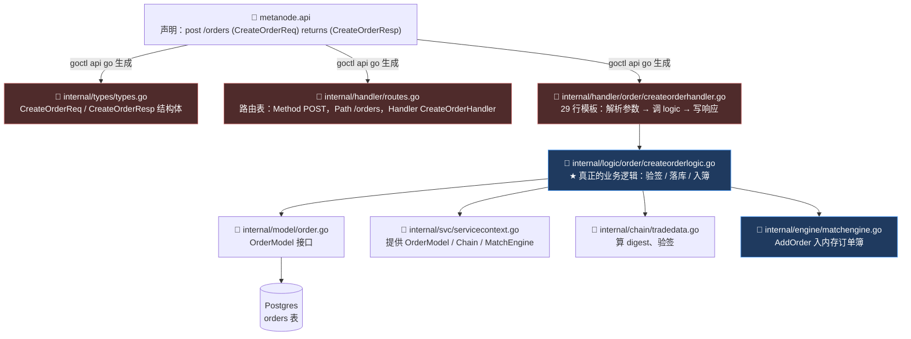
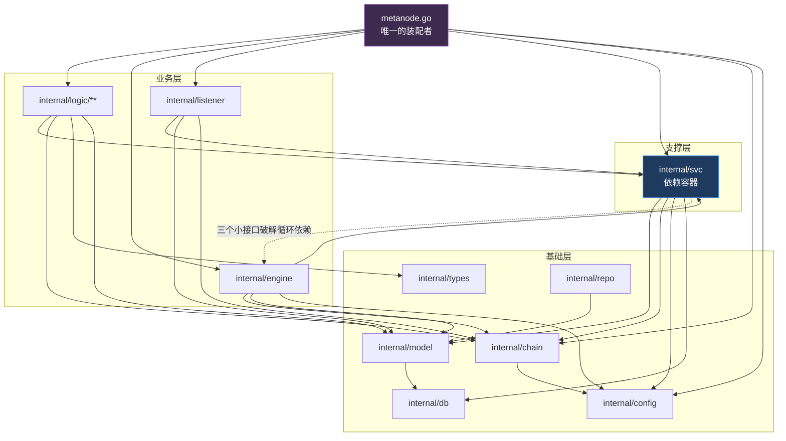
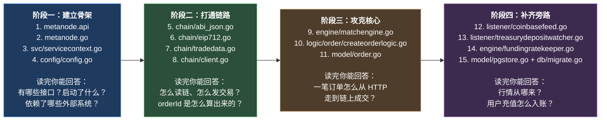

# 第 2 章：代码地图 — 五千行 Go 代码的目录职责与推荐阅读顺序

> 第 1 章我们回答了"为什么需要这个后端"。本章回答一个更接地气的问题：**代码到底放在哪，以及我该按什么顺序读。**
>
> 一个 6,786 行的 Go 项目，如果逐文件线性通读，你大概会在读到第 30 个文件时开始迷失——因为它里面有大量**机器生成的、结构完全一样的**样板代码，读它们不会增加你任何理解，只会消耗你的耐心。本章的第一个任务，就是教会你**用 30 秒判断一个文件值不值得读**；第二个任务是给你一条经过设计的阅读路径，让你沿着"一笔订单的一生"这条主线把整个项目串起来，而不是按目录字母序乱撞。

---

## 1. 本章导读

### 1.1 一个反直觉的事实：这个项目有六分之一的行数，你完全不需要读

先把账算清楚。下面是本项目 `internal/` 下所有 Go 代码的规模分布（数字是从源码统计出来的）：

```text
internal/chain/      5 文件    832 行    ← 链交互层
internal/config/     2 文件    188 行    ← 配置结构
internal/db/         1 文件    215 行    ← 数据库迁移
internal/engine/     3 文件    968 行    ← 撮合 / 资金费 / 清算
internal/handler/   20 文件    769 行    ← HTTP 处理器
internal/listener/   2 文件    541 行    ← 链上监听 / 行情订阅
internal/logic/     21 文件  1,235 行    ← 业务逻辑
internal/model/      7 文件  1,308 行    ← 数据访问层
internal/repo/       1 文件     44 行    ← 又一处数据访问
internal/svc/        1 文件    148 行    ← 依赖容器
internal/types/      1 文件    413 行    ← 请求/响应类型
metanode.go          —          97 行    ← 主入口
metanode.api         —         532 行    ← API 声明文件
──────────────────────────────────────────
合计                          6,786 行
```

现在做一个减法。下面这些行的**信息密度接近为零**：

| 类别 | 具体文件 | 行数 | 为什么不用读 |
| --- | --- | --- | --- |
| **机器生成的数据结构** | `internal/types/types.go` | 413 | 文件头写着 `Code generated by goctl. DO NOT EDIT.`，内容就是 `.api` 文件里 `type` 块的翻译 |
| **机器生成的路由表** | `internal/handler/routes.go` | 181 | 同样是生成物，内容是"URL 路径 → handler 函数"的机械映射 |
| **模板化的 handler** | `internal/handler/**/**.go`（17 个） | 493 | 我实际做了字节级比对：**这 17 个文件除了函数名和一行注释外完全相同**，都是 29 行的同一个模板 |
| **小计** | | **1,087** | **占全项目 16.0%** |

这 1,087 行你不读，不会遗漏任何业务知识。**这就是"代码地图"的第一个价值：帮你砍掉六分之一的工作量。**

但请注意，这里有一个**反直觉的陷阱**——本章第 3 节会详细拆解：

- `types.go` 和 `routes.go` 明明写着 `DO NOT EDIT`，**却被人手改过**；
- 那 17 个 handler 文件**没有**生成标记，**却全是机器生成的**。

**所以"看文件头判断是否生成"这条经验在本项目里会失效。** 我会在第 3 节给你一套更可靠的判断方法。

### 1.2 判断"这个文件要不要精读"的三个问题

在动手读任何文件之前，先问三个问题。这套判断标准可以迁移到任何 Go 后端项目：

**问题一：它是机器生成的，还是人写的？**

具体的识别手段有三条，可靠性从高到低：

1. **看文件头有没有 `// Code generated by ... DO NOT EDIT.`**。这是 Go 社区的官方约定（`go generate` 工具链自动识别这种注释）。本项目中只有 2 个文件带这个标记。
2. **看重复度**。把两个同类文件拿来 `diff` 一下，如果差异只在函数名上，那它就是模板产物。本项目中 17 个 handler 文件就是这种情况。
3. **看它有没有"决策"**。生成的代码只做机械搬运（解析参数 → 调用 → 写响应），**没有任何条件分支**。有 `if` 判断的地方就有业务逻辑，就值得看。

**问题二：它是"本项目独有"的，还是"任何后端都有"的？**

这是**区分 Web3 项目与普通后端项目**的关键分界线。同样一段"查列表 + 分页"的代码，在这个项目里和在一个电商后台里，逐字都一样——**读它学不到 Web3 知识**。反之，凡是涉及这些关键词的代码，都是 Web3 独有的、必须精读的：

```text
EIP-712 / EIP-191 / 签名 / digest / nonce / gas / txHash / receipt
ABI / encode / decode / 合约地址 / 链 ID / blockNumber / confirmations
decimalMul / 1e18 / 1e6 / big.Int / paper / credit / fundingRate
```

**问题三：它在主链路上吗？**

本指南的主线是"一笔订单的一生"（第 7~12 章）。沿着这条主线，只有这几个包是必经之路：

```text
metanode.api → handler → logic → engine → chain → 合约
                                   ↓
                                 model → Postgres
```

其他包（`listener`、`config`、`db`、`repo`）都是**旁路支撑**，可以按需查阅。

### 1.3 用一张图记住本项目：四层依赖结构

本项目的包依赖关系是**严格单向**的（Go 不允许循环 import，这是语言层面的强制约束）。整个依赖图像一座四层金字塔：

```text
第 4 层（最顶层）  metanode.go                         ← 唯一的装配者
                     ↓ 依赖所有
第 3 层（业务层）  internal/logic/  internal/engine/
                  internal/listener/
                     ↓ 依赖
第 2 层（支撑层）  internal/svc/   ← 唯一的依赖容器
                     ↓ 依赖
第 1 层（基础层）  internal/model/  internal/chain/
                  internal/config/  internal/types/
```

**这个结构有两个必须记住的性质：**

**性质一：依赖只能向下，不能向上，更不能横向循环。**

比如 `model` 包**不能** import `engine` 包（它不知道撮合引擎的存在）。当 `engine` 需要写数据库时，是 `engine` import `model`，而不是反过来。

唯一的例外是 `svc` 包——它需要持有 `engine` 的对象，这会造成 `svc ↔ engine` 的循环依赖。第 1 章讲过作者的破解方法：**在 `svc` 包内定义三个只有一个方法的小接口**（`MatchBookSink` / `OrderBookSource` / `IndexPriceSource`），让 `engine` 和 `listener` 的具体类型"隐式满足"它们。这是全项目唯一一处需要动脑筋的依赖设计，第 5 章会专题讲。

**性质二：`types` 包是全项目的"公共语言"，`svc` 包是全项目的"公共仓库"。**

- `types` 包里没有一行逻辑，全是结构体定义。它的作用是**让各层之间传递数据时不产生循环依赖**（如果 handler 直接返回 logic 包里的结构体，而 logic 又要 import handler 包的类型，就绕回去了）。
- `svc` 包里也没有业务逻辑，它只是把 11 个 Model、链客户端、撮合引擎、行情源打包成一个结构体传给所有人。**全项目所有的 `NewXxxLogic(ctx, svcCtx)` 都是从这里拿依赖的。**

**记住这两条，"这个功能该写在哪"这个问题你就能自己回答了。**

---

## 2. 架构 / 流程图

### 2.1 完整的代码地图（附每个目录的职责与阅读优先级）

```text
perp-backend/
│
├── metanode.go                      97 行  ⭐⭐⭐ 主入口，六大组件装配（第 3 章）
├── metanode.api                    532 行  ⭐⭐⭐ API 声明文件，一切的源头（第 4 章）
├── etc/metanode.yaml                      ⭐⭐⭐ 配置文件，等价于功能清单（附录 E）
├── go.mod / go.sum                        ⭐     依赖清单
│
├── internal/
│   ├── svc/servicecontext.go       148 行  ⭐⭐⭐ 依赖容器，全项目唯一的"仓库"（第 5 章）
│   ├── config/
│   │   ├── config.go               132 行  ⭐⭐   配置结构体（配置项 = 功能清单）
│   │   └── markets.go               56 行  ⭐     市场地址自检
│   │
│   ├── types/types.go              413 行  ⛔     机器生成，不用读（作为参考手册查阅）
│   │
│   ├── handler/                    769 行  ⛔     几乎全是机器生成的薄适配层（第 4 章）
│   │   ├── routes.go               181 行  ⛔     生成的路由表（⚠️ 已被手改，见 6.1）
│   │   ├── wallet_auth_handlers.go  47 行  ⭐     手写的登录 handler（例外）
│   │   └── {order,account,market,position,trade,funding,liquidation}/
│   │       每个文件 29 行（共 17 个）      ⛔     完全相同的模板
│   │       market/ws_ticker.go      48 行  ⭐     WebSocket 推送（例外）
│   │
│   ├── logic/                    1,235 行  ⭐⭐⭐ 业务逻辑层，每个文件对应一个接口（第 4 章）
│   │   ├── auth/                  216 行  ⭐⭐   钱包登录（nonce / verify）（第 6 章）
│   │   ├── order/                 239 行  ⭐⭐⭐ 下单 / 查单 / 撤单（第 7 章）
│   │   ├── trade/listtradeslogic  132 行  ⭐⭐   成交记录查询（第 19 章）
│   │   ├── position/              130 行  ⭐⭐   仓位与风险（第 19 章）
│   │   ├── account/               166 行  ⭐⭐   余额 / 存取款记录（第 19 章）
│   │   ├── market/                289 行  ⭐⭐   行情 / K线 / 深度（第 19 章）
│   │   ├── funding/                31 行  ⭐     资金费率历史（第 14 章）
│   │   └── liquidation/            31 行  ⭐     清算记录（第 17 章）
│   │
│   ├── engine/                    968 行  ⭐⭐⭐⭐ 核心中的核心
│   │   ├── matchengine.go         623 行  ⭐⭐⭐⭐ 内存订单簿 + 撮合 + 上链（第 8~12 章）
│   │   ├── fundingratekeeper.go   189 行  ⭐⭐⭐ 资金费率 keeper（第 14 章）
│   │   └── liquidator.go          156 行  ⭐⭐   清算机器人（⚠️ 空壳）（第 17 章）
│   │
│   ├── chain/                     832 行  ⭐⭐⭐⭐ 链交互层，链下与链上的桥梁
│   │   ├── client.go              425 行  ⭐⭐⭐⭐ RPC 封装 / 只读调用 / 发交易（第 13 章）
│   │   ├── tradedata.go           192 行  ⭐⭐⭐⭐ tradeData 编码 + EIP-712 digest（第 7、10 章）
│   │   ├── eip712.go              105 行  ⭐⭐⭐ EIP-712 域与结构哈希（第 7 章）
│   │   ├── usdc_transfer.go        63 行  ⭐⭐   ERC-20 Transfer 日志解析（第 16 章）
│   │   └── abi_json.go             47 行  ⭐     手写的最小 ABI 片段（第 13 章）
│   │
│   ├── listener/                  541 行  ⭐⭐⭐ 后台监听器
│   │   ├── coinbasefeed.go        287 行  ⭐⭐⭐ Coinbase WS 行情（第 15 章）
│   │   └── treasurydepositwatcher.go 254 行 ⭐⭐⭐ 扫链入账（第 16 章）
│   │
│   ├── model/                   1,308 行  ⭐⭐   数据访问层
│   │   ├── pgstore.go             525 行  ⭐⭐   GORM 实现（订单/成交/充值/余额）
│   │   ├── models.go              366 行  ⭐⭐   sqlx 实现（仓位/取款/资金费…）
│   │   ├── order.go               145 行  ⭐⭐   订单模型接口 + 状态常量（第 7 章）
│   │   ├── trade.go               113 行  ⭐     成交模型
│   │   ├── market_quote.go         73 行  ⭐     行情快照
│   │   ├── ledger_balance.go       70 行  ⭐     链下余额（第 19 章）
│   │   └── wallet_user.go          16 行  ⭐     钱包用户
│   │
│   ├── db/migrate.go              215 行  ⭐⭐   数据库表结构的唯一真相（第 18 章）
│   └── repo/wallet_user.go         44 行  ⭐     登录 upsert（与 model 职责重叠）
│
├── cmd/pgping/main.go              28 行         数据库连通性探测小工具
├── schema/*.sql                                  增量 SQL 迁移脚本
├── deploy/*.sql                                  部署 SQL
└── doc/                                          README 里提到但内容滞后
```

**图例**：⭐ 数量 = 阅读优先级；⛔ = 建议跳过或只当参考手册查阅。

### 2.2 一次 HTTP 请求的完整穿透路径

这是 go-zero **约定式工程**最核心的知识点。一次 `/api/v1/orders` 请求，会依次穿过 5 个文件，但它们的分工极其清晰：



**红色三个框是"生成物"，蓝色两个是"人写的核心"。**

看这张图你要建立一个条件反射：**`.api` 文件是源头，`types.go` / `routes.go` / `handler/*.go` 都是它的衍生品。** 想搞清一个接口长什么样，读 `.api` 里那 5 行声明，比读生成的 200 行代码快 10 倍。

**而 `logic/` 层是分界线**：从这一层往下，代码就开始"有思想"了 —— 有校验、有分支、有外部调用、有错误处理。**你在这个项目上花的时间，90% 应该花在 `logic/`、`engine/`、`chain/`、`listener/` 这四个目录里。**

### 2.3 包依赖图：谁 import 谁



**读图要点：**

- **所有箭头向下，没有向上或横向的**。这是 Go 编译器强制的（import cycle 会直接编译失败），也是你能放心"从下往上读"的保证：读 `model` 时你完全不需要知道 `engine` 的存在。
- **`svc` 那条虚线是唯一的例外**。`svc` 需要持有 `engine.MatchEngine` 对象，如果直接写具体类型就会造成 `svc ↔ engine` 循环 import。作者用三个接口绕过去了 —— 这叫**依赖倒置**，第 5 章详讲。
- **`logic` 包横跨了两个下游**：既依赖 `svc`（拿依赖），又直接依赖 `chain`（做链上操作）。**注意这个"越界"**：`logic` 理论上只该依赖 `svc`，但本项目的 `logic/market/chainquote.go` 和 `logic/order/createorderlogic.go` 都直接 import 了 `chain` 包。这在工程上是可接受的（链交互本身就是业务），但破坏了"logic 只通过 svc 拿依赖"的纯粹性。读代码时不要被这个不一致绕晕。

### 2.4 推荐阅读顺序：四阶段递进

不要按目录字母序读。下面这条路径是按"依赖自下而上 + 业务由入口向内核"设计的：



**每个阶段的"出口标准"（读完能回答什么问题）已经写在图里了。** 如果你读完一个阶段答不上对应的问题，说明还没读透，不要急着进下一阶段。

**特别注意阶段二的顺序**：`abi_json.go` → `eip712.go` → `tradedata.go` → `client.go`。这是**从"最死的数据"读到"最活的逻辑"**：

- `abi_json.go` 是纯字符串常量（手写的 ABI 片段）；
- `eip712.go` 是纯数学（域分隔符与结构哈希）；
- `tradedata.go` 把前两者组装成合约能解码的字节；
- `client.go` 才是真正发起网络请求的地方。

**按这个顺序读，每一层都建立在上一层已经理解的基础上，不会出现"突然看不懂"的断层。**

---

## 3. 核心代码拆解

本章的"核心代码"是**结构性**的——我们要拆的是"这个项目的组织方式"，而不是某个算法。下面 10 段代码片段，每一段都代表一种**在本项目中反复出现的模式**。

### (1) `metanode.api` 的路由声明 —— 一切的源头

```go
// ==================== API 路由定义 ====================
@server (
	prefix: /api/v1        // 所有路由的统一前缀
	group:  order          // 生成到 internal/handler/order/ 和 internal/logic/order/ 目录
)
service metanode {
	@doc "创建订单"
	@handler CreateOrder                                   // 生成的函数名是 CreateOrderHandler / CreateOrderLogic
	post /orders (CreateOrderReq) returns (CreateOrderResp) // 路径 + 请求类型 + 响应类型

	@doc "查询订单"
	@handler GetOrder
	get /orders/:orderId (GetOrderReq) returns (GetOrderResp)  // :orderId 是路径参数

	@doc "查询订单列表"
	@handler ListOrders
	get /orders (ListOrdersReq) returns (ListOrdersResp)       // 同路径不同方法，靠 GET/POST 区分

	@doc "取消订单"
	@handler CancelOrder
	post /orders/cancel (CancelOrderReq) returns (CancelOrderResp)
}
```

**作者为什么这么设计（设计思想）：**

这 20 行声明，会生成**三个层次的产物**（`types` / `routes` / `handler`），总计上百行代码。这是一个**声明式编程（declarative programming）**的典型应用：你只描述"我要什么"，不描述"怎么做到"。

go-zero 这样设计的核心动机是**消除样板代码的重复劳动**。在一个有 20 个接口的项目里，手写"解析 JSON → 校验必填 → 调用业务 → 序列化响应 → 设置 Content-Type"这套流程，会产出大量**结构完全相同、只差类型名**的代码。这类代码不但写起来枯燥，更麻烦的是**改起来容易漏**（比如某天要把错误响应格式统一改一下，20 个文件都得动）。

**几点值得注意的设计细节：**

1. **`group` 决定目录结构。** `group: order` 会同时生成 `internal/handler/order/` 和 `internal/logic/order/` 两个目录。**这个映射关系是固定的**：`.api` 里的分组名 = 两个目录名。当你看到 `internal/logic/market/` 下有 6 个文件，你立刻能知道 `.api` 里有一个 `group: market` 的块。
2. **`@handler CreateOrder` 生成两个东西**：`CreateOrderHandler`（在 `handler/order/` 下）和 `NewCreateOrderLogic` / `CreateOrderLogic`（在 `logic/order/` 下）。**这是 goctl 最重要的一个约定**：一个路由 = 一个 handler + 一个 logic + 一对 Req/Resp 类型。
3. **路径参数与 query 参数的区别。** `get /orders/:orderId` 里的 `:orderId` 会自动被解析到 `GetOrderReq.OrderId` 字段（靠 go-zero 的 tag 映射），而 query string 参数（如 `?page=1&pageSize=20`）靠 `form:"page"` tag。这两者的处理都在生成的 handler 里由 `httpx.Parse(r, &req)` 统一完成。

### (2) `types.go` —— 声明如何变成结构体

```go
// Code generated by goctl. DO NOT EDIT.
// goctl 1.9.0

package types

type CreateOrderReq struct {
	Perp         string `json:"perp"`          // 永续合约地址
	Signer       string `json:"signer"`        // 下单人地址
	PaperAmount  string `json:"paperAmount"`   // 仓位数量（带符号）
	CreditAmount string `json:"creditAmount"`  // 资金数量（带符号）
	MakerFeeRate string `json:"makerFeeRate"`
	TakerFeeRate string `json:"takerFeeRate"`
	Expiration   int64  `json:"expiration"`    // 过期时间戳（秒）
	Nonce        int64  `json:"nonce"`         // 订单随机数（防重放）
	Signature    string `json:"signature"`     // EIP-712 签名
}

type CreateOrderResp struct {
	Code    int    `json:"code"`
	Message string `json:"message"`
	OrderId string `json:"orderId"`
}
```

**作者为什么这么设计（设计思想）：**

这段代码最值得注意的地方是**全部金额字段都是 `string` 类型**。这不是随便写的，而是 Web3 后端一条**铁律**：

- 链上的金额是 `uint256` / `int256`，最大约 1.15 × 10⁷⁷；
- JavaScript 的 `Number` 是 IEEE 754 双精度浮点，**安全整数上限只有 2⁵³ - 1 ≈ 9 × 10¹⁵**；
- `1e18`（一个 wei 单位的 ETH）= 10¹⁸，**比 JS 的安全整数上限大了 1000 倍**。

如果用 JSON number 传输，前端 `JSON.parse` 时精度就已经丢了 —— **而且丢得很安静，不会报错**。所以行业惯例是：**所有涉及链上金额的字段一律用字符串传输**，前端用 `BigInt` 或 `ethers.BigNumber` 处理。

这个约定在本项目里是**贯穿始终**的：`types.go` 里 145 个 `string` 字段，绝大多数都是金额。第 4 节还会再展开这一点。

**另一处值得注意的**是 `CreateOrderResp` 里那个 `Code int` 字段 —— 这是一种**"HTTP 状态码永远是 200，业务错误放在 body 里"**的设计。你可以看到 `createorderlogic.go` 里的返回是这样的：

```go
return &types.CreateOrderResp{Code: 400, Message: "Order expired"}, nil
//                        ↑ HTTP 是 200      ↑ 业务码是 400        ↑ err 是 nil
```

**这是一种有意的取舍**：优点是不会触发前端的 `catch` 分支（前端只需要检查 `resp.code`，不用处理网络层异常）；缺点是**违反 HTTP 语义**，无法被标准的监控工具、CDN、网关正确识别错误率。业界两种做法都有，本项目选了前者。

### (3) `routes.go` —— 声明如何变成路由表（以及一个重要的发现）

```go
// Code generated by goctl. DO NOT EDIT.
// goctl 1.9.0

package handler

func RegisterHandlers(server *rest.Server, serverCtx *svc.ServiceContext) {
	// ⚠️ 注意这一块：它把 auth 路由注册在 /api/v1 前缀下
	server.AddRoutes(
		[]rest.Route{
			{
				Method:  http.MethodPost,
				Path:    "/auth/nonce",
				Handler: AuthNonceHandler(serverCtx),
			},
			{
				Method:  http.MethodPost,
				Path:    "/auth/verify",
				Handler: AuthVerifyHandler(serverCtx),
			},
		},
		rest.WithPrefix("/api/v1"),
	)

	server.AddRoutes(
		[]rest.Route{
			{Method: http.MethodGet, Path: "/balance", Handler: GetBalanceHandler(serverCtx)},
			// ...
		},
		rest.WithPrefix("/api/v1"),
	)
	// ... 其余 6 个 group 的路由块
}
```

**这里有一个必须指出的重大发现。**

我在写这一章时，把 `metanode.api` 和 `routes.go` 做了交叉比对，结果是：

| 检查项 | 结果 |
| --- | --- |
| `.api` 文件里有 `auth` 分组吗？ | ❌ **没有**。7 个 group 分别是 order / trade / position / account / market / funding / liquidation |
| `.api` 里有 `AuthNonceReq` 类型定义吗？ | ❌ **没有** |
| `routes.go` 里注册了 `/auth/nonce` 吗？ | ✅ **有** |
| `types.go` 里有 `AuthNonceReq` 吗？ | ✅ **有**（在文件末尾，第 389~413 行） |

再看 git 历史，证据链就完整了：

```text
c2abe10 feat: 实现撮合
 internal/handler/routes.go       |  16 +      ← 手加了 16 行（auth 路由块）
 internal/types/types.go          |  32 +      ← 手加了 32 行（4 个 auth 类型）
 internal/handler/wallet_auth_handlers.go | 47 +++  ← 新增的手写文件
 internal/logic/auth/noncelogic.go  |  75 +++
 internal/logic/auth/verifylogic.go | 133 +++
```

**结论：`routes.go` 和 `types.go` 这两个标着 `DO NOT EDIT` 的生成文件，被人手改过，而源头 `.api` 文件没有同步更新。**

**这个发现的后果是具体的、可预见的**：任何人只要执行一次 README 里写的命令——

```bash
goctl api go -api metanode.api -dir .
```

—— goctl 就会**按 `.api` 的内容重新生成 `routes.go` 和 `types.go`**（因为它们是 `DO NOT EDIT` 的衍生品）。由于 `.api` 里没有 auth 相关内容，**重新生成会静默地删掉 `/auth/nonce`、`/auth/verify` 两条路由和 4 个 auth 类型**，导致钱包登录功能彻底消失、`wallet_auth_handlers.go` 编译失败。

> 这个坑的完整分析和正确修法，见第 6 节第 1 条。

### (4) 一个典型的 handler —— 29 行的模板

```go
package order

import (
	"net/http"

	"github.com/zeromicro/go-zero/rest/httpx"
	"metanode/internal/logic/order"
	"metanode/internal/svc"
	"metanode/internal/types"
)

// 创建订单
func CreateOrderHandler(svcCtx *svc.ServiceContext) http.HandlerFunc {
	return func(w http.ResponseWriter, r *http.Request) {
		// ① 解析请求：go-zero 会根据 tag 自动把 path/query/body 填进 req
		var req types.CreateOrderReq
		if err := httpx.Parse(r, &req); err != nil {
			httpx.ErrorCtx(r.Context(), w, err)   // 解析失败 → 400
			return
		}

		// ② 构造 logic 对象（每个请求都新建一个，携带当前请求的 ctx）
		l := order.NewCreateOrderLogic(r.Context(), svcCtx)
		resp, err := l.CreateOrder(&req)

		// ③ 统一写响应：成功用 OkJsonCtx，失败用 ErrorCtx
		if err != nil {
			httpx.ErrorCtx(r.Context(), w, err)
		} else {
			httpx.OkJsonCtx(r.Context(), w, resp)
		}
	}
}
```

**作者为什么这么设计（设计思想）：**

我实测比对过 `getorderhandler.go` 和 `cancelorderhandler.go`：**把函数名替换掉之后，两个文件字节级完全相同**。整个 `handler/` 目录下 17 个文件都是这一个模板的复制品。

这引出一个自然的问题：**既然这些文件完全一样，为什么不干脆省掉 handler 这一层，让 logic 直接实现 `http.HandlerFunc`？**

答案是 **go-zero 的分层约定 + 代码生成的成本收益**：

1. **生成的代码比"运行时反射"更可控。** 理论上框架可以用反射自动把 HTTP 请求映射到 logic 方法（像 Spring MVC 那样），但 Go 的反射既慢又不直观，且会把"哪个字段来自 body、哪个来自 path"的规则藏进框架内部。**生成显式代码的好处是：所有映射规则都看得见、可以断点调试。**
2. **handler 是"可以改"的。** 虽然在项目里它没被改过，但如果你需要给某个接口加一个特殊的中间件、或改一下响应格式，**只需要改这一个 handler 文件**，不会影响其他接口。这是一种"预留的可扩展点"。本项目里 `wallet_auth_handlers.go` 和 `ws_ticker.go` 就是利用了这个可扩展点。
3. **`httpx.Parse` 是统一入口。** 它同时处理 JSON body、query string、path 参数，并会自动执行 `validate` tag 的校验（比如 `json:"perp" validate:"required"`）。**把这个统一入口收敛在 handler 层，比散落在 20 个 logic 里要好得多。**

**一个容易被忽略的细节**：`l := order.NewCreateOrderLogic(r.Context(), svcCtx)` —— **logic 对象是每个请求新建一个的**，而且它携带了 `r.Context()`。这意味着：

- logic 内部调用的所有数据库操作、RPC 调用都可以通过这个 ctx 实现**请求级的取消**（客户端断开连接 → ctx 被 cancel → 阻塞中的调用提前返回）；
- **但要注意**：`engine/matchengine.go` 里的 `submitBatch` 用的是 `context.Background()` 而不是请求的 ctx —— **这是对的**，因为链上交易提交不能因为"下单用户的 HTTP 连接断了"就被取消。**"哪些操作应该跟随请求 ctx、哪些应该用独立 ctx"，是异步系统里的一个关键设计判断。**

### (5) 一个典型的 logic —— 业务逻辑层的标准形态

```go
package order

type CreateOrderLogic struct {
	logx.Logger                    // 内嵌 go-zero 的日志器
	ctx    context.Context         // 请求上下文
	svcCtx *svc.ServiceContext     // 依赖容器
}

// 固定的构造函数签名：所有 logic 都是 (ctx, svcCtx)
func NewCreateOrderLogic(ctx context.Context, svcCtx *svc.ServiceContext) *CreateOrderLogic {
	return &CreateOrderLogic{
		Logger: logx.WithContext(ctx),   // 日志自动带上 trace id
		ctx:    ctx,
		svcCtx: svcCtx,
	}
}

// 方法名与 .api 里的 @handler 同名；入参出参都来自 types 包
func (l *CreateOrderLogic) CreateOrder(req *types.CreateOrderReq) (resp *types.CreateOrderResp, err error) {
	// ... 业务逻辑（校验 → 算 digest → 验签 → 落库 → 入簿）...
}
```

**作者为什么这么设计（设计思想）：**

这个结构的三个要素——**内嵌 Logger、持有 ctx、持有 svcCtx**——是 go-zero 项目里所有 logic 的固定配置。理解这三个东西，你就理解了 go-zero 的"横切关注点（cross-cutting concerns）"处理方式：

1. **`logx.Logger` 内嵌**：这样你可以直接写 `l.Error("...")` 而不用 `logx.Error`。更重要的是 `logx.WithContext(ctx)` 会让日志**自动携带请求的 trace id**，在分布式追踪里能把一次请求的所有日志串起来。
2. **`ctx` 存成字段**（而不是每个方法都传）：这是 Go 社区一个**有争议**的做法。官方建议是 ctx 应该作为每个函数的第一个参数显式传递，而不是存进结构体。但 go-zero 的代码生成模板就是这么做的，**本项目作为框架使用者照抄了模板**。实际影响不大，但你要知道这是"框架约定优先于社区规范"的一个例子。
3. **`svcCtx` 是唯一的依赖来源**：注意 `CreateOrderLogic` 里从来没有出现过 `sql.DB`、`*ethclient.Client` 这类底层对象，它只通过 `l.svcCtx.OrderModel`、`l.svcCtx.Chain` 拿依赖。**这让 logic 层的单元测试变得可行**（只要伪造一个 ServiceContext 就行），也让"这个 logic 依赖了哪些外部系统"一眼可见。

**一个真正值得你注意的细节：方法签名里的 `resp *types.CreateOrderResp, err error` 组合。**

```go
return &types.CreateOrderResp{Code: 400, Message: "Order expired"}, nil
//     ↑ 返回了"错误响应"                                              ↑ err 却是 nil
```

**本项目大量使用"`err` 表示系统级失败，`resp.Code` 表示业务级失败"的双轨错误模型。** 具体地说：

- 参数错误、签名错误、订单已存在 → 返回 `resp{Code: 400, Message: ...}, nil`（HTTP 200）
- 数据库挂了、代码 bug → 返回 `nil, err`（HTTP 500）

**这个区分很重要**：它让"预期内的业务失败"和"预期外的系统故障"在监控上可以分开统计。如果你看到一个接口的错误率突然升高，先看它是 `Code: 400`（用户输入问题）还是 `err != nil`（系统问题），排查方向完全不同。

### (6) `svc.ServiceContext` —— 从"依赖图"的角度再看一次

第 1 章我们从"降级设计"的角度看过这个结构，本章从"依赖地图"的角度再看一遍：

```go
type ServiceContext struct {
	Config config.Config          // 配置（所有人的只读视图）

	DB    sqlx.SqlConn             // go-zero SQL 抽象（MySQL 风格 ? 占位符）
	PG    *gorm.DB                 // GORM 直连（Postgres，绕开 sqlx 的兼容问题）
	Redis *redis.Redis             // 登录 nonce、扫块游标

	// ★ 11 个数据模型，全项目的"数据库地图"
	OrderModel         model.OrderModel           // orders 表
	TradeModel         model.TradeModel           // trades 表
	PositionModel      model.PositionModel        // positions 表
	DepositModel       model.DepositModel         // deposits 表
	WithdrawModel      model.WithdrawModel        // withdraws 表
	FundingRateModel   model.FundingRateModel     // funding_rates 表
	LiquidationModel   model.LiquidationModel     // liquidations 表
	MarketModel        model.MarketModel          // markets 表
	KlineModel         model.KlineModel           // klines 表
	LedgerBalanceModel model.LedgerBalanceModel   // ledger_balances 表（链下账本）
	MarketQuoteModel   model.MarketQuoteModel     // market_quotes 表

	// ★ 四个"活的组件"，由 main 装配
	Chain      *chain.Client        // 链客户端（可能为 nil）
	MatchEngine MatchBookSink       // 下单入口（往订单簿塞单）
	OrderBook   OrderBookSource     // 深度查询（读订单簿快照）
	IndexPrice  IndexPriceSource    // 指数价（Coinbase WS）
}
```

**作者为什么这么设计（设计思想）：**

**把 `ServiceContext` 当成"项目的地图"来读，效率极高。** 你只需要看一眼它的字段列表，就能知道：

- **这个系统有哪些持久化实体**（11 个 Model 对应 11 张表）；
- **有哪些外部依赖**（Chain = 区块链，IndexPrice = Coinbase，Redis = 缓存/游标）；
- **有哪些"活的、有状态的"组件**（MatchEngine 持有内存订单簿，OrderBook 是它的只读视图）。

**这就是为什么我在 2.4 节的阅读顺序里，把 `servicecontext.go` 放在阶段一的第三个。** 读完它，你对"这个后端有什么"就有了完整的答案，后面读的都是"具体怎么用"。

**两处需要特别注意的设计：**

1. **`DB` 和 `PG` 并存不是冗余，而是被迫的。** 注释里写得很清楚："充值 / 链下余额 / 订单 / 成交：Postgres 上必须用 GORM（go-zero sqlx 的 `?` 与 pgx 不兼容）"。于是 `internal/model/` 下出现了**两套实现**：`models.go` 用 sqlx，`pgstore.go` 用 GORM。**这意味着"某张表用什么方式访问"是一个必须记住的事实**，第 18 章会给出完整的对照表。
2. **`Chain *chain.Client` 是指针，其余 Model 是接口。** 这个差异很关键：
   - `*chain.Client` 是**具体类型**，且**可能为 nil**。所以每个用到它的地方都必须写 `if svcCtx.Chain != nil`。用具体类型而不是接口，意味着**没法用 mock 替换它做单元测试**——这是本项目可测试性差的一个根源。
   - 11 个 Model 是**接口**，可以 mock。但它们的构造依赖数据库连接，所以也没真正被 mock 过。

### (7) `model` 层的"接口 + 双实现"模式

`internal/model/order.go` 定义接口：

```go
// OrderModel 订单模型接口
type OrderModel interface {
	Insert(ctx context.Context, order *Order) (sql.Result, error)
	FindOne(ctx context.Context, orderId string) (*Order, error)
	FindByTrader(ctx context.Context, signer, perp string, status int, page, pageSize int) ([]*Order, int64, error)
	Update(ctx context.Context, order *Order) error
	UpdateStatus(ctx context.Context, orderId string, status int, filledAmount string) error
	FindPendingOrders(ctx context.Context, perp string, limit int) ([]*Order, error)
}
```

`internal/model/pgstore.go` 提供 GORM 实现：

```go
// --- orders / trades (GORM) ---

type orderRow struct {           // ← 数据库表结构的 Go 映射
	// ...
}

func (orderRow) TableName() string { return "orders" }

type gormOrderModel struct {
	db *gorm.DB
}

// ★ 关键设计：DB 行 ↔ 领域模型的转换函数被显式抽出
func orderToRow(o *Order) orderRow        { /* ... */ }
func orderRowToModel(r *orderRow) *Order  { /* ... */ }

func (m *gormOrderModel) Insert(ctx context.Context, order *Order) (sql.Result, error) {
	row := orderToRow(order)
	if err := m.db.WithContext(ctx).Create(&row).Error; err != nil {
		return nil, err
	}
	return gormResult{lastID: row.ID, rows: 1}, nil
}
```

**作者为什么这么设计（设计思想）：**

这个模式叫 **"Repository 模式"** 或 **"领域模型与持久化模型分离"**，是 Go 后端里非常常见的写法。它的核心是**三层对象**：

```text
业务层（logic / engine）
      ↕  领域模型 model.Order      ← 业务语义的对象（带 OrderStatusFilled 这类常量）
      ↕  转换函数 orderToRow / orderRowToModel
      ↕  持久化模型 orderRow        ← 数据库表的逐列映射（带 gorm tag）
      ↕  数据库
```

**为什么要有中间那层 `orderRow`？** 三个理由：

1. **关注点分离**：`model.Order` 的字段是给业务看的（`Status int` 配常量），`orderRow` 的字段是给 GORM 看的（带 `gorm:"column:order_id"` tag）。混在一起会让领域模型被 ORM 的实现细节污染。
2. **字段名可以不一致**：数据库列名是 `snake_case`（`order_id`），Go 字段是 `CamelCase`（`OrderId`）。有了转换层，映射规则集中在一处，不用散落得到处都是。
3. **类型可以不一致**：数据库里 `paper_amount` 可能是 `text`/`numeric`，Go 里统一是 `string`。转换层负责把 `sql.NullString` 之类的东西归一化。

**但要说实话，本项目里这个模式执行得并不彻底**：`models.go` 里用 sqlx 实现的那些 Model（Position、Withdraw、FundingRate 等）**直接扫描到领域模型**，没有 `orderRow` 这一层：

```go
// models.go 里的 sqlx 写法（没有中间层）
func (m *defaultPositionModel) FindByTrader(ctx context.Context, trader string) ([]*Position, error) {
	var resp []*Position
	query := `SELECT * FROM positions WHERE trader = ?`
	err := m.conn.QueryRowsCtx(ctx, &resp, query, trader)
	//                    ↑ 直接扫进领域模型，靠 db tag 做映射
	return resp, err
}
```

**所以"两套实现"的差异不只是驱动不同，连代码风格都不同：**

| | `models.go`（sqlx） | `pgstore.go`（GORM） |
| --- | --- | --- |
| 有独立的行结构体吗 | ❌ 直接扫进领域模型 | ✅ 有 `orderRow` 等 |
| 有转换函数吗 | ❌ 无 | ✅ 有 `orderToRow` 等 |
| 占位符 | `?`（MySQL 风格） | 参数绑定 |
| 涉及的表 | positions / withdraws / funding_rates / liquidations / markets / klines | orders / trades / deposits / ledger_balances / market_quotes |

**读代码时的实用建议**：先看你要找的那张表在哪个文件里（对照上表），再决定读哪种风格。**不要指望在 `pgstore.go` 里找到 `positions` 表的操作，它不在这里。**

### (8) 三个核心包的"自我介绍" —— 先读包注释

这是一个**极高性价比的阅读技巧**：Go 的包注释（package 语句正上方的那段注释）通常是作者写给"下一个读代码的人"的第一句话。本项目有三个包的注释写得特别好：

```go
// internal/chain/client.go
// Package chain 封装与 MetaNodeDealer / Perpetual 的链上交互：
// 只读调用走 Dealer；成交走 Perp.trade；资金费率更新走 Dealer.updateFundingRate。
// 订单签名域必须与链上 MetaNodeStorage.domainSeparator 一致（MetaNode / v1 / chainId / Dealer 地址）。
package chain
```

```go
// internal/engine/matchengine.go
// 撮合引擎：内存订单簿 + 周期性调用 chain.BuildMatchTradeData / Perpetual.trade。
// 链上角色：私钥地址须为 Dealer.validOrderSender（见 SubmitPerpTrade）。
```

```go
// internal/logic/order/createorderlogic.go
// CreateOrder 与链上 Types.Order + EIP-712 对齐；orderId 即合约内用于累计成交量的 orderHash。
```

```go
// internal/logic/market/chainquote.go
// ChainTickers 等：行情数据直接读 Dealer 视图，与 src/MetaNodeView 一致。
```

**为什么这几段注释价值极高？**

因为它们各自回答了**读这个包之前你必须知道的关键前提**：

| 包 | 注释告诉你的关键信息 | 如果你不先读注释会怎样 |
| --- | --- | --- |
| `chain` | ① 读写分流（读走 Dealer，写走 Perp）② **签名域必须与链上一致**，并给出了 4 个参数 | 你会困惑"为什么算 digest 要传 Dealer 地址和 chainId" |
| `engine` | ① 内存订单簿 ② **私钥必须是 `validOrderSender`** | 你会困惑"为什么启动时要检查这个" |
| `createorderlogic` | **orderId 就是合约里的 orderHash** | 你会以为 orderId 是个普通的业务主键，从而漏掉"防重放"的设计意图 |
| `chainquote` | **行情直接读链，不读库** | 你会去 `models.go` 里找行情表，白费功夫 |

**注意最后一条里那个"与 `src/MetaNodeView` 一致"** —— 这是作者在提醒你：**Go 侧的这些查询对应合约侧的哪些视图函数。** 这类跨代码库的注释索引是本项目里最有价值的注释类型，看到了要重点标记。

**给你的行动建议**：读任何一个包之前，先 `head -10` 看一眼包注释。本项目 90% 的"为什么这么写"的答案都在那里。

### (9) `config.Config` —— 配置文件就是功能清单

```go
type Config struct {
	rest.RestConf                          // go-zero 的 HTTP 服务配置（Host/Port/Log）

	Redis      RedisConfig                 // Redis（登录 nonce / 扫块游标）
	Ethereum   EthereumConfig              // RPC / ChainId / Dealer 地址 / 私钥 / gas 参数
	Markets    []MarketConfig              // 市场列表（地址 + 名称 + 价格源）
	Chainlink  ChainlinkConfig             // 预言机聚合器地址
	Supabase   SupabaseConfig              // Postgres 连接串 + 连接池
	Auth       AuthConfig                  // JWT 密钥 / 有效期 / nonce TTL（可选）
	Coinbase   CoinbaseConfig              // Coinbase WS 地址 / 节流 / 重连（可选）

	MatchEngine MatchEngineConfig          // 撮合间隔 / 批量大小 / 最大挂单数
	FundingRate FundingRateConfig          // 结算间隔 / 费率上限
	Liquidator  LiquidatorConfig           // 清算检查间隔 / 是否启用
	TreasuryDeposit TreasuryDepositConfig  // 扫链间隔 / 确认数 / 回溯块数
}
```

**作者为什么这么设计（设计思想）：**

**这个结构体是本项目的"功能清单"。** 你只要看它有哪些字段，就知道这个后端能干什么：

- 有 `Ethereum` + `Markets` + `Chainlink` → 说明它会跟链交互；
- 有 `MatchEngine` → 说明它自己撮合（如果是纯中继模式，就不会有这个配置）；
- 有 `Auth` 且标了 `json:",optional"` → 说明**登录功能是可选的**（不配就能跑，只是没有登录）；
- 有 `TreasuryDeposit` → 说明有"扫链入账"这条业务线；
- 有 `Coinbase` → 说明行情源是 Coinbase 现货。

**几个值得注意的设计细节：**

1. **`json:",optional"` 标记表示"这个配置段可以整个不写"。** 本项目里 `Auth`、`Coinbase`、`Supabase` 都标了 optional（见 `etc/metanode.yaml`，实际上都配了）。**这解释了一个重要的行为**：`CoinbaseFeed` 在 `main()` 里是**无条件启动**的，但如果配置里没写 `Coinbase` 段，它内部的 `Enabled` 是 `false`，启动后会立刻退出。

2. **配置项与代码的对应关系是"一对一"的。** 每一个 keeper / listener 都恰好对应一个配置段：

   | 配置段 | 对应的组件 | 关键参数 |
   | --- | --- | --- |
   | `MatchEngine` | `engine.MatchEngine` | `MatchInterval: 100`（毫秒） |
   | `FundingRate` | `engine.FundingRateKeeper` | `SettleInterval: 28800`（= 8 小时） |
   | `Liquidator` | `engine.Liquidator` | `CheckInterval: 10`（秒）、`Enabled: true` |
   | `TreasuryDeposit` | `listener.TreasuryDepositWatcher` | `PollIntervalSeconds: 12`、`Confirmations: 1` |
   | `Coinbase` | `listener.CoinbaseFeed` | `ThrottleMs: 500`、`ReconnectSec: 5` |

   **这张表就是"这个后端有哪些后台任务"的完整答案。** 第 1 章讲的"四大职责"，在这里有了具体的配置载体。

3. **`Markets` 是一个数组，而 `Chainlink` 是固定字段。** 这个不一致值得注意：

   ```go
   Markets []MarketConfig            // 数组：可以加任意多个市场
   Chainlink ChainlinkConfig         // 固定字段：BTC_USD / ETH_USD 两个
   ```

   后果是：**新增一个市场，`Chainlink` 配置结构体需要改代码**。看 `chain/client.go` 里的实现就能确认这一点：

   ```go
   func (c *Client) IndexPriceForMarket(name string) common.Address {
       switch name {
       case "BTC-PERP":
           return common.HexToAddress(c.chainlink.BTC_USD)
       case "ETH-PERP":
           return common.HexToAddress(c.chainlink.ETH_USD)
       default:
           return common.Address{}      // ← 新市场直接返回零地址
       }
   }
   ```

   **这是一个硬编码的扩展瓶颈**：`switch` 里写死了两个市场名。新增市场时，如果不改这个函数，`IndexPriceForMarket` 会返回零地址，作为指数价来源的 Chainlink 就静默失效了。**这是本项目里一处典型的"看起来可配置、实际写死了"的设计**，第 14、15 章会再遇到它。

### (10) `db/migrate.go` —— 数据库表结构的唯一真相

```go
// MigrateAccountTables 确保 users / deposits / ledger_balances / orders / trades 存在。
// Supabase 上若已有旧表结构，会先 ADD COLUMN IF NOT EXISTS 再建索引。
func MigrateAccountTables(pg *gorm.DB) error {
	if pg == nil {
		return fmt.Errorf("postgres nil")
	}
	batches := [][]string{
		userStmts(), depositStmts(), ledgerStmts(),
		orderStmts(), tradeStmts(), fundingRateStmts(), marketQuoteStmts(),
	}
	for _, batch := range batches {
		for _, s := range batch {
			if err := pg.Exec(s).Error; err != nil {   // 逐条执行裸 SQL
				return fmt.Errorf("%w\nSQL: %s", err, s)
			}
		}
	}
	// Supabase Realtime 需要这个设置才能推送 UPDATE 事件
	if err := pg.Exec(`ALTER TABLE public.market_quotes REPLICA IDENTITY FULL`).Error; err != nil {
		_ = err     // 非 Supabase 或权限不足时可忽略
	}
	return nil
}
```

以及它对 `orders` 表（本项目最核心的表）的定义：

```go
func orderStmts() []string {
	return []string{
		`CREATE TABLE IF NOT EXISTS public.orders (...)`,
		`CREATE UNIQUE INDEX IF NOT EXISTS uq_orders_order_id ON public.orders (order_id) WHERE order_id <> ''`,
		`CREATE INDEX IF NOT EXISTS idx_orders_signer_time ON public.orders (signer, create_time DESC)`,
		`CREATE INDEX IF NOT EXISTS idx_orders_perp_status ON public.orders (perp, status)`,
	}
}
```

**作者为什么这么设计（设计思想）：**

**这段代码是本项目数据库结构的唯一真相。** 它值得单独讲，因为里面藏着三个重要的设计决策：

**决策一：用"幂等的裸 SQL"而不是 ORM 的 AutoMigrate。**

GORM 提供了 `db.AutoMigrate(&Order{})`，能根据结构体自动建表。作者**没有用它**，而是手写 `CREATE TABLE IF NOT EXISTS` + `ALTER TABLE ... ADD COLUMN IF NOT EXISTS`。

原因在于 **AutoMigrate 的行为在"已有数据的表"上是危险的**：它可能做出你没预期的改动（改列类型、加约束），而且在 Supabase 这种托管数据库上，`ALTER TABLE` 的权限和行为可能受限制。**手写幂等 SQL 的好处是：每一句都是明确的、可审计的、可以拿去 DBA 那里过一遍的。**

注意每条 SQL 都带了 `IF NOT EXISTS`，这意味着 `MigrateAccountTables` **可以反复执行**（服务每次启动都会跑一次，在 `NewServiceContext` 里调用）。这个性质叫**幂等性（idempotence）**，是数据库迁移脚本的基本要求。

**决策二：索引是照着查询模式设计的。**

看这三个索引，它们不是随便加的，每一个都对应一条具体的查询：

| 索引 | 对应哪条查询 | 在哪段代码 |
| --- | --- | --- |
| `uq_orders_order_id`（**唯一**） | `FindOne(orderId)` | `CreateOrder` 里的防重复检查 |
| `idx_orders_signer_time` | `FindByTrader(signer, perp, status, page, pageSize)` | `GET /api/v1/orders` 列表查询 |
| `idx_orders_perp_status` | `FindPendingOrders(perp, limit)` | **撮合引擎重启恢复内存订单簿**（第 12 章） |

**最后一条特别值得注意。** `FindPendingOrders` 是 `MatchEngine.Start()` → `RestorePendingOrders()` 调用的，**它发生在服务启动的关键路径上**。如果没有 `idx_orders_perp_status` 这个索引，每次重启都要全表扫描 `orders`，服务启动会随着历史订单增长而越来越慢。**"给启动路径上的查询加索引"是一个很容易被忽略的优化点。**

**决策三：`REPLICA IDENTITY FULL` 是为了 Supabase Realtime。**

```sql
ALTER TABLE public.market_quotes REPLICA IDENTITY FULL
```

这一句和前端有关。Supabase 提供了一项叫 **Realtime** 的功能：前端可以直接订阅某张表的变更，数据变了浏览器会自动收到推送（底层走 PostgreSQL 的逻辑复制槽）。

但 PostgreSQL 默认的 `REPLICA IDENTITY` 是 `DEFAULT`，它**只在 UPDATE/DELETE 事件的日志里包含主键**，不包含其他列的旧值。前端订阅时如果需要知道完整的数据，就得设成 `FULL`。

**这段代码揭示了本项目的一条重要数据链路**：

```text
Coinbase WS 行情
   ↓ listener.CoinbaseFeed 收到 ticker
   ↓ UPSERT 进 market_quotes 表
   ↓ Supabase Realtime 捕获表变更（靠 REPLICA IDENTITY FULL）
   ↓ 推送给浏览器前端
```

**注意：这条链路里，Go 后端只负责"把数据写进表"，推送工作完全交给了 Supabase。** 这是一种"把实时推送外包给数据库"的架构选择，与本项目自己实现的 `/ws/ticker`（`handler/market/ws_ticker.go`，2 秒轮询链上标记价）形成了两条并行的行情通道。第 15 章会详细对比这两条通道的差异。

---

## 4. Web3 特有机制

本章是"代码地图"章，但即使是组织结构，也有一批**只有 Web3 项目才会有的约定**。理解它们，你在读任何一个链下后端时都能迅速定位关键代码。

### 4.1 为什么全项目的钱都是字符串

这是本项目**最普遍、最容易被误判为"设计不佳"的约定**。看 `types.go` 的类型统计：

```text
145 个 string 字段    ← 绝大多数是金额
 53 个 int 字段       ← 状态码、页码、间隔秒数
 29 个 int64 字段     ← 时间戳、nonce
  2 个 bool 字段
```

**所有的金额、价格、数量、费率，无一例外都是 `string`。**

理由在 3.(2) 节已经讲了（JS 安全整数上限 2⁵³ - 1 ≈ 9×10¹⁵，而 1e18 比它大 1000 倍）。但还有几个**更细的、在 Web3 里才成立的**理由：

**理由一：链上的数字没有小数点。**

以太坊的 `uint256` 是整数，"1.5 个 ETH"在链上是 `1500000000000000000`（1.5 × 10¹⁸ wei）。整个行业用"最小单位 + 固定精度"的方式表示小数。所以后端在传输时传的是**原始整数**，小数点应该打在哪里是一个**约定**（本项目里是 1e18 和 1e6，见 4.3）。

**如果后端擅自把它转成 `float64` 或者带小数点的字符串，前端就没法把它还原成精确的链上数值了。**

**理由二：链上运算的精度和 IEEE 754 完全不同。**

链上 `decimalMul(a, b) = a * b / 1e18` 是**整数除法，向下取整**。而浮点数是二进制表示，`0.1 + 0.2 != 0.3`。如果链下用浮点算了一遍、链上又用整数算了一遍，两者结果会不一致 —— **在有清算、有资金费率这种"金额必须精确对齐"的场景里，这是致命的。**

所以本项目的 Go 代码里到处是 `big.Int`：

```go
paper := new(big.Int)
paper.SetString(order.PaperAmount, 10)    // 从字符串解析成任意精度整数
// ... 用 big.Int 做运算 ...
price.Div(price, paper)                   // 整数除法，与链上行为一致
```

**Go 的 `big.Int` 与 Solidity 的 `int256` 在语义上是对齐的**（都是整数、除法都是截断），这就是本项目能"链下算一遍、链上验一遍"的基础。

**理由三：`string` 是唯一能无损跨越所有边界的类型。**

一条链上金额的完整旅程是：

```text
Solidity int256 → ABI 编码（32 字节）→ Go big.Int → JSON string
   → TypeScript string → ethers.BigNumber → 用户界面
   → 用户签名 → 回到 Solidity int256
```

**在这条链路上，任何一次转成浮点数都是不可逆的精度损失。** `string` 是唯一从始至终无损的表示。

> **实用提示**：你在读本项目代码时，看到 `string` 类型的字段，**先假设它是定点数**，然后再去找它的精度。看到 `int64` 的字段，**先假设它是时间戳或 nonce**。这个直觉能帮你省下很多时间。

### 4.2 合约地址是"主键"也是"外键"

在传统后端里，一张表的主键通常是自增 ID 或 UUID，外键指向另一张表的主键。在这个项目里，**很多地方直接用合约地址当标识符**：

```go
// model.Order
Perp string `db:"perp"`         // 永续合约地址，如 "0x11Aae1f92Ff10bfbb205971e060CF6d9D917723b"

// ServiceContext 的初始化
svcCtx.MarketModel = model.NewMarketModel(sqlConn)      // markets 表以合约地址为标识

// 撮合引擎
orderBooks map[string]*OrderBook    // key 是 perp 地址
```

**这个设计的含义：**

1. **"市场"这个概念在链上和链下是同一个东西。** 一个 `Perpetual` 合约 = 一个市场。`BTC-PERP` 这个人类可读的名字只是配置里的一个标签（`MarketConfig.Name`），**真正的标识符是地址**。
2. **地址大小写不敏感，但字符串比较敏感。** 以太坊地址是十六进制，`0xABC...` 和 `0xabc...` 是同一个地址。但 `map[string]` 的 key 比较是**大小写敏感**的。**这是本类项目里最容易出错的地方之一**。本项目的处理方式是尽量用 `common.Address`（go-ethereum 的类型，比较时会归一化）：

   ```go
   perp := common.HexToAddress(trade.TakerOrder.Perp)    // 归一化成标准形式
   ```
3. **大小写还有一层含义：EIP-55 校验和。** 以太坊地址有一种"大小写混合"的表示法，**大小写本身就是校验位**（可以检测出输入的地址有没有打错字）。所以本项目的 `config/markets.go` 里的地址比较，用的是自己手写的**大小写不敏感比较**，而不是直接 `==`：

   ```go
   func sameAddr(a, b string) bool {
       for i := 0; i < len(a); i++ {
           ca, cb := a[i], b[i]
           if ca >= 'A' && ca <= 'Z' { ca += 'a' - 'A' }    // 手动转小写
           if cb >= 'A' && cb <= 'Z' { cb += 'a' - 'A' }
           if ca != cb { return false }
       }
       return true
   }
   ```

   （其实标准库有 `strings.EqualFold` 可以做这件事，作者手写了一遍。）

**读代码时的实用建议**：任何以 `perp`、`signer`、`trader`、`dealer` 命名的字段，都是**地址**，都可能有大小写问题。看到 `strings.ToLower` 出现在这些字段附近，那就是在防这个坑。

### 4.3 精度约定 1e18 / 1e6：一个"隐式契约"

本项目里有两个魔数**到处出现**：

| 精度 | 用在哪 | 例子 |
| --- | --- | --- |
| **1e18** | `paperAmount`（仓位数量）、价格、资金费率 | `1e18` = 1 个 BTC |
| **1e6** | `creditAmount`（USDC 金额） | `30000e6` = 30,000 USDC |

为什么是 1e6？因为 **USDC 本身就是 6 位小数**（一个 USDC = 1,000,000 个最小单位）。为什么是 1e18？因为**以太坊的原生单位 wei 是 18 位小数**，所以整个行业默认用 1e18 表示"一个代币"。

**关键点在于：这个约定在代码里是隐式的。**

```go
// engine/matchengine.go → calculatePrice
func calculatePrice(order *model.Order) *big.Int {
	paper := absPaperString(order.PaperAmount)
	credit := absCreditString(order.CreditAmount)
	if paper.Sign() == 0 {
		return big.NewInt(0)
	}
	precision := new(big.Int).Exp(big.NewInt(10), big.NewInt(18), nil)  // ← 1e18
	price := new(big.Int).Mul(credit, precision)
	price.Div(price, paper)      // price = credit * 1e18 / paper
	return price
}
```

这里用 `1e18` 把一个 `credit/paper` 的比值放大成了整数。**如果后端用了 1e18，而合约用了别的精度，两边算出来的价格就会差几个数量级** —— 而且这种错误往往不会立刻暴露，可能只在撮合边界条件（比如恰好相等时是否应该成交）上表现异常。

**这就是为什么第 1 章反复强调"链下算的必须和链上算的一致"。** 在 Web3 项目里，**精度不是实现细节，是接口契约的一部分**。

**读代码时的实用建议**：把本项目里所有出现 `1e18` / `1e6` / `10^18` / `10^6` 的位置都标记出来，对照合约侧的同名运算。**任何一处精度不一致，都是一个潜在的、很难排查的 bug。**

### 4.4 配置里的"链身份"：EIP-712 域的两个参数

看 `EthereumConfig`：

```go
type EthereumConfig struct {
	RpcUrl        string    // 连哪个节点
	ChainId       int64     // ★ EIP-712 域参数之一
	DealerAddress string    // ★ EIP-712 域参数之一
	UsdcAddress   string    // 扫块用
	UsdcTreasuryAddress string
	PrivateKey          string   // 后端的链上身份
	GasPriceMultiplier  float64
	MaxGasLimit         int64
}
```

**其中 `ChainId` 和 `DealerAddress` 不只是"连哪个链、调哪个合约"的配置——它们是 EIP-712 签名的域（domain）组成部分。**

EIP-712 的域分隔符是这样算的：

```text
domainSeparator = keccak256(
    keccak256("EIP712Domain(string name,string version,uint256 chainId,address verifyingContract)"),
    keccak256("MetaNode"),      // name
    keccak256("1"),             // version
    chainId,                    // ← 来自 config.Ethereum.ChainId
    dealerAddress               // ← 来自 config.Ethereum.DealerAddress
)
```

**这意味着：改了 `ChainId` 或 `DealerAddress` 这两个配置项，所有用户的签名都会失效。** 因为用户签名时用的域变了，后端复算出来的 digest 就不一样了。

**这是一个非常隐蔽的运维陷阱**：假设你部署了一套新的 Dealer 合约，更新了配置里的 `DealerAddress`，然后重启服务 —— **服务一切正常，但所有下单都会失败**，报 "Invalid signature"。因为用户前端还在用旧地址签，而后端已经用新地址验了。

所以本项目的 `chain/client.go` 包注释特意写了这一句：

```go
// 订单签名域必须与链上 MetaNodeStorage.domainSeparator 一致（MetaNode / v1 / chainId / Dealer 地址）。
```

**并且 `main()` 里有一个启动自检**：

```go
if err := ch.ValidateOrderSender(context.Background()); err != nil {
    fmt.Println("validOrderSender:", err)
}
```

这个自检虽然只查了私钥白名单，但**同一类问题（配置与链上状态不一致）的思路是一致的**：**启动时把关键配置拿去链上核对一遍，比等到线上出问题再排查要便宜得多。** 第 3 章会详细分析这套自检设计。

### 4.5 生成代码在 Web3 项目里的特殊风险

最后这一条是**本项目暴露出来的一个真实问题**（见 3.(3) 和 6.1），值得上升到方法论：

**在 Web3 项目里，"重新生成代码"的风险比普通后端高得多。** 原因是：

1. **接口变更会波及签名。** 如果一个 `.api` 变更导致 `CreateOrderReq` 的字段名改了（比如 `paperAmount` → `paper_amount`），**前端的签名逻辑可能对不上**（前端是按 `paperAmount` 构造 EIP-712 结构体的）。这在普通后端里只是"改个字段名"，在 Web3 里是"所有用户的签名全废"。
2. **生成物里可能有手改的、与链交互相关的关键代码。** 本项目的 `types.go` 和 `routes.go` 都被手改过。在普通后端里，手改生成文件只影响功能；在 Web3 项目里，被手改的可能正是"某个签名字段的类型"这类致命的地方。
3. **ABI 是另一个"生成源头"。** 本项目里的 `chain/abi_json.go` 是手写的最小 ABI 片段（第 13 章会讲为什么不用 `abigen`）。**合约一升级、ABI 一变，这些手写的片段必须同步更新**，否则编码出来的 `tradeData` 合约解不出来。这又是一处"多处真相源需要保持同步"的风险点。

**通用的做法建议**（也是这个项目的教训）：

- **把生成命令纳入 CI**：每次提交自动跑一遍 `goctl api go`，如果生成结果与仓库里的不一致就报错。这样能立刻发现"手改了生成文件但没改源头"的情况。
- **永远改源头，不改生成物。** 如果确实需要超出 goctl 能力的东西（比如本项目的 WebSocket 路由），把它写在**独立的手写文件**里（本项目 `ws_ticker.go` 就是这么做的，这是正确的做法）。
- **把跨代码库的契约（EIP-712 域、ABI、精度）写成启动自检或测试**，而不是只写在注释里。

---

## 5. 本章小结与思考题

### 5.1 核心知识点回顾

| 知识点 | 一句话总结 |
| --- | --- |
| **代码规模的真实分布** | 6,786 行中约 1,087 行（16%）是纯样板，读它们零收益 |
| **识别生成代码的三招** | ① 看 `Code generated` 文件头 ② 看重复度（diff 两个同类文件）③ 看有没有条件分支 |
| **本项目的一个反常现象** | `types.go`/`routes.go` 标着 `DO NOT EDIT` 却被人手改过；17 个 handler 没标记却全是生成的 |
| **四层依赖金字塔** | `metanode.go` → `logic`/`engine`/`listener` → `svc` → `model`/`chain`/`config`/`types`，依赖严格单向向下 |
| **go-zero 的分层约定** | `.api` 声明 → `types.go`（类型）+ `routes.go`（路由）+ `handler/*.go`（29 行模板）→ `logic/*.go`（真逻辑） |
| **handler 层为什么存在** | 统一 `httpx.Parse` 入口、生成显式代码比反射更可控、预留可扩展点 |
| **logic 的标准形态** | 内嵌 `logx.Logger` + 持有 `ctx` + 持有 `svcCtx`，构造函数签名固定 |
| **双轨错误模型** | `resp.Code = 400, err = nil`（业务失败）vs `resp = nil, err != nil`（系统故障） |
| **ServiceContext 是项目地图** | 11 个 Model = 11 张表；4 个活组件 = 链、撮合、订单簿、指数价 |
| **model 层的两套实现** | `models.go`（sqlx，无中间层）vs `pgstore.go`（GORM，有 `xxxRow` + 转换函数） |
| **`Chain` 是具体类型且可为 nil** | 所以到处都要 `if Chain != nil`，也无法 mock 做单测 |
| **推荐阅读顺序** | 四阶段：建骨架 → 通链路 → 攻核心 → 补旁路，每阶段有明确的"出口标准" |
| **Web3 特有约定** | 金额全用 `string`、合约地址作标识符（注意大小写）、精度 1e18/1e6 是接口契约、`ChainId`+`DealerAddress` 是 EIP-712 域 |

### 5.2 思考题

#### 思考题 1：现在你要给项目加一个新接口 `GET /api/v1/positions/:perp`（查询某用户在某个市场的仓位）。请列出**所有需要改动的文件**，并说明每个文件改什么、为什么。

<details>
<summary>点击查看参考答案</summary>

这道题的目的是检验你是否真的建立了"代码地图"的心智模型。**核心判断标准是：你知不知道哪些文件是"源头"、哪些是"衍生品"。**

**正确做法（4 个文件，其中只有 1 个手写）：**

**① `metanode.api`（必须改，这是源头）**

在 `position` 分组里加一段声明：

```go
@server (
	prefix: /api/v1
	group:  position
)
service metanode {
	// ... 已有的 GetPositions / GetRiskInfo ...

	@doc "查询单市场仓位"
	@handler GetPositionByPerp
	get /positions/:perp (GetPositionByPerpReq) returns (GetPositionByPerpResp)
}
```

同时在 `type` 块里加 `GetPositionByPerpReq`（含 `Trader string` + `Perp string`）和 `GetPositionByPerpResp`。

**② 生成代码：重新执行 `goctl api go -api metanode.api -dir .`**

这会自动产出：

- `internal/types/types.go` 里新增两个结构体；
- `internal/handler/routes.go` 里新增一条路由；
- `internal/handler/position/getpositionbyperphandler.go`（29 行模板）；
- `internal/logic/position/getpositionbyperplogic.go`（空壳，带 `// TODO`）。

**⚠️ 但这里有一个必须先处理的前提**：如 3.(3) 节所述，本项目的 `routes.go` 和 `types.go` 已被手改过（auth 相关），而 `.api` 里没有这些内容。**直接重跑 goctl 会删掉钱包登录功能。** 所以正确的操作顺序是：

```text
第 0 步（前置修复）：把 auth 的 4 个类型和 2 条路由补写进 metanode.api，
                     使其与生成物一致，然后再动新接口。
```

**这是本题最重要的一分** —— 能意识到"生成命令在这个项目里现在是不安全的"，说明你真的读懂了 3.(3)。

**③ `internal/logic/position/getpositionbyperplogic.go`（唯一需要手写业务的地方）**

实现真正的查询逻辑。参考已有的 `getpositionslogic.go` 的写法，它大概率是调 `svcCtx.Chain.GetPositions(ctx, trader)`（直接读链）或者查 `PositionModel`。

**④ 可能还要改 `internal/model/`（视实现而定）**

如果需要一个新的 SQL 查询（比如 `FindByTraderAndPerp`），要在 `models.go` 里加接口方法和实现。**注意 `positions` 表走的是 sqlx 风格（在 `models.go` 里），不要写成 GORM。**

**不需要改的文件（这是本题的关键考点）：**

| 文件 | 为什么不用改 |
| --- | --- |
| `internal/handler/position/*.go`（已有文件） | 每个接口对应独立的 handler，新增接口不影响旧文件 |
| `internal/svc/servicecontext.go` | 除非需要注入新的依赖；查仓位用现有的 `Chain` / `PositionModel` 就够 |
| `metanode.go` | 路由注册是 `handler.RegisterHandlers(server, ctx)` 一行搞定，新路由自动被包含 |
| `internal/model/pgstore.go` | `positions` 表不在 GORM 管辖范围内 |
| `internal/chain/client.go` | `GetPositions` 已经存在，除非你要按 perp 过滤需要新加一个合约调用 |

**🎯 本题的核心结论：**

> **go-zero 项目里"加接口"的标准动作是"改一处声明 + 跑一次生成 + 写一处 logic"，而不是"到处都要动"。** 理解这个模式，你的改动力气就花在该花的地方。

**同时要记住本项目的一个特殊前提**：`.api` 与生成物已经漂移，**在修复这个漂移之前，代码生成命令是危险操作**。这是本节最想让你带走的一条实战经验：**"约定式代码生成"体系的健康度，取决于源头与产物是否始终同步。**

</details>

#### 思考题 2：`handler` 层的 17 个文件都是同一个 29 行模板。既然它们完全一样，为什么不干脆去掉这一层，让 `logic` 直接实现 `http.HandlerFunc`？换句话说，多一层"什么都不做"的转发，到底买到了什么？

<details>
<summary>点击查看参考答案</summary>

这是一个"看似冗余的设计为什么存在"的经典问题。**答"为了分层"是不够的，要说出具体的收益。**

**收益一：把"HTTP 协议细节"和"业务逻辑"隔离开。**

`logic` 层的方法签名是 `CreateOrder(req *types.CreateOrderReq) (*types.CreateOrderResp, error)` —— **它完全不认识 `http.ResponseWriter` 和 `*http.Request`**。

这个隔离带来一个很实际的后果：**业务逻辑可以被非 HTTP 的调用方复用。** 比如：

- 将来加一个 gRPC 接口，只需要写一个新的 handler 适配层，`logic` 一行都不用改；
- 写测试时，可以**直接调用 `logic.CreateOrder(req)`**，不需要起一个 HTTP server；
- 后台任务（比如重启后触发的补单）也可以直接调用同一个 logic，而不是发一个 HTTP 请求给自己。

**收益二：给每个接口留了一个"可定制的钩子"。**

虽然 17 个文件现在长得一样，但**它们是 17 个独立的文件**，可以被独立修改。本项目里有两个现成的例子证明了这点的价值：

```text
internal/handler/wallet_auth_handlers.go   ← 登录接口没有走 goctl 生成，
                                             而是手写在这个共用文件里
internal/handler/market/ws_ticker.go       ← WebSocket 接口完全手写，
                                             因为 goctl 的 .api 语法不支持 WS
```

**如果一开始就没有 handler 层、让 logic 直接当 `http.HandlerFunc`，那么"加一个非标准接口"就要污染 logic 层。** 有了这一层，"标准的走生成、特殊的走手写"就成了一个干净的扩展路径。

**收益三：统一了参数解析，且这个统一是"显式可见的"。**

```go
var req types.CreateOrderReq
if err := httpx.Parse(r, &req); err != nil { ... }
```

`httpx.Parse` 同时处理 JSON body、query string、path 参数，还会执行 struct tag 上的 `validate` 校验。**把这一行收敛在 17 个 handler 里，比散落在 17 个 logic 里要好**：某天要统一加一个"请求体大小限制"或"统一的时间格式解析"，只需要改模板、重新生成。

**收益四（Web3 特有的）：这是"审计友好"的。**

在 Web3 项目里，代码要接受安全审计。审计员看一个接口时的第一反应是"**用户输入从哪里进来、经过哪些校验**"。**有一层显式的、结构完全一致的 handler，让"入口点"变得可以机械枚举**：

```bash
$ ls internal/handler/*/*.go | wc -l
18   # 一眼看清总共有多少个 HTTP 入口
```

如果 logic 直接当 handler，入口点就分散在 21 个 logic 文件的函数签名里，审计时容易漏。**"可枚举的入口"本身就是一种安全属性。**

**🎯 本题的核心结论：**

> **这一层买到的是"可替换、可扩展、可审计的边界"，代价是 493 行样板代码 —— 而这 493 行是机器生成的，人力成本为零。**

**这个权衡在绝大多数项目里都是划算的。** 反过来，如果这 17 个文件是手写维护的，那就成了实实在在的负担 —— 这也正是**代码生成**在这个设计里不可或缺的原因：**它让"多余的一层"变得免费。**

**顺带一个反例思考**：什么时候这一层真的该去掉？如果一个项目只有 2~3 个接口，且永远不会有非 HTTP 的调用方，那么引入完整的 go-zero 分层反而是过度设计。**框架的价值随项目规模增长，小项目里它就只是负担。**

</details>

---

## 6. 踩坑提示

### 🔴 严重：`metanode.api` 与生成代码已经漂移，重跑代码生成会删掉登录功能

这是本章最重要的发现，也是**本项目目前最危险的一个技术债**。

**证据链：**

| 事实 | 验证命令 | 结果 |
| --- | --- | --- |
| `.api` 里没有 auth 分组 | `grep -i "auth" metanode.api` | 只有 `author:` 一行和两个 `Nonce` 字段，**没有任何 auth 类型或路由** |
| `routes.go` 里注册了 auth 路由 | `grep 'Path:' internal/handler/routes.go` | 有 `/auth/nonce`、`/auth/verify` |
| `types.go` 里有 auth 类型 | `grep "Auth" internal/types/types.go` | 第 389~413 行有 4 个类型，**在文件末尾**（典型的"手工追加"特征） |
| 这两个文件是生成物 | 文件头 | `// Code generated by goctl. DO NOT EDIT.` |
| 它们是后来手加的 | `git log --stat` | `routes.go +16`、`types.go +32`，与 auth 功能在同一个提交里 |

**后果（具体、可复现）：**

```bash
# 任何人照着 README 执行这一句：
goctl api go -api metanode.api -dir .
```

goctl 会**按 `.api` 的内容重写** `routes.go` 和 `types.go`。由于 `.api` 里没有 auth，重写后：

- `routes.go` 里两条 auth 路由**消失** → `/api/v1/auth/nonce` 和 `/api/v1/auth/verify` 变成 404；
- `types.go` 里 4 个 auth 类型**消失** → `wallet_auth_handlers.go` 引用的 `types.AuthNonceReq` **编译不过**。

**注意这两件事的先后**：编译错误反而是"幸运"的情况（CI 会拦住）；**如果 `wallet_auth_handlers.go` 恰好没被提交（比如是新加的），那就只会静默丢路由，服务照常启动，登录静默失效。** 这就是第 1 章讲过的**静默失效**，比崩溃危险得多。

**正确修法（两步，顺序不能反）：**

**第 1 步：把 auth 补写进 `.api`，让源头与产物一致。** 在 `metanode.api` 里加：

```go
// ==================== 钱包登录相关 ====================
type (
	AuthNonceReq struct {
		Wallet string `json:"wallet"`
	}
	AuthNonceResp struct {
		Code    int    `json:"code"`
		Message string `json:"message"`
		Nonce   string `json:"nonce"`
	}
	AuthVerifyReq struct {
		Wallet    string `json:"wallet"`
		Signature string `json:"signature"`
	}
	AuthVerifyResp struct {
		Code    int    `json:"code"`
		Message string `json:"message"`
		Token   string `json:"token"`
	}
)

@server (
	prefix: /api/v1
	group:  auth
)
service metanode {
	@doc "获取登录 nonce"
	@handler AuthNonce
	post /auth/nonce (AuthNonceReq) returns (AuthNonceResp)

	@doc "校验签名并签发 JWT"
	@handler AuthVerify
	post /auth/verify (AuthVerifyReq) returns (AuthVerifyResp)
}
```

**第 2 步：把 `wallet_auth_handlers.go` 里的手写 handler 挪到标准位置。**

因为一旦加了 `group: auth`，goctl 生成的是 `internal/handler/auth/authnoncehandler.go` 和 `internal/logic/auth/authnoncelogic.go`。而现有的手写文件在 `internal/handler/wallet_auth_handlers.go`（package `handler`，不是 `handler/auth`）。**两套会冲突，必须二选一。**

**推荐的做法**是遵循 go-zero 约定：删掉 `wallet_auth_handlers.go`，让 goctl 生成标准位置的文件，然后把现有实现（`logic/auth/noncelogic.go` 和 `verifylogic.go` 里的逻辑）保留 —— 因为这两个 logic 文件已经是**手写的、有真实实现**的，只需要确认函数名能对上生成的桩。

**做完之后验证**：

```bash
goctl api go -api metanode.api -dir .
git diff --stat          # 应该只有预期的改动，auth 相关不应消失
go build ./...           # 应该编译通过
```

**🎯 这个坑的通用教训：**

> **代码生成体系的健康度 = 源头与产物的一致性。**
> 一旦有人在生成物上打了补丁而没回头改源头，这个体系就进入了一个**"不能用"的状态** —— 因为最核心的那条命令（重新生成）变成了危险操作。
>
> **正确的做法只有一个：永远只改源头。** 如果 goctl 的能力不够（比如 WebSocket 路由），就把它写在**独立的手写文件**里（本项目 `ws_ticker.go` 就是这么做的，这个是对的），而不是塞进生成文件里。

### 🟠 中等：`handler` 文件不带生成标记，容易误判为"需要阅读的手写代码"

17 个 handler 文件**没有** `// Code generated by goctl` 头。我用字节级比对验证了它们除了函数名和一行注释外完全相同：

```bash
$ diff <(sed 's/GetOrder/XXX/g; s/getorder/yyy/g' internal/handler/order/getorderhandler.go) \
       <(sed 's/CancelOrder/XXX/g; s/cancelorder/yyy/g' internal/handler/order/cancelorderhandler.go)
12c12
< // 查询订单
---
> // 取消订单
```

**只有第 12 行的注释不同。**

据推测原因可能是：作者在生成后批量删掉了文件头（或者用了自定义模板），也可能是较早期版本的 goctl 在 handler 模板里不带这个标记。

**影响**：新人（或 AI）在读代码时，会把这 493 行当成"需要理解的手写业务代码"，浪费大量时间。

**建议**：**自行在仓库里维护一份"生成物清单"**（放在 README 或本指南的附录 A 里），明确列出哪些文件是生成物。**比依赖文件头更可靠。**

### 🟠 中等：文档里的目录数量与实际不符

**大纲里写的是"`internal/` 下 13 个子包"，README 里列的是另一套。实际统计结果：**

```text
$ ls -d internal/*/ | wc -l
11
```

**`internal/` 下有 11 个一级子目录，不是 13 个：**

```text
chain  config  db  engine  handler  listener  logic  model  repo  svc  types
```

（另外 `handler/` 和 `logic/` 各自还有 7 个二级分组目录，如果把二级目录也算上，数量会远超 13。所以"13 个"这个数字对不上任何一种数法。）

**这不是一个影响运行的问题，但对"代码地图"这一章来说是致命的** —— 因为读者会拿着一个错误的数字去核对目录树，然后怀疑自己看漏了什么。

**修法**：以本指南 2.1 节的目录树为准（那是从真实文件系统统计出来的）。

### 🟡 轻微：`engine` 包名与职责不完全匹配

`internal/engine/` 下的三个文件是：

```text
matchengine.go         623 行   ← 名实相符：这是个"引擎"
fundingratekeeper.go   189 行   ← 这是个"定时任务"，不是"引擎"
liquidator.go          156 行   ← 这是个"机器人"，不是"引擎"
```

**`FundingRateKeeper` 和 `Liquidator` 更准确的归类应该是"后台任务"或"keeper"，与"引擎"（有状态、常驻内存的核心组件）不是一类东西。**

它们的共同点只是"**都是常驻的、自己起 goroutine 的组件**"。而真正的后台任务还有两个在 `listener/` 包里：

```text
listener/coinbasefeed.go            ← 也是常驻后台任务
listener/treasurydepositwatcher.go  ← 也是常驻后台任务
```

**所以本项目对"后台任务"这个概念的归类是分散的**：两个在 `engine/`，两个在 `listener/`。这个划分的依据大概是"是否与链上状态结算有关"（engine 组会发交易，listener 组不发），但**这个依据没有写在任何地方**，读者只能自己猜。

**更好的组织方式**（仅供参考，不必真的改）：单独一个 `internal/keeper/` 或 `internal/worker/` 包，把所有常驻后台任务放一起，`engine/` 只留撮合引擎。这样"这个后端有哪些后台任务"就一目了然了。

**通用教训**：**包名是一种承诺。** 当包里的东西和包名说的不一样时，读者的心智模型就会失效。命名时多想一步"一年后有人看到这个名字，会以为里面有什么"。

### 🟡 轻微：`repo` 包与 `model` 包职责重叠

```text
internal/model/wallet_user.go    16 行   ← WalletUser 结构体（GORM tag）
internal/repo/wallet_user.go     44 行   ← UpsertWalletUserOnLogin 函数（GORM 操作）
```

**同样是对 `users` 表的数据访问，结构体在 `model` 包、操作函数在 `repo` 包。** 而项目里其他 10 张表都是"结构体 + 接口 + 实现"全在 `model` 包里。

这是一个**孤立的不一致**。推测来源是：这个文件是后来加登录功能时新建的，作者当时可能想引入 `repo` 这个新分层，但没有坚持下去。

**影响**：读代码时你会在 `model/` 下找不到 `users` 表的操作函数，得多跳一次。

**建议**：要么把 `repo/` 的内容合并进 `model/`（与项目其他部分保持一致），要么把它作为"新分层"的起点，把其他的 Model 也逐步迁移过去（成本较高，不推荐）。**本项目当前的状态是"两种风格并存"，这是最需要避免的中间态。**

### 🟡 轻微：`cmd/pgping/main.go` 里硬编码了数据库密码

这是一个**诊断用的小工具**（探测哪个 Supabase 连接串能用），本意是好的。但它的结构是这样的：

```go
func main() {
	pwd := os.Getenv("PGPWD")
	if pwd == "" {
		pwd = "<这里写死了一个真实的数据库密码>"   // ← 明文兜底
	}
	try("postgresql://postgres:"+pwd+"@<host>/postgres?sslmode=require", "old-direct")
	// ...
}
```

**问题在于"环境变量读不到就用硬编码兜底"这个模式**：它等于把密码又硬编码了一份，而且和 `etc/metanode.yaml` 里的**是同一个密码**。所以第 1 章列出的"凭据进仓库"问题，在这里又出现了一次。

（**本指南刻意隐去了那串密码**。如果你想自己核对，请直接去看 `cmd/pgping/main.go` —— 但请不要把它复制到任何其他地方，包括笔记和聊天记录。）

**建议**：诊断工具也不要留明文兜底，改成报错退出：

```go
pwd := os.Getenv("PGPWD")
if pwd == "" {
	log.Fatal("必须设置环境变量 PGPWD")
}
```

**通用原则**：**"为了方便调试"是所有凭据泄露借口里最常见的一个。** 而调试代码往往最容易被遗忘在仓库里。

---

> **下一章预告**：本章给了你地图，但地图上的每个地点还是空的。第 3 章会带着你逐行读 `metanode.go` 的 `main()` —— 六大组件的启动顺序、它们之间的相互引用关系，以及最重要的那个工程决策：**为什么 `Chain == nil` 时服务还能跑，这个降级设计的边界在哪里、代价是什么。** 这一章是你本地把项目跑起来的前提。
