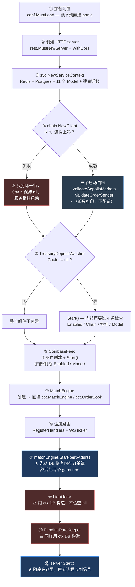
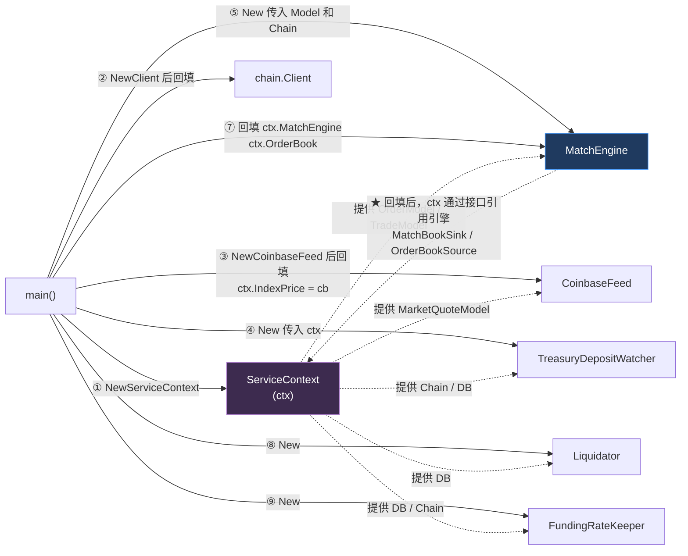

# 第 3 章：先跑起来 — main 函数的启动序、依赖装配与"无链降级"设计

> 第 2 章给了你代码地图。本章我们真正走进这栋楼，打开总配电箱——`metanode.go` 的 `main()`。
>
> 这个函数只有 97 行，但它是全项目的**装配说明书**：六个组件按什么顺序被造出来、谁引用谁、谁在什么条件下不启动、进程退出时按什么顺序拆除。更要紧的是，它包含本项目**最值得你反复咀嚼的一个工程决策**：**当链客户端创建失败时，服务照常启动，只是所有链上功能静默失效。**
>
> 这个设计有一个非常好听的名字叫"降级（degradation）"，听起来很稳健。但本章会带你把它拆开看清楚——**它到底降级了什么、代价是什么、在什么情况下这个设计会变成一个陷阱。** 读完之后，你不仅能自己把项目跑起来，还能对"链下服务该如何面对 RPC 不可用"这个问题给出自己的判断。

---

## 1. 本章导读

### 1.1 为什么 `main()` 值得单独用一章来讲

大多数项目的 `main()` 是"读配置 → 起服务"两行完事，不值得看。但这个项目的 `main()` 不一样，因为它要装配的东西有一半是**有状态、会自己跑起来、会主动跟外部世界交互**的：

```text
六个组件里，有四个是"活的"：
  · TreasuryDepositWatcher  —— 每 12 秒扫一次链上的 USDC 转账
  · CoinbaseFeed            —— 长连接 WebSocket，断了自动重连
  · MatchEngine             —— 100 毫秒一轮撮合 + 每秒一轮提交上链
  · FundingRateKeeper       —— 每 8 小时结算一次资金费率
  · Liquidator              —— 每 10 秒检查一次仓位（当前是空壳）
```

**它们不是"函数库"，是"进程"。** 装配它们的顺序、它们之间的引用关系、它们各自在什么条件下会被跳过、退出时怎么收摊——这些都是真正的工程决策，而这些决策全都压缩在这 97 行里。

所以本章的目标有三个：

1. **读懂启动序**：这六个东西为什么按这个顺序造？哪些顺序是绝对不能改的？
2. **读懂装配**：`ServiceContext` 和撮合引擎之间的循环引用是怎么解开的？
3. **读懂降级**：`Chain == nil` 到底意味着什么，这个设计在什么情况下会害你。

第 3 个是重点中的重点，也是本章篇幅最长的一节。

### 1.2 先看一个反直觉的启动日志

在开始读代码之前，先看一下这个服务**启动成功**时打印的东西：

```text
postgres migrate: ok (users, deposits, ledger_balances, orders, trades, funding_rates, market_quotes)
chain client: eth dial: dial tcp: lookup ethereum-sepolia.publicnode.com: no such host (链上查询/结算将不可用，请检查 RpcUrl、DealerAddress)
Coinbase feed skipped: MarketQuoteModel nil (check Supabase.DataSource)
Liquidator starting...
FundingRateKeeper starting...
Starting server at 0.0.0.0:28888...
```

**这几行日志里有三件事同时发生了：**

1. 第二行说**链上功能完全不可用**（RPC 域名解析失败）——但服务**没有退出**；
2. 第三行说 **Coinbase 行情源被跳过了**——因为数据库没配好，行情无处可写；
3. 第四行说 **`Liquidator starting...`（清算机器人正在启动）**——而它其实是个空壳，什么都不会做（第 1 章已分析）。

**但这个服务"启动成功"了。** 端口在监听，HTTP 接口在响应，`/api/v1/markets` 能返回 200。

**这就是本章要讨论的核心现象：这个项目的"启动成功"和"功能可用"是两个完全独立的概念。** 你没法从"进程活着"推断出"服务是好的"。

对这种情况，业内有个很形象的说法叫**"僵尸服务"（zombie service）**：进程健康、端口在听、健康检查通过，但业务功能已经悄悄失效了。对 Web3 后端来说，这是特别需要警惕的一类故障——因为**链上交互的失败往往是"静默"的**（返回一个空数组、返回 0，而不是抛错），前端和监控都很难发现。

### 1.3 三个必须记住的装配原则

在进入代码之前，先把本章的结论摆出来。这三条是你读完 `main()` 之后应该带走的东西：

**原则一：启动顺序 = 依赖顺序 + 故障域顺序。**

不是"想到哪个写哪个"。`main()` 里的顺序遵循两条规则：

- **依赖在前**：被依赖的先造（`ServiceContext` 最先，因为所有人都要它）；
- **故障域分组**：把"会挂掉的东西"和"不能挂的东西"分开处理。链客户端失败只影响它自己（走 `else` 分支），不阻断后面的组件启动。

**原则二：所有初始化必须在 `server.Start()` 之前完成。**

`server.Start()` 会阻塞在最后一行，所以它之前的代码都是"启动期"。这是**唯一能保证"HTTP 请求到达时，依赖一定已就绪"的办法**。本项目严格遵守了这条——所有组件的 `Start()` 都在 `server.Start()` 之前调用。

**原则三：`defer` 是 LIFO（后进先出），所以"先写 `defer` 的最后执行"。**

这是一个所有 Go 程序员都知道、但在写 `main()` 时最容易搞错的规则。本项目的 `defer` 顺序**有问题**（第 3 节第 (10) 段会详细分析），但正因为有问题，它才是一个很好的学习样本。

---

## 2. 架构 / 流程图

### 2.1 `main()` 的完整启动时序

这张图把 97 行的执行过程按时间轴摊开。**中间的"失败分支"和"跳过分支"是重点**——它们体现了作者对"哪些依赖是必需的、哪些是可选的"的判断：



**读图要点：**

- **红色的三处**（④ 失败分支、⑩、⑪）是本项目的三个薄弱点：两处是"用可能为 nil 的数据库连接去构造组件"，一处是"链客户端失败后服务继续启动"。
- **`conf.MustLoad` 是唯一一个"失败即 panic"的步骤**。这个差异是刻意的：配置文件读不到，你是**什么都做不了**的（连端口都不知道）；而 RPC 连不上，你至少还能提供查询服务。**"什么错误该致命、什么错误该降级"——这是设计降级策略时的第一个判断。**
- **⑤ 和 ⑥ 的条件不对称**：`TreasuryDepositWatcher` 在 `main` 里就判了 `Chain != nil`，而 `CoinbaseFeed` 是无条件创建的。原因是前者**强依赖链**（它的工作就是扫链），后者**与链无关**（它连的是 Coinbase 的公开 WebSocket）。

### 2.2 组件之间的引用关系（装配图）

这张图回答"谁持有谁"。**注意那两条回填箭头（⑦ 里的 `ctx.MatchEngine = matchEngine`）——它们是破解循环依赖的关键**：



**这张图里最重要的一条边是那条双向的虚线**：`ctx` 提供 Model 给引擎，引擎造好之后又被回填进 `ctx`。这在 Go 里之所以能编译通过，是因为 `ctx` 持有的**不是 `*engine.MatchEngine` 具体类型，而是三个小接口**（`MatchBookSink` / `OrderBookSource` / `IndexPriceSource`）——这两个接口定义在 `svc` 包内，所以 `svc` 不需要 import `engine`，循环就断开了。第 5 章会专题讲这个技巧。

### 2.3 `Chain == nil` 时的功能降级矩阵

这是本章最重要的一张表。我把全项目**所有**的 `Chain == nil` / `Chain != nil` 检查点都找了出来（一共 12 处），按"降级后用户看到什么"分类：

| # | 调用点 | 代码位置 | `Chain == nil` 时的行为 | 用户看到什么 | 评价 |
| --- | --- | --- | --- | --- | --- |
| 1 | `GetPositions` | `logic/position/getpositionslogic.go:31` | 返回空数组 | `{code:0, message:"ok", positions:null}` | ❌ **静默谎言** |
| 2 | `GetRiskInfo` | `logic/position/getriskinfologic.go:31` | 返回全零 | `{code:0, netValue:"0", isSafe:false}` | ❌ **静默谎言** |
| 3 | `GetBalance` | `logic/account/getbalancelogic.go:46` | 链上部分为 0，链下部分照常返回 | 链上 credit 显示 0 | ⚠️ **勉强可接受** |
| 4 | `GetMarket` | `logic/market/getmarketlogic.go:34` | 标记价/资金费率留空 | 市场信息缺价格字段 | ⚠️ 勉强可接受 |
| 5 | `ListMarkets` | `logic/market/listmarketslogic.go:37` | 同上 | 同上 | ⚠️ 勉强可接受 |
| 6 | `ChainTickers` | `logic/market/chainquote.go:18` | 返回 `nil` | Ticker 列表为空 | ⚠️ 勉强可接受 |
| 7 | **`CreateOrder`** | `logic/order/createorderlogic.go:68` | **跳过签名验证**，订单照收 | **下单成功** | 🔴 **危险** |
| 8 | `submitBatch` | `engine/matchengine.go:375` | 每笔撮合都 `rollbackMatch` | 订单永远不成交 | ✅ **正确**（拒绝假成交） |
| 9 | `settleFundingRate` | `engine/fundingratekeeper.go:79` | 打印日志后跳过 | 资金费率不更新 | ✅ 正确 |
| 10 | `TreasuryDepositWatcher.Start` | `listener/treasurydepositwatcher.go:42` | 整个组件不启动 | 充不到账 | ✅ 正确（且启动时就拦截） |
| 11 | `main` 里的启动判断 | `metanode.go:59` | 不创建 watcher | 同上 | ✅ 正确 |
| 12 | `GetBalance`（DB 那条） | `logic/account/getbalancelogic.go:29` | 返回 **HTTP 503** | `{code:503, ...}` | ✅✅ **最正确的做法** |

**这张表按"危险程度"排出了三种模式：**

**🔴 危险模式（第 7 行）：把安全校验绑在了外部依赖的可用性上。**

`CreateOrder` 里那行 `if l.svcCtx.Chain != nil { VerifyEOASignature(...) }` 意味着：**RPC 一旦不可用，任何人都可以往数据库里塞任意订单**，`signer` 字段随便填。虽然这些订单不会真的上链（第 8 行会拦），但它们会进入内存订单簿、出现在深度接口里、污染行情展示。

**而且验签根本不需要 RPC**——它是纯粹的本地密码学运算（`crypto.SigToPub`）。需要的信息（Dealer 地址、chainId）都在配置文件里。**把一件不需要外部依赖的事，做成了依赖外部依赖——这是本末倒置。** 第 6 节会给出修法。

**❌ 静默谎言模式（第 1、2 行）：把"读不到"伪装成"就是没有"。**

```go
func (l *GetPositionsLogic) GetPositions(req *types.GetPositionsReq) (resp *types.GetPositionsResp, err error) {
	if l.svcCtx.Chain == nil {
		return &types.GetPositionsResp{Code: 0, Message: "ok", Positions: nil}, nil
	}
	// ...
}
```

`Code: 0, Message: "ok"` —— 从响应上看，这和"该用户确实没有仓位"**完全无法区分**。

**为什么这比返回错误更糟？** 因为调用方会**基于错误的信息做出正确的推理，得到错误的结论**。设想这个场景：

```text
用户有 1 BTC 的多头仓位（在链上）
   ↓
RPC 抖动 5 秒
   ↓
用户点击"我的仓位" → 界面显示"暂无仓位"
   ↓
用户以为仓位没了 → 重新开了一单
   ↓
RPC 恢复 → 用户发现自己有 2 BTC 的仓位
```

**这不是假设，这是这类设计的必然结果。** 一个显式的 `503 Service Unavailable` 会让前端弹"服务暂时不可用，请稍后重试"，用户会等；而一个 `200 + 空数组` 会让用户立刻做决策。

**✅✅ 正确模式（第 12 行）：区分"业务语义上的空"和"基础设施故障"。**

```go
func (l *GetBalanceLogic) GetBalance(req *types.GetBalanceReq) (resp *types.GetBalanceResp, err error) {
	if l.svcCtx.LedgerBalanceModel == nil {
		return &types.GetBalanceResp{Code: 503, Message: "database unavailable: configure Supabase.DataSource"}, nil
	}
	// ...
}
```

**同一个文件、同一个作者，在数据库这一侧做对了：返回 503，并明确指出"该配什么"。** 这说明作者**知道**该怎么处理这类问题——只是在链这一侧没有贯彻同样的标准。

**这张表告诉我们一个通用的判断方法：**

> **问自己一个问题："这个依赖挂掉之后，用户看到的响应，和一个正常的业务结果能否区分开？"**
> **能区分 → 降级是安全的。不能区分 → 你在制造静默谎言，必须返回显式错误。**

### 2.4 进程退出时的关闭顺序（`defer` 栈）

`main()` 里注册了 8 个 `defer`。因为 Go 的 `defer` 是**后进先出（LIFO）**，实际的执行顺序和书写顺序**正好相反**：

```text
书写顺序（自上而下）              实际执行顺序（自下而上）
─────────────────────────      ─────────────────────────
defer server.Stop()            ⑧ server.Stop()
defer sqlDB.Close()            ⑦ sqlDB.Close()
defer ch.Close()               ⑥ chain 客户端关闭
defer treasuryWatcher.Stop()   ⑤ TreasuryDepositWatcher 停止
defer coinbaseFeed.Stop()      ④ CoinbaseFeed 停止
defer matchEngine.Stop()       ③ MatchEngine 停止
defer liquidator.Stop()        ② Liquidator 停止
defer fundingKeeper.Stop()     ① FundingRateKeeper 停止
```

**先看好的部分**：组件的停止顺序（①~⑤）**恰好是启动顺序的逆序**——这是对的，符合"后创建的先销毁"。而且**先停业务组件、再关底层资源**（⑥⑦）也是对的：如果反过来先关数据库，正在跑的 keeper 就会撞上已关闭的连接池。

**但有三个问题：**

**问题一（最严重）：`server.Stop()` 排在最后，意味着整个拆除期间 HTTP 还在服务。**

从 ① 到 ⑦ 的执行过程中，HTTP 服务器**仍在监听端口、仍在处理请求**。而此时数据库连接已经关了（第 ⑦ 步）、RPC 也断了（第 ⑥ 步）。任何一个在这个窗口期到达的请求，都会撞上已关闭的资源。

**正确的顺序应该是反过来的**：先用 `server.Stop()` 停止接受新请求，再逐个停业务组件，最后关底层资源。

```text
理想顺序：server.Stop() → 停各组件 → 关 RPC → 关 DB
实际顺序：停各组件 → 关 RPC → 关 DB → server.Stop()   ← 反了
```

**问题二：`Stop()` 的实现不一致，有的能防重复关闭，有的不能。**

```go
// listener 包的两个组件：用 sync.Once 保护，重复 Stop 是安全的
func (w *TreasuryDepositWatcher) Stop() {
	w.once.Do(func() { close(w.stop) })
}
func (f *CoinbaseFeed) Stop() {
	f.once.Do(func() { close(f.stop) })
}

// engine 包的三个组件：裸 close，重复调用会 panic（"close of closed channel"）
func (e *MatchEngine) Stop()   { close(e.stopCh) }
func (l *Liquidator) Stop()    { close(l.stopCh) }
func (k *FundingRateKeeper) Stop() { close(k.stopCh) }
```

**在本项目的 `main()` 里不会有问题**（每个 `defer` 只执行一次）。但这个不一致是个隐患：将来任何一处重构导致重复调用 `Stop()`，engine 包那三个会直接 panic。

**问题三：`Stop()` 只是"发信号"，不是"等待结束"。**

```go
func (e *MatchEngine) Stop() {
	close(e.stopCh)
}
```

这**只是关闭了一个 channel**，它不等待 `matchLoop` 和 `submitLoop` 这两个 goroutine 真正退出。所以：

```text
matchEngine.Stop()          → 发出停止信号
ch.Close()                  → 关闭 RPC 连接
                              ↑ 但 submitLoop 可能正在 WaitMined(...)！
```

如果此刻 `submitLoop` 正在 `bind.WaitMined(ctx, e.chain.RPC(), tx)`，而 `ch.Close()` 把底层的 `ethclient` 关了，这个等待会直接失败——**而那笔已经广播出去的链上交易，后端就再也不知道它成不成了**。

**这是一个真实的一致性风险**：交易发出去了，但后端在确认前就退出了，于是数据库里没有成交记录。这正是第 11 章要讨论的"链上成功但本地不知道"问题的一个具体触发路径。

**正确的做法**是用 `sync.WaitGroup` 让 `Stop()` 变成阻塞式的：

```go
// 理想形态
func (e *MatchEngine) Stop() {
	close(e.stopCh)
	e.wg.Wait()        // 等待所有 goroutine 真的退出
}
```

---

## 3. 核心代码拆解

### (1) `main()` 的前半段：配置与服务上下文

```go
var configFile = flag.String("f", "etc/metanode.yaml", "the config file")

func main() {
	flag.Parse()

	var c config.Config
	conf.MustLoad(*configFile, &c)          // ★ 唯一一个"失败即 panic"的步骤

	// 允许任意来源跨域（Access-Control-Allow-Origin: *）
	server := rest.MustNewServer(c.RestConf, rest.WithCors())
	defer server.Stop()

	ctx := svc.NewServiceContext(c)         // ★ 依赖容器，可能会打印错误但不 panic
	if ctx.PG != nil {
		if sqlDB, err := ctx.PG.DB(); err == nil {
			defer sqlDB.Close()             // 进程退出时关闭连接池
		}
	}

	// ...（接下一段）
}
```

**作者为什么这么设计（设计思想）：**

**设计点一：`MustLoad` 的"必须"是刻意的。**

注意 `conf.MustLoad` 和后面 `chain.NewClient` 的**错误处理差异**：

```go
conf.MustLoad(*configFile, &c)         // 读不到 → panic，进程退出
ch, err := chain.NewClient(...)        // 连不上 → 打印一行，继续跑
```

**这个差异背后是"这个依赖失败之后，你还有没有意义继续运行"的判断：**

| 依赖 | 失败后果 | 能否降级 | 选择的策略 |
| --- | --- | --- | --- |
| 配置文件 | 不知道端口、不知道连接串、**什么都不知道** | ❌ 完全无法运行 | `MustLoad` → panic |
| 链客户端 | 链上功能不可用，但数据库里的历史数据还能查 | ✅ 有残余价值 | 打印日志 → 继续 |

**这就是"降级设计"的第一原则：先问"降级后还剩什么价值"，再决定要不要降级。** 配置文件失败后剩余价值为零，所以必须死；RPC 失败后还剩"查询历史订单/成交"这个价值，所以可以活。

**设计点二：`rest.WithCors()` 是开发期的便利，生产期的风险。**

```go
server := rest.MustNewServer(c.RestConf, rest.WithCors())
```

这一行设置了 `Access-Control-Allow-Origin: *`，也就是**允许任何网站的前端调用这个 API**。在本地开发阶段这是必需的（前端跑在 `localhost:3000`，后端在 `localhost:28888`，跨域会被浏览器拦），但**上线前必须收紧**。

为什么在 Web3 项目里尤其要注意？因为这里有一个**签名重放**的风险面：如果攻击者能诱导用户在某个恶意页面上签名（钓鱼），然后用那个签名来调用你的 API，宽松的 CORS 会让这个攻击更顺畅。**CORS 不是认证机制**（它只在浏览器里生效，用 curl 可以完全绕过），但它是一道"减少攻击面"的防线。

这个项目里还有第二处同样的问题，在 WebSocket 那边：

```go
// internal/handler/market/ws_ticker.go
var wsUpgrader = websocket.Upgrader{
	// 默认放开跨域便于本地联调；上线请改为校验 Origin。
	CheckOrigin: func(r *http.Request) bool {
		return true     // ← 永远返回 true，等于不校验
	},
}
```

**注意这行注释写得是对的**（"上线请改为校验 Origin"），说明作者知道该改。但**注释不会自己执行**——这正是第 2 章讲的"文档漂移"的另一种形态：不是文档过期，而是**TODO 从未被执行**。

**设计点三：`if ctx.PG != nil` 这个判断暴露了"数据库也是可选的"。**

```go
if ctx.PG != nil {
	if sqlDB, err := ctx.PG.DB(); err == nil {
		defer sqlDB.Close()
	}
}
```

这段代码的含义是：**Postgres 连不上时，`ctx.PG` 是 `nil`，服务照样能跑。** 这和 `Chain == nil` 是同一套降级哲学——**所有外部依赖都被当成"可选的"**。

这套哲学的收益是"服务总能起来"，代价就是 2.3 节那张降级矩阵里列出的所有问题。**它是同一个设计决策的两面。**

### (2) `svc.NewServiceContext` —— 一个自己做取舍的初始化函数

```go
func NewServiceContext(c config.Config) *ServiceContext {
	// ① Redis：注意这里是 MustNewRedis，连不上会 panic
	rds := redis.MustNewRedis(redis.RedisConf{
		Host: c.Redis.Host,
		Type: c.Redis.Type,
		Pass: c.Redis.Pass,
	})

	var pgDB *gorm.DB
	var sqlConn sqlx.SqlConn

	// ② Postgres：这里是"尽力而为"，连不上只打印
	if ds := strings.TrimSpace(c.Supabase.DataSource); ds != "" {
		if !strings.Contains(ds, "sslmode=") {
			// 自动补 sslmode=require（Supabase 要求 TLS）
			if strings.Contains(ds, "?") {
				ds += "&sslmode=require"
			} else {
				ds += "?sslmode=require"
			}
		}
		gdb, err := gorm.Open(postgres.Open(ds), &gorm.Config{})
		if err != nil {
			fmt.Println("supabase postgres (gorm):", err, "(未连接 PG，请检查 Supabase.DataSource)")
		} else {
			sqlDB, errSQL := gdb.DB()
			if errSQL != nil {
				fmt.Println("supabase postgres sql.DB:", errSQL)
			} else {
				// 设置连接池
				if mo := c.Supabase.MaxOpenConns; mo > 0 {
					sqlDB.SetMaxOpenConns(mo)
				}
				if mi := c.Supabase.MaxIdleConns; mi > 0 {
					sqlDB.SetMaxIdleConns(mi)
				}
				pgDB = gdb
				// model 层仍使用 go-zero sqlx；占位符由 sqlx 展开后与 Postgres 兼容。
				sqlConn = sqlx.NewSqlConnFromDB(sqlDB)
				if err := db.MigrateAccountTables(pgDB); err != nil {
					fmt.Println("postgres migrate:", err)
				} else {
					fmt.Println("postgres migrate: ok (...)")
				}
			}
		}
	} else {
		fmt.Println("supabase: Supabase.DataSource 为空，链下余额/充值记录不可用")
	}

	// ③ 装配：注意 Model 是"有条件地"赋值的
	svcCtx := &ServiceContext{Config: c, DB: sqlConn, PG: pgDB, Redis: rds}

	if sqlConn != nil {
		svcCtx.PositionModel = model.NewPositionModel(sqlConn)
		svcCtx.WithdrawModel = model.NewWithdrawModel(sqlConn)
		// ... 另外 4 个 sqlx 风格的 Model
	}
	if pgDB != nil {
		svcCtx.DepositModel = model.NewGormDepositModel(pgDB)
		svcCtx.LedgerBalanceModel = model.NewGormLedgerBalanceModel(pgDB)
		// ... 另外 3 个 GORM 风格的 Model
	}

	return svcCtx
}
```

**作者为什么这么设计（设计思想）：**

**设计点一：Redis 用 `MustNewRedis`（连不上就死），Postgres 用"尽力而为"（连不上就活）——这个不一致是有意义的。**

| | Redis | Postgres |
| --- | --- | --- |
| 构造函数 | `MustNewRedis` | `gorm.Open` + 手动判错 |
| 连不上时 | **panic，进程退出** | 打印日志，`PG = nil`，继续跑 |
| 存什么 | nonce（登录）、扫块游标 | 订单、成交、余额、行情 |
| 丢了会怎样 | 登录不可用、扫块要重新回溯 | 查询不可用 |

**这个取舍可以说得通，但值得质疑。** Redis 存的 nonce 是登录流程的一环——如果没有 Redis，用户就登录不了，但**查询接口（读订单、读仓位）仍然完全可用**。按"降级后还剩什么价值"这个标准，Redis 也应该降级而不是 panic。

**更重要的是这个不一致的一致性问题**：项目里**同时存在两种"外部依赖失败"的处理风格**。读者遇到一个新的依赖时，无法从既有代码推断出"这里应该 panic 还是应该降级"。**在工程上，"不一致"本身就是一种技术债**——它让每个新加入的人都要重新做一次判断，而且很可能做出和前人不同的选择。

**设计点二：`sslmode` 自动补全是一处贴心的细节。**

```go
if !strings.Contains(ds, "sslmode=") {
	if strings.Contains(ds, "?") {
		ds += "&sslmode=require"
	} else {
		ds += "?sslmode=require"
	}
}
```

Supabase 的连接串**必须带 `sslmode=require`**，否则连接会失败。作者的这段代码自动补上了这个参数，避免了"用户从 Supabase 控制台复制连接串、忘了加参数、然后连不上"这个常见坑。

**这种"帮用户把容易忘的默认值补上"的思路值得学。** 与之相对的反例是 `cmd/pgping/main.go` 里那个硬编码密码（第 2 章 6.6 节）——同样是"体贴"，一个是补默认值，一个是留凭据，效果完全不同。

**设计点三：Model 的赋值是"有条件"的，这埋下了第 2.3 节所有降级问题的种子。**

```go
if sqlConn != nil {
	svcCtx.PositionModel = model.NewPositionModel(sqlConn)
	// ...
}
```

注意这里的判断是 `if sqlConn != nil`——**Model 字段要么被赋成一个可用的对象，要么保持 `nil`**。这就是为什么业务代码里遍地都是 `if l.svcCtx.Chain != nil` 和 `if l.svcCtx.LedgerBalanceModel == nil`：**因为在类型系统里，这些字段是"可能为 nil 的"，编译器不会强制你检查。**

**更好的设计是让"不可用"显式化。** 有两种常见做法：

```go
// 做法 A：构造一个"空对象"（Null Object 模式）——调用不会 panic，但行为是明确的
type unavailableChain struct{}
func (unavailableChain) GetPositions(ctx context.Context, t common.Address) ([]common.Address, error) {
    return nil, ErrChainUnavailable        // ★ 返回显式错误，而不是空数组
}

// 做法 B：干脆不允许降级——连不上就拒绝启动
ch, err := chain.NewClient(...)
if err != nil {
    logx.Must(err)      // 配置错误就应该立刻暴露
}
```

本项目选的是"拿到 nil、到处判空"，这是最容易想到、但最容易漏判的一种做法。

### (3) `chain.NewClient` 的失败路径 —— 本章的核心决策点

```go
	// 链客户端：失败时 Chain 为 nil，仅 HTTP 可用，撮合/资金费不落链。
	ch, err := chain.NewClient(c.Ethereum, c.Markets, c.Chainlink)
	if err != nil {
		fmt.Println("chain client:", err, "(链上查询/结算将不可用，请检查 RpcUrl、DealerAddress)")
	} else {
		ctx.Chain = ch
		defer ch.Close()

		// 启动自检一：市场地址是否与 Sepolia 预期一致
		if err := config.ValidateSepoliaMarkets(c.Ethereum.ChainId, c.Markets); err != nil {
			fmt.Println("markets config:", err)
		} else {
			fmt.Println("markets config: ok (BTC-PERP, ETH-PERP Sepolia addresses)")
		}

		// 启动自检二：私钥地址是否在链上 validOrderSender 白名单里
		if err := ch.ValidateOrderSender(context.Background()); err != nil {
			fmt.Println("validOrderSender:", err)
		} else {
			fmt.Println("validOrderSender: ok", ch.From().Hex())
		}
	}
```

**作者为什么这么设计（设计思想）：**

**设计点一：这个 `if/else` 是本项目"无链降级"的**唯一**实现点。**

整个降级机制没有别的开关——**就是这里不把 `ch` 赋给 `ctx.Chain`**。之后全部 12 处 `Chain == nil` 判断，都是在对这一行代码的后果做响应。

**这也是为什么这个设计值得反复讨论**：一个影响全系统行为的决策，被压缩成了一个 4 行的 `if`。它的好处是"改动面小、易理解"；它的坏处是**它的后果分散在 12 个地方，没有任何一个地方能看到全貌**——只有像 2.3 节那样把所有调用点聚到一起，你才能发现"同一个降级，有的地方处理得好，有的地方是静默谎言"。

**这就是"隐式降级"和"显式降级"的区别。** 显式降级的做法是定义一个明确的"不可用状态"（比如返回 `ErrChainUnavailable` 空对象），让所有调用点**被迫**处理它；隐式降级就是本项目这样，靠 `nil` 和逐处判空。

**设计点二：那两个自检（`ValidateSepoliaMarkets` / `ValidateOrderSender`）是很好的工程实践。**

我们在第 1 章分析过 `ValidateOrderSender` 的价值（确认私钥地址确实在链上白名单里，避免"每笔上链交易都 revert 但白烧 gas"）。这里补充 `ValidateSepoliaMarkets`：

```go
// config/markets.go
func ValidateSepoliaMarkets(chainID int64, markets []MarketConfig) error {
	if chainID != 11155111 {        // 只在 Sepolia 上生效
		return nil
	}
	expected := map[string]string{
		"BTC-PERP": SepoliaBTCPerp,
		"ETH-PERP": SepoliaETHPerp,
	}
	// 逐个比对地址（大小写不敏感），并检查有没有遗漏的市场
	// ...
}
```

它做两件事：**地址比对**（配置里的合约地址是否是 Sepolia 上真实部署的那两个）和**完整性检查**（BTC-PERP / ETH-PERP 是不是都配了）。这两件事都属于"配置错误"，而配置错误的特点是**不改就一直错**，所以**越早报出来越好**。

**设计点三（也是问题所在）：两个自检都只打印，不阻断。**

```go
if err := config.ValidateSepoliaMarkets(...); err != nil {
	fmt.Println("markets config:", err)      // ← 打印完就完了，服务继续跑
}
if err := ch.ValidateOrderSender(...); err != nil {
	fmt.Println("validOrderSender:", err)    // ← 同上
}
```

**这两个自检发现的问题，都是"服务跑起来也没用"的问题：**

- 市场地址配错了 → 所有链上查询都会打到错误（可能是空）的合约地址上，返回一堆 0；
- 私钥不在白名单里 → 每一笔撮合上链都会 revert，**而且每次 revert 都要付 gas**。

**第二种情况尤其糟糕**：服务"正常启动"，撮合循环"正常工作"，然后**每 100 毫秒把一笔注定失败（但照样扣 gas）的交易发到链上**。如果没人盯着链上浏览器，你可能要烧掉一大笔测试币才会发现。

**这里暴露了一个关键的设计判断：自检发现问题之后，应该"警告"还是"拒绝启动"？**

我的判断标准是：**问"如果带着这个错误继续运行，会不会造成不可逆的损失（尤其是花钱）？"**

| 自检项 | 带着错误运行会怎样 | 应该 |
| --- | --- | --- |
| `ValidateSepoliaMarkets` | 返回错误数据，用户看到 0 | ⚠️ 警告即可（可恢复） |
| `ValidateOrderSender` | **每笔交易 revert 并烧 gas** | 🔴 **拒绝启动**（不可逆的成本） |
| Supabase 未配置 | 查询接口返回 503 / 空 | ⚠️ 警告即可 |
| 私钥格式错误 | `NewClient` 会直接返回 error | ✅ 已正确（走 `err` 分支） |

**一条可以带走的经验**：**凡是"持续产生不可逆成本"的配置错误（烧 gas、扣费、发交易），都应该让服务拒绝启动，而不是打印一行日志继续跑。**

### (4) 撮合引擎的创建与"回填"—— 破解循环依赖的实操

```go
	// 撮合引擎与 ServiceContext 互相引用，便于下单 API 入簿。
	matchEngine := engine.NewMatchEngine(c.MatchEngine, ctx.OrderModel, ctx.TradeModel, ctx.Chain)
	ctx.MatchEngine = matchEngine
	ctx.OrderBook = matchEngine

	handler.RegisterHandlers(server, ctx)
	market.RegisterTickerWebSocket(server, ctx)

	perpAddrs := make([]string, 0, len(c.Markets))
	for _, m := range c.Markets {
		perpAddrs = append(perpAddrs, m.Address)
	}
	matchEngine.Start(perpAddrs)
	defer matchEngine.Stop()
```

**作者为什么这么设计（设计思想）：**

**设计点一：为什么需要"先传进去、再回填"这种绕法？**

依赖关系是这样的：

```text
MatchEngine 需要：OrderModel（读写订单）、TradeModel（写成交）、Chain（发交易）
ServiceContext 需要：MatchEngine（让下单接口能调用 AddOrder）
                     OrderBook（让深度接口能读快照）

→ engine 需要 svc 的东西，svc 需要 engine 的东西 = 循环
```

**这个循环是真实存在的，不是设计失误。** 撮合引擎天然需要数据库，而下单接口天然需要撮合引擎。作者用的破解方法是：

```text
第 1 步：造 ctx（不含引擎）
第 2 步：把 ctx 里的 Model 和 Chain 传给引擎，造出引擎
第 3 步：把引擎"回填"进 ctx —— 但 ctx 里声明的类型是三个小接口，不是 *MatchEngine
```

第 3 步是关键。因为 `svc` 包里定义的是：

```go
type MatchBookSink interface { AddOrder(order *model.Order) }
type OrderBookSource interface { SnapshotOrderBook(perp string, limit int) (bids, asks []OrderBookLevel) }
```

**`svc` 包完全不知道 `engine` 包的存在**（它只知道"有一个东西能 `AddOrder`"）。所以 `ctx.MatchEngine = matchEngine` 这行的实际含义是"把一个 `*engine.MatchEngine` 赋给一个接口变量"——**Go 的隐式接口实现让这一步不需要任何显式的类型声明**。

**设计点二：`ctx.MatchEngine` 和 `ctx.OrderBook` 是同一个对象。**

```go
ctx.MatchEngine = matchEngine      // 类型是 MatchBookSink（只有 AddOrder）
ctx.OrderBook = matchEngine        // 类型是 OrderBookSource（只有 SnapshotOrderBook）
```

**为什么要拆成两个字段？** 因为这是**接口隔离原则（ISP）**的应用：下单逻辑只需要"往里塞单"的能力，深度查询只需要"读快照"的能力。如果把整个 `*MatchEngine` 暴露出去，调用方就获得了 `Stop()`、`submitBatch()` 等本不该碰的方法。

用两个窄接口分别暴露两种能力，**等于在类型系统层面规定了"谁能做什么"**。这个技巧在 Go 里很常用，成本极低（两个接口一共三行），收益是清晰的权限边界。

**设计点三：`perpAddrs` 的构造暴露了"市场列表来自配置"这个事实。**

```go
perpAddrs := make([]string, 0, len(c.Markets))
for _, m := range c.Markets {
	perpAddrs = append(perpAddrs, m.Address)
}
matchEngine.Start(perpAddrs)
```

**为什么要传这一串地址给 `Start()`？** 因为引擎需要**从数据库恢复未成交订单**（第 12 章的主题），而 `FindPendingOrders(perp, limit)` 是按市场查询的，所以得先知道有哪些市场。

**注意这个设计的一个特点：市场列表来自配置文件，而不是链上查询。** 也就是说，**新增一个市场，必须改配置并重启服务**。这在去中心化交易所的语境下是合理的（上市是一个治理行为，不是自动的），但你要意识到：**链上可能存在一个已部署的 Perpetual 合约，而后端配置里没有它**——那么这个市场上的所有活动，后端都是不知道的。

### (5) `matchEngine.Start()` —— 一个"先恢复、后并发"的启动模式

```go
// Start 启动撮合引擎；perpAddresses 用于从 DB 恢复未成交订单。
func (e *MatchEngine) Start(perpAddresses []string) {
	logx.Info("Match engine starting...")
	e.RestorePendingOrders(context.Background(), perpAddresses)   // ★ 同步：先把内存簿重建好
	go e.matchLoop()                                              // 异步：100ms 一轮撮合
	go e.submitLoop()                                             // 异步：1s 一轮提交
}
```

**作者为什么这么设计（设计思想）：**

**这段只有五行，但顺序是关键，分三层理解：**

**第一层：为什么 `RestorePendingOrders` 是同步的？**

因为**内存订单簿必须是"完整"的，撮合才有意义。** 如果恢复还没做完就让撮合循环跑起来，会发生什么？

```text
恢复进行中（已恢复 BTC 的 10 张单，还剩 5 张）
   ↓
matchLoop 同时启动，开始撮合
   ↓
用一份不完整的订单簿撮合 → 得到"本该成交但没成交"或"错误配对"的结果
```

**更具体地说**：假设 BTC-PERP 上有两张本可立即成交的订单（一张买单、一张卖单），但恢复只做到一半。撮合循环可能先看到买单、后看到卖单，中间产生一次"无对手盘"的空转；或者更糟——它可能把新进来的订单和不完整的簿撮合，产生**实际不该发生的成交**。

**同步恢复消除了这个窗口期。** 这是"先把状态准备好，再开放服务"这个通用原则的应用——和第 1.3 节讲的"所有初始化必须在 `server.Start()` 之前"是同一个道理。

**第二层：为什么是两个独立的 goroutine，而不是一个大循环？**

```go
go e.matchLoop()      // 每 100ms 撮合一次
go e.submitLoop()     // 每 1s 提交一次
```

因为这两件事的**节奏完全不同**：

| | 撮合 | 提交上链 |
| --- | --- | --- |
| 频率 | 100 毫秒 | 1 秒 |
| 耗时 | 极快（纯内存运算） | 极慢（等区块确认，秒级） |
| 失败处理 | 无需回滚（没产生副作用） | 需要回滚（改了内存簿） |

**如果把它们放在同一个 goroutine 里会怎样？**

```text
大循环：撮合 → 提交（等 15 秒确认）→ 撮合 → 提交（等 15 秒）...
                    ↑ 这 15 秒里完全无法撮合
```

**撮合会被提交彻底拖死。** 拆成两个 goroutine 之后，`matchLoop` 可以每 100 毫秒把新的成交结果塞进 `pendingTrades` 队列，而 `submitLoop` 慢慢地一笔一笔上链。它们之间通过 `pendingTrades` 这个切片（配 `tradeMu` 互斥锁）通信。

**这是一种典型的"生产者—消费者"模式**，只不过这里的"队列"是一个受互斥锁保护的切片，而不是 channel。

**第三层：这个设计的一个副作用——内存撮合与链上确认"脱节"。**

因为两个 goroutine 是异步的，所以：

```text
T=0ms    撮合出 100 笔成交，全部塞进 pendingTrades，内存簿立刻扣减
T=1000ms submitLoop 醒来，开始批量处理
T=1000ms 第 1 笔发交易 → 等确认 → 15 秒后成功 → 写库
T=16000ms 第 2 笔发交易 → ...
```

**如果此刻用户查 `/api/v1/orders`，他会看到什么？** 订单状态还是"待成交"（因为数据库还没更新）——但他的订单其实已经在内存里被扣减了，而且链上交易马上就要发出去。

**这个"内存状态领先于数据库"的窗口期，就是第 11 章要讨论的一致性问题。** 本章只需要记住：**它是这个"双 goroutine 异步架构"的直接产物，不是 bug。**

### (6) `CoinbaseFeed` 的启动：一个"无条件创建、内部自查"的正面案例

```go
	coinbaseFeed := listener.NewCoinbaseFeed(ctx)
	coinbaseFeed.Start()
	ctx.IndexPrice = coinbaseFeed
	defer coinbaseFeed.Stop()
```

`main` 里只有三行，**没有任何条件判断**。所有检查都在 `Start()` 内部：

```go
func (f *CoinbaseFeed) Start() {
	cfg := f.svc.Config.Coinbase
	if !cfg.Enabled {
		logx.Info("Coinbase feed disabled")
		return
	}
	if len(f.products) == 0 {
		logx.Error("Coinbase feed skipped: no CoinbaseProduct in Markets config")
		return
	}
	if f.svc.MarketQuoteModel == nil {
		logx.Error("Coinbase feed skipped: MarketQuoteModel nil (check Supabase.DataSource)")
		return
	}
	logx.Infof("Coinbase feed starting: products=%d ws=%s", len(f.products), f.wsURL())
	go f.run()
}
```

**作者为什么这么设计（设计思想）：**

**设计点一：把依赖检查放在组件内部，而不是调用方。**

对比一下 `main` 里对两个 listener 的不同处理：

```go
// TreasuryDepositWatcher：main 里判断，不满足就整个不创建
var treasuryWatcher *listener.TreasuryDepositWatcher
if ctx.Chain != nil {
	treasuryWatcher = listener.NewTreasuryDepositWatcher(ctx)
	treasuryWatcher.Start()
	defer treasuryWatcher.Stop()
}

// CoinbaseFeed：无条件创建，内部自查
coinbaseFeed := listener.NewCoinbaseFeed(ctx)
coinbaseFeed.Start()
ctx.IndexPrice = coinbaseFeed
defer coinbaseFeed.Stop()
```

**哪一种更好？** 从软件设计角度，**CoinbaseFeed 的做法更好**。理由：

1. **`main()` 里的判断逻辑会随组件增多而膨胀。** 想象如果有 20 个组件，每个都在 `main` 里写一段 `if` 判断自己能不能启动，`main()` 会变成一坨互相纠缠的条件判断。
2. **组件的启动条件应该由组件自己最清楚。** `CoinbaseFeed` 需要 `Enabled`、需要 `MarketQuoteModel`——这些约束内聚在组件内部，将来新增一个约束（比如"还需要配置代理"），只改组件自己，`main` 不动。
3. **检查更完整。** `CoinbaseFeed.Start()` 检查了三项，而 `main` 里对 watcher 只检查了一项（`Chain != nil`），剩下的三项在 `watcher.Start()` 内部（第 2.1 节的图里能看出这个不对称）。

**设计点二：`ctx.IndexPrice = coinbaseFeed` 是第三次"回填"。**

```go
ctx.IndexPrice = coinbaseFeed      // 接口类型 IndexPriceSource
```

和第 (4) 段的 `ctx.MatchEngine = matchEngine` 是同一个套路：`main` 作为唯一的装配者，负责把"实现了接口的对象"塞进 `ctx` 的接口字段。

**这个模式可以总结成一句话：**

> **`main()` 是唯一知道"具体类型"的地方；其他所有代码只通过 `ctx` 里的接口看到"能力"。**

**设计点三：`defer coinbaseFeed.Stop()` 用了 `sync.Once` 保护。**

```go
func (f *CoinbaseFeed) Stop() {
	f.once.Do(func() { close(f.stop) })
}
```

这是正确的写法（对比第 2.4 节提到的 engine 包三个组件的裸 `close`）。**而且这里的 `once` 还有一个额外作用**：如果 `Start()` 因为配置未启用而提前 `return` 了，`Stop()` 依然会被 `defer` 调用——`once` 保护让这个调用是安全的（虽然此时 `close` 一个没人监听的 channel 也无害）。

### (7) `TreasuryDepositWatcher.Start` —— 依赖检查的"教科书式"写法

这是第 1 章提过的"正面案例"，本章从"依赖检查"的角度完整看一遍：

```go
// Start 非阻塞启动。
func (w *TreasuryDepositWatcher) Start() {
	cfg := w.svc.Config.TreasuryDeposit
	if !cfg.Enabled {
		logx.Info("TreasuryDeposit watcher disabled")
		return
	}
	if w.svc.Chain == nil {
		logx.Error("TreasuryDeposit watcher skipped: chain client nil (check RpcUrl)")
		return
	}
	if strings.TrimSpace(w.svc.Config.Ethereum.UsdcAddress) == "" ||
		strings.TrimSpace(w.svc.Config.Ethereum.UsdcTreasuryAddress) == "" {
		logx.Error("TreasuryDeposit watcher skipped: UsdcAddress or UsdcTreasuryAddress empty")
		return
	}
	if w.svc.DepositModel == nil || w.svc.LedgerBalanceModel == nil {
		logx.Error("TreasuryDeposit watcher skipped: Supabase unavailable (DepositModel/LedgerBalanceModel nil)")
		return
	}

	logx.Infof(
		"TreasuryDeposit watcher starting: usdc=%s treasury=%s poll=%ds confirmations=%d lookback=%d",
		w.svc.Config.Ethereum.UsdcAddress,
		w.svc.Config.Ethereum.UsdcTreasuryAddress,
		w.pollSeconds(), w.confirmations(), w.lookback(),
	)
	go w.loop()
}
```

**作者为什么这么设计（设计思想）：**

**这段代码有三个值得学的细节：**

**细节一：四道检查，每一道都给出了"该去改哪个配置"。**

```text
"chain client nil (check RpcUrl)"                     ← 告诉你去看 Ethereum.RpcUrl
"UsdcAddress or UsdcTreasuryAddress empty"            ← 明确说是哪两个字段
"Supabase unavailable (DepositModel/LedgerBalanceModel nil)"  ← 指向 Supabase.DataSource
```

**这就是"可操作的错误信息"**。对比一下不合格的写法：`logx.Error("watcher start failed")`——运维看到这条，唯一能做的就是去读源码。

**一条可以带走的经验**：**错误信息里应该包含"下一步该做什么"，而不只是"哪里错了"。**

**细节二：检查顺序是"由外到内"的。**

```text
Enabled（配置开关） → Chain（最外层依赖） → 地址（配置内容） → Model（数据库依赖）
```

**先查最容易查、最不可能误报的**（`Enabled` 是个 bool），**再查需要判断的**（`Chain == nil` 意味着 RPC 挂了）。这个顺序让日志的"第一个错误"就是最可能的根因。

**细节三：`logx.Infof` 那行把所有关键参数都打出来了。**

```go
logx.Infof("TreasuryDeposit watcher starting: usdc=%s treasury=%s poll=%ds confirmations=%d lookback=%d", ...)
```

`poll` / `confirmations` / `lookback` 这三个参数直接决定了这个组件的行为（多久扫一次、等几个确认、回溯多少块），**把它们打进启动日志，等于把"这一轮运行的配置快照"记了下来**。排查"为什么充值没到账"时，第一件事就是看这行日志确认参数对不对。

**这是"启动日志应该是一份可审计的运行记录"这个原则的体现。**

### (8) `Liquidator` 与 `FundingRateKeeper` —— 两个有问题的构造

```go
	// 启动清算机器人
	liquidator := engine.NewLiquidator(c.Liquidator, c.Ethereum, ctx.DB)
	liquidator.Start()
	defer liquidator.Stop()

	// 启动资金费率服务
	fundingKeeper := engine.NewFundingRateKeeper(c.FundingRate, c.Markets, ctx.DB, ctx.Chain)
	fundingKeeper.Start()
	defer fundingKeeper.Stop()
```

**这两段代码有两个问题，第 1 章提过，这里要说清"为什么会炸"。**

**问题一：传的是 `ctx.DB` 而不是 `ctx.PG`。**

`ctx.DB` 的类型是 `sqlx.SqlConn`（go-zero 的 SQL 抽象），`ctx.PG` 是 `*gorm.DB`。这里传 `ctx.DB` 说明这两个组件用的是 **sqlx 风格的 Model**：

```go
func NewLiquidator(cfg config.LiquidatorConfig, ethCfg config.EthereumConfig, db sqlx.SqlConn) *Liquidator {
	return &Liquidator{
		config:           cfg,
		ethConfig:        ethCfg,
		positionModel:    model.NewPositionModel(db),        // sqlx 风格
		liquidationModel: model.NewLiquidationModel(db),     // sqlx 风格
		stopCh:           make(chan struct{}),
	}
}
```

**这两个 Model 用 sqlx 是对的**（`positions` 和 `liquidations` 表确实在 `models.go` 而不是 `pgstore.go` 里，第 2 章的表可以核对）。但要注意：`ctx.DB` 是从 `ctx.PG` 派生出来的（`sqlx.NewSqlConnFromDB(sqlDB)`），**所以 Supabase 没配时，`ctx.DB` 也是 `nil`**。

**问题二（真正的 bug）：构造函数不检查 `nil`。**

```go
model.NewPositionModel(db)     // db 可能是 nil

func NewPositionModel(conn sqlx.SqlConn) PositionModel {
	return &defaultPositionModel{conn: conn}     // ← 把 nil 存进去了
}

func (m *defaultPositionModel) FindByTrader(ctx context.Context, trader string) ([]*Position, error) {
	var resp []*Position
	query := `SELECT * FROM positions WHERE trader = ?`
	err := m.conn.QueryRowsCtx(ctx, &resp, query, trader)
	//        ↑ conn 是 nil 接口 → nil pointer dereference → PANIC
	return resp, err
}
```

**在 Go 里，对一个 `nil` 接口调用方法会直接 panic**（而不是返回错误）。

那么**什么时候会真的触发这个 panic？** 需要同时满足三个条件：

```text
① Supabase.DataSource 为空 → ctx.DB == nil
② 但 RPC 配好了 → ctx.Chain != nil（否则 FundingRateKeeper 会在开头 return）
③ 资金费率结算周期到了（默认 8 小时）
        ↓
settleFundingRate() 走完全流程 → 调 chain.SubmitFundingRateUpdate 成功
        ↓
k.fundingModel.Insert(ctx, ...)  → PANIC
```

**注意第 ③ 条：默认 8 小时。** 这意味着**这个 bug 不会在启动时暴露，而是会在服务跑了 8 小时之后突然崩溃**——而且崩溃点在一个和后端 goroutine 里，`main()` 的 `defer` 不会执行（goroutine panic 会导致整个进程退出，但栈展开只发生在那个 goroutine 里）。

**一个只在特定配置组合下、运行 8 小时后才触发的崩溃——这是最难排查的一类 bug。**

**修法很简单**：在构造函数里 fail fast，或者在 `settleFundingRate` 里也检查一下数据库可用性：

```go
// 方案 A：构造时拒绝（推荐）
func NewFundingRateKeeper(cfg config.FundingRateConfig, markets []config.MarketConfig, db sqlx.SqlConn, ch *chain.Client) *FundingRateKeeper {
	if db == nil {
		logx.Error("FundingRateKeeper: DB unavailable, funding settlement disabled")
		// 要么返回一个"空实现"，要么让调用方知道
	}
	// ...
}

// 方案 B：使用时检查
func (k *FundingRateKeeper) settleFundingRate() {
	if k.chain == nil {
		logx.Info("FundingRateKeeper: chain client nil, skip")
		return
	}
	if k.fundingModel == nil {
		logx.Error("FundingRateKeeper: db unavailable, skip")
		return
	}
	// ...
}
```

**顺带一提**：`Liquidator` 的 `Start()` 里有一个 `Enabled` 检查：

```go
func (l *Liquidator) Start() {
	if !l.config.Enabled {
		logx.Info("Liquidator is disabled")
		return
	}
	logx.Info("Liquidator starting...")
	go l.checkLoop()
}
```

**这和 `TreasuryDepositWatcher.Start()` 的四道检查形成了鲜明对比**：同样是"常驻后台任务"，一个检查了四项依赖并逐一给出修复指引，另一个只检查了一个开关、然后打印了一句"starting..."（尽管它其实什么都不会做）。

**同一个项目里，同类组件的完成度差异如此之大——这正是"读源码要看全貌"的价值所在。** 你从 `TreasuryDepositWatcher` 学到的是"应该怎么写"，从 `Liquidator` 学到的是"不写会怎样"。

### (9) `server.Start()` —— 阻塞点与优雅退出

```go
	fmt.Printf("Starting server at %s:%d...\n", c.Host, c.Port)
	server.Start()
}
```

**作者为什么这么设计（设计思想）：**

**设计点一：`server.Start()` 是全项目唯一的阻塞点。**

它之前的 95 行都是"启动期"，它之后没有代码。这个结构保证了 **"HTTP 请求开始被处理时，所有依赖都已经就绪"**——这是 1.3 节原则二的落地。

**注意一个细节**：路由在第 75 行就注册了（`handler.RegisterHandlers(server, ctx)`），但服务器到第 96 行才开始监听。**"注册路由"和"开始监听"是两件事**，注册只是往一个 table 里塞记录，此时端口还没打开。所以第 75 行到第 96 行之间，不存在"请求到达但引擎还没启动"的竞态。**这是一个容易看错的地方。**

**设计点二：优雅退出是怎么发生的？**

`server.Start()` 会在收到进程信号时返回（go-zero 的 `rest` 包内置了信号监听）。返回之后，Go 运行时开始执行 `defer` 栈——也就是 2.4 节分析的那 8 个关闭动作。

**但这里有个值得注意的点**：如果进程是被 `SIGKILL`（`kill -9`）杀掉的，**任何 `defer` 都不会执行**。所有"靠 defer 做的清理"都失效。而 `SIGKILL` 在实际运维里非常常见（Kubernetes 的 Pod 驱逐、OOM Killer、Docker 的 `kill` 超时）。

**这对本项目的含义是**：`matchEngine` 的内存订单簿、`pendingTrades` 队列里的成交、`TreasuryDepositWatcher` 的扫块进度**都可能丢失**。项目对此的应对是：

- 内存订单簿 → 重启时从数据库 `RestorePendingOrders` 恢复（第 12 章）；
- 扫块进度 → 存 Redis + 数据库兜底（第 16 章）；
- **`pendingTrades` 队列 → 没有任何持久化，直接丢失。**

**最后一条是一个真实的数据丢失点**：撮合完成但还没提交上链的成交，遇到 `SIGKILL` 就直接消失了。此时内存订单簿的 `remain` 已经被扣减（第 1 章 3.(4) 段讲过），而数据库里没有记录 —— 重启后从数据库恢复，`remain` 会按 `filled_amount` 重算，**所以这一部分实际上能自愈**。但如果成交已经发了链上交易、只差写库，就会落进第 11 章那个"链上成功但本地不知道"的坑。

**我们在这里第一次看到"崩溃一致性"这个主题的三个不同层次：**

```text
崩溃点在                后果                              本项目的应对
─────────────────────────────────────────────────────────────────────
内存扣减之后、发交易之前   重新撮合即可                        ✅ 恢复时自愈
交易已发、确认之前         链上可能成功，本地不知道            ⚠️ 第 11 章的问题
链上确认之后、写库之前     链上已成功，本地永久不知道          🔴 第 11、12 章的坑
```

### (10) `defer` 栈的顺序分析 —— 一个可以避免的错误

把 2.4 节的结论落到具体代码上：

```go
func main() {
	// ... 配置加载 ...

	server := rest.MustNewServer(c.RestConf, rest.WithCors())
	defer server.Stop()                          // ① 注册最早 → 【最后】执行

	ctx := svc.NewServiceContext(c)
	if ctx.PG != nil {
		if sqlDB, err := ctx.PG.DB(); err == nil {
			defer sqlDB.Close()                  // ② → 倒数第二执行
		}
	}

	ch, err := chain.NewClient(...)
	if err == nil {
		ctx.Chain = ch
		defer ch.Close()                         // ③ → 倒数第三执行
		// ...
	}

	if ctx.Chain != nil {
		treasuryWatcher = listener.NewTreasuryDepositWatcher(ctx)
		treasuryWatcher.Start()
		defer treasuryWatcher.Stop()             // ④
	}

	coinbaseFeed := listener.NewCoinbaseFeed(ctx)
	coinbaseFeed.Start()
	defer coinbaseFeed.Stop()                    // ⑤

	matchEngine := engine.NewMatchEngine(...)
	// ...
	matchEngine.Start(perpAddrs)
	defer matchEngine.Stop()                     // ⑥

	liquidator := engine.NewLiquidator(...)
	liquidator.Start()
	defer liquidator.Stop()                      // ⑦

	fundingKeeper := engine.NewFundingRateKeeper(...)
	fundingKeeper.Start()
	defer fundingKeeper.Stop()                   // ⑧ 注册最晚 → 【最先】执行

	server.Start()
}
```

**实际执行顺序：⑧ → ⑦ → ⑥ → ⑤ → ④ → ③ → ② → ①**

**好的部分**（前面已说过，这里再明确一次）：

```text
⑧⑦⑥⑤④  停止五个业务组件 —— 顺序恰好是启动的逆序 ✅
③②      关闭 RPC 和数据库连接 —— 在组件停止之后 ✅
```

**坏的部分**：

```text
① server.Stop() 排在最后
   → 从 ⑧ 执行到 ② 的整个过程中，HTTP 服务器仍然在接受请求
   → 而这些请求会用已经关闭的数据库(②)和已断开的 RPC(③)
```

**怎么修？** 把 `server.Stop()` 的 `defer` **移到代码最后**（也就是在 `server.Start()` 之前注册），让它变成第一个执行的：

```go
	// ... 所有组件启动完毕 ...

	defer server.Stop()        // ★ 挪到这里：注册最晚 → 最先执行
	server.Start()
}
```

**修好之后，顺序变成：**

```text
① server.Stop()              先停止接受新请求（正在处理的请求会走完）
⑧⑦⑥⑤④                      再逐个停业务组件
③②                          最后关 RPC 和 DB
```

**这就是标准的"由外向内"关闭顺序**：先摘掉流量入口，再停内部处理，最后释放资源。

**不过还有一个更深的问题**：即使调整了顺序，`Stop()` 也只是发信号、不等 goroutine 退出（见 2.4 节问题三）。**真正的正确做法需要把 `Stop()` 改成阻塞式（配 `sync.WaitGroup`），并且给 goroutine 一个"宽限期"来收尾。**

**一个完整的生产级关闭流程应该是这样的：**

```text
1. 收到 SIGTERM
2. server.Stop()           → 停止接受新请求，等待在途请求完成（有超时）
3. matchEngine.Stop()      → 停止撮合循环
4.   submitLoop 收尾：把 pendingTrades 里的成交提交完，或持久化到磁盘待重启重试
5.   等待两个 goroutine 真正退出（WaitGroup + 超时）
6. 停其他 keeper
7. ch.Close() / sqlDB.Close()
8. 退出
```

**第 4 步是本项目完全缺失的一环**——它正是"崩溃一致性"问题的根治方案之一。第 11 章会再回到这里。

---

## 4. Web3 特有机制

### 4.1 为什么"无链降级"是 Web3 特有的问题

传统后端也有外部依赖（数据库、缓存、第三方 API），但 Web3 后端面临一个**独特的组合**：

**第一，链是"不可替代的真相源"，你不能用一个降级版本代替它。**

数据库挂了，你可以读缓存；支付网关挂了，你可以排队重试。但**链挂了，你没有任何替代品**——用户真正的资产、真正的仓位都在链上。你不能"用数据库里的副本代替链"，因为那个副本可能已经过期了。

**这就使得"链不可用时的降级"本质上是一个没有正确答案的问题**：你既不能假装成功（静默谎言），也不能假装失败（因为链上数据可能确实存在，只是你读不到）。

**第二，链上交互有成本，而且是不可逆的成本。**

传统后端的重试大多是无害的（重发一个 HTTP 请求）。但链上交易**每一次 revert 都要扣 gas**，每一次"重试"都可能是一笔真实支出。这让"失败后重试"这个常规策略在链上要谨慎得多。

**第三，链上读写的失败模式是"静默"的。**

```go
// 读仓位：RPC 挂了会返回 error，但代码可能把它当成"没有仓位"
perps, err := l.svcCtx.Chain.GetPositions(l.ctx, trader)
if err != nil {
	return &types.GetPositionsResp{Code: 500, Message: err.Error()}, nil
}
```

**注意这里：`GetPositions` 这一层是有错误处理的**（返回 500），所以问题不在这一层。真正的问题在**上一层**——`Chain == nil` 时直接返回"空数组 + ok"，绕过了这个错误处理。

**所以本项目的降级问题不是"忘了处理错误"，而是"把两种不同的失败（依赖不可用 vs 业务为空）用同一个响应表达了"。**

### 4.2 启动自检：把链上状态当作"配置的真相源"

这是本项目里一个**很值得学的模式**，我们已经在第 1 章和第 3 节的 (3) 里见过两次：

```go
func (c *Client) ValidateOrderSender(ctx context.Context) error {
	if c.signerKey == nil {
		return fmt.Errorf("Ethereum.PrivateKey 未配置，无法提交链上成交")
	}
	valid, err := c.IsOrderSenderValid(ctx, c.fromAddr)   // 读链上的白名单映射
	if err != nil {
		return fmt.Errorf("查询 validOrderSender 失败: %w", err)
	}
	if !valid {
		return fmt.Errorf("PrivateKey 对应地址 %s 不是 Dealer.validOrderSender，撮合上链将 revert", c.fromAddr.Hex())
	}
	return nil
}
```

**为什么这个模式在 Web3 里特别重要？**

因为在传统后端里，**配置一般是自洽的**：你配了数据库密码，密码对不对是"连上才知道"；你配了 API key，key 有没有权限是"调用才知道"。这些都能通过一次健康检查验证。

但 Web3 多了一层：**链上有独立于你配置文件的授权状态。**

```text
你的配置文件说：          "我的地址是 0xABC，我要发交易"
链上的真实状态说：        "0xABC 不在 validOrderSender 白名单里"
```

**这两个"真相"是分离的，而且没有任何机制会自动同步它们。** 配置文件可以是对的，但链上的授权可能没做、或者被撤销了、或者合约重新部署了（`DealerAddress` 变了，白名单也就变了）。

**运行时的表现是什么？** 不是"启动失败"，而是**每一笔交易都 revert**：

```solidity
// MetaNodeExternal.approveTrade 的第一行
require(state.validOrderSender[orderSender], Errors.INVALID_ORDER_SENDER);
```

**而这个 revert 是要花钱的。** 服务"正常运行"、日志"看起来正常"、撮合"正常进行"，只是**每 100 毫秒烧掉一笔 gas**。

**所以 `ValidateOrderSender` 是一次"零成本把链上真相拉回来和配置对齐"的操作。** `eth_call` 不花 gas、不需要私钥、不需要 nonce——**这是 Web3 工程师应该养成的习惯：任何"链上授权"型的依赖，都在启动时用只读调用验证一遍。**

**值得补充的是**：这个模式可以推广成一张清单：

| 依赖类型 | 验证方式 | 本项目是否做了 |
| --- | --- | --- |
| 订单发送者白名单 | `Dealer.isOrderSenderValid(addr)` | ✅ 做了 |
| 资金费率 keeper 白名单 | `Dealer.fundingRateKeeper()` | ❌ **没做** |
| 市场合约地址正确性 | 比对 `Perpetual.owner() == Dealer` | ⚠️ 只比对了硬编码常量 |
| 签名域一致性 | 比对链上 `domainSeparator` | ❌ 没做（只在注释里说明） |
| ABI 与合约匹配 | 调一个只读函数验证 selector | ⚠️ 隐含在 `ValidateOrderSender` 里 |

**第三行和第四行特别值得注意**：

- **`domainSeparator` 没验证**（第 2 章 4.4 节讲过）：如果 `ChainId` 或 `DealerAddress` 配错了，用户的签名会**全部失效**，而症状是"下单报 Invalid signature"——排查起来要绕一大圈。一次 `eth_call` 读链上的 `domainSeparator()` 并和本地计算的值比对，就能在**启动时**把这个错误抓住。
- **`fundingRateKeeper` 没验证**：这是**同一类白名单检查**，而且同样会导致"每 8 小时烧一笔 gas"。作者做了订单发送者的检查、漏了 keeper 的检查——**这是一个不一致，也是一处明显的改进空间**。

### 4.3 启动期与 Nonce：为什么"启动时并发发交易"是危险的

`main()` 启动顺序里有一个不那么显眼但很关键的点：**多个 keeper 会在启动后各自开始发交易，而它们用的是同一个私钥。**

```text
MatchEngine      → SubmitPerpTrade      → 用私钥签名交易
FundingRateKeeper → SubmitFundingRateUpdate → 用同一个私钥签名交易
Liquidator       → （当前是空壳，但设计上也会用同一个私钥）
```

**它们取 nonce 的方式是：**

```go
nonce, err := c.eth.PendingNonceAt(ctx, c.fromAddr)
```

**`PendingNonceAt` 返回的是"包含 mempool 中待打包交易在内"的下一个 nonce。** 如果两个 goroutine 几乎同时调用它，它们**可能拿到同一个 nonce**：

```text
时刻 T：MatchEngine 调用 PendingNonceAt → 得到 nonce = 42
时刻 T：FundingRateKeeper 调用 PendingNonceAt → 也得到 nonce = 42
        ↓
两笔交易都用 nonce=42 签名并广播
        ↓
节点接受第一笔，拒绝第二笔（"nonce too low" 或 "replacement transaction underpriced"）
```

**本项目的实际风险有多大？** 相对低，因为：

- `submitBatch` 是**串行**执行的（发一笔、等确认、再发下一笔），所以 MatchEngine 内部不会自我竞争；
- `FundingRateKeeper` 每 8 小时才动一次，与被高频触发的 MatchEngine 撞车的概率不高。

**但这个"低概率"是靠两个巧合维持的，不是靠机制保证的。** 一旦有人改了 `SettleInterval`（比如改成 60 秒用于测试），撞车的概率就会显著上升。

**正确的做法**是给私钥配一个**发送队列 + 集中式的 nonce 管理**：

```go
// 理想形态：所有要发交易的地方共用一个"交易发送器"
type TxSender struct {
	mu    sync.Mutex
	nonce uint64        // 本地维护的 nonce，发一笔加一
}
```

或者更简单：**串行化所有发交易的操作**（用一把全局互斥锁）。本项目实际上是用"串行 + 碰运气"达到了近似效果，但**这个保证是隐式的、脆弱的**。

**这是本章想传达的一个通用判断：如果一个正确性依赖"两个组件的执行频率恰好错开"，那它就是一个定时炸弹。** 频率是会变的（配置调整、负载变化），而机制不会。

### 4.4 私钥在启动期被解析并常驻内存

```go
if cfg.PrivateKey != "" {
	key, err := crypto.HexToECDSA(strings.TrimPrefix(cfg.PrivateKey, "0x"))
	if err != nil {
		return nil, fmt.Errorf("private key: %w", err)
	}
	c.signerKey = key                            // ← 私钥对象常驻在 Client 结构体里
	c.fromAddr = crypto.PubkeyToAddress(key.PublicKey)
}
```

**这行代码之后，私钥就以 `*ecdsa.PrivateKey` 的形式常驻在进程内存里**，直到进程退出（`defer ch.Close()` 关闭的是 RPC 连接，**不会清除私钥**）。

**这是 Web3 后端的常态**——你要发交易，就必须在某个时刻把私钥加载进内存。但它带来几个需要意识到的风险：

1. **内存转储（core dump）会泄露私钥**。如果进程崩溃产生了 core 文件，或者被 `gcore` 附加调试，私钥就在里面。生产环境应该关闭 core dump，或者用 HSM/KMS 来签名（私钥永不进进程内存）。
2. **配置文件的私钥是明文**（第 1 章 6.1 节）。即使不考虑 git 提交的问题，从"加载路径"看，它也是"明文文件 → 进程内存"。
3. **私钥没有"最小权限"**。这个私钥既能当 `orderSender`（撮合上链），又能当 `fundingRateKeeper`（改资金费率）——只要链上把两个角色都授给了它。**而 `fundingRateKeeper` 的权限实际上更大**：它能把资金费率设成任意值，直接影响所有持仓者的余额。

**配置文件的注释里其实点出了这个问题：**

```yaml
# 私钥：须与链上 validOrderSender 一致，用于撮合成功后调用 Perpetual.trade。
# 若同时承担资金费结算，还须被设为 fundingRateKeeper（或使用单独运维流程）。
```

**"或使用单独运维流程"这半句是关键**——它承认了"一个私钥承担两个高权限角色"是有风险的，建议拆分。生产环境的做法通常是：

```text
orderSender 私钥       → 热钱包，高频使用，风险限额低（只能发成交交易）
fundingRateKeeper 私钥 → 冷钱包或人工审批流程，低频使用
```

**这样即使撮合私钥被攻破，攻击者也无法操纵资金费率。** 这是"最小权限原则"在链上的具体应用。

### 4.5 `REPLICA IDENTITY` 与"启动时改数据库结构"

最后一条 Web3 特有的机制，藏在 `MigrateAccountTables` 里：

```go
if err := pg.Exec(`ALTER TABLE public.market_quotes REPLICA IDENTITY FULL`).Error; err != nil {
	// 非 Supabase 或权限不足时可忽略
	_ = err
}
```

**这一句会在每次服务启动时执行。** 它的作用我们在第 2 章 3.(10) 讲过：让 Supabase Realtime 能推送完整的行数据给前端。

这里要补充的是**它的执行位置带来的一个特性**：**服务启动会修改数据库的模式（schema）**。

这在传统后端里是需要谨慎对待的做法（通常由独立的迁移流程执行），但在这个项目里它是合理的，因为：

- 所有的 DDL 都是**幂等**的（`CREATE ... IF NOT EXISTS`、`ADD COLUMN IF NOT EXISTS`），重复执行无害；
- Supabase 是托管服务，作者没有独立的 DBA 流程；
- **Fast fail**：如果权限不足或表结构不对，启动时就能发现。

**但要注意最后那行 `_ = err`——它把错误吞掉了。** 作者的注释说明了理由（"非 Supabase 或权限不足时可忽略"），逻辑上说得通：这个设置只在 Supabase 上有意义，在自建 Postgres 上失败是无所谓的。

**问题在于"可忽略的错误"和"该关注但被忽略了"之间的界线很模糊。** 假设你确实在用 Supabase，但数据库用户权限不足导致这句执行失败——**服务会正常启动，Realtime 推送会静默失效，前端再也收不到实时行情**。而日志里什么都没有（错误被 `_ =` 吞了）。

**更好的写法**是记录但不阻断：

```go
if err := pg.Exec(`ALTER TABLE public.market_quotes REPLICA IDENTITY FULL`).Error; err != nil {
	logx.Infof("REPLICA IDENTITY 设置跳过（非 Supabase 或权限不足）: %v", err)
}
```

**"可以忽略"不等于"不该记录"。** 这是排查疑难问题时的一条重要经验：**那些被静默吞掉的错误，往往就是导致"看起来都正常但功能不工作"的元凶。**

---

## 5. 本章小结与思考题

### 5.1 核心知识点回顾

| 知识点 | 一句话总结 |
| --- | --- |
| **`main()` 的定位** | 全项目唯一的装配者，97 行里包含 6 个组件、8 个 `defer`、2 处自检 |
| **"启动成功" ≠ "功能可用"** | 进程活着、端口在听、接口返回 200，但链上功能可能已全部静默失效 |
| **什么错误该致命** | 判断标准：**降级后还剩什么价值**。配置读不到 → 零价值 → `MustLoad` panic；RPC 挂了 → 还能查历史 → 降级 |
| **启动顺序的两条规则** | ① 被依赖的先造 ② 所有初始化必须在 `server.Start()` 之前完成 |
| **循环依赖的破解** | `ctx` 提供 Model 给引擎 → 引擎回填进 `ctx` 的三个窄接口（`MatchBookSink` / `OrderBookSource` / `IndexPriceSource`） |
| **接口隔离** | `ctx.MatchEngine` 和 `ctx.OrderBook` 是同一对象，但暴露不同的能力集 |
| **启动自检** | `ValidateSepoliaMarkets` / `ValidateOrderSender`：把链上状态当配置的真相源；**但只打印不阻断是个缺陷** |
| **降级的三种模式** | 🔴 静默谎言（`GetPositions` 返回空数组）⚠️ 勉强可接受（`GetBalance` 分开返回）✅✅ 正确（返回 503） |
| **降级的判断标准** | **"用户看到的响应，能否和正常业务结果区分开？"** |
| **`Stop()` 的实现不一致** | listener 用 `sync.Once` 防重复关闭，engine 三个组件裸 `close`；且都只发信号、不等待 goroutine 退出 |
| **`defer` 顺序** | LIFO，`defer server.Stop()` 最先注册所以最后执行 → **停机期间 HTTP 还在服务，但 DB/RPC 已关** |
| **崩溃一致性的三个层次** | 内存扣减后 → 可自愈；交易发出未确认 → 第 11 章；链上确认未写库 → 第 11、12 章的坑 |
| **私钥风险** | 常驻内存（core dump 会泄露）、明文配置、**一个私钥承担两个高权限角色** |
| **自检清单的缺口** | 做了 `orderSender` 检查，**漏了 `fundingRateKeeper` 和 `domainSeparator`** |

### 5.2 思考题

#### 思考题 1：本项目选择让 `Chain == nil` 时服务继续运行。请回答：（a）这个设计在什么场景下是**对的**？（b）在什么场景下是**有害的**？（c）如果你来重新设计，会怎么做？

<details>
<summary>点击查看参考答案</summary>

**（a）什么时候是对的**

这个设计在**"链上功能不是这个实例的主要职责"**的场景下是对的：

1. **本地开发 / 单元测试**。你只想调 `/api/v1/orders` 的查询逻辑，不想配 RPC、不想连测试网。此时"无链降级"让你能立刻跑起来。
2. **只读副本 / 降级服务的部署形态**。如果运维上刻意部署一个"只提供历史数据查询"的实例（读数据库，不碰链），那么 `Chain == nil` 正好表达了这个意图。
3. **RPC 提供方切换的过渡期**。更换 RPC 服务商时，新旧地址交替的几分钟里，服务不至于整体不可用。

**（b）什么时候是有害的**

**核心危害在于：这个设计无法区分三种语义完全不同的情况。**

```text
情况一：本地开发，故意不接链        → 降级是合理的
情况二：RPC 临时抖动 3 秒           → 应该让前端重试
情况三：生产环境配置错误，RPC 永久不可用  → 应该告警甚至拒绝启动
```

**这三种情况在代码里都表现为 `Chain == nil`，无法区分。** 具体的危害：

1. **静默谎言**（2.3 节第 1、2 行）。RPC 抖动 5 秒期间，用户查仓位得到"暂无仓位"，可能据此做出错误决策（重复开仓）。**用户无法区分"我没有仓位"和"系统读不到我的仓位"。**
2. **安全边界被削弱**（2.3 节第 7 行）。`CreateOrder` 的验签被包在 `Chain != nil` 里，导致 RPC 不可用时**任何人都能塞入伪造订单**。
3. **故障被隐藏**。运维看到服务"healthy"，监控没有告警，直到有用户投诉。

**（c）重新设计：三个关键改动**

**改动一：把"链不可用"变成显式状态，而不是 `nil`。**

用空对象模式代替 `nil`，让"不可用"这个状态**必须被处理**：

```go
// 定义一个明确表示"链不可用"的实现
type unavailableChain struct{}

func (unavailableChain) GetPositions(ctx context.Context, t common.Address) ([]common.Address, error) {
	return nil, chain.ErrUnavailable     // ★ 显式错误，不是空数组
}
func (unavailableChain) GetMarkPrice(ctx context.Context, p common.Address) (*big.Int, error) {
	return nil, chain.ErrUnavailable
}
// ...

// 装配时永远不做 nil 检查
if err != nil {
	ctx.Chain = unavailableChain{}
} else {
	ctx.Chain = ch
}
```

**收益**：所有调用点不再需要 `if Chain != nil`（因为永远不为 nil），而 `ErrUnavailable` 会自然地沿着错误链冒泡到 HTTP 层，最后变成 503。**"降级"从"到处判空的隐式约定"变成了"类型系统强制的显式契约"。**

**改动二：把"安全校验"和"数据查询"的区别对待。**

- **验签必须无条件执行**（它是本地密码学运算，不需要任何外部依赖）：

```go
// 修法：去掉 if 判断
if err := chain.VerifyEOASignature(dc, order); err != nil {
	return &types.CreateOrderResp{Code: 400, Message: "Invalid signature: " + err.Error()}, nil
}
```

- **数据查询在链不可用时返回 503**（而不是空数据）：

```go
if l.svcCtx.Chain == nil {
	return &types.GetPositionsResp{Code: 503, Message: "chain unavailable, please retry"}, nil
}
```

**改动三：区分"启动期"和"运行期"的不可用。**

这是最关键的一点——**这两种情况应该有不同的处理**：

```go
// 启动期：连不上就拒绝启动（除非显式配置了"允许无链模式"）
ch, err := chain.NewClient(...)
if err != nil {
	if !c.Ethereum.AllowDegradedMode {      // ★ 新增一个显式配置项
		logx.Mustf("chain client 初始化失败，且未开启降级模式: %v", err)
	}
	logx.Errorf("⚠️ 降级模式：链上功能全部不可用 —— %v", err)
	ctx.Chain = unavailableChain{}
}

// 运行期：RPC 出错时返回 503，让前端重试
```

**这样做的意义是：把"降级"从一个**默认行为**变成一个**需要显式开启的运维决定**。**

```text
默认：RPC 连不上 → 拒绝启动 → 运维立刻发现
显式开启降级：RPC 连不上 → 启动但标记为降级 → 提供只读服务 + 告警
```

**🎯 本题的核心结论：**

> **降级本身不是坏事，"隐式降级"才是。**
> 一个降级策略是否合格，取决于三个问题：
> ① **它可被观测吗？**（运维能知道自己在降级状态吗）
> ② **它可被区分吗？**（用户能区分"没有数据"和"读不到数据"吗）
> ③ **它是显式选择的吗？**（还是碰巧触发的默认行为）
>
> 本项目的降级：① 只在启动时打印一行（运行期没有状态）；② 不能区分（静默谎言）；③ 隐式的。
> **三个问题都是否，这就是它最大的问题。**

</details>

#### 思考题 2：`main()` 里这 97 行的执行顺序，哪些是**绝对不能改**的？哪些改了也没关系？请把主要步骤分类。

<details>
<summary>点击查看参考答案</summary>

这道题的目的是训练你区分"**因果约束**"和"**书写顺序**"。判断标准是：**把两行对调，会不会产生一个可观测的行为差异？**

**🔴 绝对不能改（改了会出错或产生竞态）**

**① `svc.NewServiceContext` 必须在所有用到它的组件之前。**

因为后面所有组件的构造函数都从 `ctx` 里取依赖。这条几乎是废话，但它是**传递性**的：意味着 `NewServiceContext` 必须在那 5 个组件的创建之前。

**② 所有组件的 `Start()` 必须在 `server.Start()` 之前。**

这是**唯一一条真正的并发约束**。`server.Start()` 一执行，HTTP 请求就开始进来了。如果此时某个组件的 `Start()` 还没调用，那么：

```text
用户请求 GET /api/v1/orderbook
   ↓
逻辑调用 ctx.OrderBook.SnapshotOrderBook(...)
   ↓
但 ctx.OrderBook 是 nil（因为 matchEngine 还没创建）→ panic
```

**注意**：`handler.RegisterHandlers(server, ctx)` 本身**不受这条约束**（它只是往路由表里塞记录，不监听端口），只要在 `server.Start()` 之前就行。

**③ `ctx.MatchEngine = matchEngine` / `ctx.OrderBook = matchEngine` 必须在 `RegisterHandlers` 之前。**

这是一个**更细的约束**。假设顺序反了：

```go
handler.RegisterHandlers(server, ctx)      // 注册路由（此时 ctx.MatchEngine 还是 nil）
ctx.MatchEngine = matchEngine              // 回填
```

因为 `ctx` 是**指针**，handler 里持有的是同一个 `*ServiceContext`，所以这个顺序其实**也能工作**（handler 在请求到来时才真正读 `ctx.MatchEngine`）。**但它极其危险**——它把正确性建立在"`server.Start()` 恰好足够晚"这个巧合上。**任何人只要把 `server.Start()` 挪到回填之前，就会立刻 panic。**

**所以这条约束的正确表述是**：**回填必须在"任何可能读取该字段的代码执行"之前。** 在当前代码里，最安全的做法就是在 `RegisterHandlers` 之前完成回填——**用书写顺序表达意图，而不是依赖运行时巧合。**

**④ `RestorePendingOrders` 必须在 `go e.matchLoop()` 之前。**

这条在第 3 节 (5) 已详细分析：内存订单簿必须在撮合开始前恢复完整，否则会基于不完整的状态做出错误的撮合决策。**这是"状态完整性"约束，不是"执行顺序"约束**——即使两个 goroutine 的启动顺序反过来，只要恢复还是同步的，就仍然正确。但如果把恢复改成异步（`go e.RestorePendingOrders(...)`），就会立刻出现竞态。**这是一个"不要为了启动快而牺牲正确性"的经典例子。**

**🟡 改了也没关系（书写顺序而已）**

**⑤ `TreasuryDepositWatcher` 和 `CoinbaseFeed` 的相对顺序。**

两者互不引用，先启动谁都不影响正确性。**它们之间的顺序只影响启动日志的先后。**

**⑥ `Liquidator` 和 `FundingRateKeeper` 的相对顺序。**

同上，两者互不引用。

**⑦ `perpAddrs` 的构造位置。**

它只被 `matchEngine.Start(perpAddrs)` 使用，所以只要在那一行之前构造就行。

**⑧ `server := rest.MustNewServer(...)` 的位置。**

它只被 `RegisterHandlers`、`RegisterTickerWebSocket` 和 `server.Start()` 使用。**理论上可以挪到很后面**——但放在最前面是更好的可读性选择（"先创建容器，再往里装东西"）。

**🟠 一条"看起来是约束、其实不是"的**

**⑨ `if ctx.PG != nil { defer sqlDB.Close() }` 的位置。**

很多人会以为它必须在 `NewServiceContext` 之后（显然），但实际上**它的位置对正确性完全没影响**——因为 `defer` 的执行顺序是由**注册顺序**决定的（LIFO），而这个 `defer` 注册得越早、执行得越晚。

**反过来，这个位置恰恰凸显了第 2.4 节的问题**：`defer server.Stop()` 注册得最早就执行得最晚。**说明 `defer` 的书写位置是"有语义的"，但语义是反的——这是一个很容易踩的坑。**

**🎯 本题的核心结论：**

> **`main()` 里的顺序约束分三类：**
> 1. **数据依赖**（必须先有 ctx 才能造组件）—— 最明显，编译器有时也能帮你发现
> 2. **并发边界**（必须在 `server.Start()` 之前完成所有初始化）—— **最容易被忽略，也最危险**
> 3. **`defer` 栈**（书写顺序 = 执行顺序的逆序）—— 语义是反的，最容易写错
>
> **判断方法始终是同一个问题："把这两行对调，会出现可观测的行为差异吗？"** 会 → 是约束；不会 → 只是风格。
>
> **另外记住一条**：当正确性依赖于"某个巧合"（比如"注册路由时 ctx 还没回填，但请求恰好还没来"）时，**应该用书写顺序把这个巧合变成显式的保证**，而不是依赖它。

</details>

---

## 6. 踩坑提示

### 🔴 严重：`Chain == nil` 时下单接口跳过签名验证

这是全项目最需要修的一处。第 1 章提过，第 2.3 节从降级矩阵的角度又看了一遍，这里给出完整的分析和修法。

```go
// internal/logic/order/createorderlogic.go
h, err := chain.OrderDigestWith(dc, order)       // 算 EIP-712 digest
if err != nil {
	return &types.CreateOrderResp{Code: 400, Message: "Invalid order fields: " + err.Error()}, nil
}
orderId := h.Hex()
order.OrderId = orderId

if l.svcCtx.Chain != nil {                        // ← ★ 问题在这一行
	if err := chain.VerifyEOASignature(dc, order); err != nil {
		return &types.CreateOrderResp{Code: 400, Message: "Invalid signature: " + err.Error()}, nil
	}
}
```

**为什么会写成这样？** 作者的意图大概可以还原为："验签需要 Dealer 地址和 chainId，这些是链相关配置，所以放在 `Chain != nil` 里更安全。"

**但这个推理是错的**，因为：

看 `dc` 的构造（就在上面几行）：

```go
dc := chain.DealerChain{
	Dealer:  common.HexToAddress(l.svcCtx.Config.Ethereum.DealerAddress),   // ← 来自配置
	ChainID: big.NewInt(l.svcCtx.Config.Ethereum.ChainId),                  // ← 来自配置
}
```

**验证签名需要的一切，都来自 `Config`，不来自 `Chain`。** 更关键的是，看 `VerifyEOASignature` 的实现：

```go
func VerifyEOASignature(dc DealerChain, o *model.Order) error {
	digest, err := OrderDigestWith(dc, o)          // 本地 keccak256 哈希
	if err != nil {
		return err
	}
	sig, err := DecodeSignature(o.Signature)       // 本地 hex 解码
	if err != nil {
		return err
	}
	pub, err := crypto.SigToPub(digest.Bytes(), sig)   // ★ 纯本地密码学运算
	if err != nil {
		return err
	}
	rec := crypto.PubkeyToAddress(*pub)
	if !strings.EqualFold(rec.Hex(), o.Signer) {
		return fmt.Errorf("signer mismatch: recovered=%s expect=%s", rec.Hex(), o.Signer)
	}
	return nil
}
```

**整个函数里没有一次网络请求。** `SigToPub` 是以太坊的"从签名恢复公钥"算法，是一个纯粹的数学运算，在本地几微秒就完成了。

**所以这是一个典型的"把不需要外部依赖的操作，做成了依赖外部依赖"。**

**具体的危害链条：**

```text
RPC 不可用（可能是 3 秒的抖动）
   ↓
Chain = nil，但服务照常启动/运行
   ↓
POST /api/v1/orders 不做任何签名校验
   ↓
任何人可以构造任意内容的订单：signer 随便填、paperAmount 随便填
   ↓
订单插入 orders 表（Status = Pending）
   ↓
订单进入内存订单簿
   ↓
出现在 GET /api/v1/orderbook 的深度里
   ↓
前端展示的盘口被污染
```

**虽然这些订单不会真的上链**（`submitBatch` 里有 `if e.chain == nil { rollbackMatch }` 兜底，第 2.3 节第 8 行），但这不改变问题的性质：**一个本该由密码学保证的安全边界，被一个网络状况决定了。**

**修法（一行）：**

```go
// 无条件验签 —— 它是本地密码学运算，不需要 RPC
if err := chain.VerifyEOASignature(dc, order); err != nil {
	return &types.CreateOrderResp{Code: 400, Message: "Invalid signature: " + err.Error()}, nil
}
```

**🎯 这条坑的通用教训：**

> **在决定"要不要给某个校验加条件"之前，先问：这个校验真的需要那个条件吗？**
>
> 很多"看起来需要外部依赖"的操作，其实是纯计算。把纯计算包在外部依赖的判断里，只会让安全边界随外部系统的可用性一起波动。
>
> **一个更普适的原则：安全校验不应该有"跳过"路径。** 如果你发现自己在写 `if 某条件成立 { 做安全检查 }`，那几乎总是错的——正确的形式是 `安全检查(); if 某条件成立 { 做额外的事 }`。

### 🟠 中等：启动自检发现问题后只打印日志，不阻断启动

```go
if err := ch.ValidateOrderSender(context.Background()); err != nil {
	fmt.Println("validOrderSender:", err)     // ← 打印完继续跑
}
```

**问题**：`ValidateOrderSender` 检查的是"我的私钥地址是否在链上白名单里"。如果不在，**每一笔撮合上链都会 revert，而每次 revert 都真实扣除 gas**。

**这个错误的最坏形态是**：服务启动成功、日志里有一行不太起眼的错误、撮合循环正常运行、**每 100 毫秒烧掉一笔 gas**。

**为什么"打印一行"是不够的？**

因为它假设了"有人会读日志"。而在实际运维里，服务启动时会打印几十行日志，一行 `fmt.Println` 淹没在里面几乎不可能被注意到——**尤其当它不是 `logx.Error` 而是一个裸的 `fmt.Println`（没有日志级别、没有结构化字段、不受日志配置控制）时。**

**注意这里还有一个细节**：项目的其他日志都用 `logx`，只有 `main()` 里这几处用 `fmt.Println`。这意味着**它们不受 `etc/metanode.yaml` 里的 `Log.Level` 控制**（你没法通过配置把它们关掉或调高），也不会带上服务名和 traceId。

**修法建议（分级处理）：**

```go
// 市场地址配错 → 可恢复、不花钱 → 警告即可，但要让它显眼
if err := config.ValidateSepoliaMarkets(c.Ethereum.ChainId, c.Markets); err != nil {
	logx.Errorf("⚠️ 市场配置校验失败（链上查询结果可能不正确）: %v", err)
}

// 私钥不在白名单 → 持续烧 gas、不可逆 → 拒绝启动
if err := ch.ValidateOrderSender(context.Background()); err != nil {
	logx.Errorf("❌ 致命配置错误: %v", err)
	logx.Errorf("    私钥地址 %s 不在 Dealer 的 validOrderSender 白名单中。", ch.From().Hex())
	logx.Errorf("    继续运行会导致每一笔撮合上链都 revert 并消耗 gas。")
	logx.Error("    请先在链上调用 setOrderSender 授权该地址，或更换配置中的私钥。")
	os.Exit(1)      // ← 或者 panic，让容器编排系统重启/告警
}
```

**判断标准（第 3 节 (3) 已经给出过，这里作为结论重申）：**

> **凡是"持续产生不可逆成本"的配置错误（烧 gas、扣费、发交易），都应该让服务拒绝启动。**
> 因为这类错误的价值损失是**随时间累积的**——早一分钟停下来，就少烧一分钟的钱。

### 🟠 中等：`FundingRateKeeper` / `Liquidator` 用可能为 `nil` 的数据库连接构造，且不检查

```go
// main() 里
liquidator := engine.NewLiquidator(c.Liquidator, c.Ethereum, ctx.DB)          // ctx.DB 可能是 nil
fundingKeeper := engine.NewFundingRateKeeper(c.FundingRate, c.Markets, ctx.DB, ctx.Chain)

// 构造函数里
func NewFundingRateKeeper(cfg config.FundingRateConfig, markets []config.MarketConfig, db sqlx.SqlConn, ch *chain.Client) *FundingRateKeeper {
	return &FundingRateKeeper{
		fundingModel: model.NewFundingRateModel(db),     // ← db 为 nil 也照收
		// ...
	}
}
```

**`FundingRateKeeper` 的具体崩溃路径**（第 3 节 (8) 已展开）：

```text
Supabase 未配置（ctx.DB == nil）
   + RPC 配好了（ctx.Chain != nil，否则会在 settleFundingRate 开头 return）
   + 8 小时后结算周期到
   ↓
settleFundingRate() 走完全流程 → 链上交易提交成功
   ↓
k.fundingModel.Insert(ctx, ...)  → conn 是 nil 接口 → PANIC
```

**这个 bug 的三个特征让它特别难查**：① 只在特定配置组合下触发；② 延迟 8 小时才触发；③ 崩溃在后台 goroutine 里，日志上下文稀少。

**修法（在 `settleFundingRate` 里补一道检查）：**

```go
func (k *FundingRateKeeper) settleFundingRate() {
	ctx := context.Background()
	if k.chain == nil {
		logx.Info("FundingRateKeeper: chain client nil, skip")
		return
	}
	if k.fundingModel == nil {                    // ← 补这一道
		logx.Error("FundingRateKeeper: db model nil, skip (check Supabase.DataSource)")
		return
	}
	// ...
}
```

**更好的修法是在构造函数里 fail fast**（启动时就报出来，而不是等 8 小时）。

**顺带一个对比**：`TreasuryDepositWatcher.Start()` 用四道检查做了正确示范（第 3 节 (7)），`CoinbaseFeed.Start()` 用三道检查也是对的。**这两个 keeper 是项目里唯二没有做依赖检查的常驻组件** —— 而它们恰好也是"用 `ctx.DB` 构造"的那两个。**这个相关性不是巧合。**

### 🟠 中等：`defer` 的关闭顺序反了，停机期间 HTTP 仍在服务

```go
server := rest.MustNewServer(c.RestConf, rest.WithCors())
defer server.Stop()          // ★ 注册最早 → 最后执行
```

**LIFO 导致的实际顺序是**：停各组件 → 关 RPC → 关数据库 → **最后**才停 HTTP 服务器。

**后果**：整个拆除过程（可能持续几百毫秒到几秒，取决于各组件的 `Stop()` 有多快）里，**HTTP 服务器仍在接受请求，而这些请求会用到已经关闭的数据库连接和已断开的 RPC。**

**修法（把 `defer` 挪到 `server.Start()` 前面）：**

```go
	// ... 所有组件启动完毕 ...

	defer server.Stop()      // ★ 挪到这里：注册最晚 → 最先执行
	server.Start()
}
```

**但要说清楚：这只是治标。** 真正的根治需要三步（第 3 节 (10) 已给出完整方案）：

1. **`server.Stop()` 最先执行**（停止接受新请求 + 等待在途请求完成）；
2. **`Stop()` 改成阻塞式**（`sync.WaitGroup` 等待 goroutine 真正退出，而不是只发信号）；
3. **给 `submitLoop` 一个"收尾期"**——把 `pendingTrades` 里的成交提交完，或者持久化下来供重启重试。

**第 3 条是当前完全缺失的一环**，也是第 11 章"崩溃一致性"问题的一个组成部分。

### 🟡 轻微：`Stop()` 实现不一致，engine 包三个组件会在重复调用时 panic

```go
// ✅ listener 包：用 sync.Once 保护
func (w *TreasuryDepositWatcher) Stop() { w.once.Do(func() { close(w.stop) }) }
func (f *CoinbaseFeed) Stop()           { f.once.Do(func() { close(f.stop) }) }

// ❌ engine 包：裸 close，第二次调用 panic（"close of closed channel"）
func (e *MatchEngine) Stop()        { close(e.stopCh) }
func (l *Liquidator) Stop()         { close(l.stopCh) }
func (k *FundingRateKeeper) Stop()  { close(k.stopCh) }
```

**当前不会触发**（每个 `defer` 只执行一次），但这个不一致是**重构时的隐患**。

**修法**：统一用 `sync.Once`，或者统一加一个 `sync.Once` 字段。

**更值得注意的是**：`MatchEngine` 和 `OrderBook` 是**同一个对象**（第 3 节 (4)），如果将来有人在 `ctx` 上调用 `Stop()`…… 不会，因为 `ctx.MatchEngine` 的类型是 `MatchBookSink` 接口，**根本没有 `Stop()` 方法**。**接口隔离在这里意外地起到了保护作用**——这也是第 3 节 (4) 说的"窄接口 = 清晰权限边界"的一个具体好处。

### 🟡 轻微：CORS 与 WebSocket 的跨域检查全部放开

```go
// metanode.go
server := rest.MustNewServer(c.RestConf, rest.WithCors())      // Access-Control-Allow-Origin: *

// internal/handler/market/ws_ticker.go
var wsUpgrader = websocket.Upgrader{
	// 默认放开跨域便于本地联调；上线请改为校验 Origin。
	CheckOrigin: func(r *http.Request) bool {
		return true      // ← 永远放行
	},
}
```

**这两处都是开发期的便利设置，但注释里写了"上线请改"却从未改。** 这是第 2 章讲的"TODO 从未执行"的又一例。

**要澄清一点**：CORS 和 Origin 检查**不是认证机制**——它们只在浏览器里生效，用 `curl` 可以完全绕过。所以放开它们**不会直接导致资金损失**。

**但在 Web3 项目里它们的意义比别人大**，因为攻击者常用的手法是"诱导用户在恶意页面上对一个看似正常的消息签名"（钓鱼）。宽松的跨域策略让这种攻击更容易组合：攻击者可以在自己的页面上同时完成"诱导签名"和"调用你的 API"两件事。

**修法**：把允许的来源做成配置项：

```go
// 配置里加：Cors.AllowOrigins: ["https://app.metanode.xyz"]
server := rest.MustNewServer(c.RestConf, rest.WithCors(c.Cors.AllowOrigins...))

wsUpgrader := websocket.Upgrader{
	CheckOrigin: func(r *http.Request) bool {
		origin := r.Header.Get("Origin")
		return slices.Contains(c.Cors.AllowOrigins, origin)
	},
}
```

### 🟡 轻微：`main()` 里的日志用 `fmt.Println`，绕过了项目的日志体系

```go
fmt.Println("chain client:", err, "(链上查询/结算将不可用，请检查 RpcUrl、DealerAddress)")
fmt.Println("markets config:", err)
fmt.Println("validOrderSender:", err)
fmt.Println("supabase: Supabase.DataSource 为空，链下余额/充值记录不可用")
```

**项目其他地方全都用 `logx`（`logx.Info` / `logx.Errorf`），只有 `main()` 这几处用裸的 `fmt.Println`。**

**四个具体的影响：**

1. **不受 `etc/metanode.yaml` 里的 `Log.Level` 控制**——你没法通过配置把它们调高或调低；
2. **没有日志级别**——运维没法"只看 Error"，因为这几行在日志系统里就是普通文本；
3. **没有结构化字段**——不能按 `service_name` 过滤、不能接入 ELK/Loki 的结构化查询；
4. **没有时间戳和服务名**（取决于 go-zero 的日志初始化顺序，这几行很可能发生在日志系统初始化之前）。

**这几行恰好是"服务健康状态的最重要信息"**（链通不通、数据库通不通），却用了最不适合被采集的形式输出。**这是一种很常见的反差：越关键的诊断信息，越容易被随意地打印。**

**修法**：统一用 `logx`。如果担心日志系统还没初始化，可以在 `main` 最开始显式初始化一次 `logx`。

### 📌 一个值得单独记住的观察：本项目的"启动日志"是最好的自检工具

虽然上面列了这么多问题，但**本项目有一个很好的工程习惯值得单独表扬**：**启动日志几乎把"这个实例现在的运行状态"完整地记录下来了**。

```text
postgres migrate: ok (users, deposits, ledger_balances, orders, trades, funding_rates, market_quotes)
markets config: ok (BTC-PERP, ETH-PERP Sepolia addresses)
validOrderSender: ok 0x149F9754dB43Dda309a0B52a802D23F52e04F4F9
TreasuryDeposit watcher starting: usdc=0x... treasury=0x... poll=12s confirmations=1 lookback=2000
Coinbase feed starting: products=2 ws=wss://ws-feed.exchange.coinbase.com
Match engine starting...
Match engine restored 3 pending orders from DB          ← 恢复了几张单，一目了然
FundingRateKeeper starting...
Starting server at 0.0.0.0:28888...
```

**这九行日志回答了一个运维最常问的问题："这个实例现在到底是好的还是坏的？"**

- 链通不通？→ 看 `validOrderSender: ok`
- 数据库通不通？→ 看 `postgres migrate: ok`
- 扫链入账开了吗？参数对不对？→ 看 `TreasuryDeposit watcher starting: ... poll=12s confirmations=1 lookback=2000`
- 内存订单簿恢复了吗？恢复了几张？→ 看 `Match engine restored N pending orders`
- 行情源连上了吗？→ 看 `Coinbase feed starting: products=2`

**这是"可观测性"最朴素也最有效的一种形式：让启动日志成为一份可审计的运行快照。**

**建议你在自己的项目里推广这个习惯**，并且在两个方向上加强：

1. **把 `fmt.Println` 换成 `logx`**（让它们能被日志系统采集和检索）；
2. **给每一行加上"结论性"的关键字**（`ok` / `skip` / `degraded`），让运维可以用一条 `grep` 快速判断状态：

```bash
# 一眼看出这个实例有没有降级
$ grep -E "skip|degraded|nil|unavailable|failed" startup.log
```

**把上面那段"好的日志"和这一条 grep 结合起来，你就能在服务启动后的 3 秒内判断出它的健康状态**——这比等监控告警要快得多。**这是本项目的启动流程里，最值得抄走的一个实践。**

---

> **下一章预告**：前三章我们建立了"为什么需要后端"、"代码在哪"、"怎么跑起来"的整体认知。从第 4 章开始，我们进入**第二部分：请求入口**。第 4 章会深入 go-zero 的约定式工程——`metanode.api` 里的一个 `type` 声明如何变成 `types.go` 里的结构体、一个 `@server` 块如何变成路由表、`.api` 文件与生成代码之间那条"必须保持同步"的边界到底在哪里。读完那一章，你将彻底摆脱对自动生成代码的困惑。
