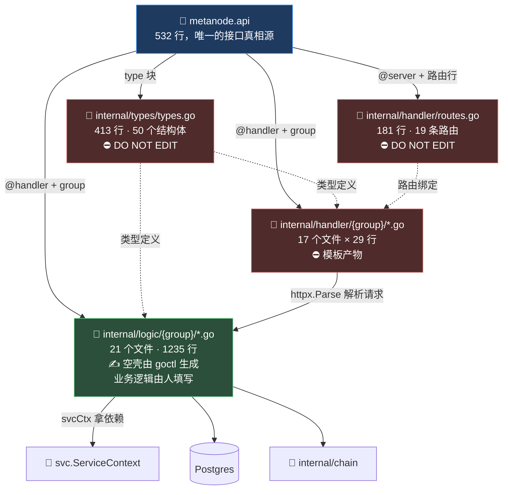
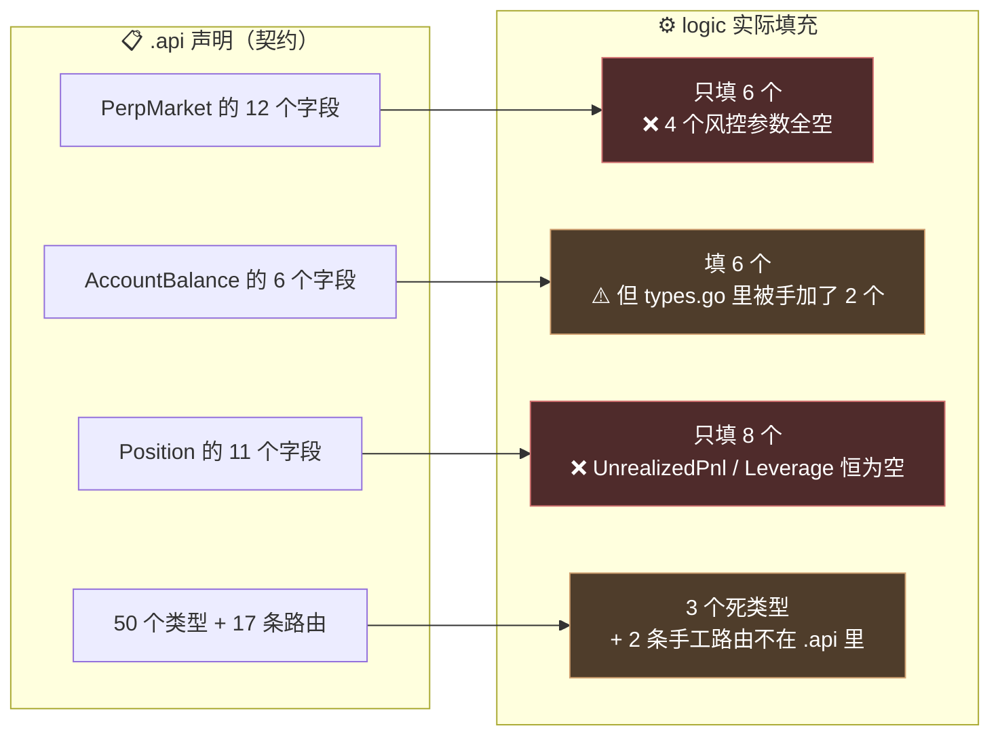
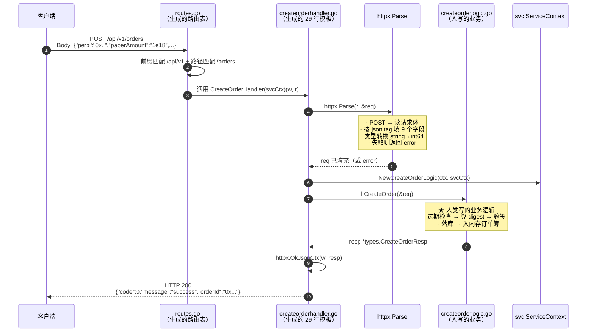

# 第 4 章：go-zero 约定式工程 — metanode.api 如何"生"出 handler、types 与路由

> 第 2 章的代码地图里，我们把 `handler/` 和 `types/` 标成了"⛔ 不用读"。本章要回答的是：**为什么可以不用读，以及"不用读"的前提是什么。**
>
> 答案藏在 `metanode.api` 这个 532 行的文件里。它是全项目**唯一的接口真相源**——每一行 `post /orders (CreateOrderReq) returns (CreateOrderResp)`，都会在三个地方长出对应的代码。理解了这套映射，你就能做到"读 5 行声明，等于读 200 行生成代码"。
>
> 但本章还有第二个、更重要的任务。我在写这一章时对 `.api` 和生成代码做了一次**逐字段的机器比对**，发现了三处偏离——其中一处会让**风控参数完全无法送达前端**，另一处会让**重跑代码生成命令直接编译失败**。这些都是"只看声明不看实现"的人永远发现不了的。**这一章会告诉你：契约文件读起来省事，但它最容易和现实脱节。**

---

## 1. 本章导读

### 1.1 一个声明，四处落地

先看最小的事实。`.api` 文件里这样一行：

```go
@doc "创建订单"
@handler CreateOrder
post /orders (CreateOrderReq) returns (CreateOrderResp)
```

执行 `goctl api go -api metanode.api -dir .` 之后，磁盘上会多出（或更新）四个位置的东西：

```text
① internal/types/types.go                       ← 新增 2 个结构体
     type CreateOrderReq struct { ... }
     type CreateOrderResp struct { ... }

② internal/handler/routes.go                    ← 新增 1 条路由
     {Method: POST, Path: "/orders", Handler: CreateOrderHandler(serverCtx)}

③ internal/handler/order/createorderhandler.go  ← 新建 1 个 29 行文件
     func CreateOrderHandler(svcCtx *svc.ServiceContext) http.HandlerFunc { ... }

④ internal/logic/order/createorderlogic.go      ← 新建 1 个空壳文件
     func (l *CreateOrderLogic) CreateOrder(req *types.CreateOrderReq) (...) {
         // TODO: 在这里实现业务逻辑
     }
```

**这四处里，只有第 ④ 处是给人写的**（另外三处是 `DO NOT EDIT` 或被标记为生成物），**但第 ④ 处 goctl 只给你一个空壳**——它甚至不知道你的业务逻辑长什么样，它只能生成一个函数签名。

**这就是 go-zero "约定式工程"（convention over configuration）的全部内容：**

> 用一份声明描述"**接口长什么样**"，让机器生成所有**结构确定的**代码；
> 人类只负责写机器写不出来的那部分——**业务逻辑**。

### 1.2 为什么这套约定值得学

在 Web3 后端里，这个模式有一个额外的价值：**接口的稳定性比普通后端更重要。**

回忆第 2 章 4.4 讲的 EIP-712 签名域——**链下接口的字段名，是链上签名覆盖的内容的一部分**。如果 `CreateOrderReq` 里的 `paperAmount` 被改名成 `paper_amount`：

| | 普通后端 | 这个项目 |
| --- | --- | --- |
| 后果 | 前端改个字段名，发版 | **前端构造的 EIP-712 结构体对不上，所有用户签名失效** |
| 修复成本 | 改一行 | 前后端同时发版 + 用户重新签名 |

**所以在这个项目里，`.api` 文件不只是"接口文档"，它是链上链下契约的一部分。** 这意味着两件事：

1. **改 `.api` 要格外谨慎**——它不是随手可改的"接口定义文件"；
2. **`goctl` 这把"一键重新生成"的枪，在这个项目里必须小心使用**（第 2 章 6.1 已经看到了后果）。

### 1.3 本章要回答的三个问题

本章不是"goctl 语法教程"（官方文档比我写得好）。我们要回答的是三个**只有读了这个项目的代码才能回答**的问题：

**问题一：`.api` 里的 `type` 和 `@server` 块，各自能表达什么、不能表达什么？**

比如：`.api` 能不能声明"这个接口需要登录"？能不能声明"金额字段必须是数字字符串"？——**答案是不能**，而这个"不能"直接导致了本章 6.3 和 6.4 两个坑。

**问题二：生成代码里有哪些东西是 `.api` 里看不出来的？**

`httpx.Parse` 到底做了什么？`default=20` 是怎么生效的？`path:"orderId"` 和 `form:"orderId"` 有什么区别？——这些行为都藏在生成代码对框架的调用里。

**问题三（最重要）：契约和实现，现在对得上吗？**

这是我在写本章时做的实测。结论是：**`PerpMarket` 声明的 12 个字段里有 6 个永远不会被填充，其中包含全部四个风控参数。**

---

## 2. 架构 / 流程图

### 2.1 `.api` 文件的语法地图

`metanode.api` 一共 532 行，但结构非常规整。它由**五种语法块**拼成：

```text
┌─ syntax = "v1"                    ← 固定声明，声明这是 v1 语法
│
├─ info (...)                        ← 元信息（标题/描述/作者/版本），只影响文档生成
│
├─ type ( TypeName { 字段 } )        ← 【块 1】8 个 type 块，定义 50 个数据结构
│   type (
│       Order { ... }                    · 字段名 Go类型 `tag:"..."` // 注释
│       CreateOrderReq { ... }           · 注释会被保留到生成的 types.go
│   )
│
├─ @server ( prefix / group )        ← 【块 2】7 个 @server 块，声明一组路由的公共属性
│   service metanode {                   · prefix: 统一 URL 前缀
│       @doc "..."                       · group: 决定生成到哪个子目录
│       @handler Name                    · 本项目的 @server 只用了这两个指令
│       post /path (Req) returns (Resp)  ← 【块 3】路由行
│   }
```

**关键认知：`service metanode` 这个名字（metanode）在 7 个块里是完全一样的，它不是"服务名"而是一个语法占位符。** 真正起分组作用的是 `@server` 块里的 `group` 字段。**goctl 允许你把同一个 service 拆成多个 `@server` 块，只是为了能对不同的路由组设置不同的 prefix/group。**

### 2.2 一个声明的完整生命周期

这张图把 2.1 里的语法块和 1.1 里的生成物连起来，是本章的地图：



**读图要点：**

- **红色的三处是"生成物"**，`.api` 一改就会被动重写；
- **绿色的 `logic/` 是唯一的"人写区"**，但它同时依赖 `.api` 生成的两个类型（`Req` / `Resp`）——**这意味着"改了 `.api` 里的字段名，logic 层会编译失败"**，这是一个良性约束（编译器帮你发现不匹配）；
- **注意那条 `handler → logic` 的箭头上写着 `httpx.Parse`**：请求的解析完全发生在 handler 层，logic 收到的是**已经填好、已经带默认值的结构体**。这一点在 3.(10) 会展开。

### 2.3 契约与实现的偏离图（本章的核心发现）

这张图是本章最有价值的部分。它对比"`.api` 里声明了什么"和"logic 里实际填了什么"：



**这不是理论担忧，是实测结果**（具体的验证方法在 3.(12) 和 6.1~6.3 给出）。最严重的一项是 `PerpMarket`——**前端拿到的市场信息里，`initialMarginRatio`（初始保证金率）、`liquidationThreshold`（清算阈值）、`liquidationPriceOff`（清算折扣）、`insuranceFeeRate`（保险费率）全部是空字符串 `""`。**

**在一个永续合约交易界面上，"清算价格"和"保证金率"是用户最需要的两个数字。** 而这个 API 的契约承诺了它们，实现却没有给。

---

## 3. 核心代码拆解

### (1) 文件头部 —— `syntax` 与 `info`

```go
// MetaNode 永续合约交易系统 API 定义
// 使用 goctl api go -api metanode.api -dir . 生成代码
syntax = "v1"

info (
	title:   "MetaNode API"
	desc:    "去中心化永续合约交易系统后端 API"
	author:  "MetaNode Team"
	version: "1.0"
)
```

**作者为什么这么设计（设计思想）：**

**`syntax = "v1"` 是必需的，而且它有一个容易踩的坑。** goctl 的 `.api` 文件语法有 v1 和 v2 两个版本，**功能差异很大**：

| | v1 | v2 |
| --- | --- | --- |
| `@server` 里能否用 `middleware` | ✅ 可以 | ✅ 可以 |
| 能否给单个路由挂中间件 | ❌ | ✅ |
| 能否定义 `import`（拆文件） | ❌ | ✅ |
| 支持 goctl 版本 | 全版本 | 较新版本 |

**本项目用的是 v1**。这个选择解释了 6.4 的一个现象：**整个 `.api` 里没有任何 `middleware` 或 `jwt:` 指令**——虽然 v1 支持它们，但作者没用。

**`info` 块里的四个字段只影响文档生成**（`goctl api doc` 命令会输出 Markdown/HTML 文档），**对代码生成没有任何影响**。所以 `version: "1.0"` 这行**只是一个字符串**，它不会影响任何行为——一个很实际的推论是：**你没法从 `.api` 里看出这个 API 已经改过几版**。

**注意文件头的第二行注释**：

```go
// 使用 goctl api go -api metanode.api -dir . 生成代码
```

**这是一句"隐含危险"的注释。** 它告诉后来的人"用这条命令生成代码"——但正如第 2 章 6.1 所分析的，**在当前状态下执行这条命令会删掉登录功能**。详见 6.1。

### (2) `type` 块 —— 一个数据结构的完整定义

以项目最核心的 `Order` 类型为例：

```go
// 订单信息
Order {
	OrderId      string `json:"orderId"`
	Perp         string `json:"perp"` // 永续合约地址
	Signer       string `json:"signer"` // 签名者地址
	PaperAmount  string `json:"paperAmount"` // 仓位数量
	CreditAmount string `json:"creditAmount"` // 资金数量
	MakerFeeRate string `json:"makerFeeRate"` // Maker 手续费率
	TakerFeeRate string `json:"takerFeeRate"` // Taker 手续费率
	Expiration   int64  `json:"expiration"` // 过期时间
	Nonce        int64  `json:"nonce"` // 随机数
	Signature    string `json:"signature"` // EIP-712 签名
	Status       int    `json:"status"` // 状态: 0-待处理, 1-部分成交, 2-完全成交, 3-已取消
	FilledAmount string `json:"filledAmount"` // 已成交数量
	CreateTime   int64  `json:"createTime"`
	UpdateTime   int64  `json:"updateTime"`
}
```

生成的 Go 代码（`internal/types/types.go`）：

```go
type Order struct {
	OrderId      string `json:"orderId"`
	Perp         string `json:"perp"`          // 永续合约地址
	Signer       string `json:"signer"`        // 签名者地址
	PaperAmount  string `json:"paperAmount"`   // 仓位数量
	CreditAmount string `json:"creditAmount"`  // 资金数量
	MakerFeeRate string `json:"makerFeeRate"`  // Maker 手续费率
	TakerFeeRate string `json:"takerFeeRate"`  // Taker 手续费率
	Expiration   int64  `json:"expiration"`    // 过期时间
	Nonce        int64  `json:"nonce"`         // 随机数
	Signature    string `json:"signature"`     // EIP-712 签名
	Status       int    `json:"status"`        // 状态: 0-待处理, 1-部分成交, 2-完全成交, 3-已取消
	FilledAmount string `json:"filledAmount"`  // 已成交数量
	CreateTime   int64  `json:"createTime"`
	UpdateTime   int64  `json:"updateTime"`
}
```

**作者为什么这么设计（设计思想）：**

**设计点一：这个映射是"逐字节保真"的，连注释都保留。**

`.api` 里的字段名、类型、tag、行尾注释，**全部原样出现在 `types.go` 里**。唯一的变化是加上了 `type` 关键字和 `struct` 关键字。

**这个保真度带来一个实用价值**：你完全可以只看 `.api`，不看 `types.go`。**这也是第 2 章说"types.go 不用读"的根据。**

**设计点二：注意 `Order` 的字段顺序，它和链上的结构体顺序不一致。**

对比链上的 `Types.Order`（Solidity）：

```solidity
struct Order {
    address perp;          // 第 1 个
    address signer;        // 第 2 个
    int128  paperAmount;   // 第 3 个
    int128  creditAmount;  // 第 4 个
    bytes32 info;          // 第 5 个 ← 把费率/过期/nonce 打包在一起
}
```

而 Go 侧的 `Order` 有 **14 个字段**，把链上打包在 `info` 里的东西**拆开了**：

```text
链上 bytes32 info  =  makerFeeRate(8字节) + takerFeeRate(8字节) + expiration(8字节) + nonce(8字节)
Go 侧             =  MakerFeeRate + TakerFeeRate + Expiration + Nonce（4 个独立字段）
```

**为什么要拆？** 因为链上是 **gas 优化的存储格式**（一个 `bytes32` 只占一个存储槽），而链下是**给人查询和展示的格式**（拆开才能建索引、才能单独展示"这笔单的费率是多少"）。

**这个"链上压缩、链下展开"的模式在本项目里反复出现**，第 10 章会专门讲 `info` 字段的位打包规则。**读 `.api` 时你要有这个意识：API 里的字段结构是为"好用"设计的，不要理所当然地以为它等于链上的结构。**

**设计点三：`Order` 类型在 `.api` 里定义得非常完整——但它的 `UpdateTime` 字段永远不会被填充。**

这是个已实测的问题（3.(12) 会展开）：`Order` 声明了 14 个字段，`getorderlogic.go` 只填了其中 13 个，`UpdateTime` 恒为 `0`。

**这不是 `.api` 的错**——`.api` 只是描述了"这个接口返回的订单对象长什么样"，它无法约束"实现必须填满每个字段"。**但正因为 `.api` 检查不了这件事，"契约写了、实现没做"就成了一种很隐蔽的缺陷。**

### (3) tag 三兄弟：`json` / `form` / `path`

这是 `.api` 语法里**最需要理解清楚**的部分。本项目用到了三种 tag，各自对应请求的一个不同位置：

```go
// ① json:"..." —— 从 HTTP 请求体（body）里取，用于 POST
CreateOrderReq {
	Perp         string `json:"perp"`
	PaperAmount  string `json:"paperAmount"`
	// ...
}

// ② form:"..." —— 从 URL query string 里取，用于 GET
GetPositionsReq {
	Trader string `form:"trader"`              // GET /positions?trader=0x...
}

// ③ path:"..." —— 从 URL 路径里取，用于 RESTful 风格的路由
GetOrderReq {
	OrderId string `path:"orderId"`            // GET /orders/:orderId
}
GetMarketReq {
	Address string `path:"address"`            // GET /markets/:address
}
```

**作者为什么这么设计（设计思想）：**

**设计点一：三种 tag 对应三种 HTTP 语义，选错会导致"参数收不到"。**

| tag | 数据来源 | 典型场景 | 如果选错了 |
| --- | --- | --- | --- |
| `json` | 请求体 | POST/PUT，参数多且长 | 用 `form` 接 body → 全部字段为零值 |
| `form` | URL query string | GET，参数少且可读 | 用 `json` 接 query → 全部字段为零值 |
| `path` | URL 路径片段 | RESTful 资源标识 | 用 `form` 接 path → 收不到，且路由不匹配 |

**最容易混的是 `json` 和 `form`。** 而它们的失败方式是**静默的**：`httpx.Parse` 不会因为你用错了 tag 而报错，它只会把字段留成零值（`""`、`0`）。

**这会导致一类很难查的 bug**：接口返回 200，但数据是错的（比如 `trader=""` 导致查了个空地址）。**当你发现某个接口"参数明明是传了的但后端收不到"，第一个要检查的就是 tag 用对了没有。**

**设计点二：`path` tag 和路由声明必须"字段名对得上"。**

注意这个配对关系：

```go
get /orders/:orderId (GetOrderReq) returns (GetOrderResp)
        ↑ 冒号后是 orderId

GetOrderReq {
	OrderId string `path:"orderId"`      // ← 必须是同一个词（大小写不敏感）
}
```

**`:orderId` 和 `path:"orderId"` 里的词必须一致**（go-zero 会做大小写不敏感的匹配，所以 `path:"OrderId"` 也能工作）。如果写成 `path:"order_id"` 而路由是 `:orderId`，就会**收不到值**——同样不报错。

**设计点三：`metanode.api` 里的一个实际观察——`path` 用过两次，但语义不同。**

```text
get /orders/:orderId  →  path:"orderId"   ← 资源 ID（订单哈希）
get /markets/:address →  path:"address"   ← 资源 ID（合约地址）
```

**两处都是"用业务标识符当路径参数"**，这是 RESTful 的标准做法。但注意第 6.7 节会讲的一个重要细节：**`address` 这个参数在实现里是用大小写敏感的字符串比较的**——这是一个真实的 bug。

### (4) `optional` 与 `default` —— 两个选项标记

```go
// 分页请求
PageReq {
	Page     int `form:"page,default=1"`        // 不传时默认 1
	PageSize int `form:"pageSize,default=20"`   // 不传时默认 20
}

// 查询订单列表请求
ListOrdersReq {
	Signer   string `form:"signer"`                          // 必填（没有 optional）
	Perp     string `form:"perp,optional"`                   // 可选，不传则为 ""
	Status   int    `form:"status,optional,default=-1"`      // 可选，默认 -1（表示"全部"）
	Page     int    `form:"page,default=1"`
	PageSize int    `form:"pageSize,default=20"`
}

// 查询成交记录请求
ListTradesReq {
	Trader   string `form:"trader,optional"`
	Perp     string `form:"perp,optional"`
	Page     int    `form:"page,default=1"`
	PageSize int    `form:"pageSize,default=20"`
}
```

**作者为什么这么设计（设计思想）：**

**设计点一：`optional` 和 `default` 是两件不同的事，虽然看起来很像。**

| 标记 | 含义 | 不传时的值 |
| --- | --- | --- |
| （无标记） | **必填** | `httpx.Parse` **报错**，请求被拒 |
| `optional` | 可选的 | 类型的零值（`""` / `0`） |
| `default=X` | 可选的（**`default` 隐含了 `optional`**） | 你指定的 `X` |

**一个很关键的推论**：`default=-1` 这行**同时表达了两个意思**——"这个字段可以不传"和"不传时是 -1"。所以写 `optional,default=-1` 是**冗余的**（`default` 已经隐含了 `optional`），本项目在 `Status` 字段上就是这么写的。

**设计点二：`Status` 的 `default=-1` 是一个"哨兵值"设计。**

```go
Status   int `form:"status,optional,default=-1"` // -1表示全部
```

**为什么要用 -1 而不是 0？** 因为 `0` 在业务上有意义——它是 `OrderStatusPending`（待处理，见 `model/order.go`）：

```go
const (
	OrderStatusPending     = 0 // 待处理
	OrderStatusPartialFill = 1 // 部分成交
	OrderStatusFilled      = 2 // 完全成交
	OrderStatusCancelled   = 3 // 已取消
)
```

**如果默认值是 0，那么"不传 status"和"查待处理的订单"就变成了同一个请求**——用户想查全部订单，结果只看到了待处理的。用 `-1` 这个**业务上不可能出现的值**当哨兵，就能干净地区分这两种意图。

**"哨兵值（sentinel value）"是一个很通用的技巧，但用它要满足一个前提：这个值必须在业务上永远不会出现。** 这里 `-1` 满足（状态码只有 0~3）。如果不满足，就该用指针（`*int`，`nil` 表示未传）或额外的布尔标记。

**设计点三：`ListTradesReq` 的两个 optional 参数暴露了一个业务问题。**

```go
ListTradesReq {
	Trader   string `form:"trader,optional"`   // 为空时返回所有
	Perp     string `form:"perp,optional"`
	// ...
}
```

**两个参数都是可选的，注释说"为空时返回所有"。** 这意味着 `GET /api/v1/trades`（不带任何参数）会返回**全平台所有成交记录**。

**这是一个需要谨慎对待的设计**：在去中心化交易所里，成交记录是**公开数据**（链上本来就人人可查），所以"返回所有"在隐私上没问题。但从**性能**角度，一个不带过滤条件的全表查询 + 分页，在数据量大了之后会成为慢查询。第 19 章会讨论这个接口的取舍。

### (5) `@server` 块 —— 一组路由的公共属性

```go
@server (
	prefix: /api/v1
	group:  order
)
service metanode {
	// ... 四条订单相关的路由 ...
}
```

本项目有 **7 个这样的块**，全部使用相同的 `prefix: /api/v1`，但 `group` 各不相同：

| group | 路由数 | 生成目录 |
| --- | --- | --- |
| `order` | 4 | `handler/order/` + `logic/order/` |
| `trade` | 1 | `handler/trade/` + `logic/trade/` |
| `position` | 2 | `handler/position/` + `logic/position/` |
| `account` | 3 | `handler/account/` + `logic/account/` |
| `market` | 5 | `handler/market/` + `logic/market/` |
| `funding` | 1 | `handler/funding/` + `logic/funding/` |
| `liquidation` | 1 | `handler/liquidation/` + `logic/liquidation/` |
| **合计** | **17** | |

**作者为什么这么设计（设计思想）：**

**设计点一：`group` 是"目录映射"的唯一来源。**

这条映射规则是 goctl 里最重要的约定：

```text
group: order  →  internal/handler/order/     （handler 文件）
              →  internal/logic/order/       （logic 文件）
```

**它的价值在于可预测性**：你看到 `.api` 里有个 `group: market`，立刻就知道去 `internal/logic/market/` 找实现。**这省掉了"这个接口的实现放在哪"这个问题。**

**设计点二：为什么把 `prefix: /api/v1` 在每个块里重复写了 7 遍？**

因为 goctl 的 `prefix` 是 **`@server` 块的属性，不是全局属性**。所以即使 7 个块都用同一个前缀，也必须写 7 遍。

**这带来一个实际的维护风险**：如果将来要把 API 升到 v2，你需要改 7 个地方。**漏改一个，那个分组的路由就还挂在 `/api/v1` 下**——而且不会有任何编译错误，只会在前端调用时 404。

**这是"约定式工程"的一个典型代价：那些本该是全局的配置，被分散到了多个块里。**

**设计点三（重点）：`@server` 能表达什么、不能表达什么。**

这是 1.3 节问题一的答案。本项目用到的 `@server` 指令**只有两个**（`prefix` 和 `group`）。go-zero 的 `.api` 其实还支持这些：

| 指令 | 作用 | 本项目是否使用 |
| --- | --- | --- |
| `prefix:` | URL 前缀 | ✅ 7 处 |
| `group:` | 生成目录 | ✅ 7 处 |
| `middleware:` | 挂中间件（如鉴权、限流） | ❌ **完全没用** |
| `jwt:` | 声明该组路由需要 JWT 鉴权 | ❌ **完全没用** |
| `timeout:` | 请求超时 | ❌ 没用 |
| `maxBytes:` | 请求体大小上限 | ❌ 没用 |
| `signature:` | 请求签名校验 | ❌ 没用 |
| `tag:` | 给生成的路由打标签 | ❌ 没用 |

**这一列的"❌"是本章 6.4 那个坑的根源**：**整个 API 里没有一个路由声明了鉴权要求**——包括 `POST /api/v1/orders`（下单）和 `POST /api/v1/orders/cancel`（撤单）。

**为什么这个项目可以不挂 JWT？** 因为它的安全模型根本不是"登录态"模型：

```text
传统后端：用户登录 → 拿到 token → 每个请求带 token → 服务端校验 token → 知道你是谁
本项目：  每个请求自带 EIP-712 签名 → 服务端验签恢复地址 → 知道你是谁
```

**签名本身就是身份证明**（第 6 章会详细讲这套登录体系，第 7 章讲订单签名）。所以 `.api` 里没有 `jwt:` 是**合理的**——但前提是**每个需要身份的接口都必须验签**。

**而这里有一个致命的缺口**：回想第 1 章和第 3 章反复提到的 `CreateOrder` 里那行：

```go
if l.svcCtx.Chain != nil {
	if err := chain.VerifyEOASignature(dc, order); err != nil { ... }
}
```

**验签被包在了链可用的判断里。** 于是这个体系里唯一的安全边界，在链不可用时会消失——而 `.api` 层面**没有任何机制能兜住它**（因为没有 `jwt:`，也没有 middleware）。

**这就是 1.3 节问题一的完整答案：**

> **`.api` 能声明"这个接口有哪些参数、返回什么"，但它无法声明"这个接口必须做哪些校验"。**
> **参数结构是契约，安全规则不是。**

### (6) 路由声明行 —— 一行里的四个信息

```go
@doc "查询订单"
@handler GetOrder
get /orders/:orderId (GetOrderReq) returns (GetOrderResp)
```

这一行（加上面两行注解）包含四组信息：

| 部分 | 值 | 作用 |
| --- | --- | --- |
| HTTP 方法 | `get` | 生成 `http.MethodGet` |
| 路径 | `/orders/:orderId` | 生成路由路径，`:orderId` 是路径参数 |
| 请求类型 | `(GetOrderReq)` | 生成 handler 里的 `var req types.GetOrderReq` |
| 响应类型 | `returns (GetOrderResp)` | 决定 logic 方法的返回值类型 |

**作者为什么这么设计（设计思想）：**

**设计点一：`/orders` 和 `/orders/:orderId` 的共存是 RESTful 的标准做法。**

```go
get /orders              (ListOrdersReq)  returns (ListOrdersResp)   // 列表
get /orders/:orderId     (GetOrderReq)    returns (GetOrderResp)      // 单个
post /orders             (CreateOrderReq) returns (CreateOrderResp)   // 创建
post /orders/cancel      (CancelOrderReq) returns (CancelOrderResp)   // 取消 ← 注意
```

**前三条是教科书式的 RESTful**（集合 / 单个 / 创建）。但第四条 `POST /orders/cancel` **不是 RESTful**——标准的做法应该是 `DELETE /orders/:orderId` 或 `PATCH /orders/:orderId`。

**为什么这里用了 `POST /orders/cancel`？** 因为**撤单在链上是需要用户签名的动作**，而不是一个简单的"删除"操作：

```go
CancelOrderReq {
	OrderId   string `json:"orderId"`
	Signer    string `json:"signer"`
	Signature string `json:"signature"` // 取消签名
}
```

它需要**三个参数**（订单 ID + 签名者 + 取消签名），而 `DELETE` 方法的语义里通常不鼓励带请求体。**用 POST 承载"带签名的动作"是一种务实的妥协**——这在 Web3 后端里非常常见，因为**很多操作都不是纯幂等的 CRUD，而是需要签名的"指令"**。

**一条可以带走的经验**：**Web3 后端的 API 设计常常偏离标准 REST，因为"写操作需要签名"这个约束改变了动作的性质。** 看到 `POST /xxx/someAction` 这种路径，先想想是不是因为"这个动作需要签名"。

**设计点二：`@doc` 注解会出现在哪里？**

```go
@doc "查询订单"
```

它会变成生成代码里的注释：

```go
// 查询订单
func GetOrderHandler(svcCtx *svc.ServiceContext) http.HandlerFunc { ... }
```

**而这个注释正是第 2 章 6.2 里我用来做字节级比对的那个"唯一差异行"**——17 个 handler 文件除了函数名和第 12 行的这个 `@doc` 注释外完全相同。**这从另一个角度印证了"这些文件是机器生成的"。**

### (7) 生成的 `types.go` —— 三个必须知道的细节

```go
// Code generated by goctl. DO NOT EDIT.
// goctl 1.9.0

package types
```

**细节一：`goctl 1.9.0` 这个版本号是有信息量的。**

它记录了**生成这份代码时用的工具版本**。当你怀疑"生成结果和预期不符"时，第一步就是核对版本——不同版本的 goctl 生成的模板可能有差异（比如第 2 章 6.2 讨论的"handler 文件为什么没有生成标记"，很可能就是版本差异导致的）。

**细节二：`DO NOT EDIT` 是约定，不是强制。**

Go 工具链**不阻止**你修改这个文件，`go build` 也不会报错。这个标记全靠**人和工具自觉**：

- 人类看到它应该停手；
- 一些代码生成工具（和 linter）会识别这个模式并跳过该文件。

**这解释了第 2 章 6.1 那个坑为什么能存在**：因为 `DO NOT EDIT` 只是一句话，作者手改 `types.go` 加 4 个 auth 类型时，**编译器不会拦他**。

**细节三（重要）：`types.go` 里的类型数量比 `.api` 多。**

我用脚本做了逐字段比对，结果是：

```text
.api 声明：      50 个类型
types.go 实际：  53 个类型   ← 多出 4 个 auth 类型，少了 1 个（ListMarketsReq 被误判）

真正的手工新增：
  ✚ AuthNonceReq     （第 389 行）
  ✚ AuthNonceResp    （第 393 行）
  ✚ AuthVerifyReq    （第 400 行）
  ✚ AuthVerifyResp   （第 406 行）
```

**这 4 个类型全部出现在文件末尾**——这是"手工追加"的典型特征。**如果你看到一个生成文件的末尾有一段风格略有不同的代码，那几乎可以肯定是有人手加的。** 第 6.1 节会给出完整的比对方法。

### (8) 生成的 `routes.go` —— 19 条路由 vs 17 条声明

```go
// Code generated by goctl. DO NOT EDIT.
// goctl 1.9.0

func RegisterHandlers(server *rest.Server, serverCtx *svc.ServiceContext) {
	// 第 1 组：auth（⚠️ .api 里没有这一组）
	server.AddRoutes(
		[]rest.Route{
			{Method: http.MethodPost, Path: "/auth/nonce",  Handler: AuthNonceHandler(serverCtx)},
			{Method: http.MethodPost, Path: "/auth/verify", Handler: AuthVerifyHandler(serverCtx)},
		},
		rest.WithPrefix("/api/v1"),
	)

	// 第 2 组：account
	server.AddRoutes(
		[]rest.Route{
			{Method: http.MethodGet, Path: "/balance",   Handler: GetBalanceHandler(serverCtx)},
			{Method: http.MethodGet, Path: "/deposits",  Handler: ListDepositsHandler(serverCtx)},
			{Method: http.MethodGet, Path: "/withdraws", Handler: ListWithdrawsHandler(serverCtx)},
		},
		rest.WithPrefix("/api/v1"),
	)
	// ... 其余 6 组 ...
}
```

**实测数字对比：**

```text
.api 声明的路由：    17 条
routes.go 注册的：   19 条
                     ─────
差 2 条 = /auth/nonce + /auth/verify
```

**这个"17 vs 19"就是第 2 章 6.1 那个坑的量化证据。** 我在这里再强调一次它的后果，因为这一章是从"契约"的角度来看的：

**`.api` 是契约。当契约和实现不一致时，最大的危险不是"实现多了东西"，而是"重新生成会按契约把实现抹掉"。**

```text
契约说：   有 17 条路由
实现说：   有 19 条路由
重新生成 → 按契约重写实现 → 那 2 条手工路由被删除
```

**这是一个"生成器不认识例外"的经典问题。** 任何代码生成系统的健康度都依赖于一条铁律：**产物必须能由源头完整重建。** 一旦有人手工改了产物，这条铁律就断了——而断裂的代价通常在**下一次生成时**才爆发。

### (9) 生成的 handler —— 逐行拆解 `httpx.Parse` 的行为

```go
// 查询订单
func GetOrderHandler(svcCtx *svc.ServiceContext) http.HandlerFunc {
	return func(w http.ResponseWriter, r *http.Request) {
		var req types.GetOrderReq
		if err := httpx.Parse(r, &req); err != nil {
			httpx.ErrorCtx(r.Context(), w, err)
			return
		}

		l := order.NewGetOrderLogic(r.Context(), svcCtx)
		resp, err := l.GetOrder(&req)
		if err != nil {
			httpx.ErrorCtx(r.Context(), w, err)
		} else {
			httpx.OkJsonCtx(r.Context(), w, resp)
		}
	}
}
```

**作者为什么这么设计（设计思想）：**

**这是 17 个 handler 的模板，全部 493 行都长这样。** 但其中只有一行是"有内容"的——`httpx.Parse(r, &req)`。**理解这一行，就理解了这一层存在的全部理由。**

`httpx.Parse` 做的事，按顺序：

```text
1. 判断请求方法
   · GET / DELETE 等 → 从 URL 的 query string 解析
   · POST / PUT 等   → 从请求体解析（默认按 JSON）

2. 按 tag 填字段
   · `path:"xxx"`  → 从路由匹配出的路径参数里取
   · `form:"xxx"`  → 从 URL query string 里取
   · `json:"xxx"`  → 从请求体 JSON 里取

3. 处理选项
   · `default=X`   → 字段缺失时填 X
   · `optional`    → 允许缺失（否则报错）
   · `range=`      → 数值范围校验
   · `options=`    → 枚举校验

4. 类型转换
   · 字符串 → int / int64 / bool / float
   · 转换失败 → 返回错误 → handler 走 httpx.ErrorCtx → HTTP 400
```

**这里有三个值得记住的行为：**

**行为一：`GET` 请求的 `json` tag 是无效的。**

因为 GET 不解析请求体。所以 `GetPositionsReq` 用的是 `form:"trader"` 而不是 `json:"trader"`——**如果用错了，字段会是零值，且不报错。**

**行为二：`default` 只在"字段完全缺失"时生效，传空值时不会。**

```text
GET /orders                          → Page = 1（默认值生效）
GET /orders?page=                     → Page = 1（空字符串转 int 失败 → 走默认？取决于版本）
GET /orders?page=0                    → Page = 0（显式传 0，默认值不生效）
```

**最后一条很重要**：`?page=0` 会得到 `Page = 0`，然后传给数据库的 `LIMIT/OFFSET` 计算。**如果 logic 层没有对 `page <= 0` 做防护，就可能生成非法的 SQL。** 这是 6.3 节"没有 validate 标签"带来的具体风险之一。

**行为三：`httpx.Parse` 是 handler 层唯一的"实质逻辑"。**

正因为解析集中在这一行，**这一层才值得存在**（第 2 章思考题 2 讨论过）。如果把解析分散到 21 个 logic 里，就没法统一处理"`?page=0` 怎么办"这类问题了。

### (10) 生成的 logic 桩 —— 人写区的起点

goctl 对**新路由**生成的 logic 长这样：

```go
package order

import (
	"context"

	"metanode/internal/svc"
	"metanode/internal/types"

	"github.com/zeromicro/go-zero/core/logx"
)

type GetOrderLogic struct {
	logx.Logger
	ctx    context.Context
	svcCtx *svc.ServiceContext
}

func NewGetOrderLogic(ctx context.Context, svcCtx *svc.ServiceContext) *GetOrderLogic {
	return &GetOrderLogic{
		Logger: logx.WithContext(ctx),
		ctx:    ctx,
		svcCtx: svcCtx,
	}
}

func (l *GetOrderLogic) GetOrder(req *types.GetOrderReq) (resp *types.GetOrderResp, err error) {
	// todo: add your logic here and delete this line

	return
}
```

**作者为什么这么设计（设计思想）：**

**设计点一：`// todo: add your logic here and delete this line` 是 goctl 的"待办标记"。**

它是一个**幂等生成的保护机制**：**如果你重新运行 `goctl api go`，goctl 会发现这个文件里还有这行 `todo` 注释，于是认为"这个 logic 还没实现"，从而跳过覆盖它。**

**而一旦你删掉了这行注释（也就是写了真实实现），goctl 就会认为"这个文件已经被人工编辑过"——它仍然会跳过覆盖。** 也就是说，**goctl 对已存在的 logic 文件永远是"不覆盖"的**，这个 `todo` 标记只是给你自己看的提示。

**这一点非常重要，因为它解释了为什么第 2 章那个"重跑 goctl 会删掉 auth"的问题不会波及 `logic/auth/`**：

```text
goctl api go 的行为：
  routes.go      → 完全重写（按 .api）        ← 会丢手工加的路由
  types.go       → 完全重写（按 .api）        ← 会丢手工加的类型
  handler/*.go   → 已存在则不覆盖
  logic/*.go     → 已存在则不覆盖
```

**所以危险的是那两个"完全重写"的文件**——它们恰好是手工改过的两个。**这是巧合吗？不是。** 因为 `.api` 生成的一切都指向这两个文件，而所有人都知道"handler 和 logic 我要自己改"，却很少有人意识到"types.go 和 routes.go 其实也会被全量重写"。

**设计点二：`return` 空返回是合法的。**

注意最后的 `return`——它返回的是零值（`resp = nil`, `err = nil`）。这意味着**一个刚生成、还没实现的接口，会返回 200 和一个 `null` 响应体**。

**这又是一个"静默失效"**：前端调用 `/api/v1/something` 得到 `{"code":0,"message":"","xxx":null}` ——看起来像成功，其实是没实现。**好在这是开发期的临时状态**，但它提醒我们：**"接口能返回 200" 和 "接口实现了" 是两件事**（第 3 章 1.2 讨论过同一个主题）。

**设计点三（⚠️ 本节已修正）：21 个 logic 文件里，有 5 个从未被实现。**

我最初在这一节写的是"21 个 logic 文件全部有真实实现"，**这是错的**。实际统计：

```bash
$ grep -rln "todo: add your logic here" --include="*.go" internal/logic/
internal/logic/account/listwithdrawslogic.go        ← 取款记录
internal/logic/funding/listfundingrateslogic.go     ← 资金费率历史
internal/logic/liquidation/listliquidationslogic.go ← 清算记录
internal/logic/market/getklineslogic.go             ← K线
internal/logic/order/cancelorderlogic.go            ← ★ 撤单

$ # 5 / 21
```

**其中 `cancelorderlogic.go`（撤单）是最要紧的一个**——它是交易系统的核心功能之一，却还停留在 goctl 生成的空壳状态：

```go
func (l *CancelOrderLogic) CancelOrder(req *types.CancelOrderReq) (resp *types.CancelOrderResp, err error) {
	// todo: add your logic here and delete this line

	return
}
```

**这 5 个接口目前的实际行为是：返回 HTTP 200，响应体是字面量 `null`。**

推导过程：`return` 空返回时 `resp` 是 `(*types.CancelOrderResp)(nil)`、`err` 是 `nil`，于是 handler 走 `httpx.OkJsonCtx(w, resp)` 分支，而 `json.Marshal` 一个 nil 指针得到的正是 `null`：

```bash
$ curl -s -X POST http://localhost:28888/api/v1/orders/cancel -d '{"orderId":"0x..."}'
null        # ← 用户以为"撤单接口出问题了"，实际上这个接口根本没写
```

**这是一个比"返回错误"更糟的失败形态**：错误码至少能告诉调用方"我没做成"，而 `null` 会让前端崩溃在解析阶段（`resp.code` 读的是 `undefined` 的属性）。

**这个发现修正了本节的结论**：handler 层确实是 100% 模板产物，**但 logic 层并不是 100% 有实现**。完整的图景是：

```text
handler 层：  17 个文件  100% 模板产物（0 行人工）
logic  层：   21 个文件   16 个有真实实现 / 5 个仍是空壳
```

**⚠️ 这个信息有一个重要的下游影响**：这 5 个未实现的接口，恰好解释了第 5 章发现的"6 个 Model 死字段"现象——**字段被构造出来，是因为接口设计时预期会用到它们；字段没人用，是因为那些接口从未被实现。** 详见第 5 章 3.(10)。

### (11) 从 `.api` 到 HTTP 响应的完整链路

把前面所有片段串起来，这是**一次 `/api/v1/orders` 请求的完整数据流**：



**这张图里最值得注意的一点是**：从 `routes.go` 到 `httpx.Parse` 的这四步**完全不包含任何业务判断**——它们只是"把 HTTP 请求翻译成 Go 结构体"。**所有业务判断都集中在第 7 步那一个函数调用里。**

**这个清晰的分界线，就是"约定式工程"的最终产出**：机器负责翻译，人负责判断。

### (12) 契约 vs 实现：一次逐字段的机器比对

这是本章最重要的实测。我用脚本把 `.api` 声明的每个类型、每个字段，和 `types.go` 以及 `logic/` 里的实际填充做了比对。

**验证方法（你可以自己复现）：**

```bash
# ① 类型级比对：.api 声明的类型 vs types.go 里实际存在的类型
# ② 字段级比对：同名字段的差集
# ③ 填充级比对：在 logic/ 目录里 grep 每个字段是否被赋值
grep -rwn "UnrealizedPnl" --include="*.go" internal/ | grep -v types.go
```

**结果一：`types.go` 比 `.api` 多出 6 个字段/类型（手工新增）。**

```text
【新增类型】AuthNonceReq / AuthNonceResp / AuthVerifyReq / AuthVerifyResp
             ← 4 个，见第 6.1 节

【新增字段】AccountBalance.OnChainPrimaryCredit
           AccountBalance.LedgerPrimaryBalance
             ← 2 个，见第 6.2 节
```

**结果二（更严重）：`PerpMarket` 声明的 12 个字段里，有 6 个永远不会被填充。**

```text
PerpMarket 的 12 个字段，logic 里实际赋值的只有 6 个：

✅ Address                ← listmarketslogic.go:34
✅ Name                   ← 同上
✅ IsRegistered           ← 同上（硬编码 true）
✅ MarkPrice              ← 链上读
✅ IndexPrice             ← 链上读 / Coinbase
✅ FundingRate            ← 链上读

❌ InitialMarginRatio     ← 恒为空字符串 ""
❌ LiquidationThreshold   ← 恒为空字符串 ""
❌ LiquidationPriceOff    ← 恒为空字符串 ""
❌ InsuranceFeeRate       ← 恒为空字符串 ""
❌ OpenInterest           ← 恒为空字符串 ""
❌ Volume24h              ← 恒为空字符串 ""
```

**前四个"❌"是风控参数**——它们决定了用户能开多少倍杠杆、什么时候会被清算、清算时被扣多少钱。**这些恰恰是永续合约前端最需要的数字。**

**而且它们不是"没实现"，而是"数据源就在手边却没用"**：`PerpMarket` 的这几个字段在数据库模型里是存在的——

```go
// internal/model/models.go:274
type Market struct {
	Address              string    `db:"address"`
	Name                 string    `db:"name"`
	InitialMarginRatio   string    `db:"initial_margin_ratio"`
	LiquidationThreshold string    `db:"liquidation_threshold"`
	LiquidationPriceOff  string    `db:"liquidation_price_off"`
	InsuranceFeeRate     string    `db:"insurance_fee_rate"`
	IsRegistered         bool      `db:"is_registered"`
	// ...
}
```

**`MarketModel.FindAll()` 已经能从 `markets` 表里读出来，只是 `ListMarkets` 没有去调它**——它选择了从 `svcCtx.Config.Markets`（配置文件）构造响应，而配置文件里只有 `Address` / `Name` / `PriceSource` / `CoinbaseProduct` 四个字段。

**这就是"契约与实现偏离"最典型的成因：契约按理想设计，实现在压力下抄了近路，而两者之间没有任何机制来发现这个差距。**

**结果三：`Position` 和 `Order` 各有一个字段永远为空。**

```text
Position.UnrealizedPnl   ← 从未被赋值（types.go 之外零引用）
Position.Leverage        ← 从未被赋值
Order.UpdateTime         ← 从未被赋值
```

`UnrealizedPnl`（未实现盈亏）和 `Leverage`（杠杆倍数）**都是交易界面上非常重要的数字**。它们被声明在契约里，但恒为 `""`。

**注意这产生的一个具体后果**：前端拿到的是 `"unrealizedPnl": ""` 而不是 `null` 或 `0`。如果前端做 `parseFloat("")` 会得到 `NaN`；如果直接显示，界面上会出现一个空白格。**这种"空字符串代替数字"的响应，比字段缺失更容易让前端出错——因为它通过了"字段存在"的检查。**

---

## 4. Web3 特有机制

### 4.1 API 契约里的 EIP-712 字段：为什么必须逐字段对齐链上结构

这是本章最需要理解的一条 Web3 特有约束。

看 `CreateOrderReq` 的字段：

```go
CreateOrderReq {
	Perp         string `json:"perp"`          // 合约地址
	Signer       string `json:"signer"`        // 签名者地址
	PaperAmount  string `json:"paperAmount"`   // 仓位数量（带符号）
	CreditAmount string `json:"creditAmount"`  // 资金数量（带符号）
	MakerFeeRate string `json:"makerFeeRate"`
	TakerFeeRate string `json:"takerFeeRate"`
	Expiration   int64  `json:"expiration"`
	Nonce        int64  `json:"nonce"`
	Signature    string `json:"signature"`     // EIP-712 签名
}
```

**前 8 个字段（除 `Signature` 外）不是随便设计的——它们和链上 `Types.Order` 的结构体定义是严格对应的：**

```solidity
// src/libraries/Types.sol
struct Order {
    address perp;
    address signer;
    int128  paperAmount;
    int128  creditAmount;
    bytes32 info;          // ← 打包了 makerFeeRate / takerFeeRate / expiration / nonce
}
```

**映射关系：**

| Go 字段 | 链上位置 | 类型差异 |
| --- | --- | --- |
| `Perp` | `order.perp` | `string` ↔ `address` |
| `Signer` | `order.signer` | `string` ↔ `address` |
| `PaperAmount` | `order.paperAmount` | `string` ↔ `int128`（**链下用 string 承载任意精度**） |
| `CreditAmount` | `order.creditAmount` | `string` ↔ `int128` |
| `MakerFeeRate` | `info` 的第 1 个 8 字节 | `string` ↔ `int64` 打包 |
| `TakerFeeRate` | `info` 的第 2 个 8 字节 | 同上 |
| `Expiration` | `info` 的第 3 个 8 字节 | `int64` ↔ `uint64` 打包 |
| `Nonce` | `info` 的第 4 个 8 字节 | `int64` ↔ `uint64` 打包 |

**为什么这个对齐是"生死攸关"的？**

因为 EIP-712 的签名是**对结构体的哈希**。用户在前端签名时，用的是**前端的字段名和顺序**；后端验签时，用的是**后端复算的哈希**。**两边的类型哈希必须逐字节相同。**

```text
前端（ethers.js / viem）：
  types = { Order: [
    { name: "perp",         type: "address" },
    { name: "signer",       type: "address" },
    { name: "paperAmount",  type: "int128"  },
    { name: "creditAmount", type: "int128"  },
    { name: "info",         type: "bytes32" },
  ]}

后端（internal/chain/tradedata.go）：
  {Name: "perp",         Type: "address"},
  {Name: "signer",       Type: "address"},
  {Name: "paperAmount",  Type: "int128"},     ← 必须完全一致
  {Name: "creditAmount", Type: "int128"},
  {Name: "info",         Type: "bytes32"},
```

**任何一处不一致，签名都会验证失败**——而且失败信息是"signer mismatch"，不会告诉你"是哪个字段的类型写错了"。

**这就是为什么本书反复强调"链下必须精确重现链上"**。API 契约在这里不只是"接口文档"，它是**密码学协议的一部分**。第 7 章会完整追踪这条验签链路。

### 4.2 为什么金额字段全部是 `string`

第 2 章 4.1 已经详细讲过原因（JS 安全整数上限 2⁵³ - 1，而 1e18 比它大 1000 倍）。这里从 **API 契约设计** 的角度补充三个观察：

**观察一：`.api` 文件里的类型是 `string`，但字段注释写的是"数量/金额"。**

```go
PaperAmount  string `json:"paperAmount"` // 仓位数量
CreditAmount string `json:"creditAmount"` // 资金数量
```

**契约里没有任何地方记录"这个字符串表示的精度是多少"。** 前端怎么知道 `"1000000000000000000"` 是 1 个 BTC 还是 1e-10 个 BTC？

**答案只能从别处获得**：从链上的 `decimalMul` 约定（1e18）、从 `creditAmount` 用 USDC 精度（1e6）。**这是一个没有被契约承载的隐式约定**——第 2 章 4.3 讨论过，这里要强调的是：**它是 API 设计上的一处信息缺失。**

**改进的做法**是在 `.api` 里用注释明确写出来：

```go
PaperAmount  string `json:"paperAmount"` // 仓位数量，1e18 精度，正数=做多
CreditAmount string `json:"creditAmount"` // 资金数量，1e6 精度（USDC），与 paper 异号
```

**成本为零，收益是每个接口调用方都不会误解。**

**观察二：`string` 类型让 `default` 值失效。**

```go
// 对于 int 类型，default 是有意义的
Limit int `form:"limit,default=100"`     // 不传 → 100

// 对于 string 类型金额，default 只能是 "" 或某个字符串常量
// 而 "" 不是一个合法的数字
```

**所以金额字段都不能有 `default`**——它们的"缺省"必须是"请求非法"，而不是"用某个默认值"。这正是 6.3 节要讲的"缺少 validate 校验"的问题所在。

**观察三：`int64` 用于时间戳和 nonce 是安全的。**

```go
Expiration int64 `json:"expiration"`  // 秒级时间戳，约 1.7e9，远小于 2^53
Nonce      int64 `json:"nonce"`       // 由前端维护，量级很小
```

**这两个字段用 `int64` 不会丢精度**（它们在 JS 的安全范围内）。**这是一个好的设计判断**：只对"超出 JS 安全范围"的字段用 `string`，其他用原生数字类型，让 API 更好用。

### 4.3 地址参数的大小写陷阱

这是本章实测发现的**一处真实 bug**。

看 `GetMarket` 的实现：

```go
// internal/logic/market/getmarketlogic.go:32
func (l *GetMarketLogic) GetMarket(req *types.GetMarketReq) (resp *types.GetMarketResp, err error) {
	var found types.PerpMarket
	for _, m := range l.svcCtx.Config.Markets {
		if m.Address == req.Address {          // ← ★ 字符串直接比较
			// ...
		}
	}
	return &types.GetMarketResp{Code: 404, Message: "market not found"}, nil
}
```

而配置里的地址是 **EIP-55 校验和格式**（大小写混合）：

```yaml
Markets:
  - Address: "0x11Aae1f92Ff10bfbb205971e060CF6d9D917723b"   # 注意中间的大写字母
```

**后果：**

```text
GET /api/v1/markets/0x11Aae1f92Ff10bfbb205971e060CF6d9D917723b   → 200，返回市场信息 ✅
GET /api/v1/markets/0x11aae1f92ff10bfbb205971e060cf6d9d917723b   → 404，市场不存在 ❌
```

**这两个是同一个链上地址**（以太坊地址是大小写不敏感的），但用字符串比较就会得到不同结果。

**对比项目里其他地方的做法**：

```go
// getpositionslogic.go:55 —— 用了 common.Address 比较（正确）
if common.HexToAddress(m.Address) == perp { ... }
```

`common.Address` 是 `[20]byte` 的数组类型，**比较的是字节，不是字符串**——所以它天然大小写不敏感。

**为什么这个 bug 特别值得注意？**

因为**前端的地址通常是小写的**。`ethers.js` 的 `address.toLowerCase()` 是最常见的输出格式，浏览器钱包、区块浏览器、"复制地址"按钮给的也大多是小写。**所以这个接口在前端真实使用时会大概率直接失效**——而症状是"市场详情页打不开，提示 404"，排查起来要绕到"是不是路由配错了"。

**顺带一提，前面第 2 章 4.2 讲的 `config/markets.go` 里的 `sameAddr` 函数**（手写的大小写不敏感比较）说明**作者知道地址有大小写问题**——他在启动自检里处理了，却在业务逻辑里漏了。**这正是"同一个知识在不同地方应用不一致"的典型表现。**

### 4.4 `.api` 无法表达的约束：零 `validate` 标签

实测结果：**整个 `metanode.api` 里，`validate:` 标签出现 0 次。**

```bash
$ grep -c "validate:" metanode.api
0
```

**go-zero 的 `httpx.Parse` 其实支持一组校验标签**，语法是：

```go
// 如果这样写，Parse 会自动校验
CreateOrderReq {
	Perp         string `json:"perp" validate:"required,ethaddr"`      // 必填且是合法地址
	PaperAmount  string `json:"paperAmount" validate:"required,number"` // 必填且是数字
	Expiration   int64  `json:"expiration" validate:"gt=0"`            // 必须大于 0
	Signature    string `json:"signature" validate:"required,len=132"` // 必填且长度 132（0x + 130 hex）
}

GetKlinesReq {
	Limit int `form:"limit,default=100" validate:"lte=1000"`   // 上限 1000
}
```

**本项目一个都没用。**

**这意味着什么？** 我们看一下 `CreateOrder` 现在的实现：

```go
func (l *CreateOrderLogic) CreateOrder(req *types.CreateOrderReq) (resp *types.CreateOrderResp, err error) {
	if req.Expiration <= time.Now().Unix() {          // ← 唯一的前置校验
		return &types.CreateOrderResp{Code: 400, Message: "Order expired"}, nil
	}

	order := &model.Order{
		Perp:         req.Perp,          // ← 没有校验是不是合法地址
		Signer:       req.Signer,        // ← 没有校验
		PaperAmount:  req.PaperAmount,   // ← 没有校验是不是数字
		CreditAmount: req.CreditAmount,  // ← 没有校验
		MakerFeeRate: req.MakerFeeRate,  // ← 没有校验范围
		TakerFeeRate: req.TakerFeeRate,
		Expiration:   req.Expiration,
		Nonce:        req.Nonce,
		Signature:    req.Signature,
		// ...
	}
	// ...
}
```

**接下来发生的是：**

```go
h, err := chain.OrderDigestWith(dc, order)     // 这里会解析 PaperAmount 等字符串
if err != nil {
	return &types.CreateOrderResp{Code: 400, Message: "Invalid order fields: " + err.Error()}, nil
}
```

**`OrderDigestWith` 内部确实会做字符串到 `big.Int` 的解析并报错**（`ParseIntString`），所以**非法数字最终会被挡住**——但这是"在业务逻辑深处挡住的"，而不是"在入口处挡住的"。

**这两种做法的差别在于：**

| | 入口校验（validate tag） | 深层校验（业务逻辑里） |
| --- | --- | --- |
| 错误信息 | 框架统一生成，说清哪个字段、什么规则 | 自己写，本项目写的是 `Invalid order fields: ...` |
| 代码位置 | 声明式，一眼可见 | 分散在各层，要追着读 |
| 能否防住"深度攻击" | ❌（只防格式） | ✅（能防业务规则） |
| 消耗 | 0 成本（一行 tag） | 需要写代码 |

**它们不是互相替代的，而是分层的。** 本项目**只做了深层校验、完全没做入口校验**，后果是：

1. **非法请求会走到业务逻辑深处才被拒绝**——多做了一堆无用功（比如尝试连接数据库）；
2. **没有长度限制**——一个 10 MB 的 `signature` 字段会被完整读进内存、存进数据库；
3. **没有数值范围限制**——`GetKlinesReq.Limit` 可以传 `999999999`，直接落到 SQL 的 `LIMIT` 上。

**改进建议（按优先级）：**

```go
// 高优先级：给最关键的下单接口加最小校验
CreateOrderReq {
	Perp         string `json:"perp" validate:"required,ethaddr"`
	Signer       string `json:"signer" validate:"required,ethaddr"`
	PaperAmount  string `json:"paperAmount" validate:"required"`
	CreditAmount string `json:"creditAmount" validate:"required"`
	Expiration   int64  `json:"expiration" validate:"gt=0"`
	Signature    string `json:"signature" validate:"required"`
}

// 中优先级：给分页参数加上限，防止 `?pageSize=999999` 拖垮数据库
ListOrdersReq {
	PageSize int `form:"pageSize,default=20" validate:"lte=200"`
}
```

### 4.5 API 契约里的一处"隐性 Web3 语义"：`Trade` 的费用字段

`Trade` 类型里有两个字段值得单独看：

```go
Trade {
	// ...
	TakerFee     string `json:"takerFee"`
	MakerFee     string `json:"makerFee"`
	// ...
}
```

**它们在 `listtradeslogic.go:124-125` 被正确填充**（我实测验证过）：

```go
TakerFee:     r.TakerFee,
MakerFee:     r.MakerFee,
```

**但注意一个 Web3 特有的细节**：回顾第 1 章 3.(5) 讲的 `Trading._matchOrders`：

```solidity
// Maker 手续费
int256 fee = SafeCast.toInt256(creditChange.abs()).decimalMul(_info2MakerFeeRate(orderList[i].info));
emit OrderFilled(orderHashList[i], orderList[i].signer, msg.sender, paperChange, creditChange - fee, serialNum, fee);

// Taker 的变化与 Maker 相反（不扣 Maker 手续费）
result.creditChangeList[0] -= creditChange;
// 手续费归撮合引擎
result.orderSenderFee += fee;
```

**链上的手续费是"从 creditChange 里扣掉"的**，也就是说：

```text
maker 的实际 creditChange = creditChange - fee
taker 的实际 creditChange = -creditChange        （不扣费）
撮合引擎（orderSender）收到的   = fee
```

**那么 `Trade.TakerFee` 这个字段是从哪来的？** 它是撮合引擎在 `Model.Trade` 里记录的（`engine/matchengine.go` 的 `Insert`）。**但链上的 `TakerFee` 实际上并没有从 taker 的 credit 里扣**——它是记在 `creditChangeList` 之外的。

**这是一个需要小心核对的语义**：链下记录的 `TakerFee` 和链上真正扣掉的费用**可能不是同一个东西**。第 10 章（费率打包）和第 19 章（成交查询）会回到这个问题。

**这里要说明的是 API 契约层面的含义**：**`Trade.TakerFee` 这个字段名会让 API 的使用者以为"这是用户实际支付的费用"**，但如果链下记录的口径和链上不同，前端据此计算的"我实际赚了多少"就会不准。

**这是 Web3 API 设计里一个很典型的陷阱：字段名看起来是通用的金融术语，但它的实际口径取决于链上合约的实现细节。** 契约文档里应该明确写出这个口径。

---

## 5. 本章小结与思考题

### 5.1 核心知识点回顾

| 知识点 | 一句话总结 |
| --- | --- |
| **约定式工程的核心** | 一份 `.api` 声明 → 四处产物（types / routes / handler / logic 空壳），人是唯一写逻辑的 |
| **`.api` 的五种语法块** | `syntax` / `info` / `type` / `@server` / `service{路由行}` |
| **`group` 是目录映射的唯一来源** | `group: order` → `handler/order/` + `logic/order/` |
| **tag 三兄弟** | `json`（请求体）/ `form`（query string）/ `path`（路径），用错了**静默失效**不报错 |
| **`optional` vs `default`** | `default` 隐含 `optional`；`default` 只在字段完全缺失时生效，传 `0` 不会走默认 |
| **哨兵值技巧** | `Status` 的 `default=-1` 是为了和业务值 `0`（待处理）区分开 |
| **`httpx.Parse` 的行为** | 方法分派 → 按 tag 填字段 → 处理 default/optional → 类型转换；**全部集中在 handler 层** |
| **`DO NOT EDIT` 是约定不是强制** | 编译器不拦你手改；`goctl` 会**全量重写** `types.go` 和 `routes.go` |
| **`todo:` 注释的作用** | goctl 用它判断"logic 是否已实现"；但已存在的 logic 文件本来就不会被覆盖 |
| **`.api` 表达能力的边界** | 能声明参数结构，**不能声明安全规则**（鉴权、验签、业务校验） |
| **🔴 契约漂移实测** | `types.go` 手加了 4 个 auth 类型 + 2 个 `AccountBalance` 字段；`routes.go` 有 19 条路由而 `.api` 只有 17 条 |
| **🔴 契约未兑现实测** | `PerpMarket` 12 个字段只填 6 个，**4 个风控参数恒为空**；`Position.UnrealizedPnl` / `Leverage` 恒为空 |
| **🟠 零 validate 标签** | 整个 `.api` 没有任何入口校验，非法请求会走到业务逻辑深处才被拒 |
| **🟠 地址大小写 bug** | `getmarketlogic.go:32` 用字符串比较地址（大小写敏感），而其他地方都用 `common.Address` |
| **Web3 特有契约约束** | `CreateOrderReq` 的字段必须与链上 `Types.Order` 逐字段对齐（EIP-712 类型哈希） |

### 5.2 思考题

#### 思考题 1：`metanode.api` 里定义的 `Order` 类型（14 个字段），和链上 `Types.Order`（5 个字段）**长得完全不一样**——链上把费率、过期时间、nonce 压进了一个 `bytes32 info`，而 API 把它们拆成了 4 个独立字段。既然两边必须"逐字段对齐"才能验签，为什么 API 不直接照抄链上的结构（用一个 `Info string` 表示 `bytes32`）？

<details>
<summary>点击查看参考答案</summary>

这道题考察的是**你是否理解"数据表示"和"数据语义"的区别**。

**先明确一件事：真正需要"逐字段对齐"的，不是这个 API 类型，而是另一个类型。**

```text
internal/types.Order              ← API 的响应类型（给人看的）
internal/chain.SolidityOrder      ← 用于编码 tradeData（给合约看的）★ 这个才是必须对齐的
```

看 `internal/chain/tradedata.go`：

```go
// SolidityOrder 对应 Solidity Types.Order，用于与链上 abi.encode 一致。
type SolidityOrder struct {
	Perp         common.Address
	Signer       common.Address
	PaperAmount  *big.Int
	CreditAmount *big.Int
	Info         [32]byte        // ← 这里才是一个 bytes32
}
```

**`SolidityOrder` 才需要和链上严格对齐**，它用的是 `Info [32]byte`。而 `types.Order` 是**API 响应类型**，它和链上的对齐只发生在**一个特定的转换点**——`chain.OrderFromModel()`：

```go
func OrderFromModel(o *model.Order) (SolidityOrder, error) {
	// ...
	mf, _ := ParseFeeInt64(o.MakerFeeRate)
	tf, _ := ParseFeeInt64(o.TakerFeeRate)
	info := PackOrderInfo(mf, tf, uint64(o.Expiration), uint64(o.Nonce))   // ★ 在这里打包
	return SolidityOrder{
		Perp: perp, Signer: signer,
		PaperAmount: paper, CreditAmount: credit,
		Info: info,
	}, nil
}
```

**所以真正的问题是：为什么在 API 层要拆开，而不是在最后一步才拆？**

**理由一：API 的消费者不是合约，是人。**

合约需要 `bytes32` 是因为**gas 优化**——`info` 打包成一个存储槽。但 API 的消费者是：

- 前端开发（要显示"这笔单的 maker 费率是多少"）
- 数据分析（要统计"平均费率分布"）
- 风控系统（要筛"过期时间在 X 之后的单"）

**如果 API 只给一个 `info: "0x0000..."`，所有这些用途都要自己写解包逻辑**——而且前端必须知道打包规则才能解，这就把"链上实现细节"泄露给了每一个 API 消费者。

**理由二：拆开后可以做数据库索引和查询。**

看 `orders` 表的实际列：

```sql
CREATE TABLE orders (
    order_id text, perp text, signer text,
    paper_amount text, credit_amount text,
    maker_fee_rate text,    -- ← 独立列
    taker_fee_rate text,    -- ← 独立列
    expiration bigint,      -- ← 独立列，可建索引
    nonce bigint,           -- ← 独立列
    signature text, ...
)
```

**`expiration` 是独立列，意味着可以 `WHERE expiration > now()` 这样查询**（第 9 章会讲到撮合引擎剪枝过期订单）。如果压缩成一个 `info` 字符串，**它就变成了一个不透明的 blob，任何基于过期时间的查询都要全表扫描 + 应用层过滤。**

**理由三：`info` 的打包规则是"链上实现细节"，不应该泄漏到 API 契约里。**

想一想：如果 `Dealer` 合约升级，把 `info` 的位布局改了（比如把 nonce 从 8 字节扩到 16 字节），会发生什么？

```text
如果 API 用 Info string：
  → API 契约暴露了链上的位布局
  → 合约升级 → API 契约必须跟着改 → 前端全部要改 → 连锁反应

如果 API 用 4 个独立字段：
  → 位布局的改变被封装在 OrderFromModel / PackOrderInfo 里
  → 只需要改这一个函数，API 契约纹丝不动
  → 前端完全无感知
```

**这就是"封装"的价值：把易变的实现细节挡在契约之外。**

**🎯 本题的核心结论：**

> **"必须与链上对齐"的约束，只应该施加在真正与链交互的那一层边界上（`internal/chain`），而不应该扩散到整个系统的数据模型里。**
>
> 这是一个通用的架构原则：**链上格式是"外部协议"，链下格式是"内部模型"，两者应该在一个明确的边界处转换。** 本项目做得基本对——转换点是 `chain.OrderFromModel()`，只有这一个地方懂 `info` 的位布局。
>
> **反过来说，这也解释了为什么 `createorderlogic.go` 里要重新算一遍 digest**：因为验签必须用链上的格式（`SolidityOrder`），所以业务层拿到的 `types.CreateOrderReq` 需要被"翻译"一次。**这次翻译就是上述边界的实际体现。**

**（补充：如果 API 真的只返回一个 `info: "0x..."`，还有一个隐性代价——前端必须自己实现位运算解包，而位运算的字节序、符号位处理是最容易写错的地方。把这种容易出错的逻辑放在每个前端里各写一遍，远不如在后端统一解包一次。）**

</details>

#### 思考题 2：本章实测发现 `PerpMarket` 声明的 12 个字段里有 6 个永远不会被填充（含全部 4 个风控参数），`Position.UnrealizedPnl` 和 `Leverage` 也恒为空字符串。**这算不算 bug？** 如果算，谁来负责发现它？请从"契约的作用"这个角度分析。

<details>
<summary>点击查看参考答案</summary>

**先回答"算不算 bug"。**

这需要区分两种不同的判断标准：

**从"代码能不能跑"的角度**：不算。服务启动正常，接口返回 200，没有 panic，没有报错日志。**按这个标准，它是"能工作的"。**

**从"契约能不能兑现"的角度**：**算，而且是比较严重的一类。** 理由：

1. **API 契约是一种承诺。** `.api` 文件里写了 `InitialMarginRatio string`，就意味着"这个接口会返回初始保证金率"。前端据此写代码（`market.initialMarginRatio`），**这个字段存在于类型里，TypeScript 不会报错**，运行时却永远是 `""`。
2. **失败方式是静默的。** 没有异常、没有错误码、没有日志。前端拿到 `""`，如果用它做计算会得到 `NaN` 或 `0`。**一个显示"保证金率 0%"的合约市场，用户可能会误以为可以无限杠杆。**
3. **它影响的是风控参数。** 前面三个字段还相对边缘（`OpenInterest` / `Volume24h` 是展示性的），但 `InitialMarginRatio` / `LiquidationThreshold` / `LiquidationPriceOff` / `InsuranceFeeRate` **是用户理解自己风险敞口的基础数据**。

**所以结论是**：这是一类**"功能性缺陷"而非"崩溃性缺陷"**——系统能跑，但有一个功能对用户不可用，而且没有任何信号。

**再回答"谁该负责发现它"。**

这道题的关键在这里。**在当前的工程实践里，没有任何一个环节会自动发现它：**

| 环节 | 能发现吗 | 为什么 |
| --- | --- | --- |
| **编译器** | ❌ | `types.PerpMarket` 的零值就是 `""`，是合法的 Go 值 |
| **`httpx.Parse`** | ❌ | 它只管**请求**的解析，不管**响应**的填充 |
| **单元测试** | ⚠️ 理论上可以，但**本项目没有测试** | `go test ./...` 会通过（因为没有测试文件） |
| **代码 review** | ⚠️ 很难 | 需要同时看 `.api` 契约和 `logic` 实现，而且要在 12 个字段里注意到少填了 6 个 |
| **联调测试** | ⚠️ 可以，但依赖前端细心 | 前端要发现"这个字段总是空的"，而不是"我以为后端就是不支持" |
| **线上监控** | ❌ | 接口返回 200，错误率为 0 |

**注意最后一行**：这个缺陷**在监控上完全不可见**。它不会让任何指标变红。

**🎯 那么正确的做法是什么？**

这个问题的本质是：**当契约和实现分离时，缺少一个"校验契约被兑现"的机制。** 有几种成熟的解法：

**解法一：契约测试（Contract Test）**

写一个测试，断言"每个声明的字段都能被填充"：

```go
func TestPerpMarketFieldsArePopulated(t *testing.T) {
	resp := listMarkets()      // 调用真实接口
	for _, m := range resp.Markets {
		// 用反射遍历字段，检查哪些是零值
		v := reflect.ValueOf(m)
		for i := 0; i < v.NumField(); i++ {
			if v.Field(i).IsZero() {
				t.Logf("⚠️ 字段 %s 是零值", v.Type().Field(i).Name)
			}
		}
	}
}
```

**成本低，收益高。** 它能立刻暴露出"哪些字段永远不被填充"——而这也正是我在写本章时用脚本做的事。**这个脚本和这个测试本质上是同一个东西。**

**解法二：让契约无法"过度承诺"**

如果一个字段实现不了，**就从契约里删掉它**。前端拿不到字段，就会去问"为什么没有"，而不是默默显示空白。**"少写"比"写了不填"更诚实。**

**解法三：在文档里显式标注未实现的字段**

如果字段必须保留（比如为了兼容已发布的前端），至少要在 `.api` 里标注清楚：

```go
PerpMarket {
	// ...
	// ⚠️ TODO: 未实现，当前恒为 ""。风控参数需从 MarketModel 或链上 Dealer 读取。
	InitialMarginRatio string `json:"initialMarginRatio"`
	// ...
}
```

**这条的成本是零，而且它把"这个字段有问题"这个知识固化在了契约文件里**——下一个读代码的人（或 AI）立刻就能看到。

**🎯 本题的核心结论：**

> **契约本身不会自动被执行，也不会自动被校验。**
> 一份 `.api` 文件的可靠性，等于"它被兑现的程度"，而这个程度**完全依赖于工程里有没有任何机制去检查它**。
>
> 本项目的情况是：**契约写得很完整（50 个类型、17 条路由、注释齐全），但没有任何机制检查实现是否兑现了它。** 于是出现了一个很典型的反差：
>
> ```text
> 生成代码这件事做得非常好（types/routes/handler 三处自动同步，零偏差）
> 生成代码之外的事没有任何保障（响应字段填没填、验签做没做、风控参数读没读）
> ```
>
> **这就是"约定式工程"的边界所在：它能保证"结构"的一致性，保证不了"语义"的完整性。**
>
> 一个成熟的工程实践应该是：**用代码生成保证结构，用契约测试保证语义。** 本项目只做了前者。

</details>

---

## 6. 踩坑提示

### 🔴 严重：`types.go` 已手工漂移两处，重跑代码生成会编译失败

第 2 章 6.1 发现了 auth 那处漂移。本章的**逐字段机器比对**又发现了**第二处**——这一处更隐蔽，因为它藏在一个已有类型的**内部**：

```go
// .api 里声明的（6 个字段）
AccountBalance {
	Trader                   string `json:"trader"`
	PrimaryCredit            string `json:"primaryCredit"` // 主资产余额
	SecondaryCredit          string `json:"secondaryCredit"`
	PendingPrimaryWithdraw   string `json:"pendingPrimaryWithdraw"`
	PendingSecondaryWithdraw string `json:"pendingSecondaryWithdraw"`
	ExecutionTimestamp       int64  `json:"executionTimestamp"`
}

// types.go 里实际的（8 个字段 —— 多出 2 个）
type AccountBalance struct {
	Trader                   string `json:"trader"`
	PrimaryCredit            string `json:"primaryCredit"`            // 主资产余额（链上 + 链下合计）
	OnChainPrimaryCredit     string `json:"onChainPrimaryCredit"`     // ← 手加
	LedgerPrimaryBalance     string `json:"ledgerPrimaryBalance"`     // ← 手加
	SecondaryCredit          string `json:"secondaryCredit"`
	PendingPrimaryWithdraw   string `json:"pendingPrimaryWithdraw"`
	PendingSecondaryWithdraw string `json:"pendingSecondaryWithdraw"`
	ExecutionTimestamp       int64  `json:"executionTimestamp"`
}
```

**注意连注释都被改了**：`PrimaryCredit` 的注释从"主资产余额"变成了"主资产余额（链上 + 链下合计）"。**这说明这是一次有意识的修改，不是误操作。**

**这个字段是活跃使用的**：

```go
// internal/logic/account/getbalancelogic.go
return &types.GetBalanceResp{
	Code: 0, Message: "ok",
	Balance: types.AccountBalance{
		Trader:                   req.Trader,
		PrimaryCredit:            primaryMerged.String(),
		OnChainPrimaryCredit:     pc.String(),          // ← 手加的字段
		LedgerPrimaryBalance:     ledgerAmt.String(),   // ← 手加的字段
		SecondaryCredit:          sc.String(),
		// ...
	},
}, nil
```

**所以重跑 `goctl api go` 之后：**

```text
types.go 被按 .api 重写 → OnChainPrimaryCredit / LedgerPrimaryBalance 消失
                        → getbalancelogic.go 引用不存在的字段
                        → go build ./... 编译失败 ❌
```

**这比 auth 那处"好"一点**（auth 那处如果 `wallet_auth_handlers.go` 没提交，会静默丢路由；这处一定会编译失败），**但根因完全相同。**

**完整的漂移清单（11 项）：**

| # | 漂移内容 | 位置 | 重跑后的后果 |
| --- | --- | --- | --- |
| 1~4 | `AuthNonceReq` / `AuthNonceResp` / `AuthVerifyReq` / `AuthVerifyResp` | `types.go` 末尾 | 编译失败 / 登录 404 |
| 5~6 | `AccountBalance.OnChainPrimaryCredit` / `.LedgerPrimaryBalance` | `types.go` 中间 | **编译失败** |
| 7 | `AccountBalance.PrimaryCredit` 的注释 | `types.go` | 注释回退（无害） |
| 8~9 | `/auth/nonce` / `/auth/verify` 两条路由 | `routes.go` | **登录 404** |

**完整的修法（第 2 章 6.1 给了 auth 部分，这里补 AccountBalance 部分）：**

```go
// 在 metanode.api 的"账户资金相关" type 块里，把 AccountBalance 改成：
AccountBalance {
	Trader                   string `json:"trader"`
	PrimaryCredit            string `json:"primaryCredit"`            // 主资产余额（链上 + 链下合计）
	OnChainPrimaryCredit     string `json:"onChainPrimaryCredit"`     // Dealer 链上 credit
	LedgerPrimaryBalance     string `json:"ledgerPrimaryBalance"`     // Treasury 扫链累计 ledger
	SecondaryCredit          string `json:"secondaryCredit"`
	PendingPrimaryWithdraw   string `json:"pendingPrimaryWithdraw"`
	PendingSecondaryWithdraw string `json:"pendingSecondaryWithdraw"`
	ExecutionTimestamp       int64  `json:"executionTimestamp"`
}
```

**验证方法（一条命令）：**

```bash
# 用脚本比对 .api 和 types.go 的类型/字段差集（本章 3.(12) 的方法）
# 差集为空 = 源头与产物一致 = 可以安全地重跑 goctl
```

**🎯 这条坑的通用教训（在第 2 章的基础上补充）：**

> **手工修改生成文件这件事，最危险的不是"改了"，而是"改了之后没有任何记录"。**
>
> 一个可行的做法是**在 CI 里加一道检查**：
>
> ```bash
> # 在临时目录重新生成，然后比对
> cp -r . /tmp/regen && cd /tmp/regen
> goctl api go -api metanode.api -dir .
> diff -r /tmp/regen/internal/types ./internal/types   # 有差异就报错
> ```
>
> **这道检查的成本是几秒钟的 CI 时间，收益是"契约漂移永远不可能悄悄积累"。**

### 🔴 严重：`PerpMarket` 一半的字段永不填充，包含全部 4 个风控参数

本章 3.(12) 已详细分析。这里补充**排查方法**和**修法**。

**排查方法（一条命令定位）：**

```bash
# 找出所有"声明了但从未被赋值"的响应字段
for f in InitialMarginRatio LiquidationThreshold LiquidationPriceOff InsuranceFeeRate OpenInterest Volume24h; do
  echo "--- $f ---"
  grep -rwn "$f" --include="*.go" internal/ | grep -v "internal/types/types.go"
done
```

**输出会是**：`InitialMarginRatio` / `OpenInterest` 在 `types.go` 之外**零引用**；`LiquidationThreshold` / `LiquidationPriceOff` / `InsuranceFeeRate` 只出现在 `internal/model/models.go` 的数据库模型里，**从未出现在任何 logic 的响应构造中**。

**修法有两条路，取决于数据源：**

**路线 A：从数据库读（改动小）**

```go
// listmarketslogic.go
func (l *ListMarketsLogic) ListMarkets(req *types.ListMarketsReq) (resp *types.ListMarketsResp, err error) {
	// 先从数据库读出市场参数
	dbMarkets, _ := l.svcCtx.MarketModel.FindAll(l.ctx)
	byAddr := make(map[string]*model.Market, len(dbMarkets))
	for _, m := range dbMarkets {
		byAddr[strings.ToLower(m.Address)] = m
	}

	var markets []types.PerpMarket
	for _, m := range l.svcCtx.Config.Markets {
		pm := types.PerpMarket{Address: m.Address, Name: m.Name, IsRegistered: true}
		// ★ 补上风控参数
		if row, ok := byAddr[strings.ToLower(m.Address)]; ok {
			pm.InitialMarginRatio   = row.InitialMarginRatio
			pm.LiquidationThreshold = row.LiquidationThreshold
			pm.LiquidationPriceOff  = row.LiquidationPriceOff
			pm.InsuranceFeeRate     = row.InsuranceFeeRate
		}
		// ... 链上价格部分不变 ...
	}
}
```

**路线 B：从链上读（更权威）**

风控参数的**真相在合约里**（`MetaNodeView` 有对应的视图函数）。链上读的好处是"永远不会过期"，代价是每个市场多一次 RPC 调用。第 19 章会讨论"读链 vs 读库"的取舍。

**⚠️ 注意一个前提**：路线 A 依赖 `markets` 表里**确实有数据**。如果这张表从未被写入过（本项目里没有看到写入 `markets` 表的代码路径），那么路线 A 也拿不到数据——**这种情况就只能走路线 B，或者把参数放进配置文件**。

### 🔴 严重：5 个接口从未实现，包括撤单

`.api` 里声明了 17 条路由，`routes.go` 里注册了 19 条——**但其中 5 条路由的 logic 至今仍是 goctl 生成的空壳**：

```bash
$ grep -rln "todo: add your logic here" --include="*.go" internal/logic/
internal/logic/account/listwithdrawslogic.go        ← GET  /api/v1/withdraws
internal/logic/funding/listfundingrateslogic.go     ← GET  /api/v1/funding-rates
internal/logic/liquidation/listliquidationslogic.go ← GET  /api/v1/liquidations
internal/logic/market/getklineslogic.go             ← GET  /api/v1/klines
internal/logic/order/cancelorderlogic.go            ← POST /api/v1/orders/cancel  ★
```

**五个接口的实际行为**：

```go
func (l *CancelOrderLogic) CancelOrder(req *types.CancelOrderReq) (resp *types.CancelOrderResp, err error) {
	// todo: add your logic here and delete this line
	return
}
```

`resp` 是 nil 指针、`err` 是 nil → handler 走成功分支 → `httpx.OkJsonCtx(w, nil)` → **HTTP 200，响应体是字面量 `null`**。

```bash
$ curl -s -X POST http://localhost:28888/api/v1/orders/cancel -d '{"orderId":"0x...","signer":"0x...","signature":"0x..."}'
null
```

**为什么这比"返回 500"更糟？**

| | 返回 500 | 返回 200 + `null` |
| --- | --- | --- |
| 前端能否识别失败 | ✅ 进 catch 分支 | ❌ 走进 success 分支 |
| 读取 `resp.code` | 不会执行到 | **TypeError: Cannot read property 'code' of null** |
| 监控能否发现 | ✅ 错误率上升 | ❌ 错误率为 0 |
| 用户看到什么 | "服务异常，请重试" | 界面卡住或白屏 |

**四个维度全部更差。** 这是"静默失效"的极端形态——**接口在监控上 100% 健康，在实际使用上 100% 失败。**

**`cancelorderlogic.go` 尤其值得注意**：撤单不是边缘功能，它是交易系统的核心能力。一个用户下了单之后发现撤不掉——**资金被锁在订单里，只能等它过期**（第 9 章会讲撮合引擎怎么处理过期单）。

**修法**：至少在未实现前返回显式的错误码，而不是让空壳的零值返回：

```go
func (l *CancelOrderLogic) CancelOrder(req *types.CancelOrderReq) (resp *types.CancelOrderResp, err error) {
	// 未实现期间显式报错，避免前端拿到 null
	return &types.CancelOrderResp{Code: 501, Message: "cancel order not implemented yet"}, nil
}
```

**更好的做法**：如果短期内不打算实现，**就从 `.api` 里把路由删掉**——让接口返回 404，比返回 `null` 诚实得多。**"接口不存在"是调用方一定能正确处理的情况，"接口返回垃圾"不是。**

**🎯 这条坑的通用教训：**

> **goctl 生成的空壳返回的是"零值成功响应"，这是模板的一个危险默认值。**
>
> 一个未实现的接口，在行为上应该等价于"不存在"，而不是"存在但返回 null"。**任何代码生成工具的默认桩实现，都应该被设计成"显式失败"而不是"静默成功"。**
>
> **实践建议**：在 CI 里加一条检查，防止空壳被误发布：
>
> ```bash
> # 有空壳就报错（除非在开发分支）
> ! grep -rq "todo: add your logic here" internal/logic/ || \
>   { echo "❌ 存在未实现的接口空壳"; exit 1; }
> ```

### 🟠 中等：`Position` 的 `UnrealizedPnl` / `Leverage` 恒为空字符串

```go
Position {
	// ...
	UnrealizedPnl string `json:"unrealizedPnl"` // 未实现盈亏
	Leverage      string `json:"leverage"` // 杠杆倍数
	// ...
}
```

**实测**：这两个字段在 `types.go` 之外**零引用**——`getpositionslogic.go` 构造 `types.Position` 时只填了 8 个字段：

```go
out = append(out, types.Position{
	Trader:     req.Trader,
	Perp:       perp.Hex(),
	PerpName:   name,
	Paper:      paper.String(),
	Credit:     credit.String(),
	EntryPrice: entryPrice,
	MarkPrice:  mark.String(),
	LiqPrice:   liq.String(),
	// ← UnrealizedPnl / Leverage / UpdateTime 都没填
})
```

**为什么这比 `PerpMarket` 的问题更棘手？**

因为**未实现盈亏（PnL）的计算需要一个"当前价格"**，而 `getpositionslogic.go` 里**明明已经读到标记价了**：

```go
mark, _ := l.svcCtx.Chain.GetMarkPrice(l.ctx, perp)     // ← 已经拿到了
// ...
MarkPrice:  mark.String(),                              // ← 存进了响应
```

**所以数据是有的，只是没算。** 未实现盈亏的计算公式（从合约侧语义推导）大致是：

```text
未实现盈亏 = credit + paper * markPrice / 1e18     （注意 1e18 精度和符号约定）
```

**但这里有一个必须谨慎的地方**：这个公式在链上是有精确定义的（`Perp.balanceOf` 返回的 `credit` 已经包含了资金费率调整），**链下自己算一遍很容易和链上不一致**。第 2 章 4.3 讲过：**精度和舍入规则必须与链上完全一致，否则链下算出的 PnL 会和用户实际能提取的金额对不上。**

**更稳妥的做法**是直接从链上读——`MetaNodeView` 里应该有对应的视图函数。**"宁可多一次 RPC，也不要自己实现一遍链上算法"** 是 Web3 后端的一条重要经验。

### 🟠 中等：整个 `.api` 没有任何 `validate` 标签

实测：`grep -c "validate:" metanode.api` 返回 **0**。

**最直接的风险是可量化的**：`GetKlinesReq.Limit` 的声明是：

```go
Limit int `form:"limit,default=100"`
```

**没有上界。** 请求 `GET /api/v1/klines?perp=0x...&interval=1m&limit=100000000` 会把这个值一路传到 SQL 的 `LIMIT` 子句。第 19 章会看 `getklineslogic.go` 有没有做防护——**如果没有，这就是一个可以被随意触发的数据库压力点。**

**修法（最小改动，收益最大）：**

```go
// 给所有分页/限量参数加上限
PageReq {
	Page     int `form:"page,default=1"      validate:"gte=1"`
	PageSize int `form:"pageSize,default=20" validate:"gte=1,lte=200"`
}
GetKlinesReq {
	Limit int `form:"limit,default=100" validate:"gte=1,lte=1000"`
}
GetOrderBookReq {
	Limit int `form:"limit,default=20" validate:"gte=1,lte=100"`
}
```

**成本是 4 行 tag，收益是"非法请求在入口被挡住，不会走到数据库"。**

### 🟠 中等：`GetMarket` 用大小写敏感的字符串比较地址

```go
// internal/logic/market/getmarketlogic.go:32
for _, m := range l.svcCtx.Config.Markets {
	if m.Address == req.Address {          // ← ★ 唯一一处裸字符串比较
```

**对比项目里其他所有地方**（实测）：

```go
// getpositionslogic.go:55
if common.HexToAddress(m.Address) == perp { ... }        // ✅ 归一化后比较

// getmarketlogic.go:35 —— 同一个文件里，下面几行就用对了
perp := common.HexToAddress(m.Address)                    // ✅
```

**同一个函数的第 32 行和 35 行用了两种方式**——这是"局部不一致"的典型样本。

**修法（一行）：**

```go
target := common.HexToAddress(req.Address)
for _, m := range l.svcCtx.Config.Markets {
	if common.HexToAddress(m.Address) == target {
		// ...
	}
}
```

**顺带建议**：`config/markets.go` 里已经有一个手写的 `sameAddr` 函数（第 2 章 4.2 提到过），它是大小写不敏感的。**更好的做法是统一用它，或者干脆统一用 `common.Address` 比较**——**关键是要有"一个统一的做法"，而不是每个地方各写各的。**

### 🟡 轻微：`GetMarket` 返回 404 但 HTTP 状态码是 200

```go
return &types.GetMarketResp{Code: 404, Message: "market not found"}, nil
//                        ↑ body 里是 404    ↑ err = nil → handler 走 OkJsonCtx → HTTP 200
```

这是第 2 章 3.(2) 讲的"双轨错误模型"的一个具体表现。**它的代价在这里体现得很清楚**：

```bash
$ curl -o /dev/null -w "%{http_code}" "http://localhost:28888/api/v1/markets/0xdeadbeef"
200        # ← HTTP 状态码
```

**任何基于 HTTP 状态码的监控、CDN、网关、重试策略都无法识别这个"失败"。**

**注意 `.api` 里其他地方用的是 `Code: 500`**（比如 `getpositionslogic.go`、`getriskinfologic.go` 在链上读失败时）。所以项目内部对"用什么业务码"也是不一致的：有的用 400、有的用 500、有的用 404、有的用 503。

**建议**：至少要**统一业务码的语义**并在文档里说明，比如：

```text
400 → 请求参数问题（客户端错误）
404 → 资源不存在
500 → 服务端内部错误
503 → 依赖不可用（数据库/链），可重试
```

**这会显著降低前端和运维的理解成本。**

### 🟡 轻微：3 个死类型

实测：`.api` 里声明但**从未被任何路由或类型引用**的类型：

```text
❌ BaseResp     —— 声明了 Code / Message，但每个 Resp 都自己重复定义了这两个字段
❌ PageReq      —— 声明了 Page / PageSize，但每个列表请求都自己重复定义了
❌ PageResp     —— 同上
```

**这三个是"抽公共基类"的尝试失败了留下的遗迹。** 作者显然想过用它们统一分页和响应结构，但 goctl 的 `.api` 语法**不支持结构体嵌入**（v1 语法里没法写 `ListOrdersResp { BaseResp; Orders []Order }`），所以每个 Resp 只能自己重复声明 `Code` 和 `Message`。

**后果**：字段重复了 18 次（实测：`json:"code"` 出现 18 次，`json:"message"` 出现 18 次）。

**这是 goctl v1 语法的一个真实限制。** goctl v2 支持了 `type X { Y; Z }` 形式的嵌入，但升级语法需要整体迁移，成本不低。

**建议**：至少**删掉这三个死类型**——它们留着只会让人以为"项目里有统一的响应基类"，从而去找一个并不存在的约定。

### 🟡 轻微：`.api` 里的注释说"用这条命令生成代码"，但那条命令现在不安全

```go
// MetaNode 永续合约交易系统 API 定义
// 使用 goctl api go -api metanode.api -dir . 生成代码
syntax = "v1"
```

**文件头的第二行是一句"指向悬崖的路标"**——它告诉后来的人用这条命令，而这条命令在当前状态下会删掉登录功能（6.1）和基础服务（6.1 的 AccountBalance 部分）。

**这说明了一个更大的问题**：**契约漂移的代价不只是"重跑会出错"，而是"文件的自我描述也变成了错的"。**

**建议的修法**：在把 `.api` 补全（6.1 的两步修法）之后，**在文件头加一句警告**，把"必须先做什么"写清楚：

```go
// MetaNode 永续合约交易系统 API 定义
//
// ⚠️ 生成前必读：
//    本文件必须是接口的【唯一真相源】。types.go 和 routes.go 会被本命令【全量重写】，
//    任何手工改动都会丢失。生成代码之间请先确认 .api 已覆盖全部分支：
//      - 路由数：.api 声明数 必须等于 routes.go 里 Path: 的数量
//      - 类型数：types.go 里不允许出现 .api 中不存在的类型
//
// 使用 goctl api go -api metanode.api -dir . 生成代码
syntax = "v1"
```

**把"这个文件是真相源、不要手改产物"这个约定写在最显眼的位置**——这比在 README 里写要有效得多，因为**改代码的人一定会打开这个文件，但不一定会打开 README。**

---

> **下一章预告**：第 4 章讲的是"请求怎么从 HTTP 变成 Go 结构体"。第 5 章要讲的是"处理这个请求需要的东西从哪里来"——`ServiceContext` 作为全项目唯一的依赖容器，它是怎么被装配的、为什么 11 个 Model 都是接口而 `Chain` 是具体类型，以及那三个用来破解循环依赖的小接口（`MatchBookSink` / `OrderBookSource` / `IndexPriceSource`）背后的设计思想。读完那一章，你就能回答"这个功能该从哪拿依赖"这个日常问题。
