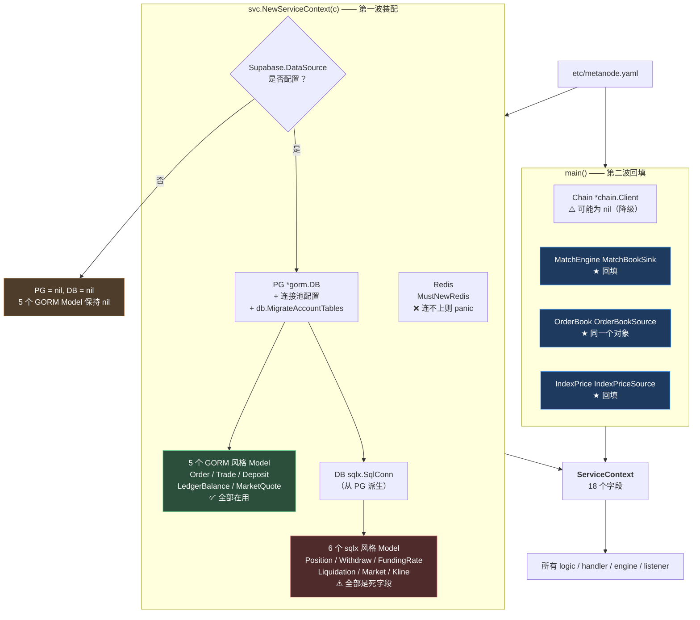
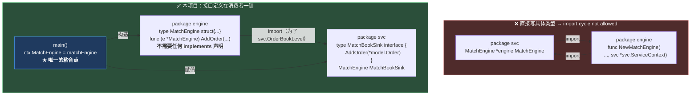
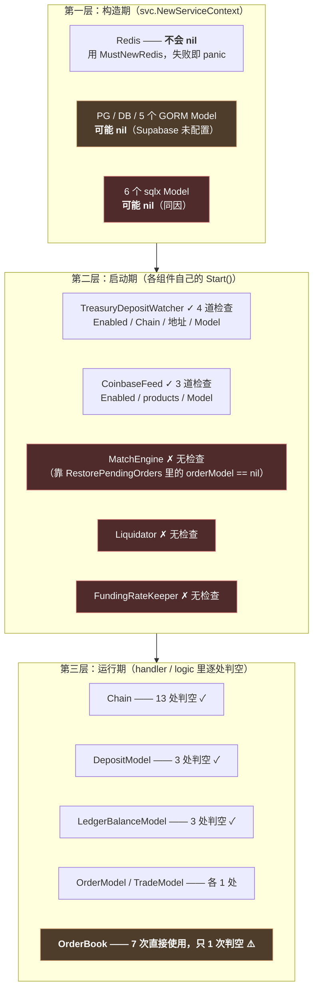
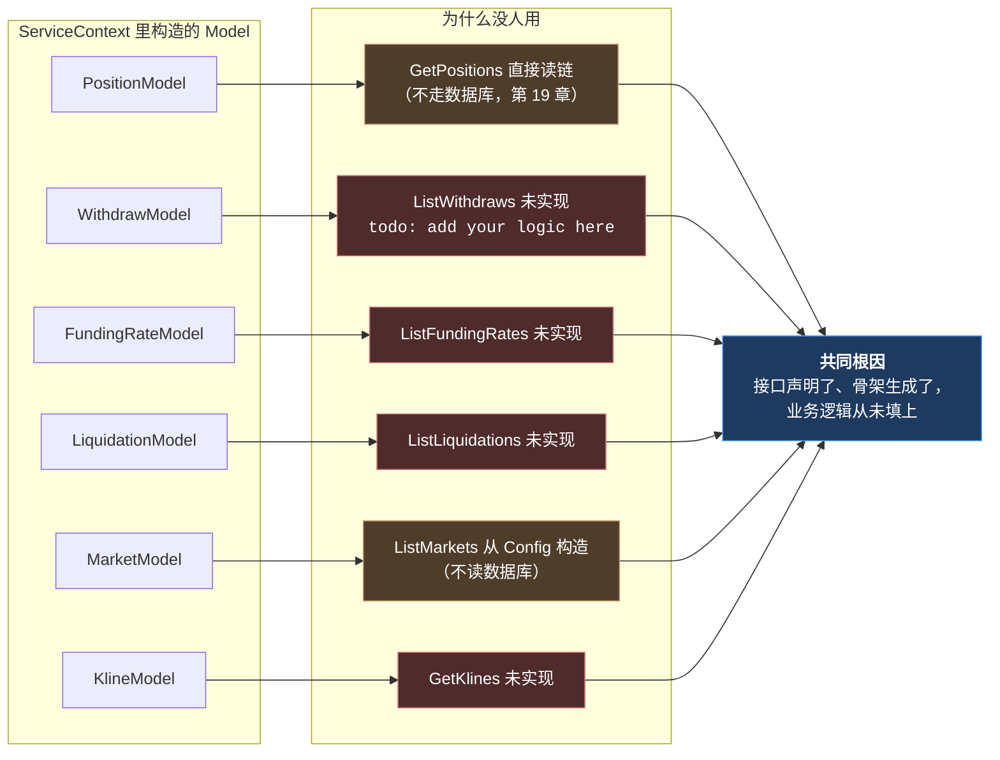

# 第 5 章：服务枢纽 ServiceContext — 依赖注入、接口抽象与 nil 安全

> 第 4 章讲的是"请求怎么从 HTTP 变成 Go 结构体"。本章回答接下来的问题：**处理这个请求需要的东西，从哪里来？**
>
> 全项目所有的 `NewXxxLogic(ctx, svcCtx)` 都从同一个结构体里拿依赖——它叫 `ServiceContext`，只有 148 行，却是这个项目里**每一条业务代码的必经之路**。本章要拆开它，回答三个问题：
>
> 1. **为什么要有这一层？**（直接 `new` 一个数据库连接不行吗）
> 2. **那三个只有一两个方法的小接口，到底打破了什么？**（这是全项目唯一一处需要动脑筋的依赖设计）
> 3. **`nil` 安全：这个结构体里有 18 个字段，哪些可能为 `nil`，谁负责检查？**
>
> 第三个问题的答案会在本章出现一个反转：我一开始用脚本统计"哪些字段缺少判空检查"，找到了 6 个从来没被检查过的 Model。**但追下去才发现，它们不是"漏检查了"——而是从来没有人用过。** 而这个"没人用"的原因，又牵出了第 4 章末尾那个发现的完整解释：**有 5 个接口从未被实现。**

---

## 1. 本章导读

### 1.1 一个 148 行的结构体，凭什么值得单独一章

先看它到底装了什么。这是 `internal/svc/servicecontext.go` 里 `ServiceContext` 的全部字段：

```text
┌─ 配置 ─────────────────────────────────────
│  Config config.Config                      ← 配置（所有人的只读视图）
│
├─ 三个连接（基础设施）───────────────────────
│  DB    sqlx.SqlConn                        ← go-zero SQL 抽象（可能 nil）
│  PG    *gorm.DB                            ← GORM 直连（可能 nil）
│  Redis *redis.Redis                        ← 不会 nil（MustNewRedis）
│
├─ 十一个数据模型（数据访问）──────────────────
│  OrderModel / TradeModel / PositionModel / DepositModel /
│  WithdrawModel / FundingRateModel / LiquidationModel /
│  MarketModel / KlineModel / LedgerBalanceModel / MarketQuoteModel
│
└─ 四个"活的组件"（业务能力）──────────────────
   Chain      *chain.Client        ← 链客户端（可能 nil）
   MatchEngine MatchBookSink       ← 撮合引擎的"写"能力
   OrderBook   OrderBookSource     ← 撮合引擎的"读"能力
   IndexPrice  IndexPriceSource    ← Coinbase 行情源
```

**这 18 个字段就是整个后端的能力清单。** 你读完它，就知道了：

- 这个系统**依赖哪些外部世界**（链、数据库、Redis、Coinbase）；
- 这个系统**能读写哪些数据**（11 个 Model = 11 张表）；
- 这个系统**自己持有哪些有状态的东西**（一个撮合引擎，被拆成"读"和"写"两个接口暴露）。

**所以第 2 章说"读完 servicecontext.go 你就有了完整的地图"——它是字面意义上的"项目地图"。**

### 1.2 为什么不直接 `new`？—— 依赖注入在这类项目里的真实价值

初学者看到这种"把所有东西塞进一个结构体"的做法，第一反应往往是："这不是把全局变量换了个包装吗？直接在哪用就在哪 `new` 一个不行吗？"

这个质疑是合理的，**而且在小型项目里答案就是"不需要"**。但在本项目这种结构里，`ServiceContext` 至少解决了四个具体问题：

**问题一：有些依赖只能被创建一次，而且创建成本很高。**

```go
// 数据库连接池：创建一次，全局复用
gorm.Open(postgres.Open(ds), &gorm.Config{})
sqlDB.SetMaxOpenConns(20)          // 连接数上限是全局的
```

如果每个 logic 都自己 `gorm.Open`，会有两个后果：

- **连接数失控**：每次请求新建一个连接池，20 个并发请求就是 20 个池子，数据库很快被打满；
- **配置分散**：`MaxOpenConns` 这类全局设置要在每个地方重复写。

**`ServiceContext` 是"单例容器"**——它保证这些重资源被创建一次、配置一次。

**问题二：有些依赖之间有初始化顺序，而且装配逻辑很复杂。**

链客户端的创建是这样的：

```go
ch, err := chain.NewClient(c.Ethereum, c.Markets, c.Chainlink)
if err != nil {
	// 降级：Chain 保持 nil（第 3 章的主题）
} else {
	ctx.Chain = ch
	// 还要做两个启动自检……
}
```

**这段逻辑不能散在每个使用者的地方。** 它必须在一个地方集中完成——`main()` 做决定、`ServiceContext` 承载结果。

**问题三（在 Web3 项目里尤其重要）：依赖的"可用性"是一个需要被统一表达的状态。**

在本项目里，"链能不能用"不是一个布尔变量，而是**"`ctx.Chain` 是不是 `nil`"**。这个约定是全项目统一的：13 处判空检查、14 处直接使用，**所有人都认同"`Chain == nil` 表示链不可用"这个语义**。

**如果每个组件自己管理链客户端，这个语义就没法统一**——可能有的地方用 `nil`、有的地方用一个 `Connected bool`、有的地方直接 panic。**统一的状态表达本身就是一种设计资产。**

**问题四（这个才是本项目真正的技术点）：它能打破循环依赖。**

这是本章 1.3 节和 3.(2)~(4) 的主题，也是这个 148 行文件里唯一"需要动脑筋"的地方。

### 1.3 三个小接口：全项目唯一一处需要动脑筋的依赖设计

先把问题摆出来。`ServiceContext` 需要持有撮合引擎（因为下单接口要往订单簿里塞订单）；而撮合引擎需要 `OrderModel` / `TradeModel` / `Chain`（这些都在 `ServiceContext` 里）。**这是一个真实的双向依赖。**

在 Go 里，双向依赖会直接导致**编译失败**：

```text
package svc
import "metanode/internal/engine"      // ← 为了写 *engine.MatchEngine

package engine
import "metanode/internal/svc"          // ← 为了拿 svc.ServiceContext

→ import cycle not allowed
```

**本项目的解法**是：`svc` 包里**不写具体类型**，而是就地定义三个只有一两个方法的小接口：

```go
// MatchBookSink 订单入 memory book（由 internal/engine.MatchEngine 实现）。
type MatchBookSink interface {
	AddOrder(order *model.Order)
}

// OrderBookSource 撮合引擎订单簿快照（由 MatchEngine 实现）。
type OrderBookSource interface {
	SnapshotOrderBook(perp string, limit int) (bids, asks []OrderBookLevel)
}

// IndexPriceSource Coinbase 指数价缓存（由 listener.CoinbaseFeed 实现）。
type IndexPriceSource interface {
	IndexPrice1e6(perp string) (price string, ok bool)
}
```

**然后 `ServiceContext` 里持有的是接口，不是具体类型：**

```go
Chain       *chain.Client        // ← 具体类型（下面会说明为什么它不一样）
MatchEngine MatchBookSink        // ← 接口
OrderBook   OrderBookSource      // ← 接口
IndexPrice  IndexPriceSource     // ← 接口
```

**粘合发生在 `main()` 里**（`metanode.go:71-73` 和 `:67`）：

```go
matchEngine := engine.NewMatchEngine(c.MatchEngine, ctx.OrderModel, ctx.TradeModel, ctx.Chain)
ctx.MatchEngine = matchEngine      // *MatchEngine 满足 MatchBookSink
ctx.OrderBook = matchEngine        // 同一个对象，满足 OrderBookSource

coinbaseFeed := listener.NewCoinbaseFeed(ctx)
ctx.IndexPrice = coinbaseFeed      // *CoinbaseFeed 满足 IndexPriceSource
```

**这三行的赋值之所以能编译通过，是因为 Go 的接口是隐式实现的**——`*engine.MatchEngine` 有一个方法 `AddOrder(order *model.Order)`，签名和 `MatchBookSink.AddOrder` 完全一致，于是它"自动"满足了接口。**不需要任何 `implements` 声明，`engine` 包甚至不需要知道 `svc` 包定义过这个接口。**

**结果就是：`svc` 包对 `engine` 包的依赖被彻底切断了。**

```text
改之前：  svc ──→ engine ──→ svc      （循环，编译失败）
改之后：  svc      ←── engine          （engine 单向依赖 svc 的接口定义）
          main 负责把两者接起来
```

**这个技巧的学名叫「依赖倒置原则（Dependency Inversion Principle，DIP）」**，它的经典表述是"高层模块不应该依赖低层模块，两者都应该依赖抽象"。**在 Go 里实现它的成本极低——不需要额外的抽象层、不需要依赖注入框架，三个几行的接口就够了。**

**反面案例**：如果在 Java/Spring 里做同样的事，通常需要定义接口 + 实现类 + XML/注解配置三处改动。**这是 Go 的隐式接口带来的一个真实优势。**

### 1.4 一次"疑似问题"到"真问题"的排查

本章 1.3 之后，本来应该顺着讲 nil 安全。**但我在这里想插一段方法论**，因为它比结论本身更有价值。

写这一章时，我用脚本统计了每个字段的判空情况：

```bash
# 统计每个 svc 字段的"判空次数"和"直接使用次数"
```

结果里有一组数据很可疑：

```text
PositionModel        判空 0 次 | 直接使用 1 次
WithdrawModel        判空 0 次 | 直接使用 1 次
FundingRateModel     判空 0 次 | 直接使用 1 次
LiquidationModel     判空 0 次 | 直接使用 1 次
MarketModel          判空 0 次 | 直接使用 1 次
KlineModel           判空 0 次 | 直接使用 1 次
```

**第一反应是："这 6 个 Model 从来没人判空，但它们确实可能为 nil（因为 `NewServiceContext` 里是条件赋值的）——这是一个 nil 安全漏洞。"**

**但追下去就发现不是这么回事。** 我换了个更精确的 grep：

```bash
$ grep -rn "svcCtx\.PositionModel" --include="*.go" internal/
（无输出）
```

**那"直接使用 1 次"是哪来的？** 是 `model.PositionModel` 这个**类型名**（接口类型声明），不是字段访问。我的第一个 grep 模式 `\.$m\b` 同时匹配了字段访问 `svcCtx.PositionModel` 和类型引用 `model.PositionModel`——**这是一个典型的"正则太宽导致假阳性"。**

**修正后的真实数据是：6 个 Model 的 `svcCtx` 字段访问次数为 0。**

```text
OrderModel           svcCtx 访问  4 次  ✅ 在用
TradeModel           svcCtx 访问  3 次  ✅ 在用
DepositModel         svcCtx 访问  7 次  ✅ 在用
LedgerBalanceModel   svcCtx 访问  4 次  ✅ 在用
MarketQuoteModel     svcCtx 访问  2 次  ✅ 在用
─────────────────────────────────────────
PositionModel        svcCtx 访问  0 次  ❌ 死字段
WithdrawModel        svcCtx 访问  0 次  ❌ 死字段
FundingRateModel     svcCtx 访问  0 次  ❌ 死字段
LiquidationModel     svcCtx 访问  0 次  ❌ 死字段
MarketModel          svcCtx 访问  0 次  ❌ 死字段
KlineModel           svcCtx 访问  0 次  ❌ 死字段
```

**所以真正的问题不是"缺少 nil 检查"，而是"这 6 个字段被构造出来之后从来没人用过"。**

**这个反转很值得记住，因为它是一个通用的工程教训：**

> **静态分析发现的"疑似问题"，必须追到调用点确认它到底是不是问题。**
> "缺少判空"和"根本没被使用"在 grep 输出里长得几乎一样，但性质完全不同——前者是安全漏洞，后者是死代码。
> **如果不追这一步，我就会在本章里写出一段听起来很专业、实际是错的结论。**

**而这个"为什么没人用"的问题，又引出了第 1.5 节——也是本章最完整的那个发现。**

### 1.5 死字段的成因：5 个从未被实现的接口

我继续追：这 6 个 Model 对应哪些业务？为什么没人用？

```text
PositionModel      → 应该给"查仓位"用      → 但 getpositionslogic.go 直接从链上读（第 19 章）
WithdrawModel      → 应该给"查取款记录"用  → ListWithdraws 未实现
FundingRateModel   → 应该给"查资金费率"用  → ListFundingRates 未实现
LiquidationModel   → 应该给"查清算记录"用  → ListLiquidations 未实现
MarketModel        → 应该给"市场参数"用    → ListMarkets 从 Config 构造（第 4 章 3.(12)）
KlineModel         → 应该给"查 K 线"用     → GetKlines 未实现
```

**验证一下"未实现"：**

```bash
$ grep -rln "todo: add your logic here" --include="*.go" internal/logic/
internal/logic/account/listwithdrawslogic.go        ← WithdrawModel 的使用者
internal/logic/funding/listfundingrateslogic.go     ← FundingRateModel 的使用者
internal/logic/liquidation/listliquidationslogic.go ← LiquidationModel 的使用者
internal/logic/market/getklineslogic.go             ← KlineModel 的使用者
internal/logic/order/cancelorderlogic.go            ← （与 Model 无关）
```

**四个"未实现"精确对应四张表的 Model，再加上一个"从配置读而不从数据库读"的 `ListMarkets`——六个死字段全部有了完整的解释。**

**这个发现串起了本指南前面几章的几条线索：**

```text
第 2 章 6.x   发现 ListWithdraws / GetKlines 的空壳（"21 个 logic 有真实实现"这个判断是错的）
第 4 章 6.x   发现 PerpMarket 的风控参数恒为空（因为 ListMarkets 走的是配置而非数据库）
第 5 章 本章  发现 6 个 Model 是死字段（因为它们的使用者从未被实现）
                    ↓
             三处发现指向同一个根因：有一批接口设计好了、代码骨架生成了，
             但业务逻辑从未被填上，而骨架的"零值成功"特性让这些空缺完全静默。
```

**这就是"读源码要交叉验证"的价值**——单独看 `ServiceContext`，你只会觉得"字段有点多"；单独看 `listwithdrawslogic.go`，你只会觉得"这是个空文件"。**只有把两边的数据放在一起，才能看出"死字段"和"空壳接口"是一回事。**

---

## 2. 架构 / 流程图

### 2.1 `ServiceContext` 的字段全景与来源

这张图回答"每个字段是谁塞进去的、什么时候塞的"：



**读图要点：**

- **装配分两波**：`NewServiceContext` 负责基础设施和数据层（配置驱动），`main()` 负责业务组件（需要互相引用，所以必须回填）。**理解这个两波结构，就理解了为什么 `main()` 里有那么多赋值语句。**
- **红色的 6 个 Model 是死字段**（1.4/1.5 节的发现）——它们被构造出来，但从未被访问。
- **蓝色的三个是"回填"进去的**，也是本节 1.3 讲的那三个接口。
- **黄色的 `NILDB` 是 nil 安全的源头**：Supabase 没配置时，`PG` 和 `DB` 都是 `nil`，而 **5 个 GORM Model 会保持 nil**。这就是为什么业务代码里到处要判 `DepositModel == nil`。

### 2.2 依赖循环与破解：一张 import 图

这张图是本节的**核心证明**。左边是"如果直接写具体类型会发生什么"，右边是本项目的实际做法：



**这张图要传达的关键点是：接口定义在 `svc` 包（消费者侧），而不是 `engine` 包（生产者侧）。**

这是 Go 社区一条著名的实践原则：**"Accept interfaces, return structs"**，以及它的推论——**"接口应该由使用方定义，而不是实现方"**。

**为什么这条原则重要？** 因为如果接口定义在 `engine` 包里，`svc` 还是得 import `engine` 才能用它，循环依然存在。**把接口放在消费者一侧，生产者就完全不需要知道这个接口的存在。**

**⚠️ 一个容易被忽略的细节**：右边的箭头显示 **`engine` 仍然 import `svc`**——这不是笔误。看 `matchengine.go` 的 `SnapshotOrderBook` 签名：

```go
func (e *MatchEngine) SnapshotOrderBook(perp string, limit int) (bids, asks []svc.OrderBookLevel) {
	//                                                    ↑ 这里用了 svc 包的类型
}
```

**`engine` 依赖 `svc` 是为了拿 `svc.OrderBookLevel` 这个数据结构**（订单簿档位的返回类型）。而这个依赖是**单向的、无害的**——因为 `svc` 不再反向依赖 `engine`。

**所以完整的依赖方向是：**

```text
engine ──→ svc        （为了 OrderBookLevel 类型 + ServiceContext 参数）
listener ─→ svc       （为了 ServiceContext 参数）
logic ───→ svc        （为了 ServiceContext 参数）
svc ────→ model/chain/config/db    （只有基础层，没有任何业务层）
```

**`svc` 位于依赖图的最底层之一，所有业务层都指向它，它不指向任何业务层。** 这就是"枢纽"这个词的准确含义。

### 2.3 nil 安全的三层防线

`ServiceContext` 的 18 个字段里，哪些可能为 `nil`、由谁负责保证？这张表按"防线"分层：



**三层防线的工作方式是：**

```text
第 1 层决定"哪些字段可能 nil"      → 但是隐式的（靠 if 语句，没有类型层面的表达）
第 2 层决定"组件在依赖不全时启不启动" → 但只有 2/5 个组件做了检查
第 3 层决定"请求在依赖不全时返回什么" → 处理方式不统一（503 / 空数组 / 跳过）
```

**第 3 层的问题已经在第 3 章 2.3 详细分析过（降级矩阵）**，本章只补充第 1、2 层的问题：

**问题一：第 1 层的"可能为 nil"是隐式的。** 类型系统完全不知道 `PositionModel` 可能为 nil——它就是个接口类型，零值就是 nil。**没有任何机制强制调用者检查。**

**问题二：第 2 层的检查覆盖率只有 40%。** 5 个常驻组件里，只有 2 个做了完整的依赖检查。

**问题三：第 3 层有一个被忽略的字段——`OrderBook`。**

```text
OrderBook  判空 1 次 | 直接使用 7 次
```

**7 次使用只有 1 次判空**——这是所有字段里比例最悬殊的。下一节会分析它到底危不危险。

### 2.4 死字段与空壳接口的对应关系（本章的核心发现）



**六条线索指向两个不同的原因：**

- **4 个（红色）**：对应的接口**从未实现**，是 goctl 空壳；
- **2 个（黄色）**：对应的接口**实现了，但走了别的数据源**——`GetPositions` 从链上读，`ListMarkets` 从配置读。

**这两个原因的性质完全不同：**

| | 未实现（红色） | 走别的数据源（黄色） |
| --- | --- | --- |
| 是 bug 吗 | ✅ 是功能缺失 | ⚠️ 是设计选择（但 `ListMarkets` 那个有副作用，见第 4 章） |
| 修法 | 实现它 | 或者删掉死字段，或者改用 Model |
| 死字段该删吗 | 一旦实现就会用到，**保留合理** | 可能永远用不到，**可以考虑删** |

---

## 3. 核心代码拆解

### (1) `ServiceContext` 结构体全貌（带实测使用统计）

```go
// ServiceContext 服务上下文
type ServiceContext struct {
	Config config.Config

	// 数据库连接
	DB sqlx.SqlConn        // go-zero 的 SQL 抽象

	// PG Supabase / Postgres（GORM）；未配置 DataSource 时为 nil。
	PG *gorm.DB

	// Redis 连接
	Redis *redis.Redis

	// 数据模型（11 个）
	OrderModel         model.OrderModel           // 实测：svcCtx 访问 4 次  ✅
	TradeModel         model.TradeModel           // 实测：svcCtx 访问 3 次  ✅
	PositionModel      model.PositionModel        // 实测：svcCtx 访问 0 次  ❌ 死字段
	DepositModel       model.DepositModel         // 实测：svcCtx 访问 7 次  ✅
	WithdrawModel      model.WithdrawModel        // 实测：svcCtx 访问 0 次  ❌ 死字段
	FundingRateModel   model.FundingRateModel     // 实测：svcCtx 访问 0 次  ❌ 死字段
	LiquidationModel   model.LiquidationModel     // 实测：svcCtx 访问 0 次  ❌ 死字段
	MarketModel        model.MarketModel          // 实测：svcCtx 访问 0 次  ❌ 死字段
	KlineModel         model.KlineModel           // 实测：svcCtx 访问 0 次  ❌ 死字段
	LedgerBalanceModel model.LedgerBalanceModel   // 实测：svcCtx 访问 4 次  ✅
	MarketQuoteModel   model.MarketQuoteModel     // 实测：svcCtx 访问 2 次  ✅

	// Chain 为 nil 时：无 RPC，链上查询接口返回空或零；撮合仍可记库但不会发交易。
	Chain *chain.Client
	// MatchEngine 在 main 中创建并赋值，供 CreateOrder 入簿。
	MatchEngine MatchBookSink
	// OrderBook 在 main 中与 MatchEngine 同一实例，供深度 API 读取。
	OrderBook OrderBookSource
	// IndexPrice Coinbase 指数价（可选）。
	IndexPrice IndexPriceSource
}
```

**作者为什么这么设计（设计思想）：**

**设计点一：字段的组织顺序反映了三个层次，而且注释把关键信息都标出来了。**

```text
第 1 组：Config                    ← 只读配置
第 2 组：DB / PG / Redis           ← 基础设施连接
第 3 组：11 个 Model               ← 数据访问（按业务分组）
第 4 组：Chain / MatchEngine / ... ← 业务能力（有注释说明语义）
```

**注意第 4 组每个字段都有一行注释**，而且注释写的不是"这是什么"，而是"**这个字段为 nil 时会发生什么**"：

```go
// Chain 为 nil 时：无 RPC，链上查询接口返回空或零；撮合仍可记库但不会发交易。
Chain *chain.Client
```

**这是很好的注释习惯**——它回答了读者最关心的问题（"这个东西没有的时候会怎样"），而不是重复字段名已经表达的信息。

**设计点二：`DB` 和 `PG` 并存，且注释解释了原因。**

```go
// PG Supabase / Postgres（GORM）；未配置 DataSource 时为 nil。
PG *gorm.DB
```

第 2 章 3.(6) 和 3.(7) 都讨论过这个"双数据访问层"的由来（`sqlx` 的 `?` 占位符与 pgx 不兼容）。**这里补充一个从"依赖容器"角度看的观察**：

```text
DB (sqlx.SqlConn) 是被 PG 派生出来的：
  sqlDB, _ := gdb.DB()                    ← 从 GORM 拿底层 *sql.DB
  sqlConn = sqlx.NewSqlConnFromDB(sqlDB)  ← 包装成 go-zero 的抽象

所以：
  · 两者的生命周期绑定（同一个连接池）
  · PG == nil ⟹ DB == nil（反之不一定，但实际是这样的）
  · main() 里只需要 defer sqlDB.Close() 一次
```

**在 `main()` 里可以看到这个关系的体现：**

```go
ctx := svc.NewServiceContext(c)
if ctx.PG != nil {                       // ← 判 PG 而不是判 DB
	if sqlDB, err := ctx.PG.DB(); err == nil {
		defer sqlDB.Close()              // ← 关一次，两个抽象都失效
	}
}
```

**设计点三（也是本章的核心批评）：11 个 Model 字段是被"预期"设计出来的，而不是被"使用"驱动的。**

从字段的排列能看出作者的设计意图——**11 个 Model 恰好对应 11 张业务表**，这是一个很整齐的规划：

```text
orders / trades / positions / deposits / withdraws /
funding_rates / liquidations / markets / klines /
ledger_balances / market_quotes
```

**但规划和使用是两回事。** 实测结果是 6 个从未被访问。

**这不是"写错了"，而是"写多了"**——在项目早期按"完整性"把表都列上，然后再实现功能，是很自然的做法。**问题在于：没有任何机制在"这些字段一直没被用"时发出提示。**

**一条可以带走的经验**：

> **依赖容器里的字段，应该由"使用需求"驱动，而不是由"数据模型完整性"驱动。**
>
> 一个空的字段看起来无害，但它有两个隐性成本：
> ① **误导读者**——看到 `MarketModel` 会以为有人从数据库读市场参数（实际上 `ListMarkets` 走的是配置）；
> ② **掩盖缺失**——有字段在，容易让人以为"这个功能已经接好了"。
>
> **如果一个字段暂时用不到，宁可先不加。** 加字段的成本很低（一行），但"以为它已经工作了"的成本可能很高。

### (2) 三个小接口的定义 —— 为什么定义在 `svc` 侧

```go
// MatchBookSink 订单入 memory book（由 internal/engine.MatchEngine 实现）。
type MatchBookSink interface {
	AddOrder(order *model.Order)
}

// OrderBookLevel 内存订单簿档位快照。
type OrderBookLevel struct {
	Price  string
	Amount string
}

// OrderBookSource 撮合引擎订单簿快照（由 MatchEngine 实现）。
type OrderBookSource interface {
	SnapshotOrderBook(perp string, limit int) (bids, asks []OrderBookLevel)
}

// IndexPriceSource Coinbase 指数价缓存（由 listener.CoinbaseFeed 实现）。
type IndexPriceSource interface {
	IndexPrice1e6(perp string) (price string, ok bool)
}
```

**作者为什么这么设计（设计思想）：**

**设计点一：这三个接口都是"一个方法、零依赖、无副作用"的最小接口。**

| 接口 | 方法数 | 输入 | 输出 | 有副作用吗 |
| --- | --- | --- | --- | --- |
| `MatchBookSink` | 1 | 一个订单 | 无 | ✅ **有**（往内存簿里加东西） |
| `OrderBookSource` | 1 | 市场 + 条数 | 买卖档位 | ❌ 无（纯读） |
| `IndexPriceSource` | 1 | 市场 | 价格 + 是否命中 | ❌ 无 |

**注意这个划分方式**：它不是一个"大而全的 MatchEngine 接口"，而是**按"读"和"写"拆成了两个**。

```go
MatchEngine MatchBookSink        // 只暴露 AddOrder —— 只能往簿里写
OrderBook   OrderBookSource      // 只暴露 SnapshotOrderBook —— 只能读
```

**同一个对象，用两个接口分别暴露两种能力。** 这是**接口隔离原则（Interface Segregation Principle，ISP）**的直接应用：

> 客户端不应该被迫依赖它不使用的方法。

**具体的收益**：`CreateOrder` 逻辑拿到的 `ctx.MatchEngine` 类型是 `MatchBookSink`，它**根本无法调用 `Stop()`、`submitBatch()`、`match()`** —— 这些方法在接口里不存在。**权限边界由类型系统保证，而不是靠约定。**

**这个技巧在本项目里有一个意外的实际收益**（第 3 章 6.5 提到过）：`MatchEngine.Stop()` 是裸的 `close(e.stopCh)`，重复调用会 panic。而 `ctx.MatchEngine` 的类型是接口、**没有 `Stop()` 方法**，所以从 `ctx` 这条路径**根本调不到它**——接口隔离意外地挡住了一条可能的误用路径。

**设计点二：`OrderBookLevel` 定义在 `svc` 包，而 `engine` 包反向依赖它。**

```go
// svc 包定义
type OrderBookLevel struct {
	Price  string
	Amount string
}

// engine 包使用（matchengine.go:538）
func (e *MatchEngine) SnapshotOrderBook(perp string, limit int) (bids, asks []svc.OrderBookLevel) {
```

**这是一个值得琢磨的细节**：数据结构定义在消费者（`svc`）一侧，生产者（`engine`）反向 import 它。

**这和 1.3 节讲的"接口定义在消费者侧"是同一个思路的延伸**：

> **契约（接口 + 传输数据结构）都由使用方定义，实现方去适配它。**

**它带来的好处是依赖方向的清晰**：`engine` 依赖 `svc`（单向），`svc` 不依赖 `engine`。**而代价是 `engine` 包会被迫知道 `svc` 的存在**——如果将来想把 `engine` 抽成独立模块（比如发布成一个库），就必须先解决这个依赖。

**这是一个典型的架构权衡**：

| | 契约定义在消费者侧（本项目） | 契约定义在生产者侧 |
| --- | --- | --- |
| 循环依赖 | ✅ 打破 | ❌ 存在 |
| 生产者可复用性 | ⚠️ 依赖宿主包 | ✅ 独立 |
| Go 社区惯例 | ✅ 推荐 | ⚠️ 常见于库开发 |

**本项目的场景是"单体应用"，不是"通用库"，所以选择前者是对的。**

**设计点三：`IndexPriceSource` 的返回值设计得很讲究。**

```go
IndexPrice1e6(perp string) (price string, ok bool)
```

**方法名里带着精度信息（`1e6`），返回值用 `(值, 是否命中)` 的双返回形式。**

`(value, ok)` 是 Go 的惯用模式（和 `map` 取值、类型断言一致）。**它的语义很精确**：

```text
ok == true  → 有缓存的价格
ok == false → 还没收到过这个市场的行情（可能刚启动，或 Coinbase 没订阅这个产品）
```

**注意这里没有"错误"这个概念**——"还没有价格"不是错误，是正常的初始状态。**用 `ok bool` 而不是 `error`，准确表达了"这不是异常情况"。**

**调用方也需要相应地处理这个"未命中"**（`listmarketslogic.go:48`）：

```go
if l.svcCtx.IndexPrice != nil {
	if idx, ok := l.svcCtx.IndexPrice.IndexPrice1e6(m.Address); ok {
		pm.IndexPrice = idx        // 只有命中才覆盖
	}
}
```

**注意这个"只覆盖不置空"的写法**：如果 `IndexPrice` 未命中，就保留前面从链上读到的值。**这是一种合理的降级**——指数价的优先级高于标记价，但拿不到时不要清空已有的数据。

### (3) `MatchEngine` 如何"隐式满足"接口

```go
// internal/engine/matchengine.go

// AddOrder 添加订单到订单簿
func (e *MatchEngine) AddOrder(order *model.Order) {
	e.addOrderWithRemain(order, absPaperString(order.PaperAmount))
}

// SnapshotOrderBook 返回内存订单簿聚合深度（price 为 |credit|/|paper| 的 1e18 精度字符串）。
func (e *MatchEngine) SnapshotOrderBook(perp string, limit int) (bids, asks []svc.OrderBookLevel) {
	// ...
}
```

**作者为什么这么设计（设计思想）：**

**设计点一：这两个方法里没有任何"我在实现某个接口"的痕迹。**

对比 Java 的写法：

```java
// Java 需要显式声明
public class MatchEngine implements MatchBookSink, OrderBookSource {
    @Override
    public void addOrder(Order order) { ... }
}
```

**Go 不需要**：只要方法名、参数类型、返回值类型匹配，就自动满足接口。**这是 Go 的"结构化类型系统（structural typing）"。**

**它的好处是解耦**：`engine` 包完全不知道 `svc` 定义过 `MatchBookSink`。**它只是"碰巧"有一个 `AddOrder` 方法。**

**它的代价是隐式**：你无法从 `MatchEngine` 的定义处看出"它实现了哪些接口"。**要知道这件事，你必须去搜哪些地方做了赋值**——这就是 1.3 节那张图里"`main()` 是唯一粘合点"的意义。

**设计点二：`SnapshotOrderBook` 的返回值用了 `svc.OrderBookLevel`，这反而是"显式"的依赖。**

注意这个不对称：

```text
AddOrder(order *model.Order)                            ← 只用 model 包的类型
SnapshotOrderBook(...) ([]svc.OrderBookLevel, ...)      ← 用了 svc 包的类型
```

**第二个方法让 `engine` 被迫 import `svc`。这不是必需的**——理论上可以把 `OrderBookLevel` 也定义在 `model` 包里（毕竟它是个数据结构，和 `model.Order` 同级别）。

**放在 `svc` 包里的唯一理由是"它服务于 `OrderBookSource` 这个接口"**，而接口定义在消费者侧，所以配套的数据结构也就跟着放在那里了。**这是一个合理但不够彻底的选择**：

```text
理想形态：契约（接口 + DTO）都定义在一个中立的包（如 internal/contract 或 internal/dto）
          → svc 和 engine 都依赖它，互相不依赖
现状：    契约放在 svc 包
          → engine 依赖 svc
          → 在没有循环依赖的前提下，这个方案是可行的
```

**对本项目来说现状是够用的**，因为 `engine` 依赖 `svc` 并不造成任何问题（`svc` 位于依赖底层）。**但如果你要把 `engine` 抽成独立库，这一步就绕不过去了。**

### (4) 循环依赖的完整证明

前面都是结论，这里给出**可复现的验证方法**。

**第一步：确认 `engine` import 了 `svc`。**

```bash
$ grep -n "metanode/internal/svc" internal/engine/matchengine.go
6:	"metanode/internal/svc"
```

**`engine` 依赖 `svc`——确认。**

**第二步：确认 `svc` **没有** import `engine` 或 `listener`。**

```bash
$ sed -n '/^import/,/^)/p' internal/svc/servicecontext.go
import (
	"fmt"
	"strings"

	"metanode/internal/chain"
	"metanode/internal/config"
	"metanode/internal/db"
	"metanode/internal/model"

	"github.com/zeromicro/go-zero/core/stores/redis"
	"github.com/zeromicro/go-zero/core/stores/sqlx"
	"gorm.io/driver/postgres"
	"gorm.io/gorm"
)
```

**`svc` 只依赖基础层（chain / config / db / model）——确认。**

**第三步：验证"如果改成具体类型会不会真的循环"。**

这一步不需要真的改代码，逻辑推导就够了：

```text
svc 要写 MatchEngine *engine.MatchEngine
  → 必须 import "metanode/internal/engine"

engine 已经 import "metanode/internal/svc"
  → svc → engine → svc
  → Go 编译器会报 "import cycle not allowed"
```

**可以现场验证（在临时副本里做）：**

```bash
cp -r /path/to/perp-backend /tmp/cycletest && cd /tmp/cycletest
# 把 servicecontext.go 里的 MatchEngine MatchBookSink 改成 *engine.MatchEngine
# 并加上 import
go build ./... 2>&1 | head -3
# 预期输出：import cycle not allowed
```

**⚠️ 一个容易看错的点**：`logic` 包也 import 了 `svc` **和** `chain`：

```bash
$ grep -l "metanode/internal/chain" internal/logic/*/*.go
internal/logic/market/chainquote.go
internal/logic/order/createorderlogic.go
...
```

**这是第 2 章 2.3 提到的"logic 层的越界"**——`logic` 理论上只该通过 `svc` 拿依赖，但它也直接 import 了 `chain`。**这不构成循环**（`chain` 不依赖 `logic`），但它让依赖图变得不如设计的那般干净。

### (5) `NewServiceContext` 的条件装配 —— nil 的源头

```go
func NewServiceContext(c config.Config) *ServiceContext {
	// ① Redis：连不上就 panic（唯一一个"必须成功"的依赖）
	rds := redis.MustNewRedis(redis.RedisConf{
		Host: c.Redis.Host,
		Type: c.Redis.Type,
		Pass: c.Redis.Pass,
	})

	var pgDB *gorm.DB
	var sqlConn sqlx.SqlConn

	// ② Postgres：尽力而为，连不上就留 nil
	if ds := strings.TrimSpace(c.Supabase.DataSource); ds != "" {
		// ... 补 sslmode、gorm.Open、设置连接池 ...
		if err != nil {
			fmt.Println("supabase postgres (gorm):", err, "(未连接 PG，请检查 Supabase.DataSource)")
		} else {
			// ...
			pgDB = gdb
			sqlConn = sqlx.NewSqlConnFromDB(sqlDB)
			// ... 建表迁移 ...
		}
	} else {
		fmt.Println("supabase: Supabase.DataSource 为空，链下余额/充值记录不可用")
	}

	svcCtx := &ServiceContext{Config: c, DB: sqlConn, PG: pgDB, Redis: rds}

	// ③ 两个条件分支，各自装配一批 Model
	if sqlConn != nil {
		svcCtx.PositionModel = model.NewPositionModel(sqlConn)
		svcCtx.WithdrawModel = model.NewWithdrawModel(sqlConn)
		svcCtx.FundingRateModel = model.NewFundingRateModel(sqlConn)
		svcCtx.LiquidationModel = model.NewLiquidationModel(sqlConn)
		svcCtx.MarketModel = model.NewMarketModel(sqlConn)
		svcCtx.KlineModel = model.NewKlineModel(sqlConn)
	}
	// 充值 / 链下余额 / 订单 / 成交：Postgres 上必须用 GORM（go-zero sqlx 的 ? 与 pgx 不兼容）
	if pgDB != nil {
		svcCtx.DepositModel = model.NewGormDepositModel(pgDB)
		svcCtx.LedgerBalanceModel = model.NewGormLedgerBalanceModel(pgDB)
		svcCtx.OrderModel = model.NewGormOrderModel(pgDB)
		svcCtx.TradeModel = model.NewGormTradeModel(pgDB)
		svcCtx.MarketQuoteModel = model.NewGormMarketQuoteModel(pgDB)
	}

	return svcCtx
}
```

**作者为什么这么设计（设计思想）：**

**设计点一：`Redis` 用 `MustNewRedis`，是一个有争议的选择。**

```text
Redis 的用途：
  · 登录 nonce 的一次性存储（第 6 章）
  · 扫链入账的区块游标（第 16 章）

Redis 挂掉的后果：
  · 用户无法登录（nonce 存不了）
  · 扫链要从"回溯 2000 块"重新开始（第 16 章的兜底机制）
  · ★ 但查询接口（查订单、查仓位、看行情）完全不受影响
```

**按第 3 章 1.3 提出的判断标准（"降级后还剩什么价值"），Redis 应该是可以降级的**——丢了它，这个后端还能提供绝大部分只读服务。**但它偏偏是唯一一个"失败即 panic"的依赖。**

**这个不一致值得记住**：项目里有三种"依赖失败"的处理风格：

| 依赖 | 处理 | 理由 |
| --- | --- | --- |
| 配置文件 | `MustLoad` panic | 无降级价值（什么都不知道） |
| Redis | `MustNewRedis` panic | **存疑**——理论上可降级 |
| Postgres | 打印日志，留 nil | 有降级价值（只读服务仍可用） |
| 链 | 打印日志，留 nil | 有降级价值（读库服务仍可用） |

**4 种依赖、3 种策略、没有统一的判断标准**——这正是第 3 章 6.x 那条"依赖处理不一致"的根源。

**设计点二：两个 `if` 分支的划分依据是"用哪个驱动程序"，而不是"业务重要性"。**

```go
if sqlConn != nil { ... 6 个 sqlx 风格 Model ... }
if pgDB != nil    { ... 5 个 GORM 风格 Model ... }
```

**这两个条件在实际运行时是等价的**（因为 `sqlConn` 是从 `pgDB` 派生的，`pgDB == nil` 时 `sqlConn` 也一定是 `nil`）。**所以这两个 `if` 可以合并成一个。**

**它们被分开写的原因是代码组织上的**——注释解释了："充值 / 链下余额 / 订单 / 成交：Postgres 上必须用 GORM（go-zero sqlx 的 `?` 与 pgx 不兼容）"。**这个注释解释了"为什么分两批"，但没有解释"为什么用两个 if 而不是一个"。**

**这是一个很小的代码质量问题**，但它的含义不小：**当两个条件永远同时为真/假时，写成两个 `if` 会让读者以为它们可能独立变化**——从而去思考一个不存在的场景。

**设计点三：`model.NewXxxModel(nil)` 不会报错——这是 nil 能一路传下去的原因。**

看 `model.NewPositionModel` 的实现：

```go
func NewPositionModel(conn sqlx.SqlConn) PositionModel {
	return &defaultPositionModel{conn: conn}      // ← 把 conn 原样存进去，不检查
}
```

**如果传进去的是 `nil`，它照收不误，构造出一个"持有 nil 连接的 Model"。** 这个对象在**被调用方法时**才会 panic（对一个 nil 接口调方法是 runtime panic）。

**这就是 1.4 节那个"零判空"现象的另一面**：既然构造函数不检查，那检查的责任就落到了每个调用点——而本项目**没有任何机制提醒调用点去做检查**。

**理想的做法（第 3 章 3.(2) 提过的"空对象模式"）：**

```go
// 构造时就明确表态
func NewPositionModel(conn sqlx.SqlConn) PositionModel {
	if conn == nil {
		return unavailablePositionModel{}     // ← 返回一个"明确不可用"的实现
	}
	return &defaultPositionModel{conn: conn}
}

type unavailablePositionModel struct{}
func (unavailablePositionModel) FindByTrader(...) ([]*Position, error) {
	return nil, ErrDatabaseUnavailable        // ← 显式错误，不是 panic
}
```

**这样改动之后**：调用方拿到的永远是一个合法对象，**不需要判空**；而当它真的不可用时，会得到一个明确的 `error` 而不是一次 panic。**"把运行期的 panic 变成可处理的错误"，这是依赖注入设计里一个很实用的改进方向。**

### (6) 为什么 `Chain` 是具体类型，而 11 个 Model 是接口

这是本章一个很值得琢磨的不一致：

```go
Chain      *chain.Client        // ← 具体类型（指针）
OrderModel model.OrderModel     // ← 接口
```

**按 1.3 节讲的 DIP 思路，`Chain` 也应该是接口才对**——这样它就能被 mock，业务代码的单元测试就能跑起来。为什么作者没这么做？

**可能的原因（按可能性排序）：**

**原因一：接口要覆盖的方法太多。**

数一下 `chain.Client` 上被业务代码调用的方法：

```bash
$ grep -o "svcCtx\.Chain\.[A-Za-z]*\|svc\.Chain\.[A-Za-z]*" -r --include="*.go" internal/ | \
  sed 's/.*Chain\.//' | sort -u
GetMarkPrice
GetFundingRate
GetCreditOf
GetTraderRisk
GetPositions
GetLiquidationPrice
IsSafe
BalanceOf
RPC
FilterUsdcTransfersTo
SubmitPerpTrade
```

**十几个方法。** 定义一个包含这十几个方法的接口，然后为测试写一个 fake 实现（十几个方法都要实现一遍）——**成本不低，而本项目根本没有测试。**

**换句话说："因为不写测试，所以不需要 mock；因为不需要 mock，所以不需要接口"**——这是一个自我强化的循环。

**原因二：`Chain` 的 nil 语义需要"指针"来表达。**

```go
var ch *chain.Client      // 零值是 nil → "链不可用"
```

如果用接口：

```go
var ch ChainInterface     // 零值也是 nil → 语义相同
```

**其实接口也能表达 nil。** 但用具体指针类型有一个额外的表达力：**"这是一个可能没有的东西"**，这在 Go 里是更惯用的写法（比如 `*sql.DB` 通常不用接口包装）。

**原因三：`Chain.RPC()` 这个方法返回了底层的 `*ethclient.Client`。**

```go
// RPC 返回底层 RPC 客户端（例如 WaitMined）。
func (c *Client) RPC() *ethclient.Client { return c.eth }
```

**`engine/matchengine.go` 里用到它：**

```go
rec, err := bind.WaitMined(ctx, e.chain.RPC(), tx)
```

**如果 `Chain` 变成接口，这个方法就会把 go-ethereum 的类型泄漏到接口契约里**——接口就不再是"业务抽象"，而是"go-ethereum 的转发层"了。**这会让接口失去意义。**

**从这一点看，`Chain` 不被抽象成接口是有正当理由的。** 但它带来的代价也是真实的：

```text
代价：所有涉及链交互的代码都无法单元测试
     · CreateOrder（验签 + digest 计算）
     · MatchEngine（撮合逻辑）
     · FundingRateKeeper（delta 计算）
     · 所有 position / market 查询

这些恰好是本项目最核心、最需要测试的部分。
```

**改进建议**：把接口设计得**更窄、更贴近业务**，而不是照搬 `Client` 的所有方法。比如：

```go
// 只暴露业务真正需要的、能 mock 的最小集合
type ChainReader interface {
	GetPositions(ctx context.Context, trader common.Address) ([]common.Address, error)
	BalanceOf(ctx context.Context, perp, trader common.Address) (paper, credit *big.Int, err error)
	GetMarkPrice(ctx context.Context, perp common.Address) (*big.Int, error)
}

// 发交易单独一个接口（因为它需要私钥，测试时不应该真的发）
type TradeSubmitter interface {
	SubmitPerpTrade(ctx context.Context, perp common.Address, data []byte) (*types.Transaction, error)
}
```

**注意这个思路和 3.(2) 里"`MatchBookSink` / `OrderBookSource` 拆成两个窄接口"是完全一样的**——**按使用场景拆接口，而不是按实现拆接口。** 项目在撮合引擎那一处做对了，在这里没做。

### (7) `OrderBook` 的 7 次直接使用 vs 1 次判空

这是 2.3 节提到的"最悬殊的比例"。查一下这 7 次用在哪：

```bash
$ grep -rn "svcCtx\.OrderBook\|svc\.OrderBook" --include="*.go" internal/
```

**主要使用点是 `getorderbooklogic.go`（深度查询）加上 `main()` 里的赋值和 `ws_ticker.go`。** 关键在于：**`ctx.OrderBook` 在什么情况下会是 nil？**

推导：

```text
ctx.OrderBook = matchEngine      ← main() 里无条件赋值
matchEngine := engine.NewMatchEngine(...)   ← 无条件创建，永远返回非 nil

⟹ ctx.OrderBook 永远不为 nil
```

**对比 `ctx.Chain`：**

```text
ctx.Chain = ch                   ← 只在 err == nil 时才赋值
⟹ ctx.Chain 可能为 nil
```

**所以 `OrderBook` 的"缺判空"其实是安全的**——**它和 `MatchEngine` 一样，在 `main()` 里是被无条件赋值的，永不 nil。**

**这是一个重要的观察**：2.3 节那张表里把"判空次数"当作风险指标，**但判空次数的多少本身不说明问题**——关键是"这个字段到底会不会是 nil"。

```text
Chain:      可能 nil   + 13 次判空   → ✅ 覆盖到位
DepositModel: 可能 nil + 3 次判空    → ✅ 覆盖到位
OrderBook:  永不 nil   + 1 次判空    → ✅ 多余的检查，无害
MatchEngine: 永不 nil  + 1 次判空    → ✅ 同上
OrderModel: 可能 nil   + 1 次判空 / 4 次使用 → ⚠️ 有 3 处未检查
```

**真正需要关注的是最后一行**：`OrderModel` 可能为 nil（在 `if pgDB != nil` 里赋值），有 4 处使用但只有 1 处判空。**那 3 处未检查的使用点在第 6 节列出。**

**这条经验值得单独记住：**

> **用"判空次数"评估 nil 安全是错的。正确的方法是两步：**
> **① 判断这个字段"到底会不会是 nil"（追构造和赋值路径）；**
> **② 对"可能为 nil"的字段，检查每一处使用点。**
>
> **只看次数会得出错误结论**——本项目里最"危险"的字段（`OrderBook`，7 用 1 判）其实是安全的，而看起来还行的字段（`OrderModel`，4 用 1 判）才有真问题。

### (8) `main()` 里的装配顺序与"必须回填"的约束

```go
	// 第一波：基础设施（在 NewServiceContext 内完成）
	ctx := svc.NewServiceContext(c)

	// 第二波：业务组件（在 main 里按依赖顺序创建 + 回填）
	ch, err := chain.NewClient(...)
	if err == nil {
		ctx.Chain = ch                         // ① 可能不赋值（降级）
	}

	coinbaseFeed := listener.NewCoinbaseFeed(ctx)
	coinbaseFeed.Start()
	ctx.IndexPrice = coinbaseFeed              // ② 无条件回填

	matchEngine := engine.NewMatchEngine(c.MatchEngine, ctx.OrderModel, ctx.TradeModel, ctx.Chain)
	ctx.MatchEngine = matchEngine              // ③ 无条件回填
	ctx.OrderBook = matchEngine                // ④ 同一个对象

	handler.RegisterHandlers(server, ctx)      // ⑤ 路由开始引用 ctx
	market.RegisterTickerWebSocket(server, ctx)

	matchEngine.Start(perpAddrs)               // ⑥ 引擎开始跑
```

**作者为什么这么设计（设计思想）：**

**设计点一：② ③ ④ 必须在 ⑤ 之前完成。**

这是一个**真实的顺序约束**（第 3 章思考题 2 讨论过）：

```text
如果 ⑤ 在 ③④ 之前：
  → RegisterHandlers 把 ctx 传给了所有 handler
  → handler 持有的是 ctx 指针
  → 请求到来时读 ctx.MatchEngine
  → 如果此时 ③ 还没执行，读到的是 nil

实际上因为 server.Start() 在最后，所以这个顺序"看起来"也能工作——
但那是靠"server 还没开始监听"这个巧合保证的，不是靠顺序保证的。
```

**这就是为什么第 3 章说"用书写顺序表达意图，而不是依赖运行时巧合"。**

**设计点二：① 和 ②③④ 的区别，正是"可降级"与"不可降级"的区别。**

```text
① Chain      → 可能不赋值（失败可降级）
② IndexPrice → 无条件赋值（对象总能造出来，内部自己判断 Enabled）
③④ MatchEngine/OrderBook → 无条件赋值（纯内存对象，创建不会失败）
```

**这三个不同的处理方式不是随意的，它们对应三种依赖性质：**

| 依赖 | 性质 | 处理 |
| --- | --- | --- |
| `Chain` | 需要连外部网络，**可能连不上** | 条件赋值（降级） |
| `IndexPrice` | 需要连外部网络，但**对象可以先造出来，连接是异步的** | 无条件赋值（内部管理连接状态） |
| `MatchEngine` | **纯内存对象，创建不会失败** | 无条件赋值 |

**`CoinbaseFeed` 的处理方式尤其值得学**：它把"对象创建"和"连接建立"分开了——`NewCoinbaseFeed(ctx)` 永远成功，返回一个空缓存的对象；`Start()` 里再异步去连 WebSocket。**这样 `ctx.IndexPrice` 永远不是 nil，调用方不需要判空。**

**这就是 3.(5) 说的"空对象模式"的一个实际应用**——`CoinbaseFeed` 在没收到任何行情前，就是一个"空的 IndexPriceSource"，`IndexPrice1e6` 返回 `("", false)`，**完全合法，不会 panic。**

**本项目在 `IndexPrice` 上做对了，在 `Chain` 和 6 个 Model 上没做。** 这个对比本身就是最好的教学材料。

---

## 4. Web3 特有机制

### 4.1 为什么"依赖容器"在 Web3 后端里要装三种截然不同的东西

传统后端的依赖容器通常装两类东西：**配置**和**数据访问**。本项目的容器装了三类，而这三类在**"真相的来源"**上完全不同：

| 类别 | 例子 | 真相来源 | 变化频率 | 读取成本 |
| --- | --- | --- | --- | --- |
| **链上状态** | `Chain` | **区块链**（唯一真相） | 每个区块 | 高（RPC 往返） |
| **本地数据** | Model | 本地数据库（**副本**） | 随业务写入 | 低（本地查询） |
| **配置** | `Config` | 配置文件（**人工维护**） | 部署时 | 零 |

**这三者的关系是本项目所有一致性问题的根源：**

```text
用户在链上有 1 BTC 的仓位（链上真相）
   ↓
数据库 orders 表里有一条"已成交"的记录（本地副本）
   ↓
配置文件里写着这个市场的地址（人工维护）

问：如果三者不一致，谁对？
答：链上对。本地副本和配置都可能过期。
```

**这个判断标准决定了本项目里很多设计选择：**

```go
// GetPositions：仓位直接从链上读，不读库 ✅ 因为链是真相
perps, err := l.svcCtx.Chain.GetPositions(l.ctx, trader)

// ListMarkets：市场列表从配置读 ⚠️ 因为配置里只有地址和名字
for _, m := range l.svcCtx.Config.Markets { ... }

// ListDeposits：充值记录从数据库读 ✅ 因为这是"链下账本"，链上没有这个概念
list, total, err := l.svcCtx.DepositModel.FindByTrader(...)
```

**⚠️ 第三种情况值得特别注意**：`deposits` 表记录的是"用户往收款地址转 USDC"这件事——**这个事件在链上是存在的（ERC-20 Transfer 日志），但"哪个用户充了值"这个映射只在链下**（因为用户是往一个公共收款地址转账，链上无法区分是谁）。

**所以 `deposits` 表不是"链上数据的副本"，而是"链上数据 + 链下推断"的产物。** 第 16 章会讲这个推断过程（扫链 + 匹配发送方地址），以及它的可靠性边界。

**这就是为什么 Web3 后端的依赖容器比普通后端复杂：它要同时管理"真相"（链）、"副本"（库）和"人工配置"（config），而三者的权威性是不等的。**

### 4.2 依赖的可用性是一个"多维状态"，而不是布尔值

第 3 章 2.3 的降级矩阵揭示了一个问题：`Chain == nil` 混淆了三种语义。**本章从"依赖容器"的角度补充：这个问题的根源是"用 nil 表达了本该是多维的状态"。**

**一个链客户端的真实状态空间至少是三维的：**

```text
维度 1：连接是否建立？      （RPC 可达性）
维度 2：身份是否被授权？    （私钥是否在 validOrderSender 白名单里）
维度 3：合约是否匹配？      （DealerAddress 指向的合约是不是我们期待的那个）
```

**而本项目把它们压缩成了一个 `nil`：**

```go
ctx.Chain = ch      // 非 nil = "链可用"？
```

**实际上"非 nil"只保证维度 1**（TCP 连上了、`ethclient.Dial` 成功了）。维度 2 和 3 是在 `main()` 里**另做检查**的：

```go
if err := ch.ValidateOrderSender(context.Background()); err != nil {
	fmt.Println("validOrderSender:", err)      // ← 只打印，不改变 ctx.Chain
}
```

**所以一个"`Chain != nil` 但私钥不在白名单"的状态是存在的**——此时所有链上查询正常（读不需要授权），但每一笔撮合上链都会 revert。**而 `ctx.Chain != nil` 这个判断对此一无所知。**

**改进方向**：把"链状态"显式建模成一个结构：

```go
type ChainState struct {
	Client       *chain.Client
	Readable     bool      // RPC 可达，能读
	Writable     bool      // 私钥已授权，能发交易
	Verified     bool      // 启动自检全部通过
	Degraded     bool      // 处于降级模式
	DegradeCause string    // 为什么降级
}
```

**这样业务代码就能做更精细的判断**：

```go
// 查询接口：只需要 Readable
if !l.svcCtx.ChainState.Readable {
	return &types.GetPositionsResp{Code: 503, Message: "chain unreachable"}, nil
}

// 下单接口：需要 Writable
if !l.svcCtx.ChainState.Writable {
	return &types.CreateOrderResp{Code: 503, Message: "trading temporarily unavailable"}, nil
}
```

**这就是第 3 章思考题 1 的答案在"依赖容器"层面的落地**：**把"降级"从一个隐式的 nil 变成一个显式的、多维的状态对象。**

### 4.3 三个"数据来源"的优先级：一个贯穿全项目的隐式规则

本项目在需要某个数据时，选择从哪读，遵循着一条**没有被写下来的优先规则**。从实测的使用方式反推，规则是：

```text
优先级 1：链上（Chain）        —— 实时、权威、较慢、可能不可用
优先级 2：本地库（Model）      —— 快、但可能过期
优先级 3：配置（Config）       —— 零成本、但只含静态信息
```

**在 `ListMarkets` 里能看到这个优先级被逐层应用**（第 4 章 3.(12) 引用过这段）：

```go
for _, m := range l.svcCtx.Config.Markets {        // ← 优先级 3：静态信息（地址、名字）从配置来
	pm := types.PerpMarket{Address: m.Address, Name: m.Name, IsRegistered: true}

	if l.svcCtx.Chain != nil {                      // ← 优先级 1：动态信息（价格）从链上来
		if mp, err := l.svcCtx.Chain.GetMarkPrice(l.ctx, perp); err == nil {
			pm.MarkPrice = mp.String()
		}
	}

	if l.svcCtx.IndexPrice != nil {                 // ← 优先级 1.5：指数价优先用 Coinbase
		if idx, ok := l.svcCtx.IndexPrice.IndexPrice1e6(m.Address); ok {
			pm.IndexPrice = idx                     // ← 覆盖链上读到的值
		}
	}
}
```

**注意最后那个"覆盖"——它揭示了一个更细的优先级：**

```text
IndexPrice 字段的来源优先级：
  ① Coinbase WS 的实时指数价（最新，但可能还没收到）
  ② 链上 GetMarkPrice（总是有，但那是标记价不是指数价）
```

**⚠️ 这里有一个语义问题值得指出**：`MarkPrice`（标记价）和 `IndexPrice`（指数价）在永续合约里是**两个不同的概念**（Solidity 篇第 10、13 章讲过它们的区别，资金费率就是基于二者的差值算的）。但在 `listmarketslogic.go` 里：

```go
if mp, err := l.svcCtx.Chain.GetMarkPrice(l.ctx, perp); err == nil {
	pm.MarkPrice = mp.String()
	pm.IndexPrice = mp.String()      // ← 把标记价也赋给了指数价
}
```

**链上没有 `GetIndexPrice` 这个方法时，它把标记价同时填进了两个字段。** 如果 Coinbase 那边也没命中（`ok == false`），那么 **`indexPrice` 返回的就是标记价，而不是真正的指数价**——**前端无法区分这两者，而它们在业务上是不同的量。**

**这是一个"降级导致的语义失真"**：字段还在，值也有，但**值代表的含义变了**。它和 4.2 节讲的"降低维度"是同一类问题——**用"有/无"处理了本该是"精确/近似/未知"三态的情况。**

### 4.4 `Chain` 不可 mock 带来的连锁后果

3.(6) 已经分析了原因。这里补充**它对 Web3 项目测试策略的影响**。

**在传统后端里，一个"从外部 API 拉数据"的服务，测试策略是：**

```text
单元测试   → mock 掉 HTTP 客户端，测业务逻辑
集成测试   → 用 WireMock/nginx 起一个假的服务端
端到端测试 → 连真的沙箱环境
```

**在 Web3 后端里，链的不可 mock 让这套策略全部失效：**

| 测试级别 | 传统做法 | 本项目的情况 |
| --- | --- | --- |
| 单元测试 | mock 外部依赖 | ❌ `Chain` 是具体类型，**无法 mock** |
| 集成测试 | 起一个假服务端 | ⚠️ 可以起一个本地 EVM 节点（Anvil/Hardhat），但项目里没有 |
| 端到端测试 | 连沙箱 | ✅ 可以连 Sepolia，但**慢且要花真 gas** |

**结果是：本项目一个测试文件都没有。**

```bash
$ find . -name "*_test.go" | wc -l
0
```

**这不是"作者偷懒"——而是"链不可 mock"让单元测试的性价比变得很低。** 写一个测试要连 Sepolia、等 12 秒出块、消耗测试币，那还不如手工点一下接口。

**但这里有一个技术上的解法，而且是 Web3 领域里的标准做法：本地 EVM 节点。**

```text
Anvil（Foundry 自带）：一条本地区块链，出块时间可以设为 0
   · 部署合约 → 秒级
   · 发交易 → 立即确认
   · 可以任意操纵状态（改余额、改时间、模拟 revert）
```

**Solidity 篇第 16 章讲的就是用 Foundry 跑通"存款 → 交易 → 资金费 → 清算"闭环**——**那个测试环境完全可以被 Go 侧的集成测试复用**：

```go
// 可行的集成测试形态
func TestMatchEngineAgainstLocalChain(t *testing.T) {
	// ① 起 Anvil，部署 Dealer + Perpetual
	// ② Go 侧 NewClient 连上 localhost:8545
	// ③ 造两个用户、签名订单、入簿撮合
	// ④ 断言链上 balanceOf 的变化符合预期
}
```

**这是本项目"可测试性"改进最实际的一条路径**——**不需要把 `Chain` 改成接口，只需要给它一个"便宜的、可控的链"。**

**一条可以带走的经验**：

> **当一个外部依赖难以 mock 时，"让它变得便宜且可控"往往比"抽象掉它"更有效。**
>
> 对区块链来说，本地 EVM 节点就是这个"便宜的替身"。**它比 mock 更真实（跑的是真的 EVM bytecode），又比测试网更便宜（秒级、免费、可操纵）。**

### 4.5 隐式依赖：`engine` 自己 `new` 的 Model

这是一个和第 5 章主题直接相关、但很容易被忽略的问题：

```go
// internal/engine/liquidator.go:24-31
func NewLiquidator(cfg config.LiquidatorConfig, ethCfg config.EthereumConfig, db sqlx.SqlConn) *Liquidator {
	return &Liquidator{
		config:           cfg,
		ethConfig:        ethCfg,
		positionModel:    model.NewPositionModel(db),       // ← 自己造
		liquidationModel: model.NewLiquidationModel(db),    // ← 自己造
		stopCh:           make(chan struct{}),
	}
}

// internal/engine/fundingratekeeper.go:36-45
func NewFundingRateKeeper(cfg config.FundingRateConfig, markets []config.MarketConfig, db sqlx.SqlConn, ch *chain.Client) *FundingRateKeeper {
	return &FundingRateKeeper{
		config:       cfg,
		markets:      markets,
		fundingModel: model.NewFundingRateModel(db),        // ← 自己造
		chain:        ch,
		stopCh:       make(chan struct{}),
	}
}
```

**注意这几行**：`PositionModel` / `LiquidationModel` / `FundingRateModel` **在 `ServiceContext` 里已经有一个实例了**（`svcCtx.PositionModel` 等），但这两个组件**自己又造了一个**，用的是同一个 `ctx.DB` 连接。

**所以系统里存在同一个 Model 的两个实例：**

```text
svcCtx.PositionModel        ← 构造了，但没人用（1.4 节的死字段）
liquidator.positionModel    ← 实际在用的那个
```

**这削弱了 `ServiceContext` 作为"唯一依赖容器"的地位。** 严格地说，本项目的依赖容器**不是唯一的**——`engine` 包绕过了它，直接从 `db` 参数造自己的依赖。

**这个设计是好是坏？**

**支持这样做的理由：**

- `engine` 包的组件本来就不该依赖整个 `ServiceContext`（那会引入更宽的耦合）；
- 传一个窄接口（`sqlx.SqlConn`）比传整个容器更符合"最小知识原则"。

**反对的理由：**

- **破坏了"依赖来源唯一"这个性质**——你无法通过看 `ServiceContext` 知道系统到底用了哪些 Model；
- **连接池是共享的，但实例是独立的**——如果将来某个 Model 加了内部状态（比如缓存），两个实例的状态会不一致；
- **和死字段的现象纠缠在一起**：`svcCtx.PositionModel` 没人用，而 `liquidator.positionModel` 在被用——**读者很难分清哪个是"真的在用"的那个。**

**更彻底的方案**是把 `ServiceContext` 里那几个死字段删掉，同时让 `engine` 接受**构造函数注入的 Model 接口**：

```go
// 由 main 统一造好，注入进去
func NewLiquidator(cfg config.LiquidatorConfig, positionModel model.PositionModel, liquidationModel model.LiquidationModel) *Liquidator
```

**这样依赖的来源就重新收敛到 `main()` 一处**——**这也是 `MatchEngine` 的做法**（它接受 `ctx.OrderModel` / `ctx.TradeModel` / `ctx.Chain` 作为参数，而不是自己造）。

**所以本项目内部其实有两种风格并存：**

```text
MatchEngine          → ✅ 依赖注入（从 main 传入）
Liquidator           → ❌ 自己 new
FundingRateKeeper    → ❌ 自己 new
```

**同一个 `engine` 包里的三个组件，两种风格。** 这是 4.(1) 那条"依赖处理不一致"在更细的粒度上的又一次体现。

---

## 5. 本章小结与思考题

### 5.1 核心知识点回顾

| 知识点 | 一句话总结 |
| --- | --- |
| **`ServiceContext` 的定位** | 全项目唯一的依赖容器，18 个字段 = 配置 + 3 个连接 + 11 个 Model + 4 个业务组件 |
| **为什么要容器** | 单例重资源、集中装配顺序、统一表达"可用性"、**打破循环依赖** |
| **三个小接口** | `MatchBookSink` / `OrderBookSource` / `IndexPriceSource`，**定义在 `svc`（消费者）侧** |
| **破解循环的原理** | Go 的隐式接口：`engine` 不需声明 `implements`，`svc` 不需 import `engine` |
| **粘合点唯一** | `main()` 里那 4 行赋值，是"把两个包接起来"的唯一地方 |
| **接口隔离** | 同一个 `MatchEngine` 对象，用两个窄接口分别暴露"读"和"写" |
| **数据的三个真相源** | 链上（权威但慢）/ 本地库（快但可能过期）/ 配置（静态） |
| **🔴 实测发现：6 个 Model 是死字段** | `PositionModel` / `WithdrawModel` / `FundingRateModel` / `LiquidationModel` / `MarketModel` / `KlineModel` 的 svcCtx 访问次数为 0 |
| **死字段的成因** | 4 个对应的接口**从未实现**（含撤单）+ 2 个走了别的数据源 |
| **⚠️ 统计方法的坑** | "判空次数"不能直接当风险指标——`OrderBook`（7 用 1 判）其实安全，`OrderModel`（4 用 1 判）才有问题 |
| **正确判断 nil 风险两步法** | ① 追构造路径判断"会不会是 nil" ② 对可能 nil 的字段逐处检查使用点 |
| **`Chain` 是具体类型** | 因为方法太多（十几个）、且 `RPC()` 会泄漏 go-ethereum 类型；**代价是无法 mock，全项目零测试** |
| **三种依赖处理风格并存** | 配置 panic / Redis panic / PG 降级 / Chain 降级——**没有统一标准** |
| **组件级的不一致** | `MatchEngine` 用依赖注入，`Liquidator` / `FundingRateKeeper` 自己 `new` Model |
| **可测试性的出路** | 不是把 `Chain` 抽象掉，而是**用本地 EVM 节点（Anvil）让链变便宜** |

### 5.2 思考题

#### 思考题 1：三个小接口（`MatchBookSink` / `OrderBookSource` / `IndexPriceSource`）全部定义在 `svc` 包里，而不是 `engine` / `listener` 包里。请回答：（a）如果反过来定义在实现方，会发生什么？（b）为什么 `OrderBookLevel` 这个**数据结构**也定义在 `svc` 包里？（c）这个做法有什么代价？

<details>
<summary>点击查看参考答案</summary>

**（a）定义在实现方会发生什么**

如果接口写在 `engine` 包里：

```go
// internal/engine/matchengine.go
package engine

type MatchBookSink interface {
	AddOrder(order *model.Order)
}
```

那么 `svc` 要用它，就必须写：

```go
// internal/svc/servicecontext.go
package svc

import "metanode/internal/engine"        // ← ★ 必须 import

type ServiceContext struct {
	MatchEngine engine.MatchBookSink     // ← 用 engine 包里的类型
}
```

**循环依赖原封不动地存在：**

```text
svc → engine（为了 engine.MatchBookSink 这个类型）
engine → svc（为了 svc.ServiceContext 这个参数类型）
= import cycle not allowed ❌
```

**关键点**：接口放在哪一侧，决定了**哪一侧需要 import 另一侧**。**只要 `svc` 里出现了任何来自 `engine` 包的类型名（无论是接口还是结构体），循环就成立。**

**所以"接口定义在消费者侧"不是一个风格偏好，而是打破循环的充要条件。**

**（b）为什么 `OrderBookLevel` 也定义在 `svc` 包里**

因为**它出现在接口签名里**：

```go
type OrderBookSource interface {
	SnapshotOrderBook(perp string, limit int) (bids, asks []OrderBookLevel)
	//                                                     ↑ 接口的一部分
}
```

**接口的签名里出现的所有类型，都必须是 `svc` 包能命名的类型。** 而 `svc` 不能 import `engine`（那会循环），所以 `OrderBookLevel` **必须**放在 `svc` 包（或任何 `svc` 能 import 的、位于依赖下层的包）里。

**这是一条很容易被忽略的连锁约束：**

> **打破循环依赖时，不只是接口要挪位置——接口签名里引用到的所有类型都要跟着挪。**

**本项目里 `OrderBookLevel` 只有 `Price` 和 `Amount` 两个字符串字段**，挪到 `svc` 包没有任何负担。**但如果一个接口的签名里有复杂的、领域特定的大结构体，挪动就会变得很别扭**——那时候通常的解法是：

```text
把契约类型抽到一个中立的、位于依赖下层的包，例如：

internal/contract/         ← 或者 dto/、api/、types/
    orderbook.go           ← OrderBookLevel
    sink.go                ← MatchBookSink / OrderBookSource 接口

然后：
    svc      → contract
    engine   → contract
    （两者互相不依赖）✅
```

**这比"把契约放在消费者包里"更彻底**，因为消费者包本身也可能有多个。**本项目的场景（只有一个消费者 `svc`）下，放在 `svc` 里是够用的。**

**（c）这个做法的代价**

**代价一：`engine` / `listener` 被迫依赖 `svc`。**

```text
engine   → svc     （为了 svc.OrderBookLevel + svc.ServiceContext）
listener → svc     （为了 svc.ServiceContext）
```

这意味着**这两个包无法脱离 `svc` 单独复用**。如果你想把这个撮合引擎抽成一个独立的 Go module 发布出去，第一步就得把 `svc.OrderBookLevel` 挪走。

**代价二：契约的"归属不清"。**

从命名上看很奇怪：**为什么"订单簿档位"这个明显属于撮合领域的数据结构，定义在"服务上下文"包里？** 一个不熟悉这段历史的读者，会在 `svc` 包里看到一个领域模型，然后困惑"这里为什么有业务对象"。

**代价三：`main()` 成为唯一的"接缝"，而它是不可测试的。**

```go
ctx.MatchEngine = matchEngine
ctx.OrderBook = matchEngine
ctx.IndexPrice = coinbaseFeed
```

**这三行是"契约与实现匹配"的唯一证明。** 而 `main()` 函数几乎不可能写单元测试。

**如果接口的匹配出了问题（比如有人改了 `MatchEngine.AddOrder` 的签名），会在哪里被发现？**

```text
编译期 → 会报错 ✅（因为 main 里的赋值不再满足接口）
```

**幸好 Go 的编译期检查能兜住这一点**——这是结构化类型系统的一个好处：**接口匹配在赋值点被静态检查**。

**但如果把赋值点藏进了一个"永远不执行的代码路径"里（比如 `if false { ... }`），就可能漏掉。** 更稳妥的做法是在**包级别**声明一个编译期断言：

```go
// internal/engine/matchengine.go
var (
	_ svc.MatchBookSink   = (*MatchEngine)(nil)     // ← 编译期断言
	_ svc.OrderBookSource = (*MatchEngine)(nil)
)
```

**这两行不产生任何运行时开销**（一个赋值给空标识符的 nil 指针），但**它把"我实现了这个接口"这个事实显式地写在了实现方**——**既保留了隐式接口的解耦优势，又夺回了显式声明的可读性。**

> **这是一个非常值得抄走的 Go 技巧：用 `var _ Interface = (*Type)(nil)` 给隐式接口实现加显式断言。**

</details>

#### 思考题 2：本章实测发现 `ServiceContext` 里有 6 个 Model 字段从未被访问（死字段）。请回答：（a）现在就把它们删掉，有哪些利弊？（b）如果保留，应该做什么？（c）从这个现象里，你能提炼出什么关于"依赖容器设计"的原则？

<details>
<summary>点击查看参考答案</summary>

**（a）删掉的利弊**

**好处：**

1. **消除误导**。现在看到 `MarketModel` 会以为"市场参数从数据库读"，实际上 `ListMarkets` 走的是配置——**删掉它，读者就不用去追这条不存在的线了。**（这一条正是我在写第 4 章时被误导的地方。）
2. **消除"功能性幻觉"**。有字段在，容易让人以为"这个功能已经接好了"。`KlineModel` 存在会让人以为 K 线功能在跑，实际上 `GetKlines` 是空壳。
3. **减少构造开销**。虽然只是 6 次结构体分配，但 `NewServiceContext` 会因此更短。

**坏处：**

1. **"保留字段"和"实现接口"是两件独立的事**。删掉 `WithdrawModel` **不会让 `ListWithdraws` 变得更容易实现**——实现它的时候还是得把 Model 加回来。**如果这个接口在近期的路线图上，删了就是白删。**
2. **更大的代价是"掩盖了未实现这件事"**。这里有一个反直觉的点：
   ```text
   保留死字段：读者看到 MarketModel 会想"这个在用"（误导，但至少说明有人规划过）
   删掉死字段：读者看不到任何痕迹，更不会去检查 ListWithdraws 有没有实现
   ```
   **所以"删字段"这个动作，如果不同时记录"为什么这些接口没实现"，反而会丢失信息。**

**我的判断是：应该删除，但必须同时做一件事——把"未实现的接口清单"显式记录在某处。** 详见（b）。

**（b）如果保留，应该做什么**

**无论删还是留，最重要的一步是"让状态可见"。** 有三种做法，按推荐度排序：

**做法一：在字段上加显式的 TODO 注释（成本最低）**

```go
// WithdrawModel 取款记录查询。
// ⚠️ TODO: ListWithdraws 接口尚未实现（logic/account/listwithdrawslogic.go 仍是空壳），
//           此字段当前没有任何使用者。
WithdrawModel model.WithdrawModel
```

**这条注释的价值在于：它把"我追了两步才发现的事实"固化下来。** 下一个读代码的人（或 AI）不需要重复这个排查过程。

**做法二：把"未实现清单"集中到一处**

```go
// 未实现的接口（截至 <日期>）——这些 Model 已构造但暂无使用者：
//   · WithdrawModel      ← GET /api/v1/withdraws      未实现
//   · FundingRateModel   ← GET /api/v1/funding-rates  未实现
//   · LiquidationModel   ← GET /api/v1/liquidations   未实现
//   · KlineModel         ← GET /api/v1/klines         未实现
//   · MarketModel        ← ListMarkets 走配置而非数据库
//   · PositionModel      ← GetPositions 直接读链
```

**注意最后一行的日期**——这类清单会过期，写日期能让读者判断它的时效性。**这正是本指南附录 D（全项目 TODO 与占位实现清单）要做的事。**

**做法三：用编译期或 CI 检查自动化（成本最高，但最可靠）**

```bash
# CI 检查：死字段检测
# 用 staticcheck 或自定义脚本，找出从未被引用的结构体字段
$ staticcheck -checks=U1000 ./...       # Go 的未使用标识符检查
```

**`staticcheck` 的 `U1000` 检查能发现未被使用的私有标识符**，但对**导出字段**（大写开头的）**默认不报**——因为它们可能被外部包使用。**所以对本项目这种单体应用，需要一个自定义的检查脚本。**

**（c）可以提炼的设计原则**

**原则一：依赖容器的字段应该由"使用需求"驱动，而不是由"数据模型完整性"驱动。**

本项目的 11 个 Model 是照着 11 张表列的——**这是一种"对称的、看起来很完整"的规划方式，但它把"设计意图"和"实际使用"混在了一起。**

```
更好的顺序：先写业务逻辑 → 需要什么依赖 → 往容器里加什么字段
本项目的顺序：先列出所有表 → 都放进容器 → 再写业务（结果一半没用上）
```

**原则二：容器里的每一个字段，都应该能回答"谁在用我"。**

**一个无法回答这个问题的字段，要么是死代码（该删），要么是缺失的功能（该实现或记录）。** 两种情况都应该被显式处理，而不是"先放着"。

**原则三：字段的"可用性"应该由类型表达，而不是靠约定。**

```go
// 现状：靠约定（"这个字段可能是 nil，记得判空"）
WithdrawModel model.WithdrawModel      // 可能是 nil，但类型上看不出来

// 改进：靠类型（空对象模式）
WithdrawModel model.WithdrawModel      // 永远非 nil，内部状态自管理
```

本项目在 `IndexPrice` 上就是这么做的（`CoinbaseFeed` 永远返回一个合法对象，未收到行情时返回 `("", false)`）——**这是一个已经存在于项目里的正面样本，只是没有推广到其他字段。**

**🎯 本题的核心结论：**

> **`ServiceContext` 这类依赖容器，最大的风险不是"字段太多"，而是"字段的状态不透明"。**
>
> 18 个字段里：哪些永远是 nil？哪些可能 nil？哪些根本没人用？**这些问题在当前的代码组织下，必须靠"追调用点"才能回答**——而这正是我写本章时做的事（也正因为不做这一步，我第一次得出了错误的结论）。
>
> **一个健康的依赖容器应该做到"看一眼就知道"**：可选的依赖用空对象表达（永不 nil），未实现的依赖加显式 TODO，死字段直接删除。**让"状态"待在类型和注释里，而不是藏在调用图里。**

</details>

---

## 6. 踩坑提示

### 🔴 严重：`ServiceContext` 里 6 个 Model 是死字段，其中 4 个对应未实现的接口

**实测数据：**

```bash
# 精确统计（注意：用 `svcCtx.X` 而不是 `\.X`，避免把 `model.X` 类型引用算进来）
$ grep -rn "svcCtx\.PositionModel" --include="*.go" internal/ | wc -l
0
```

| 字段 | svcCtx 访问次数 | 对应接口 | 状态 |
| --- | --- | --- | --- |
| `OrderModel` | 4 | 下单 / 查单 / 撤单 / 恢复 | ✅ 在用 |
| `TradeModel` | 3 | 成交记录 | ✅ 在用 |
| `DepositModel` | 7 | 充值记录 | ✅ 在用 |
| `LedgerBalanceModel` | 4 | 链下余额 | ✅ 在用 |
| `MarketQuoteModel` | 2 | 行情快照 | ✅ 在用 |
| `PositionModel` | **0** | `GetPositions` → **改从链上读** | ❌ 死字段 |
| `WithdrawModel` | **0** | `ListWithdraws` → **未实现** | ❌ 死字段 |
| `FundingRateModel` | **0** | `ListFundingRates` → **未实现** | ❌ 死字段 |
| `LiquidationModel` | **0** | `ListLiquidations` → **未实现** | ❌ 死字段 |
| `MarketModel` | **0** | `ListMarkets` → **改从配置读** | ❌ 死字段 |
| `KlineModel` | **0** | `GetKlines` → **未实现** | ❌ 死字段 |

**三个副作用：**

**副作用一：误导读者。** 写第 4 章时我一度以为"`ListMarkets` 应该从 `MarketModel` 读"——因为容器里有这个字段。**追下去才发现它从来没用过，`ListMarkets` 走的是配置文件。** 如果我没多查一步，就会在指南里给出一个错误的改进建议。

**副作用二：掩盖功能缺失。** `KlineModel` 存在会让人以为"K 线功能在跑"，而实际上 `GetKlines` 还是空壳（返回 `null`）。

**副作用三：重复实例。** `PositionModel` / `LiquidationModel` / `FundingRateModel` 在 `engine` 包里**被重新构造了一遍**：

```go
// internal/engine/liquidator.go:29-30
positionModel:    model.NewPositionModel(db),        // ← 与 svcCtx.PositionModel 是两个实例
liquidationModel: model.NewLiquidationModel(db),

// internal/engine/fundingratekeeper.go:41
fundingModel: model.NewFundingRateModel(db),         // ← 与 svcCtx.FundingRateModel 是两个实例
```

**系统里同时存在同一个 Model 的两个对象**（共用连接池，但实例独立）。如果将来某个 Model 加了内部状态（缓存、计数器），就会出现两个实例状态不一致的问题。

**修法（三步）：**

```go
// 第 1 步：给保留的字段加显式 TODO，说明"为什么没人用"
	// PositionModel 仓位查询。
	// ⚠️ 注意：GetPositions 当前直接从链上读（见 logic/position/getpositionslogic.go），
	//           此字段暂无使用者。保留以便将来做链下缓存。
	PositionModel model.PositionModel

// 第 2 步：把 5 个未实现的接口集中记录（见第 4 章 6.x 和本指南附录 D）

// 第 3 步：把 engine 里自己 new 的 Model 改成依赖注入（与 MatchEngine 的风格统一）
func NewLiquidator(cfg config.LiquidatorConfig,
	positionModel model.PositionModel,
	liquidationModel model.LiquidationModel) *Liquidator
```

### 🔴 严重：5 个接口从未实现，骨架返回 `null`

完整清单和后果已在第 4 章 6.x 详述。**这里补充它与本章主题的关联**：

**这 5 个空壳就是 6 个死字段的成因。** 这是一个**互为因果的恶性组合**：

```text
goctl 生成了空壳 → 作者没填业务逻辑 → 对应的 Model 没人用 → 成为死字段
                                                              ↓
                                              死字段反过来让问题更难被发现
                                              （"容器里有字段，说明功能应该在"）
```

**最值得警惕的是 `cancelorderlogic.go`（撤单）** —— 它是交易系统的核心能力，用户下单后如果撤不掉，资金就被锁在订单里，只能等过期。

**修法**：见第 4 章 6.x（至少返回 501，更好的做法是从 `.api` 里删掉路由）。

### 🟠 中等：用"判空次数"评估 nil 安全会得出错误结论

**本章 1.4 节记录了我自己在排查中踩的坑**：第一次统计时，我用 `\.$m\b` 这个正则，结果同时匹配了字段访问（`svcCtx.PositionModel`）和类型引用（`model.PositionModel`），得出了"6 个字段缺少判空 = nil 安全漏洞"的错误结论。

**修正后的正确分析方法是两步：**

```text
第 1 步：判断这个字段"到底会不会是 nil"——追构造和赋值路径
第 2 步：对"可能为 nil"的字段，逐一检查使用点
```

**用这个方法重新分析，结论和"看判空次数"完全不同：**

| 字段 | 会不会 nil | 判空/使用 | 真实风险 |
| --- | --- | --- | --- |
| `Chain` | ✅ 会（条件赋值） | 13 / 14 | ✅ 覆盖到位 |
| `DepositModel` | ✅ 会（条件赋值） | 3 / 5 | ✅ 覆盖到位 |
| `LedgerBalanceModel` | ✅ 会 | 3 / 2 | ✅ 覆盖到位 |
| `OrderModel` | ✅ 会（`if pgDB != nil` 内赋值） | **1 / 4** | ⚠️ **3 处未检查** |
| `TradeModel` | ✅ 会 | **1 / 3** | ⚠️ **2 处未检查** |
| `OrderBook` | ❌ 不会（`main` 无条件赋值） | 1 / 7 | ✅ **安全，判空是多余的** |
| `MatchEngine` | ❌ 不会 | 1 / 2 | ✅ 安全 |
| 6 个死字段 | ✅ 会但没人用 | 0 / 0 | ⚠️ 死代码 |

**注意最后两行**：`OrderBook` 的"7 次使用只有 1 次判空"看起来最危险，**实际上完全安全**——因为它在 `main()` 里是被无条件赋值的，永远不为 nil。

**⚠️ 而 `OrderModel` / `TradeModel` 的 3+2 处未判空是真实隐患**：

```go
// OrderModel 在 NewServiceContext 里是这样赋值的：
if pgDB != nil {
	svcCtx.OrderModel = model.NewGormOrderModel(pgDB)
}
// ⟹ Supabase 未配置时，ctx.OrderModel == nil
```

**而 `engine/matchengine.go` 里对 `e.orderModel` 有 5 处使用**（实测：第 100、151、497、510、417/418 行）。逐一审计的结果是——**全部都有保护，但保护方式分三种，可靠性递减：**

**保护方式一：函数入口检查（最可靠）**

```go
func (e *MatchEngine) RestorePendingOrders(ctx context.Context, perpAddresses []string) {
	if e.orderModel == nil {                      // ← 第 100 行的使用受此保护 ✅
		logx.Error("RestorePendingOrders skipped: order model nil")
		return
	}
	// ... orders, err := e.orderModel.FindPendingOrders(ctx, perp, limit) ...
}

func (e *MatchEngine) submitBatch(trades []*MatchResult) {
	if e.orderModel == nil || e.tradeModel == nil {   // ← 第 417/418/420 行受此保护 ✅
		logx.Error("order/trade model nil, skip DB updates")
		return
	}
	// ... e.applyFillStatus(...) ... e.tradeModel.Insert(...) ...
}
```

**保护方式二：使用点就地判空（同样可靠，但容易漏）**

```go
func (e *MatchEngine) dropExpiredLocked(book *OrderBook, side string, idx int, o *model.Order) {
	// ...
	if e.orderModel != nil {                      // ← 第 151 行就地判空 ✅
		_ = e.orderModel.UpdateStatus(context.Background(), o.OrderId, model.OrderStatusCancelled, o.FilledAmount)
	}
}
```

**保护方式三：靠"调用路径必然经过检查点"（最不可靠）**

```go
func (e *MatchEngine) applyFillStatus(ctx context.Context, orderID, signedPaper, deltaStr string) {
	o, err := e.orderModel.FindOne(ctx, orderID)   // ← 第 497 行，函数内没有判空
	// ...
	_ = e.orderModel.UpdateStatus(ctx, orderID, status, total.String())   // ← 第 510 行，同样没有
}
```

**`applyFillStatus` 目前只被两处调用，都在 `submitBatch` 内部、且在那道 `nil` 检查之后**：

```text
submitBatch 入口：if e.orderModel == nil || e.tradeModel == nil { return }
                            ↓
        第 417/418 行：e.applyFillStatus(...)   ← 能执行到这里，说明 orderModel 一定非 nil
                            ↓
        applyFillStatus 内的第 497/510 行：安全
```

**所以当前是安全的——但这个安全性完全依赖"函数只被 `submitBatch` 调用"这个事实**，而函数内没有任何断言来保护它。

**⚠️ 风险场景**：将来任何人（或 AI）在 `submitBatch` 之外调用 `applyFillStatus`（比如写一个"手动补单"的管理接口），就会直接 panic。**这种"跨函数的隐式不变式"是最容易在重构中被打破的。**

**更稳妥的做法是在 `applyFillStatus` 内部也加一道检查**——成本是一次 nil 比较：

```go
func (e *MatchEngine) applyFillStatus(ctx context.Context, orderID, signedPaper, deltaStr string) {
	if e.orderModel == nil {
		return
	}
	// ...
}
```

**审计结论：5 处使用、3 处保护点、0 处真实漏洞——但其中 2 处（第 497、510 行）是"靠调用约定保护"的，属于需要加固的薄弱环节。**

**这个审计过程本身就说明了 6.x 那条坑的要点**：**"判空次数"不是有效指标。** 这里 `OrderModel` 只有 1 处显式判空（在 `RestorePendingOrders` 里），加上 `submitBatch` 和 `dropExpiredLocked` 各 1 处，实际是 3 处保护覆盖 5 处使用——**而这些数字只有逐个追调用路径才能得到。**

**🎯 这条坑的通用教训：**

> **"判空次数"是一个很容易误导人的指标。**
>
> - 多判了 → 可能只是多余的防御（`OrderBook`）
> - 少判了 → 可能是安全的（受调用路径保护），也可能真的是漏洞
> - **零判空 → 大概率是因为"根本没人用"（死字段）**
>
> **正确的做法**：先追"这个字段会不会是 nil"（看赋值路径），再看"每一处使用点是否被保护"（看调用路径）。**两个都追完，才能下结论。**

### 🟠 中等：`Redis` 是唯一"失败即 panic"的外部依赖，但它其实可以降级

```go
// 初始化 Redis 连接
rds := redis.MustNewRedis(redis.RedisConf{
	Host: c.Redis.Host,
	Type: c.Redis.Type,
	Pass: c.Redis.Pass,
})
```

**`MustNewRedis` 在连不上时会 panic，导致整个进程退出。** 而 Redis 在本项目里只服务两个功能：

```text
① 登录 nonce 的一次性存储（第 6 章）
② 扫链入账的区块游标（第 16 章）
```

**这两个功能失效，不影响**：

- 查订单、查成交、查仓位（读 Postgres / 读链）
- 看行情、看深度（读内存订单簿 / Coinbase）
- **大部分只读服务**

**按第 3 章 1.3 提出的判断标准（"降级后还剩什么价值"），Redis 完全应该降级。** 而它偏偏是**唯一一个 panic 的**——项目里有四种依赖、三种策略、没有统一标准：

| 依赖 | 策略 | 合理吗 |
| --- | --- | --- |
| 配置文件 | `MustLoad` panic | ✅ 合理（无降级价值） |
| **Redis** | **`MustNewRedis` panic** | ❌ **存疑** |
| Postgres | 打印日志，`PG = nil` | ✅ 合理 |
| 链 | 打印日志，`Chain = nil` | ✅ 合理 |

**修法**（如果确实要降级）：

```go
rds, err := redis.NewRedis(redis.RedisConf{...})
if err != nil {
	logx.Errorf("⚠️ Redis 不可用，登录与扫链游标功能将失效: %v", err)
	// Redis 保持 nil，业务代码各自判断
} 
```

**⚠️ 但要注意**：改成可降级之后，**所有使用 `svcCtx.Redis` 的地方都必须加判空**。实测目前有 2 处直接使用、3 处判空——**改成可降级之前，必须先把剩下那 2 处的判空补齐。**

**这是"降级设计"的一个通用经验：**

> **让一个依赖变得可降级，不是一个地方改一行代码——而是要审计所有使用点，确保它们都能处理"这个依赖不存在"的情况。**
>
> 本项目的 `Chain` 之所以能安全降级，是因为有 13 处判空覆盖了它。**如果 Redis 只改一行初始化代码而不补使用点的判空，就是把一个"启动期崩溃"换成了一个"运行期 panic"。**

### 🟡 轻微：`engine` 包内部有两种依赖获取风格

```go
// ✅ 风格 A：依赖注入（从 main 传入）
matchEngine := engine.NewMatchEngine(c.MatchEngine, ctx.OrderModel, ctx.TradeModel, ctx.Chain)

// ❌ 风格 B：自己 new（传入的是裸 db 连接）
liquidator := engine.NewLiquidator(c.Liquidator, c.Ethereum, ctx.DB)
fundingKeeper := engine.NewFundingRateKeeper(c.FundingRate, c.Markets, ctx.DB, ctx.Chain)
```

**同一个包里，三个组件两种风格。**

**风格 B 的直接后果**：`ctx.PositionModel` / `ctx.LiquidationModel` / `ctx.FundingRateModel` 成为死字段（因为组件自己造了新的）。

**更深的影响是"依赖来源不再唯一"**：

```text
现在的依赖图：
  svcCtx.OrderModel  ──→ MatchEngine          ✅
  svcCtx.PositionModel ──→ （没人用）          ❌
  （新实例）          ──→ Liquidator          ⚠️ 绕过容器

问题：你无法通过读 ServiceContext 知道"系统到底用了哪些 Model"
```

**修法**：统一成风格 A——`main()` 造好 Model 传进去。

```go
liquidator := engine.NewLiquidator(c.Liquidator, ctx.PositionModel, ctx.LiquidationModel)
fundingKeeper := engine.NewFundingRateKeeper(c.FundingRate, c.Markets, ctx.FundingRateModel, ctx.Chain)
```

**⚠️ 注意这里的连带效应**：一旦改成风格 A，`ctx.PositionModel` 等字段就从"死字段"变成了"有使用者"——**第 6.1 节那个"6 个死字段"的问题就自动解决了一半。** 这是一个"一次重构修两个问题"的机会。

### 🟡 轻微：三个小接口在 `svc` 包里，但缺少编译期断言

本章 3.(2)(3) 讲了三个接口的隐式实现机制。**这个机制有一个可读性代价**：**你无法从 `MatchEngine` 的定义处看出它实现了哪些接口。**

**如果有人在 `MatchEngine` 上改了 `AddOrder` 的签名**（比如加上 `ctx` 参数），会发生什么？

```text
编译期 → main() 里的 ctx.MatchEngine = matchEngine 会报错 ✅
```

**所以编译期是能兜住的**——但这依赖"赋值点存在且会被编译"。

**更稳妥的做法是在实现方加编译期断言：**

```go
// internal/engine/matchengine.go
package engine

// 编译期断言：确保 MatchEngine 满足 svc 包的接口契约。
// 本行不产生运行时开销（赋值给空标识符的 nil 指针）。
var (
	_ svc.MatchBookSink   = (*MatchEngine)(nil)
	_ svc.OrderBookSource = (*MatchEngine)(nil)
)
```

```go
// internal/listener/coinbasefeed.go
var _ svc.IndexPriceSource = (*CoinbaseFeed)(nil)
```

**这三行的收益：**

1. **文档价值**：读 `matchengine.go` 的人立刻知道"这个类型对外承担了哪些契约"；
2. **错误位置更近**：接口不匹配时，报错会出现在 `matchengine.go` 而不是 `metanode.go`——**离改动点更近，排查更快**；
3. **零成本**：编译器会把 `var _ = (*T)(nil)` 完全优化掉。

> **这是 Go 社区里一条很成熟的做法（`var _ Interface = (*Type)(nil)`），本项目 66 个文件里一行都没有。值得在下一个项目里直接用上。**

### 📌 一个正面的对比样本：`IndexPrice` 做对了

本章列了这么多问题，但有一个字段值得单独表扬——**`IndexPrice` 是本项目里 nil 安全做得最好的一个**：

```go
// ① 无条件创建，永远返回一个合法对象
coinbaseFeed := listener.NewCoinbaseFeed(ctx)
coinbaseFeed.Start()
ctx.IndexPrice = coinbaseFeed        // ← 永远非 nil

// ② 配置不全时，Start() 内部自己拒绝启动（但对象依然合法）
func (f *CoinbaseFeed) Start() {
	if !cfg.Enabled { logx.Info("Coinbase feed disabled"); return }
	if len(f.products) == 0 { logx.Error("..."); return }
	if f.svc.MarketQuoteModel == nil { logx.Error("..."); return }
	go f.run()
}

// ③ 未收到行情时，返回 (零值, false) 而不是报错
func (f *CoinbaseFeed) IndexPrice1e6(perp string) (price string, ok bool) {
	// ... 缓存里没有 → ("", false)
}

// ④ 调用方优雅处理"未命中"
if idx, ok := l.svcCtx.IndexPrice.IndexPrice1e6(m.Address); ok {
	pm.IndexPrice = idx          // 只有命中才覆盖
}
```

**这四步构成了一个完整的"可降级依赖"的正确形态：**

| 步骤 | 做法 | 解决了什么 |
| --- | --- | --- |
| ① | 对象永远非 nil | 调用方**不需要判空** |
| ② | 组件内部自查依赖 | `main()` 不需要写条件判断 |
| ③ | 用 `(值, ok)` 表达"未就绪" | **区分了"没有数据"和"出错了"** |
| ④ | 调用方按需覆盖 | 优雅降级，不清空已有数据 |

**这个模式可以原样复制到其他依赖上**——尤其是 `Chain`（第 3 章思考题 1 的建议）和那 6 个 Model。

**这就是"读源码"的价值所在：同一个项目里，有的地方做得好、有的地方做得差。把做得好的那个抽出来当成模板，比从零设计要可靠得多。**

---

> **下一章预告**：第一部分（1~5 章）到这里结束了。我们从"为什么需要后端"讲到"请求怎么进来"、"依赖从哪拿"，架构层面的问题已经基本铺开。
>
> 第 6 章开始进入**第二部分：请求入口**的最后一个主题——**钱包即身份**。那一章会讲 Web3 应用最经典的登录范式：服务端下发 nonce → 用户用钱包对明文消息签名 → 服务端恢复地址完成认证。它和第 7 章的订单签名会形成一组关键对比：**身份签名（EIP-191，证明"我是这个地址的主人"）vs 交易签名（EIP-712，证明"我同意这笔交易的具体条款"）**——这两者的混淆是 Web3 新手最常犯的错误之一。
