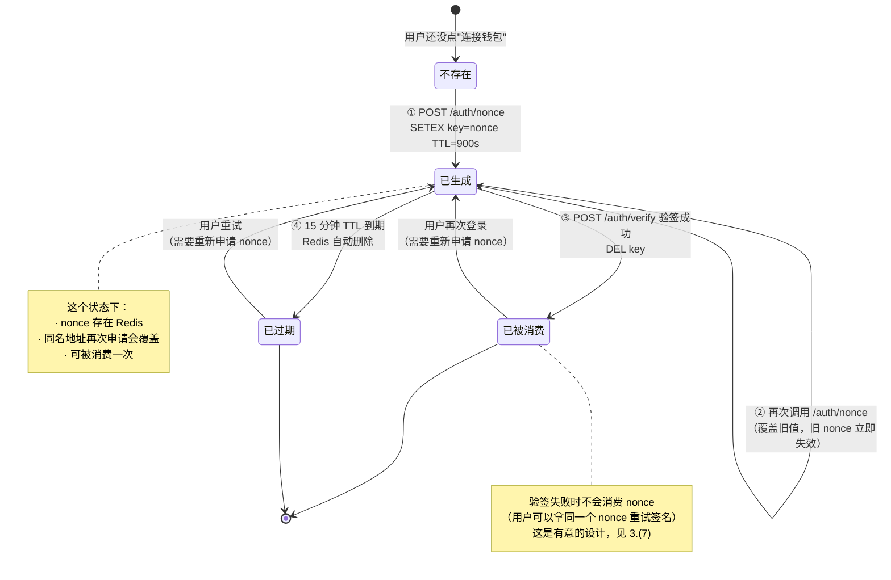
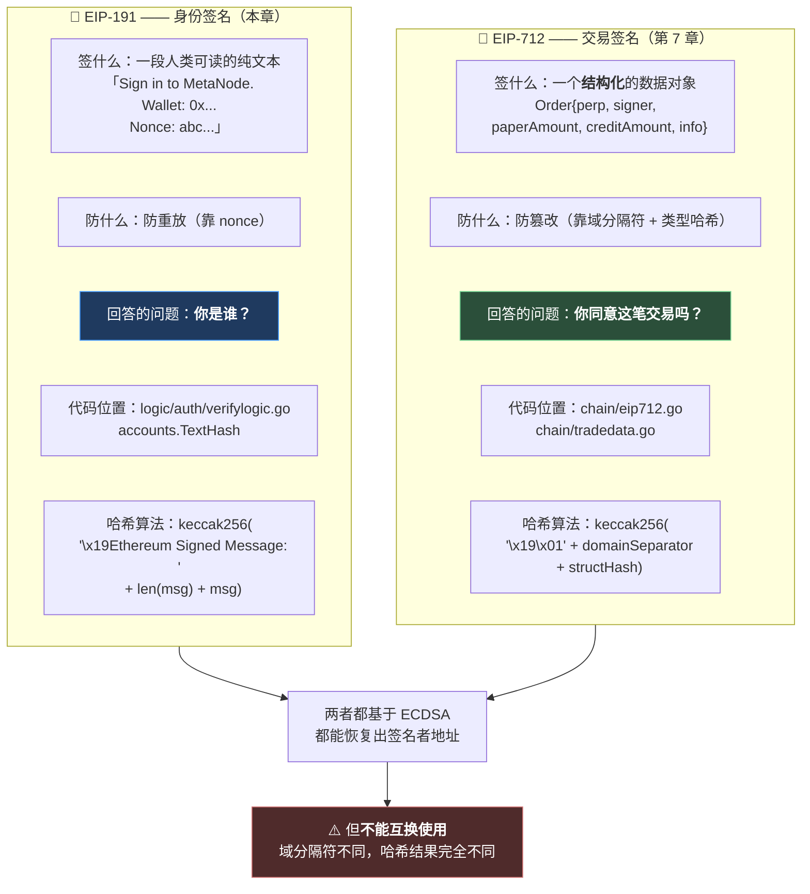
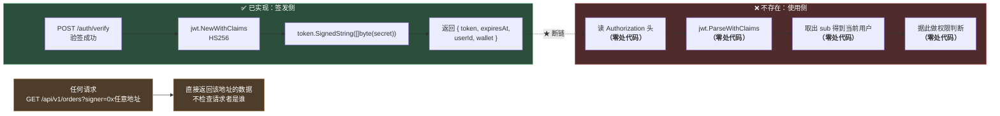

# 第 6 章：钱包即身份 — EIP-191 登录、Redis nonce 与 JWT 签发

> 从这一章开始，本指南进入**第二部分：请求入口**。前五章是架构铺垫，从这章起我们开始追踪具体的业务流程——而"登录"是一切业务的起点。
>
> Web3 应用的登录和传统应用**长得完全不一样**：没有用户名、没有密码、没有"注册"按钮。用户点一下"连接钱包"，钱包弹出一个签名框，签完之后就是登录状态了。**这中间的密码学原理是什么？服务端凭什么相信"这个请求来自那个地址"？**
>
> 本章会讲清这套机制（EIP-191 签名 + Redis nonce + JWT 签发），但更要紧的是——**我做了一次全仓库搜索，发现了这条链路上一个致命的断点：签发的 JWT 从来没有被任何代码校验过。** 这个发现会改变你对整套登录功能的理解，也会引出本章最重要的思考题：**当"认证"和"授权"分离，而授权环节根本不存在时，这套系统到底在保护什么？**

---

## 1. 本章导读

### 1.1 先看传统登录和 Web3 登录的根本区别

**传统登录（用户名 + 密码）本质上是"共享秘密"：**

```text
① 注册：用户把密码发给服务端 → 服务端存一个哈希（bcrypt(password)）
② 登录：用户再发一次密码 → 服务端比对哈希
③ 关键性质：服务端"知道"一个能代表用户的东西（密码哈希），这个知识本身就是风险
              → 数据库泄露 = 用户密码可能被破解
              → 服务端可以冒充用户（它有你密码的等价物）
```

**Web3 登录本质上是"证明私钥占有"，服务端不存任何秘密：**

```text
① 用户有私钥（在钱包里，永远不离开用户设备）
② 服务端发一个随机数（nonce）
③ 用户用私钥对这个"随机数 + 地址"签名 → 得到一个签名
④ 服务端从签名里"恢复"出公钥 → 推导出地址 → 比对
⑤ 关键性质：服务端从头到尾没拿到任何能冒充用户的东西
              → 数据库泄露 ≠ 用户身份泄露（因为数据库里根本没有密钥材料）
              → 服务端无法冒充用户（它没有私钥，签不出名）
```

**这个差别带来的实际后果：**

| | 传统登录 | Web3 登录 |
| --- | --- | --- |
| 服务端存什么 | 密码哈希 | **什么都不存**（nonce 用完即删） |
| 数据库泄露 | 用户密码可能被爆破 | 攻击者拿不到任何能签名的东西 |
| 服务端能否冒充用户 | ✅ 能（它知道密码等价物，或者能重置密码） | ❌ **不能**（没有私钥） |
| 用户忘记凭证怎么办 | 走"找回密码"流程 | **没有找回流程**——私钥丢了就是丢了 |
| 能否被封号 | ✅ 能 | ⚠️ 只能封地址（用户可以换一个地址） |

**⚠️ 但这里有一个必须说清楚的边界**：Web3 登录证明的是"**这个请求的发起者持有某个地址的私钥**"。它**不证明**任何关于这个人身份的事情——一个地址可能属于一个人、一个团队、一个合约，或者一个刚生成三秒钟的临时密钥对。

**所以 Web3 登录更像"证明你是这把钥匙的主人"，而不是"证明你是谁"。** 这个区别在业务设计上很重要：**不能用地址来做 "一人一票" 这类需要唯一身份的场景。**

### 1.2 本章会看到的三个层次

**层次一：密码学层——EIP-191 签名与地址恢复。**

这是最"漂亮"的部分：签名里**包含了可以恢复出公钥的信息**（ECDSA 的 `v` 值），所以服务端不需要事先知道你是谁，就能从签名反推出地址。这一层在 3.(4)(5) 拆解。

**层次二：工程层——nonce 的防重放设计与 Redis 生命周期。**

光有签名还不够。如果没有 nonce，攻击者可以**录下**你的签名然后反复重放——因为签名对同一段消息永远有效。所以服务端必须确保"每次登录要签的消息都不一样"。这一层在 3.(2)(7) 拆解。

**层次三（本章的核心发现）：这条链路是断的。**

登录流程完整实现了前两层，最后签发了一个 JWT。**但我做了全仓库搜索：这个 JWT 从来没有被任何地方校验过。**

```bash
$ grep -rn "jwt\.Parse\|ParseWithClaims" --include="*.go" .
（无输出）

$ grep -rn "Authorization" --include="*.go" internal/handler/ internal/logic/
（无输出）
```

**签发端有 2 行 `jwt.` 调用，校验端有 0 行。**

**这意味着：整个登录功能目前是一个"能跑的装饰品"**——用户可以完成登录、拿到 token，但这个 token 在后续任何请求里都不被检查。**所有 API 的实际访问权限，和有没有登录、登录的是谁，完全无关。**

这一层在 3.(10) 完整展开。

### 1.3 一个必须先建立的认知：认证 ≠ 授权

这个发现之所以重要，是因为它触及了一个很容易混淆的概念区分：

```text
认证（Authentication，AuthN）：你是谁？      ← 本项目实现了（钱包签名登录）
授权（Authorization，AuthZ）： 你能做什么？   ← 本项目基本没实现
```

**在传统 Web 应用里，这两件事通常用同一个机制解决**——"登录后拿到 session/JWT，后续请求带上它，服务端据此知道你是谁，然后决定你能不能做某个操作"。**因为这两件事被耦合在一起，所以很多人会不自觉地认为"实现了登录就等于实现了权限控制"。**

**但在 Web3 应用里，这个耦合是可以（而且应该）被解开的**，因为链上操作的安全性**根本不依赖服务端的授权判断**：

```text
用户想下单 → 服务端不检查"你登录了吗" → 直接把订单转发给撮合引擎
           → 但订单本身带着 EIP-712 签名
           → 最终由链上合约验证签名（approveTrade 里的 ECDSA.tryRecover）
           → 签名不对，整笔交易 revert
```

**链上合约是最终的安全边界，服务端只是"加速器"。** 所以本项目不检查 JWT，**在功能上不会导致用户资金被盗**——因为资金的操作都需要链上签名。

**⚠️ 但这不意味着"不校验 JWT"是正确的**，它带来的是另外三类问题（详见 6.1）：

| 问题类型 | 具体表现 |
| --- | --- |
| **数据隐私** | 任何人（不登录）都能查任意地址的订单、成交、余额 |
| **资源滥用** | 任何人都能无偿调用下单接口，写满数据库 |
| **限流/风控失效** | 无法按用户维度做频率限制、无法封禁恶意地址 |

**所以本章的结论不是"这个登录功能没用"，而是"它实现了一半、用途被浪费了"。** 至于这一半该怎么补，见 6.1 和 5.2 的思考题。

---

## 2. 架构 / 流程图

### 2.1 登录的完整时序

这是本章的主图。**注意图中标注颜色的三个环节——它们分别是"密码学核心"、"防重放机制"和"断链点"**：

```mermaid
%%{init: {'flowchart': {'wrappingWidth': 1000}}}%%
sequenceDiagram
    autonumber
    participant W as 👤 用户钱包<br/>（MetaMask 等）
    participant F as 前端
    participant S as Go 后端
    participant R as Redis
    participant PG as Postgres

    Note over W,PG: 第一步：申请 nonce
    F->>S: POST /api/v1/auth/nonce<br/>{"address":"0xAbC..."}
    S->>S: ① 校验地址格式 common.IsHexAddress
    S->>S: ② crypto/rand 生成 16 字节随机数<br/>→ hex 编码成 32 字符
    S->>S: ③ 拼接明文消息<br/>"Sign in to MetaNode.\n\nWallet: 0x..\nNonce: abc.."
    S->>R: ④ SETEX metanode:wallet_auth_nonce:0xabc... <br/>值=nonce，TTL=15 分钟
    S-->>F: {nonce, messageToSign}

    Note over W,PG: 第二步：用户签名（私钥永不离开钱包）
    F->>W: 请求对 messageToSign 签名
    W->>W: ★ EIP-191 personal_sign<br/>对 "\x19Ethereum Signed Message:\n" + len + msg 做哈希<br/>再用私钥签名
    W-->>F: 65 字节签名（r ‖ s ‖ v）
    F->>S: POST /api/v1/auth/verify<br/>{address, message, signature}

    Note over W,PG: 第三步：服务端验证
    S->>R: ⑤ 取出该地址的 nonce
    alt Redis 里没有 nonce（过期或未申请）
        R-->>S: 空
        S-->>F: 401 nonce expired or missing
    else
        S->>S: ⑥ 用存下来的 nonce 重建 expected 消息<br/>与请求里的 message 逐字符比对
        S->>S: ⑦ ★ accounts.TextHash(message) → SigToPub(sig)<br/>从签名恢复地址，与声称的地址比对
        S->>R: ⑧ DEL nonce（一次性消费）
        S->>PG: ⑨ UPSERT users（首次登录插入，再次登录更新 last_login_at）
        S->>S: ⑩ 签发 JWT（HS256，claims: sub/iat/exp/uid）
        S-->>F: {token, expiresAt, userId, wallet}
    end

    Note over F,PG: 第四步：使用 token
    F->>S: ★ GET /api/v1/orders<br/>Authorization: Bearer &lt;token&gt;
    S-->>F: 200 —— <b>⚠️ token 从未被读取</b>
```

**图的最后两行是本章的核心发现**：前端带着 token 发请求，服务端**从来不看它**。

### 2.2 nonce 的生命周期状态机

nonce 是这个防重放机制的核心。它的完整生命周期是这样的：



**这张图里有两个值得注意的设计点：**

**设计点一：重复调用 `/auth/nonce` 会覆盖旧 nonce。**

这意味着**用户在多标签页同时点"连接钱包"，只有最后一个 nonce 有效**——另一个标签页里的签名会失败，提示"message mismatch"。**这是一个真实的用户体验问题**（虽然不算 bug）：用户看到的是"登录失败"，但实际原因是"你在另一个标签页里重新申请了 nonce"。

**设计点二：验签失败不消费 nonce，只有成功才消费。**

这个顺序是刻意的：**让用户可以用同一个 nonce 重新签名**（比如第一次点错了、或者钱包弹窗被误关闭）。**但它同时意味着一个 nonce 可以被无限次尝试签名**——不过由于 ECDSA 签名的伪造不可行，这个"无限次尝试"没有实际风险。

### 2.3 EIP-191 与 EIP-712 的分工

这是本章和下一章（第 7 章）的关键对比。**同样是"用私钥签名"，但这两个标准解决的问题完全不同：**



**关键区别一览：**

| | EIP-191（身份签名） | EIP-712（交易签名） |
| --- | --- | --- |
| 签名对象 | 一段纯文本 | 结构化的类型化数据 |
| 前端 API | `personal_sign` / `signMessage` | `signTypedData` / `_signTypedData` |
| 钱包弹窗显示 | 一大段原始文本（用户"看不清"在签什么） | 结构化的字段列表（**用户可以核对每一项**） |
| 是否有域绑定 | ❌ 没有 | ✅ 有（`domainSeparator` 含 chainId + 合约地址） |
| 跨链重放 | ⚠️ **同一签名在任意链上都有效** | ✅ 域不同，换链即失效 |
| 跨合约重放 | ⚠️ 没有合约绑定 | ✅ 域里含 `verifyingContract` |
| 本项目的用途 | 登录 | 下单 |

**"跨链重放"这一行值得特别注意**：EIP-191 的哈希里**没有任何链的信息**。所以同一个钱包在以太坊主网和 Sepolia 上对同一段文本签名，得到的是**完全相同的签名**。

**对登录场景来说这个风险可控**（因为登录只在本服务端有效，不涉及链上资产），但**它是一个值得记住的性质**：**如果你用 EIP-191 做任何跨链的业务动作，就要额外注意重放问题。**

### 2.4 JWT 的"签发有、校验无"——本章的核心断链



**验证方法（你可以自己复现）：**

```bash
# 1. 搜索 JWT 解析
grep -rn "jwt\.Parse\|ParseWithClaims" --include="*.go" .
# → 无输出

# 2. 搜索 Authorization 头
grep -rn "Authorization" --include="*.go" internal/
# → 无输出

# 3. 搜索 go-zero 的 jwt 中间件
grep -rn "rest.WithJwt\|jwt:" --include="*.go" --include="*.api" .
# → 无输出

# 4. 统计签发端和校验端
grep -c "jwt\." internal/logic/auth/verifylogic.go     # → 2（签发）
grep -rc 'jwt\.Parse' --include="*.go" . | grep -v ':0' | wc -l   # → 0（校验）
```

**结论：JWT 在整个生命周期里只有"被创建"，从来没有"被读取"。**

**这意味着下面这个流程是完全可行的：**

```bash
# 不登录，直接查任意地址的订单
$ curl "http://localhost:28888/api/v1/orders?signer=0x任何一个地址"
{"code":0,"message":"ok","orders":[...],"total":42,...}

# 不登录，直接下单（只要有一张合法的签名订单）
$ curl -X POST http://localhost:28888/api/v1/orders \
  -d '{"perp":"0x...","signer":"0x...","paperAmount":"1000000000000000000",...}'
{"code":0,"message":"success","orderId":"0x..."}
```

**⚠️ 注意第二条**：下单不需要 JWT，**但它需要一张 EIP-712 签名订单**——所以攻击者不能凭空下单。**安全保障来自第 7 章的订单签名，而不是本章的登录。**

**这正好印证了 1.3 节的判断：在 Web3 应用里，"认证"和"授权"可以解耦，而真正的安全边界在链上（或者说，在密码学签名上）。**

---

## 3. 核心代码拆解

### (1) `BuildWalletLoginMessage` —— 一个 8 行的消息模板

```go
package auth

import "fmt"

// BuildWalletLoginMessage 与 verify 侧校验用的明文一致（EIP-191 personal_sign）。
func BuildWalletLoginMessage(walletChecksum string, nonce string) string {
	return fmt.Sprintf("Sign in to MetaNode.\n\nWallet: %s\nNonce: %s", walletChecksum, nonce)
}
```

**作者为什么这么设计（设计思想）：**

**设计点一：这个函数只有 8 行，但它被放在独立文件里，而且有两个调用点。**

```go
// noncelogic.go:61 —— 生成时用
msg := BuildWalletLoginMessage(addr.Hex(), nonce)

// verifylogic.go:85 —— 校验时用
expected := BuildWalletLoginMessage(wallet.Hex(), strings.TrimSpace(storedNonce))
```

**这是它被抽出来的唯一理由：确保生成和校验用的是同一个模板。** 如果这两处各写一遍字符串拼接，任何一次改动（比如加一行"Chain ID: 1"）都可能只改一处，导致**所有用户的签名都验不过**。

**这是一个很小但很关键的设计**——它把一个"两处必须一致"的约束，变成了"只有一个地方能改"的代码结构。**这类"单一定义"的抽取，成本是 8 行代码，收益是消除一整类 bug。**

**设计点二：消息里包含了什么、没包含什么。**

```text
Sign in to MetaNode.        ← ① 用途说明（人类可读）
                            ← 空行
Wallet: 0xAbC...            ← ② 钱包地址（checksum 格式）
Nonce: 3f2a...              ← ③ 一次性随机数
```

**包含了：**用途、地址、nonce。

**没有包含（而应该包含的）：**

| 缺失项 | 为什么重要 |
| --- | --- |
| **域名 / 来源（origin）** | 用户无法区分"这是官网要我签的"还是"钓鱼网站要我签的" |
| **链 ID** | 同一个签名在任意链上有效（见 2.3 的"跨链重放"） |
| **签发时间** | nonce 已提供了时效，但用户看不到"这是刚才的请求" |
| **请求的资源** | 无法表达"我授权的是登录，不是转账" |

**这正是 EIP-4361（Sign-In with Ethereum，简称 SIWE）要解决的问题。** SIWE 定义的标准消息格式长这样：

```text
example.com wants you to sign in with your Ethereum account:
0xAbC...

I accept the Terms of Service: https://example.com/tos

URI: https://example.com/login
Version: 1
Chain ID: 1
Nonce: 3f2a...
Issued At: 2026-09-18T10:00:00Z
```

**注意前两行**：`example.com wants you to sign in with...` —— **域名出现在第一行**，用户一眼就能看出"这是哪个网站在要签名"。**这是防钓鱼的关键设计。**

**本项目的消息第一行是 `Sign in to MetaNode.`** ——**"MetaNode" 是一个人类可读的名字，而不是一个可验证的域名。** 攻击者可以原样复制这段消息（包括 `Sign in to MetaNode.` 这行）在自己的钓鱼网站上展示，**用户完全无法从消息内容上分辨真伪**。

**⚠️ 但这个风险的实际影响有限**，因为：

```text
登录签名的用途 = 证明"我是这个地址的主人"（只对本服务端有效）
              ≠ 授权任何资产操作

即使攻击者骗到了登录签名，他能做的只是"用别人的地址登录这个后端"——
而这个后端目前根本不检查登录状态（2.4 节），所以连这点价值都没有。
```

**所以这是一个"设计不够严谨、但当前没有实际危害"的问题。** 如果将来加了 JWT 校验、并且把登录态关联到业务权限上（比如"只有登录用户能下单"），那么这个消息模板就必须升级成 SIWE 格式。

### (2) `NonceLogic.AuthNonce` —— nonce 的生成与存储

```go
const redisNonceKeyPrefix = "metanode:wallet_auth_nonce:"

func authNonceTTL(cfg config.AuthConfig) int {
	m := cfg.NonceTTLMinutes
	if m <= 0 {
		m = 15                          // 兜底默认值：15 分钟
	}
	return m * 60
}

func (l *NonceLogic) AuthNonce(req *types.AuthNonceReq) (*types.AuthNonceResp, error) {
	// ① 配置检查：没配 JwtSecret 就直接拒绝
	sec := strings.TrimSpace(l.svcCtx.Config.Auth.JwtSecret)
	if sec == "" {
		return &types.AuthNonceResp{Code: 503, Message: "Auth.JwtSecret 未配置"}, nil
	}

	// ② 地址格式校验
	raw := strings.TrimSpace(req.Address)
	if raw == "" || !common.IsHexAddress(raw) {
		return &types.AuthNonceResp{Code: 400, Message: "invalid address"}, nil
	}

	// ③ 地址归一化：无论用户传什么大小写，统一转成小写作为 Redis key
	addr := common.HexToAddress(raw)
	addrLower := strings.ToLower(addr.Hex())

	// ④ 生成 16 字节密码学安全随机数
	buf := make([]byte, 16)
	if _, err := rand.Read(buf); err != nil {
		return &types.AuthNonceResp{Code: 500, Message: fmt.Sprintf("nonce: %v", err)}, nil
	}
	nonce := hex.EncodeToString(buf)         // → 32 个十六进制字符

	// ⑤ 用同一个模板生成待签消息
	msg := BuildWalletLoginMessage(addr.Hex(), nonce)   // 注意：这里用的是 checksum 格式

	// ⑥ 写入 Redis，带 TTL
	key := redisNonceKeyPrefix + addrLower
	ttl := authNonceTTL(l.svcCtx.Config.Auth)
	if err := l.svcCtx.Redis.SetexCtx(l.ctx, key, nonce, ttl); err != nil {
		return &types.AuthNonceResp{Code: 500, Message: fmt.Sprintf("redis: %v", err)}, nil
	}

	return &types.AuthNonceResp{
		Code: 0, Message: "ok",
		Nonce:         nonce,
		MessageToSign: msg,
	}, nil
}
```

**作者为什么这么设计（设计思想）：**

**设计点一：`crypto/rand` —— 这次用对了。**

```go
buf := make([]byte, 16)
if _, err := rand.Read(buf); err != nil { ... }    // crypto/rand，不是 math/rand
```

**对比第 1 章 6.4 那个反面案例**（`engine/matchengine.go` 里的 `randomString` 用 `time.Now().UnixNano() % 36`），**这里用的是 `crypto/rand`——正确的选择。**

**这个对比很有教育意义：同一个项目里，两个"需要随机数"的地方用了完全不同的随机源。**

| | `auth/noncelogic.go` | `engine/matchengine.go` |
| --- | --- | --- |
| 用什么 | `crypto/rand.Read` | `time.Now().UnixNano() % 36` |
| 安全性 | ✅ 密码学安全 | ❌ 可预测 |
| 用途 | 防重放的 nonce | 生成 tradeId |
| 后果 | 安全 | 低（ID 不参与安全决策） |

**为什么 nonce 必须是密码学安全的？** 因为**如果 nonce 可预测，防重放机制就失效了**：

```text
假设 nonce 是 time.Now().Unix() % 10000（可预测）
   ↓
攻击者可以预先算出"未来某个时刻的 nonce"
   ↓
诱导用户对那个 nonce 签名（或者提前准备好签名）
   ↓
在对应时刻重放 → 登录成功
```

**16 字节 = 128 位 = 3.4 × 10³⁸ 种可能**，暴力枚举不可行。**这个长度是合理的**（作为对比：UUIDv4 是 122 位随机）。

**设计点二：地址归一化的处理很讲究。**

```go
addr := common.HexToAddress(raw)              // ① 解析成 20 字节
addrLower := strings.ToLower(addr.Hex())      // ② 转小写
...
msg := BuildWalletLoginMessage(addr.Hex(), nonce)   // ③ 但消息里用的是 checksum 格式
```

**注意这里的"两副面孔"**：

```text
Redis key  → 用小写地址（addrLower）—— 保证不同大小写输入命中同一个 key
消息内容   → 用 checksum 地址（addr.Hex()）—— 保持人类可读 + 有校验位
```

**为什么 Redis key 必须用小写？** 因为**以太坊地址大小写不敏感，但字符串比较敏感**（第 2 章 4.2 讲过）。

```text
用户 A 用 0xAbC...D 申请 nonce → key = "metanode:wallet_auth_nonce:0xabc...d"
用户 A 用 0xabc...d 验证      → 如果不做归一化，key = "metanode:wallet_auth_nonce:0xabc...d"
                                 恰好一致（因为用户这次传的是小写）
但如果两次传的大小写都不同，不做归一化就会 key 不匹配 → 登录失败
```

**`common.HexToAddress(raw).Hex()` 这个写法值得记住**——它做了两件事：

1. **解析 + 校验**：`HexToAddress` 会把输入解析成 20 字节的 `[20]byte` 数组（非法输入会得到全零地址）；
2. **产出 checksum 格式**：`.Hex()` 输出的不是原样字符串，而是 **EIP-55 校验和格式**（大小写混合，大小写本身就是校验位）。

**⚠️ 但这里有一个容易被忽略的细节**：`HexToAddress` **不会报错**——它对非法输入返回全零地址 `0x0000...0000`。所以 `common.IsHexAddress(raw)` 那个前置校验是必需的（代码里做了，在步骤 ② 里）。

**设计点三：`JwtSecret` 未配置时返回 503，而不是拒绝启动。**

```go
sec := strings.TrimSpace(l.svcCtx.Config.Auth.JwtSecret)
if sec == "" {
	return &types.AuthNonceResp{Code: 503, Message: "Auth.JwtSecret 未配置"}, nil
}
```

**这个行为是合理的**：登录功能是可选的（`AuthConfig` 在 `Config` 里标了 `json:",optional"`，见第 2 章 3.(9)），没配就不提供登录。**503 是准确的语义**（"依赖未配置"），比 500 或 400 都更贴切。

**⚠️ 但注意：这个检查只在"签发端"做了。** 详见 6.2 的踩坑。

### (3) 对比：两种"随机数"的写法

上一节提到 `crypto/rand` 用对了。这里把两段代码并排放在一起，因为这个对比本身很有教学价值：

```go
// ✅ 正确：auth/noncelogic.go —— 密码学安全随机
buf := make([]byte, 16)
if _, err := rand.Read(buf); err != nil {        // crypto/rand.Read
	return &types.AuthNonceResp{Code: 500, Message: fmt.Sprintf("nonce: %v", err)}, nil
}
nonce := hex.EncodeToString(buf)
```

```go
// ❌ 有问题的：engine/matchengine.go —— 可预测的"随机"
func randomString(n int) string {
	const letters = "abcdefghijklmnopqrstuvwxyz0123456789"
	b := make([]byte, n)
	for i := range b {
		b[i] = letters[time.Now().UnixNano()%int64(len(letters))]   // ← 时间取模当随机源
	}
	return string(b)
}

func generateTradeId() string {
	return time.Now().Format("20060102150405") + randomString(8)
}
```

**两段代码的对比：**

| | `auth/noncelogic.go` | `engine/matchengine.go` |
| --- | --- | --- |
| 随机源 | `crypto/rand`（操作系统熵池） | `time.Now().UnixNano()` |
| 熵 | 128 位 | 实际不到 20 位（时间戳低位高度相关） |
| 可预测性 | 不可预测 | **可暴力枚举** |
| 错误处理 | ✅ 检查了 `rand.Read` 的 error | ❌ 无 |
| 用途 | 登录 nonce | tradeId（成交记录 ID） |
| 后果 | 安全 | 影响有限 |

**为什么 `engine` 那个后果"影响有限"？** 因为 `tradeId` **不参与任何安全决策**——它不是签名、不是密钥、不是访问凭证。它只是一个数据库主键，而且前面还拼了秒级时间戳：

```text
tradeId = "20260918143000" + 8 个弱随机字符
```

**要碰撞，需要"同一秒内生成两次"。** 在 `submitBatch` 串行执行（发一笔、等确认、再发下一笔，中间要等 12 秒出块）的前提下，这个概率几乎为零。

**但这个对比仍然值得记住，因为它是"同一个项目里同一个概念被两种方式实现"的典型样本。** 更值得记住的是这条判断标准：

> **判断一个随机数是否必须密码学安全，看它的用途：**
>
> ```text
> 参与安全决策（nonce、token、密钥、盐值、抽奖） → 必须 crypto/rand
> 只是标识符（ID、文件名、日志追踪）              → math/rand 即可
> ```
>
> **但这个判断必须在写代码的那一刻做对**——因为一旦选错了，事后很难发现（弱随机不会报错、不会崩溃，只会在某个攻击场景下静默失效）。

### (4) `verifyPersonalSign` —— EIP-191 验签的核心

这是本章最"密码学"的 20 行，也是整个登录功能的技术核心：

```go
func verifyPersonalSign(wallet common.Address, message string, sigHex string) bool {
	// ① 去掉可选的 "0x" 前缀
	sigHex = strings.TrimSpace(sigHex)
	hexBody := sigHex
	if strings.HasPrefix(strings.ToLower(sigHex), "0x") {
		hexBody = sigHex[2:]
	}

	// ② hex 解码，并检查长度
	sig, err := hex.DecodeString(hexBody)
	if err != nil || len(sig) != 65 {
		return false                     // 签名必须是 65 字节：r(32) + s(32) + v(1)
	}

	// ③ 归一化 v 值
	if sig[64] >= 27 {
		sig[64] -= 27
	}

	// ④ ★ EIP-191 哈希
	hash := accounts.TextHash([]byte(message))

	// ⑤ ★ 从签名恢复公钥
	pub, err := crypto.SigToPub(hash, sig)
	if err != nil {
		return false
	}

	// ⑥ 公钥 → 地址，与声称的地址比对
	recovered := crypto.PubkeyToAddress(*pub)
	return strings.EqualFold(recovered.Hex(), wallet.Hex())
}
```

**作者为什么这么设计（设计思想）：**

**设计点一：步骤 ③ 的 `v` 值归一化，是一个真实的兼容性坑。**

ECDSA 签名包含三部分：

```text
r (32 字节) —— 椭圆曲线点的 x 坐标
s (32 字节) —— 签名值
v (1 字节)  —— 恢复标识（recovery id），取值 0/1 或 27/28
```

**`v` 为什么有两种取值？** 历史原因：

| 取值 | 来源 | 用在哪里 |
| --- | --- | --- |
| `27` / `28` | 比特币时代的约定 | 大多数钱包的 `personal_sign` 输出、链上 `ECDSA.tryRecover` |
| `0` / `1` | 以太坊黄皮书定义的原始值 | go-ethereum 的 `crypto.SigToPub` 期望的格式 |

**而不同钱包输出的格式不一致**：

```text
MetaMask          → v = 27/28
部分硬件钱包       → v = 0/1
某些 SDK          → v = 0/1
```

**步骤 ③ 就是处理这个差异：如果 `v >= 27`，就减 27 转成 0/1。**

**⚠️ 但这个归一化是不完整的**——它只处理了 `27/28` 的情况。完整的情况还包括：

```text
v = 0/1      → 不需要转换
v = 27/28    → 减 27
v = 2/3      → EIP-155 的 recovery id（某些场景下出现）
```

**对比第 7 章的订单签名处理**（`chain/tradedata.go` 的 `DecodeSignature`），它处理得更完整：

```go
switch b[64] {
case 27, 28:
	b[64] -= 27
case 0, 1:
	// MetaMask / viem 常见格式，无需处理
case 2, 3:
	// EIP-155 recovery id，取 parity
	b[64] -= 2
default:
	return nil, fmt.Errorf("bad recovery id %d", b[64])
}
```

**⚠️ 同一个项目里，两处签名处理用了不同的归一化逻辑**——这是本节最值得指出的一点。虽然对登录场景来说 `27/28` 已经覆盖了绝大多数钱包，但**这种不一致意味着：如果某个钱包输出了 `v=2/3`，登录会失败而下单会成功**。

**修法**：把签名解析抽成一个公共函数（比如复用 `chain.DecodeSignature`），让两处用同一套逻辑。

**设计点二：`accounts.TextHash` 是 EIP-191 的实现。**

```go
hash := accounts.TextHash([]byte(message))
```

这个函数来自 `github.com/ethereum/go-ethereum/accounts`，它做的是：

```text
hash = keccak256(
    "\x19Ethereum Signed Message:\n" + decimalLength(message) + message
)

其中 decimalLength 是消息字节数的十进制字符串表示。
```

**举例**：如果消息是 `"hello"`（5 字节），哈希的输入是：

```text
"\x19Ethereum Signed Message:\n5hello"
```

**为什么要加这个前缀？** 这是 EIP-191 的核心设计——**防止"签名被挪用"**：

```text
问题：如果直接对消息本身签名，那么：
      · 一段消息的签名，可能恰好等于"某个交易的签名"
      · 攻击者可以诱导用户签一段"看起来无害的文本"，
        然后把那个签名当作一笔交易的签名提交到链上

解法：给所有"非交易"的签名加一个固定前缀
      → 交易签名的哈希输入是 "\x19\x01" + domainSeparator + structHash（EIP-712）
      → 消息签名的哈希输入是 "\x19Ethereum Signed Message:\n" + len + msg（EIP-191）
      → 两者的哈希空间完全隔离，不能互相挪用
```

**这个设计叫「域分离（domain separation）」**，是一个通用的密码学工程原则：**给不同用途的签名加上不同的前缀，让它们的签名空间互不相通。**

**记住这个原则，因为第 7 章的 EIP-712 用的是同一套思路的进阶版。**

**设计点三：为什么是"恢复公钥"而不是"用公钥验签"？**

这是很多初学者的疑问：

```text
常规的数字签名验证流程：
  服务端有公钥 → verify(公钥, 消息, 签名) → true/false

本项目的流程：
  服务端没有公钥 → 从签名里"恢复"出公钥 → 推导地址 → 比对
```

**为什么能用后者？** 因为 ECDSA 有一个特殊的性质：**签名里包含了恢复公钥所需的信息**（就是那个 `v` 参数）。

**这个性质带来的关键好处是：服务端不需要预先知道用户是谁。**

```text
如果用"验签"模式：
  用户请求 → 服务端：请问您是谁？→ 用户：我是 0xAbC → 服务端查库拿公钥 → verify
  → 但在登录场景里，服务端还不知道这个地址有没有注册过

用"恢复"模式：
  用户请求 → 服务端：从签名算一下你是谁 → 得到 0xAbC → 完成
  → 不需要预先存储任何东西
```

**这就是"服务端不存任何秘密"能成立的技术基础**——**第一次见面的用户，服务端也能验证他。** 这是 Web3 登录相比传统登录最优雅的地方。

### (5) `AuthVerify` 的完整校验链

这是本章最长的函数（68 行），但它的结构非常清晰——**五道校验，每道都有明确的失败码**：

```go
func (l *VerifyLogic) AuthVerify(req *types.AuthVerifyReq) (*types.AuthVerifyResp, error) {
	// 【校验 1】配置检查
	sec := strings.TrimSpace(l.svcCtx.Config.Auth.JwtSecret)
	if sec == "" {
		return &types.AuthVerifyResp{Code: 503, Message: "Auth.JwtSecret 未配置"}, nil
	}

	// 【校验 2】地址格式
	raw := strings.TrimSpace(req.Address)
	if raw == "" || !common.IsHexAddress(raw) {
		return &types.AuthVerifyResp{Code: 400, Message: "invalid address"}, nil
	}
	wallet := common.HexToAddress(raw)
	addrLower := strings.ToLower(wallet.Hex())

	// 【校验 3】nonce 是否存在（未申请 / 已过期 / 已消费都会走到这里）
	key := redisNonceKeyPrefix + addrLower
	storedNonce, err := l.svcCtx.Redis.GetCtx(l.ctx, key)
	if err != nil || strings.TrimSpace(storedNonce) == "" {
		return &types.AuthVerifyResp{Code: 401, Message: "nonce expired or missing, request /auth/nonce again"}, nil
	}

	// 【校验 4】消息是否与服务端重建的一致
	expected := BuildWalletLoginMessage(wallet.Hex(), strings.TrimSpace(storedNonce))
	if strings.TrimSpace(req.Message) != expected {
		return &types.AuthVerifyResp{Code: 400, Message: "message mismatch"}, nil
	}

	// 【校验 5】签名是否有效
	if !verifyPersonalSign(wallet, req.Message, req.Signature) {
		return &types.AuthVerifyResp{Code: 401, Message: "invalid signature"}, nil
	}

	// 【消费】nonce 一次性，验签通过后才删
	if _, err := l.svcCtx.Redis.DelCtx(l.ctx, key); err != nil {
		l.Infof("auth verify del nonce key: %v", err)     // ⚠️ 只记日志，不阻断
	}

	// 【落库】用户表 upsert（PG 未配置时跳过）
	var userID string
	if l.svcCtx.PG != nil {
		id, err := repo.UpsertWalletUserOnLogin(l.ctx, l.svcCtx.PG, addrLower)
		if err != nil {
			return &types.AuthVerifyResp{Code: 500, Message: fmt.Sprintf("persist user: %v", err)}, nil
		}
		userID = id
	}

	// 【签发】JWT
	hours := jwtExpireHours(l.svcCtx.Config.Auth)
	now := time.Now()
	exp := now.Add(time.Duration(hours) * time.Hour)

	claims := jwt.MapClaims{
		"sub": addrLower,      // 主体：钱包地址
		"iat": now.Unix(),     // 签发时间
		"exp": exp.Unix(),     // 过期时间
	}
	if userID != "" {
		claims["uid"] = userID
	}
	token := jwt.NewWithClaims(jwt.SigningMethodHS256, claims)
	tokenStr, err := token.SignedString([]byte(sec))
	if err != nil {
		return &types.AuthVerifyResp{Code: 500, Message: fmt.Sprintf("jwt: %v", err)}, nil
	}

	return &types.AuthVerifyResp{
		Code: 0, Message: "ok",
		Token: tokenStr, ExpiresAt: exp.Unix(),
		UserId: userID, Wallet: addrLower,
	}, nil
}
```

**作者为什么这么设计（设计思想）：**

**设计点一：校验 4（消息比对）看起来是多余的，但它堵住了一个真实的攻击面。**

**疑问**：既然服务端能用 `storedNonce` 重建出 `expected` 消息，为什么还要客户端把 `message` 发回来对比？直接用 `expected` 去验签不就行了？

**答案在于"用户实际签了什么"这件事只有客户端知道。**

设想没有这道校验的场景：

```text
攻击者：我想让用户对一段"我控制的文本"签名（比如一段授权转账的文本）
       ↓
攻击者诱导用户签名 "I authorize transfer of 100 ETH to attacker"（用户以为是别的）
       ↓
攻击者把这个签名 + 那个文本，发到 /auth/verify
       ↓
如果没有校验 4：服务端用 expected（登录消息）去验签 → 签名不匹配 → 失败 ✅
                （因为用户签的是另一段文本）
```

**所以即使没有校验 4，验签本身也会失败**——因为签名只对用户实际签的那段文本有效。

**那校验 4 的价值是什么？**

**它把一个"密码学失败"变成了一个"明确的业务错误"。** 对比两种响应：

```text
没有校验 4：验签失败 → "invalid signature"（401）
           用户/运维看到这个，会怀疑"是不是签名格式有问题"、"是不是钱包有 bug"

有校验 4：消息不匹配 → "message mismatch"（400）
           立刻知道"客户端发的消息和服务端期待的不一样"
```

**这是"错误信息应该指向根因"的一个好例子。** 而且校验 4 比验签便宜得多（一次字符串比较 vs 一次椭圆曲线运算），**放在前面做短路判断也更高效**。

**设计点二：nonce 的删除位置——在验签之后、落库之前。**

```go
// 验签通过
if !verifyPersonalSign(...) { return 401 }

// ★ 这里删除 nonce
if _, err := l.svcCtx.Redis.DelCtx(l.ctx, key); err != nil {
	l.Infof(...)                 // 只记日志
}

// 然后才落库、签发
if l.svcCtx.PG != nil { ... }
tokenStr, err := token.SignedString(...)
```

**这个位置选择带来两个后果：**

**后果 A（好的）**：验签失败时 nonce **不被消费**——用户可以重新签名重试。**这是对用户体验的照顾。**

**后果 B（有问题）**：**如果后续步骤失败（落库失败、JWT 签发失败），nonce 已经被删了。**

```text
用户签名正确 → nonce 被删 → 落库时数据库挂了 → 返回 500
   ↓
用户想重试 → 但 nonce 已经没了 → 必须重新申请 nonce
```

**这是"fail-closed"（失败时关闭）的行为**——用户需要重来，但不会产生安全问题。**可以接受，但不理想。**

**更稳妥的顺序应该是**：先完成所有可能失败的步骤，最后才消费 nonce：

```go
// 理想顺序
verifySignature()          // 1. 验签
upsertUser()               // 2. 落库（可能失败，此时 nonce 还在，可重试）
signJWT()                  // 3. 签发（可能失败，同上）
delNonce()                 // 4. ★ 全部成功后才消费 nonce
```

**⚠️ 但这样又引入一个新问题**：如果在第 4 步之前进程崩溃，nonce 就永远不会被消费（直到 TTL 到期）。**在"一次性"和"不浪费"之间，没有完美的顺序。**

**本项目的选择（早删）偏向安全**，是合理的取舍。**但 `DelCtx` 的错误只记日志这一点值得改进**——见 6.5。

**设计点三：PG 为 nil 时，登录仍然成功，但 `userID` 为空。**

```go
var userID string
if l.svcCtx.PG != nil {
	id, err := repo.UpsertWalletUserOnLogin(l.ctx, l.svcCtx.PG, addrLower)
	if err != nil {
		return &types.AuthVerifyResp{Code: 500, Message: fmt.Sprintf("persist user: %v", err)}, nil
	}
	userID = id
}

// ... 后面照常签发 JWT，只是 claims 里没有 "uid"
```

**这个降级是合理的**：登录的本质是"证明身份"，落库只是附加记录。**数据库挂了不应该阻止用户登录。**

**⚠️ 但它有一个连带后果**：JWT 的 claims 里可能没有 `uid`。如果将来某处代码依赖 `uid`（比如"用 uid 关联用户数据"），在数据库不可用时就会拿到空值。**这需要在消费 JWT 时防御性地处理**——不过当前 JWT 根本没被消费（2.4 节），所以这个风险还没实现。

### (6) JWT 的签发细节

```go
hours := jwtExpireHours(l.svcCtx.Config.Auth)     // 默认 168 小时 = 7 天
now := time.Now()
exp := now.Add(time.Duration(hours) * time.Hour)

claims := jwt.MapClaims{
	"sub": addrLower,        // subject —— 标准 claim，表示"这个 token 代表谁"
	"iat": now.Unix(),       // issued at —— 标准 claim，签发时间
	"exp": exp.Unix(),       // expiration —— 标准 claim，过期时间
}
if userID != "" {
	claims["uid"] = userID   // 自定义 claim
}
token := jwt.NewWithClaims(jwt.SigningMethodHS256, claims)
tokenStr, err := token.SignedString([]byte(sec))
```

**作者为什么这么设计（设计思想）：**

**设计点一：用了标准的 JWT claim 名（`sub` / `iat` / `exp`）。**

这是对的——JWT 的三个标准 claim 名（RFC 7519 定义）正好覆盖了这里的需要：

| claim | 全称 | 含义 | 本项目的值 |
| --- | --- | --- | --- |
| `sub` | subject | token 的主体 | 小写钱包地址 |
| `iat` | issued at | 签发时间 | 当前 Unix 时间戳 |
| `exp` | expiration | 过期时间 | 当前 + 168 小时 |

**用标准名而不是自定义名（比如 `wallet`），好处是能被标准库和中间件直接识别。** 比如 go-zero 的 `rest.WithJwt` 中间件就是读 `exp` 来做过期判断的——**如果将来要接入标准中间件，这些 claim 名不用改。**

**设计点二：`HS256`（对称签名）vs `RS256`（非对称签名）的选择。**

```go
token := jwt.NewWithClaims(jwt.SigningMethodHS256, claims)
tokenStr, err := token.SignedString([]byte(sec))
```

| | HS256（本项目） | RS256 |
| --- | --- | --- |
| 算法 | HMAC-SHA256，**对称** | RSA-SHA256，**非对称** |
| 密钥 | 一个共享密钥（签名和验签用同一个） | 私钥签名 / 公钥验签 |
| 谁能签发 | **任何知道密钥的人** | 只有持有私钥的人 |
| 谁能验证 | 任何知道密钥的人 | 任何拿到公钥的人 |
| 适用场景 | 单体应用 | **微服务**（网关验签、服务签发） |

**本项目选 HS256 是合理的**——因为只有一个服务，没有"多服务共享验证能力"的需求。

**⚠️ 但 HS256 有一个必须注意的风险**：**签发密钥 == 验证密钥**。这意味着：

```text
任何能读到 JwtSecret 的人 → 可以伪造任意用户的 token
```

**而本项目的 `JwtSecret` 恰恰是……见 6.2。**

**设计点三：过期时间 168 小时（7 天）是一个偏长的值。**

```go
func jwtExpireHours(cfg config.AuthConfig) int {
	h := cfg.JwtExpireHours
	if h <= 0 {
		return 168                // 默认 7 天
	}
	return h
}
```

**7 天的有效期在 Web3 应用里是"长"还是"短"？取决于业务：**

```text
支持"7 天免登录"的  → 168 小时合理
要求高安全性的金融场景 → 通常 15 分钟 ~ 24 小时
```

**关键问题是：本项目的 token 无法被撤销。**

```text
传统会话：服务端存 session → 可以随时删除（登出、封号）
JWT：      自包含，服务端不存 → ★ 签发之后无法撤销，只能等它过期

所以 JWT 的有效期 = "一个被盗的 token 能被滥用的最长时间"
```

**7 天意味着：如果 token 泄露，攻击者可以冒充该用户 7 天。** 对于金融类应用，这个窗口偏长。

**改进方向（如果将来 JWT 真的被使用）**：

```text
方案 A：缩短有效期（比如 2 小时）+ refresh token
方案 B：用 Redis 维护一个"已撤销 token"黑名单（牺牲 JWT 的无状态性）
方案 C：把 JWT 的 jti（JWT ID）存进 Redis，验签时检查是否有效
```

**在"JWT 从未被校验"的现状下，这些都还谈不上。** 但如果你要补齐校验，**有效期是需要同步调整的第一个参数。**

### (7) `UpsertWalletUserOnLogin` —— 幂等的用户落库

```go
// internal/repo/wallet_user.go
// UpsertWalletUserOnLogin 首次登录插入；再次登录更新 last_login_at（及 updated_at）。
func UpsertWalletUserOnLogin(ctx context.Context, db *gorm.DB, walletLower string) (string, error) {
	walletLower = strings.ToLower(strings.TrimSpace(walletLower))
	if walletLower == "" {
		return "", errors.New("empty wallet address")
	}

	// ① 先查
	var row model.WalletUser
	err := db.WithContext(ctx).Where("wallet_address = ?", walletLower).First(&row).Error
	now := time.Now().UTC()

	if err == nil {
		// ② 存在 → 更新 last_login_at
		row.LastLoginAt = now
		if err := db.WithContext(ctx).Save(&row).Error; err != nil {
			return "", err
		}
		return row.ID, nil
	}
	if !errors.Is(err, gorm.ErrRecordNotFound) {
		return "", err                 // 真错误，返回
	}

	// ③ 不存在 → 插入
	row = model.WalletUser{
		WalletAddress: walletLower,
		LastLoginAt:   now,
	}
	if err := db.WithContext(ctx).Create(&row).Error; err != nil {
		return "", err
	}
	return row.ID, nil
}
```

对应的表结构（`internal/model/wallet_user.go`）：

```go
// WalletUser 对应 public.users（钱包登录），非 Supabase Auth 的 auth.users。
type WalletUser struct {
	ID            string    `gorm:"column:id;type:uuid;primaryKey;default:gen_random_uuid()"`
	WalletAddress string    `gorm:"column:wallet_address;size:66;not null;uniqueIndex"`
	CreatedAt     time.Time `gorm:"column:created_at;autoCreateTime"`
	UpdatedAt     time.Time `gorm:"column:updated_at;autoUpdateTime"`
	LastLoginAt   time.Time `gorm:"column:last_login_at"`
}

func (WalletUser) TableName() string { return "users" }
```

**作者为什么这么设计（设计思想）：**

**设计点一："先查再写"不是原子操作——这是一个真实存在的竞态。**

```text
时刻 T1：请求 A 执行 ① 查询 → 没找到
时刻 T1：请求 B 执行 ① 查询 → 没找到
时刻 T2：请求 A 执行 ③ 插入 → 成功
时刻 T2：请求 B 执行 ③ 插入 → ★ 违反唯一约束，报错
```

**两个并发的首次登录请求，会有一个失败。**

**⚠️ 但要注意失败的表现**：`Create` 会返回一个 Postgres 唯一约束冲突错误，于是 `UpsertWalletUserOnLogin` 返回 `("", err)`，`AuthVerify` 返回 `Code: 500, Message: "persist user: ..."`。

**用户看到的是"登录失败"**——虽然他的签名完全正确。

**这什么时候会发生？** 需要"同一地址的两个首次登录请求几乎同时到达"。在正常使用下概率很低（用户不会同时点两次），但在以下场景会出现：

```text
· 用户网络卡顿，前端自动重试
· 用户快速双击登录按钮
· 前端并发了两个请求
```

**更稳妥的写法**是用数据库原生的 upsert：

```sql
INSERT INTO users (wallet_address, last_login_at)
VALUES ($1, $2)
ON CONFLICT (wallet_address)
DO UPDATE SET last_login_at = EXCLUDED.last_login_at
RETURNING id
```

**GORM 也支持这个写法：**

```go
row := model.WalletUser{WalletAddress: walletLower, LastLoginAt: now}
err := db.WithContext(ctx).
	Clauses(clause.OnConflict{
		Columns:   []clause.Column{{Name: "wallet_address"}},
		DoUpdates: clause.AssignmentColumns([]string{"last_login_at", "updated_at"}),
	}).
	Create(&row).Error
```

**这样一次 SQL 就完成了"插入或更新"，天然原子，没有竞态。** 而且代码还更短。

**⚠️ 顺带一个发现**：项目里其实**已经有处理重复键的工具函数**（`model.IsDuplicateKeyErr`，第 2 章 3.(7) 提到过 `pgstore.go:197`），但 `repo/wallet_user.go` 没有用它。

```go
// internal/model/pgstore.go:197
// IsDuplicateKeyErr Postgres 唯一约束冲突（扫链重复入账时忽略）。
func IsDuplicateKeyErr(err error) bool { ... }
```

**这个函数本来就是为"并发写入导致的唯一约束冲突"准备的**（注释里说"扫链重复入账时忽略"），**同样的场景在用户落库这里也适用，但没有复用。**

**设计点二：`WalletUser` 的表名是 `users`，而不是 `wallet_users`。**

```go
func (WalletUser) TableName() string { return "users" }
```

注释解释了原因：

```go
// WalletUser 对应 public.users（钱包登录），非 Supabase Auth 的 auth.users。
```

**这是一个容易踩的坑**：Supabase 自带一套认证系统，它的用户表叫 `auth.users`（在 `auth` schema 下）。**本项目的 `public.users` 是完全独立的另一张表**——只是因为作者选了 `users` 这个名字，容易和 Supabase 的搞混。

**⚠️ 这个命名选择带来的实际风险**：如果将来有人想接入 Supabase Auth（很多人会这么做，因为它自带 OAuth、邮箱验证等功能），就会发现**表名冲突**——要么改自己的表名，要么和 `auth.users` 做同步。**更清晰的做法是叫 `wallet_users` 或 `wallet_logins`。**

### (8) 为什么这个登录流程"能跑但没用"

把前面所有片段串起来，我们可以完整地回答一个问题：**这套登录到底提供了什么价值？**

**它确实做到了的事：**

```text
✅ 证明了"请求者持有某个地址的私钥"（密码学上无懈可击）
✅ 防止了签名重放（nonce 一次性 + TTL）
✅ 记录了用户首次/最近登录时间（users 表）
✅ 签发了一个格式正确的 JWT
```

**它没有做到的事：**

```text
❌ 没有保护任何接口（JWT 从未被校验）
❌ 没有限流（任何接口都能匿名无限制调用）
❌ 没有把"登录"和"业务权限"关联起来
```

**用一个比喻来说明这个状态（我想了很久，觉得这个比较准确）：**

> 这套登录系统就像**一家公司做了员工工牌，发给了每个人，但所有门禁都不刷卡**。
>
> - **制卡流程是严谨的**（密码学上无懈可击：员工要当面出示证件才能领卡）；
> - **卡本身是有效的**（JWT 格式正确、有有效期）；
> - **但没有任何一扇门会去读卡**（零处校验代码）。
>
> 结果是：**工牌系统运转良好，但公司的安全状态和没有工牌时完全一样。**

**⚠️ 但这个比喻有一处需要修正**：这家公司**并不真的需要工牌**——因为**贵重的房间（链上资产）用的是另一套锁（EIP-712 订单签名），而那套锁是真的在用的**。

**所以准确的说法是**：**制卡系统做得很认真，但公司的主要资产靠的是另一套独立的、真正有效的锁。工牌目前的唯一作用是"记录谁来过"。**

**这个状态是好是坏？**

| 视角 | 判断 |
| --- | --- |
| **资产安全** | ✅ 没问题——链上签名才是真正的边界 |
| **隐私** | ❌ 有问题——任何人都能查任意地址的订单/成交/余额 |
| **资源保护** | ❌ 有问题——下单接口可被匿名无限制调用 |
| **工程完成度** | ⚠️ 做了一半——基础设施完备，但没有接到业务上 |

**这就是 1.3 节说的"认证 ≠ 授权"的具体后果**：**本项目的"认证"做完了，"授权"没做，而两者之间没有任何联动。**

**该补什么？** 不是"无脑给所有接口加上 JWT 校验"，而是**先想清楚哪些接口需要**：

| 接口类型 | 需要 JWT 吗 | 为什么 |
| --- | --- | --- |
| `POST /orders`（下单） | ⚠️ 可选 | 签名已经保证安全，但**加上能实现限流和封禁** |
| `POST /orders/cancel`（撤单） | ⚠️ 同上 | 同上 |
| `GET /orders?signer=X`（查订单） | ✅ **需要** | 防止任意人查任意地址的历史 |
| `GET /balance?trader=X` | ✅ **需要** | 财务信息，最敏感 |
| `GET /markets`、`GET /ticker` | ❌ 不需要 | 公开行情数据 |
| `GET /orderbook` | ❌ 不需要 | 公开数据 |

**⚠️ 注意"下单/撤单"这一行**：它们**不需要 JWT 来保证安全**（签名够了），但**需要它来防止滥用**。这是一个很实用的区分：

> **JWT 在 Web3 后端里更主要的用途，可能不是"权限控制"而是"限流和风控"。**
> 因为安全性由签名保证，但"谁在刷接口"只能靠登录态识别。

---

## 4. Web3 特有机制

### 4.1 EIP-191 的域分离设计

3.(4) 提到了 `accounts.TextHash` 加的 `\x19Ethereum Signed Message:\n` 前缀。这里把它的设计动机讲透，因为它是理解所有签名标准的基础。

**问题：如果不加前缀会怎样？**

考虑这个场景：

```text
① 用户在一个 DApp 上"签名登录"，签的消息是："0x1234"
② 攻击者拿到这个签名
③ 攻击者构造一笔交易，让交易的某个字段恰好哈希成 "0x1234"
   （或者更简单：某个合约的"授权"操作就是对一串字节签名）
④ 攻击者把这个签名当作"授权签名"提交 → 资金被转走
```

**根本原因是：签名本身不携带"我是用来干什么的"这个信息。** 一个对字节串 `X` 的有效签名，在**任何**需要"对 `X` 的签名"的场景里都有效。

**EIP-191 的解法是给不同用途的签名加上不同的前缀：**

```text
用途                          哈希输入
─────────────────────────────────────────────────────────────
交易签名（EIP-155）            keccak256(rlp([nonce, gasPrice, ..., chainId, 0, 0]))
消息签名（EIP-191）            keccak256("\x19Ethereum Signed Message:\n" + len + msg)
结构化数据（EIP-712）          keccak256("\x19\x01" + domainSeparator + structHash)
```

**注意那个 `\x19`** ——它在所有三种前缀里都出现。为什么？

```text
\x19 = 25（十进制）

RLP 编码的第一个字节如果是 0x19，表示"这是一个 25 字节的字符串"。
而合法的 RLP 编码列表的第一个字节不可能以 0x19 开头。

⟹ 以 \x19 开头的输入，永远不可能是一个合法的 RLP 编码交易
⟹ 从格式上就杜绝了"消息签名被当作交易签名"的可能
```

**这个细节很漂亮**：它不是在哈希层面做隔离，而是**从编码格式的层面**保证了不可能混淆。**这是一个"用协议设计消除攻击面"的典范。**

**所以 EIP-191 完整的前缀是 `\x19Ethereum Signed Message:\n<length>`：**

```text
\x19                        ← 标记"这不是 RLP"
Ethereum Signed Message:   ← 人类可读的用途说明
\n                         ← 分隔符
<length>                   ← 消息长度（十进制字符串）
<message>                  ← 原始消息
```

**为什么要带 `<length>`？** 防止**长度扩展攻击（length extension attack）**——如果消息本身包含 `\n`，没有长度标记的话，攻击者可以构造出两条不同的消息产生相同的哈希输入。

### 4.2 两种 nonce：登录 nonce 与订单 nonce

第 1 章 4.3 已经对比过"交易 nonce"和"订单 nonce"。这里补充第三个——**登录 nonce**，它们三者很容易混淆：

| | 交易 nonce | 订单 nonce | **登录 nonce** |
| --- | --- | --- | --- |
| 属于谁 | 发交易的账户（后端） | 下单用户 | **登录用户** |
| 作用 | 防交易重放、保证顺序 | 让同内容的订单哈希不同 | **防登录签名重放** |
| 谁生成 | 以太坊账户状态（隐式） | **用户/前端** | **服务端** |
| 存在哪 | 链上 | 打包进订单 `info`，被签名覆盖 | **Redis，15 分钟 TTL** |
| 生命周期 | 永久（递增） | 随订单永存 | **一次性，用完即删** |
| 代码位置 | `PendingNonceAt` | `PackOrderInfo` | `auth/noncelogic.go` |

**三者最本质的区别是"谁生成"：**

```text
交易 nonce  → 链上隐式维护，你不用管
订单 nonce  → ★ 用户自己生成（前端维护一个递增计数器）
登录 nonce  → ★ 服务端生成（服务端发什么，用户签什么）
```

**为什么登录 nonce 必须由服务端生成？** 因为**它的作用是"证明这次签名是新鲜的"**：

```text
如果由用户生成：
  攻击者可以诱导用户对一个"他自己选的 nonce"签名
  然后无限次重放（因为 nonce 是攻击者选的，他可以一直用）

必须由服务端生成：
  服务端每次给一个不同的随机数
  → 用户签的是"服务端刚给的那个数"
  → 服务端验证"这确实是我刚发的"（通过 Redis 里存的值）
  → 用完就删，无法重放
```

**这就是 challenge-response（挑战-响应）认证的核心：** **挑战（challenge）必须由验证方发出，否则"响应"就可以被预录制和重放。**

**⚠️ 而订单 nonce 由用户生成是合理的**，因为订单的防重放机制**不是靠 nonce**，而是靠：

```text
① 订单哈希（orderHash）= 所有字段的哈希 → 同一个订单重复提交是幂等的
② 链上的 orderFilledPaperAmount[orderHash] 累计计数 → 超量成交被拒
③ 过期时间 expiration → 订单有时效
```

**所以订单 nonce 的作用只是"让两张内容相同的订单产生不同的哈希"**（第 1 章 4.3 讲的），而不是防重放。**这个区别很重要**——把两者的机制搞混，会导致设计错误。

**验证方法**：本项目的 `CreateOrder` 里**没有任何 nonce 防重放的检查**：

```go
// createorderlogic.go —— 唯一的防重放机制是"订单已存在"检查
existOrder, _ := l.svcCtx.OrderModel.FindOne(l.ctx, orderId)
if existOrder != nil {
	return &types.CreateOrderResp{Code: 400, Message: "Order already exists"}, nil
}
```

**它靠的正是"orderId = 订单哈希"这个性质**（第 1 章思考题 2 的答案）：**同一张签名订单只能入库一次，天然幂等。**

### 4.3 地址的三种表示形式

本项目里地址有三种形态，它们在不同场合使用，混用会导致 bug：

| 形态 | 例子 | 用在哪 | 特点 |
| --- | --- | --- | --- |
| **checksum（EIP-55）** | `0x11Aae1f92Ff10bfbb205971e060CF6d9D917723b` | 配置文件、签名消息、钱包显示 | 大小写是校验位，可检测输入错误 |
| **全小写** | `0x11aae1f92ff10bfbb205971e060cf6d9d917723b` | **Redis key、数据库存储** | 便于比较和索引 |
| **`common.Address`** | `[20]byte{0x11, 0xaa, ...}` | **代码内部比较** | 字节数组，比较天然大小写不敏感 |

**本项目在这三种形态间的转换（实测）：**

```go
// auth/noncelogic.go
addr := common.HexToAddress(raw)              // 字符串 → [20]byte
addrLower := strings.ToLower(addr.Hex())      // [20]byte → 小写字符串（用于 Redis key）
msg := BuildWalletLoginMessage(addr.Hex(), nonce)   // [20]byte → checksum（用于签名消息）

// config/markets.go
func sameAddr(a, b string) bool { /* 手写的大小写不敏感比较 */ }

// logic/position/getpositionslogic.go
if common.HexToAddress(m.Address) == perp { ... }    // 转成 [20]byte 再比

// logic/market/getmarketlogic.go:32
if m.Address == req.Address { ... }                  // ★ 裸字符串比较（大小写敏感）—— 第 4 章 6.x 的 bug
```

**登录模块的地址处理是正确且规范的**（三种形态各司其职、转换清晰）。**第 4 章那个 `GetMarket` 的 bug，在这个背景对照下显得更突出**——**同一个项目里，一个模块处理得很细致，另一个模块漏了。**

### 4.4 签名消息的"可读性"与钓鱼风险

3.(1) 分析了本项目消息模板缺少域名绑定。这里把它上升为一个 Web3 特有的安全问题。

**传统应用的钓鱼** 通常是诱导用户在**假网站**上输入密码。**用户的防线是"看域名"。**

**Web3 钓鱼的一个新变种** 是诱导用户在**假网站**上**签名**——而签名框里显示的往往是：

```text
┌─────────────────────────────────┐
│  Message                        │
│                                 │
│  Sign in to MetaNode.           │
│                                 │
│  Wallet: 0xAbC...               │
│  Nonce: 3f2a...                 │
│                                 │
│         [拒绝]     [签名]        │
└─────────────────────────────────┘
```

**问题在于：这段文字里的 `MetaNode` 是一个人类可读的名字，不是一个可验证的标识。** 攻击者的网站可以弹出**完全相同**的消息（他只需要知道用户的地址，然后自己生成一个 nonce）。

**⚠️ 但这里有一个关键问题：攻击者拿到的签名有什么用？**

```text
攻击者拿到用户在钓鱼网站上的"登录签名"
   ↓
他能用它做什么？
   ├─ 登录本项目后端 → 但后端不校验 JWT（2.4 节）→ 没意义
   ├─ 转走用户的钱   → ❌ 不可能，登录签名不含任何资产授权
   └─ 伪造订单       → ❌ 不可能，订单需要 EIP-712 签名（不同格式）
```

**结论：在当前实现下，这个钓鱼签名的"收益"几乎是零。**

**⚠️ 但如果将来 JWT 被真正使用，风险就会立即出现：**

```text
攻击者拿到钓鱼签名
   ↓
调用真实后端的 /auth/verify（用他钓来的签名）
   ↓
✅ 验证通过 → 拿到一个代表该用户的 JWT
   ↓
★ 用这个 JWT 冒充该用户访问所有需要登录的接口
   （查他的余额、查他的订单、甚至以他的身份下单——虽然下单还需要签名）
```

**这就是"消息模板必须包含域名"的实际价值：** 它不是防止签名被钓鱼钓走（那防不住，用户还是会签），**而是让"这个签名是给哪个站点的"成为签名内容的一部分**——这样即使攻击者钓到了签名，**它也只能在同一个站点使用，无法跨站复用**。

**这正是 EIP-4361（SIWE）的设计目标，也是它的消息第一行就是域名（`example.com wants you to sign in with...`）的原因。**

**改进建议（如果本项目要把登录真正用起来）：**

```go
// 当前
func BuildWalletLoginMessage(walletChecksum string, nonce string) string {
	return fmt.Sprintf("Sign in to MetaNode.\n\nWallet: %s\nNonce: %s", walletChecksum, nonce)
}

// 改进：加上域名、链 ID、签发时间、用途声明
func BuildWalletLoginMessage(domain, walletChecksum, nonce string, chainID int64, issuedAt time.Time) string {
	return fmt.Sprintf(`%s wants you to sign in with your Ethereum account:
%s

Sign in to MetaNode perpetual exchange. This request will not trigger a blockchain transaction or cost any gas fees.

URI: https://%s/login
Version: 1
Chain ID: %d
Nonce: %s
Issued At: %s`, domain, walletChecksum, domain, chainID, nonce, issuedAt.Format(time.RFC3339))
}
```

**注意第二段那句话**：`This request will not trigger a blockchain transaction or cost any gas fees.` ——**这是 SIWE 里很重要的一句**，它明确告诉用户"这次签名不会动你的钱"。**在 Web3 里，用户最大的恐惧是"我签了个名，钱就没了"——把这句话写在签名框里，能显著降低用户的犹豫，也能让用户建立起"什么时候该警惕"的判断力。**

### 4.5 为什么 JWT 在 Web3 应用里是一个"尴尬的存在"

这是本章最后一个、也是最值得琢磨的 Web3 特性。

**JWT 的设计初衷是"无状态认证"**：服务端不存 session，token 自包含身份信息，任何服务拿到密钥就能验证。**这个设计在微服务架构里非常有效。**

**但在 Web3 应用里，JWT 面临一个根本性的定位问题：**

```text
问题：既然每个业务操作（下单、撤单）都自带密码学签名，
     那么"登录态"还能提供什么额外的东西？

答案：几乎只有两样 ——
      ① 识别"谁在刷接口"（限流、风控）
      ② 避免用户为每个只读请求都签名（免签名）
```

**而这两件事，都**不**需要 JWT 的强大特性（自包含、无状态、跨服务）：**

```text
限流、风控  → 需要一个"能标识用户"的 key，JWT 或者 session 都行
免签名读接口 → 需要一个"短期凭证"，JWT 或者一个随机 token 都行
```

**所以一个很自然的问题是：为什么不用最朴素的"随机 token + Redis 映射"？**

```text
方案 A（JWT）：
  · 签发时用 HS256 签名
  · 验证时需要 JwtSecret
  · 无法撤销（只能等过期）
  · 换来"无状态"这个在单体应用里用不到的优点

方案 B（随机 token + Redis）：
  · 签发时生成随机串，存 Redis：token → {wallet, exp}
  · 验证时查 Redis
  · ★ 可以随时撤销（DELETE 一条记录）
  · 换来"可撤销"这个在安全场景里非常实用的能力
```

**对于本项目这种单体应用，"方案 B"其实更合适**——因为：

1. **Redis 本来就在用**（nonce 就存在那里）；
2. **可撤销性很重要**（用户发现异常可以立即"登出所有设备"）；
3. **实现更简单**（不需要引入 JWT 库和 claim 设计）。

**⚠️ 我并不是说"本项目用 JWT 是错的"**——它是一个完全合理的选择，而且是行业惯例。**但值得认识到：在 Web3 后端里，JWT 的价值比在传统后端里小得多，因为最有价值的能力（无状态、跨服务）用不上，而最缺的能力（可撤销）它没有。**

**一条可以带走的判断：**

> **选 JWT 还是 session，取决于"你有没有多个服务需要共享认证"，而不是"哪个更现代"。**
>
> ```text
> 单服务 + 需要可撤销  → session / Redis token
> 多服务 + 无状态优先  → JWT
> 需要第三方验证       → JWT（用 RS256，公钥可公开）
> ```
>
> **本项目是"单服务"，所以用哪种都行；但如果要补校验逻辑，值得顺手把"可撤销"这个能力做进去**（因为 Web3 用户对"我的账户被盗了怎么办"这个问题的敏感度，比传统用户高得多——**他们的资产真的可能一键归零**）。

---

## 5. 本章小结与思考题

### 5.1 核心知识点回顾

| 知识点 | 一句话总结 |
| --- | --- |
| **钱包登录 vs 密码登录** | 服务端**不存任何秘密**；证明"持有私钥"而非"知道密码" |
| **地址恢复（不是验签）** | ECDSA 的签名里含 `v`，所以服务端能**从签名反推地址**，无需预先知道用户是谁 |
| **nonce 的作用** | 挑战-响应认证：**挑战必须由验证方发出**，否则响应可以被录制重放 |
| **nonce 生命周期** | Redis `SETEX` 15 分钟 TTL → 验签成功才 `DEL`（失败不消费，允许重试） |
| **`crypto/rand` vs 时间戳** | 本项目登录 nonce 用对了（`crypto/rand`），tradeId 用错了（`UnixNano()%36`） |
| **EIP-191 前缀** | `\x19Ethereum Signed Message:\n<len><msg>`，`\x19` 保证不可能与 RLP 交易混淆 |
| **域分离原则** | 不同用途的签名加不同前缀，让签名空间互不相通 |
| **`v` 值归一化** | 27/28 ↔ 0/1 ↔ 2/3，**本项目登录侧只处理了 27/28，订单侧处理得更全**（不一致） |
| **两个 nonce 的区别** | 登录 nonce **服务端生成**（防重放）；订单 nonce **用户生成**（让哈希不同，不防重放） |
| **地址三种形态** | checksum（消息/配置）/ 小写（Redis/DB）/ `common.Address`（代码比较） |
| **EIP-191 vs EIP-712** | 身份签名（纯文本、无域绑定）vs 交易签名（结构化、有域绑定、防跨链重放） |
| **🔴 核心发现：JWT 从未被校验** | 全仓库零处 `jwt.Parse`、零处 `Authorization` 读取、零处中间件 |
| **认证 ≠ 授权** | 认证（你是谁）已实现，授权（你能做什么）基本没有 |
| **JWT 在 Web3 里的尴尬** | 最值钱的特性（无状态、跨服务）用不上，最缺的能力（可撤销）它没有 |
| **消息模板缺域名** | 无法防跨站钓鱼；生产级应对齐 EIP-4361（SIWE） |

### 5.2 思考题

#### 思考题 1：登录用的是 **EIP-191**（对一段纯文本签名），下单用的是 **EIP-712**（对结构化数据签名）。为什么登录不用 EIP-712？如果强行把登录也改成 EIP-712，会有什么好处和代价？

<details>
<summary>点击查看参考答案</summary>

**先明确两者的技术差异（2.3 节的表格）：**

| | EIP-191 | EIP-712 |
| --- | --- | --- |
| 签名对象 | 一段字节序列 | 结构化类型数据 |
| 哈希输入 | `\x19Ethereum Signed Message:\n` + len + msg | `\x19\x01` + domainSeparator + structHash |
| 域绑定 | ❌ 无 | ✅ chainId + verifyingContract + name + version |
| 钱包展示 | 原始文本（**用户"看不清"在签什么**） | 字段列表（**用户可以逐项核对**） |
| 跨链重放 | ⚠️ 同一签名在任意链有效 | ✅ 域不同则失效 |

**（a）为什么登录选 EIP-191？—— 三个理由**

**理由一：登录消息本来就该是人类可读的。**

EIP-712 的价值在于"把结构化的数据展示成字段列表，让用户能核对"。**但登录消息的内容就是一段给人看的文字**：

```text
Sign in to MetaNode.

Wallet: 0xAbC...
Nonce: 3f2a...
```

**这里没有"字段"的概念需要保护**——它就是要用户读一遍然后签名。**用 EIP-712 把它包成结构体，反而更绕**：

```text
// 强行改成 EIP-712 会长这样
SignIn {
    string domain;
    address wallet;
    string nonce;
    uint256 issuedAt;
}
// 用户在钱包里看到的是一个字段列表，而不是一句完整的话
// 可读性反而下降了
```

**理由二：登录不涉及链上资产，域绑定的价值有限。**

EIP-712 的 `domainSeparator` 里最关键的字段是 `verifyingContract`（验证合约地址）和 `chainId`。**它们的作用是"让这个签名只在某一个链上的某一个合约里有效"** ——用来防止：

```text
· 在测试网签的订单，被拿到主网重放
· 对合约 A 的授权签名，被拿去合约 B 用
```

**但登录根本不涉及合约**——它的验证方是**这个 HTTP 服务**，不是链上的任何东西。**`verifyingContract` 该填什么？没有答案。**

**这也是为什么 SIWE（EIP-4361）选择了 EIP-191 而不是 EIP-712**：**它解决"域绑定"的方式是把域名写进纯文本的第一行，而不是用 EIP-712 的域分隔符。**

**理由三：兼容性。** `personal_sign` 是所有钱包都支持的**最基础**的签名方法，而 `signTypedData` 在早期钱包里支持得不好（有些硬件钱包至今对 EIP-712 支持不完整）。**登录是最高频、最不能出问题的路径**，选最通用的是合理的。

**（b）改成 EIP-712 的好处**

**好处一：结构化的消息让用户更难被误导。**

EIP-191 的消息是一大段文本，**用户实际上不会逐字读**——攻击者可以把关键信息藏在第十行，或者在消息里加入看起来像分隔符的内容：

```text
Sign in to MetaNode.

Wallet: 0xAbC...
Nonce: 3f2a...

---
Sign in to EvilSite.          ← 攻击者追加的内容，用户很难注意到
Wallet: 0xAbC...
Nonce: 3f2a...
```

**而 EIP-712 的字段是钱包渲染的**（不是文本），**用户无法被"格式欺骗"**：

```text
钱包会逐字段显示：
  domain:  metanode.xyz        ← 域名作为一个独立字段显示
  wallet:  0xAbC...
  nonce:   3f2a...
  purpose: "sign-in"           ← 用途声明
```

**好处二：可以加一个"用途"字段，彻底消除跨协议复用。**

```solidity
struct SignIn {
    string  domain;
    address wallet;
    string  nonce;
    uint256 issuedAt;
    string  purpose;      // ★ 固定填 "authentication"，不可用于其他用途
}
```

**这样即使有人设计了一个"用 EIP-712 签名做授权"的合约，它用的 struct 类型不同，`structHash` 就不同，签名不能互换。**

**好处三：可以绑定 chainId——如果将来登录和某个链上的身份关联（比如 NFT 持有者登录、链上治理投票），域绑定就能直接复用。**

**（c）改成 EIP-712 的代价**

**代价一：前端复杂度上升。**

```javascript
// EIP-191：一行
const signature = await signer.signMessage(message)

// EIP-712：需要定义完整的类型结构
const domain = { name: "MetaNode", version: "1", chainId: 1, verifyingContract: "0x..." }
const types = { SignIn: [
  { name: "domain",   type: "string"  },
  { name: "wallet",   type: "address" },
  { name: "nonce",    type: "string"  },
  { name: "issuedAt", type: "uint256" },
  { name: "purpose",  type: "string"  },
]}
const signature = await signer._signTypedData(domain, types, value)
```

**而且前后端的 types 定义必须逐字段一致**——这正是第 4 章 4.1 讲的"契约"问题，**任何一处不一致，签名就废了**。

**代价二：`verifyingContract` 填什么？**

**这是一个真正的设计难题。** 登录的验证方不是合约，所以：

```text
选项 1：填 Dealer 合约地址 → 但登录和 Dealer 没有关系，语义混乱
选项 2：填零地址 0x000...000 → 所有不涉及合约的应用都会用零地址，
                                域绑定的隔离效果就没了
选项 3：不用 verifyingContract，只用 name + version + chainId
        → 但这样就和"用 EIP-712 做授权"的其他协议可能撞车
```

**SIWE 正是因为绕不开这个问题，才选择了 EIP-191 + 域名写进文本的方案。**

**🎯 本题的核心结论：**

> **选择签名标准，关键不是"哪个更先进"，而是"这个签名的语义是什么、需要防住什么"。**
>
> ```text
> 需要防跨链/跨合约重放（涉及资产的）→ EIP-712
> 需要用户能逐字段核对的（涉及授权额度的）→ EIP-712
> 只是一段需要人类阅读并确认的文字     → EIP-191
> ```
>
> **登录属于第三类**——它要防的是**重放**（靠 nonce 解决），不是**篡改**（内容本来就被用户完整看到了）。**所以 EIP-191 是合适的选择。**
>
> **⚠️ 但本项目真正的问题不在"选错了标准"，而在"消息模板缺少域名"** —— 这是 EIP-191 方案下**必须自己补上**的一环（SIWE 就是标准答案）。**标准选对了，实现细节没做到位。**

</details>

#### 思考题 2：本章的核心发现是"JWT 签发了但从未被校验"。请回答：（a）在这个状态下，这套登录功能还有任何实际价值吗？（b）如果你要把校验补上，应该按什么顺序、给哪些接口加？（c）会不会出现"加了校验反而更不安全"的情况？

<details>
<summary>点击查看参考答案</summary>

**（a）当前状态下的实际价值**

**不能简单说"没价值"——它做了三件真实的事：**

**价值一：用户记录的采集。** `users` 表记录了每个地址的首次登录和最近登录时间。**这是有独立价值的数据**——比如空投、用户活跃度分析、新用户增长曲线。**这部分功能不依赖 JWT 是否被校验。**

**价值二：基础设施就位。** 密码学验证、nonce 管理、JWT 签发这些"难的部分"都实现正确了。**补校验只需要加一层中间件**（相对容易的部分）。

**价值三：前端体验的完整性。** 用户点"连接钱包"→ 签名 → 界面变成"已登录"状态，**这个流程对用户是完整的**。即使后端不校验，前端仍然可以用登录态做界面控制（比如"未登录时不显示下单按钮"）。

**⚠️ 但必须承认：以上三条价值，没有一条是"安全价值"。**

**更严重的是，当前状态存在三个真实风险：**

| 风险 | 具体表现 | 严重度 |
| --- | --- | --- |
| **数据暴露** | 任何人可查任意地址的订单、成交、余额 | 🟠 中（链上数据本就公开，但链下记录不一定） |
| **资源滥用** | 下单接口可被匿名无限制调用，可写满 `orders` 表 | 🟠 中 |
| **无法风控** | 无法按用户维度限流、无法封禁恶意地址 | 🟠 中 |
| **误导性安全感** | 开发者/审计者看到"有登录功能"会以为有访问控制 | 🔴 **高（这是最危险的）** |

**最后一条最值得警惕**：**一个不工作的安全机制，比没有安全机制更危险**——因为它会让人停止思考这个问题。**如果这个项目没有登录功能，任何人在 review 时都会问"接口不需要鉴权吗？"；而有了登录功能，这个问题就被"已经做了"掩盖了。**

**这正是本章标题"钱包即身份"想传达的反讽**：钱包确实是身份，**但这个身份目前没有被任何地方使用。**

**（b）补校验的顺序和范围**

**第一步：先分类，不要无脑全加。**

```text
【A 类】公开数据，不需要登录
  GET /api/v1/markets      市场列表
  GET /api/v1/markets/:address
  GET /api/v1/ticker       行情
  GET /api/v1/orderbook    深度
  GET /api/v1/funding-rates 资金费率历史（链上公开数据）
  POST /api/v1/auth/nonce  当然不能要登录
  POST /api/v1/auth/verify

【B 类】需要登录，因为涉及"谁能看谁的数据"
  GET /api/v1/orders       查订单（★ 必须校验 signer == token.sub）
  GET /api/v1/orders/:orderId
  GET /api/v1/trades       成交记录
  GET /api/v1/balance      余额（★ 最敏感）
  GET /api/v1/deposits
  GET /api/v1/withdraws
  GET /api/v1/positions
  GET /api/v1/risk

【C 类】需要登录，但目的不是"保密"而是"限流"
  POST /api/v1/orders        下单（安全靠签名，登录用来限流）
  POST /api/v1/orders/cancel 撤单（同上）
```

**第二步：B 类接口的校验逻辑不只是"有没有 token"，还要"token 对应的人是不是请求的人"。**

**这是最容易做错的地方**：

```go
// ❌ 错误的做法：只检查 token 有效
func (l *GetOrdersLogic) ListOrders(req *types.ListOrdersReq) (...) {
	token := parseToken(r.Header.Get("Authorization"))
	if token == nil {
		return &types.ListOrdersResp{Code: 401, Message: "unauthorized"}, nil
	}
	// ★ 然后就直接用 req.Signer 查了 —— 攻击者可以传任意 signer！
	list, total, _ := l.svcCtx.OrderModel.FindByTrader(l.ctx, req.Signer, ...)
	// ...
}

// ✅ 正确的做法：强制用 token 里的地址，忽略请求参数
func (l *GetOrdersLogic) ListOrders(req *types.ListOrdersReq) (...) {
	wallet := currentWallet(l.ctx)          // 从中间件放进 ctx 的
	list, total, _ := l.svcCtx.OrderModel.FindByTrader(l.ctx, wallet, ...)
	// ★ 请求里的 signer 参数被完全忽略
}
```

**⚠️ 这个区别是"有没有鉴权"和"鉴权做没做对"的分界线。** 大量真实世界的越权漏洞就是这么产生的——**校验了 token，但仍然信任请求参数里的用户 ID。**

**加倍的防范：在中间件层面把"当前用户"注入 ctx，业务层只从 ctx 读，不从请求参数读。** 这样即使业务代码写错了，也拿不到攻击者指定的值。

**第三步：C 类接口的校验可以只做"限流"而不做"拒绝"。**

```go
// C 类接口：没登录也允许，但要限速
POST /orders:
  · 有 token → 按用户维度限流（比如 10 单/秒）
  · 无 token → 按 IP 维度限流（比如 1 单/秒）
```

**为什么 C 类不做强校验？** 因为**下单的安全性完全由 EIP-712 签名保证**（第 1 章 1.3 的四道锁）。**强制登录只会降低可用性**（比如量化机器人不想维护登录态），**而不会提高安全性。**

**（c）"加了校验反而更不安全"的情况**

**这种情况是真实存在的，至少有三类：**

**情况一：把 JWT 当作"授权"用，而忘记了签名才是真正的边界。**

```go
// ❌ 危险的想法："用户已经登录了，所以可以相信他发的订单"
func (l *CreateOrderLogic) CreateOrder(req *types.CreateOrderReq) (...) {
	wallet := currentWallet(l.ctx)
	// ★ 如果这样写：跳过验签，直接用请求里的 paperAmount
	order := &model.Order{
		Signer:      wallet,              // 用登录身份覆盖
		PaperAmount: req.PaperAmount,     // ← 但这张订单没有签名！
		// ...
	}
	// 直接入簿 → 用户可以凭空下单
}
```

**这是最危险的一种**：**JWT 校验给人一种"已经验证过了"的错觉，导致开发者跳过了真正重要的验签**。**记住第 1 章 1.3 的信任模型：合约只认签名，不认 JWT。**

**情况二：JWT 泄露后的影响被放大。**

**如果 JWT 被用来授权"查余额"，而 JWT 的有效期是 7 天、且无法撤销**（3.(6) 讨论过）：

```text
攻击者拿到一个 JWT
   ↓
可以在 7 天内持续查询该用户的余额、订单、成交
   ↓
这些信息可以用来精准钓鱼（"我知道你在 30000 开了多单，现在跌到 25000 了，点这里补保证金"）
```

**这就是为什么补校验之前应该先解决"可撤销性"问题**——4.5 节建议的方案 B（Redis token）在这里就有优势了。

**情况三：CORS / 前端存储方式不当，让 JWT 更容易被盗。**

```text
如果把 JWT 存在 localStorage → 任何 XSS 都能偷走
如果用 Authorization 头 + CORS: *（本项目当前的配置，第 3 章 6.6）→ 
   任何网站都能发起带凭证的请求（如果还开了 credentials）
```

**⚠️ 本项目现在的 CORS 是 `Access-Control-Allow-Origin: *`**（第 3 章 6.6）。**一旦 JWT 真的被校验了，这个配置就从一个"无害的开发便利"变成了一个安全问题了。**

**🎯 本题的核心结论：**

> **补鉴权不是"加一个中间件"这么简单，它是一次系统性的安全设计。**
>
> 需要同时想清楚：
> ```text
> ① 哪些接口需要？（不是越多越好）
> ② token 里的身份和请求参数的关系？（★ 最容易被做错的地方）
> ③ token 泄露的影响面？（有效期 + 可撤销性）
> ④ 前端怎么存、怎么传？（localStorage vs httpOnly cookie）
> ⑤ CORS 配置是否还合适？（`*` 必须收紧）
> ```
>
> **而最需要警惕的是"虚假的安全感"**：**当前的零校验状态其实很诚实——它什么都不保护，所以也不会误导任何人。而一个"做了一半"的鉴权（比如只检查 token 存在、不检查身份归属）比零校验更危险，因为它会让人以为已经安全了。**
>
> **所以如果决定要补，就要一次做对；如果暂时不做，至少要像本章这样把"没做"这件事明确记录下来。** 这也是本指南存在的意义之一。

</details>

---

## 6. 踩坑提示

### 🔴 严重：JWT 签发后从未被任何代码校验

这是本章的核心发现，也是全项目最"名不副实"的一处。

**证据（可复现）：**

```bash
# ① JWT 解析代码：零处
$ grep -rn "jwt\.Parse\|ParseWithClaims" --include="*.go" .
（无输出）

# ② Authorization 头读取：零处
$ grep -rn "Authorization\|r.Header.Get" --include="*.go" internal/handler/ internal/logic/
（无输出）

# ③ go-zero 的 JWT 中间件：未使用
$ grep -rn "rest.WithJwt" --include="*.go" .
（无输出）

# ④ 签发 vs 校验的代码量
$ grep -c "jwt\." internal/logic/auth/verifylogic.go
2                     # 签发侧
$ grep -rc 'jwt\.Parse' --include="*.go" . | grep -v ':0' | wc -l
0                     # 校验侧
```

**实际后果（可直接验证）：**

```bash
# 不登录，查任意地址的订单
$ curl "http://localhost:28888/api/v1/orders?signer=0x任意地址"
{"code":0,"message":"ok","orders":[...],"total":42}

# 不登录，查任意地址的余额
$ curl "http://localhost:28888/api/v1/balance?trader=0x任意地址"
{"code":0,"message":"ok","balance":{...}}

# 请求里带一个完全伪造的 token —— 结果完全一样
$ curl -H "Authorization: Bearer 完全伪造的token" \
       "http://localhost:28888/api/v1/orders?signer=0x任意地址"
{"code":0,...}        # ← 一模一样，因为 token 从来没被读过
```

**⚠️ 需要说明的是：这不导致用户资金被盗。**

因为资金相关的操作需要 **EIP-712 订单签名**（第 7 章），而那是链上验证的（第 1 章 1.3 的四道锁）。**JWT 缺失保护的是"数据隐私"和"资源配额"，不是"资产安全"。**

**但它的危害仍然明确：**

| 危害 | 说明 |
| --- | --- |
| **数据暴露** | 任意地址的订单、成交、余额、充值记录全部可查 |
| **资源滥用** | `POST /orders` 可被匿名无限调用，可写满 `orders` 表 |
| **无法风控** | 无法按用户限流、无法封禁恶意地址 |
| **虚假安全感** | ★ **最危险的一条**——看到"有登录功能"会以为有访问控制 |

**修法（分两步，见思考题 2 的详细分析）：**

**第 1 步：先分类，不要无脑全加。**

```go
// A 类：公开数据，不加
GET /markets、/ticker、/orderbook、/funding-rates

// B 类：需要登录（涉及"谁能看谁的数据"）
GET /orders、/trades、/balance、/deposits、/positions、/risk

// C 类：需要登录但只为限流（安全靠签名）
POST /orders、POST /orders/cancel
```

**第 2 步：B 类接口的校验必须包含"身份归属"检查——这是最容易做错的地方。**

```go
// ❌ 只检查 token 存在，然后信任请求参数
if token == nil { return 401 }
list, _ := OrderModel.FindByTrader(ctx, req.Signer, ...)   // ← 攻击者可传任意 signer

// ✅ 强制用 token 里的地址，忽略请求参数
wallet := currentWallet(ctx)          // 中间件注入的
list, _ := OrderModel.FindByTrader(ctx, wallet, ...)       // ← 请求参数被忽略
```

**🎯 这条坑的通用教训：**

> **一个不工作的安全机制，比没有安全机制更危险。**
>
> 没有登录功能 → review 时会问"接口不要鉴权吗？"
> 有登录功能但零校验 → 这个问题被"已经做了"掩盖了
>
> **所以要么彻底做，要么明确标注"未做"。** 后者也是本指南存在的意义——把"看起来做了但实际没做"的地方显式记录下来。

### 🔴 严重：`JwtSecret` 仍是模板默认值，且明文提交进仓库

```bash
$ grep -q 'JwtSecret: *"change-me-in-production"' etc/metanode.yaml && echo "仍是占位默认值"
仍是占位默认值
```

**这意味着：**

```text
① 这个密钥是公开的（在仓库里、在模板里）
② 任何人用这个已知的密钥，可以伪造任意地址的 JWT
   （HS256 是对称算法：密钥 = 签发能力 = 验证能力）
```

**伪造一个 JWT 有多容易？**

```go
// 任何人用已知的密钥就能签出"合法"的 token
claims := jwt.MapClaims{
	"sub": "0x受害者地址",
	"iat": time.Now().Unix(),
	"exp": time.Now().Add(168 * time.Hour).Unix(),
}
token := jwt.NewWithClaims(jwt.SigningMethodHS256, claims)
tokenStr, _ := token.SignedString([]byte("change-me-in-production"))
// → 服务端（如果校验的话）会认为这是受害者本人
```

**⚠️ 当前的实际影响为零**——因为 JWT 根本不被校验（6.1）。**但这构成了一个"如果补了校验就会立刻爆炸"的地雷。**

**两件事必须同时做：**

```text
① 把密钥从配置模板里改掉（用环境变量注入强随机值）
② 把 etc/metanode.yaml 加入 .gitignore，并从 git 历史里清除
```

**⚠️ 为什么"从 git 历史里清除"是必需的？** 因为即使你现在改了文件，**旧版本还在历史里**：

```bash
$ git log --all --full-history -- etc/metanode.yaml | head
# 任何人 clone 这个仓库都能拿到历史版本里的密钥
```

**修法（如果已经提交过）：**

```bash
# 用 git-filter-repo 或 BFG 清除历史
# 然后：★ 把那个密钥视为已泄露，彻底废弃
```

**顺带说一句**：这个问题和私钥、数据库密码是同一类（第 1 章 6.1、第 2 章 6.6 都提过）。**本项目在 `etc/metanode.yaml` 里同时明文存放了：以太坊私钥、数据库密码、JWT 密钥——三个不同权限级别的凭据，用了同一个不安全的存储方式。**

**建议统一整改：**

```yaml
# etc/metanode.yaml（提交到仓库的模板）
Ethereum:
  PrivateKey: "${ETH_PRIVATE_KEY}"         # 从环境变量注入
Supabase:
  DataSource: "${SUPABASE_DATASOURCE}"
Auth:
  JwtSecret: "${JWT_SECRET}"
```

**注意 `Ethereum.PrivateKey` 和 `JwtSecret` 的权限级别完全不同：**

```text
私钥泄露    → 攻击者可以发链上交易（但要花自己的 gas）、可能拿走手续费
JWT 泄露    → 攻击者可以冒充任意用户（如果校验被补上）
数据库密码   → 攻击者可以读改所有数据
```

**三个都重要，但应对策略不同**（私钥要链上撤销授权、JWT 要换密钥、数据库要改密码）。**混在一起管理，容易在应急时手忙脚乱。**

### 🟠 中等：`/auth/nonce` 没有任何限流，可被匿名刷

```go
func (l *NonceLogic) AuthNonce(req *types.AuthNonceReq) (*types.AuthNonceResp, error) {
	// ... 校验地址格式 ...
	// ... 生成 nonce ...
	// ... Redis.SetexCtx(key, nonce, ttl) ...     ← 每次调用都写一条 Redis 记录
}
```

**没有任何频率限制、没有验证码、没有前置校验。**

**攻击面分析：**

```text
同一个地址反复调用 /auth/nonce
  → 每次都覆盖同一个 key（因为 key = 前缀 + 地址）
  → ★ Redis 里的记录数不会增长
  → 无害

但攻击者可以生成大量随机地址（自己造密钥对，成本为零）
  → 每个地址产生一条独立的 Redis key
  → TTL 15 分钟，所以最多堆积"15 分钟内被请求过的地址数"条记录
  → ★ 一个脚本每秒请求 1000 次 → 15 分钟产生 90 万条记录
```

**每条记录的大小：**

```text
key:   "metanode:wallet_auth_nonce:" (28 字节) + 42 字符地址 = 约 70 字节
value: 32 字符 nonce = 约 32 字节
Redis 开销：约 100~150 字节/条
→ 90 万条 ≈ 100~130 MB
```

**对于一个默认配置的 Redis（通常限几个 GB），这个量级还算不上"打垮"，但足以：**

- **挤掉其他 key**（如果 Redis 配了 `maxmemory-policy allkeys-lru`，登录 nonce 和扫块游标都可能被淘汰）；
- **消耗带宽和连接数**；
- **成为一个免费的 DoS 放大点**。

**修法**：

```text
① 按 IP 限流（go-zero 自带 rest.WithMaxBytes / 限流中间件，或自己用 Redis 做令牌桶）
② 给这个接口加一个全局速率上限（比如每秒 100 次，超出直接 429）
③ Redis 设置 maxmemory + 合适的淘汰策略（但要排除关键 key）
```

**⚠️ 但要注意限流的位置**：不要按地址限流（因为攻击者可以换地址），**要按 IP + 全局总量**。

### 🟠 中等：`DelCtx` 失败只记日志，nonce 的一次性无法保证

```go
// 【消费】nonce 一次性，验签通过后才删
if _, err := l.svcCtx.Redis.DelCtx(l.ctx, key); err != nil {
	l.Infof("auth verify del nonce key: %v", err)     // ⚠️ 只记日志，不阻断
}
```

**如果删除失败（Redis 抖动、网络问题、权限问题），流程会继续往下走并签发 JWT。** 而那个 nonce 仍然在 Redis 里，**在 TTL 到期前（15 分钟）可以被再次使用**。

**实际影响分析：**

```text
攻击者需要同时具备两个条件：
  ① 拿到一个有效的登录签名（比如通过钓鱼）
  ② 在 15 分钟内，用同一个签名重复调用 /auth/verify

他能得到什么？
  → 多个代表同一地址的 JWT
  → ★ 但由于 JWT 不被校验（6.1），他什么都没得到

如果 JWT 被校验了：
  → 他能得到多个有效 token（但都是同一个身份，和他的第一个 token 等价）
  → 仍然没有"提权"效果
```

**所以这个问题的严重度取决于 JWT 是否被使用。** 在当前状态下影响极低。

**⚠️ 但它是"防重放机制的一个漏洞"**——**本章 2.2 的状态机里，"已被消费"这个状态是不可靠的**（取决于 Redis 删除是否成功）。**一个安全机制的可靠性，等于它最弱的一环。**

**修法**：

```go
// 方案 A：删除失败就拒绝（fail-closed）
if _, err := l.svcCtx.Redis.DelCtx(l.ctx, key); err != nil {
	l.Errorf("auth verify: nonce 删除失败，拒绝签发 token: %v", err)
	return &types.AuthVerifyResp{Code: 503, Message: "service temporarily unavailable, please retry"}, nil
}

// 方案 B：用 Lua 脚本做原子"读取并删除"（更彻底）
// GETDEL 命令（Redis 6.2+）：原子地读取并删除
nonce, err := l.svcCtx.Redis.GetdelCtx(l.ctx, key)    // ★ 一次原子操作
```

**方案 B 更好**——它把"读 nonce"和"删 nonce"合并成一个原子操作，**从根本上消除了"读到了但删不掉"的窗口**。而且它还能防止另一个更隐蔽的竞态：

```text
时刻 T1：请求 A 读取 nonce → "abc"
时刻 T1：请求 B 读取 nonce → "abc"
时刻 T2：A 验签成功 → 删除 nonce → 签发 token A
时刻 T2：B 验签成功（用的是同一个 nonce）→ 删除已不存在的 key → 签发 token B
         ★ 同一个 nonce 被用了两次
```

**用 `GETDEL` 就没有这个窗口**——第二个请求会读到空值，直接返回 401。

**⚠️ 这是一个真实的并发竞态**，虽然在本项目的当前状态下无害（JWT 不校验），**但它是"nonce 一次性"这个承诺的一个真实漏洞**。

### 🟡 轻微：签名 `v` 值的归一化处理不完整，且与订单侧不一致

```go
// auth/verifylogic.go:54 —— 只处理了 27/28
if sig[64] >= 27 {
	sig[64] -= 27
}
```

```go
// chain/tradedata.go -> DecodeSignature —— 处理得更完整
switch b[64] {
case 27, 28:
	b[64] -= 27
case 0, 1:
	// MetaMask / viem 常见格式
case 2, 3:
	// EIP-155 recovery id，取 parity
	b[64] -= 2
default:
	return nil, fmt.Errorf("bad recovery id %d", b[64])
}
```

**两处签名处理用了不同的归一化逻辑**：

| `v` 值 | 登录侧 | 订单侧 |
| --- | --- | --- |
| `0/1` | ✅（不减，恰好正确） | ✅ |
| `27/28` | ✅（减 27） | ✅ |
| `2/3` | ⚠️ **不减**（`2 >= 27` 为假，进入 `SigToPub` 会失败） | ✅（减 2） |
| 其他 | ⚠️ 不报错，交给 `SigToPub` 失败 | ✅ 显式报错 |

**另外登录侧还缺一个检查**：`sig[64]` 在归一化后应该落在 `0/1`，但代码没有验证这一点。

**实际影响**：**如果某个钱包输出 `v = 2/3`，登录会失败而下单会成功。** 绝大多数情况下不会遇到（主流钱包用 27/28 或 0/1），**但这是一处"同一项目内逻辑不一致"的隐患。**

**修法**：抽出公共函数，两处复用。

```go
// 建议放在一个公共位置（比如 internal/chain 或 internal/crypto）
func NormalizeSignatureV(sig []byte) error {
	if len(sig) != 65 {
		return fmt.Errorf("bad sig length %d", len(sig))
	}
	switch sig[64] {
	case 0, 1:
		// 已是目标格式
	case 27, 28:
		sig[64] -= 27
	case 2, 3:
		sig[64] -= 2
	default:
		return fmt.Errorf("bad recovery id %d", sig[64])
	}
	return nil
}
```

### 🟡 轻微：`UpsertWalletUserOnLogin` 的"先查再写"存在并发竞态

```go
// ① 先查
err := db.Where("wallet_address = ?", walletLower).First(&row).Error
if err == nil { /* 更新 */ return row.ID, nil }
if !errors.Is(err, gorm.ErrRecordNotFound) { return "", err }
// ③ 不存在 → 插入
err = db.Create(&row).Error
```

**并发的首次登录会导致一个请求违反唯一约束而失败。** 详见 3.(7)。

**修法**（用数据库原生 upsert，一次 SQL 完成，天然原子）：

```go
row := model.WalletUser{WalletAddress: walletLower, LastLoginAt: now}
err := db.WithContext(ctx).
	Clauses(clause.OnConflict{
		Columns:   []clause.Column{{Name: "wallet_address"}},
		DoUpdates: clause.AssignmentColumns([]string{"last_login_at", "updated_at"}),
	}).
	Create(&row).Error
```

**⚠️ 顺带一提**：项目里**已经有 `model.IsDuplicateKeyErr` 这个工具函数**（`pgstore.go:197`，注释说"扫链重复入账时忽略"），但 `repo` 包没有复用它。**这是一个很典型的"项目里已经有解法，但另一个地方没找到"的情况**——也说明第 2 章 6.5 那条"`repo` 与 `model` 职责重叠"的问题，实际影响比看起来大。

### 🟡 轻微：`users` 表名与 Supabase 的 `auth.users` 容易混淆

```go
func (WalletUser) TableName() string { return "users" }
```

```go
// 注释里作者自己也标明了这一点
// WalletUser 对应 public.users（钱包登录），非 Supabase Auth 的 auth.users。
```

**Supabase 自带一套认证系统，其用户表在 `auth.users`（`auth` schema 下）。** 本项目的 `public.users` 是完全独立的另一张表。

**⚠️ 风险场景**：如果将来有人想启用 Supabase Auth（很多人会这么做——它自带邮箱验证、OAuth、密码重置），会遇到：

```text
· 表名冲突的困惑（到底改哪个？）
· 两套用户体系的同步问题（auth.users 的人 ≠ public.users 的人）
```

**建议**：改名为 `wallet_users` 或 `wallet_logins`，**避免和托管平台的内置表撞名。** 这是一个很便宜的前期改动，但**表一旦有数据、且被多处引用，改名成本就会上升。**

---

> **下一章预告**：本章讲的是**身份签名**（EIP-191，证明"我是这个地址的主人"）。第 7 章讲的是**交易签名**（EIP-712，证明"我同意这笔交易的具体条款"），而且它的重要性高得多——**因为它是链上合约唯一认可的东西**。
>
> 第 7 章会完整追踪下单接口：从 HTTP 请求到 `orderId`，看 Go 侧如何**逐字节复现**合约里的订单哈希。你会看到本章的 EIP-191 与第 7 章的 EIP-712 在同一个项目里如何并存，以及一个关键问题：**为什么 `orderId` 必须等于 EIP-712 digest，而不能是一个 UUID？** 这个问题的答案会把你带回第 1 章的结论——**链上只认哈希，链下必须与它同构。**
