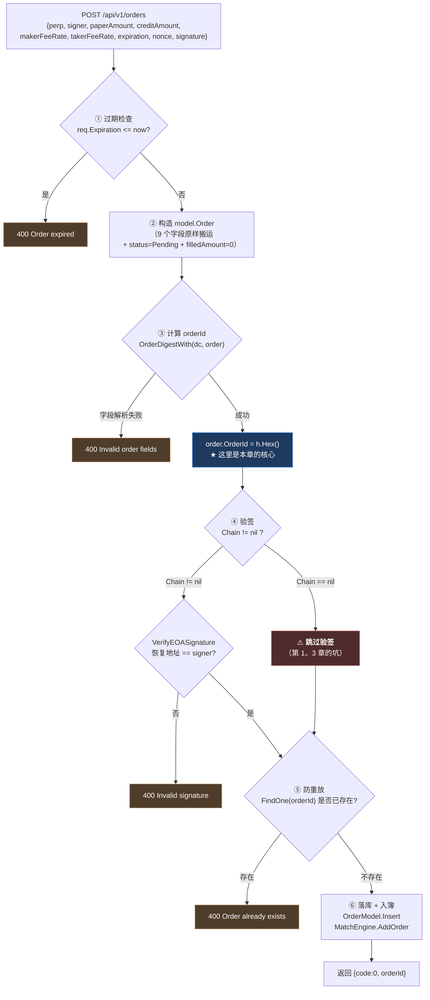
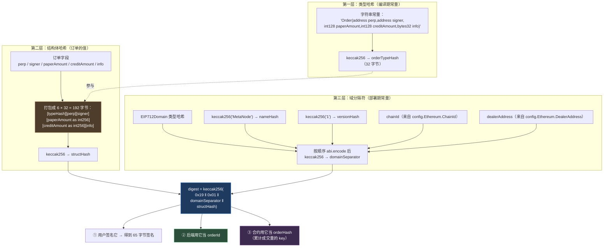
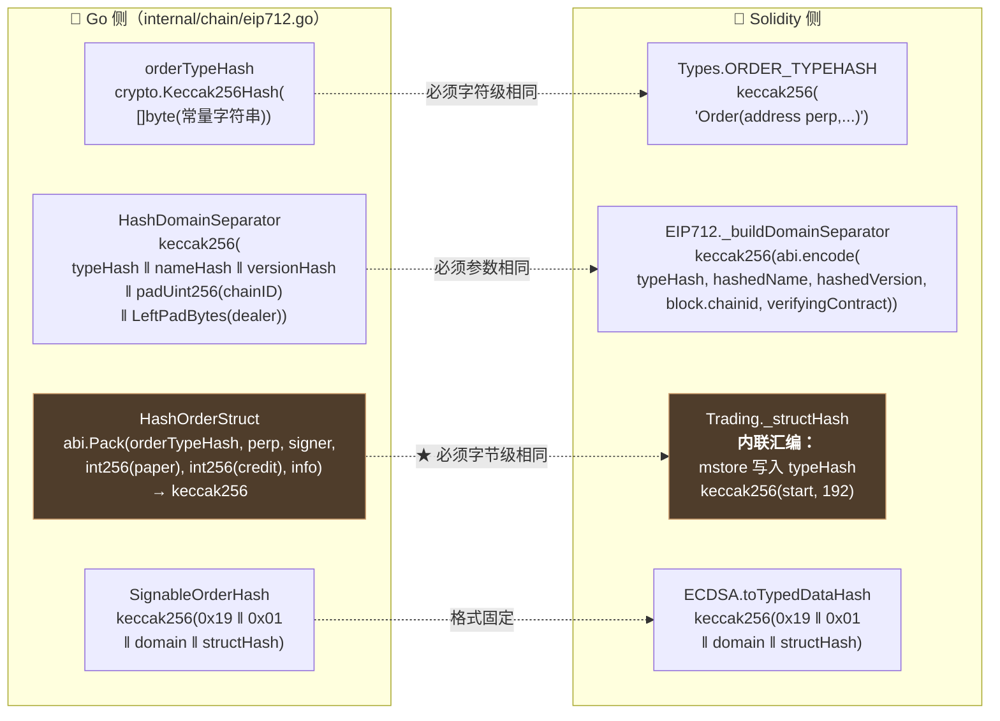
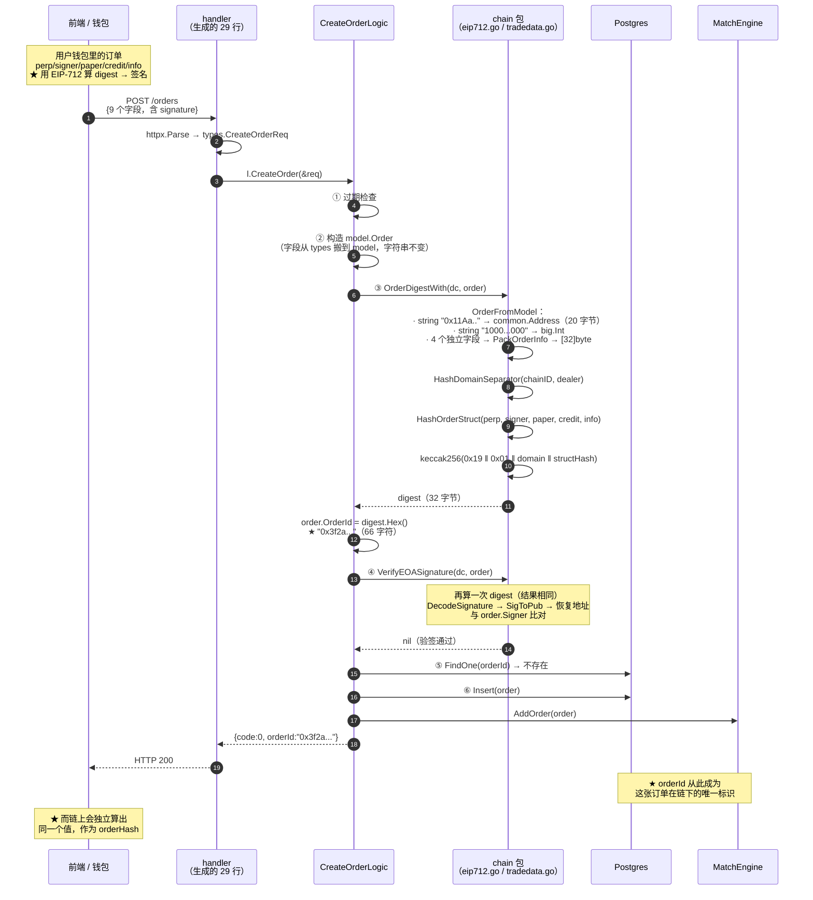

# 第 7 章：下单接口 — 从 HTTP 请求到 orderId，Go 侧如何复现合约的订单哈希

> 从本章起，我们进入本指南的**主线**：一笔订单的一生（第 7~12 章）。前面六章铺垫的所有东西——分工边界、代码地图、依赖装配、请求入口、身份认证——都是为了让这条线能跑起来。
>
> 本章追踪一笔订单的**起点**：用户点击"下单"，一个 HTTP 请求到达后端，到后端把它变成一条数据库记录、一个内存订单簿里的条目。这段路只有 93 行（`createorderlogic.go`），但里面有一个**贯穿整个系统的关键设计**：
>
> **`orderId` 不是一个 UUID，而是订单的 EIP-712 签名哈希（digest）。**
>
> 这个选择不是命名习惯，而是**链上链下能对上账的唯一前提**。本章会把它拆到字节级别——你会看到 Go 侧如何用 33 行代码，逐位复现 Solidity 合约里用内联汇编写成的哈希计算，以及**这中间最脆弱的一个假设**（它在代码注释里只占半行，但一旦不成立，整个系统会静默地全部失效）。

---

## 1. 本章导读

### 1.1 先问一个最朴素的问题：`orderId` 为什么不能是 UUID？

如果我们用最"正常"的后端思路设计这个系统，订单表大概会长这样：

```sql
CREATE TABLE orders (
    id          BIGSERIAL PRIMARY KEY,   -- 自增主键
    order_uuid  UUID NOT NULL,           -- 或者 UUID
    perp        TEXT,
    signer      TEXT,
    paper_amount TEXT,
    ...
);
```

**这样一个系统能跑通吗？表面上可以。** 用户下单 → 拿到 UUID → 查订单用 UUID 查 → 撮合时用 UUID 找订单。**整个链下流程毫无问题。**

**问题出在跨到链上的那一步。** 回忆第 1 章 1.3 讲的合约校验逻辑：

```solidity
// src/MetaNodeExternal.sol → approveTrade()
for (uint256 i = 0; i < orderList.length;) {
    Types.Order memory order = orderList[i];

    // ① 计算订单哈希
    bytes32 orderHash = EIP712._hashTypedDataV4(domainSeparator, Trading._structHash(order));
    orderHashList[i] = orderHash;

    // ② 用这个哈希验签
    (address recoverSigner,) = ECDSA.tryRecover(orderHash, signatureList[i]);
    // ...

    // ③ ★ 用这个哈希做"累计成交量"的 key
    state.orderFilledPaperAmount[orderHash] += matchPaperAmount[i];
    require(
        state.orderFilledPaperAmount[orderHash] <= int256(orderList[i].paperAmount).abs(),
        Errors.ORDER_FILLED_OVERFLOW
    );
}
```

**关键在 ③：合约里根本不存在"订单 ID"这个概念——它唯一认的标识符就是 `orderHash`。**

**合约不接收 `orderId` 参数，它是自己从订单的 5 个字段现算出来的。** 所以：

```text
如果后端用 UUID 当 orderId：
  后端说：这张订单叫 "550e8400-e29b-41d4-a716-446655440000"
  合约说：我不认识这个名字，我只认 keccak256 算出来的那个哈希
  → ★ 两边说的不是同一个东西
```

**这会导致三个具体的麻烦：**

| 麻烦 | 具体表现 |
| --- | --- |
| **查不到链上成交量** | 想知道"这张订单在链上成交了多少"，得先拿字段重算哈希，再查 `orderFilledPaperAmount` —— 多一层转换就多一处可能出错的地方（尤其是 `info` 的位打包） |
| **防重放失效** | 同一张签名订单被重复提交两次，UUID 方案会插入两条记录、当成两张订单。而 EIP-712 签名是**确定性**的（同样字段永远同样的哈希），digest 方案天然幂等 |
| **无法对账** | 链上 `OrderFilled` 事件里带的是 `orderHash`。要做"事件回扫对账"（第 11 章的改进方向），后端必须能拿 `orderHash` 直接定位本地订单 |

**所以本项目的选择是：把 `orderId` 直接定义成 EIP-712 digest。** 代码只有两行（`createorderlogic.go:53-56`）：

```go
h, err := chain.OrderDigestWith(dc, order)
if err != nil { /* ... */ }
orderId := h.Hex()          // ← 就这样，一行
order.OrderId = orderId
```

**这两行是本章的核心。** 接下来我们要回答的是：**这个 `h` 是怎么算出来的，为什么它必须和合约算出来的逐位相同。**

### 1.2 EIP-712 的三层结构：一个必须理解清楚的嵌套

EIP-712 的完整签名哈希是三层嵌套的：

```text
第一层：类型哈希（typeHash）—— 描述"这个结构体长什么样"
  orderTypeHash = keccak256("Order(address perp,address signer,int128 paperAmount,int128 creditAmount,bytes32 info)")
                                                                     ↑ 这个字符串必须逐字节一致
第二层：结构体哈希（structHash）—— 把订单的具体值代入
  structHash = keccak256(orderTypeHash ‖ perp ‖ signer ‖ paperAmount ‖ creditAmount ‖ info)
                                    ↑ 6 个 32 字节的字，共 192 字节

第三层：域分隔符（domainSeparator）—— 声明"这个签名在哪个链、哪个合约有效"
  domainSeparator = keccak256(
      keccak256("EIP712Domain(string name,string version,uint256 chainId,address verifyingContract)")
      ‖ keccak256("MetaNode")     ← name
      ‖ keccak256("1")            ← version
      ‖ chainId                   ← 链 ID
      ‖ dealerAddress             ← 验证合约地址
  )

最终：
  digest = keccak256(0x19 ‖ 0x01 ‖ domainSeparator ‖ structHash)
                      ↑     ↑
                 标记这是     EIP-712 版本号
                 EIP-712
```

**这套结构要解决两个不同的问题：**

```text
structHash 解决的是"篡改"：订单的任何一个字段变了，structHash 就变，签名就失效
domainSeparator 解决的是"重放"：同一个订单在别的链/别的合约上签的，哈希不同，签名不可用
```

**⚠️ 记住这个嵌套顺序**，因为 3.(2)~(5) 会逐层拆解，而**任何一层的任何一处不一致，都会导致签名验证失败**——而且失败信息只会是笼统的 `signer mismatch`，不会告诉你哪一层错了。

### 1.3 本章最脆弱的一个假设（先说结论）

在进入代码之前，我要先把本章最重要的一个发现摆出来，因为它藏在**一行注释**里：

```go
// internal/chain/eip712.go:61
// int128 在内存中符号扩展为 32 字节，与 abi.encode(int256) 一致
```

**这行注释说的是：** Go 侧在计算 `structHash` 时，把 `paperAmount` 和 `creditAmount`（链上类型是 `int128`）当作 **32 字节的符号扩展整数（int256）** 来打包。

**为什么可以这样？** 因为合约侧的 `_structHash` 是用**内联汇编直接哈希结构体的内存**的：

```solidity
assembly {
    let start := sub(order, 32)      // 在结构体前面腾出一个字的位置
    let tmp := mload(start)
    mstore(start, orderTypeHash)     // 把 typeHash 写在结构体前面
    structHash := keccak256(start, 192)   // 哈希连续的 192 字节 = 6 个字
    mstore(start, tmp)               // 恢复被覆盖的内容
}
```

**Solidity 的内存是"每字段一个字"（32 字节）的布局**，`int128` 在内存里占满 32 字节，**多出来的高 128 位是符号扩展位**（全 0 或全 1）。

**这就是 Go 侧要模拟的东西。** 所以 Go 用了 `int256` 而不是 `int128` 来打包：

```go
tI256, _ := abi.NewType("int256", "", nil)        // ← 注意是 int256，不是 int128
args := abi.Arguments{ {Type: t}, {Type: tAddr}, {Type: tAddr}, {Type: tI256}, {Type: tI256}, {Type: tB32} }
```

**⚠️ 这个"看起来是笔误"的 int256，实际上是整条链路上最关键的一处刻意设计。** 3.(4) 会详细证明它对在哪；6.1 会说明它有多脆弱。

---

## 2. 架构 / 流程图

### 2.1 `CreateOrder` 的六步校验链

`createorderlogic.go` 只有 93 行，但它做的事情可以清晰地分成六步。**注意每一步的"失败模式"——这是理解这个函数的关键：**



**读图要点：**

- **蓝色的第 ③ 步是本章的主题**，它同时承担了"算订单 ID"和"校验字段合法性"两个职责（因为算哈希的过程必须解析所有字段）。
- **红色的第 ④ 步是第 1、3 章反复提到的坑**——验签被包在链可用的判断里。**从"下单接口"这个视角看，这个坑的性质更清楚了**：它让本接口的安全边界随 RPC 的可用性波动。
- **四道校验的顺序是有讲究的**：过期（最便宜）→ 字段解析（本地计算）→ 验签（椭圆曲线运算，较贵）→ 查库（I/O）。**这是"从便宜到昂贵"的短路顺序**，是一个很好的工程习惯。

### 2.2 EIP-712 的三层哈希构造过程

这张图把 1.2 节的文字描述变成数据流，**每一层的输入输出都标出来了**：



**这张图要传达的关键点：`digest` 有三个消费者，而它们必须拿到完全相同的值。**

```text
用户（前端）  → 用它来签名
后端          → 用它当 orderId（数据库主键）
链上合约      → 用它当 orderHash（累计成交量的 key）
```

**三个消费者、两个实现（前端 JS 一套、Go 一套、Solidity 一套，实际是三套），任何两套不一致，系统就断了。**

**这就是为什么本指南反复强调"链下必须精确复现链上"** —— 这不是一句口号，而是这个架构的**硬性约束**。

### 2.3 链上链下如何共享同一套哈希

这张图把 Go 侧和 Solidity 侧的对应代码并排放，**这是本章最有实用价值的一张图**——你在对照调试时可以按它逐行查：



**四组对应关系里，前三组是"必须一致"，第四组是"标准固定"。**

**⚠️ 而 `G3` ↔ `S3` 这一对是最危险的**——因为：

```text
G1 ↔ S1：都是字符串常量，肉眼可比对 ← 容易验证
G2 ↔ S2：都是 5 个参数按顺序 encode ← 容易验证
G4 ↔ S4：都是 EIP-712 标准格式 ← 不可能写错
G3 ↔ S3：★ 一边是 Go 的 abi.Pack，一边是 Solidity 的内联汇编
          —— 它们计算出的字节序列相同吗？这需要理解内存布局才能确认
```

**这就是 1.3 节那个"最脆弱假设"的由来。** 3.(4) 会完整证明它对在哪，6.1 会说明它的风险边界。

---

## 3. 核心代码拆解

### (1) `CreateOrder` 全貌

```go
// CreateOrder 创建订单：校验 EIP-712 签名，写入 DB 并进入撮合引擎。
// 开仓与买卖使用挂单成交；平仓使用与持仓相反方向的订单，与对手盘撮合后由链上结算。
func (l *CreateOrderLogic) CreateOrder(req *types.CreateOrderReq) (resp *types.CreateOrderResp, err error) {
	// ===== ① 过期检查（最便宜的一道，放最前面）=====
	if req.Expiration <= time.Now().Unix() {
		return &types.CreateOrderResp{Code: 400, Message: "Order expired"}, nil
	}

	// ===== ② 构造数据模型 =====
	order := &model.Order{
		ChainId:      l.svcCtx.Config.Ethereum.ChainId,
		Perp:         req.Perp,
		Signer:       req.Signer,
		PaperAmount:  req.PaperAmount,
		CreditAmount: req.CreditAmount,
		MakerFeeRate: req.MakerFeeRate,
		TakerFeeRate: req.TakerFeeRate,
		Expiration:   req.Expiration,
		Nonce:        req.Nonce,
		Signature:    req.Signature,
		Status:       model.OrderStatusPending,
		FilledAmount: "0",
		CreateTime:   time.Now(),
		UpdateTime:   time.Now(),
	}

	// ===== ③ 算 digest → 得到 orderId =====
	dc := chain.DealerChain{
		Dealer:  common.HexToAddress(l.svcCtx.Config.Ethereum.DealerAddress),
		ChainID: big.NewInt(l.svcCtx.Config.Ethereum.ChainId),
	}
	h, err := chain.OrderDigestWith(dc, order)
	if err != nil {
		return &types.CreateOrderResp{Code: 400, Message: "Invalid order fields: " + err.Error()}, nil
	}
	orderId := h.Hex()
	order.OrderId = orderId

	// ===== ④ 验签 =====
	if l.svcCtx.Chain != nil {
		if err := chain.VerifyEOASignature(dc, order); err != nil {
			return &types.CreateOrderResp{Code: 400, Message: "Invalid signature: " + err.Error()}, nil
		}
	}

	// ===== ⑤ 防重放 =====
	existOrder, _ := l.svcCtx.OrderModel.FindOne(l.ctx, orderId)
	if existOrder != nil {
		return &types.CreateOrderResp{Code: 400, Message: "Order already exists"}, nil
	}

	// ===== ⑥ 落库 + 入簿 =====
	if _, err := l.svcCtx.OrderModel.Insert(l.ctx, order); err != nil {
		l.Error("Failed to insert order:", err)
		return &types.CreateOrderResp{Code: 500, Message: "Failed to create order"}, nil
	}

	if l.svcCtx.MatchEngine != nil {
		l.svcCtx.MatchEngine.AddOrder(order)
	}

	return &types.CreateOrderResp{
		Code:    0,
		Message: "success",
		OrderId: orderId,
	}, nil
}
```

**作者为什么这么设计（设计思想）：**

**设计点一：六步的顺序是"从便宜到昂贵"的短路设计。**

```text
① 过期检查       —— 一次整数比较，纳秒级
② 构造结构体     —— 纯内存操作，纳秒级
③ 算 digest      —— 若干次 keccak256 + 一次 ABI 打包，微秒级
④ 验签           —— ★ 一次椭圆曲线点运算（SigToPub），约 100 微秒
⑤ 查数据库       —— ★ 一次网络 I/O + 索引查询，约 1 毫秒
⑥ 写库 + 入簿    —— 最贵，且产生副作用
```

**为什么这个顺序重要？** 因为它决定了"一个恶意请求最多能让服务端做多少无用功"：

```text
如果顺序反了（先查库再验签）：
  攻击者发 10000 个签名无效的请求
  → 每个请求都先打一次数据库
  → 数据库连接池被打满 → 正常用户无法下单

按现在的顺序：
  攻击者发 10000 个签名无效的请求
  → 每个请求在 ④ 就被拒绝，永远不会碰数据库
  → ★ 数据库完全不受影响
```

**⚠️ 注意一个细节**：`③ 算 digest` 和 `④ 验签` 之间其实可以合并（`VerifyEOASignature` 内部会再算一次 digest）。**代码里算了两次**——这看起来是浪费，但换来了**清晰的错误分流**：

```go
// ③ 失败 → "Invalid order fields"（字段本身有问题）
// ④ 失败 → "Invalid signature"（字段没问题，但签名对不上）
```

**如果合并成一次，这两种错误就无法区分了。** 对于前端调试来说，"是字段填错了还是签名签错了"是一个很关键的信息。**所以这里的"重复计算"是一次有意识的取舍——用一次 keccak256 换一个更精确的错误信息。**

**设计点二：`orderId` 的计算发生在验签之前，这不是巧合。**

```go
h, err := chain.OrderDigestWith(dc, order)     // ← 先算 orderId
orderId := h.Hex()
order.OrderId = orderId

if l.svcCtx.Chain != nil {
	if err := chain.VerifyEOASignature(dc, order); err != nil {   // ← 再验签
```

**顺序上先算 ID 后验签，但两者都需要 digest。** 实际上 `VerifyEOASignature` 内部会**再算一遍**：

```go
func VerifyEOASignature(dc DealerChain, o *model.Order) error {
	digest, err := OrderDigestWith(dc, o)      // ← 又算了一次
	if err != nil {
		return err
	}
	// ... 用 digest 恢复地址 ...
}
```

**⚠️ 这里有一个值得注意的设计问题**：`VerifyEOASignature` 接收的是 `*model.Order`，并且**依赖 `o.OrderId` 之外的所有字段**。它重新算 digest，然后与签名比对。

**但 `order.Signature` 字段是被 `order` 对象携带的**——也就是说，**验签时用的签名，来自请求参数，而不是从数据库读的**（此时订单还没入库）。

**这是必要的**（订单刚收到，数据库里还没有），但它意味着一个隐含的顺序约束：**验签必须在入库之前完成**，否则就变成"用自己的库来验证自己"了。代码的顺序是对的。

**设计点三：防重放用"先查再插"，但真正的保险在数据库的唯一索引。**

```go
// ⑤ 应用层检查
existOrder, _ := l.svcCtx.OrderModel.FindOne(l.ctx, orderId)
if existOrder != nil {
	return &types.CreateOrderResp{Code: 400, Message: "Order already exists"}, nil
}

// ⑥ 插入
if _, err := l.svcCtx.OrderModel.Insert(l.ctx, order); err != nil { ... }
```

**应用层的"先查再插"存在竞态**（和第 6 章 `UpsertWalletUserOnLogin` 是同一类问题）：

```text
时刻 T1：请求 A 查询 orderId → 不存在
时刻 T1：请求 B 查询 orderId → 不存在
时刻 T2：A 插入 → 成功
时刻 T2：B 插入 → ★ 唯一约束冲突
```

**但这一次，真正的保险在数据库层**——第 2 章 3.(10) 讲过 `orders` 表的索引定义：

```sql
CREATE UNIQUE INDEX IF NOT EXISTS uq_orders_order_id ON public.orders (order_id) WHERE order_id <> ''
```

**有了这个唯一索引，即使应用层检查被绕过（并发、或者应用层代码被改坏），数据库依然会拒绝重复插入。** 这是一个**正确的纵深防御（defense in depth）**设计：

```text
第 1 层（应用层）：FindOne 检查 —— 给出友好的错误信息 "Order already exists"
第 2 层（数据库层）：唯一索引   —— 保证绝对不允许重复，无论应用层怎么写
```

**⚠️ 但有一个小瑕疵**：如果并发导致第 2 层被触发，返回的错误是：

```go
l.Error("Failed to insert order:", err)
return &types.CreateOrderResp{Code: 500, Message: "Failed to create order"}, nil
```

**用户看到的是 500（服务端错误），而不是"订单已存在"（400）。** 这不影响正确性，但会让用户/运营困惑——"为什么偶尔下单会报服务器错误？"

**修法**：识别唯一约束冲突，返回准确的错误码：

```go
if _, err := l.svcCtx.OrderModel.Insert(l.ctx, order); err != nil {
	if model.IsDuplicateKeyErr(err) {          // ← 项目里已经有这个工具函数
		return &types.CreateOrderResp{Code: 400, Message: "Order already exists"}, nil
	}
	l.Error("Failed to insert order:", err)
	return &types.CreateOrderResp{Code: 500, Message: "Failed to create order"}, nil
}
```

**顺带一提**：`model.IsDuplicateKeyErr` 在 `pgstore.go:197` 就有，注释还写着"扫链重复入账时忽略"——**它是为同一个场景准备的，但这里没用。** 这是第 5 章 6.4 那条"项目里已有解法但没被复用"的又一例。

### (2) `OrderDigestWith` 与 `SignableOrderHash` —— 从模型到哈希

```go
// DealerChain Dealer 地址与链 ID（EIP-712）。
type DealerChain struct {
	Dealer  common.Address
	ChainID *big.Int
}

// OrderDigestWith 计算用户应对其签名的 EIP-712 digest，并用作 orderId。
func OrderDigestWith(dc DealerChain, o *model.Order) (common.Hash, error) {
	so, err := OrderFromModel(o)                 // ① DB 模型 → 链上结构
	if err != nil {
		return common.Hash{}, err
	}
	return SignableOrderHash(dc.ChainID, dc.Dealer, so.Perp, so.Signer, so.PaperAmount, so.CreditAmount, so.Info), nil
}

// SignableOrderHash 用户应签名的 32 字节 digest（EIP-712 v4）。
func SignableOrderHash(chainID *big.Int, dealer, perp, signer common.Address, paperAmount, creditAmount *big.Int, info [32]byte) common.Hash {
	domain := HashDomainSeparator(chainID, dealer)                                  // 第二层（域）
	structHash := HashOrderStruct(perp, signer, paperAmount, creditAmount, info)    // 第一层（结构体）
	return crypto.Keccak256Hash(
		append(append([]byte{0x19, 0x01}, domain[:]...), structHash[:]...),         // 第三层（封装）
	)
}
```

**作者为什么这么设计（设计思想）：**

**设计点一：`DealerChain` 这个结构体是为了把"两个容易搞错的参数"绑在一起。**

```go
type DealerChain struct {
	Dealer  common.Address    // 域里的 verifyingContract
	ChainID *big.Int          // 域里的 chainId
}
```

**这两个参数有一个共同特点：它们都必须与部署的合约完全一致，否则所有签名都失效。** 把它们打包成一个结构体，并在 `main` 里从配置一次性构造，能减少"传错参数"的可能。

**⚠️ 但要注意：`OrderDigestWith` 的调用者在构造 `dc` 时是各自从配置读的**（`createorderlogic.go` 里就地构造），而**不是从 `ctx.Chain` 拿**：

```go
dc := chain.DealerChain{
	Dealer:  common.HexToAddress(l.svcCtx.Config.Ethereum.DealerAddress),
	ChainID: big.NewInt(l.svcCtx.Config.Ethereum.ChainId),
}
```

**这个细节很重要**（也是第 1 章强调"验签不需要 RPC"的依据）——**算 digest 需要的一切都来自配置文件，不需要任何链上调用。** 这也正是 6.(9) 那条修法（去掉验签的 `Chain != nil` 判断）在技术上完全可行的原因。

**设计点二：`SignableOrderHash` 的函数签名暴露了 EIP-712 的全部输入。**

```go
func SignableOrderHash(
	chainID *big.Int,                    // → domainSeparator
	dealer common.Address,               // → domainSeparator
	perp, signer common.Address,         // ↓
	paperAmount, creditAmount *big.Int,  // ↓ → structHash
	info [32]byte,                       // ↑
) common.Hash
```

**前两个参数属于域，后五个属于结构体，中间用换行隔开了。** 这个排版是作者有意的——**它让"哪些参数影响域、哪些影响结构体"一眼可见。**

**⚠️ 但更好的做法是直接用 `SolidityOrder` 结构体**（`OrderFromModel` 已经返回它了，而且 `EncodeTradeData` 也是用它）：

```go
// 更清晰的形态
func SignableOrderHash(dc DealerChain, o SolidityOrder) common.Hash
```

**这样参数就不会在调用点被拆散再拼起来**——而"拆散再拼"正是最容易出错的环节。不过这是代码风格问题，不影响正确性。

### (3) `HashDomainSeparator` —— 域分隔符的四个参数

```go
// HashDomainSeparator 计算 Dealer 合约中的 immutable domainSeparator。
func HashDomainSeparator(chainID *big.Int, dealer common.Address) common.Hash {
	typeHash := crypto.Keccak256Hash([]byte("EIP712Domain(string name,string version,uint256 chainId,address verifyingContract)"))
	nameHash := crypto.Keccak256Hash([]byte("MetaNode"))
	versionHash := crypto.Keccak256Hash([]byte("1"))
	payload := append(
		append(
			append(
				append(
					append([]byte{}, typeHash[:]...),
					nameHash[:]...),
				versionHash[:]...),
			padUint256(chainID)...),
		common.LeftPadBytes(dealer.Bytes(), 32)...)
	return crypto.Keccak256Hash(payload)
}
```

**对应的 Solidity 实现：**

```solidity
function _buildDomainSeparator(string memory name, string memory version, address verifyingContract)
	internal view returns (bytes32)
{
	bytes32 hashedName = keccak256(bytes(name));
	bytes32 hashedVersion = keccak256(bytes(version));
	bytes32 typeHash = keccak256("EIP712Domain(string name,string version,uint256 chainId,address verifyingContract)");
	return keccak256(abi.encode(typeHash, hashedName, hashedVersion, block.chainid, verifyingContract));
}
```

**以及它的调用点（`MetaNodeStorage.sol:38`）：**

```solidity
constructor() Ownable() {
	domainSeparator = EIP712._buildDomainSeparator("MetaNode", "1", address(this));
	//                                                                  ↑ Dealer 合约自己的地址
}
```

**作者为什么这么设计（设计思想）：**

**设计点一：Go 侧那五层嵌套的 `append`，是为了精确模拟 `abi.encode`。**

**这段代码可读性很差**（`append(append(append(...)))` 嵌套五层），但它做的事情很简单——**把 5 个 32 字节的值首尾相接成 160 字节：**

```text
[0   .. 32)  typeHash
[32  .. 64)  nameHash
[64  .. 96)  versionHash
[96  .. 128) padUint256(chainID)
[128 .. 160) LeftPadBytes(dealer, 32)
```

**每一个 32 字节的处理方式都对应 `abi.encode` 的规则：**

| 参数 | Go 侧的处理 | 为什么 |
| --- | --- | --- |
| `typeHash` | 本身就是 32 字节的 `common.Hash` | ✓ |
| `nameHash` / `versionHash` | 先 `keccak256` 再取 32 字节 | **string 在 ABI 里编码为"长度 + 数据"，但 EIP-712 规定先哈希成 bytes32** |
| `chainID` | `padUint256` → `FillBytes` 大端右对齐 | uint256 在 ABI 里是 32 字节大端 |
| `dealer` | `LeftPadBytes(dealer.Bytes(), 32)` | **address 在 ABI 里是"左补零到 32 字节"** |

**⚠️ `padUint256` 的实现值得看一眼：**

```go
// padUint256 将 chainId 等填充为 32 字节大端，与 abi.encode(uint256) 一致。
func padUint256(n *big.Int) []byte {
	var b [32]byte
	if n != nil {
		n.FillBytes(b[:])
	}
	return b[:]
}
```

`big.Int.FillBytes` 是**大端、右对齐、左补零**——正是 ABI 对 `uint256` 的编码方式。**如果这里错用了 `Bytes()`（不定长）或者 `LittleEndian`，chainId 的编码就会错位。**

**设计点二：`address(this)` 与 `config.Ethereum.DealerAddress` 的对应关系。**

```solidity
// Solidity：address(this) 是"当前合约地址"
// MetaNodeStorage 被 MetaNodeDealer 继承，所以 address(this) = Dealer 地址
domainSeparator = EIP712._buildDomainSeparator("MetaNode", "1", address(this));
```

```go
// Go：从配置里读 Dealer 地址
Dealer: common.HexToAddress(l.svcCtx.Config.Ethereum.DealerAddress),
```

**两者必须一致。** 而 `domainSeparator` 在合约里是 `immutable`——**部署时算一次，之后永远不变**：

```solidity
bytes32 public immutable domainSeparator;
```

**这意味着：**

```text
① `MetaNode` 和 `1` 这两个字符串一旦部署就无法改变
   → 如果将来要升级到 "MetaNode" / "2"，必须重新部署合约
② chainId 用了 block.chainid
   → 但 immutable 是部署时求值的，所以它锁死的是"部署时那条链的 chainId"
   → ★ 如果发生链分叉（chainId 变化），合约的 domainSeparator 不会跟着变
```

**⚠️ 第 ② 点是一个很隐蔽的性质。** 大多数实现会写成动态的（每次计算时读 `block.chainid`），但**本项目选择了 immutable 以省 gas**。代价是分叉场景下行为不同。

**对本项目（Sepolia 测试网）没有实际影响**，但这是一个值得知道的取舍。

**设计点三：`padUint256(nil)` 返回全零——这个防御性设计其实是必要的。**

```go
if n != nil {
	n.FillBytes(b[:])
}
```

如果 `n` 是 `nil`，返回全零的 32 字节。这意味着**如果调用者忘了传 chainID，不会 panic，而是算出一个"chainId=0"的 digest**——**而这会导致所有签名验证失败，且错误信息只有 `signer mismatch`。**

**⚠️ 这是一个"静默失败"的防御**：它避免了 panic（好事），但把一个"程序 bug"伪装成了"签名错误"（坏事）。**更安全的做法是在 `n == nil` 时返回 error**，让调用点立刻知道参数没传。

### (4) `HashOrderStruct` —— 本章最需要证明的一段

这是全项目最关键、也最容易看错的一段代码：

```go
// HashOrderStruct 计算 EIP-712 struct hash（不含 domain 包装）。
func HashOrderStruct(perp, signer common.Address, paperAmount, creditAmount *big.Int, info [32]byte) common.Hash {
	t, _ := abi.NewType("bytes32", "", nil)
	tAddr, _ := abi.NewType("address", "", nil)
	tI256, _ := abi.NewType("int256", "", nil)        // ★ 注意：int256，不是 int128
	tB32, _ := abi.NewType("bytes32", "", nil)
	args := abi.Arguments{
		{Type: t}, {Type: tAddr}, {Type: tAddr}, {Type: tI256}, {Type: tI256}, {Type: tB32},
	}
	// int128 在内存中符号扩展为 32 字节，与 abi.encode(int256) 一致
	pap := new(big.Int).Set(paperAmount)
	cre := new(big.Int).Set(creditAmount)
	packed, err := args.Pack(orderTypeHash, perp, signer, pap, cre, info)
	if err != nil {
		panic(err)
	}
	return crypto.Keccak256Hash(packed)
}
```

**对应的 Solidity 实现（用内联汇编）：**

```solidity
function _structHash(Types.Order memory order) internal pure returns (bytes32 structHash) {
	bytes32 orderTypeHash = Types.ORDER_TYPEHASH;
	assembly {
		// 在 order 结构体前面插入 ORDER_TYPEHASH
		let start := sub(order, 32)
		let tmp := mload(start)
		// 192 = (1 + 5) * 32
		// [0...32)   字节: EIP712_ORDER_TYPE
		// [32...192) 字节: order 数据
		mstore(start, orderTypeHash)
		structHash := keccak256(start, 192)
		// 恢复被覆盖的内存
		mstore(start, tmp)
	}
}
```

**先看 Solidity 侧在做什么——这是一段很漂亮的汇编技巧：**

```text
① order 是指向结构体内存的指针，结构体占 5 个字（5 × 32 = 160 字节）
② sub(order, 32) 得到"结构体前面一个字"的地址
③ mload(start) 先把那个字的内容存起来（tmp）—— 因为那是别人的内存！
④ mstore(start, orderTypeHash) 把类型哈希写进去
⑤ keccak256(start, 192) 哈希从 start 开始的 192 字节
   = [typeHash(32)] + [perp(32)] + [signer(32)] + [paper(32)] + [credit(32)] + [info(32)]
⑥ mstore(start, tmp) 恢复被覆盖的那个字
   ★ 这是必须的——否则会破坏调用者的内存
```

**⚠️ 第 ③ 和 ⑥ 步是这个技巧的关键：它在别人的内存区域"借用"了一个字，用完立刻还回去。** 这在内存安全上是正确的（同一笔交易内不会有并发），但它要求对 Solidity 的内存布局有精确理解。

**现在看核心问题：Go 的 `abi.Pack` 能算出同样的 192 字节吗？**

**逐个字段验证：**

| 字段 | Solidity 内存里的内容 | Go 的 `abi.Pack` 产出 | 一致？ |
| --- | --- | --- | --- |
| `orderTypeHash` | 32 字节的 bytes32 | `bytes32` 类型 → 原样 32 字节 | ✅ |
| `perp` (address) | 32 字节，高 12 字节为 0 | `address` → 左补零到 32 字节 | ✅ |
| `signer` (address) | 同上 | 同上 | ✅ |
| `paperAmount` (**int128**) | **32 字节，符号扩展** | `int256` → 32 字节，符号扩展 | ✅ |
| `creditAmount` (**int128**) | 同上 | 同上 | ✅ |
| `info` (bytes32) | 32 字节 | `bytes32` → 原样 | ✅ |

**关键就在第 4、5 行。** 我们把"为什么 Solidity 内存里的 `int128` 是符号扩展的 32 字节"讲清楚：

```text
① 订单从 calldata 来：abi.decode(tradeData, (Types.Order[], ...))
② ABI 编码规范规定：int128 在 ABI 编码里就是"32 字节的符号扩展值"
   —— 例如 -1 编码为 0xFFFF...FF（32 字节全 1）
③ Solidity 的 ABI 解码器解码 int128 时，会校验"这 32 字节确实是合法的 int128"
   （即高 128 位是全 0 或全 1）
④ 解码后写入内存结构体时，写的就是那个 32 字节的字
   ⟹ ★ 内存布局里，int128 字段占满 32 字节，且是符号扩展的
```

**而 Go 侧用 `int256` 打包，产生的正是"32 字节的符号扩展值"——所以两者字节级相同。** ✅

**⚠️ 但如果你把 Go 侧写成 `int128` 会怎样？**

```go
tI128, _ := abi.NewType("int128", "", nil)     // ← 如果这样写
args := abi.Arguments{ {Type: t}, {Type: tAddr}, {Type: tAddr}, {Type: tI128}, {Type: tI128}, {Type: tB32} }
```

**`abi.Pack` 在编码 `int128` 时会先做范围检查，然后输出……32 字节的符号扩展值。** 实际上在**值合法**的前提下（即值确实在 int128 范围内），**两种写法产出的字节序列是相同的**。

**那为什么作者选了 `int256`？** 从注释看，他是**从"内存布局"的角度**来思考的（"int128 在内存中符号扩展为 32 字节"），而不是"ABI 编码"的角度。**这个角度更准确**，因为合约侧的 `_structHash` 确实是直接哈希内存的（而不是 `abi.encode`）。

**⚠️ 两种写法的真正差别——我实测了这个行为，结论和直觉相反。**

我先写下我最初的猜测（它听起来很合理，但**是错的**）：我以为"用 `int128` 打包时，go-ethereum 会做范围检查并返回 error；用 `int256` 则不检查"。于是我写了一个测试程序来验证：

```go
// 实测：go-ethereum v1.13.5 的 abi.Arguments.Pack
try("int256 = 2^127 (超出 int128)", "int256", over128)   // → OK (32 bytes)
try("int128 = 2^127 (超出 int128)", "int128", over128)   // → OK (32 bytes)  ★ 也没报错
try("int256 = 2^256 (真正超界)",    "int256", over256)   // → OK (32 bytes)  ★ 还是没报错
```

**实测结果是：go-ethereum 的 `abi.Pack` 对整数类型完全不做范围校验——它把值静默截断到 256 位。**

```text
int128 打包 2^127  → 0x0000...80000000000000000000000000000000   ← 静默接受
int256 打包 2^127  → 0x0000...80000000000000000000000000000000   ← 完全相同
int256 打包 2^256  → 0x0000...00000000000000000000000000000000   ← ★ 静默变成 0
```

**所以在 go-ethereum 的实现下，`int128` 和 `int256` 这两种写法对任何输入都产生完全相同的字节——不存在"哪一种更安全"。**

**那 `int256` 这个选择还有意义吗？有，但意义在"表达意图"而不是"运行时行为"：**

```text
合约侧的 _structHash 是对 ★ 内存 做哈希（keccak256(start, 192)）
内存里 int128 字段占满 32 字节，是符号扩展的
⟹ Go 侧写 int256，准确表达了"我要的是 32 字节的符号扩展值"这个意图
⟹ 写 int128 也能work（因为 go-ethereum 不检查），但它表达的是"ABI 声明类型"，
   而这个场景其实不是 ABI 编码场景
```

**⚠️ 但这样一来，问题反而更严重了**——既然**两边都不做范围校验**，那么一个超出 `int128` 的 `paperAmount` 会：

```text
① Go 侧：静默打包成功（不报错、不 panic）
② 一路通过 digest 计算、验签、入库、进入内存订单簿
③ 最后在链上 abi.decode 时被 Solidity ★ 拒绝 ★（它会校验范围）→ revert → 烧掉 gas
```

**我同样实测验证了第 ③ 步**（用一个 Foundry 测试，把 Go 打包出来的真实 calldata 喂给 Solidity）：

```solidity
// 完全复刻 approveTrade 的解码方式
function decodeTradeData(bytes calldata tradeData) external pure returns (int128) {
    (Order[] memory orderList,,) = abi.decode(tradeData, (Order[], bytes[], uint256[]));
    return orderList[0].paperAmount;
}
```

```text
[PASS] testGoPackedLegal()     — Go 打包的 2^127-1 → Solidity 解码成功 ✓
[PASS] testGoPackedOverflow()  — Go 打包的 2^127   → Solidity 解码 revert ✓
```

**结论：`int128` 的范围校验责任，在 Go 侧是完全缺失的。** 详见 6.2。

### (5) `orderTypeHash` —— 一个必须逐字节一致的字符串常量

```go
// internal/chain/eip712.go:15
var orderTypeHash = crypto.Keccak256Hash([]byte("Order(address perp,address signer,int128 paperAmount,int128 creditAmount,bytes32 info)"))
```

```solidity
// src/libraries/Types.sol:129
bytes32 public constant ORDER_TYPEHASH =
    keccak256("Order(address perp,address signer,int128 paperAmount,int128 creditAmount,bytes32 info)");
```

**作者为什么这么设计（设计思想）：**

**两处字符串必须完全相同——包括空格、大小写、括号、参数顺序。**

**⚠️ 这个字符串的格式是有严格规范的（EIP-712 定义的 `encodeType`）：**

```text
格式：类型名(字段1类型 字段1名,字段2类型 字段2名,...)

规则：
① 类型名首字母大写（Order ✓）
② 逗号后面没有空格        ← "address perp,address signer" 而不是 "address perp, address signer"
③ 字段之间用 ", " 分隔... 不对，是 "," 直接连接
④ 字段类型用规范名（int128 而不是 int）
⑤ 结尾没有空格
```

**⚠️ 最容易出错的是"逗号后面的空格"。** 看这个对比：

```text
✅ 正确：Order(address perp,address signer,int128 paperAmount,...)
                        ↑ 逗号后无空格
❌ 错误：Order(address perp, address signer, int128 paperAmount, ...)
                         ↑ 逗号后有空格 → keccak256 结果完全不同 → 所有签名失效
```

**而在前端 `ethers.js` 里，这个字符串是自动生成的**（从 types 定义拼出来），**所以前端几乎不可能写错。** 但 Go 和服务端是手写的常量——**手写就意味着可能打错。**

**⚠️ 更危险的是：这个错误是完全静默的。**

```text
如果 Go 侧的字符串多了一个空格：
  → orderTypeHash 变了
  → structHash 变了
  → digest 变了
  → ★ 所有人下单都失败，报 "signer mismatch"
  → 但你会去怀疑"是不是钱包有问题"、"是不是签名格式错了"，
    而不会想到"是不是那个字符串里有个空格"
```

**这就是为什么 6.(8) 会建议加一个"已知答案测试（KAT）"** ——用一组固定输入和已知输出，把这类错误在 CI 阶段抓住。

**⚠️ 还有一个细节**：`int128` 这个类型名也必须和合约完全一致。如果合约改成了 `int256` 而 Go 侧没改，同样会静默失效。**而类型名是签名的一部分，改动它等于让所有历史签名失效**——这是一个"改了就破坏兼容性"的地方，所以要格外小心。

### (6) `PackOrderInfo` —— `info` 字段的位打包

```go
// PackOrderInfo 组装 Types.Order.info：高→低 64bit 依次为 makerFee、takerFee、expiration、nonce（与合约解析一致）。
func PackOrderInfo(makerFeeBps, takerFeeBps int64, expiration, nonce uint64) [32]byte {
	n := new(big.Int).SetUint64(uint64(makerFeeBps))
	n.Lsh(n, 192)                              // makerFee → 放到最高 64 位 [192, 256)
	t := new(big.Int).SetUint64(uint64(takerFeeBps))
	t.Lsh(t, 128)                              // takerFee → 放到 [128, 192)
	n.Or(n, t)
	e := new(big.Int).SetUint64(expiration)
	e.Lsh(e, 64)                               // expiration → 放到 [64, 128)
	n.Or(n, e)
	nu := new(big.Int).SetUint64(nonce)        // nonce → 放在最低 64 位 [0, 64)
	n.Or(n, nu)
	var out [32]byte
	n.FillBytes(out[:])
	return out
}
```

**对应的 Solidity 解析（`Trading.sol`）：**

```solidity
function _info2MakerFeeRate(bytes32 info) internal pure returns (int256) {
	return int256(int64(uint64(uint256(info) >> 192)));      // 取最高 64 位
}

function _info2TakerFeeRate(bytes32 info) internal pure returns (int256 takerFeeRate) {
	return int256(int64(uint64(uint256(info) >> 128)));      // 右移 128 后取低 64 位
}

function _info2Expiration(bytes32 info) internal pure returns (uint256) {
	return uint256(uint64(uint256(info) >> 64));             // 右移 64 后取低 64 位
}
```

**作者为什么这么设计（设计思想）：**

**设计点一：位布局是"高→低"排列的，而且顺序有讲究。**

```text
bit 255                                               bit 0
  ↓                                                    ↓
  ┌──────────────┬──────────────┬──────────────┬──────────────┐
  │  makerFee    │  takerFee    │  expiration  │    nonce     │
  │  64 bit      │  64 bit      │  64 bit      │   64 bit     │
  └──────────────┴──────────────┴──────────────┴──────────────┘
   [192, 256)     [128, 192)     [64, 128)      [0, 64)
```

**为什么把费率放高位、nonce 放低位？**

```text
① makerFee 和 takerFee 是"业务主数据"，放高位符合人类阅读习惯
   （info 的十六进制表示里，最左边就是费率）
② nonce 放最低位，是为了方便"递增"操作：
   如果将来需要让 nonce 递增，直接 info + 1 就行（不影响其他字段）
   ★ 本项目没有这个用法，但这是一个常见的位打包考虑
```

**设计点二（⚠️ 一个很微妙但正确的细节）：负费率的处理。**

注意这一行：

```go
n := new(big.Int).SetUint64(uint64(makerFeeBps))     // int64 → uint64 的转换
```

**`makerFeeBps` 是 `int64`，可能为负数**（费率可以是负的，表示返佣/rebate）。把它转成 `uint64` 会得到一个巨大的数：

```text
makerFeeBps = -1
uint64(-1)  = 0xFFFFFFFFFFFFFFFF = 2^64 - 1
```

**然后 `Lsh(n, 192)` 把它移到最高 64 位：**

```text
结果：高 64 位 = 0xFFFFFFFFFFFFFFFF，其余位为 0
```

**合约侧读回来：**

```solidity
int64(uint64(uint256(info) >> 192))
  = int64(0xFFFFFFFFFFFFFFFF)
  = -1                              ← ★ 恢复了！
```

**这是二进制补码（two's complement）的自然结果**——负数的位模式在"截断到 64 位"和"符号扩展回 64 位"之间是自洽的。

**⚠️ 但这个正确性依赖于两个前提：**

```text
① 费率的绝对值必须 < 2^63（因为 int64 的范围是 [-2^63, 2^63-1]）
   → ParseFeeInt64 里有 IsInt64() 检查 ✓ 保证了这一点
② n.FillBytes(out[:]) 不会 panic
   → FillBytes 要求值能放进 32 字节
   → 最高位是 0xFFFF...，整个值 < 2^256 ✓ 不会 panic
```

**所以这段代码是正确的，但它的正确性依赖"补码语义 + 范围检查"两个不那么显眼的前提。** 如果将来有人把 `ParseFeeInt64` 的 `IsInt64()` 检查去掉（比如为了支持更大的费率），这段代码就会静默地产生错误的位模式。

**设计点三：`FillBytes` vs `Bytes()` 的区别。**

```go
var out [32]byte
n.FillBytes(out[:])          // ✓ 定长输出，左补零
return out
```

```go
return n.Bytes()             // ✗ 变长输出，前导零会被丢掉
```

**`big.Int.Bytes()` 返回的是"最紧凑的表示"**——如果数值较小（比如 nonce = 1），`Bytes()` 只返回 1 个字节 `[0x01]`，而不是 32 字节。

**⚠️ 这是一个非常容易犯的错**：如果这里用了 `Bytes()`，`info` 就会变成变长的，`[32]byte` 的赋值会编译失败——**所以在这个函数里不会出错**（因为返回类型是 `[32]byte`，编译器挡住了）。

**但同样的错误在别处可能不会这么幸运**。比如在 `SignableOrderHash` 里：

```go
append(append([]byte{}, typeHash[:]...), nameHash[:]...)
```

这里用的是 `hash[:]`（切片语法），**对 `common.Hash` 类型来说它总是 32 字节**——安全。

**记住这条规则：**

> **所有参与哈希的整数/哈希值，都必须先转成定长的 32 字节大端表示。**
> ```go
> bigInt.FillBytes(buf[:])         // 整数 → 定长 32 字节 ✓
> common.Hash[:]                    // 哈希 → 定长 32 字节 ✓
> common.LeftPadBytes(addr.Bytes(), 32)   // 地址 → 定长 32 字节 ✓
> bigInt.Bytes()                    // ✗ 变长，危险
> ```

### (7) `VerifyEOASignature` —— 验签的实现

```go
// VerifyEOASignature 验证订单由 signer EOA 签名（不支持合约钱包的 EIP-1271）。
func VerifyEOASignature(dc DealerChain, o *model.Order) error {
	digest, err := OrderDigestWith(dc, o)          // ① 再算一遍 digest
	if err != nil {
		return err
	}
	sig, err := DecodeSignature(o.Signature)       // ② 解析签名（归一化 v 值）
	if err != nil {
		return err
	}
	pub, err := crypto.SigToPub(digest.Bytes(), sig)   // ③ ★ 从签名恢复公钥
	if err != nil {
		return err
	}
	rec := crypto.PubkeyToAddress(*pub)            // ④ 公钥 → 地址
	if !strings.EqualFold(rec.Hex(), o.Signer) {   // ⑤ 与声称的 signer 比对
		return fmt.Errorf("signer mismatch: recovered=%s expect=%s", rec.Hex(), o.Signer)
	}
	return nil
}
```

**作者为什么这么设计（设计思想）：**

**设计点一：注释里那句话很重要——"不支持合约钱包的 EIP-1271"。**

```go
// VerifyEOASignature 验证订单由 signer EOA 签名（不支持合约钱包的 EIP-1271）。
```

**这是链下验签和链上验签的一个**真实的能力差异**：**

```text
链上 approveTrade 的验签逻辑（第 1 章 1.3 引用过）：
  (address recoverSigner,) = ECDSA.tryRecover(orderHash, signatureList[i]);
  if (recoverSigner != order.signer && !state.operatorRegistry[order.signer][recoverSigner]) {
      if (Address.isContract(order.signer)) {
          // ★ 合约钱包走 EIP-1271
          require(IERC1271(order.signer).isValidSignature(orderHash, signatureList[i]) == 0x1626ba7e, ...);
      } else {
          revert(Errors.INVALID_ORDER_SIGNATURE);
      }
  }

链下 VerifyEOASignature：
  只做 crypto.SigToPub → 只支持 EOA
  ★ 遇到合约钱包（多签、AA 钱包）会验签失败
```

**⚠️ 这意味着一个**真实的行为不一致**：**

```text
一个多签钱包（Safe）用户：
  · 在链上：可以正常交易（合约支持 EIP-1271）
  · 在本后端：下单会被拒绝，提示 "Invalid signature"
```

**不过这个不一致的实际影响有限，因为：**

```text
① 即使后端拒绝，用户也可以绕过后端直接调链上合约（虽然那样就没有撮合服务了）
② 本项目目前没有把"合约钱包用户"作为目标场景
③ 关闭了后端验签（Chain == nil）反而能接受合约钱包的订单——但那样就不验签了
```

**这是一处"链上与链下能力不对齐"的典型案例**，值得记录。**修法**是引入 EIP-1271 的链下支持（需要一次 `eth_call` 到 `signer` 合约的 `isValidSignature`）——但那样验签就真的需要 RPC 了，第 3 章 6.3 那条"去掉 Chain != nil 判断"的修法就要重新考虑。

**⚠️ 这是一个很好的例子，说明工程决策往往不是孤立的**：一个看似简单的"去掉 if 判断"的修改，会因为"未来要支持合约钱包"而需要重新评估。

**设计点二：`strings.EqualFold` 而不是 `==`。**

```go
if !strings.EqualFold(rec.Hex(), o.Signer) {
```

**`rec.Hex()` 返回的是 checksum 格式，而 `o.Signer` 来自请求参数**（可能是全小写、可能是 checksum）。**用 `==` 会误判**（第 2 章 4.2 讲的地址大小写问题）。

**这里用对了。** 对比第 4 章 6.7 那个 `m.Address == req.Address` 的 bug——**同一类问题，这里处理正确、那里处理错了。**

**更严格的写法**是两边都规范化成 `common.Address` 再比：

```go
if crypto.PubkeyToAddress(*pub) != common.HexToAddress(o.Signer) {
```

**这样连"非法地址字符串"也会被自然处理**（`HexToAddress` 对非法输入返回全零地址，比对必然失败）。**当前的写法如果 `o.Signer` 是非法字符串，`EqualFold` 会返回 false，也是安全的**——所以两者都行。

### (8) 完整链路：从 HTTP 到 orderId 的数据变形

把前面所有片段串起来，这是一次下单的完整数据流。**注意 `orderId` 的每一次"变身"**：



**这张图里最关键的一点是第 ③ 步的"数据变形"：**

```text
用户签名时用的：      数字字符串 + 打包好的 info
后端复现时用的：      big.Int + common.Address + [32]byte
合约验证时用的：      int128 + address + bytes32（从 ABI 解码而来）

三种表示，同一组值，必须产生同一个 digest。
```

**这就是"链下复现链上"的全部工作内容** ——它不涉及任何业务逻辑，纯粹是**格式转换**，但**转换错了整个系统就断了**。

---

## 4. Web3 特有机制

### 4.1 EIP-712 的三层哈希：一个通用的阅读方法

本章反复出现"三层哈希"这个概念。这里把它总结成一个**通用方法**——你在读任何 EIP-712 相关的代码时都可以套用：

```text
看到一段 EIP-712 代码，问四个问题：

① typeHash 是什么？
   → 找到那个"TypeName(type1 name1,type2 name2,...)"字符串
   → ★ 检查它在所有实现里是否逐字节一致

② structHash 怎么算的？
   → 通常是 keccak256(typeHash ‖ 各字段的 32 字节编码)
   → ★ 检查每个字段的编码方式（尤其是小于 256 位的整数类型）

③ domainSeparator 里有什么？
   → 标准是 (name, version, chainId, verifyingContract)
   → ★ 检查四个值在所有实现里是否一致

④ 最终怎么封装的？
   → 标准是 keccak256(0x19 ‖ 0x01 ‖ domain ‖ structHash)
   → ★ 这一层几乎不会写错
```

**本项目的答案：**

```text
① orderTypeHash = keccak256("Order(address perp,address signer,int128 paperAmount,int128 creditAmount,bytes32 info)")
                  ★ 三处（前端、Go、Solidity）必须一致

② structHash    = keccak256(orderTypeHash ‖ perp ‖ signer ‖ int256(paper) ‖ int256(credit) ‖ info)
                  ★ Go 侧的关键是用 int256 而非 int128（见 3.(4)）

③ domain        = keccak256(typeHash ‖ keccak256("MetaNode") ‖ keccak256("1") ‖ chainId ‖ dealerAddress)

④ digest        = keccak256(0x19 ‖ 0x01 ‖ domain ‖ structHash)
```

**这个方法的实用价值在于：它把"调试签名问题"变成了一次结构化的排查。** 当遇到 `signer mismatch` 时，你可以按这四层逐层二分：

```text
能不能用前端算出的 digest 和我们算出的 digest 直接比对？
  → 能对上 → 问题在签名本身（格式、v 值归一化）
  → 对不上 → 问题在这四层里的某一层

然后逐层比对：
  typeHash 对不对？（打印出来比）
  structHash 对不对？（用固定的测试向量）
  domain 对不对？（链上有 getter：Dealer.domainSeparator()）
```

**⚠️ 最后一条特别有用**：`domainSeparator` 在合约里是 `public immutable`，所以可以**直接读**：

```bash
# 用 cast（Foundry）读链上的 domainSeparator
cast call <Dealer地址> "domainSeparator()(bytes32)" --rpc-url <RPC>

# 然后和 Go 侧算出来的比对
# ★ 这是验证"配置的 ChainId 和 DealerAddress 是否正确"的最直接方法
```

**而本项目恰好没有做这个验证**（第 3 章 4.2 提到过：`domainSeparator` 是自检清单里缺失的一项）。**这是一个成本极低、收益很高的补强**：

```go
// 建议加到 main() 的启动自检里
func (c *Client) ValidateDomainSeparator(ctx context.Context, chainID *big.Int, dealer common.Address) error {
	// 读链上的
	data, _ := c.dealerABI.Pack("domainSeparator")
	out, err := c.callDealer(ctx, data)
	if err != nil { return err }
	res, _ := c.dealerABI.Unpack("domainSeparator", out)
	onChain := res[0].([32]byte)

	// 算本地的
	local := chain.HashDomainSeparator(chainID, dealer)

	if common.Hash(onChain) != local {
		return fmt.Errorf("domainSeparator 不一致！链上=%x 本地=%x（检查 ChainId / DealerAddress 配置）",
			onChain, local[:])
	}
	return nil
}
```

**这 15 行代码能在启动时抓住"ChainId 或 DealerAddress 配错"这个最难排查的运维陷阱**（第 2 章 4.4 分析过：服务一切正常，但所有下单都报 Invalid signature）。

### 4.2 确定性：为什么哈希函数里不能有"变量"

EIP-712 哈希必须**完全确定性**——同样的输入必须永远产生同样的输出。这个要求排除了很多东西：

| 不能出现在哈希计算里的东西 | 为什么 |
| --- | --- |
| **时间戳** | 后端算的时刻和用户签的时刻不同 → 哈希不同 |
| **随机数** | 每次算都不一样 → 哈希不同 |
| **浮点数** | 精度和舍入规则在不同语言/平台上可能不同 |
| **map 的遍历顺序** | Go 的 map 遍历顺序是随机的 |
| **时区相关的时间格式化** | 同一时刻在不同时区格式化成不同字符串 |

**本项目在这一点上做得怎么样？**

```text
✅ 所有输入都来自请求参数或配置（确定性）
✅ 没有用时间戳参与哈希（expiration 是用户签进去的固定值，不是"当前时间"）
✅ 没有浮点数（所有金额用 big.Int）
✅ 没有 map 遍历（字段按固定顺序排列）
```

**⚠️ 但有一个值得注意的地方**：`createorderlogic.go` 里给订单打了两个时间戳：

```go
order := &model.Order{
	// ...
	CreateTime:   time.Now(),      // ← 非确定性
	UpdateTime:   time.Now(),      // ← 非确定性
}
```

**这两个字段是安全的**——因为它们**不在哈希覆盖的字段里**。回顾 `HashOrderStruct` 用的五个字段：

```text
perp / signer / paperAmount / creditAmount / info
```

**`CreateTime` 和 `UpdateTime` 不在其中。** 所以它们可以是"当前时间"。

**⚠️ 但这个安全性是"靠约定"的**——没有任何机制阻止将来有人往 `SolidityOrder` 里加一个 `CreateTime` 字段。**如果真的加了，所有签名会立即失效，而且症状是"signer mismatch"（完全看不出是时间戳的问题）。**

**一条可以带走的经验：**

> **凡是参与哈希的字段，都应该是"用户签的时候就已经确定的值"**——也就是"订单的业务内容"。
> **凡是"服务端处理时才产生的值"（接收时间、处理状态、内部 ID），都绝对不能进哈希。**
>
> **判断方法**：问"这个值在用户点击签名按钮的那一刻，用户能知道吗？"——能知道（订单字段）就可以进；不能知道（服务端时间）就不能进。

### 4.3 `info` 字段：gas 优化对链下系统的"外溢成本"

`Order` 结构体在链上有 5 个字段，但业务上需要表达 8 个概念（加上费率、过期、nonce）。**链上把它们压进了 `bytes32 info`——这是 gas 优化。**

**而链下为此付出了什么代价？**

```text
① 数据库表要多拆出 4 列（maker_fee_rate / taker_fee_rate / expiration / nonce）
   —— 只为了查询方便（第 2 章 3.(3) 讲过）

② 每次从 DB 重建链上订单时，都要重新打包 info（PackOrderInfo）
   —— 这个打包必须逐位正确，错了签名就废

③ 前端必须知道打包规则（README 里专门写了 ethers.js 的打包示例）
   —— 链上的实现细节泄漏给了前端

④ 任何一端（Go / 前端 / 合约）改了打包规则，其他两端都要跟着改
   —— 三处必须同步
```

**这就是"链上 gas 优化"的完整成本清单。** 它的核心矛盾是：

```text
链上存储按槽计费  → 所以要压缩（1 个 bytes32 而不是 4 个字段）
链下查询按列索引  → 所以要展开（4 个独立列才能建索引）
★ 压缩和解压必须无损、逐位精确，而这个责任落在了链下
```

**⚠️ 一个值得思考的问题：这个优化值不值？**

```text
收益：每张订单在链上少占 3 个存储槽
      → 但注意：订单本身并不存储在链上！
      → ★ 链上只存 orderFilledPaperAmount[orderHash]（一个 mapping）
      → order 结构体只是 calldata 里传进来的参数，不占存储

那么真正的收益是什么？
      → calldata 更小：5 个 32 字节参数 vs 8 个
      → 每字节 calldata 约 16 gas（非零字节）
      → 节省 3 × 32 × 16 ≈ 1536 gas / 订单
```

**⚠️ 而代价是上面列的四项工程复杂度。** 这是一个**典型的"gas 优化 vs 可维护性"的权衡**——而在这个案例里，**优化的收益（约 1500 gas）相对于整个交易的成本（约 10 万 gas）只有 1.5%。**

**这个观察值得记下来**：在评审一个"为了省 gas 而增加复杂度"的设计时，**先算一下省下的 gas 占整体成本的比例**。如果只有百分之几，可能要重新考虑是否值得。

**（不过要公平地说：这个设计很可能是从 Perpetual Protocol v1 / dYdX 等成熟项目继承来的，那些项目的 `info` 字段确实有更复杂的用法，不一定只是为了省 calldata。本项目的注释里也没有说明动机。）**

### 4.4 `orderId` 的密码学意义：一个"自证清白"的标识符

这是本章最值得上升到方法论的一点。

**传统后端的主键是"分配"的**：

```text
数据库分配一个自增 ID 或 UUID
  → 这个 ID 和对象的"内容"没有任何关系
  → 它只是一个"名字"，谁先申请谁拿到
  → 无法从 ID 反推内容，也无法验证"这个 ID 对应的是不是我说的那个对象"
```

**而 `orderId = digest` 是"计算"出来的**：

```text
orderId = keccak256(0x19 ‖ 0x01 ‖ domain ‖ structHash(order))
  → ★ 它是订单内容的确定性函数
  → 任何人都能独立算出同一个值（只要知道订单内容）
  → ★ 从 orderId 无法反推内容（keccak256 是单向的）
  → 但★任何人都能验证"这个 orderId 确实对应这组字段"
```

**这个性质带来三个能力：**

| 能力 | 具体表现 |
| --- | --- |
| **跨系统一致** | 链上、链下、第三方审计者，各自独立算出同一个 ID，不需要事先协商 |
| **天然去重** | 同样的内容 → 同样的 ID → 重复提交被自动拒绝（幂等） |
| **可验证** | 任何人拿到订单字段都能重算 ID，验证"这个 ID 是不是伪造的" |

**这类标识符在密码学里叫「内容寻址（content addressing）」**，你在别的地方也见过它：

```text
Git 的 commit hash   —— 由内容算出，不是分配的
IPFS 的 CID          —— 内容寻址
区块链的交易哈希      —— 由交易内容 + 签名算出
EIP-712 的 digest    —— 本章的主角
```

**一条可以带走的判断：**

> **在一个跨越信任边界的系统里（链上/链下、多个组织、多个服务），实体的标识符应该是"内容寻址"的，而不是"分配"的。**
>
> ```text
> 内部分配的 ID（自增 / UUID）
>   → 简单，但只在一个数据库/一个组织内部有意义
>   → 跨边界时必须建立映射，而映射会不同步
>
> 内容寻址的 ID（哈希）
>   → 复杂一点，但任何一方都能独立验证
>   → ★ 不需要"同步 ID 映射"这件事，因为它根本不存在
> ```
>
> **本项目的 `orderId = digest` 正是这条原则的实践。** 而它的代价是：**任何一处字段编码不一致，ID 就对不上**——这也是本章花这么多篇幅讲字节级对齐的原因。

---

## 5. 本章小结与思考题

### 5.1 核心知识点回顾

| 知识点 | 一句话总结 |
| --- | --- |
| **`orderId` = EIP-712 digest** | 不是 UUID，因为**链上不认订单 ID，只认 `orderHash`** |
| **三个消费者** | 前端签名用它、后端当 orderId、合约当 `orderFilledPaperAmount` 的 key |
| **防重放是副产品** | 内容寻址 ⇒ 同样内容 ⇒ 同样 ID ⇒ 重复提交自动被拒（幂等） |
| **EIP-712 三层结构** | typeHash → structHash（+ domainSeparator）→ digest |
| **域分隔符的四个参数** | name="MetaNode" / version="1" / chainId / dealerAddress（来自配置） |
| **⚠️ 域是部署期常量** | 合约里是 `immutable`；改了 ChainId 或 DealerAddress 配置 → **所有签名失效** |
| **⚠️ 最脆弱的假设** | Go 侧用 `int256` 打包 `int128` 字段（模拟 Solidity 内存布局的符号扩展） |
| **`int256` vs `int128`** | **实测：go-ethereum 对两者都不做范围校验，行为完全相同**（只是意图表达不同，见 6.2） |
| **⚠️ 范围校验完全缺失** | 超出 `int128` 的 `paperAmount` 会一路通过 digest/验签/入库，**最终在链上 revert 烧 gas**（Foundry 实测复现） |
| **typeHash 字符串** | 必须逐字节一致（**包括逗号后不能有空格**），错了会静默失效 |
| **`info` 位布局** | `[maker(64)][taker(64)][expiration(64)][nonce(64)]`，高→低 |
| **负费率的处理** | `int64 → uint64` 的补码转换 + 范围检查，是正确的但很微妙 |
| **定长编码** | 所有参与哈希的值必须转成定长 32 字节（`FillBytes` 而非 `Bytes()`） |
| **验签顺序** | 从便宜到昂贵：过期 → 字段 → digest → 验签 → 查库 → 写库 |
| **防重放双保险** | 应用层 `FindOne` + 数据库唯一索引 `uq_orders_order_id` |
| **⚠️ 只支持 EOA** | 链下验签不支持 EIP-1271（合约钱包），链上支持 → **行为不一致** |
| **确定性要求** | 参与哈希的字段不能在服务端才产生（时间戳、随机数都不行） |
| **内容寻址的价值** | 跨信任边界的标识符应该是"算出来的"而不是"分配的"（同 Git / IPFS / 交易哈希） |

### 5.2 思考题

#### 思考题 1：如果这个项目当初选择了"自增 ID 或 UUID 当 orderId，另存一个 order_hash 列记录 EIP-712 digest"，会发生什么？请从"需要额外维护什么"的角度列出至少四个具体后果。

<details>
<summary>点击查看参考答案</summary>

**核心思路**：把两套标识符分开，意味着要维护一张"映射表"，而映射表会带来同步问题。

**后果一：需要给 `order_hash` 加唯一索引，本质上还是绕回了同一个设计。**

```sql
-- 方案 B 的表结构
CREATE TABLE orders (
    id         BIGSERIAL PRIMARY KEY,
    order_hash TEXT NOT NULL UNIQUE,     -- ★ 为了防重放，这里必须唯一
    ...
);
```

**为什么必须唯一？** 因为 EIP-712 签名是**确定性**的——同一组字段永远产生同一个哈希。**如果用户（或前端重试）提交了两次同一张签名订单，用 `id` 就会插入两条记录、当成两张订单。** 而唯一的 `order_hash` 能挡住。

**所以"UUID 当主键"的方案，实际需要：**

```text
id         —— 主键（自增/UUID），只在本系统内有意义
order_hash —— 唯一索引，用来防重放 + 与链上对接
```

**结果是：多了一列、多了一个索引、多了一处可能不一致的地方，而 `order_hash` 承担了原来 `orderId` 的全部职责。** 这是典型的"绕了一圈回到原点，但多背了一个包袱"。

**后果二：所有与链上交互的地方都需要做一次"ID → 哈希"的转换。**

```go
// 现在（orderId 就是 digest）
td, err := chain.BuildMatchTradeData(trade.TakerOrder, trade.MakerOrder, matchAmt)
// BuildMatchTradeData 内部直接从订单字段重算哈希（因为它本来就要重算）

// 方案 B
// 需要先查出 order_hash，再继续 —— 或者同样地重算一遍
orderHash, err := l.svcCtx.OrderModel.GetOrderHashById(ctx, takerOrder.Id)
```

**⚠️ 关键问题**：`BuildMatchTradeData` **无论如何都要重算哈希**——因为它要把订单字段编码进 `tradeData`，而合约会**自己重算** `orderHash` 来验证签名。

```solidity
// 合约内部 —— 它不接受外部传入的 orderHash
bytes32 orderHash = EIP712._hashTypedDataV4(domainSeparator, Trading._structHash(order));
```

**所以"后端存的 order_hash 列"和"合约算出来的 orderHash"之间**没有任何强制联系——如果后端的 `order_hash` 列被写错了（比如字段更新了但哈希没更新），**没有任何机制会发现**。

**而用 digest 当主键的方案里，这个风险消失了**——因为不存在"单独存储的哈希列"这个可能过期的副本。

**后果三：链上事件对账会多出一步映射查找。**

第 11、12 章讨论的"事件回扫对账"改进方向，需要根据链上 `OrderFilled` 事件里的 `orderHash` 找到本地订单：

```text
用 digest 当主键：
  SELECT * FROM orders WHERE order_id = '<orderHash>'     ← 主键查找，O(1)

用 UUID 当主键：
  SELECT * FROM orders WHERE order_hash = '<orderHash>'   ← 需要额外的唯一索引
  ★ 而且这个索引如果忘了建，就会变成全表扫描
```

**两个方案都能工作，但前者"天然正确"、后者"依赖你记得做对一件事"。**

**后果四（最隐蔽的）：日志、监控、告警里的标识符会变得"不可交叉验证"。**

设想线上排查一个问题：

```text
用户说："我的订单 550e8400-... 没成交"
运维去链上查：看到一堆 OrderFilled 事件，每个都带一个 orderHash
   ↓
用 UUID 方案：需要先查库把 UUID 映射到 orderHash，才能继续查链
             ★ 多一步，而且这一步依赖数据库可用
用 digest 方案：直接在链上搜这个 orderId（它本身就是 orderHash）
             ★ 一步到位
```

**⚠️ 而更麻烦的是"日志关联"**：如果后端日志里打的是 UUID，链上浏览器里看到的是哈希，**排查时要不停地在两个世界之间做映射**。用 digest 当主键时，**两个世界的标识符是同一个字符串**——日志可以直接拿去链上搜。

**🎯 本题的核心结论：**

> **"给同一个实体两套标识符"这件事，成本不在于多存一列，而在于"多维护一个同步关系"。**
>
> ```text
> 一套标识符（digest）：任何一处算出来都是同一个值，不存在同步问题
> 两套标识符（UUID + hash）：必须保证"UUID X 对应哈希 Y"，而这个对应关系可能失效
> ```
>
> **判断标准很简单**：**问"这两个标识符可能出现不一致吗？"** —— 如果可能，那么你就引入了一类新的 bug。
>
> **一个特例（值得知道的例外）**：如果哈希的计算依赖链上状态（比如包含 `block.number`），那么链下就**无法独立算出**，这时就必须用"分配 ID + 链上回填哈希"的模式。**本项目能优雅地避开这个问题，是因为 EIP-712 的输入全部来自用户签名，不依赖链上状态。**

</details>

#### 思考题 2：`HashOrderStruct` 用 `int256` 打包 `paperAmount`，而 `EncodeTradeData` 用 `int128` 打包同一个字段。这看起来是明显的不一致——**它到底是不是不一致？两种写法在运行时有没有实际差别？**（提示：先动手实测，不要靠推理。）

<details>
<summary>点击查看参考答案</summary>

**⚠️ 这道题我在初稿里给了一个听起来很合理、但完全错误的答案。** 我把修正过程完整保留下来，因为它比结论本身更有价值。

**（a）我最初的错误答案**

我当时的推理是：

```text
"HashOrderStruct 用 int256，因为要模拟 Solidity 的内存布局（32 字节符号扩展值）
 EncodeTradeData 用 int128，因为要遵守 ABI 编码规范，而且 ★ 附带范围校验

 所以两处'看起来不一致'，实际上是各自遵循自己那一层的规则 ✓"
```

**这个推理听起来无懈可击。但它的第三环从一开始就错了——它假设"用 `int128` 打包会做范围校验"。**

**（b）实测推翻了这个假设**

我写了个小程序，直接调 go-ethereum 的 `abi.Pack`：

```go
t128, _ := abi.NewType("int128", "", nil)
args := abi.Arguments{{Type: t128}}
out, err := args.Pack(over128)      // over128 = 2^127，超出 int128 上限

// 实测结果：
// err == nil          ← ★ 不报错
// out = 0x0000000000000000000000000000000080000000000000000000000000000000
//                        ← 静默打包成功了
```

**go-ethereum 对整数类型完全不做范围校验。** 更极端的验证：

```text
int256 打包 2^256   → 0x0000000000000000000000000000000000000000000000000000000000000000
                       ★ 静默变成 0，依然不报错
```

**所以结论是：`int128` 和 `int256` 在 go-ethereum 里对任何输入都产生完全相同的字节。**

```text
int128 打包 2^127  → 0x0000...80000000000000000000000000000000
int256 打包 2^127  → 0x0000...80000000000000000000000000000000
                     ★ 一字不差
```

**（c）那这个"不一致"到底意味着什么？**

**它只在"语义/意图"层面存在，在"运行时行为"层面完全不存在：**

| | `HashOrderStruct` = `int256` | `EncodeTradeData` = `int128` |
| --- | --- | --- |
| 想表达的意思 | "我要一个 32 字节的符号扩展值"（内存视角） | "这个字段声明的类型是 int128"（ABI 视角） |
| 实际运行时行为 | 截断到 256 位，不校验 | **完全相同** |
| 对合法值（int128 范围内） | 产出相同字节 | 产出相同字节 |
| 对越界值 | 产出相同字节（都截断） | 产出相同字节（都截断） |

**所以答案是：这既不是一个"刻意的不一致"，也不是 bug——它只是"用哪种方式表达意图"的选择，而两种选择在 go-ethereum 下没有行为差别。**

**从意图表达的角度，`int256` 是更准确的**——因为合约侧的 `_structHash` 哈希的是**内存**（`keccak256(start, 192)`），而不是 `abi.encode` 的结果。**写 `int256` 说明作者理解了"这里要对齐的是内存布局"这件事。**

**（d）而真正的发现是：范围校验在两条路径上都是缺失的**

**这一次，"缺失"的后果比"不一致"严重得多。** 因为合约侧**会**校验（Foundry 实测）：

```text
[PASS] Decoder.tryDecode(2^127 - 1)  → 解码成功
[PASS] Decoder.tryDecode(2^127)      → revert ✓
[PASS] Decoder.tryDecode(2^200)      → revert ✓
```

**于是形成一个完整的失败链条：**

```text
Go 侧不校验（静默截断）→ 一路通过 digest、验签、入库、入内存订单簿
                        → 撮合时也不报错（EncodeTradeData 同样不校验）
                        → 最后在链上被拒绝 → ★ 烧 gas
                        → 订单还留在内存簿里，下次撮合再烧一次
```

**我用 Go 打包出真实 calldata、再喂给 Solidity 解码，端到端复现了这个失败：**

```text
[PASS] testGoPackedLegal()     — Go 打包的 2^127-1 → Solidity 解码成功
[PASS] testGoPackedOverflow()  — Go 打包的 2^127   → ★ Solidity 解码 revert
```

**🎯 本题的核心结论（以及我从中学到的）：**

> **第一，关于问题本身：**
> ```text
> 两处用不同类型（int256 / int128）
>   → 在 go-ethereum 下无行为差别，只是"意图表达"的差异
>
> 真正的问题
>   → ★ Go 侧完全没有 int128 范围校验，越界值会一路走到链上才被拒绝
> ```
>
> **第二，关于方法——这一条比第一更重要：**
>
> **"这个 API 会不会报错"这类问题，不要靠推理，要动手跑一遍。**
>
> 我错误推理的每一环都"听起来合理"：
> ```text
> "ABI 规范规定 int128 是 32 字节"        —— ✓ 对
> "Solidity 解码时会校验范围"             —— ✓ 对（我也实测确认了）
> "所以 go-ethereum 的 abi.Pack 也会校验" —— ✗ ★ 错！
>                                            这是把 Solidity 的行为想当然地安到了 go-ethereum 上
> ```
>
> **第三，一个可迁移的判断标准：**
>
> **当你要依赖"某个库会替我校验"时，去读源码或写个测试确认**——尤其是当"它不校验"的后果是"静默产生错误数据"时。
> ```text
> 会报错的库     → 依赖它很安全（错了立刻知道）
> 静默接受的库   → ★ 必须自己在边界处校验（错了要到下游才发现，而下游可能是链上）
> ```
>
> **go-ethereum 的 `abi.Pack` 属于第二类。** 而本项目的 `paperAmount` / `creditAmount` 恰好是**用户可控的输入**——这就是这个缺失从"理论问题"变成"真实缺陷"的原因：**任何人构造一个超范围的数字，就能让系统反复提交注定失败的上链交易。**

</details>

---

## 6. 踩坑提示

### 🔴 严重：`int128` 符号扩展假设——全系统最脆弱的一环

这是本章最需要记住的一条，因为它**没有任何测试保护**（全项目零测试文件，第 5 章 6.5 证实）。

**假设的内容**（`eip712.go:61` 的一行注释）：

```go
// int128 在内存中符号扩展为 32 字节，与 abi.encode(int256) 一致
```

**这个假设支撑着什么？**

```text
它成立 → Go 算出的 digest == 合约算出的 orderHash → 签名验证通过 → 系统正常工作
它不成立 → 两边算出不同的哈希 → ★ 所有订单的签名都验不过
         → 症状：所有人下单都报 "Invalid signature"
         → 而你会去怀疑钱包、怀疑签名格式、怀疑 v 值 —— 唯独不会怀疑那一行注释
```

**为什么这个假设有可能不成立？**

因为**Solodity 并没有在语言规范层面保证"内存结构体里的 int128 一定是符号扩展的"**。它成立依赖于：

```text
① 订单来自 abi.decode(tradeData, ...)
   → ABI 编码规范规定 int128 是 32 字节符号扩展值
   → Solidity 的解码器校验范围后写入内存
② 解码器写入内存时，写的是"清理过的" 32 字节值（而不是原样拷贝）
   → 这一步是编译器的实现细节，不是语言规范保证的
```

**⚠️ 而且它对编译器的优化级别、Solidity 版本、以及 `via_ir` 开关都可能有依赖。**

**为什么说它"已经验证过"？**

从代码结构看，这个设计**很可能源自 Perpetual Protocol v1**（它的 `_structHash` 用的正是同样的汇编技巧，订单结构也是 `int128` + `bytes32 info`）。**这类项目在生产环境跑过大量交易，说明这个假设在主流 Solidity 版本上成立。**

**但"别人验证过"不等于"你的项目验证过"** —— 因为：

```text
· Solidity 版本可能不同（本项目 ^0.8.19，Perp v1 是 0.7.x）
· 编译器优化配置可能不同
· ★ 本项目自己没有任何测试来确认这一点
```

**修法：加一个"已知答案测试"（Known-Answer Test，KAT）**

这是**成本最低、收益最高**的一条改进——**一次测试能锁死本章讲的所有字节级对齐**：

```go
// internal/chain/eip712_test.go
func TestOrderDigestKnownAnswer(t *testing.T) {
	// 用一组固定的输入（这些值应该从合约侧的测试里生成一次，然后硬编码进来）
	chainID := big.NewInt(11155111)
	dealer := common.HexToAddress("0x62e738C8e807c5D8224044207ff7623F9e080Cd7")
	perp := common.HexToAddress("0x11Aae1f92Ff10bfbb205971e060CF6d9D917723b")
	signer := common.HexToAddress("0x149F9754dB43Dda309a0B52a802D23F52e04F4F9")
	paper := big.NewInt(1000000000000000000)      // +1e18
	credit := big.NewInt(-30000000000)            // -30000e6
	info := PackOrderInfo(1000000000000000, 2000000000000000, 1800000000, 1)

	got := SignableOrderHash(chainID, dealer, perp, signer, paper, credit, info)

	// ★ 这个期望值必须来自"合约侧算出来的"（在 Foundry 测试里打印，或直接调链上合约）
	want := common.HexToHash("0x.......................")
	if got != want {
		t.Fatalf("digest 不匹配：\n  got  = %s\n  want = %s\n"+
			"可能是 typeHash 字符串、info 位打包、或 int128 符号扩展假设出了问题", got, want)
	}
}
```

**怎么拿到 `want`？两种方法：**

```text
方法 A（链上读）：部署测试合约，调一个 view 函数返回 orderHash
   —— 最权威，因为它就是合约真实计算的结果

方法 B（Foundry 测试）：在 Solidity 测试里算一遍，打印出来
   —— 可行，但如果测试和合约用了不同的编译配置，仍有风险
```

**⚠️ 顺便建议：把 `domainSeparator` 也纳入启动自检**（4.1 节给了代码）。**这两个检查加起来不到 50 行，能覆盖本章讲的全部字节级风险。**

### 🟠 中等：Go 侧对 `int128` 完全不做范围校验，越界订单会一路走到链上才 revert

**⚠️ 这一节我在初稿里写错了，下面是实测修正后的版本。**

**我最初的假设（错误）**：以为 `EncodeTradeData` 用 `int128` 会做范围检查、`HashOrderStruct` 用 `int256` 不会，于是形成"一处检查、一处不检查"的不一致。

**实测结果（这是一条可以复现的证据链）：**

**证据 1：go-ethereum 的 `abi.Pack` 对整数类型完全不做范围校验。**

```go
// 测试程序（go-ethereum v1.13.5）
t128, _ := abi.NewType("int128", "", nil)
args := abi.Arguments{{Type: t128}}
out, err := args.Pack(big.NewInt(2).Exp(big.NewInt(2), big.NewInt(127), nil))  // 2^127

// 结果：
// → OK (32 bytes)，err == nil
// → out = 0x0000000000000000000000000000000080000000000000000000000000000000
```

**`int128` 打包 `2^127`（超出上限）→ 不报错，静默接受。** `int256` 打包同一个值 → 产出**完全相同**的字节。`int256` 打包 `2^256` → **静默变成 0**。

**所以不存在"哪种类型更安全"——两者对任何输入的行为都一样：截断到 256 位，不报错、不 panic。**

**证据 2：Solidity 的 `abi.decode` 会校验范围（Foundry 实测）。**

```solidity
function decodeInt128(bytes calldata d) external pure returns (int128 v) {
    v = abi.decode(d, (int128));
}
```

```text
[PASS] testMax()       — 解码 2^127 - 1（int128 上限）→ 成功
[PASS] testOverflow()  — 解码 2^127（超出上限）    → revert ✓
[PASS] testHuge()      — 解码 2^200                 → revert ✓
```

**证据 3：把 Go 打包出的真实 calldata 喂给 Solidity，端到端验证。**

```text
[PASS] testGoPackedLegal()     — Go 打包的 2^127-1 → Solidity 解码成功
[PASS] testGoPackedOverflow()  — Go 打包的 2^127   → ★ Solidity 解码 revert
```

**完整的失败链条：**

```text
① 用户提交 paperAmount = "170141183460469231731687303715884105728"（2^127，超出 int128 上限）
   ↓
② createorderlogic.go → OrderDigestWith：★ 成功（go-ethereum 不校验，静默打包）
   ↓
③ VerifyEOASignature：成功（digest 算得出来，签名对得上）
   ↓
④ 防重放检查：通过
   ↓
⑤ ★ 订单入库、进入内存订单簿 —— 系统认为这是一张完全合法的订单
   ↓
⑥ 撮合时 submitBatch → BuildMatchTradeData → EncodeTradeData：
   ★ 依然不报错（go-ethereum 不校验）→ 打包出一段"合约解不开"的 calldata
   ↓
⑦ 发上链 → 合约 abi.decode 时才发现超范围 → revert
   ↓
⑧ ★ 交易失败，gas 白烧；rollbackMatch 回滚内存
   ↓
⑨ 但 ★ 数据库里的订单记录还在（rollbackMatch 不回滚数据库，第 1 章 3.(5) 讲过）
   ↓
⑩ 用户看到的是"下单成功"，订单却永远不可能成交，且每次被撮合都会烧一笔 gas
```

**⚠️ 最糟的是第 ⑩ 步**：这张订单**留在内存订单簿里**，撮合循环会反复尝试撮合它，**每次尝试都发一笔注定 revert 的交易**——直到它过期被 `pruneExpiredAtHead` 剪掉（第 9 章）。

**这不是"一次性的错误"，而是"持续烧 gas 直到订单过期"。**

**修法：显式做 int128 范围校验。**

`EncodeTradeData` 和 `HashOrderStruct` 这条路径上，go-ethereum 帮不了你，**必须自己查**：

```go
// 建议放在 chain 包里，供两处复用
var (
	maxInt128 = new(big.Int).Sub(new(big.Int).Lsh(big.NewInt(1), 127), big.NewInt(1))  // 2^127 - 1
	minInt128 = new(big.Int).Neg(new(big.Int).Lsh(big.NewInt(1), 127))                 // -2^127
)

func checkInt128(v *big.Int, name string) error {
	if v == nil {
		return fmt.Errorf("%s is nil", name)
	}
	if v.Cmp(maxInt128) > 0 || v.Cmp(minInt128) < 0 {
		return fmt.Errorf("%s out of int128 range (must be in [-2^127, 2^127-1])", name)
	}
	return nil
}
```

**校验点应该放在 `OrderFromModel`** —— 它是"从模型构造链上订单"的地方，最清楚链上的类型约束：

```go
func OrderFromModel(o *model.Order) (SolidityOrder, error) {
	paper, err := ParseIntString(o.PaperAmount)
	if err != nil {
		return SolidityOrder{}, err
	}
	if err := checkInt128(paper, "paperAmount"); err != nil {     // ★ 加这一道
		return SolidityOrder{}, err
	}

	credit, err := ParseIntString(o.CreditAmount)
	if err != nil {
		return SolidityOrder{}, err
	}
	if err := checkInt128(credit, "creditAmount"); err != nil {   // ★ 和这一道
		return SolidityOrder{}, err
	}
	// ...
}
```

**为什么放在这里而不是 `CreateOrder`？** 因为 `OrderFromModel` 被 `OrderDigestWith` 和 `BuildMatchTradeData` **共同调用**——放在这里能保证**两条路径都受保护**：

```text
OrderFromModel ← OrderDigestWith      （算 orderId 时）
OrderFromModel ← BuildMatchTradeData  （编码 tradeData 时）
```

**如果只加在 `CreateOrder` 里，那么"订单已经从别处进入数据库"的情况就漏掉了。**

**⚠️ 顺带说明：`panic` 那条路径我最初也写错了。**

我最初认为"超出 int256 的值会触发 `eip712.go` 里的 `panic(err)`"。**实测表明不会**——go-ethereum 不返回 error，所以 `panic` 分支永远不会被执行。**`HashOrderStruct` 里的 `if err != nil { panic(err) }` 是一段当前不可达的死代码。**

**但这不意味着那段 `panic` 是好的**：`args.Pack` 唯一的报错来源其实是**参数个数/类型不匹配**（编程错误，确实该 panic）。**真正的问题是它给人一种"这里有校验"的错觉**——而实际上超范围的值会一路静默地走到链上。**本节的修法（显式 checkInt128）才是唯一有效的防线。**

### 🟠 中等：`nonce` 为负数时会静默环绕成巨大的 uint64

```go
// OrderFromModel
info := PackOrderInfo(mf, tf, uint64(o.Expiration), uint64(o.Nonce))
//                                ↑ int64 → uint64 转换

// model.Order 里的类型
Expiration   int64     `db:"expiration"`
Nonce        int64     `db:"nonce"`
```

**`Nonce` 是 `int64`，可以是负数。** 而 `uint64(-1)` = 18446744073709551615。

**实际影响分析：**

```text
nonce 的作用 = 让同内容的订单产生不同的 orderHash（第 1 章 4.3）
             ≠ 防重放

所以 nonce 环绕成什么值，在功能上都不影响 —— 它只是让哈希不同
```

**⚠️ 但有一个连带问题**：`Expiration` 也是 `int64`。负数 expiration 会被 `createorderlogic.go` 的第一道检查挡住：

```go
if req.Expiration <= time.Now().Unix() {     // 负数 <= 当前时间戳 → 必然成立
	return &types.CreateOrderResp{Code: 400, Message: "Order expired"}, nil
}
```

**所以 expiration 是安全的**（负数会被当作"已过期"拒绝）。

**⚠️ 但 nonce 完全没有校验。** 影响很低，但值得知道：**一个负的 nonce 会变成一个接近 2^64 的值，而用户可能是无意的。** 更严谨的做法是在 `.api` 里加 `validate:"gte=0"`，或者在 logic 里检查。

**修法**：在 `.api` 的 `CreateOrderReq` 上加校验标签（第 4 章 6.3 讲过整个 `.api` 零 `validate` 标签的问题）：

```go
CreateOrderReq {
	// ...
	Nonce        int64  `json:"nonce" validate:"gte=0"`
	Expiration   int64  `json:"expiration" validate:"gt=0"`
}
```

### 🟡 轻微：并发重复提交返回 500 而不是 400

已在 3.(1) 设计点三详述。**修法**是复用项目里已有的 `model.IsDuplicateKeyErr`：

```go
if _, err := l.svcCtx.OrderModel.Insert(l.ctx, order); err != nil {
	if model.IsDuplicateKeyErr(err) {
		return &types.CreateOrderResp{Code: 400, Message: "Order already exists"}, nil
	}
	l.Error("Failed to insert order:", err)
	return &types.CreateOrderResp{Code: 500, Message: "Failed to create order"}, nil
}
```

**⚠️ 这条坑有点"哲学意味"**：应用层的 `FindOne` 检查已经覆盖了 99.9% 的情况，数据库唯一索引覆盖了剩下的 0.1%。**两者都工作正常，只是那 0.1% 的**错误码**不够准确。** 这是一个典型的"正确但不够好用"的问题。

### 🟡 轻微：链下验签不支持合约钱包，与链上行为不一致

已在 3.(7) 设计点一详述。**总结成一句：**

```text
链上 approveTrade：支持 EOA（ECDSA.tryRecover）+ 合约钱包（EIP-1271）
链下 VerifyEOASignature：只支持 EOA
⟹ 合约钱包（Safe / AA 钱包）用户无法通过后端下单
```

**⚠️ 这个不一致有一个反直觉的后果**：**如果把 `Chain == nil` 的降级路径打开（即跳过验签），合约钱包用户反而能下单了。** 也就是说：

```text
RPC 可用   → 严格验签 → 合约钱包被拒绝 ✓ 安全但功能受限
RPC 不可用 → 跳过验签 → 合约钱包能下单，但任何人都能下单 ✗ 危险
```

**这不是"降级带来了功能"，而是"安全机制的缺失恰好绕过了另一个安全机制的不完备"。** 这种巧合不应该被当作功能。

**修法**（如果需要支持合约钱包）：在 `VerifyEOASignature` 里检测 `signer` 是否是合约，如果是就走 EIP-1271：

```go
func VerifyEOASignature(dc DealerChain, o *model.Order, ch *Client) error {
	digest, err := OrderDigestWith(dc, o)
	if err != nil { return err }

	signer := common.HexToAddress(o.Signer)

	// 检查 signer 是否是合约（一次 eth_call）
	code, err := ch.RPC().CodeAt(context.Background(), signer, nil)
	if err == nil && len(code) > 0 {
		// ★ 合约钱包：走 EIP-1271
		return verifyEIP1271(ch, signer, digest, o.Signature)
	}

	// EOA：走原来的路径
	// ...
}
```

**⚠️ 但这会引入一个副作用**：验签从"纯本地密码学运算"变成了"需要 RPC"——**这正是第 3 章 6.3 那条修法（去掉 `Chain != nil` 判断）想要避免的。** 所以这是一个**需要权衡的架构决策**，不是简单的"补一个功能"。

**🎯 这里的教训是**：**"链下复现链上"这件事，在功能完整度上永远会有一道缝隙**——因为链上有完整的 EVM 可以执行任意逻辑（EIP-1271 是一次合约调用），而链下只能做本地能做的事情。**好的做法是明确记录这道缝隙，而不是假装它不存在。**

### 🟡 轻微：`SignableOrderHash` 的参数在调用点被拆散再拼起来

```go
// 定义
func SignableOrderHash(chainID *big.Int, dealer, perp, signer common.Address, paperAmount, creditAmount *big.Int, info [32]byte) common.Hash

// 调用点（OrderDigestWith）
return SignableOrderHash(dc.ChainID, dc.Dealer, so.Perp, so.Signer, so.PaperAmount, so.CreditAmount, so.Info), nil
```

**`OrderFromModel` 已经返回了一个 `SolidityOrder` 结构体，但马上又被拆成 6 个参数传出去。**

**风险**：`perp` / `signer` 类型相同、`paperAmount` / `creditAmount` 类型相同，**如果哪天有人在这行改错了参数顺序，编译器不会报错**（类型一样）。

**修法**：直接传结构体。

```go
func SignableOrderHash(dc DealerChain, o SolidityOrder) common.Hash {
	domain := HashDomainSeparator(dc.ChainID, dc.Dealer)
	structHash := HashOrderStruct(o.Perp, o.Signer, o.PaperAmount, o.CreditAmount, o.Info)
	// ...
}
```

**这样调用点变成：**

```go
func OrderDigestWith(dc DealerChain, o *model.Order) (common.Hash, error) {
	so, err := OrderFromModel(o)
	if err != nil {
		return common.Hash{}, err
	}
	return SignableOrderHash(dc, so), nil      // ← 不可能传错
}
```

**⚠️ 这是一条通用的重构经验：**

> **当两个参数类型相同、含义不同时，把它们打包成一个结构体，可以消除一整类"顺序写错"的 bug。**
>
> 本项目里 `perp`/`signer` 和 `paperAmount`/`creditAmount` 都是这种情况。**尤其危险的是 `paperAmount` 和 `creditAmount`** —— 它们传反了会导致 digest 完全不同，而症状只有 `signer mismatch`。

### 📌 关于 4.3 那条观察的补充：`info` 压缩的收益需要具体计算

4.3 节我算了一笔账：`info` 压缩节省的 calldata 约 1536 gas，占整体交易成本的约 1.5%。**这个计算基于以下假设，我把它明确写出来以便你复核：**

```text
· 订单本身不存储在链上（链上只存 orderFilledPaperAmount[orderHash] 这个 mapping）
  → 已确认：approveTrade 里没有把 Order 写入存储

· calldata 里每字节约 16 gas（非零字节）
  → 这是以太坊的标准定价（EIP-2028 之后）

· 压缩掉的 3 个字段 × 32 字节 = 96 字节
  → 96 × 16 = 1536 gas

· 一笔 trade 交易的总成本
  → 涉及多次 SSTORE（更新余额、累计成交量）和一次 ECDSA 恢复（约 3000 gas）
  → 量级在 5 万 ~ 15 万 gas
  → 取中位数 10 万 gas
  → 1536 / 100000 ≈ 1.5%
```

**⚠️ 如果这个设计来自成熟项目（Perpetual Protocol v1 / dYdX），那么它可能还有我没看到的动机**（比如那些项目的 `info` 字段承载了更多信息，或者有"一张订单在不同 perp 上复用"之类的设计）。**本项目的注释没有说明动机，所以这个收益计算只是针对当前代码的静态分析。**

**我把这段补充写出来，是想示范一种习惯**：**当你对某个设计下"值不值"的判断时，应该把计算过程摊开**——这样如果假设错了，别人能指出来；如果假设对了，结论就是可复现的。**这比直接说"这个优化不值得"要诚实得多。**

---

> **下一章预告**：本章结束时，订单已经**进入内存订单簿**了（`MatchEngine.AddOrder`），但它还静静地待在那里，没有被撮合。第 8 章会打开订单簿这个数据结构——你会看到它为什么用**两个切片**而不是红黑树或堆、买卖两侧的排序方向为什么**必须相反**，以及一个很巧妙的设计：**`paperAmount` 的正负号如何同时承担"多空方向"和"归入哪一侧"两个语义**。
>
> 第 8 章还会解释一个初学者最容易困惑的问题：**为什么买卖两侧的价格排序一个是降序、一个是升序？** 答案很简单（因为队首必须是"最可能成交的那一张"），但把它和"撮合循环只比较队首"这个优化联系起来，你就能体会到**数据结构决定算法**这个道理。
