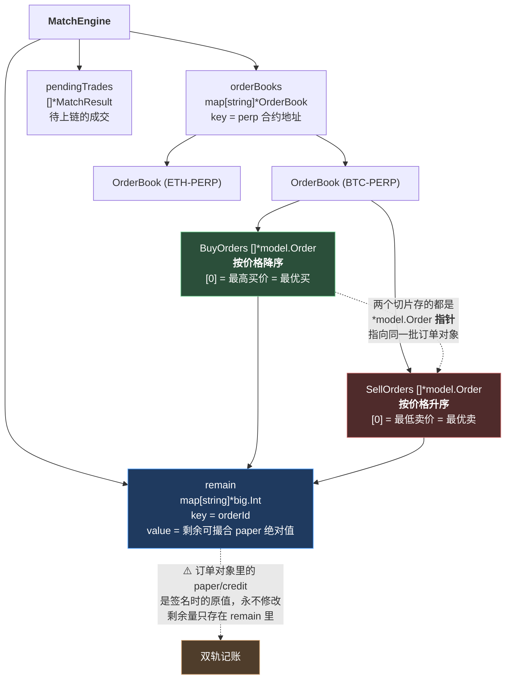
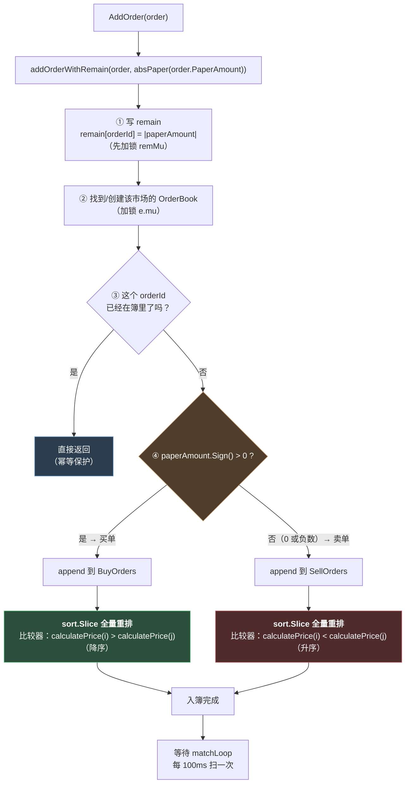
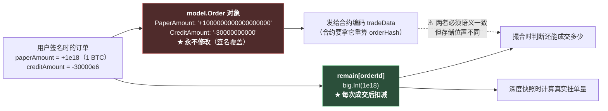

# 第 8 章：内存订单簿 — OrderBook 的数据结构与价格时间优先的排序实现

> 第 7 章结束时，订单已经算出了 `orderId`、通过了验签、写进了数据库。最后一步是 `MatchEngine.AddOrder(order)`——**订单从此进入一个有状态的世界：内存订单簿。**
>
> 订单簿是交易所的心脏。它要回答一个看起来很朴素的问题：**在一堆买家和一堆卖家里，谁先和谁成交？** 这个问题的答案就叫「撮合优先级」，而行业标准答案是六个字：**价格优先、时间优先**。
>
> 本章会拆开本项目对这个标准的实现——它只有**两个切片**和一个 `sort.Slice`，简单得出人意料。但简单是有代价的，而且我在动手测试之后发现了**三个具体的问题**：一个让"时间优先"实际上不成立（已用实验量化），一个能让整个市场的撮合**完全冻结**（已复现），还有一个会在订单簿变大后明显变慢。
>
> 这一章是本指南里最"工程"的一章：它讲的不是密码学，也不是分布式共识，而是**一个数据结构选得好不好，会如何直接决定市场的公平性和可用性**。

---

## 1. 本章导读

### 1.1 订单簿要回答的三个问题

一个订单簿，本质上是在维护两个**有序队列**，并回答三个问题：

```text
问题 1：新来的订单，应该插到队列的哪个位置？      → 排序问题
问题 2：队列的头部是谁？（谁最可能成交）          → 读取问题
问题 3：成交之后，队列怎么更新？                  → 删除/部分成交问题
```

**行业标准答案规定了"排序规则"**，也就是所谓**撮合优先级**：

```text
① 价格优先：买价高的排前面，卖价低的排前面
② 时间优先：同价格时，先挂单的排前面
```

**本项目把这两条规则实现成了：**

```text
问题 1 → append 到末尾，然后对整个切片 sort.Slice（每次插入都全量重排）
问题 2 → 直接取切片[0]
问题 3 → 剩余量为 0 就切片[1:] 切掉头部；否则原地保留
```

**总共不到 30 行代码。** 本章要做的，就是检验这套实现**是否真的实现了它声称的"价格时间优先"**。

### 1.2 先看数据结构长什么样

```go
// MatchEngine 里的订单簿存储
type MatchEngine struct {
	// 订单簿：perp -> side -> orders
	orderBooks map[string]*OrderBook        // 外层按市场地址分组

	// orderId -> 剩余可撮合 paper 绝对值
	remain map[string]*big.Int              // ★ 独立的"余额簿"

	// 待提交的交易
	pendingTrades []*MatchResult

	mu     sync.RWMutex
	remMu  sync.Mutex
	// ...
}

// OrderBook 订单簿
type OrderBook struct {
	Perp       string
	BuyOrders  []*model.Order // 买单（做多），按价格从高到低排序
	SellOrders []*model.Order // 卖单（做空），按价格从低到高排序
	mu         sync.RWMutex
}
```

**这两个结构体里有三个值得注意的设计选择，每一个都值得单独讨论：**

| 设计选择 | 表面上的理由 | 实际代价（本章会展开） |
| --- | --- | --- |
| **用两个切片，不用树/堆** | 简单、直观、可利用 CPU 缓存 | 插入 O(n log n)，删除头部 O(n) 内存搬移 |
| **有一个独立的 `remain` 余额簿** | 订单对象不能改（签名覆盖） | 双轨记账，两处状态可能不一致 |
| **每次插入都全量重排** | 代码最短 | O(n log n) × 每次插入，且比较器里有 big.Int 除法 |

### 1.3 本章的三个实测发现（先给结论）

我在写这一章时，把 `matchOrderBook` 的逻辑抽出来做了实验。**三个发现都是可复现的**，具体证据在 3.2 和 6.1~6.3：

**发现一：「时间优先」实际上不成立。**

```text
Go 的 sort.Slice 是【不稳定排序】，而同价订单在比较函数里被视为"相等"
⟹ 一旦盘口有多档价格，同一价格档内的到达顺序会被打乱

实测（30 张高价 + 30 张低价交错插入）：
  H 组内部乱序对 = 11 / 29
  L 组内部乱序对 = 10 / 29
  队列前 6 位：H09 H10 H03 H18 H05 H06    ← 完全不是插入顺序
```

**发现二（更严重）：一张 `paperAmount = 0` 的订单能让整个市场的撮合完全冻结。**

```text
实测：
  插入【买1@30000】+【卖1@29000】（价格交叉，本应立即成交）
  → 再插入一张 paperAmount = "0" 的订单
  → 跑一次撮合

结果：
  卖单队列: zero(价格=0) sell1(价格=29000000000000)   ← zero 排到了队首
  撮合后 pendingTrades 数量 = 0                       ← ★ 本该成交的一对，一笔都没成
  剩余卖单: zero sell1
  剩余买单: buy1
```

**发现三：随着订单簿变大，入簿会明显变慢。**

```text
每次 AddOrder 都对整个切片 sort.Slice
比较器里调用 calculatePrice —— 每次调用要分配 3 个 big.Int 并做 1 次除法
⟹ N 张挂单时，一次插入要做约 N×log₂N 次比较 = 2×N×log₂N 次 big.Int 除法
⟹ N = 10000 时约 28 万次大整数除法，全部发生在 HTTP 请求的处理路径上
```

**这三个发现构成了本章的主线。** 下面我们先把结构讲清楚，再逐个深入。

---

## 2. 架构 / 流程图

### 2.1 订单簿的数据结构全景

这张图把"一个市场一个订单簿、一个订单簿两个切片、外加一个全局余额簿"的结构画清楚：



**读图要点：**

- **`orderBooks` 是两层 map**：第一层按市场（perp 地址）分组，第二层是 `OrderBook` 里的两个切片。**每个市场有独立的订单簿，互不影响**（这是正确的——BTC 和 ETH 的订单不该互相成交）。
- **绿色的 `BuyOrders` 用降序、红色的 `SellOrders` 用升序**——**方向相反**。这个"相反"是本章的一个核心知识点（2.3 节）。
- **蓝色的 `remain` 是独立于订单对象的第二个真相源**——这是本项目一个很关键、也很容易看漏的设计（第 1 章 3.(4) 提过，3.(6) 会深入）。

### 2.2 一笔订单的入簿路径



**⚠️ 注意第 ④ 步的判定条件是 `Sign() > 0`（大于零），而不是 `>= 0`。**

```go
if paperAmount.Sign() > 0 {
	// 买单
} else {
	// ★ 卖单 —— 这里同时包含了"负数"和"零"两种情况
}
```

**这个 `else` 分支把 `paperAmount == 0` 的订单也归入了卖单侧**——这是 1.3 节发现二那个 DoS 的直接成因。详见 3.(5)。

### 2.3 买卖两侧排序方向为什么相反

这是初学者最容易困惑的地方。先看代码：

```go
// 买单：价格【降序】—— 最高的买价排在最前
sort.Slice(orderBook.BuyOrders, func(i, j int) bool {
	priceI := calculatePrice(orderBook.BuyOrders[i])
	priceJ := calculatePrice(orderBook.BuyOrders[j])
	return priceI.Cmp(priceJ) > 0        // ← 大于号 = 降序
})

// 卖单：价格【升序】—— 最低的卖价排在最前
sort.Slice(orderBook.SellOrders, func(i, j int) bool {
	priceI := calculatePrice(orderBook.SellOrders[i])
	priceJ := calculatePrice(orderBook.SellOrders[j])
	return priceI.Cmp(priceJ) < 0        // ← 小于号 = 升序
})
```

**用一个具体例子理解：**

```text
       买单队列（降序）                卖单队列（升序）
    ┌──────────────────┐          ┌──────────────────┐
    │ [0] 买 1 BTC @ 31000 │ ←最优买 │ [0] 卖 1 BTC @ 29000 │ ←最优卖
    │ [1] 买 1 BTC @ 30000 │          │ [1] 卖 1 BTC @ 30000 │
    │ [2] 买 1 BTC @ 29500 │          │ [2] 卖 1 BTC @ 31000 │
    └──────────────────┘          └──────────────────┘
              ↑                              ↑
         买价越高，越想成交             卖价越低，越想成交
         （愿意出更高价 = 更急）        （愿意接受更低价 = 更急）
```

**"最优"的定义对买卖双方是相反的：**

```text
对买家来说："好" = 价格低（少花钱）      → 但排队时，价格【高】的优先
对卖家来说："好" = 价格高（多收钱）      → 但排队时，价格【低】的优先
```

**注意这里有个反直觉的地方**：**排序用的不是"对谁更好"，而是"谁更愿意成交"。**

```text
买 1 BTC @ 31000 的人，比 买 1 BTC @ 29500 的人更想成交（出的价更高）
   ⟹ 所以在买方队列里排前面

卖 1 BTC @ 29000 的人，比 卖 1 BTC @ 31000 的人更想成交（要的价更低）
   ⟹ 所以在卖方队列里排前面
```

**这个"更想成交的排前面"的规则，正好等价于"双方各自的队首价格，构成了市场价格区间的两个边界"：**

```text
        bestBid                              bestAsk
     (最高买价)                            (最低卖价)
          ↓                                    ↓
    ──────●═══════════════════════════════════●──────→ 价格
          31000                              32000

    · bestBid >= bestAsk  → ★ 价格交叉 → 可以成交
    · bestBid <  bestAsk  → 有价差（spread）→ 不能成交
```

**这就是撮合循环只需要比较两个队首的原因**（第 9 章的主题）：

```go
buyOrder := book.BuyOrders[0]      // 最想买的
sellOrder := book.SellOrders[0]    // 最想卖的
buyPrice := calculatePrice(buyOrder)
sellPrice := calculatePrice(sellOrder)
if buyPrice.Cmp(sellPrice) < 0 {
	break                          // 最想买的人出价 < 最想卖的人要价 → 成交不了
}
```

**⚠️ 这里的推理是：如果"最想买的人"和"最想卖的人"都谈不拢，那其他组合更谈不拢。** 而这正是**排序保证了队首是最优价**的直接推论。

**所以"两侧方向相反"不是随意的约定，而是为了让"队首 = 最优价"这个性质同时成立。** 如果两侧都用降序，那么卖单队列的队首会是"最高卖价"——那是**最不想卖的人**，比较它毫无意义。

### 2.4 `remain` 双轨记账的数据流

第 1 章 3.(4) 从"签名覆盖"的角度解释过 `remain` 的必要性。这里从**数据结构**的角度再看一次：



**三个使用场景，两种不同的数据源：**

| 场景 | 用哪个 | 为什么 |
| --- | --- | --- |
| 编码 `tradeData` 发给合约 | **`order` 对象**（原始值） | 合约要重算 `orderHash` 验证签名——改了字段签名就废了 |
| 撮合时算可成交量 | **`remain`** | 订单可能已部分成交，原始值不再代表可成交量 |
| 深度快照 `/orderbook` | **`remain`** | 盘口应该显示"真实还能成交的量" |

**⚠️ 这个双轨设计有一个隐含的一致性要求：`remain` 必须始终等于 `|paperAmount| - 已成交累计量`。**

而"已成交累计量"记在**数据库的 `filled_amount` 列**里（第 12 章会讲重启恢复怎么用它）。**所以这三个地方必须始终一致：**

```text
remain[orderId]  ==  |order.PaperAmount|  -  order.FilledAmount
   （内存）              （订单对象，只读）        （数据库）
```

**⚠️ 注意这个等式右边跨了两个存储介质。** 第 11 章会详细讨论它在崩溃场景下如何失效。

---

## 3. 核心代码拆解

### (1) `OrderBook` 结构体 —— 三个字段里的设计

```go
// OrderBook 订单簿
type OrderBook struct {
	Perp       string
	BuyOrders  []*model.Order // 买单（做多），按价格从高到低排序
	SellOrders []*model.Order // 卖单（做空），按价格从低到高排序
	mu         sync.RWMutex
}
```

**作者为什么这么设计（设计思想）：**

**设计点一：切片里存的是 `*model.Order` 指针，不是 `model.Order` 值。**

```go
BuyOrders []*model.Order      // ✓ 指针
// BuyOrders []model.Order    // ✗ 值
```

**这个选择有几个实际影响：**

```text
① 排序时只移动指针（8 字节），不搬移整个结构体（model.Order 有 16 个字段）
   → 但 sort.Slice 内部用的是 reflect.Swapper，对指针切片的交换成本很低 ✓

② ★ 订单对象是"共享的"：同一个 Order 可能同时被 order 变量、
     remain 的 key、pendingTrades 里的 MatchResult 引用
   → 任何一处修改都会影响其他处（这正是"订单对象永不修改"这条纪律的原因）

③ 切片头部删除（book.BuyOrders = book.BuyOrders[1:]）只是移动切片头指针 ✓
   —— 但如果用值类型，每次删除都会拷贝整个剩余数组
```

**设计点二：注释里明确写了排序方向。**

```go
BuyOrders  []*model.Order // 买单（做多），按价格从高到低排序
SellOrders []*model.Order // 卖单（做空），按价格从低到高排序
```

**这个注释很重要**——因为"降序/升序"这个信息**在字段类型上完全看不出来**（`[]*model.Order` 不携带任何顺序信息）。**没有注释的话，读代码的人必须跳到 `addOrderWithRemain` 才能知道顺序。**

**⚠️ 但注释也有风险**：如果哪天有人改了排序方向却忘了改注释，**注释会变成误导**。更稳妥的做法是把顺序编码进**类型**或**访问函数**：

```go
// 更安全的形态：不暴露裸切片，只暴露语义化的访问器
type OrderBook struct {
	perp  string
	buys  []*model.Order    // 私有，外部拿不到
	sells []*model.Order
}
func (b *OrderBook) BestBid() *model.Order { ... }   // 语义清晰，顺序被封装
func (b *OrderBook) BestAsk() *model.Order { ... }
```

**但本项目选择了暴露裸切片**——代价是 `matchOrderBook`、`snapshotOrderBook`、`reinsertOrderLocked` 到处都在直接操作切片。**这是一个"简单但脆弱"的设计**：它让代码短了，但也让"排序不变式"没有单一的守护者。

**设计点三：每个 `OrderBook` 有自己的 `mu`，但 `MatchEngine` 也有一个 `mu`。**

```go
type MatchEngine struct {
	orderBooks map[string]*OrderBook
	mu         sync.RWMutex         // ← 保护 orderBooks 这个 map
	// ...
}

type OrderBook struct {
	// ...
	mu sync.RWMutex                 // ← 保护 BuyOrders / SellOrders 两个切片
}
```

**两级锁的原因**：map 本身的读写需要保护（Go 的 map 并发读写会 panic），而每个订单簿内部的切片是独立的数据。**但这两级锁是否用得恰当，见 3.(10)。**

### (2) `addOrderWithRemain` —— 入簿与排序（本章的核心）

```go
func (e *MatchEngine) addOrderWithRemain(order *model.Order, remain *big.Int) {
	// ① 先记账：把剩余量写进 remain
	e.remMu.Lock()
	e.remain[order.OrderId] = new(big.Int).Set(remain)
	e.remMu.Unlock()

	// ② 找到（或创建）这个市场的订单簿
	e.mu.Lock()
	defer e.mu.Unlock()

	orderBook, ok := e.orderBooks[order.Perp]
	if !ok {
		orderBook = &OrderBook{Perp: order.Perp}
		e.orderBooks[order.Perp] = orderBook
	}

	orderBook.mu.Lock()
	defer orderBook.mu.Unlock()

	// ③ 幂等保护：已经在簿里就跳过
	if e.orderInBook(orderBook, order.OrderId) {
		return
	}

	// ④ 按 paperAmount 的符号决定放进哪一侧，然后排序
	paperAmount := new(big.Int)
	paperAmount.SetString(order.PaperAmount, 10)

	if paperAmount.Sign() > 0 {
		// ===== 买单侧：按价格降序 =====
		orderBook.BuyOrders = append(orderBook.BuyOrders, order)
		sort.Slice(orderBook.BuyOrders, func(i, j int) bool {
			priceI := calculatePrice(orderBook.BuyOrders[i])
			priceJ := calculatePrice(orderBook.BuyOrders[j])
			return priceI.Cmp(priceJ) > 0
		})
	} else {
		// ===== 卖单侧：按价格升序 =====
		// ★ 注意：paperAmount <= 0 都进这里（含 0）
		orderBook.SellOrders = append(orderBook.SellOrders, order)
		sort.Slice(orderBook.SellOrders, func(i, j int) bool {
			priceI := calculatePrice(orderBook.SellOrders[i])
			priceJ := calculatePrice(orderBook.SellOrders[j])
			return priceI.Cmp(priceJ) < 0
		})
	}
}
```

**作者为什么这么设计（设计思想）：**

**设计点一：整段代码没有任何注释解释"为什么每次都要全量重排"。**

这是本节最值得批评的一点。**每次插入一张订单就重排整个切片**，这是一个**明显的算法选择**（复杂度是 O(n log n) 而不是 O(log n) 的插入），**但代码和注释里都没有说明为什么这么选。**

**可能的理由（我从上下文推断）：**

```text
① 项目早期订单量小（内存订单簿重启后从 DB 恢复，见第 12 章），
   n 通常只有几十到几百，O(n log n) 完全可以接受
② 用切片可以保持代码极简，避免引入堆/树的复杂度和 bug 面
③ ★ 但没有留下"这是有意为之"的痕迹，所以看起来像是不假思索
```

**⚠️ 这里的教训是：一个"看起来性能不好"的实现，如果有注释说明"为什么在当前规模下这是可以的"，就变成了一个可维护的工程决策；没有注释，它就是一个不知道什么时候会暴雷的技术债。**

**一个具体的暴雷场景**：如果某个市场在暴涨暴跌时挂单量激增到 5 万张，那么每次下单都会触发 5 万 × log₂(5万) ≈ 80 万次比较——而每次比较要算两次 `calculatePrice`（含 big.Int 除法）。**下单接口会明显变慢，而且这个退化是渐进的、不容易提前发现的。**

**设计点二：`remain` 的写入在加锁范围之外单独完成——这是对的。**

```go
e.remMu.Lock()
e.remain[order.OrderId] = new(big.Int).Set(remain)
e.remMu.Unlock()                    // ← 立刻释放

e.mu.Lock()                         // ← 再拿另一把锁
defer e.mu.Unlock()
```

**注意这两个锁不是嵌套的**——`remMu` 在 `mu` 之前就被释放了。

**⚠️ 这个顺序很关键**：如果反过来写成嵌套（先拿 `mu` 再拿 `remMu`），就会和 `matchOrderBook` 的加锁顺序（先 `book.mu` 再 `remMu`）产生**潜在的死锁风险**。当前的写法是安全的，但这个安全性来自"两把锁不嵌套"这个容易被破坏的性质。

**设计点三：`new(big.Int).Set(remain)` 是必要的防御性拷贝。**

```go
e.remain[order.OrderId] = new(big.Int).Set(remain)      // ✓ 拷贝一份
// e.remain[order.OrderId] = remain                      // ✗ 共享同一个对象
```

**为什么要拷贝？** 因为 `remain` 参数可能来自调用方的变量（比如 `AddOrder` 里的 `absPaperString(order.PaperAmount)` 返回的新对象，或者 `restoreOrder` 里传入的对象）。**如果直接存共享引用，调用方后续对这个 `big.Int` 的修改会静默影响订单簿。**

**⚠️ 这类"共享可变对象"的 bug 在 Go 里很常见**，尤其是 `big.Int`、`time.Time`、切片这些"看起来像值类型"的东西。**统一的规则是：跨越所有权边界时一律拷贝。**

**设计点四（问题所在）：第 ④ 步的 `Sign() > 0` 判断埋下了一个 DoS。**

```go
if paperAmount.Sign() > 0 {
	// 买单
} else {
	// ★ paperAmount == 0 也进这里
}
```

**`paperAmount = 0` 的订单会进入卖单侧**，而它的价格是 0（因为 `calculatePrice` 在 paper 为 0 时返回 0），**在升序排列中排到队首**。

**而队首的价格 0 意味着……** 下一节（3.(3)）会完整推导它对撮合循环的影响。**这是本章最严重的一个发现。**

### (3) `calculatePrice` —— 价格是怎么算出来的

```go
func calculatePrice(order *model.Order) *big.Int {
	paper := new(big.Int)
	paper.SetString(order.PaperAmount, 10)
	paper.Abs(paper)                       // 取绝对值

	credit := new(big.Int)
	credit.SetString(order.CreditAmount, 10)
	credit.Abs(credit)                     // 取绝对值

	if paper.Sign() == 0 {
		return big.NewInt(0)               // ★ paper 为 0 时价格定义为 0
	}

	precision := new(big.Int).Exp(big.NewInt(10), big.NewInt(18), nil)   // 1e18
	price := new(big.Int).Mul(credit, precision)
	price.Div(price, paper)                // price = |credit| * 1e18 / |paper|
	return price
}
```

**作者为什么这么设计（设计思想）：**

**设计点一：价格不是"存下来的"，而是"每次算出来的"。**

注意 `model.Order` 里**没有 price 字段**：

```go
type Order struct {
	OrderId      string
	Perp         string
	Signer       string
	PaperAmount  string     // 仓位数量（带符号）
	CreditAmount string     // 资金数量（带符号）
	// ★ 没有 Price 字段
	MakerFeeRate string
	TakerFeeRate string
	// ...
}
```

**价格是 `creditAmount / paperAmount` 的隐含比值。** 这是链上订单结构决定的（第 7 章 3.(2) 讲过：链上 `Order` 只有 5 个字段，价格为隐含值）。

**这个设计的含义：**

```text
✓ 优点：与链上结构完全一致，不存在"价格字段与 paper/credit 不一致"的可能
✗ 缺点：每次需要价格时都要做一次除法（而除法是最贵的整数运算）
```

**⚠️ 而这个"缺点"在本项目里被放大了**——因为 `calculatePrice` 被放在**排序的比较函数**里：

```go
sort.Slice(orderBook.BuyOrders, func(i, j int) bool {
	priceI := calculatePrice(orderBook.BuyOrders[i])    // ← 每次比较都算两次
	priceJ := calculatePrice(orderBook.BuyOrders[j])    // ← 每次都要分配 3 个 big.Int
	return priceI.Cmp(priceJ) > 0
})
```

**一次排序要做 O(n log n) 次比较，每次比较调用 `calculatePrice` 两次，每次调用分配 3 个 `big.Int` 并做一次大整数除法。**

**n = 10000 时：**

```text
比较次数 ≈ n × log₂n = 10000 × 13.3 ≈ 133,000 次
calculatePrice 调用 ≈ 266,000 次
big.Int 分配 ≈ 800,000 次
大整数除法 ≈ 266,000 次
```

**这全部发生在 `AddOrder` 里——也就是 HTTP 下单请求的处理路径上。**

**⚠️ 更好的做法（改动很小，收益很大）：**

```go
// 方案 A：在订单入簿时算一次价格，缓存起来
type OrderBook struct {
	BuyOrders  []*model.Order
	buyPrices  map[string]*big.Int      // orderId -> price，入簿时算一次
	// ...
}
// 比较器里直接查 map，O(1)，无 big.Int 运算

// 方案 B：如果排序时用不到精确值，可以比较 |credit|/|paper| 的交叉相乘形式
// （这是第 1 章 1.3 讲过的 Solidity 里的技巧）
// 但注意：cross-multiply 对大数仍然要做乘法，收益有限

// 方案 C：改用"插入时二分查找 + 有序插入"，把 O(n log n) 降到 O(n)（内存搬移）
// 且比较次数从 O(n log n) 降到 O(log n)
sort.Search(len(book.BuyOrders), func(i int) bool {
	return calculatePrice(book.BuyOrders[i]).Cmp(newPrice) <= 0
})
```

**方案 C 最彻底**：它把"每次全量重排"变成"二分查找插入位置"，**比较次数从 O(n log n) 降到 O(log n)**（n=10000 时从 133,000 次降到 14 次）。**代价是仍然要做 O(n) 的内存搬移（插入位置之后的元素要后移）**——但对指针切片来说，搬移是很便宜的（memmove）。

**设计点二：`paper.Sign() == 0` 时返回 0——这个"防御"反而制造了问题。**

```go
if paper.Sign() == 0 {
	return big.NewInt(0)               // 价格定义为 0
}
```

**作者的意图**显然是"避免除以零的 panic"（如果不判断，`price.Div(price, paper)` 会 panic）。**这是一个必要的防护。**

**但返回值 0 的选择是有害的**：

```text
· 对于卖单：价格 0 在【升序】排列中排到【队首】= 成为最优卖价
· 对于买单：价格 0 在【降序】排列中排到【队尾】= 最差的买价
```

**所以这个"防御"对卖单侧产生了完全相反的效果——它把一个异常订单送到了队首。**

**⚠️ 更安全的返回值选择：**

```go
if paper.Sign() == 0 {
	// 方案 A：用一个极大的值，让它对买单和卖单都排到最后
	return maxPrice    // 买降序 → 最后；卖升序 → 最后

	// 方案 B（更好）：根本不该让 paper=0 的订单进入订单簿
	// 在 AddOrder 入口就拒绝
}
```

**但真正正确的做法是在更上游拦截**（见 3.(5) 和 6.2）。**`calculatePrice` 只是一个"换算函数"，它没有能力决定"这个订单该不该存在"。**

### (4) 完整推导：`paperAmount = 0` 如何冻结整个市场

这是本章最需要看清的一段推理。**把前面几节的线索串起来：**

```text
① 用户提交 paperAmount = "0" 的订单
   （CreateOrder 没有任何校验会拒绝它——见第 7 章 6.3）

② addOrderWithRemain 的第 ④ 步：paperAmount.Sign() > 0 为 false
   ⟹ ★ 订单被放进 SellOrders（卖单侧）
   ⟹ remain[orderId] = absPaperString("0") = big.Int(0)

③ 排序：calculatePrice 返回 0
   ⟹ 在【升序】排列中，0 是最小的
   ⟹ ★ 这个订单排到了 SellOrders[0] —— 卖单队首

④ 撮合循环 matchOrderBook：
   buyOrder := book.BuyOrders[0]         // 最优买
   sellOrder := book.SellOrders[0]       // ★ 就是这个零量订单
   buyPrice := calculatePrice(buyOrder)  // 比如 31000e18
   sellPrice := calculatePrice(sellOrder) // ★ 0
   if buyPrice.Cmp(sellPrice) < 0 { break }  // 31000 > 0，不 break，继续

⑤ 取 min：
   buyRem := remain[buyOrder.OrderId]     // 比如 1e18
   sellRem := remain[sellOrder.OrderId]   // ★ 0
   matchAmount = min(1e18, 0) = 0

⑥ ★ if matchAmount.Sign() == 0 { break }
   ⟹ 整个撮合循环跳出
```

**结果：这个订单簿的撮合循环，每一次执行都在第 ⑥ 步直接 break。**

**⚠️ 而 `matchOrderBook` 的内层 `for` 循环被 break 之后，外层的 `match()` 会继续处理下一个订单簿** —— 所以**只有这个市场被冻结，其他市场不受影响**：

```go
// match 遍历所有订单簿
func (e *MatchEngine) match() {
	e.mu.RLock()
	defer e.mu.RUnlock()
	for _, orderBook := range e.orderBooks {
		e.matchOrderBook(orderBook)     // ← 这个市场被 break，其他市场照常
	}
}
```

**冻结会持续多久？**

```text
唯一的解除机制是 pruneExpiredAtHead（第 9 章）——它会在每轮撮合开头
检查队首是否过期，过期就删掉。

而零量订单虽然 paper 是 0，但它的 expiration 是用户自己填的
⟹ ★ 攻击者可以填一个很远的过期时间（比如一年后）
⟹ 冻结持续一年，或直到有人手工清理数据库和重启服务
```

**⚠️ 而且 `pruneExpiredAtHead` 检查的是"队首"，而零量订单就在队首**——所以只要它没过期，剪枝也不会碰它。

**这是一个完整的、可复现的 DoS：一次 HTTP 请求就能让一个市场的交易完全停止。**

**⚠️ 补充说明：这个订单最终上不了链。** 因为合约侧会拒绝它：

```solidity
// src/MetaNodeExternal.sol → approveTrade
require(
    (order.paperAmount < 0 && order.creditAmount > 0) || (order.paperAmount > 0 && order.creditAmount < 0),
    Errors.ORDER_PRICE_NEGATIVE
);
```

**但这个检查发生在"撮合之后"** —— 而撮合根本进行不下去（订单簿被冻结），所以**这个订单永远不会被提交到链上，也就永远触发不了链上的保护。**

**⚠️ 这正是"链上安全 ≠ 系统安全"的又一个例证**（第 1 章 3.(8) 讨论过 `Liquidator` 的同类问题）：**链上有完备的校验，但攻击者根本不需要绕过它——他只需要让链下环节卡住。**

### (5) `paperAmount` 符号的双重语义

这是本章的一个"设计之美"与"设计之险"并存的点。

**在本项目里，`paperAmount` 的符号同时承担了两个语义：**

```go
// 语义 1：多空方向（业务语义）—— 来自链上约定
//   paperAmount > 0  → 做多（买入）
//   paperAmount < 0  → 做空（卖出）

// 语义 2：归入订单簿的哪一侧（数据结构语义）
if paperAmount.Sign() > 0 {
	orderBook.BuyOrders = append(...)      // 买单侧
} else {
	orderBook.SellOrders = append(...)     // 卖单侧
}
```

**这个"一个字段表达两个概念"的做法，是好的设计吗？**

**支持的理由（本项目采用它的原因）：**

```text
① ★ 与链上完全一致：合约里的 paper 就是这个约定
   （Solidity 篇第 6 章讲过：正数为多头，负数为空头）
② 不需要额外的字段（不需要一个 "side" 枚举列）
③ 不可能出现"方向与符号不一致"的非法状态
   —— 因为它们是同一个东西，天然一致
```

**反对的理由（它带来的风险）：**

```text
① ★ "零"这个值落在了语义的缝隙里：
   · 它不是多头（不是 > 0）
   · 它也不是空头（不是 < 0）
   · 但代码用 `else` 把它归入了"空头侧"
   ⟹ 一个"既不是买也不是卖"的东西，被当成了卖

② 三个语义共用两个符号位，没有第三个状态可以表达"非法"
```

**⚠️ 这就是 3.(4) 那个 DoS 的**根本原因**：**

> **代码用"二值判断（`> 0` / `else`）"去处理"三值语义（正 / 负 / 零）"。**
>
> 正确性依赖于"零永远不会出现"这个前提——**而这个前提没有任何代码在守护。**

**修法（从根源上）：分层防御**

```go
// 第 1 层（最有效）：在下单接口就拒绝
// createorderlogic.go
if req.PaperAmount == "0" || strings.TrimPrefix(req.PaperAmount, "-") == "0" {
	return &types.CreateOrderResp{Code: 400, Message: "paperAmount must not be zero"}, nil
}
// 更好：解析成 big.Int 后判断 Sign() == 0，并且顺便做第 7 章 6.2 的 int128 范围检查

// 第 2 层：在入簿处拒绝（防止从其他路径进来的订单）
// addOrderWithRemain
if paperAmount.Sign() == 0 {
	logx.Errorf("拒绝零量订单入簿: orderId=%s", order.OrderId)
	return
}

// 第 3 层：撮合循环的防御（防止零量订单已经在簿里的情况）
// matchOrderBook 里的 break 改成跳过
if matchAmount.Sign() == 0 {
	// 不要 break —— 而是把这个异常订单移出队列
	e.dropInvalidHead(book, "buy", buyOrder)
	e.dropInvalidHead(book, "sell", sellOrder)
	continue
}
```

**⚠️ 第 3 层特别重要**：**当前的 `break` 让"一个坏数据"变成了"整个队列停摆"。** 而 `continue` + 移除坏数据，能让系统**自我修复**。这是一个通用的健壮性模式：

> **遇到无法处理的数据时，"跳过并记录"通常比"终止整个循环"更好。**
> 因为"终止"会把局部问题放大成全局问题——**而攻击者最喜欢这种放大效应。**

**⚠️ 但也要注意边界**：如果"坏数据"是大量出现的（不是个别脏数据），那么 `continue` 会导致循环空转，同样有问题。**所以第 1、2 层（在源头拦截）才是主力，第 3 层只是兜底。**

### (6) `reinsertOrderLocked` —— 回滚时的重新插入

```go
func (e *MatchEngine) reinsertOrderLocked(book *OrderBook, order *model.Order) {
	paperAmount := new(big.Int)
	paperAmount.SetString(order.PaperAmount, 10)
	if paperAmount.Sign() > 0 {
		book.BuyOrders = append(book.BuyOrders, order)
		sort.Slice(book.BuyOrders, func(i, j int) bool {
			return calculatePrice(book.BuyOrders[i]).Cmp(calculatePrice(book.BuyOrders[j])) > 0
		})
	} else {
		book.SellOrders = append(book.SellOrders, order)
		sort.Slice(book.SellOrders, func(i, j int) bool {
			return calculatePrice(book.SellOrders[i]).Cmp(calculatePrice(book.SellOrders[j])) < 0
		})
	}
}
```

**作者为什么这么设计（设计思想）：**

**设计点一：这段代码和 `addOrderWithRemain` 的后半段几乎完全相同——这是一处明显的重复。**

```text
addOrderWithRemain 的第 ④ 部分：
  按符号选侧 + append + sort.Slice

reinsertOrderLocked 的全部：
  按符号选侧 + append + sort.Slice
  ★ 一模一样（连比较函数的写法都相同）
```

**⚠️ 重复的代价**：如果将来要修 3.(2) 提到的排序稳定性问题（改用 `sort.SliceStable`），**必须记得改两处**——而漏改一处的后果是"大部分情况正常，偶尔回滚后排序又乱了"，这种 bug 极难排查。

**修法**：抽成一个函数。

```go
func (b *OrderBook) insertAndSort(order *model.Order, paperSign int) { ... }

// 两个调用点都变成一行
e.insertAndSort(orderBook, order, paperAmount.Sign())
```

**⚠️ 这是一个"改动成本极低、收益明确"的重构**，而且它顺便解决了"排序规则只有一个定义点"的问题。

**设计点二：`reinsertOrderLocked` 只回滚内存，不回滚数据库——这个边界在第 11 章会详细讨论。**

**这里只指出一个数据结构层面的观察**：`reinsertOrderLocked` 把订单重新 `append` 回切片，然后重新排序——**但订单在队列里的"位置"已经变了。**

```text
原始排队位置：  [A, B, C, D]     ← B 是先于 C 挂单的
成交后回滚：    删掉 B、C → 重新插入 B、C
                新队列： [A, B, C, D] 或 [A, C, B, D] 或 ...
                ★ 取决于 sort.Slice 的不稳定行为（3.(2) 的发现一）
```

**所以"回滚"不只是"把订单放回去"，它还可能改变订单的排队优先级。** 对于一个声称"时间优先"的订单簿来说，**这意味着一次链上失败（revert）会打乱相关订单的相对优先级。**

**⚠️ 这在有大量同价订单的市场里会累积**：每一次回滚都可能重排一次，同一档内的顺序逐渐偏离真实的到达顺序。

### (7) `orderInBook` —— 一个 O(n) 的幂等检查

```go
func (e *MatchEngine) orderInBook(book *OrderBook, orderID string) bool {
	for _, o := range book.BuyOrders {
		if o.OrderId == orderID {
			return true
		}
	}
	for _, o := range book.SellOrders {
		if o.OrderId == orderID {
			return true
		}
	}
	return false
}
```

**作者为什么这么设计（设计思想）：**

**它的目的是防止同一个订单被重复入簿**（比如 `AddOrder` 被调用两次）。

**⚠️ 但它的代价是 O(n) 的线性扫描，而且它在 `addOrderWithRemain` 里被调用时，外层已经持有 `orderBook.mu` 写锁** —— 也就是说，**每次下单都会在持锁状态下线性扫描整个订单簿。**

**更彻底的方案**：维护一个 `orderId -> side` 的 map：

```go
// 用 O(1) 替代 O(n)
type OrderBook struct {
	BuyOrders  []*model.Order
	SellOrders []*model.Order
	index      map[string]int8        // orderId -> side（1=买, -1=卖）
}
```

**⚠️ 但要注意**：引入索引 map 就引入了**第二个真相源**（索引和切片必须同步维护）。**这正是 3.(6) 讨论的"双轨记账"问题的翻版。**

**所以这个 O(n) 检查其实是一个有意识的取舍**：用一点性能换取"少一个可能不一致的状态"。对本项目的规模（重启后从 DB 恢复，通常订单量不大）来说，这个取舍是合理的。

**⚠️ 真正的问题不在 O(n)，而在于"为什么需要这个检查"**：

```text
如果 AddOrder 只会被调用一次（CreateOrder 里调用），那这个检查是多余的
真正需要它的是：【重启恢复】时可能重复恢复同一张订单
（RestorePendingOrders 遍历多个市场，理论上同一订单可能被处理两次）
```

**代码里没有注释说明这一点**，所以读者会以为是防御"用户重复下单"——**而那个场景其实由 `CreateOrder` 里的 `FindOne(orderId)` 和数据库唯一索引挡住了（第 7 章 3.(1)）。**

### (8) `SnapshotOrderBook` 与深度聚合

```go
// SnapshotOrderBook 返回内存订单簿聚合深度（price 为 |credit|/|paper| 的 1e18 精度字符串）。
func (e *MatchEngine) SnapshotOrderBook(perp string, limit int) (bids, asks []svc.OrderBookLevel) {
	if limit <= 0 {
		limit = 20
	}
	perp = strings.TrimSpace(perp)
	if perp == "" {
		return nil, nil
	}

	e.mu.RLock()
	book, ok := e.orderBooks[perp]
	e.mu.RUnlock()
	if !ok || book == nil {
		return nil, nil
	}

	book.mu.RLock()
	defer book.mu.RUnlock()

	e.remMu.Lock()
	defer e.remMu.Unlock()

	// 把订单按价格聚合成"档位"
	bidMap := aggregateBookLevels(book.BuyOrders, e.remain)
	askMap := aggregateBookLevels(book.SellOrders, e.remain)

	bids = levelsFromMap(bidMap, limit, true)
	asks = levelsFromMap(askMap, limit, false)
	return bids, asks
}
```

```go
// 把同一价格的多个订单合并成一档
func aggregateBookLevels(orders []*model.Order, remain map[string]*big.Int) map[string]*big.Int {
	out := make(map[string]*big.Int)
	for _, o := range orders {
		if o == nil {
			continue
		}
		rem := remain[o.OrderId]
		if rem == nil || rem.Sign() <= 0 {
			continue                              // ★ 跳过剩余量为 0 的订单
		}
		price := calculatePrice(o).String()       // ★ 价格转成字符串当 map key
		if out[price] == nil {
			out[price] = new(big.Int)
		}
		out[price].Add(out[price], rem)           // ★ 累加的是 remain，不是原始 paper
	}
	return out
}
```

**作者为什么这么设计（设计思想）：**

**设计点一：聚合用的是 `remain` 而不是订单的原始 `paperAmount`——这是对的。**

```go
rem := remain[o.OrderId]
if rem == nil || rem.Sign() <= 0 {
	continue
}
out[price].Add(out[price], rem)      // ← 累加剩余量
```

**如果这里用原始 `paperAmount`，盘口深度会显示错误的量**：

```text
一张 1 BTC 的买单，已成交 0.7 BTC
  · 用原始 paperAmount → 盘口显示"10000 档有 1 BTC"
  · 用 remain            → 盘口显示"10000 档有 0.3 BTC"  ✓ 正确
```

**⚠️ 而且那个 `rem.Sign() <= 0 { continue }` 的检查也很重要**——它跳过了已经完全成交但还残留在切片里的订单。

**⚠️ 但这里有一个隐含的一致性问题**：如果 `remain` 里**没有**某个订单的条目（返回 `nil`），代码会**跳过它**（而不是报错）。**这意味着"remain 缺失"和"订单已成交完"在行为上无法区分**——两者都会让订单从盘口消失。**这是一个把"数据缺失"当成"业务状态"的例子**，类似的思路在第 3 章 2.3 讨论过（静默谎言）。

**设计点二：用"价格字符串"当 map 的 key。**

```go
price := calculatePrice(o).String()       // big.Int → 十进制字符串
out := make(map[string]*big.Int)
```

**为什么不用 `*big.Int` 当 key？** 因为 `big.Int` 是**可变对象**，不能作为 map key（Go 要求 key 必须是可比较的类型，而指针虽然可比较，但比较的是**地址**不是**值**——两个内容相同的 `big.Int` 是不同的 key）。

**用字符串是正确且常见的做法。** ⚠️ 但要意识到它的代价：**每次聚合都要做一次 `big.Int → string` 的转换**，而字符串比较比数值比较慢。

**设计点三（问题所在）：`SnapshotOrderBook` 同时持有读锁和 `remMu`，做 O(n) 的聚合。**

```go
book.mu.RLock()
defer book.mu.RUnlock()
e.remMu.Lock()
defer e.remMu.Unlock()
// ↓ 这整段都在持锁状态下执行
bidMap := aggregateBookLevels(book.BuyOrders, e.remain)   // O(n) + n 次 big.Int 除法
askMap := aggregateBookLevels(book.SellOrders, e.remain)  // O(n) + n 次 big.Int 除法
```

**`aggregateBookLevels` 对每个订单调用一次 `calculatePrice`（含 big.Int 除法和字符串转换）。**

**而 `book.mu.RLock()` 与 `matchOrderBook` 的 `book.mu.Lock()` 是互斥的。**

**⟹ 一次 `/api/v1/orderbook` 查询，会阻塞该市场的撮合，阻塞时间 = O(n) 次 big.Int 运算的时间。**

**⚠️ 这意味着：**

```text
· 挂单量越大，深度查询越慢
· 深度查询越频繁，撮合被阻塞得越久
· ★ 而深度接口是公开的、不需要登录的（第 4 章 6.4）—— 任何人可以高频刷
```

**这是一个"读接口影响写路径"的典型问题**（Go 的 RWMutex 在写者等待时会阻塞新的读者，但这里的问题是读者持有锁太久）。

**修法**：把聚合移出锁外，或者在订单入簿时就预计算好聚合结果。**一个常见的做法是维护一份"档位缓存"**（每次成交/入簿时增量更新，查询时直接读）：

```go
// 增量维护的档位索引
type OrderBook struct {
	bidLevels map[string]*big.Int    // price -> 总量
	askLevels map[string]*big.Int
	// 入簿/成交时同步更新
}
// 快照变成 O(档位数) 而不是 O(订单数)，且锁持有时间极短
```

**⚠️ 但这又引入了"第三个真相源"**（切片 + remain + 档位索引），三者的同步成本会更高。**这就是"性能优化"和"状态一致性"之间的经典权衡。**

### (9) 锁的层级与加锁顺序

本项目在订单簿这部分用了**三把锁**，理解它们的关系对读懂并发行为很重要：

```go
type MatchEngine struct {
	orderBooks map[string]*OrderBook
	mu         sync.RWMutex    // ① 保护 orderBooks 这个 map 本身
	remain     map[string]*big.Int
	remMu      sync.Mutex      // ② 保护 remain 这个 map
	pendingTrades []*MatchResult
	tradeMu       sync.Mutex   // ③ 保护 pendingTrades 切片
	// ...
}

type OrderBook struct {
	// ...
	mu sync.RWMutex            // ④ 保护这个订单簿的两个切片
}
```

**加锁顺序（实测各处的调用顺序）：**

```text
addOrderWithRemain:   ② remMu（释放）→ ① mu → ④ book.mu
matchOrderBook:       ④ book.mu → ② remMu → ③ tradeMu
SnapshotOrderBook:    ① mu（释放）→ ④ book.mu(R) → ② remMu
submitBatch:          ③ tradeMu（释放）→ ② remMu → ① mu → ④ book.mu（rollbackMatch 里）
```

**⚠️ 分析：**

```text
✓ 所有路径都是"先 book.mu 再 remMu"（或两把锁不嵌套）—— 没有形成环，不会死锁
✓ matchOrderBook 持 ④ 的同时拿 ②，和 SnapshotOrderBook 的顺序一致
⚠️ 但 matchOrderBook 还拿了 ③ tradeMu，而 addOrderWithRemain 不碰 ③
   —— 目前没形成环，但这是"靠巧合维持"的安全性
```

**⚠️ 一个更值得注意的点**：`matchOrderBook` 在**持有 `book.mu` 写锁**的整个过程中，会做：

```text
· calculatePrice（big.Int 运算）
· append 到 pendingTrades
· 修改 remain
· ★ 调用 dropExpiredLocked → 它里面有数据库写操作！
```

**看 `dropExpiredLocked`：**

```go
func (e *MatchEngine) dropExpiredLocked(book *OrderBook, side string, idx int, o *model.Order) {
	// ... 从切片里删除 ...
	e.remMu.Lock()
	delete(e.remain, o.OrderId)
	e.remMu.Unlock()
	if e.orderModel != nil {
		_ = e.orderModel.UpdateStatus(context.Background(), o.OrderId, model.OrderStatusCancelled, o.FilledAmount)
		//  ★ 一次数据库写，发生在持有 book.mu 写锁的过程中
	}
	logx.Infof("expired order removed from book: %s expiration=%d", o.OrderId, o.Expiration)
}
```

**⚠️ 这是一个明确的性能问题：在持有订单簿写锁的情况下做数据库 I/O。**

```text
数据库写操作通常 1~10 毫秒（本地）/ 几十毫秒（远程 Supabase）
而撮合循环每 100 毫秒跑一次
⟹ 只要有订单过期，这一轮撮合就会因为等数据库而阻塞
⟹ 期间所有下单（AddOrder 需要 book.mu 写锁）都会被阻塞
```

**修法**：把数据库更新放到锁外（收集起来，出锁之后批量处理）。

```go
// 思路：把"要删除的订单"收集到局部切片，锁内只做内存操作
func (e *MatchEngine) pruneExpiredAtHead(book *OrderBook) {
	var expired []*model.Order
	// ... 锁内：只从切片移除，收集到 expired ...
	// 锁外：
	for _, o := range expired {
		_ = e.orderModel.UpdateStatus(...)
	}
}
```

**⚠️ 这是一条在并发系统里很通用的原则：**

> **锁内只做内存操作，I/O 一律移到锁外。**
>
> 因为 I/O 的耗时是不可控的（网络抖动、数据库慢查询），而锁的持有时间直接影响整个系统的吞吐。**把 I/O 放进锁里，等于让"外部系统的延迟"直接变成"本系统的延迟"。**

---

## 4. Web3 特有机制

### 4.1 `paper` 符号约定的链上根源

3.(5) 讲的"符号双重语义"不是本项目发明的，而是**完全照搬链上的约定**。回到 Solidity：

```solidity
// src/libraries/Types.sol
struct Order {
    // ...
    /// @notice paper 数量（仓位），正数做多，负数做空
    int128 paperAmount;
    /// @notice credit 数量
    int128 creditAmount;
}
```

```solidity
// src/Perpetual.sol —— credit 的计算公式
// credit = (paper * fundingRate) + reducedCredit
```

**以及合约里的校验（第 7 章引用过）：**

```solidity
// paperAmount 和 creditAmount 必须【异号】
require(
    (order.paperAmount < 0 && order.creditAmount > 0) || (order.paperAmount > 0 && order.creditAmount < 0),
    Errors.ORDER_PRICE_NEGATIVE
);
```

**⚠️ 注意这个 `require` 已经隐含了"不能为零"** —— 因为 `0 < 0` 为 false，`0 > 0` 也为 false，两个分支都不成立。

**所以链上早就拒绝了零量订单，而链下没有做同样的检查。** 这是一个很典型的"链上与链下校验强度不对等"的例子：

| 校验项 | 链上 | 链下 |
| --- | --- | --- |
| `paperAmount` 与 `creditAmount` 异号 | ✅ `ORDER_PRICE_NEGATIVE` | ❌ **没有** |
| `paperAmount != 0` | ✅（上一条的推论） | ❌ **没有** |
| `expiration >= block.timestamp` | ✅ `ORDER_EXPIRED` | ✅ 有（`CreateOrder` 第一道检查） |
| `order.perp == msg.sender` | ✅ `PERP_MISMATCH` | ❌ 没有 |
| 禁止自成交 | ✅ `ORDER_SELF_MATCH` | ❌ 没有 |

**⚠️ 这个对比表值得仔细看**：**链上做了五项校验，链下只做了一项。**

**为什么链上必须做而链下"可以不做"？** 因为资产安全由链上兜底——**但"链下可不做"不等于"链下不该做"**，因为：

```text
链上校验能防住"资产被盗"
但防不住"链下流程被污染"：
  · 零量订单冻结撮合（3.(4)）
  · 同价订单塞满订单簿，让排序变慢（3.(2)）
  · 无效订单占用数据库和内存

⟹ ★ 链下校验的目的是"保护链下系统本身的可用性"，
   这和"保护资产"是两个不同的目标
```

**🔑 一条可以带走的判断：**

> **在"链上撮合 + 链下验证"的架构里，链下校验不是冗余，它保护的东西和链上完全不同。**
>
> ```text
> 链上校验 → 保护 资产
> 链下校验 → 保护 系统自身的可用性和性能
> ```
>
> **所以"合约里已经检查过了"不能作为"链下不检查"的理由。** 本项目在 `expiration` 上做对了（链下也查了），在 `paperAmount != 0` 上漏了。

### 4.2 为什么价格必须是 `big.Int`，不能是 `float64`

`calculatePrice` 返回 `*big.Int` 而不是 `float64` 或 `decimal`——这是 Web3 后端的**硬约束**，有三个层次的原因：

**原因一：链上没有小数。**

```text
链上的 price 从来不是一个存下来的数，而是 |credit| / |paper| 这个比值
而 credit 和 paper 都是整数（1e6 和 1e18 精度）
⟹ 链下如果要"和链上算出完全一致的结果"，就必须用同样的整数运算
```

**如果链下用 `float64`：**

```go
price := float64(credit) / float64(paper)     // ✗ 二进制浮点，有舍入误差
```

**`float64` 只有 53 位有效数字**——而 `credit` 可能是 1e18 量级、`paper` 是 1e18 量级，**两个 60 位整数相除，结果的有效位根本放不下。**

**原因二：价格的比较决定了撮合结果，而"差不多"是不行的。**

```text
买卖价格相等时的比较：
   链上：cross-multiply 整数比较（第 1 章 1.3 讲的技巧）→ 精确
   链下用 float：可能有 1e-15 的误差 → ★ 本应成交的订单被判定为"价格不交叉"
```

**⚠️ 这种误差会制造出"链下认为不能成交，链上认为能成交"的分歧** —— 而链下是撮合的决策者，所以结果是**订单卡住不成交**。

**原因三：`big.Int` 与 Solidity 的 `int256` 语义对齐。**

```text
Solidity int256：固定 256 位，算术溢出会 revert（0.8+ 默认检查）
Go big.Int：     任意精度，永不溢出

⟹ 在 int256 范围内的值，两者的加减乘除结果完全一致 ✓
⟹ 超过 int256 时，Go 会算出结果而链上会 revert —— ★ 这正是第 7 章 6.2 那个坑
```

**⚠️ 所以 `big.Int` 是"语义上最接近链上"的选择**，它不是完美的模拟（溢出行为不同），但**在合法值范围内是精确一致的**。

**一条实用的判断：**

> **在链下复现链上计算时，整数类型的选择标准是"与链上语义对齐"，而不是"够用就行"。**
> ```text
> float64 / decimal  → ✗ 舍入规则与链上不同，会在边界值上产生分歧
> int64              → ✗ 精度不够（1e18 放不下）
> big.Int            → ✓ 在 int256 范围内与链上完全一致
> ```

### 4.3 内存订单簿的"权威性"：它是真的账本吗？

这是一个容易被忽略但很重要的问题。**这张内存订单簿，在系统的信任结构里处于什么位置？**

```text
链上 Perpetual 合约的 balanceMap    → ★ 权威（资产在这里，法律意义上的"账本"）
数据库 orders 表                     → 副本（链下索引，可能过期）
★ 内存订单簿                         → 什么都不是（只是撮合的"工作区"）
```

**内存订单簿不权威，体现在三个方面：**

**体现一：它可以被随意丢弃和重建。**

```go
// 服务重启时，订单簿完全从数据库重建
func (e *MatchEngine) Start(perpAddresses []string) {
	e.RestorePendingOrders(context.Background(), perpAddresses)   // ← 从 DB 恢复
	go e.matchLoop()
	go e.submitLoop()
}
```

**进程被 `kill -9` 之后，内存订单簿里的所有内容消失**——而系统**不需要**从链上恢复它（第 12 章会讲这个恢复过程）。

**体现二：订单簿里的"成交"在链上确认之前，随时可能被撤销。**

```go
// submitBatch 里：链上失败 → rollbackMatch → 订单重新插回订单簿
if rec == nil || rec.Status != 1 {
	logx.Errorf("trade tx reverted or failed: %s", txHash)
	e.rollbackMatch(trade, matchAmt)      // ← 撮合结果被撤销
	continue
}
```

**所以内存订单簿里的"状态"是**临时的、可回退的**——它是一个"预演台"，不是一个"账本"。**

**体现三：它没有持久化，也没有共识。**

```text
· 单机内存（如果部署多副本，每个副本的订单簿都是独立的、不同的）
· 没有 WAL / 快照 / 复制机制
· 重启即丢失
```

**⚠️ 这个"不权威"的定位带来一个重要推论：**

> **内存订单簿的正确性要求，比"数据库"低，但比"缓存"高。**
>
> ```text
> 缓存：  错了就丢，重新从源加载，无副作用         → 内存订单簿 > 这个
> 数据库：错了就是数据损坏，需要修复              → 内存订单簿 < 这个
>
> ★ 内存订单簿的真实定位：
>   它错了 → 会导致"错误的撮合决策" → 提交到链上 → 被合约拒绝（revert）
>   或者更糟：提交到链上 → 被合约接受（！）→ 产生一笔本不该发生的交易
> ```
>
> **最后那一种才是最危险的**——如果内存订单簿的排序错误导致"本不该成交的订单成交了"，而链上的 `_priceMatchCheck` 又没能拦住（比如两个订单的价格恰好都合法），那么**这笔交易会被永久记录在链上。**

**⚠️ 所以 3.(2) 的"时间优先不成立"这个发现，它的严重程度取决于"时间优先"是否有链上约束：**

```text
链上 _priceMatchCheck 检查的是【价格交叉】，不检查【时间顺序】
⟹ ★ 链上完全不管"谁先挂单"
⟹ 所以链下订单簿的排序是【唯一的】撮合优先级实现
⟹ 排序错了，就是真的错了，链上不会帮你纠正
```

**这是本章最值得记住的一条：**

> **凡是"链上没有约束、只由链下决定"的规则，链下的实现就是唯一的真相。**
>
> 本项目的"时间优先"就是这样一条规则——**合约不检查它，所以订单簿的排序算法就是它的全部实现**。**而 `sort.Slice` 的不稳定性让这条规则实际上不成立。**

### 4.4 一个对比：链上为什么不需要订单簿

最后补充一个概念性的对照，帮助你理解"为什么订单簿只在链下存在"。

```text
链上（Perpetual 合约）：
  · 只存 balanceMap[trader] = {paper, reducedCredit}
  · 只存 orderFilledPaperAmount[orderHash] = 累计成交量
  · ★ 没有"队列"，没有"排序"，没有"优先级"

链下（内存订单簿）：
  · 有 BuyOrders / SellOrders 两个有序队列
  · 有排序算法（价格 + 时间优先级）
  · ★ 有"谁先谁后"的概念
```

**为什么链上不需要订单簿？** 因为**链上不撮合**（第 1 章 1.2 的核心结论）。

```text
链上的角色是"验证者"：验证"这一组订单的价格是否交叉、签名是否有效、成交后是否安全"
链下的角色是"决策者"：决定"谁和谁成交"

★ 而"谁先谁后"只对"决策者"有意义 ——
   因为验证者只需要检查"这一笔成交是否合法"，不需要知道"为什么选了这一对"
```

**⚠️ 这解释了链上 `_priceMatchCheck` 的检查范围：它只验证"价格交叉"，不验证"时间顺序"。**

```solidity
// src/libraries/Trading.sol
function _priceMatchCheck(Types.Order memory takerOrder, Types.Order memory makerOrder) private pure {
	// 只检查：买卖方向相反 + 价格不交叉
	// ★ 不检查：这两张订单是不是"应该最先成交"的
}
```

**所以"时间优先"这条规则，在链上世界中根本不存在。** 它是链下为了提高市场效率和公平性而自行施加的**自律规则**。

**🔑 这个观察引出一个重要的判断：**

> **在"链下撮合"的架构里，"撮合优先级"是一个纯粹的链下约定——它没有任何链上强制力。**
>
> 这意味着：
> ```text
> · 如果一个撮合服务不遵守"价格优先" → 会被 _priceMatchCheck 拦住 ✓ 有强制力
> · 如果一个撮合服务不遵守"时间优先" → ★ 没有任何机制能发现和阻止
> ```
>
> **所以"时间优先"的可信度，完全取决于撮合服务的声誉和竞争**（用户可以换一个撮合服务）。**这也是为什么成熟的 DEX 会公开它的撮合规则，甚至提供可验证的撮合证明**——因为**在链下世界里，规则的可信度只能靠透明和可验证来建立。**

---

## 5. 本章小结与思考题

### 5.1 核心知识点回顾

| 知识点 | 一句话总结 |
| --- | --- |
| **订单簿的数据结构** | `map[perp]*OrderBook`，每个 `OrderBook` 是**两个切片**（买/卖）+ 一把读写锁 |
| **排序方向相反** | 买降序、卖升序——为了让"队首 = 最优价"，从而撮合只需比较两个队首 |
| **"最优"的定义对买卖相反** | 排序依据不是"对谁更好"，而是"**谁更愿意成交**" |
| **`paperAmount` 的符号** | 同时承担"多空方向"和"归入哪一侧"两个语义（来自链上约定） |
| **`remain` 双轨记账** | 订单对象存签名原值（永不改），`remain` 存剩余可成交量（每次成交扣减） |
| **`calculatePrice` 是算出来的** | 价格 = `|credit| × 1e18 / |paper|`，没有存下来的 price 字段 |
| **🔴 时间优先实际不成立** | `sort.Slice` **不稳定**，同档内部顺序被打乱（实测 11/29、10/29 乱序对） |
| **🔴 零量订单冻结撮合** | `paper=0` → 进卖侧 → 价格 0 → 排到队首 → `matchAmount=0` → **`break` 整个撮合循环** |
| **🟠 入簿性能** | 每次插入全量重排 O(n log n)，比较器里含 big.Int 除法（n=1 万时约 28 万次除法） |
| **🟠 深度查询阻塞撮合** | `SnapshotOrderBook` 持读锁做 O(n) 聚合，与撮合的写锁互斥 |
| **🟠 持锁做数据库 I/O** | `dropExpiredLocked` 在持有订单簿写锁时调用 `UpdateStatus` |
| **代码重复** | `addOrderWithRemain` 和 `reinsertOrderLocked` 的后半段完全相同 |
| **链上校验五项，链下只做了一项** | 链下校验保护的是"系统的可用性"，不是"资产" |
| **内存订单簿不权威** | 可丢弃、可重建、可回退——它是"预演台"不是"账本" |
| **"时间优先"没有链上强制力** | 合约只检查价格交叉，**完全不检查时间顺序**——这条规则完全由链下自律 |

### 5.2 思考题

#### 思考题 1：本项目的订单簿用"两个切片 + 每次插入全量重排"实现，而不是红黑树或堆。请分析：（a）这个选择在什么规模下是可以接受的？（b）它的复杂度拐点在哪里？（c）如果让你改，你会改成什么？为什么不一定值得改？

<details>
<summary>点击查看参考答案</summary>

**（a）什么规模下可以接受**

先算清楚实际的成本。关键不是"O(n log n) 听起来慢"，而是**具体到本项目，每次插入要花多少时间**。

```text
一次 AddOrder 的成本：
  · 排序比较次数 ≈ n × log₂n
  · 每次比较调用 calculatePrice 两次
  · 每次 calculatePrice：
      - 2 次 big.Int.SetString（从字符串解析）
      - 2 次 Abs
      - 1 次 Exp(10, 18)  ← ★ 每次都重新计算 1e18！
      - 1 次 Mul（256 位 × 64 位）
      - 1 次 Div（大整数除法，最贵）
      - 1 次 String()（在聚合路径上）
```

**⚠️ 注意 `new(big.Int).Exp(big.NewInt(10), big.NewInt(18), nil)`** —— **每次调用 `calculatePrice` 都重新计算 `1e18`**，而这是一个**常量**。**这是一个非常容易修、收益很明确的低效点**：

```go
var precision1e18 = new(big.Int).Exp(big.NewInt(10), big.NewInt(18), nil)   // 包级变量，算一次

func calculatePrice(order *model.Order) *big.Int {
	// ... 直接用 precision1e18 ...
}
```

**估算实际耗时（数量级层面的估算）：**

```text
单次 big.Int 除法（256 位 / 256 位）约 100~300 纳秒
单次 Exp(10,18)（小指数，但有分配）约 100~200 纳秒

calculatePrice 单次 ≈ 1 微秒左右（含分配和除法）

n = 100    → 比较 ≈ 664 次 → calculatePrice ≈ 1328 次 → ★ 约 1.3 毫秒
n = 1000   → 比较 ≈ 9966 次 → calculatePrice ≈ 19932 次 → ★ 约 20 毫秒
n = 10000  → 比较 ≈ 132877 次 → calculatePrice ≈ 265754 次 → ★ 约 266 毫秒
```

**（⚠️ 这里的数字是量级估算，不是精确基准测试。要得到准确数字应该写 benchmark。）**

**结论：**

```text
n < 1000    → 毫秒级，完全可接受（用户感知不到）
n ≈ 5000    → 几十毫秒，开始变得明显
n > 10000   → 数百毫秒，★ 已经不适合放在 HTTP 请求路径上了
```

**而本项目的实际规模是**：内存订单簿**重启时从数据库恢复**（第 12 章），`MaxPendingOrders` 配置默认 10000（`etc/metanode.yaml`）。**这是一个偏大的上限。**

**所以答案是：在"每个市场几百张挂单"的规模下，这个实现是完全可以接受的；在配置允许的 1 万张上限下，它已经接近不可用。**

**（b）复杂度拐点在哪里**

**拐点不是一个点，而是三个不同的瓶颈先后到达：**

| 瓶颈 | 何时成为主要成本 | 量级 |
| --- | --- | --- |
| **排序的比较次数** O(n log n) | n 从几百开始 | n=1000 时约 1 万次比较 |
| **`calculatePrice` 里的分配** | 和上面同步 | 每次比较 2 次调用 → 大量小对象 |
| **持锁时间**（阻塞撮合和其他下单） | ★ 这才是真正的拐点 | 上百毫秒的持锁 → 撮合循环（100ms 一轮）被完全打乱 |

**⚠️ 第三个才是本节的关键**：`AddOrder` 是在**持有 `orderBook.mu` 写锁**的情况下排序的：

```go
orderBook.mu.Lock()
defer orderBook.mu.Unlock()
// ... append + sort.Slice（几百毫秒）...
```

**而 `matchOrderBook` 也需要 `book.mu.Lock()`。** 所以：

```text
一次大订单簿的下单（266 毫秒）
   ⟹ 该市场的撮合被阻塞 266 毫秒
   ⟹ 撮合间隔配置是 100 毫秒 → ★ 至少错过 2 轮撮合
   ⟹ 同时其他用户的下单也被阻塞（都在等同一把写锁）
```

**所以真正的拐点是"单次排序耗时接近或超过撮合间隔（100ms）"**，大约在 n ≈ 5000~8000 之间。

**⚠️ 而这个拐点是"渐进"的**——服务不会明确地"坏掉"，只会越来越慢，直到有人投诉"下单很卡"。

**（c）改成什么，以及为什么不一定值得改**

**如果改，优先级排序是：**

**改动 1（成本最低、收益最高）：把 `1e18` 提成包级常量。**

```go
var oneE18 = new(big.Int).Exp(big.NewInt(10), big.NewInt(18), nil)
```

**一行改动，消除了每次调用的一次 `Exp`。** ⚠️ **注意 `big.Int` 是可变的——包级变量不能被别的代码修改**，所以要么小心使用，要么用 `func() *big.Int` 每次返回副本（那就失去意义了）。**更稳妥的写法是硬编码**：

```go
// 1e18 的十六进制表示，避免运行时计算
var oneE18 = func() *big.Int {
	z, _ := new(big.Int).SetString("1000000000000000000", 10)
	return z
}()
```

**改动 2：把价格缓存起来，不要每次比较都算。**

```go
type orderEntry struct {
	order *model.Order
	price *big.Int        // 入簿时算一次
}
type OrderBook struct {
	BuyOrders  []orderEntry
	SellOrders []orderEntry
}
```

**收益：比较器里只做 `big.Int.Cmp`（无分配、无除法）。** 代价是结构体变复杂，且 `price` 成为第二个真相源（但价格是从不可变的订单字段算出来的，所以是安全的）。

**改动 3：用二分查找 + 有序插入，替代全量重排。**

```go
// 比较次数从 O(n log n) 降到 O(log n)
pos := sort.Search(len(book.BuyOrders), func(i int) bool {
	return book.BuyOrders[i].price.Cmp(newPrice) <= 0
})
book.BuyOrders = append(book.BuyOrders, nil)
copy(book.BuyOrders[pos+1:], book.BuyOrders[pos:])
book.BuyOrders[pos] = newEntry
```

**收益：n=10000 时比较次数从 133,000 降到 14 次。** 代价是仍有 O(n) 的内存搬移（但指针切片的 memmove 很快，几十微秒量级）。

**改动 4（最彻底）：换成堆或跳表。**

**但这里我要说清楚为什么"不一定值得改"：**

**理由一：本项目的规模可能永远到不了拐点。**

```text
· 这是 Sepolia 上的一个教学/演示项目，不是生产交易所
· 内存订单簿重启时从数据库恢复 → 挂单量受限于真实用户数
· 一旦真的要上线，撮合引擎大概率会被重写（而不是优化）
```

**理由二：改动 2、3、4 都会引入新的状态或复杂度，而本项目零测试。**

```text
"在一个没有测试的代码库里做性能优化" 是一件风险很高的事：
  · 优化引入了新的不变式（比如 price 缓存必须和 order 同步）
  · 没有测试来验证新不变式是否被保持
  · 性能问题通常不会立刻暴露，但正确性问题会
```

**理由三（最重要）：当前真正的正确性问题（时间优先失效、零量订单冻结）比性能问题严重得多。**

```text
排序慢      → 用户体验问题，但系统还能用
时间优先失效 → ★ 市场公平性问题，影响所有交易者
零量订单冻结 → ★ 整个市场停止交易
```

**🎯 本题的核心结论：**

> **性能优化应该排在正确性修复之后。**
>
> 做题时容易陷入"找到 O(n log n) 就想换成 O(log n)"的思维惯性，但工程判断的顺序应该是：
> ```text
> ① 这个性能问题现在发生吗？（n 有多大）
> ② 它有正确性问题严重吗？（可用的慢系统 vs 不可用的快系统）
> ③ 我有没有办法验证优化没改坏东西？（有没有测试）
> ④ 这个代码还会活多久？（会不会被重写）
> ```
>
> **本项目在这四个问题上的答案分别是：可能不会/不那么严重/没有测试/可能会重写。所以性能优化的优先级应该排在三处正确性修复之后。**
>
> **⚠️ 但"改动 1"（把 1e18 提出来）是个例外**——它只有一行、零风险、不需要测试验证。**这类"免费的优化"应该随手做掉。**

</details>

#### 思考题 2：`paperAmount = 0` 的订单会进卖单侧、价格算作 0、排到队首，导致 `matchAmount = 0` 从而 `break` 掉整个撮合循环。请回答：（a）这个链条里，第一个"本该拦住它"的环节在哪里？（b）为什么用 `break` 而不是 `continue` 是个错误？（c）如果要彻底防止这类问题，你会加哪几道防线？

<details>
<summary>点击查看参考答案</summary>

**（a）第一个本该拦住的环节**

**从数据流上看，这个订单经历了这些环节：**

```text
① 前端构造订单            ← 用户可控，不可信
② POST /api/v1/orders     ← ★ 第一个服务端环节
③ createorderlogic.go：过期检查
④ OrderDigestWith：算 digest（会解析 PaperAmount）
⑤ VerifyEOASignature：验签
⑥ FindOne：防重放
⑦ Insert：入库
⑧ AddOrder → addOrderWithRemain → 按符号分侧  ← ★ 第一次"处理"它
⑨ 排序 → 价格 0 → 排到队首
⑩ matchOrderBook → matchAmount = 0 → ★ break
```

**答案：第 ②~④ 步之间的任何位置都该拦住它，而最合适的是第 ④ 步。**

**为什么是第 ④ 步？** 因为 `OrderDigestWith` → `OrderFromModel` → `ParseIntString` **已经在解析 `PaperAmount` 了**：

```go
func OrderFromModel(o *model.Order) (SolidityOrder, error) {
	paper, err := ParseIntString(o.PaperAmount)
	if err != nil {
		return SolidityOrder{}, err
	}
	// ★ 解析完就在这里，判断一下 Sign() 是零成本的
	// 第 7 章 6.2 建议的 int128 范围检查也应该加在这里
	credit, err := ParseIntString(o.CreditAmount)
	// ...
}
```

**⚠️ 而且这个位置有一个额外的优势**（第 7 章 6.2 也强调过）：`OrderFromModel` 是 `OrderDigestWith`（下单路径）**和** `BuildMatchTradeData`（撮合上链路径）的**共同入口**。**加在这里，两条路径都受保护。**

**更好的做法是"入口 + 共同入口"两道：**

```go
// 第 1 道：HTTP 入口（用户可控输入的第一站）
// 在 .api 里加声明式校验（第 4 章 6.3 讲过的 validate 标签）
CreateOrderReq {
	PaperAmount string `json:"paperAmount" validate:"required,number,ne=0"`
	// ...
}
// 或者更实际一点（go-zero 的 validate 对字符串数字支持有限）：在 logic 里显式判断

// 第 2 道：共同入口（所有路径的必经之地）
func OrderFromModel(o *model.Order) (SolidityOrder, error) {
	paper, err := ParseIntString(o.PaperAmount)
	if err != nil {
		return SolidityOrder{}, err
	}
	if paper.Sign() == 0 {
		return SolidityOrder{}, fmt.Errorf("paperAmount must not be zero")
	}
	// ... 以及第 7 章的 int128 范围检查 ...
}
```

**⚠️ 注意这两道防线的性质不同：**

```text
第 1 道（HTTP 入口）  → 目的是给用户一个清晰的 400 错误
第 2 道（共同入口）    → 目的是 ★ 系统级保证：任何路径都不可能产生零量订单
```

**第 2 道才是真正重要的**——因为它不依赖"调用方记得校验"。

**（b）为什么 `break` 是错的**

**这是本题最值得琢磨的一问。**

```go
matchAmount := new(big.Int)
if buyRem.Cmp(sellRem) < 0 {
	matchAmount.Set(buyRem)
} else {
	matchAmount.Set(sellRem)
}

if matchAmount.Sign() == 0 {
	break          // ← 整个 for 循环终止
}
```

**作者写 `break` 的意图大概是想表达"这一轮没法成交了，收工"。但 `matchAmount == 0` 有两种完全不同的成因：**

```text
成因 A（正常）：买卖双方都有量，但…… 
  等等，实际上如果两边 remain 都 > 0，min 一定 > 0。
  ⟹ matchAmount == 0 只可能在【至少一边 remain 为 0】时发生

成因 B（异常）：某一方的 remain 是 0 —— 而这个订单本不该在簿里
```

**所以 `matchAmount == 0` 这个条件，本身就是一个"数据异常"的信号** —— 正常的订单在簿里时 `remain` 必定 > 0（`addOrderWithRemain` 会写入 `|paperAmount|`，而 0 量的订单**本不该入簿**）。

**⚠️ 也就是说：`break` 把一个"数据完整性错误"当成了"正常的循环终止条件"来处理。**

**对比一下两种写法的语义：**

| 写法 | 语义 | 后果 |
| --- | --- | --- |
| `break` | "撮合结束了" | 局部问题 → **全局停摆** |
| `continue` + 移除异常订单 | "这个订单有问题，跳过去" | 局部问题 → **局部隔离** |

**`continue` 版本（我建议的写法）：**

```go
if matchAmount.Sign() == 0 {
	// 这是数据异常，不是正常终止 —— 把异常订单摘掉，继续撮合其他订单
	logx.Errorf("撮合遇到零剩余订单: buy=%s(buyRem=%s) sell=%s(sellRem=%s)",
		buyOrder.OrderId, buyRem, sellOrder.OrderId, sellRem)

	if buyRem.Sign() == 0 {
		e.dropInvalidHead(book, "buy", buyOrder)
	}
	if sellRem.Sign() == 0 {
		e.dropInvalidHead(book, "sell", sellOrder)
	}
	continue          // ★ 继续处理队列里的其他订单
}
```

**🎯 这里有一条可以带走的通用原则：**

> **在循环里，`break` 应该只用于"已经完成目标"或"继续下去没有意义"两种语义。**
> **"遇到异常数据"不属于这两种——它应该用 `continue` + 隔离，而不是终止整个循环。**
>
> 因为 `break` 会把**局部问题放大成全局问题**，而**攻击者最喜欢这种放大效应**：他只需要一个畸形输入，就能让整个队列停摆。
>
> **⚠️ 但这个原则有边界**：如果"异常数据"是大量出现的，`continue` 会导致循环空转（CPU 打满）。**所以正确的结构是"源头拦截（主力）+ 循环内隔离（兜底）"，而不是只依赖其中一层。**

**（c）彻底防止这类问题：三道防线**

**第 1 道：输入校验（最有效，成本最低）**

```go
// 在 createorderlogic.go，或更好——在 OrderFromModel 里
if paper.Sign() == 0 {
	return SolidityOrder{}, fmt.Errorf("paperAmount must not be zero")
}
if credit.Sign() == 0 {
	return SolidityOrder{}, fmt.Errorf("creditAmount must not be zero")
}
// ★ 顺带把链上的"异号"要求也做了 —— 这是第 4.1 节那张对比表里缺失的一项
if paper.Sign() == credit.Sign() {    // 同号（或任一为 0）
	return SolidityOrder{}, fmt.Errorf("paperAmount and creditAmount must have opposite signs")
}
```

**⚠️ 注意第三行**：**"异号"这一条校验一次就同时覆盖了"不能为零"**（因为 0 的 Sign() 是 0，与任何数同号判断都会失败）。**这是最紧凑的写法**，而且它**和链上的 `require` 完全对应**（第 4.1 节）：

```solidity
require(
    (order.paperAmount < 0 && order.creditAmount > 0) || (order.paperAmount > 0 && order.creditAmount < 0),
    Errors.ORDER_PRICE_NEGATIVE
);
```

**这条修法的价值：把"链上已经拒绝的校验"在链下也做一遍，而且代价只有三行代码。**

**第 2 道：入簿守卫（防止绕过第 1 道的路径）**

```go
func (e *MatchEngine) addOrderWithRemain(order *model.Order, remain *big.Int) {
	if remain == nil || remain.Sign() <= 0 {
		logx.Errorf("拒绝零剩余量订单入簿: orderId=%s remain=%v", order.OrderId, remain)
		return
	}
	// ...
}
```

**为什么需要这一道？** 因为 `addOrderWithRemain` 有两个入口：

```text
AddOrder(order)              → remain = absPaperString(order.PaperAmount)
restoreOrder(order, remain)  → remain 从 ★ 数据库的 filled_amount 计算而来（第 12 章）
```

**⚠️ 第二个入口的 `remain` 是算出来的：**

```go
full := absPaperString(o.PaperAmount)
filled, _ := new(big.Int).SetString(o.FilledAmount, 10)
rem := new(big.Int).Sub(full, filled)
if rem.Sign() <= 0 {
	continue                     // ← RestorePendingOrders 里有这个检查 ✓
}
```

**重启恢复的路径**已经检查了（`if rem.Sign() <= 0 { continue }`）—— **这是个好迹象，说明作者意识到了这个问题**。**但 `AddOrder` 这条路径没有检查。**

**第 3 道：撮合循环的健壮性（兜底）**

**就是（b）里那个 `break` → `continue` + 摘除的改动。**

**三道防线的分工：**

| 防线 | 位置 | 作用 | 失效时的后果 |
| --- | --- | --- | --- |
| 第 1 道 | `OrderFromModel` | 拦住用户输入 | 脏数据进入数据库 |
| 第 2 道 | `addOrderWithRemain` | 拦住所有入簿路径 | 脏数据进入内存订单簿 |
| 第 3 道 | `matchOrderBook` | 隔离已存在的脏数据 | **整个市场停摆** |

**🎯 本题的核心结论：**

> **第一，关于这个 bug 的性质：**
> 它**不是"某处少写了一个 if"**，而是**"用二值逻辑处理三值语义"**的结果：
> ```text
> paperAmount 的真实语义：正 = 买，负 = 卖，零 = 非法
> 代码的处理：> 0 ? 买 : 卖        ← ★ "零"被归入了"卖"
> ```
> **所以修法不只是"加个校验"，而是"让代码的语义覆盖完整"**——**要么显式处理三种情况，要么在上游把第三种情况消灭掉。**
>
> **第二，关于防御的层次：**
> ```text
> ★ 最有效的是"从源头消灭非法状态"，而不是"在下游处理非法状态"
> ```
> 本项目的 `break` 属于"下游处理"——它把非法状态**扩散**成了全局故障。**而正确的位置是上游（`OrderFromModel`）。**
>
> **第三，这条 bug 揭示的一个更大问题：**
> **链上做了五项校验，链下只做了一项**（4.1 节的对比表）。**而在"链下撮合"架构里，链下校验保护的是"系统可用性"，链上校验保护的是"资产安全"——两者不能互相替代。**
>
> **一个实用的检查方法**：把合约 `approveTrade` 里的所有 `require` 列出来，逐条问"链下有没有对应的检查？"。**这个清单（5 条）就是一张现成的待办事项表。**

</details>

---

## 6. 踩坑提示

### 🔴 严重：`sort.Slice` 是不稳定排序，"时间优先"实际上不成立

**这是本章最值得报告的一个发现。** 订单簿的注释明确声称：

```go
BuyOrders  []*model.Order // 买单（做多），按价格从高到低排序
SellOrders []*model.Order // 卖单（做空），按价格从低到高排序
```

**而"价格时间优先"是整个项目的撮合优先级约定**（第 1 章 3.(4) 也提到"订单簿为何用两个切片而非树结构、买卖两侧的排序方向为何相反"）。

**但代码用的是 `sort.Slice`：**

```go
sort.Slice(orderBook.BuyOrders, func(i, j int) bool {
	priceI := calculatePrice(orderBook.BuyOrders[i])
	priceJ := calculatePrice(orderBook.BuyOrders[j])
	return priceI.Cmp(priceJ) > 0
})
```

**⚠️ Go 的 `sort.Slice` 是【不稳定排序】**（官方文档明确说明；稳定版本是 `sort.SliceStable`）。**当比较函数对两个元素返回 false（视为相等）时，它们的相对顺序不保证被保留。**

**实测复现（30 张高价 + 30 张低价交错插入）：**

```text
【探针5】交错插入 30+30 张（H=高价，L=低价，各自应保持插入顺序）
   H 组内部乱序对 = 11 / 29
   L 组内部乱序对 = 10 / 29
   前 6 位: H09 H10 H03 H18 H05 H06      ← ★ 完全不是插入顺序
```

**⚠️ 一个反直觉的对照实验**：如果**所有订单价格都相同**，顺序反而是正确的（实测 40 张同价订单，乱序对 = 0）：

```text
【探针3】40 张同价买单（时间优先应保持 A01..A40）
   实际: A01 A02 A03 ... A40
   乱序对总数 = 0 / 39
```

**原因**：`sort.Slice` 内部用的是 pdqsort，它对"已经有序"的输入有优化路径；当所有元素相等时，排序直接短路，顺序得以保留。**但一旦价格混合（真实市场的常态），同价档内部的到达顺序就会被分区操作打乱。**

**所以症状是**：在只有一档价格的极简场景下测试，看不出问题；**一旦盘口有多档，同价订单的排队顺序就变成随机的。**

**经济后果：**

```text
· 同一价格档内，谁先成交是随机的（而不是按挂单时间）
· ★ 而且这个"随机"是【每次插入都重新抽一次】——
  同一张订单在不同时刻可能排在不同位置
· 对做市商来说："早挂单"没有任何优势 → 降低做市意愿
```

**修法（一行）：**

```go
sort.SliceStable(orderBook.BuyOrders, func(i, j int) bool { ... })
sort.SliceStable(orderBook.SellOrders, func(i, j int) bool { ... })
```

**实测验证修法有效：**

```text
【探针7】改用 sort.SliceStable 后：
   H 组内部乱序对 = 0 / 29
   L 组内部乱序对 = 0 / 29
   前 6 位: H01 H02 H03 H04 H05 H06      ← ✓ 保持插入顺序
```

**⚠️ 修的时候要改两处**（`addOrderWithRemain` 和 `reinsertOrderLocked` 各一个买/卖，共 4 个 `sort.Slice` 调用点）：

```bash
$ grep -n "sort.Slice" internal/engine/matchengine.go
205:		sort.Slice(orderBook.BuyOrders, ...)      ← addOrderWithRemain
212:		sort.Slice(orderBook.SellOrders, ...)     ← addOrderWithRemain
484:		sort.Slice(book.BuyOrders, ...)           ← reinsertOrderLocked
489:		sort.Slice(book.SellOrders, ...)          ← reinsertOrderLocked
595:	sort.Slice(prices, ...)                       ← levelsFromMap（这里无所谓，价格唯一）
```

**⚠️ 第 595 行那个不用改**——它排序的是 map 的 key（价格字符串），而 map 的 key 天然唯一，不存在"相等元素"。

**🎯 这个坑的通用教训：**

> **当你写下"按 X 排序"时，要明确回答"X 相同时怎么办"。**
> ```text
> 有明确的 tiebreaker   → 排序稳定与否无所谓（因为不存在"相等"）
> 没有 tiebreaker       → ★ 必须用稳定排序，否则"相等"元素的顺序是不确定的
> ```
>
> **本项目声称"价格时间优先"，但代码只实现了"价格优先"**——"时间"这一半既没有出现在比较函数里，也没有用稳定排序来隐式保证。**这是一个"文档承诺"与"代码实现"之间的缺口，而且它不会被任何测试发现（因为全项目零测试）。**

### 🔴 严重：一张 `paperAmount = 0` 的订单能让整个市场的撮合完全冻结

**完整链条**（3.(4) 详细推导过）：

```text
① CreateOrder 不校验 paperAmount（第 7 章 6.3）
   ↓
② addOrderWithRemain: paperAmount.Sign() > 0 为 false
   → ★ 订单进入 SellOrders
   → remain[orderId] = 0
   ↓
③ calculatePrice 返回 0（paper 为 0 的兜底分支）
   → 在【升序】排列中排到 SellOrders[0] = 队首
   ↓
④ matchOrderBook: matchAmount = min(buyRem, 0) = 0
   ↓
⑤ if matchAmount.Sign() == 0 { break }   ← ★ 整个撮合循环终止
```

**实测复现：**

```text
【探针4】
   插入【买1@30000】+【卖1@29000】（价格交叉，本应立即成交）
   再插入一张 paperAmount = "0" 的订单

   卖单队列: zero(价格=0) sell1(价格=29000000000000)     ← zero 排到队首
   撮合后 pendingTrades 数量 = 0                          ← ★ 零成交
   剩余卖单: zero sell1
   剩余买单: buy1
   ★★ 结论：本应成交的一对订单，被零 paper 订单完全阻断
```

**冻结持续时间**：直到那条零量订单**过期**被 `pruneExpiredAtHead` 剪掉。**而 expiration 是用户自己填的**——填一年后，就冻结一年。

**⚠️ 为什么链上的保护救不了？**

```solidity
// 合约确实会拒绝零量订单
require((order.paperAmount < 0 && order.creditAmount > 0) || (order.paperAmount > 0 && ...), ...);
```

**但撮合根本进行不下去 → 这个订单永远不会被提交到链上 → 链上的校验永远不会被触发。**

**这正是第 1 章 3.(8) 讲的"链上安全 ≠ 系统安全"的又一个实例。**

**修法（三道防线，见思考题 2 的详细分析）：**

```go
// 第 1 道：共同入口（最有效）—— 用"异号"一次覆盖两个校验，和链上完全对应
// internal/chain/tradedata.go → OrderFromModel
if paper.Sign() == credit.Sign() {
	return SolidityOrder{}, fmt.Errorf("paperAmount and creditAmount must have opposite signs")
}

// 第 2 道：入簿守卫
// internal/engine/matchengine.go → addOrderWithRemain
if remain == nil || remain.Sign() <= 0 {
	logx.Errorf("拒绝零剩余量订单入簿: orderId=%s", order.OrderId)
	return
}

// 第 3 道：撮合循环的健壮性 —— break 改 continue + 摘除异常订单
if matchAmount.Sign() == 0 {
	logx.Errorf("撮合遇到零剩余订单: buy=%s sell=%s", buyOrder.OrderId, sellOrder.OrderId)
	if buyRem.Sign() == 0  { e.dropInvalidHead(book, "buy", buyOrder) }
	if sellRem.Sign() == 0 { e.dropInvalidHead(book, "sell", sellOrder) }
	continue                       // ★ 不要 break
}
```

**🎯 这个坑的通用教训：**

> **用二值逻辑（`> 0` / `else`）处理三值语义（正/负/零）时，"零"会落进 `else` 分支——而它既不属于 `else`，也不属于 `if`。**
>
> ```text
> 正确性的前提是"零永远不会出现"
> 而这个前提没有任何代码在守护
> ```
>
> **判断方法**：看到 `if X > 0 { A } else { B }` 这种模式时，问一句"**X == 0 时走 B 分支，这是对的吗？**"。**如果答案不是明确的"对"，就该显式处理第三种情况，或者在上游把它消灭掉。**

### 🟠 中等：`dropExpiredLocked` 在持有订单簿写锁时做数据库 I/O

```go
func (e *MatchEngine) dropExpiredLocked(book *OrderBook, side string, idx int, o *model.Order) {
	// ... 从切片里删除（内存操作）...
	e.remMu.Lock()
	delete(e.remain, o.OrderId)
	e.remMu.Unlock()
	if e.orderModel != nil {
		_ = e.orderModel.UpdateStatus(context.Background(), o.OrderId, model.OrderStatusCancelled, o.FilledAmount)
		//  ★ 一次数据库写 —— 此时仍持有 book.mu 写锁
	}
	logx.Infof("expired order removed from book: %s expiration=%d", o.OrderId, o.Expiration)
}
```

**调用链：**

```text
matchOrderBook（持有 book.mu.Lock()）
  └→ pruneExpiredAtHead（在同一把锁内被调用）
       └→ dropExpiredLocked
            └→ e.orderModel.UpdateStatus(...)     ← ★ 数据库 I/O
```

**⚠️ 后果：**

```text
Supabase 是远程数据库 → 一次 UPDATE 可能 10~100 毫秒
而撮合循环每 100 毫秒跑一轮
⟹ 只要有一个订单过期，这一轮撮合就会被数据库阻塞
⟹ 期间所有下单（AddOrder 需要同一把写锁）全部排队等待
```

**⚠️ 更糟的是"过期订单可能成批出现"**——比如服务重启后，`RestorePendingOrders` 恢复了一批已经过期的订单，第一轮撮合会连续删除多个，**每个都做一次数据库写**。

**修法：把 I/O 移出锁外。**

```go
// 思路：锁内只做内存操作，把要更新的订单收集起来，出锁后批量处理
func (e *MatchEngine) pruneExpiredAtHead(book *OrderBook) []*model.Order {
	var expired []*model.Order
	now := time.Now().Unix()
	for len(book.BuyOrders) > 0 && orderExpired(book.BuyOrders[0], now) {
		expired = append(expired, book.BuyOrders[0])
		e.dropExpiredInMemory(book, "buy")       // ★ 只动内存
	}
	// ... 卖单同理 ...
	return expired
}

// matchOrderBook 里：
expired := e.pruneExpiredAtHead(book)
// ... 撮合 ...
book.mu.Unlock()                                  // ★ 先释放锁
e.markExpiredInDB(expired)                        // 再做 I/O
```

**🎯 一条可以带走的通用原则：**

> **锁内只做内存操作，I/O 一律移到锁外。**
>
> 因为 I/O 的耗时不可控（网络抖动、数据库慢查询、GC 暂停），**把 I/O 放进锁里，等于让"外部系统的延迟"直接变成"本系统的延迟"**——而且是通过锁放大到所有竞争同一把锁的请求上。

### 🟠 中等：`SnapshotOrderBook` 持有读锁做 O(n) 聚合，阻塞撮合

```go
book.mu.RLock()
defer book.mu.RUnlock()

e.remMu.Lock()
defer e.remMu.Unlock()

bidMap := aggregateBookLevels(book.BuyOrders, e.remain)    // O(n)，每个订单一次 calculatePrice
askMap := aggregateBookLevels(book.SellOrders, e.remain)   // O(n)
```

**⚠️ `book.mu.RLock()` 与 `matchOrderBook` 的 `book.mu.Lock()` 互斥**——所以**一次深度查询会阻塞该市场的撮合**，阻塞时间 = O(n) 次 `calculatePrice`。

**⚠️ 而这个接口是公开的、不需要登录的**（`GET /api/v1/orderbook`），**任何人可以高频调用**——包括在挂单量很大时。

**修法**（两个方向，各有代价）：

**方向 A：把聚合移出锁外（改动小）**

```go
book.mu.RLock()
buys := make([]*model.Order, len(book.BuyOrders))
copy(buys, book.BuyOrders)              // 只拷贝指针切片，很快
sells := make([]*model.Order, len(book.SellOrders))
copy(sells, book.SellOrders)
book.mu.RUnlock()                        // ★ 尽早释放

// 锁外做聚合（用到 remain，所以还需要短暂持有 remMu，或者也拷贝一份）
```

**⚠️ 但 `aggregateBookLevels` 需要读 `remain`**，所以要么也拷一份 remain（代价大），要么接受短暂持有 `remMu`。**不过 `remMu` 的争用比 `book.mu` 轻得多**（撮合时只短暂持有），所以这个方案是可行的。

**方向 B：增量维护档位索引（改动大，收益大）**

```go
type OrderBook struct {
	BuyOrders  []*model.Order
	SellOrders []*model.Order
	bidLevels  map[string]*big.Int      // price -> 总量，入簿/成交时增量更新
	askLevels  map[string]*big.Int
}
// 快照变成 O(档位数)，且可以完全不持 book.mu（只读 bidLevels）
```

**⚠️ 代价是引入"第三个真相源"**（切片 + remain + 档位索引），三者的同步成本更高。**在零测试的代码库里，这个方向的风险明显更大。**

**🎯 我的建议**：**优先做方向 A**（改动小、风险低），**方向 B 留到确实出现性能问题时再做。**

### 🟠 中等：`addOrderWithRemain` 与 `reinsertOrderLocked` 的代码重复

两处代码的"按符号选侧 + append + sort.Slice"完全相同（连比较函数的写法都一致）。

**⚠️ 当前的后果**：修 6.1 那个稳定性问题时，**必须记得改两处**（其实是 4 个 `sort.Slice` 调用点）。

**漏改一处的症状**：

```text
正常情况下排序稳定（走了 addOrderWithRemain）
但某次链上失败触发 rollbackMatch → reinsertOrderLocked（还是不稳定排序）
⟹ 排序又乱了 —— 而且只在"链上失败过"的订单上乱
⟹ ★ 这种 bug 极难排查（因为触发条件依赖链上交易的成败）
```

**修法：抽成一个函数。**

```go
// 在 OrderBook 上加一个方法
func (b *OrderBook) insert(order *model.Order, isBuy bool) {
	if isBuy {
		b.BuyOrders = append(b.BuyOrders, order)
		sort.SliceStable(b.BuyOrders, func(i, j int) bool {
			return calculatePrice(b.BuyOrders[i]).Cmp(calculatePrice(b.BuyOrders[j])) > 0
		})
	} else {
		b.SellOrders = append(b.SellOrders, order)
		sort.SliceStable(b.SellOrders, func(i, j int) bool {
			return calculatePrice(b.SellOrders[i]).Cmp(calculatePrice(b.SellOrders[j])) < 0
		})
	}
}
```

**两个调用点都变成一行**，而且**排序规则从此只有一个定义点**。

### 🟡 轻微：`calculatePrice` 每次都重新计算常量 `1e18`

```go
precision := new(big.Int).Exp(big.NewInt(10), big.NewInt(18), nil)     // ★ 每次调用都算一遍
```

**`1e18` 是一个常量**，但这段代码每次调用 `calculatePrice` 都用 `Exp` 重新算一遍（还带一次内存分配）。

**而 `calculatePrice` 被调用的频率极高**（排序比较器里、深度聚合里、撮合循环里）。

**修法（一行，零风险）：**

```go
// 包级变量，进程启动时算一次
var oneE18 = func() *big.Int {
	z, _ := new(big.Int).SetString("1000000000000000000", 10)
	return z
}()

func calculatePrice(order *model.Order) *big.Int {
	// ...
	price := new(big.Int).Mul(credit, oneE18)
	price.Div(price, paper)
	return price
}
```

**⚠️ 用 `SetString` 而不是 `Exp(10, 18)`** —— 前者是解析一个常量字符串，后者要做幂运算。**更重要的是：包级 `*big.Int` 是共享的可变对象，必须确保没人修改它。** `Mul` 不会修改参数（它把结果写到接收者），所以这里是安全的。

**⚠️ 这类"免费优化"值得随手做掉**——它不需要理解业务、不需要测试验证、不影响任何行为。

### 🟡 轻微：`aggregateBookLevels` 把"remain 缺失"和"已成交完"混为一谈

```go
rem := remain[o.OrderId]
if rem == nil || rem.Sign() <= 0 {
	continue                    // ★ 两种情况都被跳过
}
```

**`rem == nil`（数据缺失）和 `rem.Sign() <= 0`（已成交完）是两种不同的情况**，但代码把它们合并处理了——**结果都是"这个订单从盘口消失"。**

**⚠️ 如果 `remain` 真的缺失**（比如某个 bug 导致订单入簿了但没写 remain），**盘口会静默地少显示一个订单**，而没有任何日志或告警。

**修法**：

```go
rem := remain[o.OrderId]
if rem == nil {
	// ★ 数据不一致，应该记录（用 Error 级别，因为这不该发生）
	logx.Errorf("订单簿与 remain 不一致: orderId=%s 在簿中但无 remain", o.OrderId)
	continue
}
if rem.Sign() <= 0 {
	continue                    // 正常的"已成交完"
}
```

**🎯 这个修法的价值不在于"修 bug"，而在于"让不可观测的问题变得可观测"。** 本项目里有多处"把异常当成正常处理"的地方（第 3 章 2.3 的降级矩阵是最大的一个），**这是其中一个小的。**

### 📌 一个方法论提醒：本章的三个发现都是"跑出来"的，不是"看出来的"

这一章我想留一个方法论上的观察，因为它可能比任何单个发现都重要。

**我最初的判断是**：翻了代码之后，我"看出来"了两个问题——`sort.Slice` 可能不稳定、零量订单可能有问题。**但这两个都只是"怀疑"，不是"结论"。**

**而它们变成结论，是因为我写了测试：**

```text
怀疑：sort.Slice 不稳定 → 实测：11/29 和 10/29 的乱序对 ✓ 确认
怀疑：零量订单会冻结撮合 → 实测：本该成交的一对产生 0 笔成交 ✓ 确认
```

**⚠️ 而且过程中还有一个反例**：我原本以为"同价订单会被打乱"，**但实测发现 40 张同价订单的顺序是对的**（因为 pdqsort 对全等输入有短路优化）。**如果我只看代码不跑测试，我会写出一个"同价订单会被打乱"的错误结论。**

**🔑 这条经验值得记住：**

> **静态阅读能发现"可疑的模式"，但只有运行才能确认"它是否真的会发生"。**
>
> ```text
> "这段代码看起来有问题"        → 假设
> "我构造了输入，观察到了错误行为" → ★ 结论
> ```
>
> **本指南里的每一条"实测发现"，都附带了可复现的实验；而每一个"看起来可能有问题"但没验证的，我都明确标注了"这是怀疑"。** 这个区分很重要——**因为它决定了读者能否信任这个结论，以及能否自己复现。**

---

> **下一章预告**：订单已经安静地躺在订单簿里了。第 9 章会启动撮合循环，看 `match()` 如何每 100 毫秒扫一遍所有订单簿、如何用"两个队首的价格比较"决定成交与否、`remain` 余额簿如何支持部分成交、以及队列头部的过期订单为什么必须被剪枝。
>
> 那一章还会回答本章留下的一个问题：**为什么"买单永远是 taker、卖单永远是 maker"？** 这个简化假设与合约支持的"1 个 taker + N 个 maker"通用模型有什么关系，又会带来什么限制。
