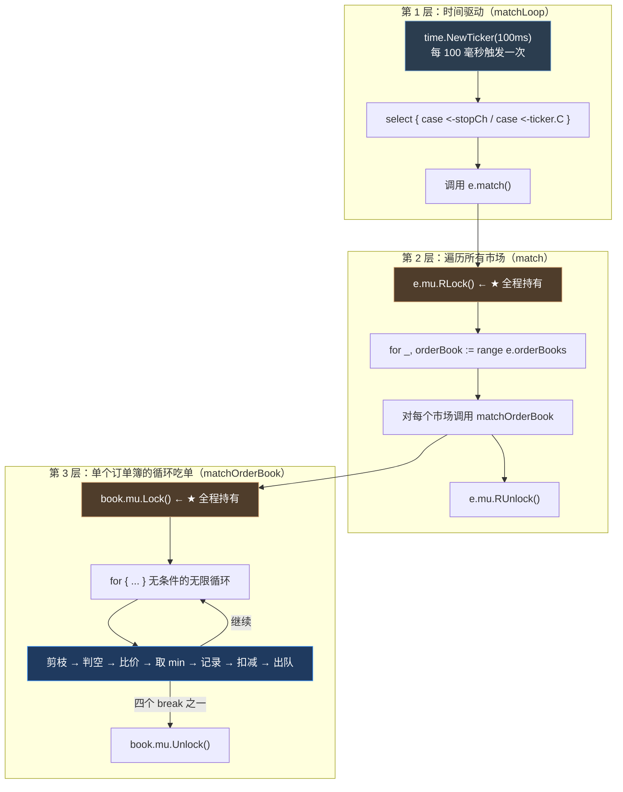
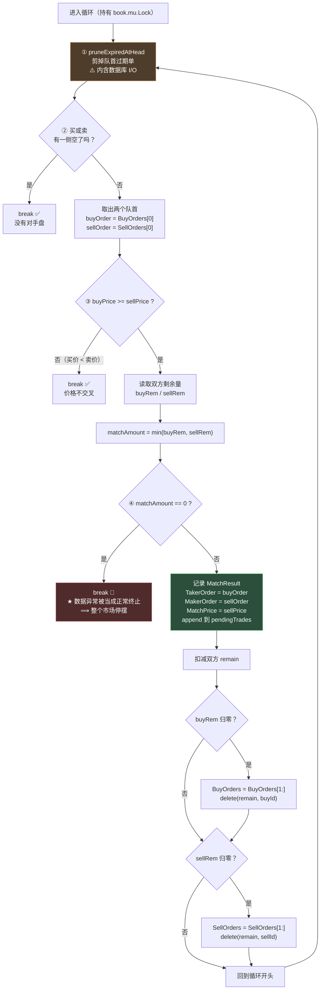
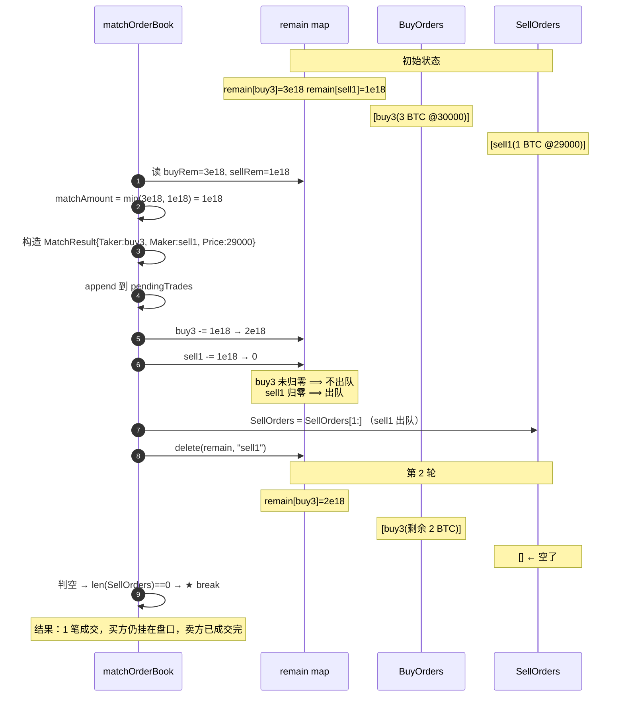
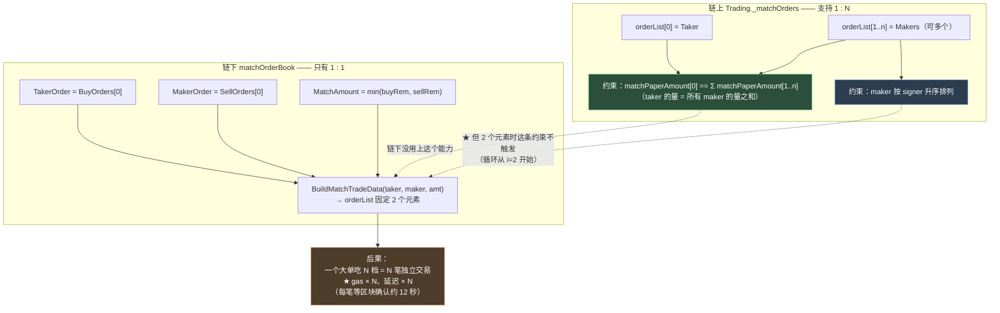

# 第 9 章：撮合循环 — match() 的循环条件、remain 余额簿与过期单剪枝

> 第 8 章把订单放进了订单簿，但它还静静地躺着。**本章要让它动起来。**
>
> 整个撮合引擎的核心是一个 `for` 循环——它在 `matchengine.go` 里只占 60 行，但要做四件事：判断哪两张订单可以成交、算出成交多少、更新双方的剩余量、决定什么时候停下来。**这 60 行是整个交易所的"心脏"，市场的全部交易都由它驱动。**
>
> 本章会逐行拆开这个循环，回答四个问题：**什么时候该停（四个退出条件）**、**成交多少（`min` 与 `remain`）**、**队列头部的过期单为什么要剪（否则会反复烧 gas）**，以及一个最容易忽略但后果最严重的：**为什么本项目"买单永远是 taker"——以及这个简化假设漏掉了一个链上有、链下没有的检查，导致某些订单会陷入无限重试、每 12 秒烧一笔 gas 的循环。**
>
> 这一章的最后一个发现是用实验证实并量化的，它是我在整个项目里看到的**最"贵"的一个缺陷**——因为它直接、持续地烧钱。

---

## 1. 本章导读

### 1.1 撮合循环要回答的问题

一个撮合循环本质上在做这件事：

```text
只要"最优买价 >= 最优卖价"（价格交叉），就：
   ① 取出两个人：最优买家 + 最优卖家
   ② 让他们按【卖家的价格】成交（卖家是 maker，价格由被动方定）
   ③ 成交金额 = min(买家想要的量, 卖家想要的量)   ← 这是"部分成交"的机制
   ④ 双方扣减剩余量，谁扣到 0 谁出队
   ⑤ 回到开头，继续判断
```

**这个过程叫"循环吃单"**：一个大的买单可以连续吃掉多档卖单，一个大的卖单也可以连续被多档买单吃掉。

**用一个具体例子：**

```text
初始状态：
  买单队列（降序）           卖单队列（升序）
  [0] 买 5 BTC @ 30000      [0] 卖 2 BTC @ 29500
  [1] 买 3 BTC @ 29000      [1] 卖 4 BTC @ 30000
                            [2] 卖 1 BTC @ 30500

第 1 轮：
  bestBid=30000 >= bestAsk=29500 ✓ 可以成交
  matchAmount = min(5, 2) = 2
  成交：2 BTC @ 29500（卖单的价格）
  → 买方剩余 5-2 = 3 BTC（还在队列）
  → 卖方剩余 2-2 = 0     → ★ 出队

第 2 轮：
  bestBid=30000 >= bestAsk=30000 ✓ 相等也可以成交
  matchAmount = min(3, 4) = 3
  成交：3 BTC @ 30000
  → 买方剩余 3-3 = 0 → ★ 出队
  → 卖方剩余 4-3 = 1（还在队列）

第 3 轮：
  bestBid=29000（下一个买单） >= bestAsk=30000 ？ ✗ 不交叉 → 退出
```

**这四轮就是整个撮合逻辑的全部。** 本章要讲的就是"每一轮里发生了什么、什么时候停"。

### 1.2 循环的四个退出条件

`matchOrderBook` 的 `for` 循环（无条件的 `for {}`）靠四个 `break` 退出。**理解这四个 `break` 是理解整个函数的关键：**

| # | 条件 | 代码 | 语义 | 评价 |
| --- | --- | --- | --- | --- |
| ① | 某一侧空了 | `len(book.BuyOrders) == 0 \|\| len(book.SellOrders) == 0` | 没有对手盘了 | ✅ 正常退出 |
| ② | 价格不交叉 | `buyPrice.Cmp(sellPrice) < 0` | 最想买的出价 < 最想卖的要价 | ✅ 正常退出 |
| ③ | 成交量为零 | `matchAmount.Sign() == 0` | —— | 🔴 **这是第 8 章那个 DoS 的成因** |
| ④ | 过期单被剪光 | （隐含在 ① 里） | 队首过期单被 `pruneExpiredAtHead` 删掉后可能为空 | ✅ 正常 |

**⚠️ 条件 ③ 是本项目的**设计缺陷**：它把"数据异常"（某一方 `remain` 为 0，而这个订单本不该在簿里）当成了"正常的循环终止条件"。**

**后果是：一张零量订单能让整个市场的撮合停摆**（第 8 章 3.(4) 完整推导并实测复现过）。**本章 3.(3) 会从"循环结构"的角度再分析一次——因为这是"`break` 用错地方"的典型案例。**

### 1.3 本章的核心发现（先说结论）

**前面几章发现的缺陷大多"不直接花钱"**——比如排序不稳定影响公平性、零量订单冻结市场影响可用性。**但本章这个不一样：它会持续烧掉真金白银。**

**发现：本项目缺少"自成交检查"，而链上合约有。**

```text
链上 MetaNodeExternal.approveTrade：
  require(i == 0 || order.signer != orderList[0].signer, Errors.ORDER_SELF_MATCH);
  ★ 禁止"同一个 signer 的订单互相成交"

链下 matchOrderBook：
  ★ 完全没有这个检查
```

**实测复现（3 轮循环）：**

```text
【探针A】同一 signer 的买卖单（价格交叉）
   pendingTrades = 1
   ★ 撮合成交: taker=buy(0xsameuser) maker=sell(0xsameuser)
   ★★ 同 signer 自成交 —— 合约会 revert(ORDER_SELF_MATCH)

【探针D】回滚后会不会重试？
第 1 轮：撮合产生 1 笔成交（同 signer）→ 模拟 revert → rollback
   回滚后：买单在簿=true 卖单在簿=true remain[buy]=1e18 remain[sell]=1e18
第 2 轮：撮合产生 1 笔成交（同 signer）→ 模拟 revert → rollback
   回滚后：买单在簿=true 卖单在簿=true remain[buy]=1e18 remain[sell]=1e18
第 3 轮：撮合产生 1 笔成交（同 signer）→ 模拟 revert → rollback
   ...
★★ 结论：每轮都重新撮成同一个自成交 —— 无限重试，每轮烧一笔 gas
```

**⚠️ 为什么会无限重试？**

```text
① 撮合成功 → 双方 remain 归零 → 双双出队
② 提交上链 → 合约 revert（ORDER_SELF_MATCH）→ 烧 gas
③ rollbackMatch → ★ 把 remain 加回去、把两张订单重新插回队列
④ 下一轮撮合 → 又看到这两张订单 → ★ 又撮在一起
⑤ 回到 ② —— 无限循环
```

**烧钱速度估算：**

```text
submitLoop 每 1 秒跑一次，但 submitBatch 内部是【串行 + 等确认】
   —— 发一笔 → bind.WaitMined（Sepolia 约 12 秒）→ 再发下一笔
⟹ 每笔失败交易占用约 12~15 秒
⟹ ★ 每小时约 240~300 笔失败交易
⟹ 直到某张订单过期（expiration 用户可控，可以设成一年后）
```

**⚠️ 而且触发条件极低**：用户只需要在自己的账户下挂一张买单和一张能成交的卖单。**任何用户都能触发，成本是零。**

**这可能是本项目里"单位成本最高的一个缺陷"** —— 它不像第 8 章的零量订单那样只影响可用性，而是**直接、持续、按秒计费地烧掉钱包里的 gas**。

**详细的成因分析、修法和验证，在 3.(10) 和 6.1。**

---

## 2. 架构 / 流程图

### 2.1 `match()` 的三层嵌套结构

整个撮合由三层循环/遍历构成，**每一层的作用和耗时完全不同**：



**⚠️ 图中两处黄色标记（`e.mu.RLock()` 和 `book.mu.Lock()`）是本章要重点讨论的**：

```text
· e.mu.RLock() 在整个"遍历所有市场"期间持有
  ⟹ 期间所有下单（AddOrder 需要 e.mu.Lock()）★ 全部被阻塞

· book.mu.Lock() 在整个"循环吃单"期间持有
  ⟹ 期间该市场的一切操作（下单、深度查询）★ 全部被阻塞
  ⟹ 而且循环里还夹着 pruneExpiredAtHead → dropExpiredLocked → ★ 数据库 I/O（第 8 章 6.3）
```

**这个"三层嵌套、两层持锁"的结构，是本项目撮合性能的主要瓶颈来源。** 详见 3.(1) 和 6.3。

### 2.2 `matchOrderBook` 的循环决策图

把 1.2 节的四个 `break` 展开成决策流程：



**这张图里有三个值得注意的点：**

**点一：`pruneExpiredAtHead` 在每一轮循环开头都被调用**（不只是进入循环时一次）。

```go
for {
	e.pruneExpiredAtHead(book)        // ← ★ 每一轮都剪
	if len(book.BuyOrders) == 0 || len(book.SellOrders) == 0 {
		break
	}
	// ...
}
```

**为什么要每轮都剪？** 因为循环可能跑很多轮（一个大单吃很多档），而**每一轮取出的队首可能都是过期的**。**如果只在进入循环时剪一次，那么第 2 轮取出的队首可能仍是过期的。**

**⚠️ 但这也意味着：如果队首有一串过期单，每一轮都会触发一次数据库 I/O**（`dropExpiredLocked` 里的 `UpdateStatus`）——**而且在持锁状态下**。

**点二：`TakerOrder = buyOrder` 是**硬编码**的。**

```go
result := &MatchResult{
	TakerOrder:  buyOrder,        // ← 永远是买单
	MakerOrder:  sellOrder,       // ← 永远是卖单
	MatchPrice:  sellPrice.String(),   // ← 永远是卖价
}
```

**这个"买单恒为 taker"的假设，是本章 3.(9) 的主题**——它和合约支持的"1 taker + N maker、方向可变"的通用模型有差距。

**点三：出队操作在 `remMu` 的锁内完成。**

```go
e.remMu.Lock()
// ... 扣减 ...
if e.remain[buyOrder.OrderId].Sign() == 0 {
	book.BuyOrders = book.BuyOrders[1:]        // ← 操作切片
	delete(e.remain, buyOrder.OrderId)
}
e.remMu.Unlock()
```

**⚠️ 这里有一个"锁的语义不匹配"的问题**：`remMu` 按名字是保护 `remain` 这个 map 的，但它同时也保护了对 `book.BuyOrders` 切片的修改。**而 `book.BuyOrders` 本来应该由 `book.mu` 保护**——虽然此刻 `book.mu` 也被持有（在 `matchOrderBook` 的 `defer` 里），所以**没有实际的竞态**，但**锁的职责边界是模糊的**。

**⚠️ 这类"用锁 A 保护本该由锁 B 保护的数据"的情况，在重构时很容易变成真的竞态**——因为后来的人看到 `book.BuyOrders = ...` 在 `remMu` 里，会以为"这个操作只需要 remMu"。

### 2.3 部分成交的完整时序

用一个具体例子把 `remain` 的变化画出来（这是本章的核心机制）：



**这张图揭示了"部分成交"的全部机制：**

```text
★ 部分成交不是一种"特殊逻辑"，而是 min() 的自然结果：
   · 买方量大 → matchAmount 取卖方量 → 卖方归零出队，买方留下
   · 买方量小 → matchAmount 取买方量 → 买方归零出队，卖方留下
   · 两者相等  → 双双归零，双双出队

   ⟹ 不需要任何"部分成交"的分支代码
   ⟹ 靠"出队条件是 remain == 0"这一个规则就覆盖了全部三种情况
```

**⚠️ 这才是 §1.1 那段伪代码里第 ④ 步的精髓**：**"谁扣到 0 谁出队"这一条规则，同时实现了"完全成交"和"部分成交"两种语义。**

**⚠️ 但要注意后续影响**：买方留在队列里，意味着**它还会继续吃后面的卖单**（如果价格交叉）。**一个 3 BTC 的买单可能产生 3 笔独立的成交记录，每一笔都要单独上链**（因为链下是 1:1 撮合）——这是 3.(9) 要讨论的限制。

### 2.4 链下的 1:1 撮合 vs 链上的 N-maker 模型

这是本章最重要的一个概念对照。**合约和链下的撮合能力**不对等：



**读图要点：**

**要点一：合约支持"N 个 maker 一次结算"，而链下只用了一半的能力。**

```solidity
// src/libraries/Trading.sol
require(matchPaperAmount[0] == totalMakerFilledPaper, Errors.TAKER_TRADE_AMOUNT_WRONG);
//      ↑ taker 的量必须等于所有 maker 的量之和
```

**这个约束的存在，说明合约本来就设计成支持多个 maker** 的。**而链下每次只传 2 个元素**（`BuildMatchTradeData` 里固定构建 `[]SolidityOrder{o0, o1}`）。

**⚠️ 后果是可以量化的：**

```text
一个 5 BTC 的买单吃掉 5 档卖单，每档 1 BTC：
  · 用 N-maker 模型：★ 1 笔交易，1 次 WaitMined
  · 本项目的 1:1：   ★ 5 笔交易，5 次 WaitMined
     → gas 成本约 5 倍（基础成本 21000 × 5 vs 21000 + 4×少量）
     → 延迟 5 × 12 秒 = 60 秒（而 N-maker 只需 12 秒）
```

**⚠️ 而这个延迟不只是"慢"**——它还有**经济后果**：在这 60 秒里，市场价格可能已经变了，后面的几档成交可能全都 revert（因为 `_priceMatchCheck` 或余额不足）。**第 11 章的 `rollbackMatch` 就是为这种情况准备的。**

**要点二：合约的"maker 按 signer 升序"约束，在 2 个元素时不会触发。**

```solidity
// 从索引 2 开始遍历 —— 所以 orderList.length == 2 时循环体一次都不执行
for (uint256 i = 2; i < orderList.length;) {
	if (orderList[i].signer > orderList[i - 1].signer) { ... }
	else { require(orderList[i].signer == orderList[i - 1].signer, Errors.ORDER_WRONG_SORTING); }
}
```

**这是一个很重要的一致性检查**：**正因为链下只用 1:1，所以不需要实现"按 signer 排序"这个逻辑。**

> **⚠️ 如果将来要把链下升级成 N-maker 模型，就必须同时实现"maker 按 signer 升序排列"**——否则会触发 `ORDER_WRONG_SORTING` revert。
>
> **这是一个"改动会引出隐藏依赖"的典型例子**：升级撮合能力不只是"多传几个订单"，还要满足合约的一堆隐含约束。**这也是为什么读懂合约约束对链下开发如此重要。**

**要点三：这条虚线揭示的架构含义。**

```text
链上的 __matchOrders 是一个【通用】的撮合结算函数：
   · 支持 1 taker + N maker
   · 支持 taker 是买方或卖方
   · 支持同一 signer 的多个订单

链下的 matchOrderBook 是一个【专用】的撮合决策器：
   · 只有 1:1
   · taker 恒为买方
   · 每次只处理一对

⟹ ★ 链下用的是链上能力的一个【子集】
```

**🔑 这个观察的实践价值：**

> **在设计"链下撮合 + 链上结算"的系统时，链上接口通常会被设计得比链下的当前实现更通用——因为合约一旦部署就改不了。**
>
> 所以你在读链下代码时，会经常遇到"合约有这个能力但链下没用上"的情况。**这不是 bug，而是"链上为未来留了空间"。**
>
> **判断方法**：对比链上接口的参数空间和链下实际使用的子集。**差额就是"链上预留但链下还没做的能力"**——它可能是一份现成的产品路线图。

---

## 3. 核心代码拆解

### (1) `match()` —— 外层遍历与它的锁

```go
// match 执行撮合
func (e *MatchEngine) match() {
	e.mu.RLock()
	defer e.mu.RUnlock()

	for _, orderBook := range e.orderBooks {
		e.matchOrderBook(orderBook)
	}
}
```

**作者为什么这么设计（设计思想）：**

**设计点一：只有 5 行，但锁的粒度是本章第一个值得质疑的地方。**

```text
e.mu.RLock() 在【整个遍历所有市场】期间持有
```

**`e.mu` 保护的是 `orderBooks` 这个 map**（因为 Go 的 map 并发读写会 panic）。**严格来说，遍历 map 期间确实需要持有读锁**——否则并发的 `addOrderWithRemain` 往 map 里插入新市场会导致 panic。

**⚠️ 但"持有读锁期间做多少事"是可以选择的：**

```go
// 当前写法：持锁期间做完所有市场的撮合
e.mu.RLock()
for _, orderBook := range e.orderBooks {
	e.matchOrderBook(orderBook)      // ← 可能很慢（big.Int 运算 + 数据库 I/O）
}
e.mu.RUnlock()

// 改进写法：持锁期间只收集订单簿指针，撮合在锁外做
e.mu.RLock()
books := make([]*OrderBook, 0, len(e.orderBooks))
for _, b := range e.orderBooks {
	books = append(books, b)
}
e.mu.RUnlock()                        // ★ 尽早释放

for _, b := range books {
	e.matchOrderBook(b)                // ← 每个 OrderBook 有自己的锁，不需要 e.mu
}
```

**⚠️ 改进写法为什么是安全的？**

```text
· 收集到的 []*OrderBook 是【指针快照】——即使之后 map 里新增了市场，也不影响这一轮
  （新增的市场下一轮（100ms 后）会被处理，延迟可忽略）
· 每个 OrderBook 自己的 mu 保护它的切片 —— 不需要 e.mu
· ★ 唯一的语义变化：如果某个市场被【移除】了（本项目没有移除逻辑），
  这一轮仍会撮合它一次 —— 无害
```

**收益**：**把 `e.mu` 的持有时间从"O(所有市场的撮合总量)"降到"O(市场数)"** —— 通常从毫秒/几十毫秒降到微秒级。**期间下单不再被阻塞。**

**⚠️ 这是一个"改动只有 5 行、收益明确、风险极低"的优化**，值得单独列出来。

**设计点二：`matchOrderBook` 的调用是**顺序**的，没有并发。**

```go
for _, orderBook := range e.orderBooks {
	e.matchOrderBook(orderBook)      // ← 一个市场撮合完，再撮合下一个
}
```

**为什么不用 goroutine 并发撮合各个市场？**

```text
支持并发的理由：不同市场的订单簿完全独立，天然可并行
反对并发的理由：
  · 引入新的并发复杂度和竞态风险
  · 单次撮合通常很快（微秒~毫秒级）→ 并行的收益有限
  · ★ 顺序执行让"100ms 一轮"的语义更清晰（一轮就是一个完整的快照）
  · ★ 而真正的瓶颈是 submitBatch 的串行上链（每秒 1 笔）——撮合本身不是瓶颈
```

**⚠️ 最后一条是关键**：**撮合 100 毫秒跑一轮、吞吐量远超上链速度（12 秒 1 笔）。** 所以**优化撮合的并发度没有意义**——瓶颈在链上确认。

**这也是第 8 章 5.2 思考题 1 那条结论的延伸**：**在优化之前，先找对瓶颈在哪一层。**

### (2) `matchOrderBook` 全貌

```go
// matchOrderBook 撮合单个订单簿
func (e *MatchEngine) matchOrderBook(book *OrderBook) {
	book.mu.Lock()
	defer book.mu.Unlock()

	for {
		// ① 剪掉队首过期单（每轮都剪，见 3.(8) 的解释）
		e.pruneExpiredAtHead(book)

		// ② 有一侧空了就没法撮
		if len(book.BuyOrders) == 0 || len(book.SellOrders) == 0 {
			break
		}

		// ③ 取两个队首：最优买 + 最优卖
		buyOrder := book.BuyOrders[0]
		sellOrder := book.SellOrders[0]

		buyPrice := calculatePrice(buyOrder)
		sellPrice := calculatePrice(sellOrder)

		// ④ 价格不交叉就停
		if buyPrice.Cmp(sellPrice) < 0 {
			break
		}

		// ⑤ 读取双方剩余量（拷贝一份，避免持锁做运算）
		e.remMu.Lock()
		buyRem := new(big.Int).Set(e.remain[buyOrder.OrderId])
		sellRem := new(big.Int).Set(e.remain[sellOrder.OrderId])
		e.remMu.Unlock()

		// ⑥ 成交量 = min（这就是"部分成交"的全部机制）
		matchAmount := new(big.Int)
		if buyRem.Cmp(sellRem) < 0 {
			matchAmount.Set(buyRem)
		} else {
			matchAmount.Set(sellRem)
		}
		if matchAmount.Sign() == 0 {
			break                      // ← ★ 第 8 章的 DoS 成因
		}

		// ⑦ 记录成交结果（★ 这里的 taker/maker 是硬编码的）
		result := &MatchResult{
			TakerOrder:  buyOrder,
			MakerOrder:  sellOrder,
			MatchAmount: matchAmount.String(),
			MatchPrice:  sellPrice.String(),
		}

		e.tradeMu.Lock()
		e.pendingTrades = append(e.pendingTrades, result)
		e.tradeMu.Unlock()

		// ⑧ 扣减剩余量，归零的出队
		e.remMu.Lock()
		e.remain[buyOrder.OrderId].Sub(e.remain[buyOrder.OrderId], matchAmount)
		e.remain[sellOrder.OrderId].Sub(e.remain[sellOrder.OrderId], matchAmount)
		if e.remain[buyOrder.OrderId].Sign() == 0 {
			book.BuyOrders = book.BuyOrders[1:]
			delete(e.remain, buyOrder.OrderId)
		}
		if e.remain[sellOrder.OrderId].Sign() == 0 {
			book.SellOrders = book.SellOrders[1:]
			delete(e.remain, sellOrder.OrderId)
		}
		e.remMu.Unlock()
	}
}
```

**作者为什么这么设计（设计思想）：**

**设计点一：第 ⑤ 步的"拷贝一份再释放锁"是一个好的并发习惯。**

```go
e.remMu.Lock()
buyRem := new(big.Int).Set(e.remain[buyOrder.OrderId])       // ★ 拷贝
sellRem := new(big.Int).Set(e.remain[sellOrder.OrderId])     // ★ 拷贝
e.remMu.Unlock()                                              // ← 立刻释放
```

**为什么不直接在锁内比较 `e.remain[...]`？**

```text
因为第 ⑥ 步的 min 比较和后续逻辑可能较慢（big.Int 运算），
把锁持有时间从"整个逻辑"缩短到"两次拷贝"
⟹ ★ 减少 remMu 的争用（remMu 同时被 submitBatch 的 rollbackMatch 使用）
```

**⚠️ 但这个"拷贝"引入了一个微妙的问题**——**在第 ⑤ 步和第 ⑧ 步之间，`remain` 可能被其他 goroutine 修改。**

```text
第 ⑤ 步（remMu 锁内）：读出 buyRem = 3e18
                          ↓ ★ 这里锁被释放了
                          ↓ 此刻 rollbackMatch（在 submitLoop 里）可能执行：
                          ↓   e.remain[buyId].Add(..., matchAmt)  → 变成 4e18
                          ↓ ★ 或者 dropExpiredLocked 删除了这个 key
第 ⑧ 步（remMu 锁内）：e.remain[buyOrder.OrderId].Sub(..., matchAmount)
                       ⟹ ★ 基于【过期】的读值做扣减
```

**⚠️ 这是一个真实的"读-改-写"竞态**（check-then-act）。

**具体后果**：如果 `rollbackMatch` 在第 ⑤ 步和第 ⑧ 步之间给同一张订单加回了量，那么第 ⑧ 步的扣减会**基于新的值进行**（因为 `Sub` 读的是当前值）——

```text
时间线：
  T1: matchOrderBook 读 buyRem = 3e18（快照）
  T2: rollbackMatch 把 1e18 加回去 → remain[buy] = 4e18
  T3: matchOrderBook 用快照算 matchAmount = min(3e18, sellRem)
  T4: matchOrderBook 执行 remain[buy].Sub(matchAmount)
      ⟹ 实际变成 4e18 - matchAmount，而不是预期的 3e18 - matchAmount
```

**⚠️ 而更危险的是第 ⑧ 步的判零：**

```go
if e.remain[buyOrder.OrderId].Sign() == 0 {
```

它读的是**当前值**（可能已经被 rollbackMatch 改过），判断"是否该出队"。如果 rollbackMatch 刚把量加回去，那么这里不会判零、不会出队——**行为上是"保守的"（订单留在队列里），所以不会丢单**。

**⚠️ 但反过来，如果第 ⑤ 步和第 ⑧ 步之间订单被 `dropExpiredLocked` 删除了 `remain` 条目**，那么第 ⑧ 步会**panic**（`e.remain[buyOrder.OrderId]` 是 `nil`，对 nil 调 `Sub`）。

**⚠️ 这个 panic 路径是否可达？**

```text
dropExpiredLocked 只在 pruneExpiredAtHead 里被调用，
而 pruneExpiredAtHead 在同一个 matchOrderBook 的循环开头
—— 即同一个 goroutine、同一把 book.mu 锁内
⟹ 不会与循环中间的代码并发执行 ✓

rollbackMatch（在 submitLoop goroutine 里）只做 Add，不做 delete
⟹ 不会造成 nil ✓

⟹ 结论：当前不可达 —— 但这个安全性依赖"没有其他路径删除 remain"这个全局性质
```

**🔑 一条可以带走的经验：**

> **"读一份快照 → 释放锁 → 基于快照做决策 → 重新加锁 → 基于当前值做修改"是一个危险的模式**，因为决策和修改可能基于不同的状态。
>
> ```text
> 安全的写法：整个"读-判断-写"在一个锁内完成
> 危险的写法：分开（本项目的做法）
> ```
>
> **本项目之所以没出问题，是因为"可能破坏它"的路径恰好不存在（只有同一 goroutine 会删除 remain）。** 但**这个安全性是隐式的、靠全局推理维持的**——任何人加一处 `delete(e.remain, ...)`，就可能引入 panic。

**设计点二：第 ⑦ 步构造 `MatchResult` 时，`MatchPrice` 取的是 `sellPrice`。**

```go
MatchPrice: sellPrice.String(),      // ← 卖单（maker）的价格
```

**这与合约的执行价格一致**（第 1 章 1.3 引用过 `Trading._matchOrders`）：

```solidity
int256 creditChange = (paperChange * orderList[i].creditAmount) / orderList[i].paperAmount;
//                     ↑ 用 maker 的 credit/paper 比值 = maker 的价格
```

**所以链下记录的 `MatchPrice` 和链上实际的结算价格是一致的。** ✅

**⚠️ 但要注意一个细节**：`MatchPrice` 是**展示用的**——链上并不接收这个字段，它是合约自己从 maker 订单的 `creditAmount/paperAmount` 算出来的。**所以如果链下的 `MatchPrice` 算错了，不会影响链上结算，只会让成交记录显示错误的数字。**

**这是一个"链下记录"与"链上真相"可能不一致的点**（第 19 章会讨论双账本问题时会再遇到）。

### (3) 四个 `break` 的语义分析

这是 1.2 节的展开，也是本章最"纯思维"的一段。

**在编写循环时，`break` 只应该承担两种语义：**

```text
语义 A：任务完成（比如"找到了"）
语义 B：继续下去没有意义（比如"不可能找到"）
```

**逐条对照本项目的四个 `break`：**

| # | 条件 | 属于哪种语义？ | 判断 |
| --- | --- | --- | --- |
| ① | 某一侧为空 | **B** —— 没有对手盘，继续找也没有意义 | ✅ 正确 |
| ② | 价格不交叉 | **B** —— 队列是有序的，队首都不交叉，后面更不可能 | ✅ 正确 |
| ③ | `matchAmount == 0` | **两者都不是** —— 这是"数据异常" | 🔴 **错误** |
| ④ | （隐含）队首过期单剪光后为空 | **B** | ✅ 正确 |

**⚠️ 条件 ③ 的问题在于：它把一个"数据完整性错误"当成了"循环的正常终止条件"。**

**看它的实际含义：**

```text
matchAmount = min(buyRem, sellRem) == 0
⟹ 只可能因为 buyRem == 0 或 sellRem == 0
⟹ 而正常的订单在簿里时，remain 必定 > 0
   （addOrderWithRemain 写入 |paperAmount|，而零量订单本不该入簿）
⟹ ★ 所以这个条件一旦成立，就说明"订单簿里有一张不该在的订单"
```

**⚠️ 一个"不应该发生"的条件，却被写成了"正常的循环出口"——这就是 bug 的温床。**

**修法（第 8 章 6.2 已给出），这里从"循环语义"的角度再明确一次：**

```go
if matchAmount.Sign() == 0 {
	// 这是数据异常，不是正常终止 —— 记录、隔离、继续
	logx.Errorf("撮合遇到零剩余订单: buy=%s(buyRem=%s) sell=%s(sellRem=%s)",
		buyOrder.OrderId, buyRem, sellOrder.OrderId, sellRem)

	if buyRem.Sign() == 0 {
		e.dropInvalidHead(book, "buy", buyOrder)      // 摘除异常订单
	}
	if sellRem.Sign() == 0 {
		e.dropInvalidHead(book, "sell", sellOrder)
	}
	continue                                          // ★ 继续处理其他订单
}
```

**🔑 一条可以带走的判断标准：**

> **写循环时，对每一个 `break`，问一句："这个条件成立时，是'我做完了'还是'出问题了'？"**
>
> ```text
> "我做完了"   → break ✓
> "出问题了"   → ★ 不应该 break，应该"隔离问题 + continue"
> ```
>
> 因为 **`break` 会把局部问题放大成全局问题**：一个坏数据 → 整个队列停摆。**而攻击者最喜欢这种"一点输入换全局瘫痪"的放大效应。**
>
> **⚠️ 边界情况**：如果"异常数据"大量出现，`continue` 会导致循环空转（CPU 打满）。**所以正确的结构是"源头拦截为主 + 循环内隔离兜底"，两层都要有。**

### (4) 价格交叉判定与合约的一致性

```go
// 链下（matchOrderBook）
if buyPrice.Cmp(sellPrice) < 0 {
	break                                // 买价 < 卖价 → 不成交
}
// ⟹ 成交条件是 buyPrice >= sellPrice
```

```solidity
// 链上（Trading._priceMatchCheck）
int256 temp1 = int256(makerOrder.creditAmount) * int256(takerOrder.paperAmount);
int256 temp2 = int256(takerOrder.creditAmount) * int256(makerOrder.paperAmount);
if (takerOrder.paperAmount > 0) {
	require(makerOrder.paperAmount < 0, Errors.ORDER_PRICE_NOT_MATCH);   // 买必须配卖
	require(temp1 <= temp2, Errors.ORDER_PRICE_NOT_MATCH);               // 卖价 <= 买价
}
```

**作者为什么这么设计（设计思想）：**

**设计点一：两边的判定逻辑是等价的，但实现方式不同。**

```text
链下：先算出两个 price（各自做一次除法），再比较
链上：交叉相乘避免除法（第 1 章 1.3 讲过的定点数技巧）
```

**为什么链上要避免除法？** 因为**整数除法会截断，两边各自截断后再比较可能得出错误的结论**。

**举个具体例子（用整数模拟）：**

```text
假设精度是整数（没有小数位）：
  maker: credit=100, paper=3   → 真实价格 = 33.333...
  taker: credit=99,  paper=3   → 真实价格 = 33.0

  链下各自算价格：100/3 = 33（截断），99/3 = 33 → buyPrice(33) >= sellPrice(33) ✓ 判定成交
  真实情况：maker 价 33.33 > taker 价 33.0 → 卖价 > 买价 → ★ 不该成交！

  ⟹ 链下的除法版本会因为"两边都截断到 33"而误判
  ⟹ 链上的交叉相乘：100×3 = 300 vs 99×3 = 297 → 300 > 297 → 正确判定不成交 ✓
```

**⚠️ 所以理论上，链下用"各自算价格再比较"和链上用"交叉相乘"**在某些边界值上会得出不同结论**。**

**⚠️ 但这个风险在本项目里被**极大削弱**了，因为：**

```text
calculatePrice 用的是 1e18 精度放大：
  price = |credit| × 1e18 / |paper|

  ⟹ 只有当 |credit| × 1e18 不能被 |paper| 整除时才会截断
  ⟹ 而 credit 是 1e6 精度、paper 是 1e18 精度
     ⟹ |credit| × 1e18 通常是 |paper| 的整数倍（因为 |paper| 本身就是 1e18 的倍数）
     ⟹ ★ 实际上很少出现截断
```

**⚠️ 但"很少"不等于"不会"**。如果 `paper` 不是 1e18 的整数倍（比如用户填了 `1234567890123456789`），截断就会发生。

**🔑 这个观察引出一条重要的实践建议：**

> **链下复现链上计算时，不只是"用同样的公式"，还要"用同样的顺序"。**
>
> ```text
> 链上：(a × d) <= (c × b)           ← 先乘后比，无除法
> 链下：(a / b) <= (c / d) 的变体     ← 先除后比，有截断
> ⟹ ★ 数学上等价，但在整数运算下不等价
> ```
>
> **判断方法**：看链上有没有"为了避免除法而改写成乘法"的痕迹。**如果有，链下也应该照做**——因为链上那么写，往往就是因为除法有精度问题。
>
> **⚠️ 对本项目的运维建议**：如果要验证链下撮合和链上的一致性，应该写一个**边界值测试**——用各种"不能整除"的 paper/credit 组合，比对链下判定和链上 `_priceMatchCheck` 的结论是否一致。

### (5) 过期单剪枝：为什么必须在"队首"剪

```go
// pruneExpiredAtHead 移除队首过期单，避免反复链上 revert。
func (e *MatchEngine) pruneExpiredAtHead(book *OrderBook) {
	now := time.Now().Unix()
	for len(book.BuyOrders) > 0 && orderExpired(book.BuyOrders[0], now) {
		e.dropExpiredLocked(book, "buy", 0, book.BuyOrders[0])
	}
	for len(book.SellOrders) > 0 && orderExpired(book.SellOrders[0], now) {
		e.dropExpiredLocked(book, "sell", 0, book.SellOrders[0])
	}
}

func orderExpired(o *model.Order, now int64) bool {
	if o == nil {
		return true
	}
	return o.Expiration <= now
}
```

**⚠️ 注意函数名和注释都很准确：「队首」+「避免反复链上 revert」——这两个词点出了设计意图。** 这段代码的注释质量在本项目里是偏高的。

**为什么必须剪？** 因为合约会拒绝过期订单：

```solidity
// src/MetaNodeExternal.sol → approveTrade
require(Trading._info2Expiration(order.info) >= block.timestamp, Errors.ORDER_EXPIRED);
```

**如果不剪，会发生什么？**

```text
① 队首是一张过期订单
② 撮合循环取出它，与对手方算出成交，append 到 pendingTrades
③ submitBatch 提交上链 → 合约 require(expiration >= block.timestamp) 失败 → revert
   ★ 而且这是【必然】失败 —— 每 12 秒烧一笔 gas
④ rollbackMatch 把订单塞回队列
⑤ 下一轮撮合又取出它 → 回到 ②
```

**⚠️ 这和自成交的无限重试是**同一个模式**：**

```text
一个"链下认为可以成交、链上必然拒绝"的条件
   + rollbackMatch 无条件重试
   ⟹ ★ 无限循环烧 gas
```

**⚠️ 所以 `pruneExpiredAtHead` 的存在，是在"链下预演"和"链上执行"之间打的一个补丁**——它让链下不要产生"注定失败的成交"。

**🔑 由此可以看到本项目的一个结构性弱点：**

> **`submitBatch` 里的 `rollbackMatch` 是"无条件重试"——它没有任何机制记住"这笔成交刚刚失败过"。**
>
> ```text
> 一次失败 → 回滚 → 重新撮合 → 又产生同一笔成交 → 又失败 → ...
> ```
>
> **`pruneExpiredAtHead` 只堵住了"过期"这一种失败原因。** 而失败原因还有很多：
>
> | 失败原因 | 链下有没有预防？ |
> | --- | --- |
> | 订单过期 | ✅ `pruneExpiredAtHead` + `submitBatch` 里的二次检查 |
> | **自成交** | ❌ **完全没有** ← 6.1 |
> | 余额不足（`isAllSafe` 失败） | ❌ 没有 |
> | 用户已撤单/已在别处成交 | ❌ 没有 |
> | 价格不再交叉（市场变了） | ❌ 没有 |
> | `paperAmount = 0` | ⚠️ 部分（第 8 章的 break 会冻结，反而更糟） |
>
> **⚠️ 其中"自成交"和"余额不足"是最常见的两种**——而它们目前都会导致无限重试。

### (6) `min(buyRem, sellRem)` —— 部分成交的全部实现

```go
matchAmount := new(big.Int)
if buyRem.Cmp(sellRem) < 0 {
	matchAmount.Set(buyRem)      // 买方量小 → 成交买方的全部
} else {
	matchAmount.Set(sellRem)     // 卖方量小（或相等）→ 成交卖方的全部
}
```

**作者为什么这么设计（设计思想）：**

**设计点一：只有 6 行，但它同时实现了三种成交语义。**

```text
buyRem < sellRem  → 买单被吃完，卖单留下   → "买方部分成交"
buyRem > sellRem  → 卖单被吃完，买单留下   → "卖方部分成交"
buyRem == sellRem → 两边都吃完，都出队     → "完全成交"
```

**⚠️ 注意第三个分支（相等）落在了 `else` 里**——它取 `sellRem`，而 `sellRem == buyRem`，所以结果相同。**这个写法是正确的，但需要读者自己验证"相等时会不会有问题"。**

**更明确的写法（可读性更好，行为完全相同）：**

```go
matchAmount := new(big.Int).Set(buyRem)
if sellRem.Cmp(matchAmount) < 0 {
	matchAmount.Set(sellRem)
}
// 语义：matchAmount = 两者中的较小值
```

**⚠️ 这是一个小例子，说明"用 `if/else` 表达 `min`"容易让人停下来想一秒**——而写代码时省下的那一秒，在无数个读者身上会累积。

**设计点二：`new(big.Int)` + `Set` 的写法避免了共享引用。**

```go
matchAmount := new(big.Int)
if buyRem.Cmp(sellRem) < 0 {
	matchAmount.Set(buyRem)        // ★ Set 是拷贝，不是引用
}
```

**⚠️ 如果写成 `matchAmount := buyRem`**，`matchAmount` 和 `buyRem` 就是同一个对象——后续 `matchAmount.String()` 没问题（只读），但如果有任何修改就会影响 `buyRem`。**当前代码用了 `Set`，是安全的。**

**⚠️ 注意 `buyRem` / `sellRem` 本身也是拷贝**（第 ⑤ 步的 `new(big.Int).Set(...)`），所以这里其实有两层拷贝。**对 `big.Int` 这类"看起来像值类型"的对象，多拷一次的成本远低于共享引用的风险。**

### (7) 切片头部删除：`book.BuyOrders[1:]` 的代价（实测）

```go
if e.remain[buyOrder.OrderId].Sign() == 0 {
	book.BuyOrders = book.BuyOrders[1:]      // ← 删除头部
	delete(e.remain, buyOrder.OrderId)
}
```

**这是一个很"地道"的 Go 写法**——删除切片头部元素，O(1) 复杂度，不需要搬移数据。**但它的代价是隐含的，我实测确认了一个：**

```text
【探针B】切片头部删除对容量的影响
   初始: len=8 cap=8
   执行 [1:] 后: len=7 cap=7     ← ★ cap 减少了 1
   再 append 后: 底层数组是否重新分配 = true
```

**⚠️ 原理：**

```go
s := make([]T, 0, 10)
s = append(s, ...)     // len=10, cap=10
s = s[1:]              // len=9,  cap=9   ← ★ cap 也减了 1
s = append(s, x)       // len=9 == cap=9 → ★ 必须扩容 → malloc + 拷贝全部元素
```

**`s[1:]` 的容量是 `cap(s) - 1`**（因为新切片的起始位置往后移了 1，可用的尾部空间就少 1）。

**⟹ 后果：每次有订单完全成交出队，**下一次入簿就会触发一次数组重新分配 + 全量拷贝**。**

**⚠️ 在一个高频撮合的市场里，这是持续的分配压力：**

```text
一次完整成交 → 出队 → 下一次 AddOrder → realloc（O(n) 拷贝）
```

**⚠️ 而且它还有一个内存滞留问题**（Go 里经典的 "slice memory leak"）：

```text
book.BuyOrders = book.BuyOrders[1:]

底层数组仍在，而数组的第 0 个元素仍然指向被删除的那个 *model.Order
⟹ ★ 在数组被重新分配之前，那个订单对象无法被 GC
⟹ 而它已经被 delete(remain, ...) 移出了余额簿 —— 成了一个"半死不活"的对象
```

**修法（两种，各有取舍）：**

```go
// 方案 A：清空尾部引用再缩短（改动小，仍 O(1) 但只解决滞留）
// 但头部删除没法"清空尾部"——被删的元素在数组开头
// ⟹ 方案 A 对头部删除不适用

// 方案 B：用 copy 覆盖 + 缩短（O(n) 搬移，但 cap 不变，不触发 realloc）
copy(book.BuyOrders, book.BuyOrders[1:])
book.BuyOrders = book.BuyOrders[:len(book.BuyOrders)-1]
book.BuyOrders[len(book.BuyOrders)] = nil     // ★ 清空尾部引用，帮助 GC
// ⟹ n=10000 时约 80KB 的 memmove，约 10 微秒 —— 比 realloc 便宜

// 方案 C：改用"头尾双指针"的队列结构（改动大）
// 但会破坏 sort.Slice 对连续切片的要求
```

**⚠️ 方案 B 有一个副作用**：它让"删除头部"从 O(1) 变成 O(n)。**在 n=10000 时约 10 微秒的 memmove，仍然远快于一次 malloc + 全量拷贝（可能上百微秒）。** 所以方案 B 是更优的。

**⚠️ 但这是一个"不值得优先修"的问题** —— 参考第 8 章 5.2 思考题 1 的判断顺序：**性能问题排在正确性问题之后。** 这里列出它，是因为它揭示了 `[1:]` 这个"地道写法"的隐含成本——**知道它，比现在就改它更重要。**

### (8) 出队与 `delete(remain)` 的原子性

```go
e.remMu.Lock()
e.remain[buyOrder.OrderId].Sub(e.remain[buyOrder.OrderId], matchAmount)
e.remain[sellOrder.OrderId].Sub(e.remain[sellOrder.OrderId], matchAmount)

if e.remain[buyOrder.OrderId].Sign() == 0 {
	book.BuyOrders = book.BuyOrders[1:]              // ← 切片操作
	delete(e.remain, buyOrder.OrderId)               // ← map 操作
}
// ... 卖单同理 ...
e.remMu.Unlock()
```

**作者为什么这么设计（设计思想）：**

**设计点一：`remain` 的扣减、判零、出队、删除——四件事在同一个 `remMu` 锁内完成，这是对的。**

**如果不这样做**：

```text
T1: 扣减 remain → 0
T2: ★ 另一个 goroutine（rollbackMatch）看到 remain == 0
T3: 判零 → 出队
⟹ 但 T2 时刻订单还在队列里、remain 却是 0 → 不一致的中间状态
```

**所以"扣减 + 判零 + 出队 + 删除"必须是一个原子操作。** ✅ 本项目做对了。

**⚠️ 但"原子"的粒度可以再讨论**：这四件事锁的是 `remMu`，而其中"出队"修改的是 `book.BuyOrders`（本该由 `book.mu` 保护）。**当前没出问题，是因为调用方已经持有 `book.mu`。** 详见 2.2 点的分析。

**设计点二：一个容易忽略的顺序问题——先出队还是先删除 `remain`？**

```go
book.BuyOrders = book.BuyOrders[1:]              // ① 先出队
delete(e.remain, buyOrder.OrderId)               // ② 再删 remain
```

**当前顺序是"先出队、再删 remain"。** 如果在两者之间发生观察（另一个 goroutine 读），会看到：

```text
订单不在队列里了，但 remain 里还有它的条目
⟹ 深度快照（SnapshotOrderBook）会怎样？
   它遍历 book.BuyOrders（已经不含该订单）→ ★ 不会读到那个 remain
   但它持有 remMu，所以实际上看不这个中间态 ✓
```

**⚠️ 因为 `SnapshotOrderBook` 也持有 `remMu`，所以这个中间态对外不可见。** ✅ 安全。

**🔑 一条可以带走的经验：**

> **当一次逻辑修改涉及多个数据结构（这里是切片 + map）时，"它们必须在同一个锁内完成"是正确性的前提。**
>
> 但更进一步的建议是：**尽量让"一个锁保护一组一致性相关的数据"**，而不是像本项目这样——`remMu` 保护 `remain`，却顺带保护了一次切片修改。**当前没出问题，但锁的语义边界是模糊的。**

### (9) Taker/Maker 假设：本项目的最大简化

```go
result := &MatchResult{
	TakerOrder:  buyOrder,          // ★ 买单恒为 taker
	MakerOrder:  sellOrder,         // ★ 卖单恒为 maker
	MatchAmount: matchAmount.String(),
	MatchPrice:  sellPrice.String(), // ★ 成交价恒为卖价
}
```

**作者为什么这么设计（设计思想）：**

**设计点一：这个假设在"价格"和"方向"两个维度上都做了固定。**

```text
方向：taker 恒为买方，maker 恒为卖方
价格：成交价恒为卖价（maker 的价格）
```

**⚠️ 在真实的交易所里，"谁是 taker"是由"谁先挂单"动态决定的：**

```text
场景 A：盘口有卖单 1 BTC @29000
       来了一个买单 @30000 → ★ 买单是 taker（主动吃单），按 29000 成交
       本项目的模型 ✓ 正确

场景 B：盘口有买单 1 BTC @30000
       来了一个卖单 @29000 → ★ 卖单是 taker（主动砸盘），按 30000 成交
       本项目的模型：会把它们配成 "买单=taker, 卖单=maker"，成交价 = 29000
       ⟹ ✗ 成交价取错了！应该是 30000（买单的价格，因为买单是先挂的 maker）
```

**⚠️ 所以在"场景 B"下，本项目的撮合会把成交价算错。**

**但这里有一个重要的缓解**：**链上的 `_priceMatchCheck` 会检查价格方向。**

```solidity
if (takerOrder.paperAmount > 0) {        // taker 是买方
	require(makerOrder.paperAmount < 0, ...);
	require(temp1 <= temp2, ...);        // maker 价 <= taker 价
}
```

**在场景 B 里**：

```text
链下构造：orderList[0] = 买单（taker，价格 30000）
         orderList[1] = 卖单（maker，价格 29000）
检查：maker 价(29000) <= taker 价(30000) ✓ 通过
结算：creditChange 用 maker 的 creditAmount/paperAmount
     ⟹ 按 29000 结算
```

**⚠️ 链上**会接受**这笔交易** —— 因为它只检查"价格方向合理"（卖价 ≤ 买价），不检查"谁先挂单"。

**⟹ 后果：在场景 B 下，成交价是 29000 而不是"应该"的 30000。**

**谁受损？**

```text
· 买单（先挂的，本该是 maker，本该享受 30000 的成交价）
  → 实际按 29000 成交 ⟹ ★ 买方【受益】了（少付了 1000）
· 卖单（后到的，本该是 taker，本该按 30000 成交）
  → 实际按 29000 成交 ⟹ ★ 卖方【受损】了（少收了 1000）
```

**⚠️ 所以这不是"随机错误"，而是**系统性地让主动卖出方吃亏**。**

**⚠️ 更准确地说**：`_priceMatchCheck` 保证的"maker 价 <= taker 价"，在链下强制的方向上，**总是让买方受益、卖方受损**。

**🔑 这是本章第二个重要发现（仅次于自成交）：**

> **"买单恒为 taker"这个简化假设，不只是"能力受限"，它会系统性地影响成交价格的经济分配。**
>
> ```text
> 在真实市场里：谁主动谁当 taker，taker 接受 maker 的报价（价格改善归主动方）
> 本项目：无论谁主动，价格改善都归买方
> ```
>
> **⚠️ 判断影响大小需要看市场结构**：如果卖方流动性主要来自做市商（他们会用限价单提供流动性，即挂单等待），那么他们挂的单**本来就应该享受 maker 的价格**——本项目的模型恰好符合这种情况。
>
> **但如果散户用市价单卖出（主动砸盘），他们本该按买方的挂单价成交，却会按自己报的低价成交**——**这会让主动卖方持续吃亏。**

**⚠️ 修法（如果要修复）**：需要引入"到达顺序"来判断谁是 taker。

```go
// 思路：给订单记一个到达序号，taker = 后到的那个
type OrderBook struct {
	BuyOrders  []*model.Order
	SellOrders []*model.Order
	// 需要记录每张订单的入簿时间/序号
}

// matchOrderBook 里：
if buyOrder.ArrivedAt < sellOrder.ArrivedAt {
	// 卖单后到 → 卖单是 taker
	TakerOrder, MakerOrder = sellOrder, buyOrder
	MatchPrice = buyPrice                    // maker（买单）的价格
} else {
	TakerOrder, MakerOrder = buyOrder, sellOrder
	MatchPrice = sellPrice
}
```

**⚠️ 但注意一个连带问题**：合约的 `_priceMatchCheck` 在 taker 是卖方时，检查的是：

```solidity
} else {                                  // takerOrder.paperAmount < 0（taker 是卖方）
	require(makerOrder.paperAmount > 0, ...);
	require(temp1 >= temp2, ...);          // ★ 方向反了：maker 价 >= taker 价
}
```

**所以改成"动态 taker"是**合约支持的**——`_priceMatchCheck` 的两个分支就是为这两种情况准备的。**

**⚠️ 但 `BuildMatchTradeData` 的签名是 `(taker, maker, matchPaper)`，它会把 taker 放在 `orderList[0]`**——所以只要调整调用时的参数顺序就行，**合约侧完全不用改**。

**✅ 这是一个"链上已经准备好、链下没用上"的又一个例子**（和 2.4 节的 N-maker 模型同类）。

### (10) 缺失的自成交检查（本章最严重的问题）

**先看合约的检查：**

```solidity
// src/MetaNodeExternal.sol → approveTrade 的订单循环里
// 防止自成交（第一个订单的签名者不能与后续订单相同）
require(i == 0 || order.signer != orderList[0].signer, Errors.ORDER_SELF_MATCH);
```

**⚠️ 注意这个检查的位置：它在**遍历订单列表**的循环里（`orderList[0]` 是 taker，`i` 从 0 开始）。当 `i == 0` 时短路放行（自己和自己比），从 `i == 1` 起要求 `signer != taker.signer`。**

**再看链下：**

```bash
$ grep -rn "SelfMatch\|selfMatch\|signer ==" --include="*.go" internal/
（无输出）
```

**⟹ 链下完全没有对"同一 signer 的订单互相成交"的任何拦阻。**

**实测复现：**

```text
【探针A】同一 signer 的买卖单（价格交叉）
   pendingTrades = 1
   ★ 撮合成交: taker=buy(0xsameuser) maker=sell(0xsameuser) amount=1000000000000000000
   ★★ 同 signer 自成交 —— 合约会 revert(ORDER_SELF_MATCH)
```

**⚠️ 而更严重的是"回滚后会重试"**——实测三轮：

```text
【探针D】
第 1 轮：撮合产生 1 笔成交（同 signer）→ 模拟 revert → rollbackMatch
   回滚后：买单在簿=true 卖单在簿=true remain[buy]=1e18 remain[sell]=1e18
第 2 轮：撮合产生 1 笔成交（同 signer）→ 模拟 revert → rollbackMatch
   回滚后：买单在簿=true 卖单在簿=true remain[buy]=1e18 remain[sell]=1e18
第 3 轮：撮合产生 1 笔成交（同 signer）→ 模拟 revert → rollbackMatch
   回滚后：买单在簿=true 卖单在簿=true remain[buy]=1e18 remain[sell]=1e18
★★ 每轮都重新撮成同一个自成交 —— 无限重试，每轮烧一笔 gas
```

**⚠️ 为什么会无限重试？完整链条：**

```text
① 撮合成功 → 双方 remain 归零 → 双双出队
② submitBatch 提交上链 → 合约 ORDER_SELF_MATCH revert → ★ 烧 gas
③ rollbackMatch：
     · e.remain[oid] == nil → 新建 big.NewInt(0) → Add(matchAmt) → 恢复成 1e18
     · orderInBook 为 false → reinsertOrderLocked → 重新插回队列
④ 下一轮 matchOrderBook（100ms 后，但受 submitBatch 串行阻塞影响，实际约 12 秒）
   → 又看到这两张订单 → 又撮在一起
⑤ 回到 ②
```

**⚠️ 烧钱速度估算：**

```text
submitLoop 每 1 秒 tick 一次
但 submitBatch 内部对每笔成交：【发交易 → bind.WaitMined（Sepolia 约 12 秒）】
   —— 而且整个 for 循环是串行的（第 1 章 3.(5) 讲过）

⟹ 每笔失败交易占用约 12~15 秒
⟹ ★ 每小时约 240~300 笔失败交易
⟹ 触发一次 revert 的 gas 成本：约 3~5 万 gas（含 approveTrade 里的部分执行）
⟹ 持续烧到某张订单过期为止
```

**⚠️ 攻击成本：零。**

```text
用户只需要在自己账户下：
  ① 挂一张买单 @30000
  ② 挂一张卖单 @29000（价格交叉）
  ⟹ 引擎就会自动把它们撮在一起 → 无限循环烧后端的 gas
```

**⚠️ 这个缺陷的性质，和前面几章发现的都不一样：**

| 缺陷 | 影响 | 谁承担成本 |
| --- | --- | --- |
| 第 7 章 int128 越界 | 单次 revert | 后端（一次 gas） |
| 第 8 章排序不稳定 | 公平性 | 交易者 |
| 第 8 章零量订单冻结 | 可用性 | 所有用户 |
| **第 9 章自成交重试** | **★ 持续烧钱** | **★ 后端（按秒计费）** |

**修法（一道检查，两行代码）：**

```go
// 在 matchOrderBook 的循环里，取出两个队首之后
buyOrder := book.BuyOrders[0]
sellOrder := book.SellOrders[0]

// ★ 自成交检查：同一 signer 的订单不能互相成交（与合约 ORDER_SELF_MATCH 对应）
if strings.EqualFold(buyOrder.Signer, sellOrder.Signer) {
	// 链上必然拒绝，不要浪费一笔 gas
	// 处理方式需要斟酌：跳过其中一张？还是标记两者都不可撮合？
	logx.Errorf("跳过自成交: signer=%s buy=%s sell=%s", buyOrder.Signer, buyOrder.OrderId, sellOrder.OrderId)
	// ... 见下面的讨论 ...
	continue
}
```

**⚠️ 但"怎么处理"需要仔细设计**——**不能简单 `continue`，因为那会死循环**：

```text
如果只是 continue：
  下一轮循环又取到同样的两个队首 → 又检测到自成交 → 又 continue
  ⟹ ★ 死循环（CPU 打满，而且撮合永远无法推进）
```

**几种可行的处理方式：**

| 方案 | 做法 | 评价 |
| --- | --- | --- |
| **A. 下单时就拒绝** | `CreateOrder` 检查"该 signer 是否已有反向挂单" | ✅ **推荐**——在源头消灭问题 |
| B. 撮合时跳过并标记 | 给两个订单打标记，让它们不再互相尝试 | ⚠️ 复杂，需要额外的状态 |
| C. 撮合时跳过买方/卖方 | 把其中一个移到队列后面 | ⚠️ 破坏排序不变式 |
| D. 挪出队列等待 | 把其中一个暂时移出，等对手方变了再放回 | ⚠️ 状态管理复杂 |

**方案 A 的细节：**

```go
// createorderlogic.go —— 下单时检查
// 但注意：这只是"降低概率"，不能"完全避免"
// 因为两张订单可能来自不同的时间点，中间又有其他订单成交了
```

**⚠️ 方案 A 有一个漏洞**：用户在 t1 挂买单，t2 挂卖单——两张单都合法，但**它们会在簿里相遇**。

**所以真正需要的可能是"撮合时检测 + 优雅跳过"**，也就是方案 B/D 的变体：

```go
// 方案 D 的具体实现思路：把自成交的双方暂时移出队列，标记为"等待"
// 但需要保证：下次循环不会立刻把它们放回来（否则又是死循环）
// ⟹ 需要额外的状态和"何时放回"的判断
```

**⚠️ 这里我要诚实地说：这几种方案都有复杂度，而"正确性"依赖于合约侧行为的精确理解。**

**🔑 一条更根本的建议：**

> **这里暴露的是"链下预演"与"链上执行"之间的一个系统性缺口：**
>
> ```text
> 链上的每一条 require，都对应一种"链下应该避免的失败"
> 但链下只实现了其中一部分的预防（只有"过期"这一条）
> ⟹ ★ 缺的那几条，都会变成"无限重试烧 gas"
> ```
>
> **一个系统性的修法**：**把合约 `approveTrade` 的所有 `require` 列成清单，逐条在链下实现对应的预防。**
>
> ```text
> require(validOrderSender[orderSender])           → ✅ 启动自检 ValidateOrderSender
> require(签名有效)                                 → ✅ CreateOrder 里验签
> require(order.perp == msg.sender)                → ⚠️ 未检查（链下按 perp 分组，天然满足）
> require(_info2Expiration >= block.timestamp)     → ✅ pruneExpiredAtHead + submitBatch 二次检查
> require(paper/credit 异号)                        → ❌ 未检查（第 7/8 章的两个坑）
> require(signer != taker.signer)  ★ ORDER_SELF_MATCH → ❌ ★ 未检查（本章的坑）
> require(orderFilledPaperAmount <= |paperAmount|) → ✅ 靠 remain 不超卖
> ```
>
> **这张清单就是一份现成的待办事项表**，而且每一条的"未实现"都对应一个已知的具体后果。

---

## 4. Web3 特有机制

### 4.1 Taker / Maker 的经济学含义

3.(9) 讨论了"固定 taker = 买方"的价格后果。这里把 taker/maker 的经济学含义补全，因为**这个区分在 Web3 里有法律和费用的双重意义**。

**在传统金融和 DeFi 里，taker 和 maker 的区分主要带来三件事：**

```text
① 谁决定成交价
   行业惯例：maker 挂出报价，taker 接受它
   ⟹ ★ 成交价 = maker 的价格

② 谁付更高的手续费
   通常 taker 付更多（比如 0.05% vs maker 0.02%）
   因为 taker "消耗流动性"，maker "提供流动性"
   ⟹ ★ 本项目用 makerFeeRate / takerFeeRate 两个字段表达（打包在 info 里）

③ 谁承担"价格改善"
   taker 挂限价单时，如果遇到更优的对手价，实际成交价会更优
   ⟹ ★ taker 享受价格改善，maker 不会（因为 maker 的价格就是成交价）
```

**⚠️ 第 ② 点在合约里是这样实现的（第 1 章 3.(5) 引用过）：**

```solidity
// Maker 手续费：从 maker 的 creditChange 里扣
int256 fee = SafeCast.toInt256(creditChange.abs()).decimalMul(_info2MakerFeeRate(orderList[i].info));
result.creditChangeList[currentTraderIndex] += creditChange - fee;

// Taker 的变化与 Maker 相反（不扣 Maker 手续费）
result.creditChangeList[0] -= creditChange;
// 手续费归撮合引擎
result.orderSenderFee += fee;
```

**⚠️ 注意 `orderList[i]` 的索引从 1 开始——也就是只有 maker 被扣费**。taker 的费用在后面的第三步单独计算。

**⚠️ 这意味着什么？**

```text
· 链上只有"maker 的费率"参与这一段的计算
· 而 maker 是谁，是由 orderList[0] / orderList[1..n] 的位置决定的
· ⟹ ★ 链下决定"谁在 orderList[0]"就是决定"谁享受 maker 费率"
```

**🔑 所以 3.(9) 那个"固定 taker = 买方"，影响的**不只是价格**，还包括：**

```text
· 谁被收 maker 费率、谁被收 taker 费率
· 通常 takerFeeRate > makerFeeRate（因为 taker 消耗流动性）
⟹ ★ 固定"买方是 taker"，意味着【买方被收更高的费率】
```

**⚠️ 这是一个比"价格改善"更直接的经济影响。**

**⚠️ 不过要公平地说**：本项目在 `MatchResult` 里**并没有记录费率**（只有 `MatchAmount` 和 `MatchPrice`），而链上是从订单的 `info` 字段读费率的。**所以链下的 taker/maker 标签只影响"用哪个订单的价格结算"，不影响费率计算**（两者都从各自订单的 `info` 里取自己的费率）。

**⚠️ 但价格影响仍然是真实的**（3.(9) 的场景 B）。

### 4.2 `_priceMatchCheck` 的两个分支：链上为"方向可变"留好了接口

3.(9) 提到合约的 `_priceMatchCheck` 有两个分支，分别对应"taker 是买方"和"taker 是卖方"：

```solidity
function _priceMatchCheck(Types.Order memory takerOrder, Types.Order memory makerOrder) private pure {
	int256 temp1 = int256(makerOrder.creditAmount) * int256(takerOrder.paperAmount);
	int256 temp2 = int256(takerOrder.creditAmount) * int256(makerOrder.paperAmount);

	if (takerOrder.paperAmount > 0) {
		// Taker 买入，Maker 必须卖出
		require(makerOrder.paperAmount < 0, Errors.ORDER_PRICE_NOT_MATCH);
		require(temp1 <= temp2, Errors.ORDER_PRICE_NOT_MATCH);       // maker 价 <= taker 价
	} else {
		// Taker 卖出，Maker 必须买入
		require(makerOrder.paperAmount > 0, Errors.ORDER_PRICE_NOT_MATCH);
		require(temp1 >= temp2, Errors.ORDER_PRICE_NOT_MATCH);       // ★ 方向相反
	}
}
```

**⚠️ 这段代码的两件事值得注意：**

**注意点一：`temp1` 和 `temp2` 的计算在 if 之外，两个分支共用。**

```solidity
int256 temp1 = makerCredit * takerPaper;      // ← 在 if 之前算
int256 temp2 = takerCredit * makerPaper;
```

**这是"能提前算的就提前算"的 gas 优化**——但更重要的是，**它保证了两个分支用的是同一组中间值，不会因为复制粘贴而出错。**

**注意点二：两个分支的 `require` 方向相反——这正是"taker 可以是卖方"的支持。**

```text
taker 买入：maker(卖方)的价格必须 <= taker(买方)的价格
taker 卖出：maker(买方)的价格必须 >= taker(卖方)的价格
```

**⚠️ 两个条件是"对称"的**——都是"maker 提供更优的价格给 taker"。

**🔑 由此可以看出合约的设计意图：**

> **`_priceMatchCheck` 的两个分支，是合约**明确支持"taker 可以是任何方向"**的证据。**
>
> ```text
> 合约：taker 可以是买方或卖方（两个分支都实现了）
> 链下：固定 taker = 买方（只用了一个分支的能力）
> ```
>
> **和 2.4 节的"N-maker 模型"一样，这是"链上能力 > 链下实现"的第二个例子。**
>
> **⚠️ 所以 3.(9) 提出的"动态 taker"修法，合约侧完全不需要改动**——只需要链下调整 `BuildMatchTradeData` 的参数顺序。**这是一个"改动全在链下"的修复**。

### 4.3 为什么"防止自成交"在链上是必须的

**自成交（wash trading / self-trading）在传统金融里是**被禁止的**，原因是它可以用来：**

```text
① 制造虚假成交量（刷量）
   —— 让某个市场的"成交量"看起来很大，吸引其他交易者

② 操纵价格
   —— 通过自己和自己成交，把价格推到一个想要的位置
   —— ★ 在永续合约里，这会影响【标记价】和【资金费率】

③ 洗钱 / 转移资产的变体
   —— 在有手续费差异的市场上，自成交可以用来"刷手续费返佣"
```

**⚠️ 而在本项目的架构里，"自成交"还有一个**特殊的技术原因**必须被禁止：**

```text
自成交意味着 taker.signer == maker.signer
⟹ 结算时，同一个交易者会被【结算两次】
⟹ 而在 Perpetual._settle 里：
     balanceMap[trader].paper += paperChange      ← 第一次
     ...
     balanceMap[trader].paper += paperChange      ← 第二次
   ★ 而这个 trader 是同一个地址
```

**更具体地看 `_matchOrders` 的结果构造：**

```solidity
result.traderList = new address[](uniqueTraderNum);   // uniqueTraderNum 初始为 2
result.traderList[0] = orderList[0].signer;           // Taker
...
result.traderList[1] = orderList[1].signer;           // Maker
```

**如果两者是同一个地址，`traderList = [A, A]`——同一个地址出现两次。**

**然后 `Perpetual.trade` 会：**

```solidity
for (uint256 i = 0; i < traderList.length;) {
	_settle(traderList[i], paperChangeList[i], creditChangeList[i]);
	// ★ i=0 时结算 A（作为 taker），i=1 时又结算 A（作为 maker）
	unchecked { ++i; }
}
```

**⚠️ 两次结算同一个地址——净效果是 `paperChange = +x` 然后 `-x`，`creditChange = -y` 然后 `+y`，理论上应该抵消。**

**⚠️ 但问题在于 `_settle` 的内部逻辑：**

```solidity
function _settle(address trader, int256 paperChange, int256 creditChange) internal {
	bool isNewPosition = balanceMap[trader].paper == 0;
	// ...
	if (isNewPosition) {
		IDealer(owner()).openPosition(trader);       // ★ 第一次结算会调 openPosition
	}
	if (newPaper == 0) {
		IDealer(owner()).realizePnl(trader, balanceMap[trader].reducedCredit);   // ★ 第二次可能触发
		balanceMap[trader].reducedCredit = 0;
	}
}
```

**⚠️ 所以两次结算会触发不同的副作用**（`openPosition`、`realizePnl`），而这些副作用是为"交易者开仓/平仓"设计的——**在自成交的场景下，它们会被以一种非预期的方式触发**。

**⚠️ 此外，`state.positionSerialNum[trader][perp]` 之类的计数也会被异常地递增。**

**🔑 所以合约禁止自成交，不只是"监管惯例"，更是**因为结算逻辑在 `traderList` 有重复地址时会出问题**。**

> **这解释了为什么 `require(i == 0 || order.signer != orderList[0].signer, ...)` 这个检查是**必须的、不可绕过的**——它不是一个"可选的风控措施"，而是**结算逻辑正确性的前提**。**
>
> **⚠️ 而链下没有实现这个检查，意味着链下会**反复尝试**一个"链上必定拒绝"的操作。**

### 4.4 revert 的成本：链下预演与链上执行的鸿沟

这是本章最后一个、也是最根本的机制性话题。

**本项目的架构是"链下预演 + 链上执行"：**

```text
链下：撮合决策、算出成交、更新内存订单簿
链上：验证 + 真正结算
```

**这个架构有一个内建的风险：链下的"预演"和链上的"实际"可能不一致。**

**不一致的来源有三类：**

| 来源 | 例子 | 链下的应对 |
| --- | --- | --- |
| **链下有、链上没有的规则** | 排序优先级（时间优先） | 无（链上不管） |
| **链上有、链下没有的规则** | `ORDER_SELF_MATCH`、异号检查 | ★ **缺** |
| **状态在链下决策后发生变化** | 用户余额被别处扣了、订单在别处成交了 | 部分（`rollbackMatch` 重试） |

**⚠️ 第 2 类是本章所有问题的根源。**

**为什么链下会漏掉链上的规则？**

```text
① 规则分散在两个代码库里（Go 和 Solidity），没有自动同步机制
② 链上的 require 散落在不同函数里（approveTrade、_matchOrders、_priceMatchCheck...）
③ ★ 没有"契约测试"来验证"链下是否会构造出链上必拒的输入"
```

**🔑 `revert` 的成本结构决定了这个问题的严重性：**

```text
传统后端：一次"预演失败" = 一次函数返回 error（零成本）
         ⟹ 试错是廉价的，可以大胆重试

区块链：  一次"预演失败" = 一次 revert = ★ 真实的 gas 支出
         + 而且 rollbackMatch 会【无条件重试】
         ⟹ ★ 试错是昂贵的，而且会重复付费
```

**🔑 一条可以带走的判断：**

> **在"链下预演 + 链上执行"的架构里，"链下能否 100% 预测链上的结果"是系统成本的核心变量。**
>
> ```text
> 预测准确率高 → 偶尔 revert，可接受
> ★ 预测准确率低 + 无条件重试 → 持续烧钱
> ```
>
> **所以三个改进方向按性价比排序：**
> ```text
> ① 提高预测准确率（把链上的 require 都在链下实现一遍）
>    → 成本：列清单 + 逐条实现
>    → 收益：消除所有"必然失败"的提交
>
> ② 让重试有记忆（失败过的成交，短时间内不要重试）
>    → 成本：加一个"失败记录"，带 TTL
>    → 收益：即使预测失败，也不会无限循环
>
> ③ 让重试有上限（同一笔成交失败 N 次就丢弃）
>    → 成本：很低
>    → 收益：兜底，防止任何形式的无限循环
> ```
>
> **⚠️ ② 和 ③ 是"无论预测多准都该有"的兜底**——因为**链上状态总是会变的**（用户余额被别处扣、订单在别处成交），**预测不可能永远正确。**
>
> **而本项目目前连 ③ 都没有：`rollbackMatch` 是无条件的、无限的重试。** 这是本章所有"烧 gas"问题的共同放大器。

---

## 5. 本章小结与思考题

### 5.1 核心知识点回顾

| 知识点 | 一句话总结 |
| --- | --- |
| **撮合循环的本质** | 只要 `bestBid >= bestAsk` 就一直循环吃单，直到不交叉或某一侧空 |
| **四个退出条件** | ①一侧空 ②价格不交叉 ③**成交量零（异常）** ④队首过期剪光 |
| **循环吃单** | 一个 `for {}` 可以连续产生多笔成交（大单吃多档） |
| **部分成交的全部机制** | `matchAmount = min(buyRem, sellRem)` + "谁扣到 0 谁出队"——**不需要专门的分支代码** |
| **成交价 = maker 价** | 取卖单（maker）的价格，与合约 `creditChange` 的计算一致 |
| **过期单剪枝** | `pruneExpiredAtHead` 每轮开头调用，避免"链上必然 revert 还反复提交" |
| **三层嵌套 + 两层持锁** | `matchLoop`(100ms) → `match`(持 `e.mu.RLock`) → `matchOrderBook`(持 `book.mu.Lock`) |
| **切片头部删除的代价** | `s[1:]` 让 cap 减少 1 → **下次 append 强制 realloc + 全量拷贝**（实测确认） |
| **`remain` 扣减的原子性** | 扣减+判零+出队+删除在同一个 `remMu` 内完成 ✓ |
| **⚠️ 读-改-写竞态** | 第 ⑤ 步读快照、释放锁、第 ⑧ 步基于当前值修改——**决策与修改可能基于不同状态** |
| **🔴 自成交检查缺失** | 链上有 `ORDER_SELF_MATCH`，链下**完全没有** → 无限重试烧 gas（实测 3 轮复现） |
| **🔴 烧钱速度** | `submitBatch` 串行 + `WaitMined` 约 12~15 秒/笔 → **每小时约 240~300 笔失败交易** |
| **Taker 假设的经济后果** | 固定"买方是 taker"→ **价格改善系统性地归买方**（主动卖方持续吃亏） |
| **链上能力 > 链下实现** | 合约支持 1:N maker、taker 可变方向——**链下只用了子集**（改动全在链下） |
| **自成交在链上是必须禁止的** | 因为 `traderList` 出现重复地址会让 `_settle` 的副作用（`openPosition`/`realizePnl`）异常触发 |
| **`break` 的语义** | 只应用在"完成"或"继续无意义"——**"数据异常"应该 continue + 隔离** |
| **重试没有记忆也没有上限** | `rollbackMatch` 无条件重试 —— 是**所有烧 gas 问题的共同放大器** |

### 5.2 思考题

#### 思考题 1：合约要求 "maker 必须按 signer 升序排列"（否则 `ORDER_WRONG_SORTING`），而链下 `BuildMatchTradeData` 只传 2 个订单、从不排序。为什么这在当前是安全的？如果要把链下升级成"1 taker + N maker"的批量撮合，需要同时实现哪些东西？

<details>
<summary>点击查看参考答案</summary>

**（a）为什么当前是安全的**

**先看合约的排序检查代码：**

```solidity
// src/libraries/Trading.sol → _matchOrders
{
    require(orderList.length >= 2, Errors.INVALID_TRADER_NUMBER);
    uint256 uniqueTraderNum = 2;
    uint256 totalMakerFilledPaper = matchPaperAmount[1];

    // ★ 从第二个 Maker 开始遍历（索引 2）
    for (uint256 i = 2; i < orderList.length;) {
        totalMakerFilledPaper += matchPaperAmount[i];
        // 检查排序：Maker 按地址升序排列
        if (orderList[i].signer > orderList[i - 1].signer) {
            uniqueTraderNum = uniqueTraderNum + 1;
        } else {
            require(orderList[i].signer == orderList[i - 1].signer, Errors.ORDER_WRONG_SORTING);
        }
        unchecked { ++i; }
    }
    require(matchPaperAmount[0] == totalMakerFilledPaper, Errors.TAKER_TRADE_AMOUNT_WRONG);
    // ...
}
```

**关键在循环的起点：`i = 2`。**

```text
orderList.length == 2  （1 taker + 1 maker，本项目的情况）
  → 循环条件 i < 2 从一开始就不成立
  → ★ 循环体一次都不执行
  → 排序检查【完全不触发】 ✓
```

**⚠️ 所以"当前安全"的原因非常朴素**：检查的循环从索引 2 开始，而本项目只有索引 0 和 1。

**而且这个设计是合理的**——当只有 1 个 maker 时，"maker 之间的顺序"这个概念根本不存在，没什么可检查的。

**✅ 附带一个验证：`matchPaperAmount[0] == totalMakerFilledPaper` 这条检查在本项目里也是满足的。**

```text
totalMakerFilledPaper 初始化为 matchPaperAmount[1]
循环不执行 ⟹ totalMakerFilledPaper 保持 = matchPaperAmount[1]
要求 matchPaperAmount[0] == matchPaperAmount[1]

★ 而 BuildMatchTradeData 里：
   amt := new(big.Int).Abs(matchPaper)
   return EncodeTradeData(orders, sigs, []*big.Int{amt, amt})
   ⟹ 两个元素都是同一个值 ✓ 满足
```

**（b）升级到 N-maker 需要实现什么**

**这个问题的价值在于：它揭示了"升级一个能力"会引出多少隐含依赖。**

**需要实现的东西（按依赖顺序）：**

**① 撮合循环要能"连续吃多档"，并把这些成交合并成一次提交。**

```text
现状：一轮撮合产生一个 MatchResult（1 taker + 1 maker）
      ⟹ 每个 MatchResult 独立提交一笔交易

目标：一轮撮合把"一个 taker 吃掉 N 档"的结果聚合成一个 N+1 元素的 tradeData
      ⟹ 一次提交
```

**⚠️ 这要求改变 `MatchResult` 的结构：**

```go
// 现状
type MatchResult struct {
	TakerOrder  *model.Order
	MakerOrder  *model.Order
	MatchAmount string
	MatchPrice  string
}

// 需要变成类似
type MatchResult struct {
	TakerOrder   *model.Order
	Makers       []*model.Order
	MakerAmounts []*big.Int        // 每个 maker 成交多少
	// MatchPrice 不再是一个值 —— 每个 maker 有自己的价格！
}
```

**⚠️ 注意最后一行**：**成交价不再是一个单一的值**——每个 maker 按自己的价格成交。**这会波及成交记录（`trades` 表）的写入**（第 10 章会讲 `tradeData` 的构造）。

**② 必须实现"maker 按 signer 升序排列"。**

```go
// 在构造 orderList 之前
makers := make([]*model.Order, 0, n)
// ... 收集 makers ...
sort.Slice(makers, func(i, j int) bool {
	return strings.ToLower(makers[i].Signer) < strings.ToLower(makers[j].Signer)
})
```

**⚠️ 这里有两个坑：**

```text
坑 1：比较必须用【同一格式】的地址
   · 合约里比较的是 address 类型（数值比较，20 字节）
   · Go 里比较的是字符串 —— ★ 如果用 checksum 格式的字符串比较，和数值比较的结果不同！
     （比如 "0xAbC" 与 "0xabc"：字符串比较 'A'(65) < 'a'(97)，但数值上相等）
   ⟹ ★ 必须先全部转成小写（或统一用 common.Address 比较），再排序

坑 2：合约允许"同一 signer 的多个订单"连续出现
   · require(orderList[i].signer == orderList[i-1].signer, ORDER_WRONG_SORTING)
   · ⟹ 排序时同 signer 的订单要排在一起
   · ⟹ 用【稳定】排序（否则同一 signer 的多个订单可能被打散）★ 又回到第 8 章那个问题
```

**⚠️ 坑 1 特别值得警惕**：**"字符串比较"和"地址数值比较"是两套不同的序**——如果链下用字符串序排、链上按数值序检查，**会出现"链下认为排好了、链上却报 ORDER_WRONG_SORTING"的情况。**

**③ `matchPaperAmount[0]` 必须等于所有 maker 的成交量之和。**

```go
// BuildMatchTradeData 里
total := big.NewInt(0)
for _, a := range makerAmounts {
	total.Add(total, a)
}
// ★ taker 的量必须是这个 total，而不是 min(buyRem, sellRem) 的某个中间值
```

**⚠️ 这有一个连锁影响**：**taker 的成交量可能小于它的 remain**（比如 taker 想买 5 BTC，但盘口只有 3 BTC 可吃）。**那么这次提交只成交 3 BTC，taker 剩余的 2 BTC 留在队列里等下一轮。**

**④ `_priceMatchCheck` 要对每一个 maker 都检查。**

```solidity
// 合约里已经是这样了（在遍历 maker 的循环里）
for (uint256 i = 1; i < orderList.length;) {
	_priceMatchCheck(orderList[0], orderList[i]);       // ★ 对每个 maker 检查
	// ...
}
```

**✅ 合约侧已经支持，链下不需要额外做什么——但链下**应该**在撮合时就避免把"价格不交叉的 maker"放进列表**（否则会浪费一次提交）。

**⚠️ 而本项目当前的撮合循环是"逐对判断价格"的**——天然满足这个要求。**但如果改成"一次性收集多档"，就要保证收集进来的每一档都满足价格条件。**

**🎯 本题的核心结论：**

> **"升级撮合能力"看起来是"多传几个订单"，实际上会波及：**
> ```text
> ① MatchResult 的数据结构（一对一 → 一对多）
> ② 成交价的概念（单一值 → 每个 maker 各自的价格）
> ③ 排序逻辑（新增，且要处理"字符串序 vs 数值序"和"稳定性"两个坑）
> ④ 成交量的一致性约束（taker 量 = Σ maker 量）
> ⑤ 成交记录（trades 表）的写入方式
> ```
>
> **⚠️ 而其中 ③ 是最容易出错的**——**因为它是链上的一条隐式约束，链下当前完全不需要实现它，所以没有任何代码或注释提醒"将来会需要它"。**
>
> **🔑 一条可以带走的经验：**
>
> **在读链下代码时，把合约侧所有的 `require` 都列出来，标注"链下有没有对应实现"。** 这个清单有两个用途：
> ```text
> ① 找出"链上有、链下没有"的检查 → ★ 当前会烧 gas 的缺陷（本章 6.1）
> ② 找出"链上有、链下暂时不需要"的检查 → ★ 未来升级时会踩的坑（本题）
> ```
> **第二类最阴险**——它现在不出问题，所以不会有人去修；**等到升级时才爆发，而那时改动面已经很大了。**

</details>

#### 思考题 2：自成交会导致"撮合 → 提交 → revert → 回滚 → 再撮合"的无限循环，每约 12 秒烧一笔 gas。请回答：（a）为什么 `rollbackMatch` 会"无条件"重试？（b）修法为什么不能简单地"检测到自成交就 `continue`"？（c）设计一个你认为可行的修法，并说明它的边界。

<details>
<summary>点击查看参考答案</summary>

**（a）为什么 `rollbackMatch` 是无条件重试的**

**先看它的调用点：**

```go
// submitBatch 里，五种失败都调用 rollbackMatch
if e.chain == nil { ... e.rollbackMatch(trade, matchAmt); continue }              // ① 没有链客户端
if orderExpired(...) { ... e.rollbackMatch(trade, matchAmt); continue }           // ② 过期
if err := chain.BuildMatchTradeData(...); err != nil { ... rollbackMatch ... }    // ③ 编码失败
if err != nil { ... e.rollbackMatch(trade, matchAmt); continue }                  // ④ 发送失败
if err != nil { ... e.rollbackMatch(trade, matchAmt); continue }                  // ⑤ WaitMined 失败
if rec == nil || rec.Status != 1 { ... e.rollbackMatch(trade, matchAmt); continue } // ⑥ 链上 revert
```

**设计意图（可以理解的）：**

```text
① "撮合是在内存里做的，链上没成功 ⟹ 内存里的扣减必须撤销"
   ⟹ 否则内存状态与链上状态不一致（订单凭空少了一块量）

② 绝大多数失败是【瞬时的】：
   · 网络抖动导致的发送失败
   · RPC 节点临时不可用
   · nonce 冲突
   ⟹ ★ 重试是正确的应对
```

**⚠️ 所以"无条件重试"在设计意图上是对的**——它想表达的是"失败了就恢复现场，下一轮重新来过"。

**⚠️ 问题在于**：它假设了"失败是暂时的"，而实际上有一类失败是**永久性的**（比如自成交）——重试一万次也不会成功，只会烧一万次 gas。

**🔑 这就是"重试策略"的经典错误：**

> **重试的前提是"失败是暂时的"。对于"永久性失败"，重试只会放大损失。**
>
> ```text
> 瞬时失败（网络抖动、RPC 不可用）  → ✅ 重试
> 永久失败（自成交、规则不满足）    → ★ 必须识别出来并放弃
> ```
>
> **而区分这两者，需要"失败原因"的信息——但 `rollbackMatch` 根本没有接收这个信息：**

```go
func (e *MatchEngine) rollbackMatch(trade *MatchResult, matchAmt *big.Int) {
	// ★ 函数签名里没有任何"失败原因"的参数！
	// 它不知道刚刚是"网络抖动"还是"链上规则拒绝"
}
```

**⚠️ 这是一个很值得注意的设计缺陷**：**回滚函数对它要回滚的原因一无所知，所以不可能做"因失败原因而异"的处理。**

**修法（最小的改动）：把失败原因传进去。**

```go
type FailReason int
const (
	FailTransient FailReason = iota   // 瞬时：可以重试
	FailPermanent                     // 永久：放弃
	FailUnknown
)

func (e *MatchEngine) rollbackMatch(trade *MatchResult, matchAmt *big.Int, reason FailReason) {
	e.rollback(trade, matchAmt)
	if reason == FailPermanent {
		e.markPermanentFailure(trade)      // ★ 记下来，不再重试
	}
}
```

**⚠️ 但怎么区分"瞬时"和"永久"？** 这就到了本题最关键的技术点——**见（c）。**

**（b）为什么不能简单地 `continue`**

**假设这样写：**

```go
if strings.EqualFold(buyOrder.Signer, sellOrder.Signer) {
	logx.Errorf("跳过自成交")
	continue                    // ← ★ 这样写会死循环
}
```

**为什么死循环？**

```text
第 1 轮循环：
  取队首 → buyOrder = B, sellOrder = S（同一 signer）
  检测到自成交 → continue
  ⟹ ★ 注意：循环的"状态"（队列内容）没有任何变化！

第 2 轮循环：
  取队首 → 还是 buyOrder = B, sellOrder = S
  检测到自成交 → continue
  ⟹ ★ 又没变化

... 无限循环，CPU 打满
```

**⚠️ 根本原因是：`continue` 只有在"循环状态会推进"时才有意义。**

```text
正常路径的 continue 为什么没问题？
  → 因为正常路径会【扣减 remain、可能出队】—— 状态推进了
  → 下一轮取到的队首不同了

自成交的 continue 为什么有问题？
  → 因为它【什么都不做就直接跳回开头】
  → 状态完全没变 → 下一轮和这一轮完全相同
```

**🔑 这是一个很通用的陷阱：**

> **在循环里用 `continue` 跳过某个元素时，必须保证"这个元素不会再被取到"。**
> ```text
> 数据驱动的循环（遍历切片）：continue 后天然推进到下一个元素 ✓
> 队列驱动的循环（永远取 [0]）：★ continue 会重复取到同一个元素 ✗
> ```

**（c）一个可行的修法及其边界**

**修法的核心要求是"状态必须推进"。有三种思路：**

**思路一：把自成交的订单"挪出队列"（状态推进）。**

```go
if strings.EqualFold(buyOrder.Signer, sellOrder.Signer) {
	// 把其中一张暂时移出队列，等对手方变化后再放回
	// 但"什么时候放回"需要额外的逻辑 —— 复杂
}
```
**⚠️ 评价：状态管理复杂，且要处理"移出后队列为空"的边界。**

**思路二：给订单打"临时不可撮合"标记（带超时）。**

```go
// 给订单加一个字段（内存里，不入库）
type OrderWithMeta struct {
	*model.Order
	skipUntil time.Time      // 在此时间之前不参与撮合
}
```
**⚠️ 评价：需要改 OrderBook 的存储结构，改动面大。**

**思路三（推荐）：不改变队列，而是改变"撮合的配对逻辑"。**

**核心洞察**：**"跳过自成交"的正确含义不是"跳过这一轮循环"，而是"换一个对手方试试"。**

```go
// 在 matchOrderBook 里，取队首之后做一个"找第一个不同 signer 的对手"的搜索
func (e *MatchEngine) findMatchableHead(orders []*model.Order, otherSigner string) (int, *model.Order) {
	for i, o := range orders {
		if !strings.EqualFold(o.Signer, otherSigner) {
			return i, o
		}
	}
	return -1, nil               // 所有订单都和 otherSigner 撞车
}
```

**然后循环里：**

```go
buyOrder := book.BuyOrders[0]
sellIdx, sellOrder := e.findMatchableHead(book.SellOrders, buyOrder.Signer)
if sellOrder == nil {
	// ★ 所有卖单都和这个买家的 signer 相同 —— 这个买家在当前盘口找不到对手
	// 把它标记为"本轮到不了"，然后暂时跳过它
	// ⟹ 这里仍然需要"状态推进"，但推进的是【买方】而不是循环
	break                        // 或者跳过这个买单（见下）
}
```

**⚠️ 但即使这样，仍然要处理"买方也需要推进"的问题。**

**最实际的方案：交换"谁被跳过"。**

```go
if strings.EqualFold(buyOrder.Signer, sellOrder.Signer) {
	// 尝试把买方换成下一个不同 signer 的
	nextBuyIdx, nextBuy := e.findMatchableHead(book.BuyOrders, sellOrder.Signer)
	if nextBuy == nil {
		// 买方全部和卖家撞车 → 跳过这个卖家
		e.moveToEnd(book, "sell", sellOrder)      // ★ 状态推进！
		continue
	}
	// 用 nextBuy 替代 buyOrder 做这一轮（不修改队列，只是局部变量）
	buyOrder = nextBuy
	// ⚠️ 但下一轮取队首时又会取到原来的 BuyOrders[0] —— 又循环了
}
```

**⚠️ 你会发现：这个方案会让逻辑变得越来越复杂，而且"状态推进"和"排序不变式"开始互相冲突**（`moveToEnd` 会破坏排序）。

**🎯 所以我推荐一个更简单、更彻底、也更符合工程直觉的方案：**

**在"下单时"就拒绝会自成交的订单。**

```go
// createorderlogic.go —— 下单时检查
// 该 signer 是否已有反向的挂单？
func (l *CreateOrderLogic) CreateOrder(req *types.CreateOrderReq) (...) {
	// ... 原有的校验 ...

	// ★ 新增：检查该用户是否已有反向挂单
	if l.svcCtx.OrderBook != nil {
		// 需要 OrderBook 接口提供一个"查该 signer 的挂单"方法
		if hasOpposite := l.svcCtx.OrderBook.HasOppositeOrder(req.Perp, req.Signer, req.PaperAmount); hasOpposite {
			return &types.CreateOrderResp{Code: 400, Message: "cannot place an order on both sides"}, nil
		}
	}
	// ...
}
```

**这个方案的优点：**

```text
✅ 问题在【源头】被消灭 —— 订单簿里永远不会出现"同一 signer 的两张交叉订单"
✅ 不需要修改撮合循环（那个 `for {}` 一行都不用动）
✅ 用户得到清晰的错误信息（400 + 明确原因），而不是"订单挂在那里永远不成交"
✅ 实现简单，没有复杂的"状态推进"逻辑
```

**但它的边界是什么？——这是本问题最重要的部分：**

**边界一：只防住了"新订单与已有挂单冲突"，防不住并发。**

```text
时刻 T1：用户提交买单 → 检查"没有反向挂单" → 通过
时刻 T1：用户提交卖单 → 检查"没有反向挂单" → ★ 也通过了！（因为买单还没入库）
时刻 T2：两张订单都入库 → ★ 还是会在簿里相遇
```

**⚠️ 所以必须配合"撮合时的兜底检测"。**

**边界二：防不住"同一 signer 的多个地址"。**

```text
用户 A 的地址 0xAAA 挂买单
用户 A 的另一个地址 0xBBB 挂卖单
   ⟹ ★ 两者 signer 不同 → 不触发自成交检查 → 正常撮合
```

**⚠️ 而这在合约侧也是允许的**（合约检查的是 `order.signer != orderList[0].signer`，也是按地址比较）。

**⚠️ 所以"自成交"在链上线下的定义都只是"**同一地址**"，而不是"同一个人"。** 这是一个**已知的局限**——真正的 wash trading 可以通过多地址绕过。**但这不是本项目需要解决的问题**（合约已经定义了规则边界）。

**边界三：防不住"订单在簿里挂久了，对手方才出现"。**

```text
T1: 用户 A 挂买单（当时盘口没有 A 的卖单）→ 通过检查
T2: 用户 A 又挂卖单 → ★ 检查时买单还在 → 拒绝 ✓
   ⟹ 这个方向是防住的

但如果：
T1: 用户 A 挂买单 → 通过
T2: 用户 A 挂卖单 → 被拒绝 ✓
   ⟹ 用户会觉得"为什么我不能挂反向单" —— 这是一个用户体验上的代价
```

**⚠️ 所以这个方案有一个产品层面的取舍**：**它禁止了"同一用户同时挂买卖单"这个在很多交易所里合法的行为**（比如做市商经常双边挂单）。

**🎯 综合判断：最优解是"两层防护"**

| 层 | 措施 | 作用 | 局限 |
| --- | --- | --- | --- |
| **第 1 层（源头）** | 下单时检查反向挂单 | 消灭 99% 的情况，给用户明确反馈 | 防不住并发；可能误伤做市商 |
| **第 2 层（撮合时兜底）** | 检测到自成交时，**跳过并标记该订单"本轮不再参与"** | 防止无限重试 | 需要"状态推进"逻辑 |
| **第 3 层（重试兜底）** | 给 `rollbackMatch` 加"永久失败记账"，同一笔成交失败 N 次后丢弃并告警 | **兜底所有未知的永久失败** | 需要引入新的状态 |

**⚠️ 第 3 层是本题最想强调的——因为它不针对"自成交"这一个具体问题：**

> **无论你把链上的规则实现了多少遍，总会有你没想到的失败原因（链上状态变化、合约升级、新的 require）。**
>
> **所以"有上限的重试"不是可选项，而是必需的兜底。**
>
> ```go
> // 最小的实现：给每笔成交一个失败计数
> type MatchResult struct {
> 	// ...
> 	FailCount int        // ★ 已经失败过几次
> }
>
> // rollbackMatch 里
> trade.FailCount++
> if trade.FailCount >= 3 {
> 	logx.Errorf("成交连续失败 %d 次，放弃并告警: taker=%s maker=%s",
> 		trade.FailCount, trade.TakerOrder.OrderId, trade.MakerOrder.OrderId)
> 	// ★ 不再插回队列 —— 让这两张订单自然过期
> 	// 同时发告警，因为这意味着"链下有规则没实现"
> 	return
> }
> // 否则照常插回队列重试
> ```

**🔑 本题的核心结论：**

> **第一，关于重试：**
> ```text
> 重试是【瞬时失败】的正确应对，但对【永久失败】是纯损失。
> 所以重试机制必须有两个配套：
>   ① 区分失败类型（能区分就区分）
>   ② ★ 重试上限（区分不了时的兜底）
> ```
>
> **第二，关于循环状态：**
> ```text
> 在"永远取 [0]"的循环里，continue 只有在【状态推进】时才有意义。
> 检测到问题却什么都不做就 continue  → ★ 死循环
> ```
>
> **第三，也是最重要的一条——关于"防御性编程"的层次：**
>
> **本项目的所有"烧 gas"问题，本质上都是同一件事：链下产生了"链上必然拒绝"的输入，然后无条件重试。**
>
> ```text
> 治标：逐个实现链上的 require（自成交、异号、余额...）
> 治本：★ 给重试加上限 —— 因为它能兜住【所有】你没想到的情况
> ```
>
> **在"链下预演 + 链上执行"的架构里，"我的预演永远不会错"是一个不可能成立的假设**（链上状态一直在变）。**所以真正的工程成熟度，体现在"预测错了会怎样"的设计上，而不是"如何做到预测不错"。**

</details>

---

## 6. 踩坑提示

### 🔴 严重：缺少自成交检查，导致无限重试烧 gas

**这是本指南目前为止发现的"单位成本最高"的缺陷。**

**证据：**

```bash
# 链上有
$ grep -n "ORDER_SELF_MATCH" src/MetaNodeExternal.sol
253:    require(i == 0 || order.signer != orderList[0].signer, Errors.ORDER_SELF_MATCH);

# 链下完全没有
$ grep -rn "SelfMatch\|selfMatch\|signer ==" --include="*.go" internal/
（无输出）
```

**实测复现（探针 A + D）：**

```text
【探针A】同一 signer 的买卖单（价格交叉）
   ★ 撮合成交: taker=buy(0xsameuser) maker=sell(0xsameuser)
   ★★ 合约会 revert(ORDER_SELF_MATCH)

【探针D】三轮循环
第 1 轮：撮合 1 笔（同 signer）→ revert → rollback
   回滚后：买单在簿=true 卖单在簿=true remain[buy]=1e18 remain[sell]=1e18
第 2 轮：★ 又撮成同一个自成交 → revert → rollback
第 3 轮：★ 又撮成同一个自成交 → revert → rollback
★★ 每轮都重新撮成同一个自成交 —— 无限重试，每轮烧一笔 gas
```

**成本估算：**

```text
submitBatch 串行 + bind.WaitMined（Sepolia 约 12 秒/笔）
⟹ 每小时约 240~300 笔失败交易
⟹ 持续到某张订单过期（expiration 用户可控，可以设成一年）
```

**触发成本：零。** 任何用户在自己的账户下挂一对交叉的买卖单即可。

**修法（三层，见思考题 2 的完整分析）：**

| 层 | 措施 | 作用 |
| --- | --- | --- |
| 第 1 层 | 下单时检查"该 signer 是否有反向挂单" | 消灭绝大多数情况，给用户明确的 400 错误 |
| 第 2 层 | 撮合时检测并**跳过**（需要状态推进，不能裸 `continue`——会死循环） | 兜住并发场景 |
| 第 3 层 | **给 `rollbackMatch` 加失败计数，超过 N 次放弃并告警** | ★ **兜住所有未知的永久失败** |

**⚠️ 第 3 层最容易被忽略但最重要** —— 因为**你不可能枚举出链上所有的 `require`**（链上状态会变、合约会升级）。**重试上限是唯一能兜住"未知的未知"的机制。**

**🎯 这条坑的通用教训：**

> **本项目所有"烧 gas"的问题，本质上是同一件事：链下产生了"链上必然拒绝"的输入，然后无条件重试。**
>
> ```text
> 已经发现的两种：
>   · 订单过期（有 pruneExpiredAtHead 兜着 ✓）
>   · 自成交（★ 完全没有兜着）
>
> 可能还有的：
>   · 余额不足（isAllSafe 失败）
>   · 订单已在别处成交
>   · 价格不再交叉
>   · paperAmount = 0（第 8 章的 break 会冻结，反而更糟）
> ```
>
> **判断方法**：把合约 `approveTrade` 和 `Perpetual.trade` 里所有的 `require` / revert 列成清单，逐条问"链下会不会构造出触发它的输入"。**这份清单（我在 3.(10) 列了 7 条）就是一份现成的待办事项表。**

### 🔴 严重：`rollbackMatch` 是无条件、无上限的重试

```go
func (e *MatchEngine) rollbackMatch(trade *MatchResult, matchAmt *big.Int) {
	// ★ 函数签名里没有"失败原因"
	// ★ 也没有"失败次数"的记录
	// ...
}
```

**两个问题：**

**问题一：它不知道失败原因，所以无法区分"瞬时失败"和"永久失败"。**

```text
瞬时失败（网络抖动、RPC 不可用、nonce 冲突） → 重试是正确的
永久失败（自成交、规则不满足）              → ★ 重试是纯损失
```

**问题二：它没有失败计数，所以同一笔成交可以无限重试。**

**修法（最小改动）：**

```go
// 给 MatchResult 加一个失败计数
type MatchResult struct {
	TakerOrder  *model.Order
	MakerOrder  *model.Order
	MatchAmount string
	MatchPrice  string
	FailCount   int          // ★ 新增
}

// rollbackMatch 里
func (e *MatchEngine) rollbackMatch(trade *MatchResult, matchAmt *big.Int) {
	trade.FailCount++
	if trade.FailCount >= 3 {
		logx.Errorf("成交连续失败 %d 次，放弃并告警: taker=%s maker=%s",
			trade.FailCount, trade.TakerOrder.OrderId, trade.MakerOrder.OrderId)
		// ★ 不再插回队列 —— 让订单自然过期
		return
	}
	// ... 原有的回滚逻辑 ...
}
```

**⚠️ 注意"放弃"的代价**：这两张订单会**滞留在订单簿里但永远不会成交**（因为每次撮合都会产生同一笔失败成交然后被放弃）。

**⚠️ 更彻底的修法**是把这两张订单**标记为不可撮合**（从队列里移除并标记状态），**但这又回到"状态管理复杂"的问题。**

**🔑 一个务实的判断：**

> **"有上限的重试 + 告警"是一个 80 分的方案** —— 它不完美（订单会滞留），但它**把"无限烧钱"变成了"有限损失 + 一条告警"**。
>
> **而在没有测试、没有监控的当前状态下，这已经是一个巨大的改善。** 完美的方案（正确地从队列移除 + 状态标记）**成本高得多，而且容易引入新 bug。**

### 🟠 中等：`match()` 在整个遍历期间持有 `e.mu.RLock()`

```go
func (e *MatchEngine) match() {
	e.mu.RLock()
	defer e.mu.RUnlock()
	for _, orderBook := range e.orderBooks {
		e.matchOrderBook(orderBook)      // ← 持锁期间做完所有市场的撮合
	}
}
```

**`e.mu` 保护的是 `orderBooks` 这个 map**，而 `addOrderWithRemain` 需要 `e.mu.Lock()`（写锁）来插入新市场。

**⟹ 整个"遍历所有市场并撮合"期间，所有下单都被阻塞。**

**修法（5 行，风险极低）：**

```go
func (e *MatchEngine) match() {
	// 1. 持读锁：只收集订单簿指针
	e.mu.RLock()
	books := make([]*OrderBook, 0, len(e.orderBooks))
	for _, b := range e.orderBooks {
		books = append(books, b)
	}
	e.mu.RUnlock()                        // ★ 尽早释放

	// 2. 锁外撮合（每个 OrderBook 有自己的 mu）
	for _, b := range books {
		e.matchOrderBook(b)
	}
}
```

**收益**：`e.mu` 的持有时间从"O(所有市场的撮合总量)"降到"O(市场数)"，**通常从毫秒级降到微秒级**。

**⚠️ 为什么安全？** 收集到的是**指针快照**——新增的市场下一轮（100ms 后）会被处理，延迟可忽略。**而本项目没有"移除市场"的逻辑，所以不存在"撮合一个已被删除的订单簿"的问题。**

### 🟠 中等：`pruneExpiredAtHead` 每轮都调用，且内含数据库 I/O

```go
for {
	e.pruneExpiredAtHead(book)      // ← 每一轮循环开头
	if len(book.BuyOrders) == 0 || len(book.SellOrders) == 0 {
		break
	}
	// ...
}
```

**为什么每轮都剪（而不是只剪一次）？** 因为一个 `for {}` 可能跑很多轮（大单吃多档），而**每一轮取出的队首可能都是过期的**。

**✅ 这个设计是对的** —— 但它带来了第 8 章 6.3 那个问题：

```text
pruneExpiredAtHead → dropExpiredLocked → e.orderModel.UpdateStatus(...)   ← 数据库 I/O
⟹ ★ 在持有 book.mu 写锁的情况下做 I/O
⟹ 远程 Supabase 一次 UPDATE 可能 10~100ms
⟹ 阻塞该市场的撮合和所有下单
```

**而且"每轮都剪"放大了这个问题**：如果队首有一串过期单，每一轮都会触发一次 I/O。

**修法**：把 I/O 移出锁外（第 8 章 6.3 给了具体写法）。

**⚠️ 但要注意**：`dropExpiredLocked` 的名字里带 `Locked`，**说明作者是刻意表达"这个函数必须在持锁状态下调用"**。**所以改动时要重新命名**（比如拆成 `dropExpiredInMemory` + `markExpiredInDB`），**否则名字会变成误导。**

### 🟡 轻微：切片头部删除 `[1:]` 导致下次 append 强制重新分配

**实测确认：**

```text
【探针B】切片头部删除对容量的影响
   初始: len=8 cap=8
   执行 [1:] 后: len=7 cap=7     ← ★ cap 减少了 1
   再 append 后: 底层数组是否重新分配 = true
```

**原理**：`s[1:]` 的 cap 是 `cap(s) - 1`，所以当 len == cap 时，下一次 append 必须扩容（malloc + 全量拷贝）。

**⚠️ 还有一个内存滞留问题**：被删除的元素仍在底层数组里，**在数组被重新分配之前无法被 GC**。

**修法（权衡见第 8 章 5.2 思考题 1 的判断顺序）：**

```go
// 用 copy + 缩短，避免 realloc（O(n) memmove，但比 malloc + 拷贝便宜）
copy(book.BuyOrders, book.BuyOrders[1:])
book.BuyOrders = book.BuyOrders[:len(book.BuyOrders)-1]
book.BuyOrders[len(book.BuyOrders)] = nil      // ★ 清空尾部引用
```

**⚠️ 但优先级应该排在正确性问题之后** —— 参考第 8 章 5.2 思考题 1 的四问判断法。

### 🟡 轻微：`remain` 的"读快照 → 释放锁 → 基于快照决策 → 重新加锁修改"

```go
e.remMu.Lock()
buyRem := new(big.Int).Set(e.remain[buyOrder.OrderId])       // ① 读快照
sellRem := new(big.Int).Set(e.remain[sellOrder.OrderId])
e.remMu.Unlock()                                              // ② 释放

// ... 基于快照做决策（算 matchAmount）...

e.remMu.Lock()
e.remain[buyOrder.OrderId].Sub(e.remain[buyOrder.OrderId], matchAmount)    // ③ 基于【当前值】修改
// ...
e.remMu.Unlock()
```

**⚠️ 第 ① 步和第 ③ 步之间，`remain` 可能被 `rollbackMatch`（在 submitLoop goroutine 里）修改。**

**当前的后果是"保守的"**（量被加回来 → 不会误判归零 → 订单留在队列里），**不会丢单**。

**⚠️ 但有一个 `panic` 风险**：如果第 ③ 步执行时 `e.remain[oid]` 是 `nil`（被别的路径删了），对 nil 调 `Sub` 会 panic。

**当前不可达**（只有同一 goroutine 的 `dropExpiredLocked` 会删除，而它在循环开头），**但这个安全性是隐式的**——**任何人加一处 `delete(e.remain, ...)` 就可能引入 panic。**

**修法**（如果要加强健壮性）：

```go
e.remMu.Lock()
if e.remain[buyOrder.OrderId] == nil || e.remain[sellOrder.OrderId] == nil {
	e.remMu.Unlock()
	logx.Errorf("remain 缺失，跳过本轮撮合: buy=%s sell=%s", buyOrder.OrderId, sellOrder.OrderId)
	continue                     // ⚠️ 注意：这里 continue 也需要状态推进，否则死循环
}
// ...
e.remMu.Unlock()
```

**⚠️ 注意最后那行注释** —— **`continue` 在这里又会遇到"状态不推进"的问题**（和思考题 2 的 (b) 同一个陷阱）。**所以这类修补必须配套"状态推进"的设计，不能只加判断。**

### 📌 一个跨章节的模式总结：本项目"烧 gas"的三个成因

写到这里，本项目已经暴露了三种"持续烧 gas"的场景。**它们的结构完全相同**，值得放在一起看：

| 场景 | 链下的错误假设 | 链上的实际行为 | 链下的应对 |
| --- | --- | --- | --- |
| **订单过期**（第 8/9 章） | 以为还能成交 | `ORDER_EXPIRED` revert | ✅ `pruneExpiredAtHead` + `submitBatch` 二次检查 |
| **自成交**（本章） | 不知道有这个规则 | `ORDER_SELF_MATCH` revert | ❌ **完全没有** |
| **int128 越界**（第 7 章） | 以为 ABI 打包会校验 | Solidity 解码时 revert | ❌ **完全没有** |
| **零量订单**（第 8 章） | 以为不会出现 | `ORDER_PRICE_NEGATIVE` revert | ⚠️ 反而冻结了撮合（更糟） |

**🔑 这张表就是本章最想传达的结论：**

> **在"链下预演 + 链上执行"的架构里，链下必须"比链上更严格"，而不是"和链上一样"。**
>
> ```text
> 链上的一条 require
>   ⟹ 链下要么【避免构造出触发它的输入】
>   ⟹ 要么【有上限地重试 + 告警】
>   ⟹ ★ 绝不能【无条件无限重试】
> ```
>
> **而本项目对这张清单的覆盖情况是：7 条链上约束，4 条有应对，3 条没有。** 而且**没有应对的 3 条，全都表现为"持续烧 gas"。**
>
> **⚠️ 一个实用的检查方法**：把合约里所有的 `require` 和 `revert` 用 grep 抓出来，做成一张表，逐条标注"链下有没有应对"。**这份表可以直接当成一个"待办事项清单"来用。**
>
> ```bash
> # 抓出合约里所有的校验点
> grep -rn "require(\|revert " src/ | grep -v "^src/support"
> ```

---

> **下一章预告**：本章结束时，`pendingTrades` 里已经攒了一批成交结果。但它们还只是内存里的对象——**要变成真正的交易，必须把它们编码成合约能解码的 `tradeData`，发到链上。**
>
> 第 10 章会拆解这个"打包上链"的过程：`(Order[], bytes[], uint256[])` 三元组怎么编码、maker/taker 的费率怎么压进 `info` 字段、批量提交的收集与切片策略，以及第 9 章留下的一个问题——**为什么本项目"每笔撮合都要单独发一笔交易"，而 `BatchSize` 这个配置项其实并不影响链上批处理的粒度。**
