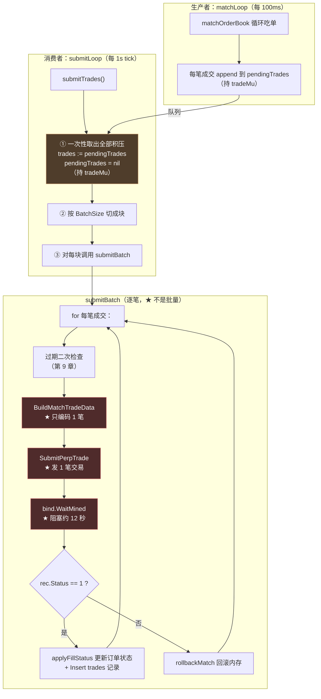
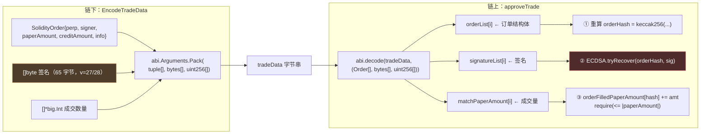
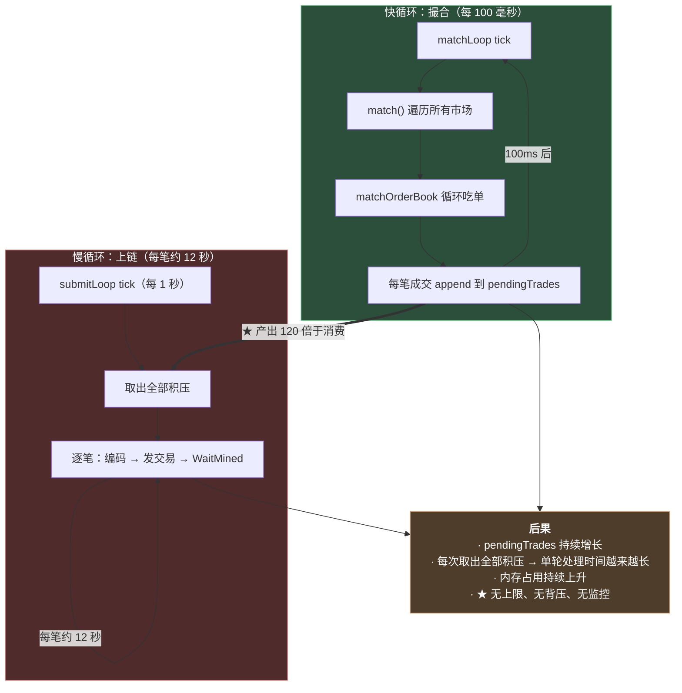

# 第 10 章：成交上链 — tradeData 的 ABI 编码、费率打包与批量提交

> 第 9 章结束时，`pendingTrades` 里攒了一批成交结果——但它们还只是**内存里的 Go 对象**。要变成真正的交易，必须跨过一道边界：**编码成合约能解码的字节，发到链上，等区块确认。**
>
> 这道边界是整条链路上**最容易出错、也最难调试**的一处。因为：
>
> ```text
> 链下用 Go 的 abi.Pack 编码 → 链上用 Solidity 的 abi.decode 解码
> 这两端是【两套独立的实现】，没有任何编译器会检查它们是否匹配
> 而错配的后果不是"报错"，而是 ★ "合约解出来一个看起来合理但完全错误的值"
> ```
>
> 本章会拆开这个编码过程（三元组、位打包、签名归一化），也会回答第 9 章留下的那个问题：**为什么 `BatchSize` 这个配置项实际上不影响链上批处理的粒度。**
>
> 而在写这一章时，我在签名编码里发现了一个**与第 9 章自成交同构的缺陷**：**存在一类签名，链下会接受、链上必定拒绝**——而它同样会触发"无限重试烧 gas"。**这是本章最需要你记住的一处。**

---

## 1. 本章导读

### 1.1 从内存对象到链上交易的三步

`submitBatch` 对每一笔撮合做三件事：

```text
第 1 步：编码（BuildMatchTradeData → EncodeTradeData）
    把 (taker订单, maker订单, 成交数量) 编码成 tradeData 字节串
    ★ 这一步的产物，合约要能 abi.decode 出来

第 2 步：发送（SubmitPerpTrade）
    以配置的私钥签名并广播一笔交易，调用 perp.trade(tradeData)
    ★ 这一步需要 nonce、gasPrice、gasLimit

第 3 步：等待（bind.WaitMined）
    等交易被打包进区块，然后检查 rec.Status == 1
    ★ 这一步会【阻塞 12 秒以上】
```

**三步里，第 1 步是本章的核心**——因为它是**唯一一处"链下字节"与"链上解码"必须精确匹配的地方**。

**第 2、3 步是标准的链上交互**（第 13 章会详细讲 `chain.Client` 的实现）。

### 1.2 三元组契约：`(Order[], bytes[], uint256[])`

合约侧的 `approveTrade` 是这样解码的：

```solidity
// src/MetaNodeExternal.sol
(
    Types.Order[] memory orderList,
    bytes[] memory signatureList,
    uint256[] memory matchPaperAmount
) = abi.decode(tradeData, (Types.Order[], bytes[], uint256[]));
```

**所以链下必须构造出一个 ABI 编码的三元组。本项目的实现（`internal/chain/tradedata.go`）：**

```go
var tradeTupleType, _ = abi.NewType("tuple[]", "", []abi.ArgumentMarshaling{
	{Name: "perp", Type: "address"},
	{Name: "signer", Type: "address"},
	{Name: "paperAmount", Type: "int128"},
	{Name: "creditAmount", Type: "int128"},
	{Name: "info", Type: "bytes32"},
})

func EncodeTradeData(orders []SolidityOrder, sigs [][]byte, matchPaper []*big.Int) ([]byte, error) {
	if len(orders) != len(sigs) || len(orders) != len(matchPaper) {
		return nil, fmt.Errorf("trade data length mismatch")     // ★ 三个数组长度必须一致
	}
	bt, _ := abi.NewType("bytes[]", "", nil)
	ut, _ := abi.NewType("uint256[]", "", nil)
	args := abi.Arguments{
		{Type: tradeTupleType},      // Order[]
		{Type: bt},                  // bytes[]
		{Type: ut},                  // uint256[]
	}
	// ...
	return args.Pack(goOrders, sigs, matchPaper)
}
```

**⚠️ 这里有一个很值得注意的类型映射细节：**

```text
Solidity:  Types.Order[]        ← 结构体数组
Go:        abi.NewType("tuple[]", "", []ArgumentMarshaling{...})
           ★ 用 "tuple[]" 来模拟 Solidity 的结构体数组
```

**"tuple" 是 go-ethereum ABI 包里表示"结构体"的方式**——因为 ABI 规范里并没有"结构体"这个类型，**结构体在 ABI 层就是"一组有序字段的元组"**。

**⚠️ 所以 `ArgumentMarshaling` 的字段顺序必须和 Solidity 结构体的字段顺序完全一致。** 对照验证：

```solidity
// src/libraries/Types.sol
struct Order {
    address perp;          // ①
    address signer;        // ②
    int128  paperAmount;   // ③
    int128  creditAmount;  // ④
    bytes32 info;          // ⑤
}
```

```go
// internal/chain/tradedata.go —— 顺序完全一致 ✓
{Name: "perp",         Type: "address"},   // ①
{Name: "signer",       Type: "address"},   // ②
{Name: "paperAmount",  Type: "int128"},    // ③
{Name: "creditAmount", Type: "int128"},    // ④
{Name: "info",         Type: "bytes32"},   // ⑤
```

**⚠️ 顺序错了会怎样？** ABI 编码是按位置来的，**字段顺序不一致会导致"值被装进错误的槽位"**：

```text
比如把 perp 和 signer 调换：
  编码后：槽位 0 是 signer，槽位 1 是 perp
  解码时：Solidity 把槽位 0 当成 perp、槽位 1 当成 signer
  ⟹ ★ 两个地址被互换
  ⟹ 后果：orderHash 变化 → 签名验证失败 → revert
  ⟹ 而且错误信息只有 "INVALID_ORDER_SIGNATURE"，看不出是"顺序错了"
```

**⚠️ 更危险的是类型兼容的情况**：`paperAmount` 和 `creditAmount` 都是 `int128`——**如果这两个的顺序调换，编译不会报错、ABI 编码也不会报错**，但**语义完全反了**（做多变做空）。

**🔑 这条经验值得记住：**

> **用 `abi.NewType` 手写类型定义时，字段顺序和类型是"契约"，任何一处不一致都不会被编译器发现。**
>
> 所以最可靠的做法是**对照测试**（KAT，第 7 章 6.1 建议过）：
> ```go
> // 用一组固定的输入，断言编码出的字节串完全等于一个已知正确的值
> // 那个"已知正确的值"必须从合约侧生成（比如用一个 view 函数返回 abi.encode(...)）
> ```

### 1.3 本章的三个发现

**发现一（🔴 与第 9 章自成交同构）：存在链下接受、链上必定拒绝的签名。**

```text
起因：ECDSA 签名有"可延展性"（malleability）——
      对同一段消息，存在两个都有效的签名 (r, s, v) 和 (r, n-s, v^1)

链下 Go（crypto.SigToPub）：★ 两个都接受
链上 Solidity（OpenZeppelin ECDSA.tryRecover）：★ 只接受 s <= n/2 的那个

⟹ 一个高 s 的签名会：
   通过链下验签 → 入库 → 撮合 → 上链被 InvalidSignatureS 拒绝
   → rollbackMatch 无限重试 → ★ 持续烧 gas
```

**实测证据见 3.(6)。**

**发现二（🔴）：`BatchSize` 这个配置项名不副实。**

```text
配置里的名字：BatchSize = 10        ⟹ 听起来像"每 10 笔成交打包成一笔交易"
实际的作用：只把内存循环切成 3 块，每块内部【仍然逐笔发交易】

实测（25 笔成交，BatchSize=10）：
  submitTrades 会切成 3 块，调用 submitBatch 3 次
  但 submitBatch 内部：for 每笔成交 { 编码 1 笔 + 发 1 笔 + 等 1 个区块 }
  ⟹ ★ 25 笔成交 = 25 笔独立交易 = 25 次 WaitMined（约 300 秒）
```

**详见 3.(10)。**

**发现三（🟠）：`pendingTrades` 没有背压，也没有上限。**

```text
产出速度：撮合循环每 100 毫秒跑一轮，每轮可产出多笔成交
消费速度：★ 每 12 秒才能确认 1 笔（Sepolia 出块时间）

⟹ 只要每 12 秒产出 > 1 笔成交，pendingTrades 就会【持续增长】
⟹ 而 submitTrades 每次把积压全部取出（e.pendingTrades = nil）再串行处理
⟹ 积压越多，一轮处理越久，期间新产出的成交继续堆积
```

**详见 3.(1) 和 6.3。**

---

## 2. 架构 / 流程图

### 2.1 从 `pendingTrades` 到链上确认的完整流程



**读图要点：**

- **红色三个框是"逐笔"的**：编码 1 笔、发 1 笔、等 1 个区块。**这正是 `BatchSize` 名不副实的原因**——它只影响蓝色那个"切块"步骤。
- **橙色的"一次性取出全部积压"是发现三的关键**：`submitTrades` 每次把整个队列取空，然后慢慢处理。**这意味着队列永远在"被取空"和"重新堆积"之间循环，而不是稳定在一个小值。**
- **生产（100ms）与消费（12 秒/笔）的速度差是 120 倍。** 这个失配是系统性的。

### 2.2 `tradeData` 的三元组结构与合约的解码



**这张图要传达的关键点：链上和链下是"两套独立的实现"，它们的匹配完全靠约定。**

```text
链下：Go 的 abi.Arguments.Pack  →  产出一串字节
链上：Solidity 的 abi.decode    →  把字节解析回结构体

★ 中间的"契约"是 ABI 规范 + Types.Order 的字段定义
★ 而没有任何机制验证"链下的 Pack 和链上的 decode 是配套的"
```

**⚠️ 图中橙色的签名（`G2`）和红色的验签（`S6`）是本章发现一的所在**——它们之间的不匹配，正是"高 s 签名"问题的根源。详见 3.(5)(6)。

### 2.3 产出与消费的速度失配



**⚠️ 这个失配不是"配置没调好"，而是**架构性的**：**

```text
撮合是【纯内存运算】→ 可以做到毫秒级
上链是【全球共识】→ 必然受出块时间限制（12 秒）

⟹ ★ 两者的速度差是物理性的，不可能靠调参消除
⟹ 唯一的问题是：系统如何【应对】这个失配
```

**本项目当前的应对方式是：不应对。** 没有背压、没有上限、没有监控、没有限流。**详见 4.3 和 6.3。**

---

## 3. 核心代码拆解

### (1) `submitLoop` 与 `submitTrades` —— 取出与分块

```go
// submitLoop 提交交易循环
func (e *MatchEngine) submitLoop() {
	ticker := time.NewTicker(time.Second)          // ★ 每 1 秒 tick 一次
	defer ticker.Stop()

	for {
		select {
		case <-e.stopCh:
			return
		case <-ticker.C:
			e.submitTrades()
		}
	}
}

// submitTrades 提交交易到链上
func (e *MatchEngine) submitTrades() {
	// ① 一次性取出全部积压
	e.tradeMu.Lock()
	if len(e.pendingTrades) == 0 {
		e.tradeMu.Unlock()
		return
	}
	trades := e.pendingTrades
	e.pendingTrades = nil                          // ★ 整个切片交给本地变量
	e.tradeMu.Unlock()

	// ② 按 BatchSize 分块
	batch := make([]*MatchResult, 0, e.config.BatchSize)
	for _, trade := range trades {
		batch = append(batch, trade)
		if len(batch) >= e.config.BatchSize {
			e.submitBatch(batch)
			batch = batch[:0]                      // ★ 复用底层数组
		}
	}
	if len(batch) > 0 {
		e.submitBatch(batch)
	}
}
```

**作者为什么这么设计（设计思想）：**

**设计点一：`e.pendingTrades = nil` 让生产者立刻可以继续写入——这是对的。**

```text
如果不这样做（比如在锁内处理）：
  ⟹ 整个上链过程（可能几百秒）都会持有 tradeMu
  ⟹ ★ 撮合循环的 append 全部被阻塞
  ⟹ 撮合停摆

当前做法：锁内只做"指针交换"（纳秒级），然后锁外慢慢处理 ✓
```

**✅ 这是"缩小临界区"的一个正确实现**——把"取数据"和"处理数据"分离。**注意它和第 9 章 6.3 那个"持锁做数据库 I/O"形成了鲜明对比：同一个项目里，一处做对了，一处做错了。**

**⚠️ 但"指针交换"这个做法有一个副作用**（发现三）：

```text
每次 tick 都把【全部积压】取走
⟹ 如果积压了 1000 笔，这一个 tick 就要处理 1000 笔 × 12 秒 = 3.3 小时
⟹ ★ 期间新产出的成交全部堆在新的 pendingTrades 里，无人处理
⟹ 而且这 3.3 小时里，内存订单簿已经扣减了，但链上还没有确认
   ⟹ ★ "内存领先链上"的窗口被拉长到 3.3 小时
```

**⚠️ 这是一个很值得注意的连锁效应**：队列积压不只影响"延迟"，还**放大了第 11 章要讲的"内存与链上不一致"的窗口**。

**更好的做法是给每次取出加一个上限**：

```go
// 一次最多处理 N 笔，避免单轮耗时过长
const maxPerTick = 20
if len(e.pendingTrades) > maxPerTick {
	trades = e.pendingTrades[:maxPerTick]
	e.pendingTrades = e.pendingTrades[maxPerTick:]     // ★ 保留剩余的
} else {
	trades = e.pendingTrades
	e.pendingTrades = nil
}
```

**⚠️ 注意 `e.pendingTrades = e.pendingTrades[maxPerTick:]` 这个写法**——它和 `[1:]` 一样会让 cap 减少（第 9 章 6.4 讲过），而且**会让底层数组保持被引用**。更稳妥的是 `append([]*MatchResult(nil), rest...)` 或者定期 compact。

**设计点二：`batch = batch[:0]` 复用底层数组——这里是对的。**

```go
batch := make([]*MatchResult, 0, e.config.BatchSize)
for _, trade := range trades {
	batch = append(batch, trade)
	if len(batch) >= e.config.BatchSize {
		e.submitBatch(batch)      // ★ 同步调用，submitBatch 返回后 batch 的内容已用完
		batch = batch[:0]         // ★ 安全地复用
	}
}
```

**⚠️ 这个复用之所以安全，是因为 `submitBatch` 是**同步**的**——它返回时已经用完了 `batch` 里的所有元素。**如果 `submitBatch` 改成异步（`go e.submitBatch(batch)`），这个复用就会变成 bug**（下一轮会覆盖上一轮正在处理的数据）。

**⚠️ 这是一类很典型的"优化引入隐式约束"**：`batch[:0]` 让代码有了一个**看不见的前置条件**（"submitBatch 必须同步"）。**而这个条件没有写在任何地方。**

### (2) `submitBatch` —— 逐笔提交（`BatchSize` 名不副实的根源）

```go
// submitBatch 对每笔撮合：编码 tradeData → Perpetual.trade → 等待收据；链上成功才更新 DB。
func (e *MatchEngine) submitBatch(trades []*MatchResult) {
	if e.orderModel == nil || e.tradeModel == nil {
		logx.Error("order/trade model nil, skip DB updates")
		return
	}
	ctx := context.Background()

	// ★ 注意：这个 for 循环【对每笔成交独立发一笔交易】
	for _, trade := range trades {
		matchAmt, ok := new(big.Int).SetString(trade.MatchAmount, 10)
		if !ok { continue }

		if e.chain == nil { e.rollbackMatch(...); continue }

		now := time.Now().Unix()
		if orderExpired(trade.TakerOrder, now) || orderExpired(trade.MakerOrder, now) {
			e.rollbackMatch(...); continue
		}

		// ★ 每次只编码这一笔
		td, err := chain.BuildMatchTradeData(trade.TakerOrder, trade.MakerOrder, matchAmt)
		if err != nil { e.rollbackMatch(...); continue }

		// ★ 发一笔独立交易
		perp := common.HexToAddress(trade.TakerOrder.Perp)
		tx, err := e.chain.SubmitPerpTrade(ctx, perp, td)
		if err != nil { e.rollbackMatch(...); continue }

		txHash := tx.Hash().Hex()

		// ★ 阻塞等一个区块确认（约 12 秒）
		rec, err := bind.WaitMined(ctx, e.chain.RPC(), tx)
		if err != nil { e.rollbackMatch(...); continue }
		if rec == nil || rec.Status != 1 { e.rollbackMatch(...); continue }

		// ===== 链上确认后才写库（第 1 章讲过的铁律）=====
		blockNum := int64(rec.BlockNumber.Uint64())
		e.applyFillStatus(ctx, trade.TakerOrder.OrderId, trade.TakerOrder.PaperAmount, matchAmt.String())
		e.applyFillStatus(ctx, trade.MakerOrder.OrderId, trade.MakerOrder.PaperAmount, matchAmt.String())
		if _, err := e.tradeModel.Insert(ctx, &model.Trade{ /* ... */ }); err != nil { ... }
	}
}
```

**作者为什么这么设计（设计思想）：**

**设计点一：整个函数是**串行**的，且每一步都阻塞。**

```text
for 每笔成交 {
	编码 → 发交易 → ★ WaitMined（12 秒）→ 写库
}
```

**为什么串行？** 第 1 章 3.(5) 讨论过：**串行换来了"简单"和"不会撞 nonce"**。**而代价是吞吐量被锁死在"每 12 秒 1 笔"。**

**⚠️ 关于 nonce 的说明**：`SubmitPerpTrade` 每次都调 `c.eth.PendingNonceAt(ctx, c.fromAddr)`。**串行执行时，前一笔已经确认（nonce 已上链），所以下一笔拿到的 nonce 是正确的。** ✅

**⚠️ 如果改成并发发送**，就必须自己管理 nonce（因为 `PendingNonceAt` 在并发下可能返回相同的值）——**这是"串行"这个选择的隐性收益。**

**设计点二（发现二）：`BatchSize` 在这里完全不起作用。**

**"批量"这个词在本项目里出现了三次，但含义各不相同：**

| 出现位置 | 名字 | 实际含义 |
| --- | --- | --- |
| `MatchEngineConfig.BatchSize` | "批量提交交易数量" | ★ **只控制内存循环的分块，不影响链上交易笔数** |
| `func submitBatch(trades []*MatchResult)` | "批量提交" | ★ **名字叫批量，实现是逐笔** |
| 合约 `approveTrade(orderList, ...)` | 数组参数 | ✅ **这才是真正的批量能力**（一次交易结算 N 张订单） |

**⚠️ 所以"批量"的能力在合约侧是**存在**的（第 9 章 2.4 讲过：合约支持 1 taker + N maker），**但链下完全没有用上。

**量化这笔损失：**

```text
假设一次撮合产生 10 笔成交：

当前实现（逐笔）：
  10 笔交易 × (基础成本 21000 + 执行成本)
  + 10 次 WaitMined × 12 秒 = ★ 120 秒

如果合并成 1 笔（用合约的 N-maker 能力）：
  1 笔交易 × (基础成本 21000 + 略多的执行成本)
  + 1 次 WaitMined = ★ 12 秒

⟹ 延迟差距 10 倍，gas 差距约 5~10 倍
```

**⚠️ 但要注意一个约束**：合约的"1 taker + N maker"要求**这 N 个 maker 都和同一个 taker 成交**（`matchPaperAmount[0] == Σ matchPaperAmount[1..n]`）。

**而我们第 9 章的实测显示**：本项目的撮合循环确实会产生"一个 taker 吃多档"的模式（`buy3` 吃 `sell1` 后还能继续吃下一个卖单）。**所以这个合并是**可行的**——只是没实现。**

**⚠️ 还有一个更微妙的约束**：合并的这 N 笔必须**都成功或都失败**（因为在一笔交易里）。**如果其中一笔因为某种原因会 revert，整批都会 revert。** 这实际上**提高了对"链下预演准确性"的要求**（第 9 章 4.4 讨论过）。

**🔑 一个务实的判断：**

> **"逐笔提交"在当前阶段其实是**合理的选择**——因为它把风险隔离开了：**
> ```text
> 逐笔：第 3 笔失败 → 只回滚第 3 笔，前 2 笔已经成功上链 ✓ 部分进展被保留
> 批量：任意一笔失败 → ★ 整批 10 笔全部 revert，全部回滚
> ```
>
> **⚠️ 在"链下预演可能出错"的当前状态下（第 9 章发现的多种失败模式），逐笔提交是更安全的。**
>
> **而当链下的准确性提高之后（把链上的 require 都实现了），批量提交才会变成纯收益。**

**⚠️ 但无论如何，`BatchSize` 这个名字是**误导性的**——它暗示了一个不存在的功能。** 详见 6.2。

### (3) `BuildMatchTradeData` —— `orderList[0]` 必须是 taker

```go
// BuildMatchTradeData 将一笔撮合（taker + maker）编码为 tradeData。orderList[0] 必须为 taker。
func BuildMatchTradeData(taker, maker *model.Order, matchPaper *big.Int) ([]byte, error) {
	if taker.Perp != maker.Perp {
		return nil, fmt.Errorf("perp mismatch")            // ① 市场必须一致
	}
	o0, err := OrderFromModel(taker)                       // ② taker → 链上结构
	if err != nil {
		return nil, fmt.Errorf("taker: %w", err)
	}
	o1, err := OrderFromModel(maker)                       // ③ maker → 链上结构
	if err != nil {
		return nil, fmt.Errorf("maker: %w", err)
	}
	sigT, err := SignatureForChain(taker.Signature)        // ④ 签名归一化
	if err != nil { return nil, err }
	sigM, err := SignatureForChain(maker.Signature)
	if err != nil { return nil, err }

	orders := []SolidityOrder{o0, o1}                      // ★ 顺序：taker 在前
	sigs := [][]byte{sigT, sigM}
	amt := new(big.Int).Abs(matchPaper)                    // ⑤ 链上只要数量，不要方向
	return EncodeTradeData(orders, sigs, []*big.Int{amt, amt})   // ⑥ 两个元素相同
}
```

**作者为什么这么设计（设计思想）：**

**设计点一：`orderList[0] = taker` 是一个**有语义的位置约定**。**

**合约侧从头到尾依赖它：**

```solidity
// src/libraries/Trading.sol → _matchOrders
result.traderList[0] = orderList[0].signer;                    // 第 0 位是 Taker
for (uint256 i = 1; i < orderList.length;) { /* 1..n 是 Maker */ }
require(matchPaperAmount[0] == totalMakerFilledPaper, ...);    // Taker 量 = Σ Maker 量
```

```solidity
// src/MetaNodeExternal.sol → approveTrade
require(i == 0 || order.signer != orderList[0].signer, Errors.ORDER_SELF_MATCH);
//                                         ↑ 拿它当"taker"来判断自成交（第 9 章的坑）
```

**⚠️ 所以"第 0 位"这个位置承载了三种语义：taker 身份、成交量约束的基准、自成交检查的基准。**

**⚠️ 如果链下把顺序搞反了会怎样？**

```text
orderList = [maker, taker]  （反了）

链上解读：
  orderList[0] = maker ⟹ 被当成 taker
  orderList[1] = taker ⟹ 被当成 maker

后果链：
  ① traderList[0] = maker 的 signer（但应该是 taker）
  ② matchPaperAmount[0] == matchPaperAmount[1] ✓（两者相同，这条不报错）
  ③ _priceMatchCheck(orderList[0], orderList[1])
     = _priceMatchCheck(maker, taker)
     ⟹ 它假设第一个是 taker、第二个是 maker
     ⟹ 而它们反了 ⟹ ★ 检查的方向也反了！
```

**⚠️ 第 ③ 点是关键**：`_priceMatchCheck` 的第一个参数被当作 taker：

```solidity
if (takerOrder.paperAmount > 0) {          // 如果"第一个"是买方
	require(makerOrder.paperAmount < 0, ...);     // 那"第二个"必须是卖方
	require(temp1 <= temp2, ...);                 // 且 卖价 <= 买价
}
```

**在"买单=taker、卖单=maker"的正确顺序下**：第一个是买单（paper>0），走第一个分支，检查"卖价 <= 买价" ✓

**在反序下**：第一个是卖单（paper<0），走 `else` 分支，检查"买价 >= 卖价"——**而这个条件下恰好也成立**（因为价格是交叉的）！

**⚠️ 所以顺序反了**可能不会**被 `_priceMatchCheck` 拦住**——**它会"碰巧"通过检查，但 `traderList` 的角色分配是反的**：

```text
traderList[0] = maker（被当成 taker）
traderList[1] = taker（被当成 maker）

⟹ paperChangeList[0] 按 "taker 的变化 = -maker 的变化" 计算
⟹ ★ 而 traderList[0] 实际是 maker
⟹ 结算的符号可能反了！
```

**⚠️ 需要说明**：这里的具体后果**取决于 `_matchOrders` 第二段的完整逻辑**，我没有逐行验证。**但可以确定的是：`orderList[0] = taker` 是一个**必须严格遵守的契约**，而链下对这个契约的唯一保障就是 `BuildMatchTradeData` 的参数名和一行注释。**

**🔑 一条可以带走的经验：**

> **"数组下标承载语义"（positional semantics）是一种**脆弱的设计**——因为它没有任何类型系统或编译器能检查。**
>
> ```text
> 链下：func BuildMatchTradeData(taker, maker, amt)  ← 靠【参数名】和注释表达
> 链上：orderList[0] 被当成 taker                    ← 靠【位置】表达
> 中间没有任何强制机制
> ```
>
> **更强的做法是把"角色"编码进数据结构：**
> ```go
> // 更安全的形态：显式表达角色
> type MatchParticipant struct {
> 	Order *SolidityOrder
> 	Sig   []byte
> 	Role  Role          // ★ RoleTaker / RoleMaker
> }
> // 然后在编码前 assert(participants[0].Role == RoleTaker)
> ```
>
> **⚠️ 但即使这样，最终还是要落到"数组的某个位置"** —— 因为 ABI 编码本身是位置相关的。**所以真正有效的手段是"边界处的断言 + 测试"，而不是更好的类型设计。**

**设计点二：`amt := new(big.Int).Abs(matchPaper)` —— 取绝对值，两个元素用同一个值。**

```go
amt := new(big.Int).Abs(matchPaper)
return EncodeTradeData(orders, sigs, []*big.Int{amt, amt})
```

**为什么取绝对值？** 因为**合约侧的 `matchPaperAmount` 是 `uint256`**（只有大小，没有方向）：

```solidity
(uint256[] memory matchPaperAmount) = abi.decode(tradeData, (Types.Order[], bytes[], uint256[]));
//  ↑ uint256，无符号
```

**方向由订单自己的 `paperAmount` 符号表达**（第 8 章 3.(5) 讲过的"符号双重语义"）。

**⚠️ 而两个元素用同一个值，是因为合约要求**：

```solidity
require(matchPaperAmount[0] == totalMakerFilledPaper, Errors.TAKER_TRADE_AMOUNT_WRONG);
// 其中 totalMakerFilledPaper 初始化为 matchPaperAmount[1]，循环从 i=2 开始
⟹ 2 个元素时：要求 matchPaperAmount[0] == matchPaperAmount[1]
⟹ ★ 所以 [amt, amt] 是正确的 ✓
```

**✅ 这个设计是对的**，而且它和第 9 章 2.4 的图对应上了。

### (4) `EncodeTradeData` —— 三元组的打包

```go
// EncodeTradeData 生成 perpetual.trade(tradeData) 所需的 abi.encode(orderList, signatureList, matchPaperAmount)。
func EncodeTradeData(orders []SolidityOrder, sigs [][]byte, matchPaper []*big.Int) ([]byte, error) {
	if len(orders) != len(sigs) || len(orders) != len(matchPaper) {
		return nil, fmt.Errorf("trade data length mismatch")       // ★ 长度一致性
	}
	bt, _ := abi.NewType("bytes[]", "", nil)
	ut, _ := abi.NewType("uint256[]", "", nil)
	args := abi.Arguments{
		{Type: tradeTupleType},      // Order[]
		{Type: bt},                  // bytes[]
		{Type: ut},                  // uint256[]
	}

	// ★ 把 SolidityOrder 转成匿名 struct —— 因为 go-ethereum 的 Pack 需要 struct 与
	//   ArgumentMarshaling 的字段名匹配
	type row struct {
		Perp         common.Address
		Signer       common.Address
		PaperAmount  *big.Int
		CreditAmount *big.Int
		Info         [32]byte
	}
	goOrders := make([]row, len(orders))
	for i := range orders {
		goOrders[i].Perp = orders[i].Perp
		goOrders[i].Signer = orders[i].Signer
		goOrders[i].PaperAmount = orders[i].PaperAmount
		goOrders[i].CreditAmount = orders[i].CreditAmount
		goOrders[i].Info = orders[i].Info
	}
	return args.Pack(goOrders, sigs, matchPaper)
}
```

**作者为什么这么设计（设计思想）：**

**设计点一：`row` 这个匿名 struct 是**必需的**——这是一个很容易被误解的地方。**

**为什么要多转一层？** 因为 go-ethereum 的 `abi.Pack` 对 tuple 的处理依赖于**struct 的字段名与 `ArgumentMarshaling` 的 `Name` 匹配**：

```go
{Name: "perp",         Type: "address"},     // ← Name 必须和 struct 字段名对上
```

**而 `SolidityOrder` 这个类型的字段名是匹配的**（`Perp` / `Signer` / `PaperAmount` / `CreditAmount` / `Info`）……

**⚠️ 那么为什么不直接用 `[]SolidityOrder`？**

**这是一个值得深究的问题。** 可能的原因：

```text
① go-ethereum 的 abi.Pack 对导出的自定义类型支持有限？
   —— 实际上它是支持 struct 的，只要字段是导出的且名字匹配

② 作者可能遇到了某个具体的报错，然后试出了这个写法
   —— 代码里没有任何注释说明原因 ★

③ 可能只是"防御性"的写法（确保字段可见性和顺序）
```

**⚠️ 无论原因是什么，这段代码**用注释说明"为什么需要这一层转换"会好得多**——因为从读者的角度看，`SolidityOrder` → `row` 是一个"看起来完全冗余"的复制。**

**🔑 一条通用的建议：**

> **当代码里出现"看起来完全冗余的数据复制"时，通常有一个不显然的原因。**
> ```text
> 最优：写清楚原因（一行注释）
> 次优：保留一个测试来验证（改坏了会红）
> ★ 最差：什么都不写（下一个人会"顺手清理掉"，然后出 bug）
> ```

**设计点二：`len(orders) != len(sigs) || len(orders) != len(matchPaper)` 这个检查是必要的。**

```go
if len(orders) != len(sigs) || len(orders) != len(matchPaper) {
	return nil, fmt.Errorf("trade data length mismatch")
}
```

**为什么必要？** 因为合约侧是按下标对应取用的：

```solidity
Types.Order memory order = orderList[i];
bytes32 orderHash = ...;
(address recoverSigner,) = ECDSA.tryRecover(orderHash, signatureList[i]);   // ← 同下标
state.orderFilledPaperAmount[orderHash] += matchPaperAmount[i];              // ← 同下标
```

**⚠️ 如果长度不一致，会怎样？**

```text
Go 的 abi.Pack 在打包三个数组时，会分别编码每个数组的长度
⟹ 长度不一致【不会】导致编码失败
⟹ 但链上解码后，访问 signatureList[i] 时如果越界 → ★ revert（数组越界）
```

**✅ 所以这个前置检查是有价值的一道防线**——它把"链上数组越界 revert"提前到了"链下编码前返回错误"。

**设计点三：错误信息 `trade data length mismatch` 可以更详细。**

```go
// 当前
return nil, fmt.Errorf("trade data length mismatch")

// 更好：说清楚各自是多少
return nil, fmt.Errorf("trade data length mismatch: orders=%d sigs=%d matchPaper=%d",
	len(orders), len(sigs), len(matchPaper))
```

**⚠️ 这类"差一点信息"的错误信息在排查时会让人抓狂**——**因为"不匹配"这个信息本身没有告诉你该去查哪一端。**

**🔑 这条经验在第 3 章 3.(7) 提过（`TreasuryDepositWatcher` 的错误信息写得很好），这里是一个反面例子：**

> **错误信息的三层境界：**
> ```text
> ① 说清"哪里错了"                 → "length mismatch"
> ② 说清"错成什么样"               → "orders=2 sigs=1 matchPaper=2"    ← 本项目的水平
> ③ 说清"下一步该做什么"           → "taker 和 maker 的签名数量必须与订单数量一致，检查 BuildMatchTradeData 的调用"
> ```
> **② 通常够了，③ 在关键时刻能省半小时。**

### (5) `SignatureForChain` —— `v` 值的归一化

```go
// SignatureForChain 将签名转为链上 ECDSA.tryRecover 接受的格式（V=27/28）。
func SignatureForChain(hexSig string) ([]byte, error) {
	sig, err := DecodeSignature(hexSig)
	if err != nil {
		return nil, err
	}
	if sig[64] < 27 {
		sig[64] += 27          // ★ 0/1 → 27/28
	}
	return sig, nil
}

// DecodeSignature 解析 hex 签名，归一化为 go-ethereum 要求的 [R||S||V]（V=0/1）。
func DecodeSignature(hexSig string) ([]byte, error) {
	h := strings.TrimSpace(hexSig)
	h = strings.TrimPrefix(h, "0x")
	b, err := hex.DecodeString(h)
	if err != nil {
		return nil, err
	}
	if len(b) == 64 {                     // EIP-2098 紧凑签名（无 v）
		b = append(b, 0)
	}
	if len(b) != 65 {
		return nil, fmt.Errorf("bad sig length %d", len(b))
	}
	switch b[64] {
	case 27, 28:
		b[64] -= 27                       // → 0/1（go-ethereum 的格式）
	case 0, 1:
		// MetaMask / viem 常见格式
	case 2, 3:
		b[64] -= 2                        // EIP-155 recovery id → parity
	default:
		return nil, fmt.Errorf("bad recovery id %d", b[64])
	}
	return b, nil
}
```

**作者为什么这么设计（设计思想）：**

**设计点一：两个函数形成了一个"双向转换"的链，这是必要的——因为两端的 `v` 格式不同。**

```text
Go 的 crypto.SigToPub 期望：v ∈ {0, 1}
Solidity 的 ECDSA.tryRecover 要求：v ∈ {27, 28}
                        （代码注释明确写着 v != 27 && v != 28 → InvalidSignatureV）

⟹ DecodeSignature：外部格式 → go-ethereum 格式（0/1）
⟹ SignatureForChain：go-ethereum 格式 → 链上格式（27/28）
```

**✅ 这个设计是对的**，而且 `DecodeSignature` 处理了四种 `v` 值（27/28、0/1、2/3），**比第 6 章登录模块那个只处理 `>= 27` 的版本完整得多**（第 6 章 6.4 指出过这个不一致）。

**设计点二：`if len(b) == 64 { b = append(b, 0) }` 支持 EIP-2098 紧凑签名。**

**EIP-2098 定义了一种 64 字节的签名格式**：把 `v` 编码进 `s` 的最高位（因为合法的 `s` 永远小于 2^255）。

```text
标准格式（65 字节）：[r(32)][s(32)][v(1)]
紧凑格式（64 字节）：[r(32)][yParityAndS(32)]
                     其中 yParityAndS = s | (v << 255)
```

**⚠️ 但代码只做了 `append(b, 0)`——也就是"补一个 v=0"，而**没有从 `s` 的最高位还原 `v`**。**

```go
if len(b) == 64 {
	b = append(b, 0)      // ★ 硬编码 v = 0
}
```

**⚠️ 这意味着：如果传入的是一个紧凑格式的签名，且其 `v` 实际是 1（yParityAndS 的最高位为 1），那么补上的 `v = 0` 是**错的**。**

**⚠️ 而更微妙的是**：如果 `s` 的最高位真的是 1（表示 `v=1`），那么 `s` 本身就**大于 2^255**——**而这已经超出了 OZ 允许的 `s <= n/2` 范围**（`n/2 ≈ 2^255 - 很小`）。

**所以两种可能：**

```text
情况 A：紧凑签名 64 字节，最高位为 0（v=0）
  → append(b, 0) 恰好正确 ✓
  → 且 s < 2^255，可能通过 OZ 检查

情况 B：紧凑签名 64 字节，最高位为 1（v=1）
  → append(b, 0) 补错了 v ✗
  → 而且 s >= 2^255 > n/2，★ 无论如何都会被 OZ 拒绝（InvalidSignatureS）
  ⟹ ★ 所以情况 B 的签名【本来就应该被拒绝】—— 补错 v 只是让错误更早发生
```

**⚠️ 所以这个 `append(b, 0)` 在实践中**是安全的**（因为情况 B 本来就是无效签名），但它的正确性是**偶然的**——它依赖于"s 的高位为 1 时签名必然无效"这个性质。**

**🔑 一条可以带走的经验：**

> **"看起来是防御性代码，实际上恰好正确"的写法是最危险的**——因为它经不起重构。
>
> **如果哪天有人**正确地**把紧凑签名的 `v` 还原出来（改成 `v = s >> 255`），并且同时把 `s` 的高位清掉，那么这个函数就会开始接受情况 B 的签名——而那个签名会被链上拒绝。**
>
> **⚠️ 更准确的说法是**：当前的写法是"不完整但安全"，而"完整"的实现反而需要**额外的 `s` 范围检查**才能保持安全。**这是一处需要注释说明的地方**（当前没有任何注释）。

### (6) 【🔴 关键】`s` 值从未被归一化——链下接受、链上拒绝

**这是本章最重要的发现，也是与第 9 章自成交**同构**的一个缺陷。**

**先看两端的差异：**

```text
链上 OpenZeppelin ECDSA.tryRecover（lib/openzeppelin-contracts/.../ECDSA.sol:134）：
    if (uint256(s) > 0x7FFFFFFFFFFFFFFFFFFFFFFFFFFFFFFF5D576E7357A4501DDFE92F46681B20A0) {
        return (address(0), RecoverError.InvalidSignatureS);
    }
    ★ 拒绝高 s 的签名

链下 DecodeSignature / SignatureForChain：
    ★ 只处理 v，从不检查或归一化 s
链下 VerifyEOASignature：
    crypto.SigToPub(digest, sig)     ← ★ 不检查 s 范围
```

**⚠️ 而 ECDSA 有一个数学性质叫**可延展性（malleability）**：**

```text
给定一个对消息 m 有效的签名 (r, s, v)，
则 (r, n - s, v ^ 1) 也是 m 的【有效签名】（n 是 secp256k1 的阶）

⟹ ★ 同一段消息、同一个私钥，存在两个都"数学上有效"的签名
⟹ 区别只在 s 的大小：一个 <= n/2，一个 > n/2
```

**实测验证（用真实订单和真实私钥）：**

```text
【签名 malleability 检查】
  原始签名              s = 4a2708f3a39f78dfdb9185b11a8d1fb9bbebaf0b2ba9f8915ac0f80bde82ecf6
  s 是否 <= OZ 上界     = true        ← 低 s，链上会接受

  可延展版本            s' = b5d8f70c5c608720246e7a4ee572e044fec32ddb839ea7aa65116680f1b3544b
  s' 是否 <= OZ 上界    = false       ← ★ 高 s，OZ 会拒绝

  Go VerifyEOASignature(高 s 签名)  → <nil>        ← ★ Go 接受了！
  ★★ Go 接受了高 s 签名 —— 而合约的 ECDSA.tryRecover 会以 InvalidSignatureS 拒绝

  SignatureForChain 输出 v = 27（合约要求 27/28 ✓）
  但 s 仍然是高的：true                                ← ★ v 修好了，s 没修
```

**⚠️ 完整的影响链条：**

```text
① 用户（或恶意前端）提交一个高 s 的订单签名
   ↓
② CreateOrder → VerifyEOASignature → ★ 通过（Go 不检查 s）
   ↓
③ 订单入库、进入内存订单簿
   ↓
④ 撮合成交 → BuildMatchTradeData → SignatureForChain（只修 v，不修 s）
   ↓
⑤ 上链 → approveTrade → ECDSA.tryRecover → ★ InvalidSignatureS → revert
   ↓
⑥ rollbackMatch → 把订单塞回队列（第 9 章）
   ↓
⑦ 下一轮又撮成同一笔 → 又 revert
   ⟹ ★ 无限重试，持续烧 gas
```

**⚠️ 这与第 9 章的自成交问题**结构完全相同**：**

| | 自成交（第 9 章） | 高 s 签名（本章） |
| --- | --- | --- |
| 链下的判断 | "可以成交" | "签名有效" |
| 链上的判断 | `ORDER_SELF_MATCH` revert | `InvalidSignatureS` revert |
| 失败性质 | **永久性** | **永久性** |
| 链下的应对 | 无 | 无 |
| 后果 | 无限重试烧 gas | 无限重试烧 gas |

**⚠️ 触发成本：零。** 任何用户用自己的私钥生成一个高 s 的签名即可（很多密码学库默认会归一化，但**手工构造或某些实现不会**）。

**修法（一处归一化，两行代码）：**

```go
// 在 DecodeSignature 的末尾，或 SignatureForChain 里
var secp256k1N = func() *big.Int {
	n, _ := new(big.Int).SetString("FFFFFFFFFFFFFFFFFFFFFFFFFFFFFFFEBAAEDCE6AF48A03BBFD25E8CD0364141", 16)
	return n
}()
var halfN = new(big.Int).Rsh(new(big.Int).Set(secp256k1N), 1)

// 归一化 s 到低半区
s := new(big.Int).SetBytes(b[32:64])
if s.Cmp(halfN) > 0 {
	s.Sub(secp256k1N, s)               // s' = n - s
	s.FillBytes(b[32:64])              // 写回
	b[64] ^= 1                         // ★ v 也要翻转（parity 变了）
}
```

**⚠️ 注意 `b[64] ^= 1`——归一化 s 必须**同时翻转 v**，因为 `(r, s, v)` 和 `(r, n-s, v^1)` 才是等价的。**

**⚠️ 但这会引入一个新的顺序问题**：`DecodeSignature` 里的 `v` 归一化（27/28 → 0/1）和这里的 `s` 归一化（翻 v）**必须协调**。**更清晰的写法是：**

```go
// 统一的归一化流程
func normalizeSignature(b []byte) error {
	// 第 1 步：先把 v 统一成 parity（0/1）
	switch b[64] {
	case 27, 28: b[64] -= 27
	case 0, 1:
	case 2, 3:   b[64] -= 2
	default:     return fmt.Errorf("bad recovery id %d", b[64])
	}

	// 第 2 步：归一化 s 到低半区（同时翻转 parity）
	s := new(big.Int).SetBytes(b[32:64])
	if s.Cmp(halfN) > 0 {
		s.Sub(secp256k1N, s)
		s.FillBytes(b[32:64])
		b[64] ^= 1
	}
	return nil
}
```

**🎯 这个发现的通用教训（和第 9 章同构，但更普遍）：**

> **"链下验签通过"和"链上验签通过"是两个不同的判断——因为它们是两套独立的实现，用的是不同的库、不同的校验强度。**
>
> ```text
> Go 的 crypto.SigToPub     ：只做数学恢复，不做任何范围检查
> OZ 的 ECDSA.tryRecover    ：检查 s 范围（EIP-2）、检查 v ∈ {27,28}
> ```
>
> **⚠️ 判断方法：把链上验签函数的**所有**校验点列出来，逐条对比链下：**
> ```solidity
> // OpenZeppelin ECDSA.tryRecover 的全部校验
> ① signature.length == 65（或 64，走 EIP-2098）
> ② uint256(s) <= 0x7FFF...B20A0        ← ★ 本项目链下没做
> ③ v == 27 || v == 28                   ← ✅ 链下做了（SignatureForChain）
> ④ 恢复出的地址 != address(0)
> ```
>
> **四条里做了三条——而漏掉的那一条，恰好会触发无限重试。**

### (7) `PackOrderInfo` 与费率的精度约定

```go
// PackOrderInfo 组装 Types.Order.info：高→低 64bit 依次为 makerFee、takerFee、expiration、nonce（与合约解析一致）。
func PackOrderInfo(makerFeeBps, takerFeeBps int64, expiration, nonce uint64) [32]byte {
	n := new(big.Int).SetUint64(uint64(makerFeeBps))
	n.Lsh(n, 192)
	t := new(big.Int).SetUint64(uint64(takerFeeBps))
	t.Lsh(t, 128)
	n.Or(n, t)
	e := new(big.Int).SetUint64(expiration)
	e.Lsh(e, 64)
	n.Or(n, e)
	nu := new(big.Int).SetUint64(nonce)
	n.Or(n, nu)
	var out [32]byte
	n.FillBytes(out[:])
	return out
}
```

**第 7 章 3.(6) 已经分析过位布局和负费率的补码处理。这里补充**精度约定**这个角度。**

**⚠️ 费率是"1e18 精度的 int64"——这是一个需要小心解释的约定：**

```text
链下传入：makerFeeBps int64       ← 名字里的 "Bps" 有歧义
链上读取：int256(int64(uint64(uint256(info) >> 192)))
链上使用：creditChange.abs().decimalMul(feeRate)
         decimalMul(a,b) = a * b / 1e18      ← ★ 除以 1e18
```

**从 `decimalMul` 的实现可以反推出：费率必须是 1e18 精度。**

```text
举例：费率 0.1%（千分之一）= 0.001
     1e18 精度下 = 1e15
     decimalMul(creditChange, 1e15) = creditChange * 1e15 / 1e18 = creditChange / 1000 ✓
```

**⚠️ 而字段名 `MakerFeeBps` 里的 "Bps"（basis points，万分之一）是**误导性的**：**

```text
Bps 通常表示"万分之一"（1 bps = 0.01%）
如果按 Bps 理解，0.1% = 10 bps，那么应该传 10
但实际必须传 1e15（1e18 精度的 0.001）
⟹ ★ 名字和实际语义相差 1e14 倍
```

**⚠️ 这个命名问题的实际影响**：如果有人按字面理解 `MakerFeeBps`，传一个像 `10` 这样的值，那么链上会算出：

```text
decimalMul(creditChange, 10) = creditChange * 10 / 1e18 ≈ 0
⟹ ★ 手续费几乎为零（但不报错）
```

**⚠️ 这是一个"静默失效"**——费率传错不会 revert，只会让手续费收得几乎为零（或者收得吓人）。

**🔑 一条可以带走的建议：**

> **凡是"带精度的小数值"，字段名里都应该体现精度，或者用专门的类型。**
> ```go
> // 有歧义
> MakerFeeBps int64              // "Bps" 暗示万分之一，实际是 1e18 精度
>
> // 清晰
> MakerFeeRate1e18 int64         // ★ 精度写在名字里
> // 或者更好：用类型表达
> type Rate1e18 int64
> ```
>
> **⚠️ 本项目在 `model.Order` 里用的名字是 `MakerFeeRate`（没有 Bps），但在 `PackOrderInfo` 的参数里叫 `makerFeeBps`——同一个值有两个名字，其中一个是有歧义的。** 这是第 7 章那条"命名不一致"的延伸。

### (8) 合约侧的校验顺序（对照理解）

**第 1 章 3.(3) 逐条分析过 `approveTrade` 的四道锁。这里从"链下应该预判哪些失败"的角度重新排列一次：**

```solidity
// src/MetaNodeExternal.sol → approveTrade
function approveTrade(address orderSender, bytes calldata tradeData) external onlyRegisteredPerp returns (...) {
	// 【0】调用者必须是授权的 orderSender
	require(state.validOrderSender[orderSender], Errors.INVALID_ORDER_SENDER);

	// 【1】解码（解码失败会 revert，但错误信息不友好）
	(Types.Order[] memory orderList, bytes[] memory signatureList, uint256[] memory matchPaperAmount) =
		abi.decode(tradeData, (Types.Order[], bytes[], uint256[]));

	for (uint256 i = 0; i < orderList.length;) {
		Types.Order memory order = orderList[i];

		// 【2】重算 orderHash
		bytes32 orderHash = EIP712._hashTypedDataV4(domainSeparator, Trading._structHash(order));
		orderHashList[i] = orderHash;

		// 【3】验签（EOA 或 EIP-1271 合约钱包）
		(address recoverSigner,) = ECDSA.tryRecover(orderHash, signatureList[i]);
		if (recoverSigner != order.signer && !state.operatorRegistry[order.signer][recoverSigner]) {
			if (Address.isContract(order.signer)) {
				require(IERC1271(order.signer).isValidSignature(orderHash, signatureList[i]) == 0x1626ba7e, ...);
			} else {
				revert(Errors.INVALID_ORDER_SIGNATURE);
			}
		}

		// 【4】订单未过期
		require(Trading._info2Expiration(order.info) >= block.timestamp, Errors.ORDER_EXPIRED);

		// 【5】paper 与 credit 必须异号
		require((order.paperAmount < 0 && order.creditAmount > 0) || (order.paperAmount > 0 && order.creditAmount < 0), Errors.ORDER_PRICE_NEGATIVE);

		// 【6】订单必须属于当前调用的永续合约
		require(order.perp == msg.sender, Errors.PERP_MISMATCH);

		// 【7】禁止自成交
		require(i == 0 || order.signer != orderList[0].signer, Errors.ORDER_SELF_MATCH);

		// 【8】累计成交不超量
		state.orderFilledPaperAmount[orderHash] += matchPaperAmount[i];
		require(state.orderFilledPaperAmount[orderHash] <= int256(orderList[i].paperAmount).abs(), Errors.ORDER_FILLED_OVERFLOW);
	}

	// 【9】撮合计算与价格检查
	Types.MatchResult memory result = Trading._matchOrders(state, orderHashList, orderList, matchPaperAmount);

	// 【10】撮合引擎的手续费结算与安全
	state.primaryCredit[orderSender] += result.orderSenderFee;
	if (result.orderSenderFee < 0) {
		require(Liquidation._isSolidIMSafe(state, orderSender), Errors.ORDER_SENDER_NOT_SAFE);
	}
	return (...);
}
```

**⚠️ 以及 `Perpetual.trade` 里的最后一道：**

```solidity
// src/Perpetual.sol → trade
require(IDealer(owner()).isAllSafe(traderList), "TRADER_NOT_SAFE");
```

**把这 11 道检查（【0】~【10】+ `isAllSafe`）与链下的应对对照：**

| # | 链上检查 | 链下有没有预防？ | 未预防的后果 |
| --- | --- | --- | --- |
| 0 | `validOrderSender` | ✅ 启动自检 `ValidateOrderSender` | — |
| 1 | `abi.decode` 成功 | ⚠️ 部分（第 7 章的 int128 范围缺失） | 烧 gas |
| 2 | `orderHash` 重算 | ✅ 链下算 digest 时同构 | — |
| 3 | 验签（s 范围、v 范围） | ⚠️ **v 做了，s 没做**（本章发现一） | ★ **无限重试烧 gas** |
| 4 | 未过期 | ✅ `pruneExpiredAtHead` + 二次检查 | — |
| 5 | paper/credit 异号 | ❌ **没有**（第 7/8 章的坑） | 零量订单冻结撮合 |
| 6 | `order.perp == msg.sender` | ✅ 链下按 perp 分组，天然满足 | — |
| 7 | 禁止自成交 | ❌ **没有**（第 9 章的坑） | ★ **无限重试烧 gas** |
| 8 | 累计成交不超量 | ✅ 靠 `remain` 不超卖 | — |
| 9 | `_priceMatchCheck` | ⚠️ 部分（第 9 章 3.(4) 的精度差异） | 边界值可能误判 |
| 10 | `orderSenderFee` 安全 | ❌ 没有 | revert |
| 11 | `isAllSafe` | ❌ **没有** | ★ 无限重试烧 gas |

**⚠️ 这张表给出了一个清晰的结论：**

```text
11 道链上检查：
  ✅ 有预防    6 道
  ⚠️ 部分预防  2 道（decode、价格检查）
  ❌ 完全没预防 3 道 —— 而这三道【全部】表现为"无限重试烧 gas"
```

**🔑 这张表本身就是一份可直接执行的待办清单**（第 9 章 6.x 也提到过同样的方法）：

> **把合约的所有 `require` 抓出来，逐条问"链下会不会构造出触发它的输入"。**
>
> ```bash
> # 一条命令抓出所有校验点
> grep -rn "require(\|revert " src/ | grep -v "^src/support"
> ```
>
> **⚠️ 而更重要的是那个"兜底"：即使这张表全覆盖了，也仍然需要"重试上限"——因为链上状态会变（用户余额被别处扣、订单在别处成交），总会有预测不到的情况。**（第 9 章 4.4 讨论过。）

### (9) `applyFillStatus` —— 成交后的状态更新

```go
func (e *MatchEngine) applyFillStatus(ctx context.Context, orderID, signedPaper, deltaStr string) {
	// 按订单原始签名数量累计 filled；达到全额则 Status=Filled，否则 PartialFill。
	o, err := e.orderModel.FindOne(ctx, orderID)
	if err != nil || o == nil {
		return
	}
	full := absPaperString(signedPaper)                       // |签名时的 paperAmount|
	delta, _ := new(big.Int).SetString(deltaStr, 10)
	prev, _ := new(big.Int).SetString(o.FilledAmount, 10)     // 数据库里已累计的
	total := new(big.Int).Add(prev, delta)
	status := model.OrderStatusPartialFill
	if total.Cmp(full) >= 0 {
		status = model.OrderStatusFilled
		total.Set(full)                                       // ★ 钳制到全额，防止溢出
	}
	_ = e.orderModel.UpdateStatus(ctx, orderID, status, total.String())
}
```

**作者为什么这么设计（设计思想）：**

**设计点一：`total.Set(full)` 是一个防御性的钳制。**

```go
if total.Cmp(full) >= 0 {
	status = model.OrderStatusFilled
	total.Set(full)          // ★ 把累计值钳制到订单总量
}
```

**为什么需要？** 因为 `filled_amount` 是**累加**的，而累加可能因为各种原因超过总量：

```text
· 链上已经限制了不超量（orderFilledPaperAmount <= |paperAmount|）
· 但链下的累加是独立计算的 —— 如果某笔成交被重复记录，就会超
⟹ ★ 钳制保证了数据库里的 filled_amount 永远不会超过订单总量
```

**✅ 这是一个好的防御**——**它让"数据异常"不会扩散成"数据库里的荒谬值"。**

**⚠️ 但要注意**：钳制只影响**写入的值**，不影响**状态判断**（`total.Cmp(full) >= 0` 已经判成 Filled 了）。**所以如果累计真的超了，状态是对的（Filled），值被修成 full——这是合理的。**

**设计点二：`applyFillStatus` 被调用两次（taker 和 maker 各一次），每次做一次 `FindOne` + 一次 `UpdateStatus`。**

```go
e.applyFillStatus(ctx, trade.TakerOrder.OrderId, trade.TakerOrder.PaperAmount, matchAmt.String())
e.applyFillStatus(ctx, trade.MakerOrder.OrderId, trade.MakerOrder.PaperAmount, matchAmt.String())
```

**⟹ 每笔成交产生 2 次读 + 2 次写数据库。**

**⚠️ 这在"每 12 秒 1 笔成交"的节奏下完全不是问题。** 但如果 `BatchSize` 真的实现了批量（一次提交 10 笔），那就是 20 次读写——**仍然可接受，但值得知道。**

**设计点三：`MatchPrice` 没有被写入任何地方。**

**⚠️ 注意 `applyFillStatus` 只更新了 `filled_amount` 和 `status`，没有用 `trade.MatchPrice`。** 而 `MatchPrice` 唯一被使用的地方是 `tradeModel.Insert` 时写入 `trades.price` 列：

```go
if _, err := e.tradeModel.Insert(ctx, &model.Trade{
	// ...
	PaperAmount:  trade.MatchAmount,
	Price:        trade.MatchPrice,      // ★ 只用于展示记录
	// ...
})
```

**⚠️ 所以 `MatchPrice` **完全是链下记录**——它不影响链上结算**（链上从 maker 订单的 `creditAmount/paperAmount` 自己算）。

**🔑 这带来一个值得注意的问题：**

> **`trades.price` 这个链下记录的价格，和链上实际结算的价格，理论上可能不一致**（如果 `calculatePrice` 的实现和合约的 `creditChange` 计算在某个边界值上不同）。
>
> **对账时应该以哪个为准？** 答案是链上（第 2 章 4.3 讲的"三个真相源"）。
>
> **⚠️ 而这正是第 19 章要讨论的"链上链下双账本"问题的一个具体表现。**

### (10) 【🔴】`BatchSize` 的真实语义

**这是本章发现二，也是第 9 章预告的那个问题。**

**配置里的声明（`internal/config/config.go`）：**

```go
// MatchEngineConfig 撮合引擎配置
type MatchEngineConfig struct {
	MatchInterval    int
	BatchSize        int      // ← 名字叫"批量大小"
	MaxPendingOrders int
}
```

**YAML 里的注释：**

```yaml
MatchEngine:
  # 撮合间隔（毫秒）
  MatchInterval: 100
  # 批量提交交易数量        ← ★ 这个注释明确说了"批量提交"
  BatchSize: 10
  # 最大待处理订单数
  MaxPendingOrders: 10000
```

**而实际的作用（实测）：**

```text
【探针】BatchSize=10，pendingTrades=25
  submitTrades 会把它切成 3 块，调用 submitBatch 3 次

  但 submitBatch 内部是：
     for _, trade := range trades {
         td := chain.BuildMatchTradeData(一笔成交)   ← 只编码 1 笔
         tx := e.chain.SubmitPerpTrade(ctx, perp, td) ← 发 1 笔交易
         bind.WaitMined(...)                          ← 等 1 个区块确认
     }

  ⟹ ★ BatchSize 只影响【内存循环的分块】，不影响【链上交易的笔数】
     25 笔成交 = 25 笔独立交易 = 25 次 WaitMined（约 300 秒）
```

**⚠️ 所以 `BatchSize` 的真实作用是：**

```text
它决定的是"submitBatch 被调用几次"，而【不是】"链上交易被合并成几笔"

BatchSize = 10，25 笔成交：
  → submitBatch 被调用 3 次（10 + 10 + 5）
  → 但总共发了 ★ 25 笔链上交易

BatchSize = 1：
  → submitBatch 被调用 25 次
  → 仍然发 25 笔链上交易
  ⟹ ★ 两种配置的链上行为【完全相同】
```

**⚠️ 那 `BatchSize` 到底有没有任何实际效果？**

**有一个非常微小的效果**：它影响 `submitBatch` 里 `if e.orderModel == nil || e.tradeModel == nil` 这个前置检查被执行的次数，以及函数调用的开销。**除此之外没有任何差别。**

**⟹ 严格地说：`BatchSize` 在当前实现下是一个**无效配置**。**

**🔑 这个问题揭示了一个更普遍的现象：**

> **配置项的"名字和注释"与实际行为不符，是一种特别隐蔽的技术债。**
>
> ```text
> 后果 1：使用者会基于错误的理解去调参
>   "吞吐量不够？把 BatchSize 调大试试"  → ★ 完全没用
>
> 后果 2：它会掩盖真正的瓶颈
>   真正的瓶颈是"每笔等 12 秒确认"，而不是"批次大小"
>   ⟹ ★ 调 BatchSize 的人会一直看不到效果，然后去怀疑别的地方
>
> 后果 3：它让"批量"这个能力看起来已经实现了
>   ⟹ 没人会去实现合约本来就支持的 N-maker 合并
> ```
>
> **⚠️ 判断方法**：对每一个配置项，问"把它改成极端值（0、1、极大），行为会有什么不同？"**如果答不上来，就说明没人真正验证过它的作用。**

**修法（两个方向）：**

```go
// 方向 A（最小改动）：改名 + 改注释，让它诚实
type MatchEngineConfig struct {
	MatchInterval    int
	SubmitChunkSize  int      // ★ 改名为"提交时的分块大小"
	MaxPendingOrders int
}
// 并在注释里说明："仅影响内存循环的分块，不影响链上交易笔数"

// 方向 B（实质改动）：真正实现批量提交
// 需要：
//   ① MatchResult 改成"1 taker + N maker"的结构（第 9 章思考题 1 分析过）
//   ② BuildMatchTradeData 改成接受多个 maker
//   ③ 处理"部分提交失败"的情况（整批 revert vs 逐笔）
//   ⟹ ★ 改动面很大，而且会提高对"链下预演准确性"的要求
```

**⚠️ 我的建议是方向 A**——**因为当前真正的问题是"链下预演不准"（自成交、高 s 签名、异号、余额），而不是"批量能力不足"。** 在预演准确之前实现批量，只会让"整批 revert"的损失更大。

**🔑 这和第 8 章 5.2 思考题 1 的判断顺序是一致的：**

> **先修正确性，再修性能/能力。**
> **而在修正确性之前，至少要"诚实地描述现状"**——改名和改注释的成本几乎为零，收益是"不再误导使用者"。

---

## 4. Web3 特有机制

### 4.1 签名可延展性（Malleability）与 EIP-2

3.(6) 的发现建立在一个密码学性质上。这里把它讲透，因为**这是 Web3 后端工程师必须知道的一个基础事实**。

**ECDSA 签名的可延展性：**

```text
secp256k1 的阶 n（一个大素数）
给定有效签名 (r, s)：
  ★ (r, n - s) 也是有效签名

原因：ECDSA 验证方程里 s 是以 s^-1 的形式出现的，
     而验证只依赖于"点 R 的 x 坐标 == r"，
     而 R 和 -R 有相同的 x 坐标。
     ⟹ 用 s 和 n-s 会算出互为相反数的两个点，但 x 坐标相同
     ⟹ ★ 两者都能通过验证
```

**⚠️ 而 v（recovery id）在两者之间必须翻转**：

```text
(r, s, v)    → 恢复出公钥 P
(r, n-s, v^1) → 恢复出同一个公钥 P ✓
```

**EIP-2 因此规定：交易签名必须使用低 s（`s <= n/2`），高 s 的签名被视为无效。**

**⚠️ 这条规定的目的：**

```text
如果两个签名都有效：
  · 一笔交易被打包后，攻击者可以用"另一个有效签名"重新广播
  · 因为交易哈希变了（签名不同）→ 交易哈希不同 → ★ 可以再次被打包
  ⟹ ★ 同一笔交易可以被执行两次（在没有 nonce 保护的情况下）

有了 nonce 保护之后，这个攻击不再有效（nonce 已用），
但"签名唯一性"仍然是一个重要的性质：
  · 它让"签名 → 交易哈希"成为一一映射
  · 内存池、区块浏览器、索引器都依赖这个性质
```

**⚠️ 而对本项目来说，可延展性的影响是：**

```text
链下验签（Go）不做低 s 检查 → 接受两个变体
链上验签（OZ）做低 s 检查   → 只接受一个变体
⟹ ★ 两个变体中的一个会"通过链下、被链上拒绝"
```

**🔑 一条可以带走的经验：**

> **在"链下预演 + 链上执行"的架构里，凡是"两侧都用不同库实现同一个密码学验证"的地方，都要逐一比对校验强度。**
>
> **通用的比对方法：打开链上用的库的源码，找它的验证函数，逐行看它检查了什么。** 然后问"我的链下实现检查了同样多的东西吗"。
>
> ```text
> 本项目已经发现的两处不一致：
>   · v 范围   → ✅ 链下做了（SignatureForChain）
>   · s 范围   → ❌ 链下没做（本章 3.(6)）
> ```
>
> **⚠️ 而这类不一致的后果总是同一个：链下放行了链上必拒的输入 → 无限重试烧 gas。**

### 4.2 批量提交的 gas 经济学

3.(2) 和 3.(10) 讨论了"逐笔提交"的代价。这里把 gas 的账算清楚，因为**它决定了"要不要实现批量"这个决策**。

**以太坊交易的 gas 结构：**

```text
一次交易的总 gas = 基础成本 + 执行成本 + calldata 成本

基础成本：21,000 gas（每笔交易固定）
执行成本：合约逻辑的实际消耗（SSTORE 最贵，约 20,000 gas/新槽）
calldata 成本：非零字节 16 gas，零字节 4 gas
```

**⚠️ 关键洞察：基础成本是**每笔交易固定**的，与交易里做了多少事无关。**

**⟹ 把 N 笔成交合并成 1 笔交易，可以省下 (N-1) × 21,000 gas 的基础成本。**

**量化一下：**

```text
假设每笔成交的执行成本约 60,000 gas（多次 SSTORE + ECDSA 恢复约 3000 gas）

逐笔（N=10）：
  10 × (21,000 + 60,000) = 810,000 gas

合并（1 taker + 10 maker 在一笔交易里）：
  1 × 21,000 + 10 × 60,000 = 621,000 gas     ← 执行成本不变
  ⟹ ★ 省下 189,000 gas ≈ 23%
```

**⚠️ 所以"批量"节省的是基础成本，占比约 20~25%（取决于执行成本的大小）。**

**⚠️ 但真正的收益在**延迟**而不在 gas：**

```text
逐笔（N=10）：  10 次 WaitMined × 12 秒 = ★ 120 秒
合并（1 笔）：   1 次 WaitMined × 12 秒 = ★ 12 秒
⟹ 延迟相差 10 倍
```

**🔑 而"延迟"在本项目里有一个**经济后果**（第 9 章 2.4 提过）：**

> **成交延迟越长，市场价格变化的概率越大，后面的几笔成交越可能因为"价格不再交叉"或"余额不足"而 revert。**
>
> ```text
> 第 1 笔：T+12s  确认 → 价格可能还没变 ✓
> 第 5 笔：T+60s  确认 → ★ 价格变了 50% 的概率
> 第 10 笔：T+120s 确认 → ★ 大概率已经 revert
> ```
>
> **所以"逐笔提交"不只是"慢"，它还会**增加失败率**——而失败率增加又意味着更多的 revert 和 gas 浪费。**

**⚠️ 这是一个"慢 → 更容易失败 → 更慢"的正反馈循环。**

**🔑 一条可以带走的判断：**

> **在链上交互里，"批量"的价值不只是省 gas——更重要的是"减少时间窗口"。**
>
> ```text
> 省 gas        → 约 20~25%
> ★ 减少时间窗口 → 决定性地降低失败率（因为链上状态在变）
> ```
>
> **所以在评估"要不要做批量"时，应该把"减少失败率"算进收益里** —— 而在链下预演不准的当前状态下，**减少失败率的价值可能比省 gas 更高。**

### 4.3 无背压的异步上链

3.(1) 的发现三是本章的第三个问题。这里从**架构模式**的角度分析。

**"生产者-消费者"模式的一个基本要求是：消费者要能"告诉"生产者慢下来。**

```text
常见的背压机制：
  ① 有界队列（队列满了，生产者阻塞或拒绝）
  ② 令牌桶（消费者按处理速度发放令牌）
  ③ 采样/丢弃（队列满了就丢弃，并记录）
  ④ 降级（队列满了就拒绝新的请求，返回"服务繁忙"）
```

**⚠️ 本项目一个都没有：**

```go
// MatchEngine 里的队列
pendingTrades []*MatchResult      // ★ 无界切片

// 生产者（matchLoop）无条件 append
e.tradeMu.Lock()
e.pendingTrades = append(e.pendingTrades, result)     // ★ 没有上限检查
e.tradeMu.Unlock()

// 消费者（submitLoop）一次取空
trades := e.pendingTrades
e.pendingTrades = nil
```

**⚠️ 后果的完整链条：**

```text
① 撮合产出 > 上链消费（120 倍速度差）
② pendingTrades 持续增长
③ 内存占用增长（每个 MatchResult 持有 2 个订单指针 + 2 个字符串）
④ ★ 更隐蔽的后果：内存订单簿已经扣减了 remain，但链上还没确认
   ⟹ "内存领先链上"的窗口被拉长
   ⟹ 第 11 章讨论的一致性问题被放大
⑤ 而且没有监控——没人知道队列有多长
```

**⚠️ 第 ④ 点是关键**，也是本章和第 11 章的连接点：

```text
正常情况下：内存领先链上约 12 秒（一笔交易的确认时间）
积压 1000 笔时：★ 内存领先链上约 3.3 小时

⟹ 在这 3.3 小时里，如果进程崩溃：
   · 内存订单簿丢失（重启从数据库恢复）
   · 而数据库里没有这些成交的记录（因为"链上确认后才写库"）
   · ★ 但链上最终会确认这 1000 笔
   ⟹ ★ 链上成交了，数据库不知道 —— 第 11、12 章的主题
```

**🔑 一条可以带走的经验：**

> **任何"生产者-消费者"结构都必须回答一个问题："如果消费者永远追不上生产者，会发生什么？"**
>
> ```text
> 没有答案 → ★ 内存耗尽 / OOM（本项目的现状）
> 有界队列 → 生产者阻塞（可能拖垮上游）
> 丢弃     → 数据丢失（要评估可接受性）
> 降级     → 拒绝新请求（用户体验受损，但系统存活）
> ```
>
> **对本项目来说，"有界队列 + 拒绝新订单"是合理的选择：**
> ```go
> const maxPending = 1000
> if len(e.pendingTrades) >= maxPending {
> 	// 拒绝这张订单（返回给调用方）
> 	// 或者：暂停撮合，等队列下降
> }
> ```
>
> **⚠️ 而"拒绝新订单"意味着用户看到"服务繁忙"——但这比"系统 OOM 崩溃"或"内存与链上严重不一致"要好得多。**

### 4.4 ABI 编码的"契约"性质

最后补充一个概念性的观察，它贯穿本章。

**ABI 编码的本质是一个**双向契约**：**

```text
编码方（链下）：按规则把结构化数据变成字节
解码方（链上）：按同一套规则把字节变回结构化数据

★ 而这个"同一套规则"没有任何强制机制
```

**⚠️ 更麻烦的是：**编码和解码失败的表现完全不同**。**

| 失败类型 | 表现 | 可发现性 |
| --- | --- | --- |
| **编码失败**（类型不匹配、长度不一致） | Go 返回 error | ✅ 容易发现（但本项目有些地方没检查） |
| **解码失败**（字节数不对、越界） | 合约 revert | ⚠️ 烧 gas 才发现 |
| ★ **编码解码"成功"但语义错位** | **没有错误** | 🔴 **最难发现** |

**⚠️ 第三类是真正的危险**，可能的成因：

```text
· 字段顺序不一致（两个同类型字段调换，编译器不报错）
· 类型宽度不一致（int128 vs int256 —— 第 7 章 3.(4) 讨论过，值合法时产出相同，
  越界时行为不同）
· 位打包不一致（info 字段的位布局 —— 第 7 章 3.(6)）
· 签名格式不一致（v/s 的取值范围 —— 本章 3.(5)(6)）
```

**🔑 而应对这类问题的手段只有一个：**

> **不要信任"数学上等价"，要验证"字节上相同"。**
>
> ```text
> ✗ "两边都按 ABI 规范编码，应该是一致的"
> ✓ "我用这组固定输入，链下编码出的字节串是 0x1234...，
>    而链上用同样的输入 abi.encode 出的字节串也是 0x1234..."
> ```
>
> **具体做法（第 7 章 6.1 建议过 KAT，这里给出针对本章的版本）：**
>
> ```solidity
> // 在合约里加一个测试专用的 view 函数
> function debugEncodeTradeData(
>     Types.Order[] calldata orderList,
>     bytes[] calldata signatureList,
>     uint256[] calldata matchPaperAmount
> ) external pure returns (bytes memory) {
>     return abi.encode(orderList, signatureList, matchPaperAmount);
> }
> ```
>
> ```go
> // 链下：断言自己编码的字节串 == 合约返回的
> onChainBytes := callDebugEncode(...)          // eth_call，零成本
> localBytes, _ := chain.EncodeTradeData(orders, sigs, amts)
> if !bytes.Equal(onChainBytes, localBytes) {
>     t.Fatalf("编码不一致！\n 链上: %x\n 链下: %x", onChainBytes, localBytes)
> }
> ```
>
> **⚠️ 这段测试能一次性覆盖本章讨论的**所有**编码问题** —— 字段顺序、类型宽度、位打包、三元组结构。**成本是合约里加一个 view 函数（部署时多几百字节）+ 一个 Go 测试。**

---

## 5. 本章小结与思考题

### 5.1 核心知识点回顾

| 知识点 | 一句话总结 |
| --- | --- |
| **上链三步** | 编码（BuildMatchTradeData）→ 发送（SubmitPerpTrade）→ 等待（WaitMined） |
| **三元组契约** | `(Order[], bytes[], uint256[])`，链下 `abi.Pack` 与链上 `abi.decode` 必须精确匹配 |
| **`tuple[]` 模拟结构体** | ABI 层没有"结构体"，只有"有序字段元组"——字段顺序即契约 |
| **`orderList[0]` 必须是 taker** | 位置承载语义：taker 身份、成交量基准、自成交检查基准 |
| **`matchPaperAmount = [amt, amt]`** | 合约要求 `[0] == Σ[1..n]`，2 个元素时即相等 |
| **`v` 值归一化** | Go 要 0/1，Solidity 要 27/28 —— `SignatureForChain` 做了 ✅ |
| **🔴 `s` 值从未归一化** | Go 接受高 s，OZ 拒绝 → ★ 通过链下、链上必拒 → **无限重试烧 gas** |
| **ECDSA 可延展性** | `(r, s, v)` 和 `(r, n-s, v^1)` 都是有效签名；EIP-2 规定只用低 s |
| **`PackOrderInfo` 的精度** | 费率是 1e18 精度，但参数名叫 `Bps`（暗示万分之一）—— **相差 1e14 倍** |
| **🔴 `BatchSize` 名不副实** | 只控制内存分块，**不影响链上交易笔数**；25 笔成交 = 25 笔交易 |
| **批量能力的现实** | 合约支持 1 taker + N maker，**链下完全没用上** —— gas 省 20~25%，延迟省 10 倍 |
| **`submitTrades` 一次取空** | 指针交换（✅ 缩小临界区）但**无背压无上限** → 队列可无限增长 |
| **速度失配是物理性的** | 撮合 100ms vs 上链 12 秒/笔，相差 120 倍，不可能靠调参消除 |
| **`pendingTrades` 积压的隐藏代价** | ★ 放大"内存领先链上"的窗口（12 秒 → 可能 3.3 小时） |
| **`applyFillStatus` 的钳制** | `total.Set(full)` 防止 `filled_amount` 超过订单总量 ✅ |
| **`MatchPrice` 是展示字段** | 链上从 maker 订单自己算价格，**不接收这个值** |
| **链上 11 道检查，链下预防 6 道** | 未预防的 3 道（s 范围、异号、自成交）**全部表现为无限重试烧 gas** |
| **ABI 编码的隐性风险** | "编码解码都成功但语义错位" 最难发现 —— 只能靠 KAT 验证字节相同 |

### 5.2 思考题

#### 思考题 1：`DecodeSignature` 里有一段"看似防御性、实际恰好正确"的代码：

```go
if len(b) == 64 {          // EIP-2098 紧凑签名
	b = append(b, 0)       // 补一个 v = 0
}
```

请分析：（a）EIP-2098 紧凑格式是怎么把 `v` 编码进 64 字节的？（b）这个 `append(b, 0)` 在什么情况下会补错？（c）为什么说它"恰好正确"？（d）如果有一天有人把它改成"正确地还原 v"，会发生什么？

<details>
<summary>点击查看参考答案</summary>

**（a）EIP-2098 紧凑格式的编码方式**

**标准 ECDSA 签名是 65 字节：**

```text
[r (32 字节)][s (32 字节)][v (1 字节)]
```

**EIP-2098 观察到两件事：**

```text
① v 只需要 1 个 bit（它是 parity，取值 0 或 1）
② ★ 合法的 s 永远小于 2^255
```

**为什么 `s < 2^255`？**

```text
secp256k1 的阶 n ≈ 1.158 × 10^77
2^255       ≈ 5.79 × 10^76
```

**⚠️ 等等，这个关系需要算清楚：**

```text
n = 0xFFFFFFFFFFFFFFFFFFFFFFFFFFFFFFFEBAAEDCE6AF48A03BBFD25E8CD0364141
2^255 = 0x8000000000000000000000000000000000000000000000000000000000000000

比较首位：n 以 0xFF 开头，2^255 以 0x80 开头
⟹ n > 2^255

所以"合法的 s < n"并不能推出 "s < 2^255"
```

**⚠️ 但 EIP-2 要求 `s <= n/2`：**

```text
n/2 ≈ 0x7FFFFFFFFFFFFFFFFFFFFFFFFFFFFFFF5D576E7357A4501DDFE92F46681B20A0
      ↑ 以 0x7F 开头
2^255 = 0x8000...0000
      ↑ 以 0x80 开头

⟹ ★ n/2 < 2^255 ✓
```

**所以**在 EIP-2 生效的前提下**，合法的 `s` 永远小于 `2^255`——**它的最高位永远是 0。

**EIP-2098 正是利用这一点：**

```text
紧凑格式（64 字节）：[r (32 字节)][yParityAndS (32 字节)]

其中 yParityAndS = s | (v << 255)
                  ↑         ↑
              低 255 位放 s   最高位放 parity
```

**解码：**

```text
s = yParityAndS & 0x7FFF...FFFF      （清掉最高位）
v = yParityAndS >> 255                （取最高位）
```

**（b）`append(b, 0)` 什么时候会补错**

**当紧凑格式里的 `yParityAndS` 最高位是 1 时（也就是真实的 v = 1），这段代码会补 `v = 0`——补错了。**

```text
输入：[r][yParityAndS]，其中最高位 = 1（真实 v = 1）
代码：b = append(b, 0)
结果：[r][yParityAndS][0]

⟹ 链下认为 v = 0
⟹ 而真实 v = 1
⟹ ★ 用错误的 v 去恢复公钥，会得到【另一个地址】
```

**⚠️ 但这里有个更严重的问题：`s` 的值本身也错了。**

```text
代码只做了 append，没有清理 yParityAndS 的最高位
⟹ b[32:64] 仍然是 yParityAndS（最高位为 1）
⟹ 这个值 >= 2^255
⟹ ★ 而 EIP-2 要求 s <= n/2 < 2^255
⟹ ★ 所以这个 s 无论如何都是非法的
```

**（c）为什么说它"恰好正确"**

**因为 s 高位为 1 的紧凑签名**本来就是一个非法签名**——它违反了 EIP-2。**

```text
无论链下怎么处理：
  · 补 v=0  → s 非法 → 链上 InvalidSignatureS ✗
  · 补 v=1  → s 非法 → 链上 InvalidSignatureS ✗
  · 正确还原 → s 非法 → 链上 InvalidSignatureS ✗
⟹ ★ 三条路都是"被拒绝"，只是拒绝的时机不同
```

**⚠️ 所以"补错 v"这个 bug 的后果是：**

```text
· 链下验签会失败（用错误的 v 恢复出错误的地址）
  ⟹ ★ 订单在 CreateOrder 就被拒绝 ✓ 这是"好"的结果
· 而不是"通过链下、被链上拒绝"（那样会烧 gas）
```

**🔑 这就是"恰好正确"的含义：**

> **这个 bug 让一个"本来就该被拒绝的输入"在更早的地方被拒绝——从"安全"的角度看，结果是好的。**
>
> **⚠️ 但它不是"设计如此"，而是"两个 bug 互相抵消"：**
> ```text
> Bug 1：紧凑格式的 s 没有被清理最高位（s 非法）
> Bug 2：v 被硬编码为 0（v 可能错）
>
> 单独看 Bug 1 → 会导致"链下通过、链上拒绝"（烧 gas）
> 但 Bug 2 恰好让链下也拒绝 → ★ 掩盖了 Bug 1
> ```
>
> **⚠️ 这类"bug 掩盖 bug"的情况极其危险**——因为它让缺陷在测试中**不可见**，直到有人修了其中一个。

**（d）如果改成"正确地还原 v"，会发生什么**

**假设有人这样改（看起来是一个纯粹的改进）：**

```go
if len(b) == 64 {
	// 按 EIP-2098 正确解码
	yParityAndS := new(big.Int).SetBytes(b[32:64])
	v := byte(yParityAndS.Bit(255))                    // 取最高位
	s := new(big.Int).And(yParityAndS, mask255)        // 清掉最高位
	s.FillBytes(b[32:64])                              // 写回干净的 s
	b = append(b, v)                                   // 补正确的 v
}
```

**⚠️ 这个改动**本身是对的**——它按规范实现了 EIP-2098 解码。**

**但它会产生一个**新的行为**：**

```text
改之前：紧凑签名 → 补 v=0 → 用错的 v 恢复 → ★ 链下失败（拒绝了）
改之后：紧凑签名 → 正确还原 → ★ 链下可能成功

⟹ ★ 一个"原本在链下被拒绝"的签名，现在会通过链下
⟹ 然后进入：入库 → 撮合 → 上链 → ★ ECDSA.tryRecover
```

**⚠️ 而链上会不会接受？取决于 `s`：**

```text
情况 A：原始 yParityAndS 的高位为 0（v=0）
  · 改之前：补 v=0，s 没有高位，s 合法（假设 <= n/2）→ 链下和链上都能通过 ✓
  · 改之后：还原 v=0，s 同上 → 行为不变 ✓

情况 B：原始 yParityAndS 的高位为 1（v=1）
  · 改之前：补 v=0，s 带高位（>= 2^255，非法）→ 链下失败 ✗
  · 改之后：v=1 正确，s 被清掉高位 → ★ 如果清掉后的 s <= n/2，那么链下成功！
    ⟹ ★ 而链上呢？s 是合法的（<= n/2），v=27/28（SignatureForChain 会加 27）
    ⟹ ★ 链上也会成功 ✓
```

**⚠️ 等等，情况 B 改之后是**正确的**——两边都通过。**

**那问题在哪？问题在于"s 的清理"是否完整。**

**EIP-2098 的 `yParityAndS` 里，低 255 位就是 `s`。** 而 `s` 的合法范围是 `<= n/2 < 2^255`——**所以低 255 位理论上可以放下任何合法的 s。**

**⚠️ 但**不合法**的 s 也可能出现在低 255 位里**（比如 `n/2 < s < 2^255`）。**这时：**

```text
改之后：链下会接受（Go 不做 s 范围检查 —— 本章 3.(6) 的发现）
       ⟹ ★ 上链被 OZ 拒绝 → 无限重试烧 gas
```

**🔑 所以正确的改动是"两件事一起做"：**

```go
if len(b) == 64 {
	// ① 按 EIP-2098 正确解码 v 和 s
	yParityAndS := new(big.Int).SetBytes(b[32:64])
	v := byte(yParityAndS.Bit(255))
	s := new(big.Int).And(yParityAndS, mask255)
	s.FillBytes(b[32:64])
	b = append(b, v)

	// ② ★ 归一化 s 到低半区（本章 3.(6) 的修法）
	//    这一步是【必须】的——否则会引入"链下通过、链上拒绝"的新路径
}
```

**🎯 本题的核心结论：**

> **第一，关于"幸运的 bug"：**
> ```text
> 一个让"本该被拒绝的输入"更早被拒绝的 bug，
> 在安全上是"无害"的 —— 但它会【掩盖】别的 bug。
> ⟹ ★ 修它之前，必须先确认"被掩盖的那个 bug 也修好了"
> ```
>
> **第二，关于"看起来是纯粹改进"的重构：**
> ```text
> 一个"更符合规范"的实现，可能因为【去掉了某个意外的保护】而引入新问题。
> ⟹ ★ 重构前问一句："现在的行为（包括 bug）有没有在挡什么？"
> ```
>
> **第三，也是最实用的一条：**
>
> **这段代码需要一行注释。** 它现在的样子让每个读者都要重新推理一遍"为什么可以硬编码 0"。**而注释的成本是一行，收益是"下一个人不会贸然改它"。**
>
> ```go
> if len(b) == 64 {
> 	// EIP-2098 紧凑签名：[r][yParityAndS]
> 	// ⚠️ 注意：这里【没有】还原 v 和清理 s 的高位。
> 	//    后果：只在 yParityAndS 最高位为 0 时能正确解析；
> 	//    最高位为 1 时会产生一个 s 非法的签名（>= 2^255），
> 	//    而它在链下就会被拒绝 —— 这正是我们想要的结果
> 	//    （链上 OZ 也会以 InvalidSignatureS 拒绝，所以"提前拒绝"是安全的）。
> 	// ⚠️ 如果要实现完整的 EIP-2098 解码，必须【同时】加上 s 的低半区归一化，
> 	//    否则会引入"链下通过、链上拒绝 → 无限重试烧 gas"的路径。
> 	b = append(b, 0)
> }
> ```
>
> **⚠️ 这段注释很长，但它保存的推理更长** —— 而且**如果不写下来，每个人都要重新推导一遍**（或者更糟：不推导就直接改）。

</details>

#### 思考题 2：`BatchSize` 这个配置项的注释写着"批量提交交易数量"，但实测发现它**完全不影响链上交易的笔数**。请回答：（a）为什么这个"无效配置"比"没有这个配置"更糟？（b）如果要把 `BatchSize` 变成"真正的批量提交"，需要改动哪些地方？（c）在什么条件下，批量提交才是**纯收益**？

<details>
<summary>点击查看参考答案</summary>

**（a）为什么"无效配置"比"没有配置"更糟**

**先看"没有这个配置"的情况：**

```text
如果 config 里根本没有 BatchSize：
  · 没有人会去调它
  · 没有人会以为"吞吐量可以通过它来提升"
  · ★ 瓶颈会被正确地识别为"每笔等 12 秒确认"
```

**而"有一个名字骗人的配置"会制造三重损害：**

**损害一：误导调参方向。**

```text
现象：下单延迟很高（因为每笔成交要等 12 秒确认）
运维/开发的推理："BatchSize 是批量大小，调大它应该能一次提交更多"
操作：BatchSize: 10 → 100

实际效果：★ 完全没有任何变化
  （submitBatch 仍然逐笔发交易，只是被调用的次数变少了）

⟹ ★ 调参的人会困惑："为什么调了没用？是不是配置没生效？"
⟹ 然后去查配置文件加载、去重启服务、去看日志……浪费大量时间
```

**损害二：掩盖真正的瓶颈。**

```text
真正的瓶颈链条是：
  每笔成交 → 独立交易 → WaitMined（12 秒）→ 串行 → 吞吐 1 笔/12 秒

而 BatchSize 的存在【暗示】：
  "吞吐量是可配置的，只是当前值不合适"
⟹ ★ 没有人会去质疑"为什么要逐笔发交易"这个【架构选择】
```

**损害三：让一个"链上已经支持、链下没实现"的能力看起来已经做完了。**

```text
合约支持 1 taker + N maker（第 9 章 2.4 验证过）
config 里有 BatchSize（名字暗示批量）
logic 里有 submitBatch（名字暗示批量）

⟹ ★ 三处"证据"都指向"批量已经实现了"
⟹ 没有人会去实现它——因为看起来已经有了
```

**🎯 这三重损害的共性：**

> **一个"名不副实"的接口，会让使用者基于错误的模型去行动——而错误的行动 + 无法证伪的结果（调了没变化），是最消耗时间的组合。**
>
> ```text
> 没有配置     → 使用者知道"这里没有优化手段" → 去找别的地方 ✓
> 无效配置     → 使用者以为"这里有优化手段，只是没调好" → ★ 反复尝试
> ```
>
> **⚠️ 判断方法（我在 3.(10) 提过）：对每一个配置项，问"把它改成极端值（0、1、极大），行为会有什么不同？"如果答不上来，就说明没人验证过它的作用。**
>
> **⚠️ 一个更彻底的实践**：给每个配置项写一个测试，**断言它的极端值会产生可观测的行为差异**。**如果写不出这个测试，那这个配置项就不该存在。**

**（b）实现真正的批量提交需要改什么**

**第 9 章思考题 1 已经分析过"升级到 N-maker"的改动面。这里从 `BatchSize` 这个角度再梳理一次，并补上"批量提交"特有的问题：**

**① `MatchResult` 的结构：一对一 → 一对多。**

```go
// 现在
type MatchResult struct {
	TakerOrder  *model.Order
	MakerOrder  *model.Order
	MatchAmount string
	MatchPrice  string
}

// 需要
type MatchResult struct {
	TakerOrder   *model.Order
	Makers       []*model.Order
	MakerAmounts []*big.Int
	// ★ MatchPrice 不再是一个单一值 —— 每个 maker 按自己的价格成交
}
```

**② `matchOrderBook` 要能"聚合一个 taker 的多笔成交"。**

```text
现在的循环：每笔成交 append 一个 MatchResult
需要改成：同一个 taker 连续吃的多档，聚合成一个 MatchResult
⟹ 什么时候"收尾"？taker 被吃完？价格不交叉？还是攒够 BatchSize？

★ 这是一个新的设计决策：聚合的边界在哪里？
   · 攒得越多 → 省 gas 越多、延迟越低
   · 但攒得越多 → 单批失败时损失越大、内存占用越久
```

**③ `BuildMatchTradeData` 要接受多个 maker，并满足合约的排序约束。**

```text
合约要求（第 9 章思考题 1 详述）：
  · 所有 maker 按 signer 升序排列
  · ★ 比较必须用"地址数值序"，不是"字符串序"（checksum 格式会出错）
  · 同 signer 的多个 maker 要相邻（用稳定排序）
  · matchPaperAmount[0] == Σ matchPaperAmount[1..n]
```

**④ 提交失败的粒度问题（这是批量特有的）。**

```text
逐笔提交：第 3 笔失败 → 只回滚第 3 笔，前 2 笔已上链 ✓

批量提交：任意一笔失败 → ★ 整批 revert
  · 可能的原因：其中一个 maker 的签名有问题、其中一个订单过期了、
    其中一个的余额不足导致 isAllSafe 失败
  ⟹ ★ 一荣俱荣、一损俱损

⟹ 这【提高】了对"链下预演准确性"的要求（第 9 章 4.4）
```

**⑤ `BatchSize` 的语义要重新定义。**

```text
现在的语义：内存循环的分块大小（无实际作用）
真正的语义应该是二选一：
  · "一次链上交易最多包含多少笔成交"（提交批次大小）
  · "一次撮合循环最多聚合多少笔成交"（撮合批次大小）
★ 这是两个不同的概念，需要明确选一个（或都保留、分别命名）
```

**（c）什么条件下批量提交才是纯收益**

**"纯收益"意味着"没有任何新的代价"。逐条检查：**

| 前提条件 | 当前是否满足 | 如果不满足的后果 |
| --- | --- | --- |
| **① 链下预演准确**（不会构造出链上必拒的输入） | ❌ **不满足**（第 9 章自成交、本章高 s 签名、第 7/8 章异号） | 整批 revert，损失放大 N 倍 |
| **② 有失败后的恢复策略** | ❌ 不满足（`rollbackMatch` 无条件重试） | 整批失败 → 整批回滚 → 整批重试 → 循环烧钱 |
| **③ 能定位"是哪一个 maker 导致失败"** | ❌ 不满足（revert 只给错误信息，不给下标） | ★ 无法修复，只能整批放弃 |
| **④ 有重试上限** | ❌ 不满足（第 9 章 6.2） | 无限重试 |
| **⑤ 成交延迟是真正的痛点** | ⚠️ **部分**（当前吞吐量远小于容量） | 为不需要的东西增加复杂度 |

**⚠️ 检查结果是：5 个前提，满足 0 个。**

**🎯 所以结论很明确：**

> **在当前状态下，批量提交不是纯收益，而是"用 N 倍的失败损失换取 10 倍的延迟改善"。**
>
> ```text
> 逐笔：10 笔中第 3 笔失败 → 损失 1 笔的 gas，前 2 笔成功 ✓
> 批量：10 笔中第 3 笔失败 → ★ 损失 10 笔的 gas，全部回滚 ✗
> ```
>
> **⚠️ 而这个权衡只有在"预演准确性足够高"时才反转** —— 当失败率从"经常"降到"罕见"时，批量的收益（省 gas + 省时间）才会超过它的代价（失败放大）。

**🔑 所以正确的实施顺序是：**

```text
第 1 步：修链下预演（把链上的 require 都实现一遍）   ← 第 9 章 6.x 的清单
第 2 步：加重试上限 + 告警（兜住未知的永久失败）      ← 第 9 章 6.2
第 3 步：给 rollbackMatch 加失败原因（区分瞬时/永久）
第 4 步：★ 这时才考虑批量提交
```

**⚠️ 而第 0 步（现在就可以做、成本几乎为零）是：把 `BatchSize` 改名或改注释，让它不再误导人。**

```go
type MatchEngineConfig struct {
	MatchInterval    int
	// ⚠️ 仅影响 submitTrades 的内存分块，不影响链上交易的笔数。
	//    若要实现真正的批量提交，见 <TODO 链接>。
	SubmitChunkSize int
	MaxPendingOrders int
}
```

**🎯 本题的核心结论：**

> **"优化"的收益必须减去它的代价才能评估——而代价往往在"失败路径"上。**
>
> ```text
> 顺利路径：批量省 gas 20~25%、省时间 10 倍   ← 容易看到
> 失败路径：批量把损失放大 N 倍               ← ★ 容易被忽略
> ```
>
> **所以在"失败率还不低"的系统里，任何"扩大失败粒度"的优化都应该推迟。**
>
> **⚠️ 而这条判断有一个更普遍的形式：**
>
> **当一个系统的"正常路径"还不够可靠时，优化应该优先投向"减少失败"，而不是"让成功的路径更快"。**
>
> 本项目的正常路径（撮合 → 编码 → 上链）已经很快了（100ms 一轮撮合），**真正的瓶颈在失败路径上**——而那些失败**全都来自"链下预演不准"**。**修好预演，比实现批量有价值得多。**

</details>

---

## 6. 踩坑提示

### 🔴 严重：`s` 值从未归一化 —— 链下接受、链上必定拒绝

**这是本章最严重的发现，与第 9 章的自成交问题**结构完全相同**。**

**证据（源码对比）：**

```solidity
// lib/openzeppelin-contracts/contracts/utils/cryptography/ECDSA.sol:134
if (uint256(s) > 0x7FFFFFFFFFFFFFFFFFFFFFFFFFFFFFFF5D576E7357A4501DDFE92F46681B20A0) {
    return (address(0), RecoverError.InvalidSignatureS);
}
```

```go
// internal/chain/tradedata.go —— SignatureForChain
func SignatureForChain(hexSig string) ([]byte, error) {
	sig, err := DecodeSignature(hexSig)
	if err != nil { return nil, err }
	if sig[64] < 27 {
		sig[64] += 27          // ★ 只处理了 v，从未检查 s
	}
	return sig, nil
}
```

**实测复现：**

```text
【签名 malleability 检查】
  原始签名              s = 4a2708f3...（低 s，OZ 会接受）
  可延展版本            s' = b5d8f70c...（★ 高 s，OZ 会拒绝）

  Go VerifyEOASignature(高 s 签名)  → <nil>        ← ★ Go 接受了
  ★★ 而合约会以 InvalidSignatureS 拒绝

  SignatureForChain 输出 v = 27（✓ 符合合约要求）
  但 s 仍然是高的：true                              ← ★ v 修好了，s 没修
```

**影响链条（与第 9 章自成交完全同构）：**

```text
高 s 签名 → 通过链下验签 → 入库 → 撮合 → 上链 revert → rollbackMatch → 重新撮合 → ...
⟹ ★ 无限重试，持续烧 gas
```

**修法：**

```go
var secp256k1N, _ = new(big.Int).SetString(
	"FFFFFFFFFFFFFFFFFFFFFFFFFFFFFFFEBAAEDCE6AF48A03BBFD25E8CD0364141", 16)
var halfN = new(big.Int).Rsh(new(big.Int).Set(secp256k1N), 1)

// 在 DecodeSignature 里，v 归一化【之后】加上
s := new(big.Int).SetBytes(b[32:64])
if s.Cmp(halfN) > 0 {
	s.Sub(secp256k1N, s)          // s' = n - s
	s.FillBytes(b[32:64])
	b[64] ^= 1                    // ★ 必须同时翻转 parity
}
```

**⚠️ 注意 `b[64] ^= 1` 必须在 `v` 已经归一化成 0/1 **之后**执行** —— 否则翻转会作用在 27/28 上，得到错误的值。**这是一个顺序敏感的修改。**

**🎯 这条坑的通用教训：**

> **"链下验签通过"和"链上验签通过"是两个独立的判断。**
>
> **判断方法：把链上验签函数的所有校验点列出来，逐条对比链下。**
> ```solidity
> // OZ ECDSA.tryRecover 的全部校验
> ① signature.length == 65（或 64）      → ✅ 链下做了
> ② uint256(s) <= 0x7FFF...B20A0          → ❌ ★ 链下没做
> ③ v == 27 || v == 28                    → ✅ 链下做了（SignatureForChain）
> ④ 恢复出的地址 != address(0)
> ```
>
> **⚠️ 而且这类不一致的后果总是同一个：链下放行链上必拒的输入 → 无限重试烧 gas。**

### 🔴 严重：`BatchSize` 名不副实 —— 它不影响链上交易的笔数

```yaml
MatchEngine:
  # 批量提交交易数量        ← ★ 这个注释是错的
  BatchSize: 10
```

**实测：**

```text
【探针】BatchSize=10，pendingTrades=25
  submitTrades 会把它切成 3 块，调用 submitBatch 3 次

  但 submitBatch 内部是：
     for _, trade := range trades {
         td := chain.BuildMatchTradeData(一笔成交)   ← 只编码 1 笔
         tx := e.chain.SubmitPerpTrade(ctx, perp, td) ← 发 1 笔交易
         bind.WaitMined(...)                          ← 等 1 个区块确认
     }

  ⟹ ★ BatchSize 只影响【内存循环的分块】
     25 笔成交 = 25 笔独立交易 = 25 次 WaitMined（约 300 秒）
```

**⟹ `BatchSize = 1` 和 `BatchSize = 100` 的**链上行为完全相同**。**

**修法（第 0 步，成本几乎为零）：**

```go
// internal/config/config.go
type MatchEngineConfig struct {
	MatchInterval int
	// ⚠️ 仅影响 submitTrades 的内存分块，【不】影响链上交易的笔数。
	//    真正的批量提交需要合约侧 N-maker 支持 + MatchResult 结构改造，尚未实现。
	SubmitChunkSize  int
	MaxPendingOrders int
}
```

**⚠️ 或者直接删掉这个配置项** —— **一个没有实际作用的配置项，留着就是负债。**

**🎯 这条坑的通用教训：**

> **配置项的"名字和注释"是对使用者的承诺。当它们与实际行为不符时，损害有三重：**
> ```text
> ① 误导调参方向（调了没效果，然后去怀疑别的地方）
> ② 掩盖真正的瓶颈（让人以为"吞吐量是可配置的"）
> ③ 让未实现的能力看起来已经存在（三处"证据"都指向批量已实现）
> ```
>
> **判断方法：对每个配置项问"把它改成极端值，行为会有什么不同？"——答不上来就说明没人验证过。**

### 🟠 中等：`pendingTrades` 无背压、无上限、无监控

```go
// 生产者：无条件 append
e.tradeMu.Lock()
e.pendingTrades = append(e.pendingTrades, result)      // ★ 没有上限检查
e.tradeMu.Unlock()

// 消费者：一次取空
trades := e.pendingTrades
e.pendingTrades = nil
```

**速度失配是物理性的：**

```text
撮合：每 100 毫秒一轮，每轮可产出多笔
上链：★ 每笔约 12 秒（Sepolia 出块时间）+ 串行执行
⟹ 相差 120 倍
```

**后果链条：**

```text
① 队列持续增长 → 内存占用上升
② submitTrades 一次取空 → 单轮处理时间 = 积压数 × 12 秒
   （积压 1000 笔 → ★ 一轮要跑 3.3 小时）
③ ★ 更隐蔽：内存订单簿已扣减 remain，但链上还没确认
   ⟹ "内存领先链上"的窗口从 12 秒被拉长到 3.3 小时
   ⟹ 这个窗口内崩溃 → 链上成交了，数据库不知道（第 11、12 章）
④ 没有任何监控能看到"队列有多长"
```

**修法（最小改动：加一个上限 + 拒绝策略）：**

```go
const maxPendingTrades = 1000

// 生产者侧
e.tradeMu.Lock()
if len(e.pendingTrades) >= maxPendingTrades {
	e.tradeMu.Unlock()
	// ★ 拒绝这张订单，或者暂停撮合
	logx.Errorf("pendingTrades 已达上限 %d，暂停撮合", maxPendingTrades)
	return
}
e.pendingTrades = append(e.pendingTrades, result)
e.tradeMu.Unlock()
```

**⚠️ 更好的是"限制每轮取出的数量"，避免单轮耗时过长：**

```go
const maxPerTick = 20
e.tradeMu.Lock()
n := len(e.pendingTrades)
if n > maxPerTick { n = maxPerTick }
trades = e.pendingTrades[:n]
e.pendingTrades = e.pendingTrades[n:]        // ⚠️ 注意 cap 减少的问题（第 9 章 6.4）
e.tradeMu.Unlock()
```

**🎯 这条坑的通用教训：**

> **任何"生产者-消费者"结构都必须回答："如果消费者永远追不上生产者，会发生什么？"**
> ```text
> 没有答案 → ★ 内存耗尽（本项目的现状）
> 有界队列 → 生产者阻塞或拒绝
> 丢弃     → 数据丢失
> 降级     → 拒绝新请求（★ 对本项目是合理选择）
> ```

### 🟠 中等：`EncodeTradeData` 的字段顺序是"隐式契约"，没有验证机制

```go
var tradeTupleType, _ = abi.NewType("tuple[]", "", []abi.ArgumentMarshaling{
	{Name: "perp",         Type: "address"},   // ①
	{Name: "signer",       Type: "address"},   // ②
	{Name: "paperAmount",  Type: "int128"},    // ③
	{Name: "creditAmount", Type: "int128"},    // ④
	{Name: "info",         Type: "bytes32"},   // ⑤
})
```

**⚠️ 与 Solidity 的 `Types.Order` 必须逐字段一致，但没有任何机制验证。**

**最危险的情况：③ 和 ④ 调换。**

```text
paperAmount 和 creditAmount 都是 int128
⟹ 调换后：
   · Go 编译通过 ✓
   · abi.Pack 不报错 ✓
   · 链上 abi.decode 成功 ✓
   · ★ 但语义完全反了（做多变做空）
   ⟹ 后果取决于后续的签名校验和价格检查能否拦住
```

**⚠️ 更常见的情况：① 和 ② 调换（两个 address）。**

```text
⟹ orderHash 变化 → ★ 签名验证失败 → revert（INVALID_ORDER_SIGNATURE）
⟹ 错误信息完全看不出"是字段顺序错了"
```

**修法：KAT（Known-Answer Test，第 7 章 6.1 建议过）。**

**最彻底的做法是在合约里加一个测试专用的编码函数，链下断言字节串完全相同：**

```solidity
// 仅用于测试，部署时可去掉
function debugEncodeTradeData(
	Types.Order[] calldata orderList,
	bytes[] calldata signatureList,
	uint256[] calldata matchPaperAmount
) external pure returns (bytes memory) {
	return abi.encode(orderList, signatureList, matchPaperAmount);
}
```

```go
// Go 测试
func TestEncodeTradeDataMatchesContract(t *testing.T) {
	// 构造一组固定输入
	onChain := callDebugEncode(t, orders, sigs, amounts)     // eth_call，零成本
	local, _ := chain.EncodeTradeData(orders, sigs, amounts)
	if !bytes.Equal(onChain, local) {
		t.Fatalf("编码不一致：\n 链上=%x\n 链下=%x", onChain, local)
	}
}
```

**⚠️ 这个测试能一次性覆盖：字段顺序、类型宽度、三元组结构、`info` 位打包。** 成本是合约里加一个 view 函数 + 一个 Go 测试。

### 🟡 轻微：费率的参数名叫 `Bps`，但实际是 1e18 精度

```go
func PackOrderInfo(makerFeeBps, takerFeeBps int64, expiration, nonce uint64) [32]byte {
```

**"Bps"（basis points）通常表示万分之一（1 bps = 0.01%）。但这三个字符在这里是误导的：**

```text
真实的费率单位：1e18 精度
  费率 0.1% = 0.001 → ★ 必须传 1e15

如果按 Bps 理解：
  费率 0.1% = 10 bps → 传 10
  ⟹ 链上 decimalMul(creditChange, 10) = creditChange * 10 / 1e18 ≈ 0
  ⟹ ★ 手续费几乎为零（但不报错 —— 静默失效）
```

**⚠️ 而且同一个值在两个地方有不同的名字：**

```text
model.Order.MakerFeeRate      ← 数据库列名 maker_fee_rate
PackOrderInfo(makerFeeBps)    ← 参数名
```

**修法（改名，让精度出现在名字里）：**

```go
func PackOrderInfo(makerFeeRate1e18, takerFeeRate1e18 int64, expiration, nonce uint64) [32]byte {
```

**🎯 一条通用的建议：**

> **凡是"带精度的小数值"，字段名里都应该体现精度。**
> ```go
> MakerFeeBps int64              // ✗ 有歧义（Bps 暗示万分之一）
> MakerFeeRate1e18 int64         // ✓ 精度写在名字里
> type Rate1e18 int64            // ✓ 更好：用类型表达
> ```
>
> **⚠️ 这类命名问题的后果总是"静默失效"** —— 传错不会报错，只会让数值偏离量级。**而"手续费几乎为零"这种偏差，可能要等到财务对账时才会发现。**

### 🟡 轻微：`EncodeTradeData` 的错误信息缺少关键细节

```go
if len(orders) != len(sigs) || len(orders) != len(matchPaper) {
	return nil, fmt.Errorf("trade data length mismatch")
}
```

**问题**：`"length mismatch"` 告诉了你"不匹配"，但**没告诉你"各自是多少"** —— 而一个 `BuildMatchTradeData` 只传 2 个元素，理论上不会不匹配。**所以一旦报这个错，说明调用方有问题，而你需要知道"哪一端多/少了"。**

**修法：**

```go
return nil, fmt.Errorf("trade data length mismatch: orders=%d sigs=%d matchPaper=%d",
	len(orders), len(sigs), len(matchPaper))
```

**⚠️ 这与第 3 章 3.(7) 表扬过的 `TreasuryDepositWatcher`（错误信息写得很好）形成对比。** 同一个项目里，有的错误信息给出了"下一步该改哪个配置"，有的只给了"不匹配"三个字。

---

> **下一章预告**：本章结束时，成交已经上链确认了。但**第 9 章和第 10 章的所有发现（自成交、高 s 签名、异号、余额不足）都会在链上失败**——而失败之后，代码调用的是 `rollbackMatch`。
>
> 第 11 章会专门解剖这个函数：**它回滚了什么、没有回滚什么、以及那个"没有回滚的部分"会带来什么后果。** 我们会看到一个关键的不对称：**`rollbackMatch` 回滚的是内存（订单簿 + remain），而数据库里的记录、以及链上已经发生的状态，都不在它的职责范围内。**
>
> 那一章的核心问题是：**当"上链成功但进程在写库前崩溃"时，会发生什么？** 而这个问题的答案，会把我们带到第 12 章的"重启恢复"——以及一个更根本的质疑：**用数据库来重建内存状态，前提是数据库是准的；但如果数据库本身就是那个"可能没写准"的东西呢？**
