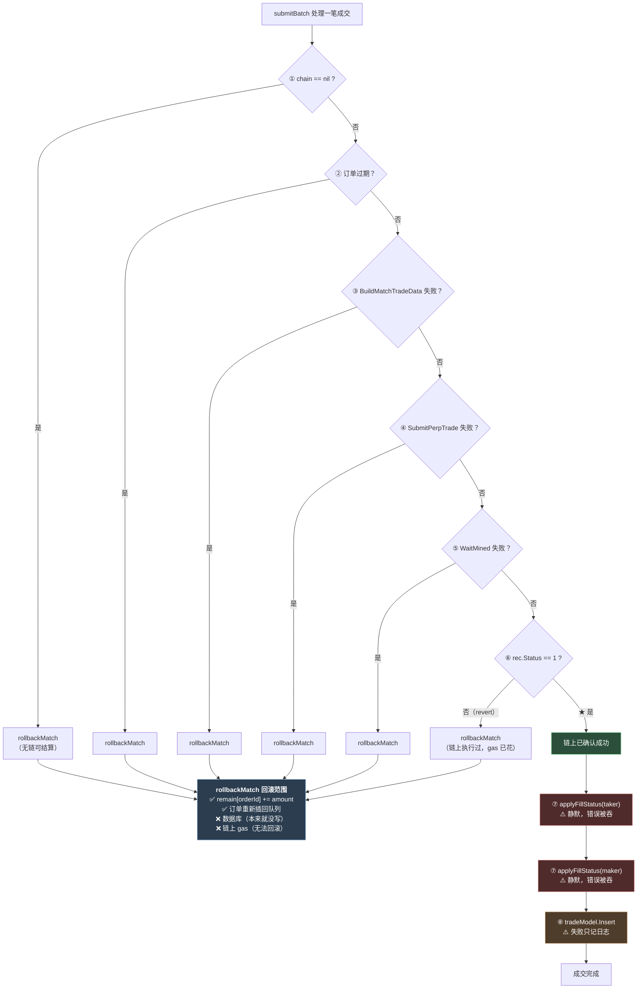
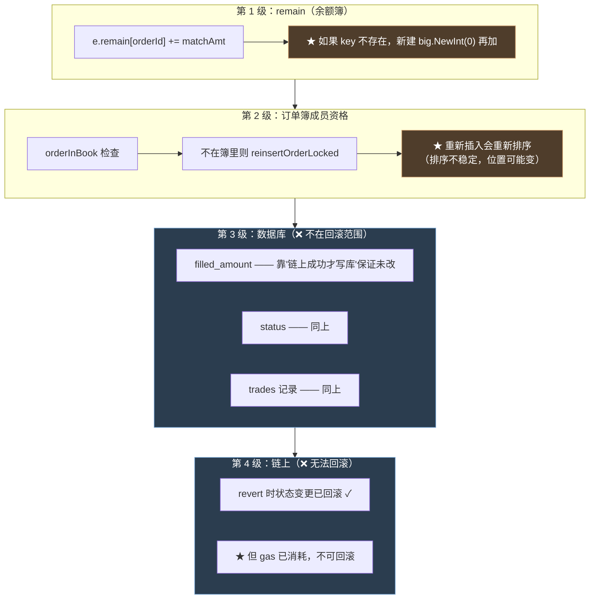
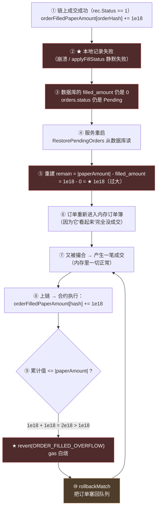

# 第 11 章：链上失败之后 — rollbackMatch 的边界，以及它没有覆盖的部分

> 第 9 章和第 10 章发现了四种"链下认为能成交、链上必定拒绝"的情况——**它们全都会走到同一个地方：`rollbackMatch`。**
>
> 这个函数只有 25 行，做的事情听起来也很简单：**"链上没成功，那就把内存里的改动撤销掉。"** 但它的**边界**在哪里，是这个项目最需要想清楚的一件事——因为它决定了：**当链上成功、而本地没记下来的那一刻，系统会怎么处理。**
>
> 本章会逐行拆开 `rollbackMatch`，明确它能做什么、不能做什么。然后我们会面对第 1 章就埋下的那个问题：**"链上成功但进程在写库前崩溃，会发生什么？"**
>
> 而答案比"数据不一致"更具体、也更严重：**它会触发第 9、10 章那种"无限重试烧 gas"的循环——而且触发条件不需要攻击者，只需要一次普通的进程崩溃。** 我在这一章实测复现了完整的链条。
>
> 这一章也是本指南里"诚实度"要求最高的一章：**本项目采用的"链上成功才写库"策略本身是**正确的**——问题不在策略，而在策略缺少了配套的一环。**

---

## 1. 本章导读

### 1.1 先看这个设计的不对称

第 1 章 3.(5) 讲过一条核心的设计原则（代码注释里也写着）：

```go
// submitBatch 对每笔撮合：编码 tradeData → Perpetual.trade → 等待收据；链上成功才更新 DB。
```

**这条原则的执行顺序是：**

```text
① 发交易
② 等确认（WaitMined）
③ 检查 rec.Status == 1
④ ★ 到这里才更新数据库
```

**所以"失败路径"上的数据库是这样的：**

```text
如果第 ①②③ 步中任意一步失败：
  ⟹ 数据库【从未被写过】（因为 ④ 还没执行）
  ⟹ ★ 所以不需要"回滚数据库"
```

**这就是 `rollbackMatch` 不回滚数据库的原因——不是遗漏，而是"数据库本来就还没动过"。**

**⚠️ 但这个推理有一个**前提**：**

```text
前提：数据库的写入是"全有或全无"的 —— 要么完全没写，要么完全写好
```

**而本章要检验的，就是这个前提在边界情况下是否成立。我们会看到它在**两处**不成立。**

### 1.2 `rollbackMatch` 回滚了什么

先把它的职责边界划出来（3.(1) 会逐行拆解）：

```text
✅ 回滚的东西（内存）：
   ① remain[orderId] —— 把成交量加回去
   ② 订单簿的成员资格 —— 把被移出队首的订单重新插入

❌ 不回滚的东西：
   ① 数据库的 filled_amount / status —— 靠"链上成功才写库"保证没被改过
   ② 数据库的 trades 记录 —— 同上
   ③ 链上已经发生的一切 —— ★ 无法回滚（交易可能已经部分执行过）
   ④ pendingTrades 里的其他成交 —— 各自独立处理
```

**⚠️ 注意最后一行的"③"** —— 它看起来是废话（链上交易 revert 了，状态应该回滚了），**但实际上不是**：

```text
一笔交易 revert 时，合约的【状态变更】都回滚了 ✓
但 ★ 这笔交易消耗的 gas 不会回滚
⟹ 所以"链上失败"永远伴随着一笔真实支出
```

**这就是第 9、10 章那些"无限重试"如此昂贵的原因——每一次循环都是一次真实支出。**

### 1.3 本章的核心问题：三个窗口

"链上成功才写库"这个策略，在"链上成功"和"写库完成"之间，**开了一个时间窗口**。本章要精确定位这个窗口，以及它被打破时的后果。

```text
┌─────────────┬──────────────────────────┬─────────────┐
│  链上还没成功 │      ★ 窗口期              │  数据库已更新 │
│  （安全：可以  │  （危险：链上已成功，      │  （安全：一致）│
│    安全回滚）  │    但本地不知道）          │             │
└─────────────┴──────────────────────────┴─────────────┘
                     ↑
              这个窗口有多宽？被打破时会发生什么？
```

**⚠️ 而这个窗口有**两处**可以被打破，而且它们**不需要同一种触发条件**：**

| 打破方式 | 触发条件 | 是否可见 |
| --- | --- | --- |
| **进程崩溃** | `SIGKILL` / OOM / 断电 | ⚠️ 可见（服务重启了） |
| **写库静默失败** | 数据库瞬时不可用 | 🔴 **完全不可见（无崩溃、无日志）** |

**第二种更危险**——**因为没有任何外部迹象。** 3.(5) 会展示 `applyFillStatus` 是如何把所有错误都吞掉的。

---

## 2. 架构 / 流程图

### 2.1 `submitBatch` 的失败路径与回滚边界



**读图要点：**

- **六条失败路径（①~⑥）全部走 `rollbackMatch`**，而且**都不需要回滚数据库**——因为数据库还没被碰过。**这个设计是自洽的 ✓**
- **关键转折在 ⑥ → SUCCESS**：一旦 `rec.Status == 1`，**链上的状态就是不可逆转的**（gas 花了、余额变了）。
- **而接下来三步（⑦⑧）全是"本地记录"，且全部是"静默失败"的**——这是本章的核心问题所在。**红色的两个 `applyFillStatus` 会把所有错误吞掉。**

### 2.2 "链上成功才写库"的完整时间线

```mermaid
%%{init: {'flowchart': {'wrappingWidth': 1000}}}%%
sequenceDiagram
    autonumber
    participant E as MatchEngine
    participant CH as 链
    participant DB as Postgres

    Note over E,DB: 【阶段一】链上执行中 —— 此阶段崩溃是安全的
    E->>CH: SubmitPerpTrade（广播交易）
    Note over CH: 交易进入内存池，等待打包
    E->>CH: WaitMined（阻塞等待，约 12 秒）
    Note over CH: 打包、执行、写入区块

    Note over E,DB: ★★ 关键时刻：链上状态从此不可逆转 ★★
    CH-->>E: rec.Status == 1（交易成功）

    Note over E,DB: 【阶段二】本地记录中 —— ★ 此阶段崩溃是危险的
    E->>DB: applyFillStatus(taker)  — 更新 filled_amount + status
    E->>DB: applyFillStatus(maker)  — 同上
    E->>DB: INSERT trades（成交记录）

    Note over E,DB: 【阶段三】一致状态
    Note over E,DB: 内存 ✓ 链上 ✓ 数据库 ✓

    rect rgb(80, 40, 40)
        Note over E,DB: ⚠️ 阶段二的窗口：链上已成功，数据库还没更新<br/>崩溃 → 链上成交了，但数据库不知道<br/>写库失败 → 同样，而且【没有任何迹象】
    end
```



**这张图揭示了本章的核心结构：**

```text
阶段一（链上执行中）：
  崩溃 → 交易可能没广播 / 可能已广播但未确认
  ⟹ 重启后：数据库里订单还是 Pending → 重新撮合 → ★ 正常（链上也没成交）

★ 阶段二（本地记录中）：
  崩溃 → 链上【已经成交】，数据库不知道
  ⟹ 重启后：数据库的 filled_amount 是陈旧的
  ⟹ ★ 后果见 2.4 —— 不是"数据不一致"这么温和

阶段三（一致）：
  无问题
```

**⚠️ 关键的不对称：阶段一的崩溃是**安全的**，阶段二的崩溃是**危险的**——而它们在代码上只隔着 4 行。**

### 2.3 `rollbackMatch` 的三级回滚范围



**⚠️ 第 3 级（数据库）"不在回滚范围"这件事，**在当前设计下是对的**——因为数据库根本没被写过。**但这个"对"是**条件性的**：它依赖于"数据库写入永远发生在链上确认之后"这个不变式。

**本章要检验的，就是**这个不变式在什么情况下会被打破**。**

### 2.4 【核心】陈旧 `filled_amount` 的完整后果链

这是本章最重要的一张图，它把第 11 章和第 12 章连起来：



**⚠️ 第 ⑦→⑩ 步是一个**闭环**——它和"订单过期"、"自成交"、"高 s 签名"是同一个模式：**

```text
链下认为可以成交 → 上链 → revert → rollbackMatch → 重新撮合 → ...
⟹ ★ 无限循环，每轮烧一笔 gas
```

**⚠️ 而触发它只需要一次普通的进程崩溃或一次数据库抖动。** 不需要攻击者。

**实测复现（第 ③⑤⑦ 步）：**

```text
【探针】链上已全额成交，但 DB 的 filled_amount=0
  重建 remain = |paper| - filled = 1000000000000000000 - 0 = 1000000000000000000
  ★ remain > 0 ⟹ 订单会【重新进入内存订单簿】

  撮合结果：pendingTrades = 1
    ★ 又产生一笔成交：taker=buy-filled-onchain maker=sell-new amount=1e18

  ⟹ 这笔成交上链时，合约执行：
       orderFilledPaperAmount[buy] += 1e18
       orderFilledPaperAmount[buy] 已经是 1e18（上次链上成功的）
       ⟹ 变成 2e18 > |paperAmount| = 1e18
       ⟹ ★ revert(ORDER_FILLED_OVERFLOW)
  ⟹ rollbackMatch 把订单塞回队列 → 下轮再撮 → 再 revert
  ⟹ ★★ 又一个「无限重试烧 gas」的循环，直到订单过期
```

**⚠️ 这个发现的意义在于：它把第 9、10 章的"烧 gas"问题从"需要攻击者主动构造"升级为"**任何一次崩溃都会触发**"。**

---

## 3. 核心代码拆解

### (1) `rollbackMatch` 全貌

```go
func (e *MatchEngine) rollbackMatch(trade *MatchResult, matchAmt *big.Int) {
	// ① 参数防御：nil 或非正数直接返回
	if trade == nil || matchAmt == nil || matchAmt.Sign() <= 0 {
		return
	}

	// ② 恢复 remain
	e.remMu.Lock()
	for _, oid := range []string{trade.TakerOrder.OrderId, trade.MakerOrder.OrderId} {
		if e.remain[oid] == nil {
			e.remain[oid] = big.NewInt(0)      // ★ key 不存在则新建
		}
		e.remain[oid].Add(e.remain[oid], matchAmt)
	}
	e.remMu.Unlock()

	// ③ 恢复订单簿成员资格
	e.mu.Lock()
	defer e.mu.Unlock()
	book, ok := e.orderBooks[trade.TakerOrder.Perp]
	if !ok {
		book = &OrderBook{Perp: trade.TakerOrder.Perp}     // ★ 连订单簿都可能不存在
		e.orderBooks[trade.TakerOrder.Perp] = book
	}
	book.mu.Lock()
	defer book.mu.Unlock()

	if !e.orderInBook(book, trade.TakerOrder.OrderId) {
		e.reinsertOrderLocked(book, trade.TakerOrder)
	}
	if !e.orderInBook(book, trade.MakerOrder.OrderId) {
		e.reinsertOrderLocked(book, trade.MakerOrder)
	}
	logx.Infof("match rolled back in memory: taker=%s maker=%s amount=%s",
		trade.TakerOrder.OrderId, trade.MakerOrder.OrderId, matchAmt.String())
}
```

**作者为什么这么设计（设计思想）：**

**设计点一：第 ① 步的参数防御是必要的，而且 `matchAmt.Sign() <= 0` 这一条很关键。**

```go
if trade == nil || matchAmt == nil || matchAmt.Sign() <= 0 {
	return
}
```

**为什么 `<= 0` 要返回？** 因为**加一个非正数到 `remain` 是没有意义的**：

```text
matchAmt == 0  → 加 0（无害，但也没意义）
matchAmt < 0   → ★ 会把 remain 减小 —— 这是灾难性的
```

**⚠️ 而 `matchAmt` 来自 `trade.MatchAmount` 字符串的解析（在 `submitBatch` 里）：**

```go
matchAmt, ok := new(big.Int).SetString(trade.MatchAmount, 10)
if !ok {
	logx.Errorf("bad match amount %s", trade.MatchAmount)
	continue                       // ★ 解析失败就跳过，不调用 rollbackMatch
}
```

**所以 `matchAmt` 一定是解析成功的正数**（因为 `matchOrderBook` 里 `matchAmount.Sign() != 0` 才产生 `MatchResult`）。**这个防御是"冗余"的，但它防的是"未来某处代码改了导致 matchAmt 变负"——这是一道便宜的保险 ✓**

**设计点二：`if e.remain[oid] == nil { e.remain[oid] = big.NewInt(0) }` 是必须的。**

**为什么 `remain` 可能不存在？** 因为订单被完全成交时会 `delete(e.remain, orderId)`（第 9 章 3.(8)）。

```text
场景：买单 3 BTC，卖单 1 BTC
  撮合后：remain[buy] = 2e18（保留）
         remain[sell] = 0 → ★ delete（key 消失）
  链上失败 → rollbackMatch：
     remain[buy] = 2e18 + 1e18 = 3e18 ✓
     remain[sell] = nil → 新建 0 + 1e18 = 1e18 ✓
```

**⚠️ 这里有一个**正确性依赖**：`rollbackMatch` 假设"被删除的订单，其剩余量恰好是 matchAmt"。**

**这个假设成立吗？** 成立——因为出队的条件是 `remain == 0`，而扣减的正是 `matchAmt`：

```text
扣减前：remain[oid] = X
扣减后：remain[oid] = X - matchAmt == 0
⟹ X == matchAmt
⟹ 恢复时加 matchAmt 恰好回到 X ✓
```

**✅ 这个推理是严密的。** 但它是**隐式的**——代码里没有任何注释说明"为什么加 matchAmt 是对的"。**如果哪天出队条件改了（比如改成 `remain <= 0`），这个恢复就会出错。**

**设计点三：第 ③ 步"连订单簿都可能不存在"这一行，暴露了一个信息。**

```go
book, ok := e.orderBooks[trade.TakerOrder.Perp]
if !ok {
	book = &OrderBook{Perp: trade.TakerOrder.Perp}     // ★ 新建订单簿
	e.orderBooks[trade.TakerOrder.Perp] = book
}
```

**什么情况下订单簿会不存在？** 只有一种：**这个市场的订单簿从来没被创建过，或者被删除了。** 而本项目**没有删除订单簿的逻辑**……

**⚠️ 所以这一行的实际作用是：给"订单簿被清空但成交还在回滚"这个场景兜底。** 而**它掩盖了一个潜在的问题**：

```text
如果订单簿不存在，说明这个市场从来没被撮合过
⟹ 那怎么会有"待回滚的成交"？
⟹ ★ 这说明"成交"和"订单簿"出现了不一致的状态
```

**⚠️ 更可能的情况是：这一行是**防御性编程**——作者不确定订单簿一定存在，就顺手加了个创建。**

**🔑 但"防御性地创建"在这里有副作用**：它会**静默地掩盖一个不该发生的情况**。**更好的写法是记录一次 Error 日志**：

```go
if !ok {
	logx.Errorf("rollbackMatch: 订单簿不存在 perp=%s，这是异常情况", trade.TakerOrder.Perp)
	book = &OrderBook{Perp: trade.TakerOrder.Perp}
	e.orderBooks[trade.TakerOrder.Perp] = book
}
```

**⚠️ 这和第 2 章 6.x 那条"静默失效最危险"是同一个主题** —— **防御性代码应该让异常可见，而不是让它消失。**

### (2) `remain` 的恢复：一个"索引还在但值被改过"的微妙情况

**考虑这个场景：**

```text
① 一次撮合：buy(3e18) × sell(1e18) → matchAmount = 1e18
   remain[buy] = 2e18（保留）
   remain[sell] = 0 → delete

② 同一批里还有一次撮合：buy(2e18) × sell2(2e18) → matchAmount = 2e18
   remain[buy] = 0 → delete
   remain[sell2] = 0 → delete

③ 现在买单的 remain key 已经不存在了（两次撮合后归零）

④ 第一笔成交链上失败 → rollbackMatch：
   remain[buy] = nil → 新建 0 → +1e18 = 1e18
   remain[sell] = nil → 新建 0 → +1e18 = 1e18

⑤ 第二笔成交也失败 → rollbackMatch：
   remain[buy] = 1e18 + 2e18 = 3e18 ✓（正确！）
   remain[sell2] = 0 + 2e18 = 2e18 ✓
```

**✅ 恢复是正确的**——因为每次 rollback 加的都是各自那笔的 `matchAmt`，累加起来正好还原。

**⚠️ 但要注意一个前提**：`rollbackMatch` 的调用顺序不影响结果 ✓（加法可交换）。

**⚠️ 而真正的问题是：**这些成交是**串行提交**的（第 10 章 3.(2)），所以不存在"两笔同时回滚"的情况。**但如果将来改成并发提交，这仍然是对的（因为 `remMu` 保护了加法的原子性）✓**

**🔑 这段分析的价值在于：它验证了 `rollbackMatch` 在"多次成交、部分失败"场景下的正确性。** 这个正确性不是显然的（需要论证"每次加 matchAmt 恰好还原"），**但它是成立的。**

### (3) `reinsertOrderLocked` —— 重新插入会改变队列位置

```go
if !e.orderInBook(book, trade.TakerOrder.OrderId) {
	e.reinsertOrderLocked(book, trade.TakerOrder)
}
if !e.orderInBook(book, trade.MakerOrder.OrderId) {
	e.reinsertOrderLocked(book, trade.MakerOrder)
}
```

**`reinsertOrderLocked` 的实现（第 8 章 3.(6) 分析过）：**

```go
func (e *MatchEngine) reinsertOrderLocked(book *OrderBook, order *model.Order) {
	paperAmount := new(big.Int)
	paperAmount.SetString(order.PaperAmount, 10)
	if paperAmount.Sign() > 0 {
		book.BuyOrders = append(book.BuyOrders, order)
		sort.Slice(book.BuyOrders, func(i, j int) bool {
			return calculatePrice(book.BuyOrders[i]).Cmp(calculatePrice(book.BuyOrders[j])) > 0
		})
	} else {
		book.SellOrders = append(book.SellOrders, order)
		sort.Slice(book.SellOrders, func(i, j int) bool {
			return calculatePrice(book.SellOrders[i]).Cmp(calculatePrice(book.SellOrders[j])) < 0
		})
	}
}
```

**⚠️ 这里的 `sort.Slice` 是**不稳定排序**（第 8 章 6.1 的发现）——所以：**

```text
原始排队：  [A, B, C, D]         ← 同价，B 早于 C 挂单
成交后回滚：删掉 B、C → 重新插入
            新队列可能是：[A, B, C, D] 或 [A, C, B, D] 或 ...
            ⟹ ★ 取决于 sort.Slice 的不稳定行为
```

**⚠️ 所以"回滚"不只是"把订单放回去"，它还可能**改变订单的排队优先级**。**

**🔑 这个副作用的经济含义（第 8 章 4.3 讨论过）：**

> **"时间优先"在本项目里没有链上强制力，完全由链下排序实现。**
> **而 `rollbackMatch` 会通过重新排序打乱它——**每一次链上失败，都是一次对"时间优先"的随机重排。
>
> ```text
> 在链上失败频繁的市场里（第 9、10 章的四种失败模式），
> ★ 同价档内的顺序会持续被"洗牌"
> ⟹ 做市商的"早挂单"优势被不断侵蚀
> ```

**⚠️ 而修法就是第 8 章 6.1 那一条**（`sort.Slice` → `sort.SliceStable`）——**它同时修复了"时间优先失效"和"回滚打乱顺序"两个问题。**

### (4) 数据库字段为什么不在回滚范围内 —— 一个条件性的正确

**回到 1.1 节那个推理：**

```text
因为"链上成功才写库"，所以失败路径上数据库从未被写过
⟹ 不需要回滚数据库 ✓
```

**⚠️ 这个推理的**前提**是"数据库的写入是全有或全无的"。** 而这个前提在**三处**可能被打破：

**打破点一：`applyFillStatus` 被调用两次，不是原子的。**

```go
e.applyFillStatus(ctx, trade.TakerOrder.OrderId, trade.TakerOrder.PaperAmount, matchAmt.String())
e.applyFillStatus(ctx, trade.MakerOrder.OrderId, trade.MakerOrder.PaperAmount, matchAmt.String())
```

```text
如果第一次成功、第二次失败（崩溃或 DB 抖动）：
  ⟹ ★ 数据库里：taker 的 filled_amount 已经更新，maker 的没有
  ⟹ 这是一个【部分更新】的中间状态 —— 不是"全有或全无"
```

**⚠️ 后果：**

```text
重启后：
  · taker 的订单：filled_amount 正确 → remain 重建正确 ✓
  · maker 的订单：filled_amount 陈旧 → ★ remain 重建过大 → 可能触发 2.4 的循环
```

**打破点二：`tradeModel.Insert` 失败只记日志。**

```go
if _, err := e.tradeModel.Insert(ctx, &model.Trade{ /* ... */ }); err != nil {
	logx.Errorf("insert trade: %v", err)      // ★ 失败只记日志，不回滚、不重试
} else {
	logx.Infof("trade settled on-chain: tx=%s perp=%s amount=%s", ...)
}
```

**⚠️ 这意味着：`trades` 表和 `orders.filled_amount` 之间可能出现不一致：**

```text
场景：applyFillStatus 两次都成功，但 tradeModel.Insert 失败
  ⟹ orders 表的 filled_amount 正确 ✓
  ⟹ trades 表缺少这条成交记录 ✗
```

**⚠️ 这个不一致相对温和**（`trades` 是展示/审计用的），**但它会让"成交记录"和"订单状态"对不上**——**用户查订单显示"已完全成交"，但查成交记录却查不到对应的一条。**

**打破点三（最严重）：`applyFillStatus` 本身会静默失败。**

**见下一节。**

**🔑 所以"数据库不需要回滚"这个结论，准确的表述应该是：**

> **"在数据库写入全部成功的前提下，失败路径上数据库从未被写过，所以不需要回滚。"**
>
> **⚠️ 而当写入**部分失败**时，数据库会处于一个"部分更新"的状态——而 `rollbackMatch` 对这种状态**没有任何处理能力**（因为它根本不知道数据库被改过）。**

### (5) 【🔴 关键】`applyFillStatus` 把所有错误都吞掉了

**这是本章最重要的代码片段，值得逐行看：**

```go
func (e *MatchEngine) applyFillStatus(ctx context.Context, orderID, signedPaper, deltaStr string) {
	// 按订单原始签名数量累计 filled；达到全额则 Status=Filled，否则 PartialFill。
	o, err := e.orderModel.FindOne(ctx, orderID)
	if err != nil || o == nil {
		return                       // ★ 这里：查询失败 / 订单不存在 → 静默返回
	}
	full := absPaperString(signedPaper)
	delta, _ := new(big.Int).SetString(deltaStr, 10)
	prev, _ := new(big.Int).SetString(o.FilledAmount, 10)
	total := new(big.Int).Add(prev, delta)
	status := model.OrderStatusPartialFill
	if total.Cmp(full) >= 0 {
		status = model.OrderStatusFilled
		total.Set(full)
	}
	_ = e.orderModel.UpdateStatus(ctx, orderID, status, total.String())
	// ★ 这里：更新失败的 error 被丢进 _
}
```

**⚠️ 这个函数有三个"静默"：**

| # | 位置 | 行为 | 后果 |
| --- | --- | --- | --- |
| 1 | `if err != nil \|\| o == nil { return }` | 查询失败 → **无日志、无返回** | 数据库不可用时，**没人知道** |
| 2 | `delta, _ := ...` / `prev, _ := ...` | 解析失败 → 得到 nil，后续 `Add(nil, ...)` 会 **panic** | ⚠️ 潜在 panic 路径 |
| 3 | `_ = e.orderModel.UpdateStatus(...)` | 更新失败 → **error 被丢弃** | ★ **链上成功了，但数据库没更新** |

**⚠️ 而且这个函数**没有返回值**：**

```go
func (e *MatchEngine) applyFillStatus(ctx context.Context, orderID, signedPaper, deltaStr string)
//                                                                                        ↑ 无返回值
```

**所以调用方**无法知道它是否成功**：**

```go
e.applyFillStatus(ctx, trade.TakerOrder.OrderId, trade.TakerOrder.PaperAmount, matchAmt.String())
e.applyFillStatus(ctx, trade.MakerOrder.OrderId, trade.MakerOrder.PaperAmount, matchAmt.String())
// 两行调用之后，代码【继续执行】，完全不知道这两次更新有没有生效
```

**🔑 这就是 1.3 节那个"窗口的第二种打破方式"：**

> **不需要崩溃，只需要一次数据库抖动——`applyFillStatus` 会静默地失败，而 `submitBatch` 会继续处理下一笔成交。**
>
> ```text
> 崩溃：        服务重启了，运维会知道
> 静默失败：    ★ 什么都不发生，只是数据库的数字不对
> ```
>
> **⚠️ 而"数据库的数字不对"的后果，就是 2.4 那条链——重启后重建出过大的 `remain`，然后无限重试烧 gas。**

**修法（三道，成本递增）：**

```go
// 修法 1（最小）：至少记录错误（让问题可见）
func (e *MatchEngine) applyFillStatus(ctx context.Context, orderID, signedPaper, deltaStr string) error {
	o, err := e.orderModel.FindOne(ctx, orderID)
	if err != nil {
		logx.Errorf("applyFillStatus: FindOne(%s) 失败: %v", orderID, err)     // ★ 记日志
		return err
	}
	if o == nil {
		logx.Errorf("applyFillStatus: 订单 %s 不存在", orderID)
		return fmt.Errorf("order %s not found", orderID)
	}
	// ... delta/prev 的解析也要检查错误 ...
	delta, ok := new(big.Int).SetString(deltaStr, 10)
	if !ok {
		return fmt.Errorf("bad delta %s", deltaStr)
	}
	prev, ok := new(big.Int).SetString(o.FilledAmount, 10)
	if !ok {
		return fmt.Errorf("bad filled_amount %s", o.FilledAmount)
	}
	// ...
	if err := e.orderModel.UpdateStatus(ctx, orderID, status, total.String()); err != nil {
		logx.Errorf("applyFillStatus: UpdateStatus(%s) 失败: %v", orderID, err)   // ★ 记日志
		return err
	}
	return nil
}

// 修法 2（更进一步）：调用方处理错误
if err := e.applyFillStatus(ctx, trade.TakerOrder.OrderId, ...); err != nil {
	logx.Errorf("taker 状态更新失败，订单 %s 需要人工核对: %v", trade.TakerOrder.OrderId, err)
	// ★ 至少把它记到一个"待对账"的队列里
}
```

**⚠️ 修法 2 引出一个更重要的问题：**失败了之后怎么办？** 重试？告警？人工介入？**

**这正好引出 3.(8) 的主题——本项目**没有任何对账机制**。**

### (6) 三个窗口的精确边界

**把 2.2 的那张时间线精确化，标注出每一步的可恢复性：**

| 时刻 | 链上状态 | 数据库状态 | 崩溃后的后果 | 可恢复吗 |
| --- | --- | --- | --- | --- |
| **T1**：`SubmitPerpTrade` 之前 | 无交易 | 未更新 | 订单还在簿里（内存丢失，重启从 DB 恢复 Pending） | ✅ 完全可恢复 |
| **T2**：交易已广播，未打包 | 内存池 | 未更新 | 交易可能被打包，也可能不 | ⚠️ 不确定 |
| **T3**：交易已打包，`WaitMined` 返回前 | ★ **已成功** | 未更新 | ★ **链上成交，DB 不知道** | ❌ 需要人工/对账 |
| **T4**：`applyFillStatus(taker)` 之后 | 已成功 | **部分更新** | ★ **taker 正确、maker 陈旧** | ❌ 需要人工/对账 |
| **T5**：两个 `applyFillStatus` 之后 | 已成功 | orders 已更新 | `trades` 表缺记录 | ⚠️ 影响较小 |
| **T6**：`tradeModel.Insert` 之后 | 已成功 | 全部一致 | 无 | — |

**⚠️ 值得注意 T2 的特殊性**：

```text
T2 时刻崩溃：
  · 交易已经广播（可能在内存池里等待打包）
  · ★ 但它【可能会被打包】—— 即使进程已经死了
  ⟹ 所以 T2 的崩溃也可能导致"链上成交，本地不知道"
  ⟹ ★ 而且这种情况下，连"我发出过这笔交易"都不知道（txHash 没记下来）
```

**⚠️ 而 T3 是最经典的窗口**——它就是第 11 章开篇那个问题的答案。

**🔑 这三个窗口（T2/T3/T4）有一个共同的补救方式：对账。** 而本项目**完全没有对账机制**（3.(8) 会验证）。

### (7) 为什么"链上成功才写库"这个策略是对的

**在讨论"缺少什么"之前，先把"已经做对的"讲清楚——因为这是本项目里最值得肯定的一个设计决策。**

**先看反面：如果"先写库、再发交易"，会怎样？**

```text
① 先写库：filled_amount += amt，status = Filled
② 发交易 → revert（比如自成交）
③ 回滚内存

⟹ 结果：★ 数据库说"成交了"，链上说"没这回事"
⟹ 而且这个不一致是【永久的】：
   · 下次重启，RestorePendingOrders 读到"已成交"的订单 → 不再恢复它
   · 用户查订单 → 显示"已成交"，但他的链上仓位是 0
   · ★ 没有任何机制能修正它（因为数据库认为自己对）
```

**而"链上成功才写库"避开了这个问题：**

```text
数据库的写入永远发生在"链上已确认"之后
⟹ 数据库要么完全没写（失败路径），要么写了就一定对应链上的真实成交
⟹ ★ "数据库里的成交记录一定在链上存在" 这个不变式【永远成立】
```

**🔑 这个不变式的价值，值得单独强调：**

> **在"链下系统 + 链上真相"的架构里，链下数据库应该永远"落后于或等于"链上，而不应该"领先于"链上。**
>
> ```text
> 数据库领先链上  → 数据库里有链上没有的成交 → ★ 永久不一致，无法自愈
> 数据库落后链上  → 链上有数据库没有的成交 → ⚠️ 可以通过【对账】补上
> ```
>
> **⚠️ 本项目选择了后者——这是**正确的方向**。**
>
> **它的问题不是"选择错了"，而是"选择了之后，没有实现配套的对账机制"。**

**🔑 用一个类比来理解这个区别（我检查过它的准确性）：**

> 这就像记账：**你应该在钱真正到账之后才记账，而不是"预计会到账就先记上"。**
>
> ```text
> 先记账后到账 → 账上多了一笔不存在的钱 → ★ 账实不符，且无法判断哪笔是假的
> 先到账后记账 → 账上少了一笔已经发生的钱 → ⚠️ 可以通过对账单找回来
> ```
>
> **本项目的选择是后者 ✓**
>
> **⚠️ 而"对账单"就是本章一直在说的"对账机制"——本项目的记账方式是对的，但它**没有对账单**，所以"少记的那笔"永远找不回来。**

### (8) 本项目没有任何对账机制（实测）

**"对账"的意思是：拿链上的真实状态，去修正链下的记录。**

**对本项目来说，可行的对账方式是：**

```text
方式 A：读链上的 orderFilledPaperAmount[orderHash]
        与数据库的 orders.filled_amount 比对

方式 B：扫链上的 OrderFilled 事件
        与数据库的 trades 表比对

方式 C：读链上的 balanceOf(trader)
        与数据库的 positions / ledger_balances 比对
```

**实测——三种都没有：**

```bash
$ grep -rn "orderFilledPaperAmount|OrderFilled" --include="*.go" internal/
（无输出）

$ grep -rn "FilterLogs|SubscribeFilterLogs" --include="*.go" internal/
internal/chain/usdc_transfer.go:38:    logs, err := c.eth.FilterLogs(ctx, q)      ← 只用于扫 USDC 转账
internal/listener/treasurydepositwatcher.go:159:  ... FilterLogs ...              ← 同上

$ grep -rn "BalanceOf" --include="*.go" internal/logic/
internal/logic/position/getpositionslogic.go:41: paper, credit, err := l.svcCtx.Chain.BalanceOf(...)
                                                          ← ★ 只用于展示，不回写数据库
```

**⚠️ 结论：**

```text
· 没有任何地方读链上的 orderFilledPaperAmount
· FilterLogs 只用于监听 USDC 转账（充值入账，第 16 章），不用于对账成交
· BalanceOf 只用于查询展示，不用于修正本地状态
```

**⟹ 所以 2.4 那条链（陈旧 filled_amount → 无限重试）**没有任何自动纠正机制**。**

**🔑 这是本项目最重要的一个架构缺口：**

> **"链上成功才写库"这个策略，**必须**配套"定期对账"才能闭环。**
>
> ```text
> 策略：链上成功才写库
>   ⟹ 保证：数据库里的成交一定在链上存在（不多）
>   ✗ 但没保证：链上的成交一定在数据库里（★ 可能少）
>
> 补上对账：
>   ⟹ 保证：链上的成交一定在数据库里（补上少的那部分）
>   ⟹ ★ 两个方向都保证了，才叫"最终一致"
> ```
>
> **⚠️ 本项目做到了"不多"，但没做"不少"。**

**修法（对账机制的设计）：**

```go
// 一个最小的对账任务
func (e *MatchEngine) reconcile(ctx context.Context, perpAddrs []string) {
	// ① 扫描链上的 OrderFilled 事件（从上次对账的区块开始）
	logs := e.chain.FilterOrderFilled(ctx, perpAddrs, fromBlock, toBlock)

	for _, log := range logs {
		orderHash := log.OrderHash
		paperChange := log.PaperChange      // 本次成交多少

		// ② 查本地订单
		o, err := e.orderModel.FindOne(ctx, orderHash.Hex())
		if err != nil || o == nil {
			logx.Errorf("对账发现本地不存在的订单: %s", orderHash)
			continue
		}

		// ③ 比对 filled_amount
		local, _ := new(big.Int).SetString(o.FilledAmount, 10)
		onChain := e.chain.OrderFilledAmount(ctx, perp, orderHash)   // 读合约的 mapping

		if local.Cmp(onChain) != 0 {
			// ④ ★ 以链上为准，修正本地
			logx.Errorf("对账修正: order=%s 本地=%s 链上=%s", orderHash.Hex(), local, onChain)
			status := model.OrderStatusPartialFill
			if onChain.Cmp(absPaper(o.PaperAmount)) >= 0 {
				status = model.OrderStatusFilled
			}
			_ = e.orderModel.UpdateStatus(ctx, orderHash.Hex(), status, onChain.String())
		}
	}

	// ⑤ 记录本次对账的区块高度（存 Redis，同第 16 章的游标模式）
}
```

**⚠️ 这个实现依赖两个合约侧的能力：**

```text
① OrderFilled 事件（合约里有：emit OrderFilled(...)）  ✓ 存在
② orderFilledPaperAmount 的 getter                  ⚠️ 需要确认
   —— 它是 state 里的一个 mapping，Solidity 会自动生成 getter
   —— 但 state 是 Types.State 结构体，需要确认访问路径
```

**⚠️ 而"以链上为准修正本地"这个动作本身也需要小心**：如果本地数据库的 `filled_amount` 比链上**大**（说明本地多记了），修正的方向应该是**减小**——**而这意味着"撤销一笔本地认为已成交的交易"，那是另一个复杂的问题。**

**🔑 好在"链上成功才写库"这个策略保证了"本地不会多于链上"** —— 所以对账只需要处理"本地少于链上"这一种情况，**修正方向是单向的（只增不减）✓**

> **⚠️ 这是"链上成功才写库"这个策略的又一个价值：它让对账变得简单（单向修正）。**
>
> **如果当初选了"先写库"，对账就需要处理两个方向，而且"本地多记了"的那种情况**无法安全修正**（因为你不知道那笔成交是该撤销还是该补上）。**

### (9) 三种"内存领先链上"的状态

**最后把 `pendingTrades` 里的状态分清楚——因为它们对应不同的可恢复性：**

| 状态 | 在哪 | 链上 | 数据库 | 崩溃后 |
| --- | --- | --- | --- | --- |
| **① 已撮合、未提交** | `pendingTrades` | 无交易 | 未更新 | ✅ 重启后重新撮合（`remain` 从 DB 重建，正确） |
| **② 已提交、未确认** | 在链上内存池或区块中 | ⚠️ 不确定 | 未更新 | ⚠️ 交易可能成功 → 落入状态 ③ 的问题 |
| **③ 已确认、未写库** | `submitBatch` 的局部变量 | ★ **已成功** | 未更新 | 🔴 **2.4 的循环** |

**⚠️ 状态 ① 的恢复是安全的**，因为：

```text
撮合 → remain 扣减（内存）
崩溃 → 内存丢失
重启 → RestorePendingOrders 从 DB 重建：remain = |paper| - filled_amount
     ⟹ DB 的 filled_amount 没变过（因为链上没成功）⟹ remain 重建正确 ✓
     ⟹ ★ 状态 ① 能自愈
```

**✅ 这解释了第 1 章 3.(5) 那个观察**（"崩溃点在内存扣减之后、发交易之前 → 重新撮合即可"）——**为什么能自愈。**

**⚠️ 而状态 ② 是最麻烦的**：

```text
交易已广播，进程崩溃 → 重启
  · 重启后 DB 显示订单 Pending → 订单重新进入撮合
  · ★ 但链上那笔交易【可能】已经被打包了
    ⟹ 如果被打包了：订单在链上已部分成交，而本地不知道 → ★ 状态 ③ 的问题
    ⟹ 如果没被打包：交易丢失，一切正常
  · ★ 而本地连 txHash 都没记下来（因为在同一个函数里，没来得及写）
```

**🔑 状态 ② 揭示了一个更深的问题：**

> **"提交交易"这个动作，本身就是一次不可靠的通信——发送方无法确定对方是否收到。**
>
> ```text
> 传统的解法（在传统分布式系统里）：两阶段提交 / 事务日志
> 区块链上的解法：★ 交易哈希是唯一的凭证 —— 但你必须先把它持久化下来
> ```
>
> **⚠️ 本项目的 `submitBatch` 里，`txHash` 只是一个局部变量**：

```go
tx, err := e.chain.SubmitPerpTrade(ctx, perp, td)
// ...
txHash := tx.Hash().Hex()              // ★ 只存在于内存里
rec, err := bind.WaitMined(ctx, e.chain.RPC(), tx)     // 阻塞 12 秒
// ... 这 12 秒里崩溃 → txHash 永久丢失
```

**⚠️ 修法（"先记账再等待"模式）：**

```go
tx, err := e.chain.SubmitPerpTrade(ctx, perp, td)
if err != nil { ... }
txHash := tx.Hash().Hex()

// ★ 立刻把"我发出了这笔交易"持久化下来（哪怕还没有结果）
_ = e.tradeModel.InsertPending(ctx, &model.PendingTx{
	TxHash: txHash, TakerOrderId: ..., MakerOrderId: ..., MatchAmount: ...,
	Status: "broadcast",     // 还没确认
})

rec, err := bind.WaitMined(ctx, e.chain.RPC(), tx)
// ...
// 确认后更新状态
```

**⟹ 这样重启后就能知道"有哪些交易是发出去了但没确认的"，然后去链上查它们的真实结果。** 这是**经典的"预写日志（Write-Ahead Log）"思路**在链上交互中的应用。

**🔑 这条经验值得记住：**

> **凡是"发出去了但结果未知"的操作，都应该在发出之前先记录"我要发了"。**
>
> ```text
> 银行转账、消息队列投递、区块链交易 —— 都有这个问题
> ★ 通用的解法：先写意图（WAL），再执行，最后写结果
> ```
>
> **⚠️ 本项目连"意图"都没记——`txHash` 一丢，就彻底不知道发生过什么了。**

---

## 4. Web3 特有机制

### 4.1 区块链的最终性 vs 应用的崩溃

**链上交易一旦被确认（进入区块并达到确认数），它就是**不可撤销的**——这一点和传统系统有本质区别。**

```text
传统数据库事务：
  提交后仍可回滚（ROLLBACK）
  管理员可以 UPDATE 任何数据
  ★ "撤销"是一个普通操作

区块链：
  交易确认后，状态变更【永久生效】
  没有管理员能"改回去"（除非有专门的治理函数）
  ★ 唯一的"撤销"方式是【再发一笔反向交易】
```

**⚠️ 这个区别对本章的主题有直接含义：**

> **在传统系统里，"数据库和真实状态不一致"可以靠"把数据库改对"来解决。**
> **在区块链上，"链下数据库和链上状态不一致"只能靠"改链下"来解决——因为链上是改不了的。**

**🔑 所以正确的方向永远是"以链上为准，修正链下"** —— 这正是 3.(8) 那个对账机制的设计原则。

**⚠️ 而这也解释了为什么"链下数据库不应该领先链上"：**

```text
如果链下数据库"领先"（有链上没有的成交）：
  ⟹ 要修正它，必须【删除】一条链下记录
  ⟹ 但"删除"是不可逆的 —— 如果删错了，无法恢复
  ⟹ ★ 而且你无法判断：这条记录是"多记的"还是"链上还没确认的"
     （在崩溃恢复的场景下，这两种情况在数据上无法区分）

如果链下数据库"落后"（链上有的没记）：
  ⟹ 要修正它，必须【补上】一条记录
  ⟹ 补上之后如果发现补错了，可以再补一次（幂等）
  ⟹ ★ 方向是安全的
```

**🔑 这是一条很实用的判断：**

> **在异步 + 不可撤销的架构里，让副本"落后"比让它"领先"安全得多。**
>
> ```text
> 落后的副本 → 可以靠"重放"追上（幂等、可重试）
> 领先的副本 → ★ 需要"撤销"，而撤销需要判断"该不该撤销"——这个判断往往是不可能的
> ```
>
> **⚠️ 本项目选择了"落后"（链上成功才写库）—— 方向是对的。缺的是"追上"的机制（对账）。**

### 4.2 `orderFilledPaperAmount` 是一个"天然的幂等屏障"

**这是本章一个值得单独指出的**正面发现**。**

**合约里这个累计计数器：**

```solidity
state.orderFilledPaperAmount[orderHash] += matchPaperAmount[i];
require(
    state.orderFilledPaperAmount[orderHash] <= int256(orderList[i].paperAmount).abs(),
    Errors.ORDER_FILLED_OVERFLOW
);
```

**⚠️ 它不只是"防止超卖"，它还是**链上的一层幂等保护**：**

```text
场景：链下认为订单还有 1e18 未成交，重试提交
     但链上其实已经成交满了

⟹ 合约：orderFilledPaperAmount += 1e18 → 超过 |paperAmount| → ★ revert
⟹ ★ 结果是"拒绝"，而不是"重复成交"
```

**✅ 所以最坏的情况是"白烧一次 gas"，而不是"用户的钱被多扣"。**

**🔑 这是链上设计的**正确姿势**：把不变量检查放在链上，让任何"越界"的操作直接失败。**

> **链上不变量（`orderFilledPaperAmount <= |paperAmount|`）是**最后一道防线**——**
> **它保证"无论链下怎么错，用户的资金都不会因为超量成交而出问题"。**
>
> **⚠️ 而代价是：每一次"链下犯错"都表现为一次 revert（烧 gas），而不是一次优雅的拒绝。**

**🔑 由此得出一个重要的架构判断：**

> **链上的不变量保护的是"正确性"，不是"可用性"。**
>
> ```text
> ✅ 它保证了：不会超卖、不会重复成交、不会出现非法仓位
> ✗ 它不保证：链下的错误不会造成损失
> ```
>
> **⚠️ 所以"链上有保护"永远不能作为"链下可以不严谨"的理由** —— 因为**链上的保护方式（revert）本身就是一种损失（gas）。**
>
> **这和第 1 章 3.(8) 讲的"链上代码的正确性 ≠ 系统的安全性"是同一个主题的延续**，只是这次的角度是"成本"而不是"功能"。

### 4.3 对账（Reconciliation）在 Web3 后端里的必要位置

**把本章的结论放到一个更大的图景里：**

```text
链下后端的三大类工作：
  ① 把外部输入搬进系统（HTTP 请求 → 订单）        —— 第 4~7 章
  ② 把系统的决策发到链上（撮合 → tradeData）       —— 第 8~10 章
  ③ ★ 把链上的真相同步回本地（对账）               —— 本项目【缺失】
```

**⚠️ 第 ③ 类工作在本项目里几乎完全缺失**：

```text
✅ 有：TreasuryDepositWatcher 扫链监听 USDC 转账（第 16 章）
     —— 但那是"链上事件 → 链下记录"的一种对账
❌ 没有：成交结果的对账
❌ 没有：订单成交量的对账
❌ 没有：用户仓位的对账
```

**🔑 为什么第 ③ 类工作容易被忽略？**

> **因为"链下主动发起的操作"，很容易让人产生"我发的，我当然知道结果"的错觉。**
>
> ```text
> 链下发起 → 链上执行 → 链下记录
>      ↑                    ↓
>      └── "我全程都在场，不需要对账" ← ★ 这个假设在崩溃时失效
> ```
>
> **⚠️ 而对"被动接收"的数据（比如用户转账充值），没人会有这个错觉** —— 所以本项目**做了** `TreasuryDepositWatcher`（因为充值确实是"我不在场"的）。
>
> **⟹ 缺的恰恰是"我以为我在场"的那部分。**

**🔑 一条可以带走的判断：**

> **凡是跨越"不可靠边界"的操作，无论方向如何，都需要对账。**
>
> ```text
> 链下 → 链上（本项目的成交提交）：★ 需要对账（本项目缺失）
> 链上 → 链下（充值入账）：        ✅ 有对账（TreasuryDepositWatcher）
> ```
>
> **"不可靠边界"的判据是：**这个操作的另一端，在我崩溃之后还能自己完成吗？****
>
> ```text
> 链上交易：★ 能 —— 我广播出去之后，即使我死了，矿工也会打包它
>          ⟹ 所以"我发出去了"和"它完成了"之间必须能对上账
> ```

### 4.4 一个反例思考：如果"先写库"会更好吗？

**为了让本章的结论更扎实，我认真考虑一下反面：**

**支持"先写库"的论证：**

```text
① 崩溃时的后果更明确：数据库里有一条"已成交"的记录
   → 重启后订单不会被重新撮合 → ★ 不会触发 2.4 那个无限重试循环
② 实现更简单：不需要考虑"链上成功了但没记下来"这种情况
```

**⚠️ 这个论证有一定的说服力**——**它确实避免了"无限重试烧 gas"这个具体问题。**

**但反对的论证更强：**

```text
① ★ 永久性不一致：数据库说成交了，链上说没有
   ⟹ 而且没有任何机制能发现和修正它（因为数据库"认为自己对"）
   ⟹ 用户会看到"我的订单成交了"，但他的链上仓位是 0

② 对账方向变成双向：需要处理"本地多记"和"本地少记"两种情况
   ⟹ 而"本地多记"的修正（删除记录）是不可逆的、危险的

③ ★ 资金安全问题的可能性：
   如果链下据此认为"用户已经有仓位了"，而链上其实没有 ——
   后续的风险计算、保证金检查全部基于错误的基础
```

**🎯 所以结论仍然是"链上成功才写库"更好** —— **但前提是配上对账。**

**🔑 这个反例思考的价值在于澄清了一个常见的误解：**

> **很多人会把"链上成功才写库"理解成"这样就不会有不一致了"——**这是错的**。**
>
> ```text
> 链上成功才写库  ⟹ 不一致只发生在【一个方向】（本地少于链上）
> 先写库          ⟹ 不一致发生在【两个方向】（本地可能多、也可能少）
>
> ★ 前者可以靠"单向补记"修复，后者需要"判断该删还是该补"——后者往往无法判断
> ```
>
> **⚠️ 所以真正的价值不是"消除了不一致"，而是"把不一致变成了可修复的形状"。**

---

## 5. 本章小结与思考题

### 5.1 核心知识点回顾

| 知识点 | 一句话总结 |
| --- | --- |
| **`rollbackMatch` 的回滚范围** | ✅ `remain` + 订单簿成员资格；❌ 数据库（本来没写）+ 链上 gas（无法回滚） |
| **`remain` 恢复的正确性** | 出队条件是 `remain == 0`，所以加回 `matchAmt` 恰好还原 ✓（但这个推理是隐式的） |
| **重新插入会打乱队列** | `reinsertOrderLocked` 用不稳定排序 → **回滚会改变"时间优先"的顺序** |
| **"链上成功才写库"是对的** | 它保证"数据库里的成交一定在链上存在"（不多），让不一致变成单向 |
| **🔴 但缺了配套的对账** | 没保证"链上的成交一定在数据库里"（可能少）→ **不一致永远无法修复** |
| **🔴 `applyFillStatus` 静默吞错** | `FindOne` 失败静默返回、`UpdateStatus` 错误丢进 `_`、**无返回值** |
| **⟹ 不需要崩溃就能出问题** | 一次数据库抖动 → 链上成功、数据库没更新 → **完全不可见** |
| **🔴 陈旧 `filled_amount` 的后果链** | 重启 → `remain` 重建过大 → 重新撮合 → **链上 `ORDER_FILLED_OVERFLOW` revert** → 无限重试烧 gas（**实测复现**） |
| **三个窗口** | T2（已广播未确认，**txHash 会丢**）、T3（已确认未写库）、T4（部分更新） |
| **状态 ① 能自愈** | "已撮合未提交"的崩溃是安全的（DB 没变过，`remain` 重建正确） |
| **`txHash` 只是局部变量** | 崩溃即丢失 → **无法事后查明"我发出过什么"** |
| **链上不变量保护正确性不保护可用性** | `orderFilledPaperAmount` 挡住超卖 ✓，但**挡的方式是 revert（烧 gas）** |
| **对账只能单向** | "以链上为准补记"是安全的；"删除本地记录"是不可逆的 |
| **本项目缺对账** | 实测：零处读 `orderFilledPaperAmount`、`FilterLogs` 只用于 USDC、`BalanceOf` 只用于展示 |
| **为什么容易漏掉对账** | 因为"链下发起的操作"让人产生"我全程在场"的错觉 |

### 5.2 思考题

#### 思考题 1：`rollbackMatch` 不回滚数据库字段（`filled_amount` / `status`）。请回答：（a）这个设计在什么前提下是正确的？（b）这个前提在哪些地方会被打破？（c）如果打破之后没有任何补救，会依次发生什么？

<details>
<summary>点击查看参考答案</summary>

**（a）正确性的前提**

**`rollbackMatch` 不回滚数据库，依赖的是这样一个推理链：**

```text
前提 1：数据库的写入 (applyFillStatus / tradeModel.Insert) 只发生在"链上确认成功之后"
       ⟹ 这个前提由 submitBatch 的代码顺序保证 ✓

前提 2：数据库的写入是"全有或全无"的
       ⟹ 要么完全没写，要么完全写好
       ⟹ ★ 这个前提【没有任何东西保证】

结论：失败路径上数据库从未被写过 ⟹ 不需要回滚 ✓
```

**⚠️ 所以真正的、唯一的前提是**前提 2** —— 而它是个**幻觉**。**

**更准确地说，"数据库不需要回滚"这个结论，需要的是这样一个组合前提：**

```text
① 写库只发生在链上成功之后            ✓ 代码顺序保证
② AND 写库是原子的（全有或全无）      ✗ ★ 不成立
③ AND 写库不会失败                    ✗ ★ 不成立
```

**而 ②③ 都不成立。**

**（b）前提在哪里被打破**

**打破点一：`applyFillStatus` 被调用两次，不是一个事务。**

```go
e.applyFillStatus(ctx, trade.TakerOrder.OrderId, ...)     // ← 第一次
e.applyFillStatus(ctx, trade.MakerOrder.OrderId, ...)     // ← 第二次
```

```text
第一次成功、第二次失败：
  ⟹ 数据库处于【部分更新】状态：
     · taker 的 filled_amount 已更新 ✓
     · maker 的 filled_amount 仍是旧值 ✗
  ⟹ ★ 不是"全有或全无"
```

**打破点二：`applyFillStatus` 内部会静默失败。**

```go
o, err := e.orderModel.FindOne(ctx, orderID)
if err != nil || o == nil {
	return                       // ★ 静默返回
}
// ...
_ = e.orderModel.UpdateStatus(ctx, orderID, status, total.String())    // ★ 错误被丢弃
```

```text
数据库瞬时不可用 → FindOne 失败 → 静默返回 → ★ 订单状态完全没更新
                → 或者 UpdateStatus 失败 → ★ 错误被丢弃

两种都【不产生任何日志、不返回任何错误】
```

**打破点三：`tradeModel.Insert` 失败只记日志。**

```go
if _, err := e.tradeModel.Insert(ctx, &model.Trade{ /* ... */ }); err != nil {
	logx.Errorf("insert trade: %v", err)      // ★ 只记日志
}
```

```text
⟹ orders.filled_amount 更新了，但 trades 表缺少记录
⟹ ★ 用户查订单显示"已成交"，查成交记录却查不到
```

**打破点四：进程崩溃。**

```text
在 applyFillStatus 执行到一半时崩溃
  ⟹ 与打破点一、二的结果相同（部分更新）
```

**⚠️ 四个打破点的共同特征：**它们都让数据库处于"部分更新"状态，而 `rollbackMatch` 对这种状态**完全无感**（它甚至不知道数据库被改过）。

**（c）打破之后的完整后果链**

**以"taker 更新成功、maker 失败"为例：**

```text
① 链上：orderFilledPaperAmount[takerHash] += amt ✓
        orderFilledPaperAmount[makerHash] += amt ✓
        （两个都真实发生了，因为在一笔交易里）

② 数据库：
   taker 的 filled_amount += amt ✓
   maker 的 filled_amount 不变  ✗

③ 进程继续运行（没有崩溃）
   ⟹ ★ 当前运行期间：内存里的 remain 是正确的（因为 rollback 没被调用，
      订单已经正常出队了）⟹ 系统看起来完全正常

④ 服务重启（可能几天后，因为一次无关的发布）
   ⟹ RestorePendingOrders 从数据库读
   ⟹ maker 的订单：filled_amount 陈旧 → remain 重建【过大】
   ⟹ ★ 它带着一个"比实际剩余量更大的 remain"重新进入订单簿

⑤ 这个订单被撮合 → 产生成交 → 上链
   ⟹ 合约：orderFilledPaperAmount[makerHash] += amt2
   ⟹ 累计值可能超过 |paperAmount| → ★ revert(ORDER_FILLED_OVERFLOW)

⑥ rollbackMatch → 把订单塞回队列 → 回到 ⑤
   ⟹ ★ 无限重试，每轮烧一笔 gas
```

**⚠️ 注意第 ③ 步的重要性**：**打破点不会立刻造成问题**——系统会"看起来正常"地运行一段时间，**直到下一次重启。**

**🔑 这是这类 bug 最难排查的地方：**

> ```text
> 触发时间（数据库抖动 / 崩溃）
>      ↓ 相隔可能几天
> 爆发时间（服务重启 → 重新撮合 → 无限重试烧 gas）
>
> ★ 排查的人会从"重启"这个时间点开始查 —— 而真正的原因在几天前
> ```

**🎯 本题的核心结论：**

> **第一，关于这个设计：**
> ```text
> "不回滚数据库" 的正确性，依赖的是一个【没有被保证的前提】：
> 数据库写入的原子性。
> ⟹ ★ 用"代码顺序"保证了"不该写的时候不写"，
>    但没保证"该写的时候一定写成"
> ```
>
> **第二，关于静默失败的危险性：**
> ```text
> 崩溃：        ★ 有外部迹象（重启日志、监控告警）→ 会有人去查
> 静默失败：    ★ 零迹象 → 没人知道，直到几天后以完全不同的形式爆发
> ```
> **⚠️ 所以 `applyFillStatus` 那三个静默点是本章最应该优先修的地方**——**不是因为它们的后果最严重，而是因为它们把"可见的问题"变成了"不可见的问题"。**
>
> **第三，一个实用的检查清单：**
>
> 对每一个"链上成功后才执行的本地写入"，问三个问题：
> ```text
> ① 这次写入失败了，我怎么知道？（有没有日志？有没有返回值？）
> ② 这次写入只成功了一半，我怎么知道？
> ③ 如果我永远不知道，后果会在什么时候、以什么形式爆发？
> ```
> **⚠️ 本项目的答案是：① 不知道；② 不知道；③ 几天后重启时，以"无限重试烧 gas"的形式。**

</details>

#### 思考题 2：本项目采用的策略是"链上成功才写库"，而 `rollbackMatch` 只回滚内存。请设计一个**对账机制**来补齐这个缺口。要求：（a）说明对账的依据（链上有什么数据可以用来比对）；（b）说明对账的方向（只增、只减、还是双向）；（c）说明如何避免对账本身引入新问题。

<details>
<summary>点击查看参考答案</summary>

**（a）对账的依据：链上有哪些可用的数据**

**需要先搞清楚"链上有哪些数据可以读"，这决定了能对账到什么粒度。**

**数据源一：`OrderFilled` 事件（事件流）**

```solidity
// src/libraries/Trading.sol → _matchOrders
emit OrderFilled(
    orderHashList[i],           // 订单哈希
    orderList[i].signer,        // 签名者
    msg.sender,                 // 撮合引擎（perp 合约地址）
    paperChange,                // 本次 paper 变化量
    creditChange - fee,         // 净 credit 变化
    serialNum,                  // 仓位序列号
    fee                         // 手续费
);
```

**⚠️ 这是**最丰富的对账数据源**：它包含了每一笔成交的订单哈希、成交量、成交额、手续费。**

```text
✅ 优点：能重建完整的 trades 表（订单哈希、数量、价格、手续费）
✅ 优点：是"事件流"，可以增量拉取（按区块范围）
⚠️ 缺点：需要链下按 orderHash 反查本地订单（本项目 orderId == orderHash ✓ 天然对得上）
```

**数据源二：`orderFilledPaperAmount[orderHash]`（状态查询）**

```solidity
// src/MetaNodeExternal.sol
state.orderFilledPaperAmount[orderHash] += matchPaperAmount[i];
```

**⚠️ 这是 `Types.State` 结构体里的一个 mapping：**

```solidity
// src/libraries/Types.sol
struct State {
    // ...
    mapping(bytes32 => int256) orderFilledPaperAmount;
    // ...
}
```

**⚠️ 关键问题：`state` 是 `public` 的，但 Solidity 的自动 getter 对**嵌套 mapping** 的支持有限：**

```solidity
Types.State public state;
// 自动生成的 getter 是 state()，它【不能】直接访问 state.orderFilledPaperAmount[hash]
// ⟹ ★ 需要合约提供一个显式的 view 函数：getOrderFilledPaperAmount(bytes32)
```

**⚠️ 如果没有这个函数，数据源二就不可用** —— **这是对账机制设计时的第一个依赖项。**

**数据源三：`Perpetual.balanceOf(trader)`（聚合状态）**

```solidity
function balanceOf(address trader) external view returns (int256 paper, int256 credit)
```

```text
✅ 优点：能对账到"用户最终仓位"这一层（最权威）
❌ 缺点：粒度太粗 —— 只能验证"最终结果对不对"，不能定位"哪一笔成交漏了"
```

**🔑 三个数据源的对比：**

| 数据源 | 粒度 | 能否增量 | 是否需要额外合约改动 |
| --- | --- | --- | --- |
| `OrderFilled` 事件 | ★ 每笔成交 | ✅ 按区块范围 | ❌ 不需要（事件已有） |
| `orderFilledPaperAmount` | 每张订单的累计量 | ❌ 全量查询 | ⚠️ **需要加 view 函数** |
| `balanceOf` | 每个交易者的仓位 | ❌ 全量查询 | ❌ 不需要 |

**⚠️ 所以**最实用的选择是数据源一（事件流）** —— 它不需要合约改动，而且是增量拉取的。**

**（b）对账的方向：**严格单向（只增）****

**这是本题最关键的判断。先分析三个方向：**

**方向 A：只增（链上有、本地没有 → 补上）**

```text
依据：Chain authoritative ⟹ 链上的一定是真的
安全性：✅ 补上之后即使重复补，也不会出错（幂等）
适用场景：本地漏记（链上成功、本地没写）
```

**方向 B：只减（本地有、链上没有 → 删掉）**

```text
依据：本地记录是错的 ⟹ 删掉
安全性：🔴 危险 —— 删除是不可逆的
问题 1：无法区分"本地多记"和"链上还没确认"
        （在崩溃恢复的场景下，这两种情况的数据形态相同）
问题 2：如果删错了，无法恢复（除非有备份）
```

**方向 C：双向（以链上为准，两个方向都修）**

```text
安全性：🔴🔴 最危险 —— 包含了方向 B 的全部问题
额外问题：一次错误的"删除 + 补上"可能造成连锁影响
```

**⚠️ 而关键的洞察是：方向 B 和 C 在本项目里**根本不需要**。**

**为什么？因为"链上成功才写库"这个策略保证了：**

```text
数据库里的成交，一定对应链上的真实成交（不多）
⟹ ★ 本地永远"不多" ⟹ 永远不需要"减"
```

**🔑 这就是 4.1 节讲的"让副本落后比领先安全"的具体体现：**

> **"链上成功才写库"这个选择，不只是"避免了一类不一致"——**
> **它更重要的是**把对账变成了单向的、幂等的、安全的操作**。**
>
> ```text
> 如果当初选"先写库"：
>   对账需要判断"这条本地记录该删还是该留" —— ★ 而这是无法判断的
> 现在选"链上成功才写库"：
>   对账只需要"把链上有、本地没有的补上" —— ★ 简单、安全、幂等
> ```

**（c）如何避免对账本身引入新问题**

**对账是一个"会修改数据"的过程，所以它自己也可能出错。逐条分析风险：**

**风险一：并发——对账和正常撮合同时修改同一张订单。**

```text
场景：
  T1：对账任务读到"链上 orderFilledPaperAmount = 1e18"
  T2：撮合引擎完成了一笔新的成交，本地 filled_amount 变成 2e18
  T3：对账任务把本地覆盖成 1e18   ← ★ 用陈旧的数据覆盖了新的
```

**⚠️ 修法：**

```text
① 对账只在"低峰期"运行（比如启动时、或每 N 小时一次）
   ⚠️ 但这不能完全避免竞态

② ★ 用"单向递增"的语义代替"覆盖"：
   UPDATE orders SET filled_amount = GREATEST(filled_amount, $new)
   ⟹ 永远只增不减 ⟹ 即使并发也不会用旧值覆盖新值 ✓

③ 记录对账的区块高度游标，避免重复处理同一区间
   （同第 16 章的扫块游标模式：Redis + DB 兜底）
```

**✅ 方案 ② 是最关键的设计** —— **它让对账天然幂等且并发安全。**

**风险二：`filled_amount` 的单位/精度不一致。**

```text
链上：orderFilledPaperAmount 是 int256，单位是最小单位（1e18 精度）
本地：orders.filled_amount 是 text，存的也是 1e18 精度的字符串
⟹ ★ 应该是一致的，但必须验证（第 2 章 4.3 讲的"精度是接口契约"）
```

**⚠️ 修法**：对账代码里显式做一次"已知答案"验证——**用一个已知的订单，比对链上和本地的值，确认口径一致后才开始批量对账。**

**风险三：对账触发"链上错误"的连锁反应。**

```text
假设对账发现本地漏记了 1e18，于是把 filled_amount 补上
⟹ 如果这个订单【还在内存订单簿里】（remain 过大），对账应该同时修正内存
   ⚠️ 但内存订单簿是撮合引擎的私有状态，对账任务能改吗？
```

**⚠️ 这是一个真正的架构问题**：**对账修正了数据库，但内存里还是错的。**

**🔑 两种解法：**

```text
解法 A（简单）：对账只在【启动时、恢复内存订单簿之前】运行
  ⟹ 顺序：启动 → ★ 先对账修正数据库 → 再 RestorePendingOrders 重建内存
  ⟹ ✅ 保证内存是从"修正后的数据库"重建的，天然一致
  ⟹ ⚠️ 但运行期间发生的不一致要等到下次重启才修

解法 B（彻底）：对账任务同时修正数据库和内存
  ⟹ 需要撮合引擎暴露一个"按订单 ID 修正 remain"的接口
  ⟹ ⚠️ 复杂度高，而且要和撮合循环的锁协调
```

**✅ 推荐解法 A** —— **它的改动最小（只是调整启动顺序），而且能覆盖"崩溃恢复"这个最主要的场景。**

```go
// main() 里的顺序调整
matchEngine := engine.NewMatchEngine(...)
// ★ 在 Start 之前先对账
if err := matchEngine.ReconcileFromChain(context.Background(), perpAddrs); err != nil {
	logx.Errorf("对账失败，继续启动（但本地数据可能不准确）: %v", err)
}
matchEngine.Start(perpAddrs)      // Start 内部会 RestorePendingOrders
```

**风险四：对账本身消耗 RPC 配额。**

```text
每次对账都要拉取区块范围的事件
⟹ 如果间隔太短、范围太大，会消耗大量 RPC 配额
⟹ ⚠️ 而且 Sepolia 的公共 RPC 通常有限流
```

**⚠️ 修法**：用游标（只拉新增的区块）+ 合理的间隔（启动时 + 每 N 小时）。

**风险五：对账发现的大量不一致应该告警，而不是静默修正。**

```text
如果对账一次性发现 1000 笔不一致
⟹ ★ 说明有系统性问题（不是偶发崩溃）
⟹ 这时候应该【告警 + 停止自动修正】，让人来判断
```

**⚠️ 修法：**

```go
if len(mismatches) > threshold {
	logx.Errorf("对账发现 %d 笔不一致，超过阈值 %d，停止自动修正，请人工介入", len(mismatches), threshold)
	// ★ 不要自动修正大量数据 —— 那可能是对账逻辑本身有问题
	return
}
```

**🎯 本题的核心结论：**

> **第一，对账的设计原则可以总结成三句话：**
> ```text
> 依据：以链上为准（链上不可篡改，链下可修正）
> 方向：★ 严格单向（只增不减）—— 这个"单向性"是"链上成功才写库"策略的直接产物
> 手段：单调递增语义（GREATEST）+ 区块游标 + 阈值告警
> ```
>
> **第二，也是本题最重要的一条：**
>
> **"链上成功才写库"这个策略的真正价值，不在于"它避免了一类不一致"，而在于"它把对账变成了可能"。**
>
> ```text
> 先写库     → 不一致是双向的 → ★ 对账需要判断"该删还是该补" → 无法判断 → 无法对账
> 后写库     → 不一致是单向的 → ★ 对账只需"把少的补上" → 幂等、安全 → 可以对账
> ```
>
> **⚠️ 所以本项目的问题不是"策略选错了"，而是"选了正确的策略，但没有把它的配套做完"。**
>
> **第三，一个务实的实施建议：**
>
> **对账机制可以分三步实现，每步都能独立产生价值：**
> ```text
> 第 1 步（成本最低）：★ 记录日志 —— 让"链上成功但写库失败"变得可见
>    · 给 applyFillStatus 加返回值 + 错误日志
>    · 这一步不修任何数据，只是让你知道问题存在
>
> 第 2 步（成本中等）：启动时对账
>    · 在 RestorePendingOrders 之前，用 OrderFilled 事件修正 filled_amount
>    · 覆盖"崩溃恢复"这个最主要的场景
>
> 第 3 步（成本较高）：定期对账 + 告警
>    · 每 N 小时跑一次，发现不一致就告警
>    · 处理"运行期间的静默失败"
> ```
> **⚠️ 而第 1 步几乎不需要设计——它只是把三个 `_ =` 和两个静默 `return` 改成有日志的错误返回。** **这是本章性价比最高的一处修改。**

</details>

---

## 6. 踩坑提示

### 🔴 严重：陈旧的 `filled_amount` 会让订单被反复提交，触发链上 `ORDER_FILLED_OVERFLOW` 无限重试

**这是第 9、10 章"烧 gas"模式的**第三种触发方式**，而且这次不需要攻击者——**一次普通崩溃或数据库抖动就够了**。**

**完整链条（前五步已实测复现）：**

```text
① 链上成交成功：orderFilledPaperAmount[orderHash] += 1e18
② ★ 本地记录失败：崩溃（T3/T4 窗口）或 applyFillStatus 静默失败
③ 数据库的 filled_amount 仍是 0
④ 服务重启 → RestorePendingOrders → remain = |paper| - 0 = 1e18（★ 过大）
⑤ 订单重新进入内存订单簿
⑥ 又被撮合 → 上链 → orderFilledPaperAmount += 1e18 → 2e18 > 1e18
   → ★ revert(ORDER_FILLED_OVERFLOW)
⑦ rollbackMatch → 塞回队列 → 回到 ⑥
   ⟹ ★ 无限重试烧 gas，直到订单过期
```

**实测证据：**

```text
【探针】链上已全额成交，但 DB 的 filled_amount=0
  重建 remain = |paper| - filled = 1000000000000000000 - 0 = 1000000000000000000
  ★ remain > 0 ⟹ 订单会【重新进入内存订单簿】

  撮合结果：pendingTrades = 1
    ★ 又产生一笔成交：taker=buy-filled-onchain maker=sell-new amount=1e18

  ⟹ 合约：orderFilledPaperAmount[buy] += 1e18
          已经是 1e18 ⟹ 变成 2e18 > |paperAmount| = 1e18
          ⟹ ★ revert(ORDER_FILLED_OVERFLOW)
  ⟹ ★★ 又一个「无限重试烧 gas」的循环
```

**修法（两步，见思考题 2 的完整设计）：**

```text
第 1 步（成本最低）：给 applyFillStatus 加返回值 + 错误日志
   —— 让"链上成功但写库失败"变得【可见】（当前是完全静默的）

第 2 步：在 RestorePendingOrders 之前做一次链上对账
   —— 用 OrderFilled 事件修正 filled_amount
   —— 修正方向严格单向（只增），用 GREATEST 语义保证并发安全
```

**🎯 这条坑的通用教训：**

> **本项目里所有的"无限重试烧 gas"，本质都是同一个结构：**
> ```text
> 链下状态出错 → 链下据此构造出一个"链上必然拒绝"的输入
>            → 无条件重试 → ★ 每轮烧一笔 gas
> ```
>
> | 触发方式 | 链上拒绝的原因 | 需要攻击者吗 |
> | --- | --- | --- |
> | 订单过期 | `ORDER_EXPIRED` | ❌（自然发生，但有 `pruneExpiredAtHead` 兜着） |
> | 自成交（第 9 章） | `ORDER_SELF_MATCH` | ⚠️ 用户可以主动触发 |
> | 高 s 签名（第 10 章） | `InvalidSignatureS` | ⚠️ 用户可以主动触发 |
> | **陈旧 filled_amount（本章）** | **`ORDER_FILLED_OVERFLOW`** | ✅ **完全不需要** |
>
> **⚠️ 最后一行意味着：这个缺陷会在**正常运行中自然发生**——只要有崩溃或数据库抖动。**

### 🔴 严重：`applyFillStatus` 静默吞掉所有错误，且无返回值

```go
func (e *MatchEngine) applyFillStatus(ctx context.Context, orderID, signedPaper, deltaStr string) {
	o, err := e.orderModel.FindOne(ctx, orderID)
	if err != nil || o == nil {
		return                       // ★ 静默返回：无日志、无返回
	}
	full := absPaperString(signedPaper)
	delta, _ := new(big.Int).SetString(deltaStr, 10)     // ★ 解析失败 → nil（后续可能 panic）
	prev, _ := new(big.Int).SetString(o.FilledAmount, 10) // ★ 同上
	total := new(big.Int).Add(prev, delta)
	status := model.OrderStatusPartialFill
	if total.Cmp(full) >= 0 {
		status = model.OrderStatusFilled
		total.Set(full)
	}
	_ = e.orderModel.UpdateStatus(ctx, orderID, status, total.String())   // ★ error 被丢弃
}
```

**三个静默点 + 一个无返回值，让"链上成功但数据库没更新"这件事**完全不可见**。**

**修法（最小改动）：**

```go
func (e *MatchEngine) applyFillStatus(ctx context.Context, orderID, signedPaper, deltaStr string) error {
	o, err := e.orderModel.FindOne(ctx, orderID)
	if err != nil {
		logx.Errorf("applyFillStatus FindOne(%s): %v", orderID, err)      // ★ 记日志
		return err
	}
	if o == nil {
		logx.Errorf("applyFillStatus: 订单 %s 不存在", orderID)
		return fmt.Errorf("order %s not found", orderID)
	}
	delta, ok := new(big.Int).SetString(deltaStr, 10)
	if !ok {
		return fmt.Errorf("bad delta %q", deltaStr)
	}
	prev, ok := new(big.Int).SetString(o.FilledAmount, 10)                 // ★ 避免 nil panic
	if !ok {
		return fmt.Errorf("bad filled_amount %q", o.FilledAmount)
	}
	// ...
	if err := e.orderModel.UpdateStatus(ctx, orderID, status, total.String()); err != nil {
		logx.Errorf("applyFillStatus UpdateStatus(%s): %v", orderID, err)  // ★ 记日志
		return err
	}
	return nil
}
```

**🎯 这条坑的通用教训：**

> **崩溃和静默失败的排查成本完全不同：**
> ```text
> 崩溃：      有重启日志、有监控告警 ⟹ ★ 有人会去查
> 静默失败：  零迹象 ⟹ ★ 没人知道，直到几天后以完全不同的形式爆发
> ```
>
> **⚠️ 所以"让问题可见"的优先级，往往高于"修问题本身"** —— 因为**不可见的问题无法被修复，只能被"发现"。**
>
> **具体的检查清单**：对每一个"吞掉 error"的地方（`_ =`、静默 `return`、只有 `logx.Infof` 没有 `Errorf`），问一句：**"如果这里失败了，我多久之后才会知道？"** **如果答案是"永远不会"，那就必须加日志。**

### 🟠 中等：`txHash` 只是局部变量，状态 ② 的崩溃无法追踪

```go
tx, err := e.chain.SubmitPerpTrade(ctx, perp, td)
if err != nil { e.rollbackMatch(...); continue }

txHash := tx.Hash().Hex()          // ★ 只存在于内存
rec, err := bind.WaitMined(ctx, e.chain.RPC(), tx)     // ★ 阻塞约 12 秒
// ... 这 12 秒里崩溃 → txHash 永久丢失 ...
```

**⚠️ 后果：**

```text
状态 ②（已广播、未确认）时崩溃：
  · 交易【可能】已经被打包（矿工不关心客户端是否还活着）
  · 重启后：数据库显示订单 Pending → 重新撮合 → 又发一笔交易
  · ★ 而本地连 txHash 都不知道 → 无法去链上查"那笔交易到底成没成"
```

**修法：预写日志（WAL）模式。**

```go
tx, err := e.chain.SubmitPerpTrade(ctx, perp, td)
if err != nil { ... }
txHash := tx.Hash().Hex()

// ★ 先持久化"我发出了这笔交易"（还没有结果）
if err := e.tradeModel.InsertPendingTx(ctx, &model.PendingTx{
	TxHash: txHash, Perp: ..., TakerOrderId: ..., MakerOrderId: ...,
	MatchAmount: ..., Status: "broadcast",
}); err != nil {
	logx.Errorf("记录待确认交易失败: %v", err)   // ★ 至少记日志
}

rec, err := bind.WaitMined(ctx, e.chain.RPC(), tx)
// ... 确认后更新状态为 confirmed/failed ...
```

**⟹ 重启后就能查到"有哪些交易是发出去了但没确认的"，然后逐个去链上查真实结果。**

**🎯 这条坑的通用教训：**

> **凡是"发出去了但结果未知"的操作，都应该在发出**之前**先记录"我要发了"。**
> ```text
> 银行转账、消息队列投递、区块链交易 —— 都有这个问题
> ★ 通用解法：先写意图（WAL），再执行，最后写结果
> ```
>
> **⚠️ 判断方法**：问一句"**如果我在这一行崩溃，重启后我还知道刚才发生了什么吗？**"**如果答案是"不知道"，那这一行之前就应该有一个持久化点。**

### 🟠 中等：`reinsertOrderLocked` 用不稳定排序，回滚会打乱"时间优先"

```go
func (e *MatchEngine) reinsertOrderLocked(book *OrderBook, order *model.Order) {
	// ...
	sort.Slice(book.BuyOrders, func(i, j int) bool { ... })     // ★ 不稳定排序
}
```

**⚠️ 后果：**

```text
原始排队：  [A, B, C, D]         ← 同价，B 早于 C 挂单
成交后回滚：删掉 B、C → 重新插入
            新队列：[A, B, C, D] 或 [A, C, B, D] 或 ...
            ⟹ ★ 取决于 sort.Slice 的不稳定行为
```

**⚠️ 而在链上失败频繁的市场里（第 9、10 章发现四种失败模式），同价档内的顺序会被**持续洗牌**。**

**修法：与第 8 章 6.1 同一处修改（`sort.Slice` → `sort.SliceStable`）。**

**⚠️ 注意要改**两处**（`addOrderWithRemain` 和 `reinsertOrderLocked`），共 4 个调用点：**

```bash
$ grep -n "sort.Slice" internal/engine/matchengine.go
205:  addOrderWithRemain   买单
212:  addOrderWithRemain   卖单
484:  reinsertOrderLocked  买单      ← ★ 回滚路径
489:  reinsertOrderLocked  卖单      ← ★ 回滚路径
595:  levelsFromMap        （map key 排序，无需改）
```

**🎯 这条坑的通用教训：**

> **"回滚"不只是"把状态放回去"，它还可能改变状态的**相对顺序**。**
>
> 当一个系统的正确性依赖某个顺序（这里是"时间优先"）时，**任何触发重排序的操作都是对它的破坏** —— 包括看起来无害的"回滚"。

### 🟡 轻微：`rollbackMatch` 新建订单簿时没有日志

```go
book, ok := e.orderBooks[trade.TakerOrder.Perp]
if !ok {
	book = &OrderBook{Perp: trade.TakerOrder.Perp}      // ★ 静默创建
	e.orderBooks[trade.TakerOrder.Perp] = book
}
```

**⚠️ "订单簿不存在"是一个**不该发生**的情况**——因为本项目没有删除订单簿的逻辑。**而这里静默地创建了一个新的，等于把这个异常掩盖了。**

**修法：**

```go
if !ok {
	logx.Errorf("rollbackMatch: 订单簿不存在 perp=%s（异常情况）", trade.TakerOrder.Perp)
	book = &OrderBook{Perp: trade.TakerOrder.Perp}
	e.orderBooks[trade.TakerOrder.Perp] = book
}
```

**🎯 这条坑的通用教训（与 6.2 同源）：**

> **防御性代码应该让异常"可见"，而不是让它"消失"。**
> ```text
> 好的防御：兜住异常 + ★ 记录它
> 坏的防御：兜住异常 + 假装没发生
> ```
> **⚠️ 后者会让"本该被发现的 bug"变成"永远发现不了的 bug"。**

### 📌 跨章节的模式总结：四种"无限重试烧 gas"的触发方式

**到这章为止，本指南已经发现了四种会触发"链下重试 → 链上 revert → 再重试"的模式。把它们放在一起看，能看清一个统一的根因：**

| # | 触发方式 | 链上拒绝的原因 | 需要主动触发吗 | 发现章节 |
| --- | --- | --- | --- | --- |
| 1 | 订单过期 | `ORDER_EXPIRED` | ❌ 自然发生 | 第 8/9 章（**有 `pruneExpiredAtHead` 兜着 ✓**） |
| 2 | 自成交 | `ORDER_SELF_MATCH` | ⚠️ 用户可主动 | 第 9 章 |
| 3 | 高 s 签名 | `InvalidSignatureS` | ⚠️ 用户可主动 | 第 10 章 |
| 4 | **陈旧 `filled_amount`** | **`ORDER_FILLED_OVERFLOW`** | ✅ **完全不需要** | **本章** |
| 5 | int128 越界 | Solidity 解码 | ⚠️ 用户可主动 | 第 7 章 |
| 6 | 零量订单 | `ORDER_PRICE_NEGATIVE` | ⚠️ 用户可主动 | 第 8 章（**但会冻结撮合，更糟**） |

**🔑 统一的根因：**

> ```text
> rollbackMatch 是【无条件、无上限、无记忆】的重试：
>   · 无条件  —— 不区分"瞬时失败"和"永久失败"
>   · 无上限  —— 同一笔成交可以重试无限次
>   · 无记忆  —— 不记得"这笔刚失败过"
>
> ⟹ ★ 任何"链下状态与链上不一致"的情况，
>    都会变成"无限循环烧 gas"
> ```

**🔑 所以最经济的一处修改是（第 9 章 6.2 提过）：**

```go
// 给 MatchResult 加失败计数
type MatchResult struct {
	// ...
	FailCount int
}

// rollbackMatch 里
trade.FailCount++
if trade.FailCount >= 3 {
	logx.Errorf("成交连续失败 %d 次，放弃并告警: taker=%s maker=%s",
		trade.FailCount, trade.TakerOrder.OrderId, trade.MakerOrder.OrderId)
	return                       // ★ 不再插回队列
}
```

**⚠️ 这一处改动**同时兜住了上表里所有 6 种情况**——而且它也是唯一能兜住"还没被发现的第 7 种情况"的机制。**

> **因为链上的规则会变、链下的实现会改、崩溃会在最意外的时候发生——**
> **你不可能枚举完所有的失败原因，所以"有上限的重试"不是可选项，而是必需的兜底。**

---

> **下一章预告**：本章讲的是"崩溃之后会怎样"。第 12 章会讲"重启之后做了什么"——`RestorePendingOrders` 如何从数据库重建内存订单簿。
>
> 而那一章会面对本章留下的一个尖锐问题：**这个重建过程完全信任数据库。但本章刚刚证明了——数据库正是那个"可能没写准"的东西。**
>
> **用一份可能不准确的数据去重建系统的运行状态，会发生什么？** 第 12 章会给出这个问题的完整答案，并且会把它和本章的发现连起来：**"陈旧 filled_amount → 过大 remain → 无限重试"这条链的第一环，正是在 `RestorePendingOrders` 里完成的。**
