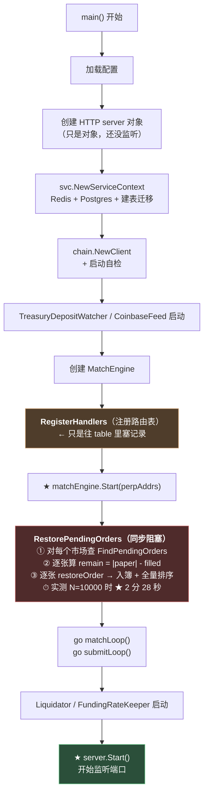
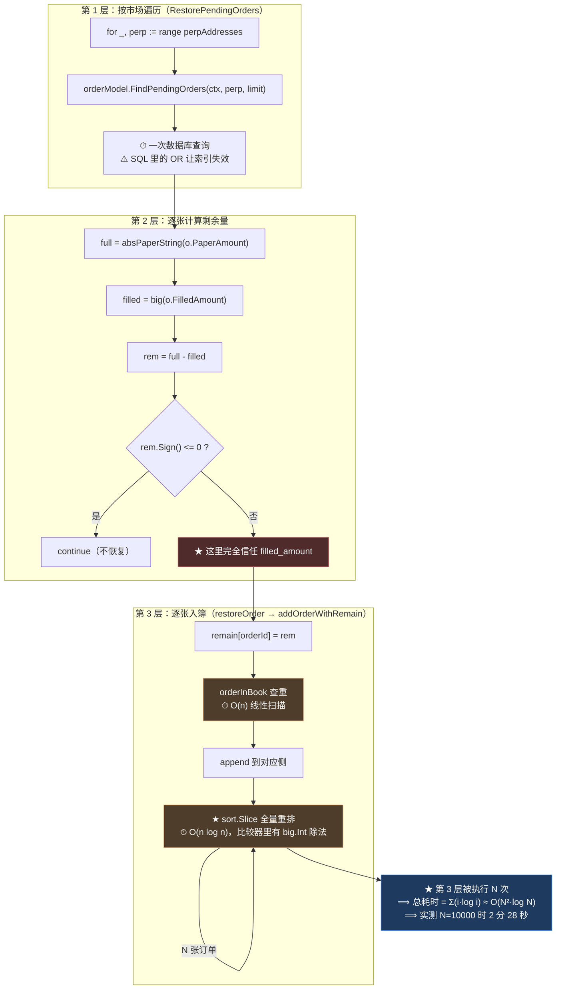
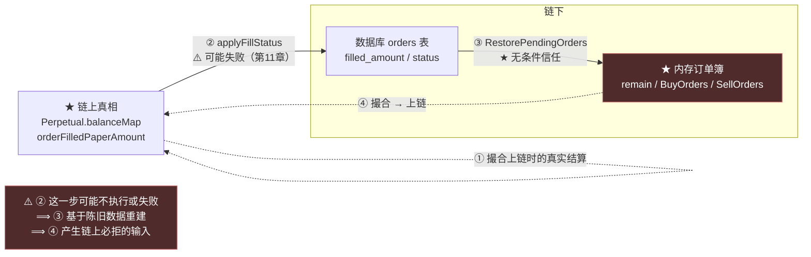

# 第 12 章：重启恢复 — RestorePendingOrders 如何从数据库重建内存簿

> 这是主线的最后一章。第 7 章下单、第 8 章入簿、第 9 章撮合、第 10 章上链、第 11 章失败回滚——**一笔订单的"一生"走到了终点。而本章要讲的是它的"来世"：服务重启之后，它怎么回到内存里继续活着。**
>
> 恢复逻辑只有 30 行（`RestorePendingOrders`），做的事情也很朴素：**从数据库读出所有"还没成交完"的订单，用 `|paperAmount| - filled_amount` 算出每张订单还剩多少，重新塞进内存订单簿。**
>
> 但这一章会面对第 11 章留下的那个尖锐问题：**这个重建过程完全信任数据库——而第 11 章刚刚证明了，数据库正是那个"可能没写准"的东西。**
>
> 而在我动手测量之后，还有一个更"物理"的发现：**恢复 N 张订单的耗时是二次增长的**——在配置的默认上限（10000）下，**实测需要 2 分 28 秒**，而这期间 HTTP 服务**根本不可用**。这一章会给出完整的数据，以及为什么这段代码会这么慢。

---

## 1. 本章导读

### 1.1 恢复要解决的问题

内存订单簿有一个根本性质（第 8 章 4.3 讨论过）：

```text
★ 它不权威、不持久、随时可以丢弃
```

**而丢弃之后的"重建"，就是本章的主题。要重建的东西有三样：**

```text
① 哪些订单还活着？      → 从数据库查 status IN (Pending, PartialFill)
② 每张订单还剩多少？    → ★ |paperAmount| - filled_amount
③ 它们分别属于哪个市场？ → 从订单的 perp 字段
```

**三个问题的答案都在数据库里。而"② 还剩多少"这个减法，是整个恢复逻辑的核心。**

### 1.2 核心公式与它的数据依赖

```go
full := absPaperString(o.PaperAmount)          // 签名时的总量
filled, _ := new(big.Int).SetString(o.FilledAmount, 10)
rem := new(big.Int).Sub(full, filled)          // ★ 剩余 = 总量 - 已成交
if rem.Sign() <= 0 {
	continue                                    // 已成交完，不恢复
}
e.restoreOrder(o, rem)
```

**⚠️ 这个公式本身是对的**——它和第 9 章 2.3 那个"`remain` 必须始终等于 `|paperAmount| - 已成交量`"的不变式完全一致。

**但它的正确性依赖两个数据源都准确：**

| 数据源 | 存在哪 | 谁维护 | 可能出错吗 |
| --- | --- | --- | --- |
| `PaperAmount` | 订单对象（数据库） | 用户签名时写入，**之后永不修改** | ❌ 不会错（签名覆盖） |
| `FilledAmount` | 数据库列 | `applyFillStatus` 在**链上确认后**累加 | ★ **会错**（第 11 章） |

**⟹ 恢复的正确性，完全押在 `filled_amount` 这一个可能不准的字段上。**

**而第 11 章已经证明了它不准的后果：**

```text
filled_amount 陈旧（偏小）
   ⟹ remain 重建【过大】
   ⟹ 订单看起来"还有更多可成交量"
   ⟹ ★ 被重新撮合 → 上链 → ORDER_FILLED_OVERFLOW revert → 无限重试烧 gas
```

**⚠️ 所以本章和第 11 章是同一条链的两端：第 11 章讲"为什么 `filled_amount` 会不准"，本章讲"这个不准的值是如何被消费的"。**

### 1.3 本章的两个发现

**发现一（🔴 实测）：恢复耗时是二次的，在配置上限下需要 2.5 分钟，期间服务不可用。**

```text
【实测】恢复 N 张订单的耗时
   N=100    24ms         236µs/张
   N=300    141ms        471µs/张      (3× 订单 → 5.9× 耗时)
   N=1000   1.488s       1.488ms/张    (10× 订单 → 62× 耗时)
   N=3000   13.384s      4.461ms/张    (30× 订单 → 558× 耗时)
   ★ N=10000  2m28s      （= etc/metanode.yaml 里 MaxPendingOrders 的默认值）

   总分配内存：TotalAlloc = 40985 MiB ≈ ★ 41 GB
```

**⚠️ 而这段时间里，HTTP 服务是**完全没有启动**的**（3.(7) 会说明为什么）。

**发现二（🟠）：恢复查询的 SQL 让索引失效。**

```go
Where("(perp = ? OR perp_address = ?) AND status IN ? AND expiration > ?", ...)
//      ↑ ★ 这个 OR 让 idx_orders_perp_status 索引用不上
```

**⚠️ 第 2 章 3.(10) 曾经表扬过这个索引**（"给启动路径上的查询加索引"）——**而本章要说明：那个索引实际上被这条 SQL 绕过了。**

---

## 2. 架构 / 流程图

### 2.1 服务启动时的完整时间线



**读图要点：**

- **橙色的 `RegisterHandlers` 只在"注册路由表"** —— 此时端口还没打开（第 3 章 3.(9) 提过）。**所以它不构成"请求到达但引擎没起来"的竞态 ✓**
- **红色的 `RestorePendingOrders` 是同步阻塞的**，而且它在 `server.Start()` **之前**。
- **⟹ 那 2 分 28 秒的恢复期间，端口根本没开，任何 HTTP 请求都会被拒绝连接（connection refused）。**

**⚠️ 这个顺序本身是**对的**（第 3 章 1.3 讲的"所有初始化必须在 `server.Start()` 之前"）——问题在于**那个初始化太慢了**。**

### 2.2 恢复逻辑的三层结构



**⚠️ 这张图揭示了性能问题的根源：第 3 层的"插入 + 全量排序"被老老实实地执行了 N 次。**

```text
第 1 张订单：排序 1 个元素
第 2 张订单：排序 2 个元素
...
第 N 张订单：排序 N 个元素

总比较次数 ≈ Σ(i × log i) ≈ (N²/2) × log N
```

**⚠️ 而每一次比较要调用两次 `calculatePrice`（含 big.Int 除法和 3 次内存分配）。**

**⟹ 实测的总分配量：41 GB。**

### 2.3 恢复的"数据信任链"



**⚠️ 这张图的核心是：恢复过程**没有任何"校验"环节**。**

```text
链条：链上真相 → 数据库副本 → 内存状态
                ↑              ↑
            可能不准        无条件信任
```

**对比一下第 16 章的 `TreasuryDepositWatcher`**（本项目唯一一个真正工作的链上监听器）：

```text
它做的事：扫链上事件 → 写入本地数据库
⟹ ★ 它的数据来源【直接是链上】，不存在"信任中间副本"的问题
```

**⚠️ 而订单恢复的链条多了一层"中间副本"（数据库），且**不加校验地信任它**。**

**🔑 这就是第 12 章的核心结论，也是本指南对"链下撮合"架构最根本的一条批评：**

> **在一个"链上是真相"的系统里，任何从链下副本重建运行状态的路径，都应该有一个"与链上核对"的环节。**
>
> ```text
> 本项目：  链上 → 数据库 → 内存        （★ 后半段无校验）
> 应有的：  链上 → 数据库 → [核对] → 内存
> ```

---

## 3. 核心代码拆解

### (1) `Start()` —— 恢复的时机

```go
// Start 启动撮合引擎；perpAddresses 用于从 DB 恢复未成交订单。
func (e *MatchEngine) Start(perpAddresses []string) {
	logx.Info("Match engine starting...")
	e.RestorePendingOrders(context.Background(), perpAddresses)   // ★ 同步阻塞
	go e.matchLoop()                                              // 异步：100ms 一轮
	go e.submitLoop()                                             // 异步：1s 一轮
}
```

**作者为什么这么设计（设计思想）：**

**✅ 第 3 章 3.(5) 分析过这个顺序的正确性**：`RestorePendingOrders` **必须是同步的**——否则撮合循环会在"订单簿还没恢复完整"的状态下开始撮合，可能产生错误的配对。

**⚠️ 但这个"正确"的选择带来了一个**没有预料到的代价****：

```text
同步恢复 ⟹ 恢复多久，就要等多久
        ⟹ 实测 N=10000 时 ★ 2 分 28 秒
        ⟹ 而 main() 里 server.Start() 在最后
        ⟹ ★ 这 2.5 分钟里，服务完全不可用
```

**🔑 这是一个很典型的工程权衡困境：**

| 选择 | 正确性 | 可用性 |
| --- | --- | --- |
| **异步恢复**（`go e.RestorePendingOrders()`) | ❌ 撮合可能基于不完整的订单簿 | ✅ 服务立刻可用 |
| **同步恢复**（本项目的选择） | ✅ 订单簿完整后才开始撮合 | ⚠️ 恢复期间服务不可用 |

**⚠️ 表面上这是"二选一"，但实际上有第三个选项：**

```text
★ 选项三：恢复期间就绪探针失败，但 HTTP 服务已经启动
   · server.Start() 提前（在恢复之前）
   · 加一个 /healthz 或 /readyz 接口，恢复完成前返回 503
   · 恢复完成后再开始撮合

⟹ 这样：
   ✅ 负载均衡/容器编排能感知"还在恢复"（返回 503 → 不导流量）
   ✅ 运维能通过接口查询"恢复到哪一步了"
   ✅ 恢复期间的请求得到明确的"服务未就绪"，而不是"连接被拒绝"
```

**⚠️ 但选项三需要"恢复期间不接受写请求"的保证**——否则撮合还没恢复完，新订单就进来了。**这需要更细致的就绪状态设计**（比如：读取接口可用，下单接口返回 503）。

**🔑 一条可以带走的经验：**

> **"同步初始化"和"异步初始化"的选择，本质上是"正确性"和"可用性"的权衡。**
> **但这个权衡有第三条路：**让服务先起来，用"就绪状态"来表达"还没准备好"。****
>
> ```text
> 传统做法：没准备好就不启动 ⟹ ★ 慢启动 = 长时间不可用
> 现代做法：先启动，用 /readyz 表达状态 ⟹ 编排系统负责等待
> ```
>
> **⚠️ 而这条路的成本是"必须实现就绪探针，且所有写接口都要检查它"** —— **这是一个架构决策，不是一行代码的改动。**

### (2) `RestorePendingOrders` 全貌

```go
// RestorePendingOrders 重启后从 DB 加载 pending / partial 订单回内存簿。
func (e *MatchEngine) RestorePendingOrders(ctx context.Context, perpAddresses []string) {
	if e.orderModel == nil {
		logx.Error("RestorePendingOrders skipped: order model nil")    // ★ 有检查 ✓
		return
	}
	limit := e.config.MaxPendingOrders
	if limit <= 0 {
		limit = 10000                                                   // ★ 兜底默认值
	}
	var restored int
	for _, perp := range perpAddresses {
		perp = strings.TrimSpace(perp)
		if perp == "" {
			continue
		}
		orders, err := e.orderModel.FindPendingOrders(ctx, perp, limit)
		if err != nil {
			logx.Errorf("RestorePendingOrders perp=%s: %v", perp, err)  // ★ 有错误处理 ✓
			continue                                                    // ⚠️ 但静默跳过这个市场
		}
		for _, o := range orders {
			full := absPaperString(o.PaperAmount)
			filled, _ := new(big.Int).SetString(o.FilledAmount, 10)
			rem := new(big.Int).Sub(full, filled)
			if rem.Sign() <= 0 {
				continue                                                 // 已成交完，不恢复
			}
			e.restoreOrder(o, rem)
			restored++
		}
	}
	if restored > 0 {
		logx.Infof("Match engine restored %d pending orders from DB", restored)
	}
}
```

**作者为什么这么设计（设计思想）：**

**✅ 设计点一：三个防御性检查都做得对。**

```text
① if e.orderModel == nil          → 记 Error 并返回（第 5 章提到的 nil 安全问题，这里做对了）
② if err != nil                   → 记 Error，跳过这个市场继续（不因一个市场失败而全盘放弃）
③ if rem.Sign() <= 0              → 已成交完的订单不恢复（避免零量订单入簿）
```

**⚠️ 特别是 ③ 值得表扬** —— **它正好挡住了第 8 章那个"零量订单冻结撮合"的 DoS 的一个入口**（虽然 `AddOrder` 那条路径没挡，见第 8 章 6.2）。

**⚠️ 但②有一个值得商榷的地方**：

```go
orders, err := e.orderModel.FindPendingOrders(ctx, perp, limit)
if err != nil {
	logx.Errorf("RestorePendingOrders perp=%s: %v", perp, err)
	continue                         // ★ 跳过这个市场，继续下一个
}
```

**"跳过这个市场"看起来是"优雅降级"，但它有一个严重后果：**

```text
这个市场的订单【全部没有恢复】到内存订单簿
⟹ 它们的 status 仍然是 Pending（数据库里）
⟹ ★ 但它们永远不在内存簿里 → 永远不会被撮合
⟹ 用户看到的是"我的订单挂着"，但它实际上已经"死"了（只是数据库不知道）
```

**⚠️ 而且这个失败**只在启动日志里出现一次**——**如果启动日志被淹没（第 3 章 6.7 提到 `main()` 里用 `fmt.Println` 而非 `logx`），很可能没人会注意到。

**🔑 修法建议：**

```go
if err != nil {
	logx.Errorf("RestorePendingOrders perp=%s 失败: %v", perp, err)
	// ★ 记下来，在恢复结束后统一判断
	failedPerps = append(failedPerps, perp)
	continue
}
// ... 循环结束后 ...
if len(failedPerps) > 0 {
	logx.Errorf("⚠️ 以下市场的订单【未被恢复】，这些市场的订单将无法撮合: %v", failedPerps)
	// ★ 更激进的做法：直接让服务启动失败（因为"部分市场不可用"是个严重状态）
}
```

**⚠️ 而"让服务启动失败"是否更好，取决于运维策略：**

```text
启动失败 → 编排系统会重启它 → 可能陷入崩溃循环（如果数据库一直不可用）
         ⟹ ★ 但至少"服务不可用"是明确的
继续启动 → 服务"看起来正常"，但部分市场的订单永远不会成交
         ⟹ ★ 这是"静默的部分故障"，更危险
```

**🔑 这和第 3 章 6.x 那条"静默失效最危险"是同一个主题** —— **"降级"必须要让外部能感知，否则它就是一个陷阱。**

**✅ 设计点二：`restored` 计数器 + 日志。**

```go
var restored int
// ...
if restored > 0 {
	logx.Infof("Match engine restored %d pending orders from DB", restored)
}
```

**⚠️ 这个日志在第 3 章 6.7 被表扬过**（"启动日志是最好的自检工具"）——**它让运维一眼看出"恢复了多少订单"。**

**⚠️ 但它缺少两个关键信息：**

```text
① 数据库里【总共有多少】待恢复的订单？（如果 restored 比预期少，说明有截断或失败）
② 是否有市场因为 limit 或错误而【被截断】？
```

**⟹ 一个更有价值的日志应该长这样：**

```text
Match engine restored 8432 pending orders from DB (查得 8432，上限 10000)
⭐ 或者在有截断时：
Match engine restored 10000 pending orders ⚠️ 达到上限，可能有更多订单未被恢复
```

**详见 3.(5)。**

### (3) `FindPendingOrders` 的 SQL —— 索引失效的细节

```go
func (m *gormOrderModel) FindPendingOrders(ctx context.Context, perp string, limit int) ([]*Order, error) {
	if limit <= 0 {
		limit = 100
	}
	var rows []orderRow
	err := m.db.WithContext(ctx).
		Where("(perp = ? OR perp_address = ?) AND status IN ? AND expiration > ?",
			perp, perp,
			[]int{OrderStatusPending, OrderStatusPartialFill},
			time.Now().Unix()).
		Order("create_time ASC").
		Limit(limit).
		Find(&rows).Error
	// ...
}
```

**作者为什么这么设计（设计思想）：**

**✅ 设计点一：`expiration > time.Now().Unix()` —— 这个条件很有价值。**

**它在**数据库层面**就过滤掉了过期订单，**所以 `RestorePendingOrders` 不需要检查过期（这也是为什么 3.(2) 的代码里没有 `orderExpired` 调用）。

**⚠️ 这个设计的好处是：**

```text
· 过期订单根本不会被读出来 → 不会占用内存 → 恢复更快
· 不会出现"恢复了一堆早已过期的订单，然后第一轮撮合全部剪掉"（那会触发大量数据库写，第 8 章 6.3）
```

**✅ 这是一个正确的优化 ✓**

**🔴 设计点二（问题所在）：`(perp = ? OR perp_address = ?)` 让索引失效。**

**先看索引定义（`internal/db/migrate.go:144`）：**

```sql
CREATE INDEX IF NOT EXISTS idx_orders_perp_status ON public.orders (perp, status)
```

**⚠️ 索引建在 `(perp, status)` 上——但查询里有 `OR perp_address = ?`：**

```sql
WHERE (perp = $1 OR perp_address = $1) AND status IN (...) AND expiration > $2
       ↑ 两列之一满足即可                    ↑ 索引的第二列
```

**⚠️ PostgreSQL 对 `OR` 的处理方式：**

```text
对于 A OR B 形式的条件，Postgres 可以：
  ① 用 BitmapOr —— 但要求【A 和 B 都能用索引】
  ② 否则退化成 Seq Scan（全表扫描）

本项目：perp 有索引 ✓，perp_address 【没有索引】 ✗
⟹ ★ Postgres 无法用 BitmapOr
⟹ ★ 整个查询退化为【全表扫描】
```

**⚠️ 而全表扫描的代价，随 orders 表的历史积累持续增长：**

```text
orders 表有 10 万行 → 每次恢复要扫 10 万行（每行都要读出来判断）
orders 表有 100 万行 → ★ 扫 100 万行
⟹ 而这个查询对【每个市场】都要执行一次
```

**🔑 这是一个很典型的"索引加了但用不上"的问题：**

> **第 2 章 3.(10) 曾经表扬过 `idx_orders_perp_status` 这个索引，说它"给启动路径上的查询加了索引"。**
> **而本章要修正那个判断：这个索引实际上被 SQL 里的 `OR perp_address` 绕过了。**
>
> ```text
> 索引：    (perp, status)          ✓ 存在
> 查询：    (perp = ? OR perp_address = ?) AND status IN (...) AND expiration > ?
> 结论：    ★ 索引用不上 → 全表扫描
> ```

**⚠️ 那为什么要写这个 `OR`？** 从 `orderRow` 的注释可以看出来：

```go
Perp        string `gorm:"column:perp;size:42;not null;index"`
PerpAddress string `gorm:"column:perp_address;size:42;not null"` // Supabase 旧表列名
```

**`perp_address` 是**Supabase 旧表的列名**——这是一个**遗留兼容**的产物。**

**⚠️ 而 `orderToRow` 显示，**新写入的行两个列都填了同一个值**：**

```go
func orderToRow(o *Order) orderRow {
	perp := o.Perp
	row := orderRow{
		// ...
		Perp:        perp,
		PerpAddress: perp,        // ★ 两列写同一个值
		// ...
	}
}
```

**⟹ 所以 `OR perp_address = ?` 只对"**很久以前写入的、只有 `perp_address` 有值的行**"有意义。**

**🔑 修法（三个方向，成本递增）：**

```sql
-- 修法 A（最小）：确认没有旧数据后，直接去掉 OR
WHERE perp = $1 AND status IN (...) AND expiration > $2
-- ⟹ 索引立刻生效 ✓

-- 修法 B：给 perp_address 也加索引，让 BitmapOr 可用
CREATE INDEX idx_orders_perp_address ON public.orders (perp_address);
-- ⚠️ 但这是"为了兼容旧数据而多维护一个索引"

-- 修法 C（最彻底）：数据迁移 —— 把 perp_address 的值搬到 perp，然后删掉旧列
UPDATE orders SET perp = perp_address WHERE perp = '' OR perp IS NULL;
ALTER TABLE orders DROP COLUMN perp_address;
-- ⟹ ★ 从根源上消除这个兼容层
```

**⚠️ 推荐修法 C** —— **因为"两列存同一个值"本身就是一种技术债**：任何写入路径都必须记得同时写两列，任何读取路径都必须记得兼容两种。

**⚠️ 而实际上 `orderToRow` 确实做了这件事（同时写两个字段）—— 但它**没有任何注释说明为什么**。**下一个读代码的人会困惑"为什么有两个 perp 列"。

### (4) 剩余量的计算与"信任链"

```go
for _, o := range orders {
	full := absPaperString(o.PaperAmount)
	filled, _ := new(big.Int).SetString(o.FilledAmount, 10)     // ⚠️ 错误被忽略
	rem := new(big.Int).Sub(full, filled)
	if rem.Sign() <= 0 {
		continue
	}
	e.restoreOrder(o, rem)
	restored++
}
```

**作者为什么这么设计（设计思想）：**

**✅ 设计点一：`absPaperString(o.PaperAmount)` —— 取绝对值，这是对的。**

```text
PaperAmount 是带符号的（正=买，负=卖）
FilledAmount 是无符号的累计量（数据库里存的都是正数）
⟹ 相减前必须取绝对值 ✓
```

**⚠️ 而且 `absPaperString` 有一个隐含的防御**：

```go
func absPaperString(paper string) *big.Int {
	z := new(big.Int)
	z.SetString(paper, 10)      // ★ 解析失败时 z 保持 0
	z.Abs(z)
	return z
}
```

**如果 `paper` 是非法的字符串，`SetString` 返回 `(nil, false)`，但 `z` 保持为 0**（因为 `SetString` 在失败时不修改接收者）。**所以会得到 `full = 0`，然后 `rem = 0 - filled < 0` → 被 `rem.Sign() <= 0` 挡住 ✓**

**⟹ 这是一个"坏数据被自然挡住"的例子 ✓**（虽然它的原因是 `SetString` 的语义，而不是刻意设计）。

**🟠 设计点二（问题）：`filled, _ := ...` 忽略了错误。**

```go
filled, _ := new(big.Int).SetString(o.FilledAmount, 10)
```

**⚠️ 如果 `o.FilledAmount` 是非法的（比如空字符串、或者"abc"）：**

```text
SetString 返回 (nil, false)
⟹ filled = nil（★ 注意：和 absPaperString 不同，这里没有先给 z 赋值，而是直接接收返回值）
⟹ rem = full.Sub(full, nil)  →  ★★ PANIC（对 nil 指针调用方法）
```

**⚠️ 等等，这个分析需要仔细。看代码：**

```go
filled, _ := new(big.Int).SetString(o.FilledAmount, 10)
```

**`new(big.Int)` 创建了一个零值对象，然后调用它的 `SetString` 方法。**

**`big.Int.SetString` 的签名是 `func (z *Int) SetString(s string, base int) (*Int, bool)`** —— **它返回的是 `z` 本身**（在成功时）。**失败时返回 `(nil, false)`。**

**所以：**

```text
成功：filled = z（非 nil）✓
失败：filled = nil ✗
⟹ rem = new(big.Int).Sub(full, nil)
⟹ Sub 内部会对 nil 解引用 → ★ PANIC
```

**⚠️ 那 `filled_amount` 可能是非法字符串吗？**

```text
· orderToRow 里有 `if row.FilledAmount == "" { row.FilledAmount = "0" }` ✓
  ⟹ 写入时空字符串会被兜成 "0"
· 但如果数据是通过【其他途径】写入的（手工 SQL、旧版本代码、数据迁移）⚠️
· 或者数据库列被改成 NULL → 读出来是空字符串 → WriteString... 
```

**⟹ 所以在正常情况下 `filled_amount` 是合法的十进制字符串（`createorderlogic.go` 里初始化为 `"0"`，`applyFillStatus` 里用 `total.String()` 写回）。**

**⚠️ 但"正常情况下不会发生"和"有防护"是两件事。** 对比一下 `absPaperString` 的写法（它天然挡住了非法输入），**这里的 `filled, _ := ...` 是一个**可以 panic 的路径**。**

**🔑 修法（一行）：**

```go
filled, ok := new(big.Int).SetString(o.FilledAmount, 10)
if !ok {
	logx.Errorf("RestorePendingOrders: 订单 %s 的 filled_amount 非法: %q", o.OrderId, o.FilledAmount)
	continue                        // ★ 跳过这张订单（而不是 panic）
}
```

**🎯 这条坑的通用教训：**

> **`big.Int.SetString` 失败时返回 `nil`——而 `new(big.Int).SetString(...)` 这种写法会让人误以为"总是有值"。**
>
> ```go
> z := new(big.Int)
> z.SetString(s, 10)          // ✓ 安全：失败时 z 保持 0
>
> z, ok := new(big.Int).SetString(s, 10)   // ✓ 正确：检查 ok
> z, _ := new(big.Int).SetString(s, 10)    // ✗ ★ 危险：失败时 z 是 nil，后续会 panic
> ```
>
> **⚠️ 本项目里两种写法都有**（`absPaperString` 用第一种，这里用第三种）——**而它们看起来非常相似。**

### (5) 达到上限时的静默截断

**`MaxPendingOrders` 的语义是"每个市场最多恢复多少张订单"：**

```go
limit := e.config.MaxPendingOrders        // 默认 10000
for _, perp := range perpAddresses {
	orders, err := e.orderModel.FindPendingOrders(ctx, perp, limit)    // ★ 每个市场各 10000
	// ...
}
```

**⚠️ 如果某个市场的待恢复订单**超过** 10000 张：**

```text
LIMIT 10000 + ORDER BY create_time ASC
⟹ 取【最早的】10000 张（按创建时间升序）

⟹ ★ 第 10001 张及之后的订单【永远不会被恢复到内存订单簿】
⟹ 它们的 status 仍然是 Pending（数据库里）
⟹ 用户看到"订单挂着"，但它已经"死"了
```

**⚠️ 而且**没有任何告警**：**

```go
if restored > 0 {
	logx.Infof("Match engine restored %d pending orders from DB", restored)
}
// ★ 没有比对"查到了多少"和"上限是多少"
```

**🔑 这是一个非常隐蔽的失效模式：**

> ```text
> 正常情况下：待恢复订单 << 10000 → 看不到这个问题
> 突发情况下：某个市场爆单 / 长期挂单堆积 → ★ 静默地丢弃超出上限的部分
> ```
>
> **⚠️ 而"丢弃"的方式是"不恢复"—— 不是拒绝、不是报错，只是"不去读它"。**

**🔑 判断方法：任何"带 LIMIT 的查询"，都要问一句"如果实际数据超过 LIMIT 会怎样？"**

```text
· 有告警（"达到上限，可能有更多"）  → ✅ 可接受
· 有分页循环（一直取到取完）        → ✅ 更好
· ★ 静默截断                        → 危险（本项目的现状）
```

**修法（两个方向）：**

```go
// 方向 A（最小）：加告警
orders, err := e.orderModel.FindPendingOrders(ctx, perp, limit)
// ...
if len(orders) >= limit {
	logx.Errorf("⚠️ perp=%s 恢复达到上限 %d，可能有更多待恢复订单未被加载！", perp, limit)
}
```

**⚠️ ⚠️ 但要注意：`len(orders) == limit` 也可能是"恰好有 limit 张"** —— **这个判断会有误报。**

**更准确的方式是让 SQL 返回总数**：

```go
// 先 count 一次
var total int64
m.db.Model(&orderRow{}).Where(...).Count(&total)
if total > int64(limit) {
	logx.Errorf("⚠️ perp=%s 有 %d 张待恢复订单，超过上限 %d，%d 张不会被加载",
		perp, total, limit, total-int64(limit))
}
```

```go
// 方向 B（更好）：分页循环，把全部订单都恢复
// 但要考虑：如果待恢复订单确实很多（比如 10 万张），恢复时间会变得不可接受
// ⟹ ★ 这时真正的问题不是"上限太小"，而是"挂了 10 万张单本身就不正常"
```

**🔑 这里有一个更根本的判断：**

> **`MaxPendingOrders` 这个配置项的存在，本身就说明"订单可能无限堆积"是一个已知风险。**
>
> ```text
> 但它【缓解】这个风险的方式是"丢弃多余的订单"—— 而不是"防止订单堆积"
> ```
>
> **🔑 更合理的设计是**双重限制**：**
> ```text
> ① 恢复上限（本项目的 MaxPendingOrders）—— 保护启动时间
> ② ★ 下单时的在架订单数上限 —— 从源头防止堆积
> ```
>
> **⚠️ 本项目只有 ①，没有 ②** —— **所以堆积会一直发生，直到恢复时被静默丢弃。**

### (6) `restoreOrder` → `addOrderWithRemain` 的成本分析

**这是 1.3 节那个实测结果的代码根源。**

```go
func (e *MatchEngine) restoreOrder(order *model.Order, remain *big.Int) {
	if remain == nil || remain.Sign() <= 0 {
		return                                   // ★ 二次防御（调用方已检查过）
	}
	e.addOrderWithRemain(order, new(big.Int).Set(remain))
}
```

**⟹ 每张订单都走一遍 `addOrderWithRemain`，而它的成本是（第 8 章 3.(2) 分析过）：**

```go
func (e *MatchEngine) addOrderWithRemain(order *model.Order, remain *big.Int) {
	e.remMu.Lock()
	e.remain[order.OrderId] = new(big.Int).Set(remain)
	e.remMu.Unlock()

	e.mu.Lock()                                       // ← 每张订单都加锁/解锁
	defer e.mu.Unlock()
	orderBook, ok := e.orderBooks[order.Perp]
	if !ok { /* 创建 */ }
	orderBook.mu.Lock()
	defer orderBook.mu.Unlock()

	if e.orderInBook(orderBook, order.OrderId) {      // ★ ① O(n) 线性扫描
		return
	}
	// ...
	orderBook.BuyOrders = append(orderBook.BuyOrders, order)
	sort.Slice(orderBook.BuyOrders, func(i, j int) bool {     // ★ ② O(n log n) 全量排序
		// ★ ③ 比较器里两次 calculatePrice（big.Int 除法 + 3 次分配）
		return calculatePrice(...).Cmp(calculatePrice(...)) > 0
	})
}
```

**三个成本叠加：**

| # | 成本 | 每张订单的代价 | N 张的总代价 |
| --- | --- | --- | --- |
| ① | `orderInBook` 查重 | O(n) 线性扫描 | O(N²) |
| ② | `sort.Slice` 全量排序 | O(n log n) 比较 | O(N² log N) |
| ③ | 比较器里的 `calculatePrice` | 每次比较 2 次调用，每次 3 次分配 + 1 次除法 | 同 ②，常数很大 |

**实测（重复一遍 1.3 的数据）：**

```text
N=100    24ms
N=300    141ms        (3× 订单 → 5.9× 耗时)     ← 接近二次
N=1000   1.488s       (10× 订单 → 62× 耗时)     ← 二次
N=3000   13.384s      (30× 订单 → 558× 耗时)    ← 二次
N=10000  2m28s                                    ← 二次的外推被实测证实
```

**⚠️ 而从 N=1000 到 N=3000，订单数增长 3 倍、耗时增长 9 倍——**恰好是二次关系**（3² = 9）。**

**⚠️ 内存分配：`TotalAlloc = 40985 MiB ≈ 41 GB`** —— **这是 N=10000 那一次运行中累计分配的字节数。**

**🔑 这个 41 GB 的数字很有说明力：**

> ```text
> 排序 10000 张订单，分配了 41 GB 内存
> ⟹ 平均每张订单分配 4 MB
> ⟹ 而每张订单的实际数据只有几百字节
> ```
>
> **⚠️ 这个 10000 倍的比例，就是"在比较器里做重计算"的代价。**

**修法（按性价比排序）：**

```text
★ 修法 1（成本最低、收益最大）：恢复时不要逐张排序
   ⟹ 先全部 append 到切片（不打乱），最后【排序一次】
   ⟹ 把 O(N² log N) 降到 O(N log N)
   ⟹ 预期收益：N=10000 时从 2.5 分钟降到 ★ 约 0.3 秒（提升 ~500 倍）

修法 2：把 1e18 提成常量（第 8 章 6.6）—— 消除每次 calculatePrice 的一次 Exp

修法 3：入簿时缓存价格（第 8 章 3.(3) 的方案）
   ⟹ 比较器里只做 big.Int.Cmp，无分配无除法

修法 4：用二分查找插入替代全量排序（第 8 章 3.(3) 方案 C）
```

**⚠️ 修法 1 的具体实现：**

```go
func (e *MatchEngine) RestorePendingOrders(ctx context.Context, perpAddresses []string) {
	// ... 收集订单 ...
	for _, perp := range perpAddresses {
		orders, err := e.orderModel.FindPendingOrders(ctx, perp, limit)
		// ...
		book := e.getOrCreateBook(perp)       // 拿到订单簿

		book.mu.Lock()
		for _, o := range orders {
			// ... 算 remain ...
			// ★ 只 append，不排序（也不查重 —— 因为订单簿此时是空的）
			if paperSign > 0 {
				book.BuyOrders = append(book.BuyOrders, o)
			} else {
				book.SellOrders = append(book.SellOrders, o)
			}
			e.remain[o.OrderId] = rem
		}
		// ★ 循环结束后，每侧各排序一次
		sortOrders(book.BuyOrders, true)
		sortOrders(book.SellOrders, false)
		book.mu.Unlock()
	}
}
```

**⚠️ 注意这个改法还能**顺带省掉 `orderInBook` 的查重** —— 因为恢复时订单簿是新建的（空的），不可能有重复。**这消除了 O(N²) 的那一项。

**⚠️ 但前提是"恢复时订单簿一定是空的"** —— **这需要保证 `RestorePendingOrders` 只在启动时调用。** 当前它确实是（`Start()` 里唯一一次调用）✓**，但这个前提没有写在任何地方。**

**🔑 一条可以带走的经验：**

> **"逐条插入 + 每次全量排序"是一个很常见的反模式**，因为它把一次 O(N log N) 的排序变成了 O(N² log N)。
>
> ```text
> 反模式：  for x in items { 插入(x); 排序() }        ⟹ O(N² log N)
> 正确：    for x in items { 插入(x) }; 排序()        ⟹ O(N log N)
> ```
>
> **⚠️ 而这个反模式在**在线**场景（订单实时到达）下是**不可避免的**（因为每次都要维持有序）。**
>
> **⟹ 但在**批量恢复**场景下，它完全可以避免——因为我们可以"先全部放进去，最后排一次"。**
>
> **🔑 判断方法：看到"循环里排序"，先问一句"这些数据是一次性来的，还是陆续来的？"** **一次性来的就可以批量化。**

### (7) 恢复期间 HTTP 真的不可用吗——精确确认

**1.3 节的实测说"2 分 28 秒"，然后我说"这段时间 HTTP 不可用"。这个论断需要精确验证。**

**看 `main()` 里的顺序：**

```go
	handler.RegisterHandlers(server, ctx)         // 第 75 行
	market.RegisterTickerWebSocket(server, ctx)   // 第 76 行

	perpAddrs := ...
	matchEngine.Start(perpAddrs)                  // 第 82 行 ← ★ 恢复在这里，阻塞 2.5 分钟
	defer matchEngine.Stop()

	liquidator := engine.NewLiquidator(...)       // 第 86 行
	// ...
	fundingKeeper := engine.NewFundingRateKeeper(...)

	fmt.Printf("Starting server at %s:%d...\n", c.Host, c.Port)    // 第 95 行
	server.Start()                                 // 第 96 行 ← ★ 端口在这里才打开
```

**关键问题：`handler.RegisterHandlers` 会不会让端口提前开始监听？**

**答案：不会。** go-zero 的 `rest.Server` 里，`AddRoutes` 只是往一个内部路由表里追加记录；**真正的监听发生在 `server.Start()` 里**（调用 `http.Server.ListenAndServe`）。

**⟹ 所以：**

```text
第 82 行（恢复开始）到第 96 行（server.Start）之间：
  · 端口【没有打开】
  · 任何 HTTP 请求得到的是 ★ TCP 层的 "connection refused"
  · 不是 503、不是超时 —— 是"这个端口上没有服务"
```

**⚠️ 对运维的含义：**

```text
· 负载均衡/容器编排看到的是"连接被拒绝" → 通常判定为"服务挂了" → ★ 可能触发重启
· 如果重启，服务又会重新走一遍 2.5 分钟的恢复
· ⟹ ★ 可能陷入"启动 → 被判定失败 → 重启 → 启动..."的循环
```

**⚠️ 这个风险在 Kubernetes 这样的编排系统里是真实的** —— **`livenessProbe` 的 `initialDelaySeconds` 如果小于恢复时间，容器会被反复杀掉。**

**🔑 所以 3.(1) 那个"第三个选项"（先启动 + 就绪探针）的价值在这里更清楚了：**

> **它不只是"让运维能看到进度"，更是"避免编排系统误判服务已死"。**
>
> ```text
> 当前：端口不开 → 编排系统认为"服务没起来" → ★ 可能反复重启
> 改进：端口开 + /readyz 返回 503 → 编排系统知道"在启动中，别杀我" ✓
> ```

### (8) 恢复之后：内存状态与数据库状态的一致性

**恢复完成后，系统的状态是：**

```text
内存订单簿：包含所有 status IN (Pending, PartialFill) 且未过期 的订单
           remain = |paper| - filled_amount（每张）
数据库：    同上（从未被修改过）
链上：      ★ 与数据库可能不一致（第 11 章）
```

**⚠️ 注意恢复过程**不修改数据库**——它只读。**

```go
orders, err := e.orderModel.FindPendingOrders(ctx, perp, limit)     // 只读
// ... 没有 UpdateStatus、没有 Insert ...
```

**✅ 这个"只读恢复"是**正确的设计**** —— **它避免了"恢复过程本身引入新的不一致"。**

**⚠️ 但它的代价是：如果数据库是错的（第 11 章那个陈旧的 `filled_amount`），恢复**会忠实地把这个错误带进内存**。**

**🔑 这就是本章最核心的那句话的具体含义：**

> **恢复过程是"零校验"的——它把数据库当作绝对真相，而数据库可能不是。**
>
> ```text
> 内存状态 = f(数据库状态)          ← 本项目
> 内存状态 = f(校验(数据库, 链上))   ← 应该的样子
> ```

**⚠️ 而第 11 章思考题 2 已经给出了修法的设计**：

```text
在 RestorePendingOrders 之前，先用链上的 OrderFilled 事件修正 filled_amount
⟹ 这样重建出来的 remain 才是准的
```

**🔑 而实现这个修法的**位置**很关键：**

```go
// main() 里的顺序
matchEngine := engine.NewMatchEngine(...)
ctx.MatchEngine = matchEngine
ctx.OrderBook = matchEngine
handler.RegisterHandlers(server, ctx)

// ★ 在这里，Start 之前，先对账
if err := matchEngine.ReconcileFromChain(ctx, perpAddrs); err != nil {
	logx.Errorf("对账失败: %v（继续启动，但订单状态可能不准）", err)
}

matchEngine.Start(perpAddrs)      // Start 内部会 RestorePendingOrders
```

**⟹ 顺序必须是"先对账 → 再恢复"，因为恢复会**读取** `filled_amount`。**

**🔑 一条可以带走的经验：**

> **凡是"从副本重建状态"的过程，都要问一句："这个副本是怎么来的？它可靠吗？"**
>
> ```text
> 副本的来源可靠（比如直接从链上扫的）→ 可以直接用
> ★ 副本的来源【经过了一次可能失败的写入】→ 必须先校验
> ```
>
> **⚠️ 本项目的情况正是第二种** —— **数据库是"链上 → `applyFillStatus` → 数据库"这个链条的产物，而中间那一步会失败（第 11 章 3.(5)）。**

---

## 4. Web3 特有机制

### 4.1 为什么"重启恢复"在 Web3 后端里比普通后端更棘手

**普通后端的重启恢复通常是这样的：**

```text
进程重启 → 从数据库/缓存重新加载 → 继续服务
⟹ 前提：数据库是【权威】的，它没有被"另一个更权威的东西"挑战
```

**而 Web3 后端多了一层：**

```text
★ 链上有一个【比数据库更权威】的真相源
⟹ 而数据库只是它的一个【可能过期的副本】
⟹ 从数据库恢复 = 从"可能过期的副本"恢复
```

**⚠️ 这个差异带来的三个具体后果：**

| # | 普通后端 | Web3 后端 |
| --- | --- | --- |
| 1 | 数据库是权威 → 恢复就是"读权威" | ★ 数据库是副本 → 恢复是"读副本"，可能与权威不一致 |
| 2 | 不一致了可以改数据库 | ★ 不一致了**只能改数据库**（链上改不了） |
| 3 | 崩溃后"我知道的"和"实际发生的"最多差一个事务 | ★ **可能差很多笔已确认的链上交易** |

**⚠️ 第 3 点特别值得展开：**

```text
普通后端：
  崩溃 → 未提交的事务回滚 → ★ 最多丢"最后一次操作"
  ⟹ 而且数据库的 ACID 保证"要么全做，要么全不做"

Web3 后端：
  崩溃 → ★ "链上已确认、本地未记录"的成交【不会回滚】
  ⟹ 因为链上不知道你崩溃了，它会照常完成
  ⟹ 而且可能不止一笔（如果提交是批量的，或者崩溃发生在恢复期间）
```

**🔑 所以"恢复"在 Web3 后端里的准确含义是：**

> **不只是"把内存状态重建起来"，更是"把本地认知**对齐**到链上的真实状态"。**
>
> ```text
> 普通后端的恢复：重建内存状态           （数据源权威，无需校验）
> ★ Web3 后端的恢复：★ 对齐 + 重建      （数据源是副本，需要校验）
> ```
>
> **⚠️ 本项目做了"重建"，没做"对齐"** —— **这是本章和整个指南的核心结论。**

### 4.2 数据库在 Web3 后端里的准确定位

**把本项目里的三个数据源排一下权威性：**

| 数据源 | 权威性 | 可修改性 | 崩溃后的可靠性 |
| --- | --- | --- | --- |
| **链上** | ★ 最高（资产在这里） | ❌ 不可改（只能发反向交易） | ✅ 不受本地崩溃影响 |
| **数据库** | 中间（链下的记录） | ✅ 可改（这正是对账的基础） | ⚠️ 可能滞后于链上 |
| **内存** | 最低（工作区） | ✅ 随时可丢 | ❌ 崩溃即全部丢失 |

**⚠️ 从这张表能推出一个重要的设计原则：**

> **内存应该永远从"数据库"重建（因为它是持久化的），**
> **而数据库应该定期从"链上"校验（因为链上是权威的）。**
>
> ```text
> 内存 ← 数据库      ← 本项目实现了 ✅
> 数据库 ← 链上      ← ★ 本项目【完全没有】
> ```

**🔑 而第 16 章的 `TreasuryDepositWatcher` 恰好实现了反向的那一半：**

```text
链上事件 → 数据库     ← ✅ 有（充值入账）
```

**⚠️ 所以本项目的"链上与数据库的同步"是**单向且不完整**的：**

```text
✅ 链上 → 数据库：只覆盖"用户转账充值"这一类事件
❌ 链上 → 数据库：不覆盖"成交"、"清算"、"资金费率结算"
```

**🔑 为什么只做了充值那一类？** 第 11 章 4.3 分析过：

> **因为充值"我不在场"（用户直接往收款地址转账），所以很自然地被识别为"需要监听链上"。**
> **而成交是"我发起的"，容易产生"我全程都在场"的错觉——所以没有被识别为"需要监听链上"。**
>
> **⚠️ 而这个错觉在崩溃时失效。**

### 4.3 幂等恢复：为什么"恢复"这个动作必须是幂等的

**"恢复"可能被触发多次：**

```text
· 服务重启（正常发布）
· 服务崩溃后自动重启（编排系统）
· 恢复过程中又崩溃 → 再次重启
· 运维手工重启
```

**⟹ 所以恢复逻辑必须是**幂等**的：执行一次和执行 N 次，结果相同。**

**⚠️ 本项目的恢复是幂等的吗？我们逐条检查：**

| 动作 | 幂等吗 | 说明 |
| --- | --- | --- |
| `FindPendingOrders`（读） | ✅ 是 | 只读 |
| 计算 `remain = |paper| - filled` | ✅ 是 | 纯计算，无副作用 |
| `e.remain[orderId] = rem` | ✅ 是 | 覆盖写（不是累加） |
| `orderBook.BuyOrders = append(...)` | ⚠️ **取决于调用次数** | ★ 见下 |
| `orderInBook` 查重 | ✅ 挡住了重复 | 这是查重存在的原因 |

**⚠️ 关键在第 4 行**：`append` 本身不幂等，**但 `orderInBook` 的查重挡住了它**：

```go
if e.orderInBook(orderBook, order.OrderId) {
	return                     // ★ 已经在簿里就不重复添加
}
```

**⟹ 所以"恢复"在**进程内**是幂等的 ✓**（重复调用 `RestorePendingOrders` 不会造成重复入簿）。

**⚠️ 但跨进程呢？**

```text
进程 A 恢复 → 崩溃
进程 B 启动 → 恢复（数据库没变过）
⟹ 结果相同 ✓（因为内存是从同一个数据库重建的）
```

**✅ 所以恢复是幂等的 ✓**

**🔑 而这引出一个重要的观察：**

> **`orderInBook` 那个 O(n) 查重的真正价值，正是"保证恢复的幂等性"。**
>
> **⚠️ 第 8 章 3.(7) 我曾经困惑"为什么需要这个检查"（因为 `CreateOrder` 已经有防重放了）——**现在答案清楚了：
> ```text
> CreateOrder 的 FindOne 防的是"用户重复提交同一张订单"
> ★ orderInBook 防的是"恢复过程重复添加同一张订单"
> ⟹ 两者防的是完全不同的场景
> ```

**⚠️ 但这也意味着**修法 1（"先全部 append 再排序一次"）需要小心：

```text
如果去掉 orderInBook 查重，就必须保证"恢复时订单簿一定是空的"
⟹ 当前成立（RestorePendingOrders 只在启动时调用一次）✓
⟹ ★ 但如果将来有人加了"运行时重新恢复"的功能，就会出问题
```

**🔑 所以修法 1 应该保留一个更廉价的查重**（比如用一个 `map[orderId]bool` 记录本次恢复已添加的订单），**而不是完全依赖"订单簿是空的"这个前提。**

### 4.4 启动日志是"恢复"这件事的唯一外在表现

**恢复过程对外的可见性，只有两行日志：**

```go
logx.Info("Match engine starting...")
// ... 2.5 分钟的沉默 ...
logx.Infof("Match engine restored %d pending orders from DB", restored)
```

**⚠️ 中间那 2.5 分钟**没有任何输出** —— 而这段时间里：**

```text
· 运维/编排系统看到的是"服务在启动中"
· ★ 无法区分"正在恢复 10000 张订单"和"卡死了"
· 如果恢复时间超过编排系统的容忍度 → ★ 被判定为失败 → 重启 → 重新开始
```

**🔑 第 3 章 6.7 曾经表扬过本项目的启动日志**（"启动日志是最好的自检工具"）——**而本章要指出它在这一个环节上的缺失：**

> **对于"耗时可能很长"的启动步骤，日志应该是**渐进**的，而不只是"开始"和"结束"。**
>
> ```text
> ✗ 当前：  "Match engine starting..."  →  (2.5 分钟沉默)  →  "restored 8432"
> ✓ 更好：  "Match engine starting..."  →  每 1000 张打一行进度  →  "restored 8432"
>
> ✗ 当前：  恢复失败时只有一行 perp=xxx 的 error
> ✓ 更好：  恢复结束后汇总"哪些市场失败了"
> ```

**⚠️ 而"进度日志"的成本极低**（一个每 N 条打一次的计数器），**收益是"运维知道它还活着"。**

**🔑 一条可以带走的经验：**

> **任何"可能耗时超过几秒"的启动步骤，都应该有进度输出。**
>
> **因为"慢"和"卡死"在没有输出时**无法区分** —— 而它们的处理方式完全不同：**
> ```text
> 慢     → 等待（或调大超时）
> 卡死   → ★ 重启（或排查）
> ```
>
> **⚠️ 判断方法：问一句"如果这一步卡住了，我多久能发现？"** **如果答案是"直到超时才被发现"，那就该加进度日志。**

---

## 5. 本章小结与思考题

### 5.1 核心知识点回顾

| 知识点 | 一句话总结 |
| --- | --- |
| **恢复要重建的三样东西** | 哪些订单还活着（`status IN (Pending, PartialFill)`）、还剩多少（`|paper| - filled`）、属于哪个市场（`perp`） |
| **核心公式** | `remain = absPaperString(PaperAmount) - FilledAmount`，与第 9 章的不变式一致 ✓ |
| **数据信任链** | 链上真相 → 数据库副本（**可能不准**）→ 内存状态（**零校验**） |
| **同步恢复的必要性** | 异步会导致"订单簿不完整时就开始撮合" → 可能产生错误配对（第 3 章 3.(5)） |
| **🔴 恢复耗时是二次的** | 实测：N=1000→1.5s、N=3000→13.4s（3× 订单 → 9× 耗时）、**N=10000→2m28s** |
| **🔴 期间 HTTP 完全不可用** | 恢复在 `server.Start()` 之前 → 端口未打开 → **connection refused**（不是 503） |
| **🔴 41 GB 分配** | 排序 10000 张订单分配了 41 GB（"比较器里做重计算"的代价，第 8 章 3.(3)） |
| **二次的根源** | 逐张 `addOrderWithRemain` → 每张都做 O(n) 查重 + O(n log n) 全量排序 |
| **🟠 SQL 的 `OR perp_address` 让索引失效** | `idx_orders_perp_status` 建在 `(perp, status)`，但 `OR` 让 Postgres 退化为全表扫描 |
| **🟠 达到上限时静默截断** | `LIMIT MaxPendingOrders`，超出部分**永远不恢复**，且**无告警** |
| **✅ 恢复只读，不写数据库** | 正确的设计——避免"恢复过程本身引入不一致" |
| **✅ SQL 里过滤了过期订单** | `expiration > now()` → 不会恢复一堆过期单（第 3 章 6.7 讲的"启动自检"） |
| **✅ 三个防御性检查** | `orderModel == nil`、查询错误、`rem <= 0` 都处理了 |
| **⚠️ `filled, _ := ...` 可以 panic** | `SetString` 失败返回 nil，`Sub(full, nil)` 会 panic（对比 `absPaperString` 的写法是安全的） |
| **✅ 恢复是幂等的** | `orderInBook` 查重保证重复调用不会重复入簿——**这正是它存在的真正理由** |
| **`orderInBook` 的真正作用** | 第 8 章我以为它防的是"用户重复下单"，**实际上是**防"恢复过程重复添加订单" |
| **启动日志的缺失** | 2.5 分钟沉默 → 无法区分"慢"和"卡死" → 可能被编排系统判定失败并反复重启 |

### 5.2 思考题

#### 思考题 1：第 11 章发现"数据库的 `filled_amount` 可能陈旧"，而本章的 `RestorePendingOrders` **无条件信任**它。请回答：（a）为什么说"恢复过程不应该信任数据库"这个说法过于绝对？（b）在什么条件下，信任数据库是**完全正确**的？（c）设计一个"带校验的恢复"，并说明它应该付出什么代价、失败时怎么处理。

<details>
<summary>点击查看参考答案</summary>

**（a）为什么"不应该信任数据库"过于绝对**

**先明确一件事：数据库在绝大多数情况下**是可信的**——它记录了真实的成交，而且写入时机（链上确认之后）保证了方向正确。**

```text
"数据库可能不准"这句话的准确含义是：
  ★ 它可能在【某些特定情况下】不准
  ✗ 而不是"它总是不可信"
```

**⚠️ 如果因为"可能不准"就完全不信数据库，会陷入一个死循环：**

```text
不信任数据库 → 每次都从链上重建？
  · 链上没有"订单列表"这个概念（只有 balanceMap 和 orderFilledPaperAmount）
  ⟹ ★ 你需要先知道"有哪些订单"，而这只能从数据库（或扫全history的事件）得到
  · 扫全 history 的事件 → 成本极高 → 不可行
```

**🔑 所以正确的表述是：**

> **数据库是"起点"，不是"终点"。**
>
> ```text
> ✓ 用数据库找出"有哪些订单"（这个信息只有它有）
> ✓ 用数据库作为"未成交订单"的初始候选集
> ★ 但"每张订单的成交进度"应该与链上核对
> ```
>
> **⚠️ 换句话说：**数据库提供"索引"，链上提供"事实"。** 两者角色不同，不能互相替代。**

**（b）信任数据库完全正确的条件**

**回溯一下"数据库会不准"的成因（第 11 章 3.(6)）：**

```text
① 写库发生在【链上确认之后】          ✓ 代码顺序保证
② 写库是原子的（全有或全无）          ✗ 不成立
③ 写库不会失败                        ✗ 不成立
```

**⟹ 要让"信任数据库"成立，需要满足：**

```text
条件 A：applyFillStatus 不会失败
   · 或者：失败时有重试 + 明确告警
条件 B：进程不会在"链上确认后、写库完成前"崩溃
   · 或者：崩溃后能自动修复（对账）
条件 C：数据库本身不丢数据
   · 这是基础设施保证（Postgres 的 WAL + 主从）✓ 基本成立
```

**🔑 所以"完全信任数据库"的正确条件是：**

> **"链上确认"和"本地记录"之间是**原子**的。**
>
> ```text
> 在传统系统里，这个原子性靠"本地事务"实现：
>   BEGIN; 做链上调用; 写库; COMMIT;
>   ⟹ ★ 但区块链调用【不在事务里】—— 它一旦确认就不可回滚
>   ⟹ ★ 所以这个原子性在 Web3 里【无法用事务实现】
> ```
>
> **⚠️ 这是 Web3 后端的一个**根本性困难**：本地事务和链上状态之间不存在原子性。**
>
> **⟹ 所以现实中的答案是：**没有条件能让"完全信任"永远成立。** 只能靠"对账"把不一致的窗口缩小。**

**（c）"带校验的恢复"的设计**

**设计目标：在恢复时，用链上数据校验（并修正）数据库的成交进度。**

**第 1 步：确定校验的数据源。**

```text
候选 1：OrderFilled 事件流
  ✅ 可以增量拉取（按区块范围）
  ✅ 包含 orderHash + paperChange，正好够用
  ⚠️ 需要记录"上次对账到的区块"

候选 2：orderFilledPaperAmount[orderHash] 的链上查询
  ✅ 最准确（就是合约用来防超卖的那个值）
  ⚠️ 需要合约提供 view 函数（当前 state 是 public 的，但嵌套 mapping 的 getter 需要确认）
  ⚠️ 每张订单一次 RPC 调用 → N 张订单 N 次调用 → ★ 太慢
```

**⟹ 选择候选 1（事件流）** —— **因为它可以批量拉取，而且天然增量。**

**⚠️ 但事件流有一个**限制**：它只能覆盖"有事件记录的区块范围"。**

```text
如果本地数据库的 orders 表里有【很久以前】的订单
而 OrderFilled 事件只从"上次对账的区块"开始拉
⟹ ★ 那些老订单的成交不会被校验到

⟹ 解法：首次对账时设置一个合理的起始区块（比如从引擎启动时记录的区块开始）
        或者：对"本地显示为 Pending 但很老的订单"单独做一次链上查询
```

**第 2 步：修正的方向（第 11 章思考题 2 已论证：严格单向）。**

```sql
-- 只增不减（幂等、并发安全）
UPDATE orders SET filled_amount = GREATEST(filled_amount, $onChainValue),
                  status = $newStatus
WHERE order_id = $hash
```

**⚠️ 为什么只增？因为"链上成功才写库"保证了本地不会多于链上。**

**第 3 步：执行时机与顺序。**

```go
// main() 里
matchEngine := engine.NewMatchEngine(...)
ctx.MatchEngine = matchEngine
ctx.OrderBook = matchEngine
handler.RegisterHandlers(server, ctx)

// ★ 关键：必须在 Start() 之前对账，因为 Start() 内部会读 filled_amount
if err := matchEngine.ReconcileFromChain(context.Background(), perpAddrs); err != nil {
	logx.Errorf("对账失败: %v", err)
	// ★ 见下面的"失败时怎么办"
}

matchEngine.Start(perpAddrs)       // 内部 RestorePendingOrders
```

**⟹ 顺序必须是"先对账 → 再恢复"** —— **因为恢复会读 `filled_amount`，对账会修正它。**

**第 4 步：代价分析（这是本题必须回答的）。**

| 代价 | 具体 | 缓解 |
| --- | --- | --- |
| **启动时间增加** | 拉取区块范围的事件（可能几秒到几十秒） | 用游标只拉增量；首次可设一个合理起点 |
| **RPC 配额** | 每次对账一次 `eth_getLogs` | 合理的区块范围；失败可重试 |
| **实现复杂度** | 需要新增：事件解析、游标存储、修正逻辑 | 可以复用第 16 章的扫块游标模式 |
| **★ 新的失败模式** | 对账本身失败 / 对账逻辑有 bug → 修正了错误的数据 | ★ 见下面的"失败时怎么办" |

**⚠️ 注意第 4 项** —— **对账是一个"会写数据"的操作，所以它自己也可能引入问题（第 11 章思考题 2 的 (c) 讨论过）。**

**第 5 步：失败时怎么办（这是最关键的决策）。**

**三种策略，各有取舍：**

| 策略 | 做法 | 优点 | 缺点 |
| --- | --- | --- | --- |
| **A. 失败就拒绝启动** | `logx.Must(err)` | ✅ 不会带着错误数据运行 | ⚠️ RPC 抖动就起不来 → 可能陷入重启循环 |
| **B. 失败就降级启动** | 记 Error，继续用数据库的数据 | ✅ 服务可用 | ⚠️ 退化成"不校验"（= 现状） |
| **★ C. 失败就降级 + 标记不健康** | 记 Error，继续启动，但标记 `degraded=true` | ✅ 服务可用 **且**问题可见 | ⚠️ 需要额外的状态和接口 |

**🔑 我推荐策略 C，理由：**

```text
· 对账失败不应该阻止服务启动（因为数据库在大多数情况下是对的）
· 但也不应该【静默地】退化成"不校验"（那样就白做了）
⟹ ★ 正确的方式是"启动但标记降级"，让运维能发现

具体做法：
  ① 加一个 ctx.Reconciled bool 字段
  ② 对账失败时设为 false
  ③ 暴露在 /healthz 或启动日志里："⚠️ 未对账，订单状态可能与链上不一致"
  ④ ★ 并且：在未对账的情况下，考虑【降低风险行为】
     —— 比如：暂停撮合（只提供只读服务）
```

**⚠️ 第 ④ 点值得单独强调：**

> **如果数据库可能是错的，那么"基于它撮合"就可能产生链上必拒的输入（第 11 章的无限重试）。**
>
> ```text
> 对账失败 + 继续撮合 → ★ 可能触发无限重试烧 gas
> 对账失败 + 暂停撮合 → ✅ 只提供只读服务，安全
> ```
>
> **⟹ 所以"对账失败"的正确降级不是"忽略它"，而是"**关掉会产生副作用的操作**"。**

**🎯 本题的核心结论：**

> **第一，关于"信任"：**
> ```text
> 数据库提供"索引"（有哪些订单），链上提供"事实"（成交了多少）
> ★ 两者的角色不同，不能互相替代
> ⟹ "不信任数据库"不是"不用数据库"，而是"不把它当作最终事实"
> ```
>
> **第二，关于 Web3 后端的根本困难：**
> ```text
> ★ 链上状态变更和本地事务之间【不存在原子性】
>   · 传统系统：BEGIN...COMMIT 保证原子
>   · Web3：链上确认是不可回滚的外部事件，本地事务管不到它
>
> ⟹ 所以"不一致"不是"实现得不好"，而是【架构的固有属性】
> ⟹ 唯一的手段是"对账"，把窗口缩小，而不是消除
> ```
>
> **第三，关于降级的设计（这一条最实用）：**
>
> **当"校验失败"时，降级的方向应该是"关掉副作用"，而不是"忽略校验"。**
> ```text
> ✗ 校验失败 → 忽略 → 继续撮合 → ★ 可能烧 gas
> ✓ 校验失败 → 标记降级 → ★ 只提供只读服务
> ```
> **⚠️ 这个原则和第 3 章 2.3 那条"降级的判断标准"是同一个：**问自己"降级后的行为，和一个正常的业务结果能否区分开？能否造成不可逆的损失？"

</details>

#### 思考题 2：实测显示恢复 10000 张订单需要 **2 分 28 秒**（二次增长），而这期间 HTTP 服务完全不可用。请回答：（a）这个"慢"的根本原因是什么（不要只说"排序慢"，要说到具体的数据结构和调用模式）？（b）为什么说"改成异步恢复"是错误的解法？（c）给出一个既能大幅提速、又不需要大改架构的方案。

<details>
<summary>点击查看参考答案</summary>

**（a）根本原因：逐条插入 + 每次全量排序**

**先说清楚"慢"的来源，逐层拆解：**

**第 1 层：每张订单都触发一次全量排序。**

```go
for _, o := range orders {                    // N 张订单
	e.restoreOrder(o, rem)                    // → addOrderWithRemain
}
// 而 addOrderWithRemain 内部：
orderBook.BuyOrders = append(orderBook.BuyOrders, order)
sort.Slice(orderBook.BuyOrders, ...)          // ★ 每次都重排整个切片
```

```text
第 1 张：排序 1 个元素
第 2 张：排序 2 个元素
...
第 N 张：排序 N 个元素

总比较次数 = Σ(i × log i) ≈ (N²/2) × log N
⟹ ★ O(N² log N) —— 而不是"一次性排序"的 O(N log N)
```

**第 2 层：比较器里做重计算。**

```go
sort.Slice(orders, func(i, j int) bool {
	return calculatePrice(orders[i]).Cmp(calculatePrice(orders[j])) > 0
	//     ↑ 每次比较调用 2 次
})
```

```go
func calculatePrice(order *model.Order) *big.Int {
	paper := new(big.Int)                    // ★ 分配 1
	paper.SetString(order.PaperAmount, 10)   // ★ 字符串解析（O(len)）
	paper.Abs(paper)
	credit := new(big.Int)                   // ★ 分配 2
	credit.SetString(order.CreditAmount, 10) // ★ 字符串解析
	credit.Abs(credit)
	if paper.Sign() == 0 { return big.NewInt(0) }
	precision := new(big.Int).Exp(big.NewInt(10), big.NewInt(18), nil)   // ★ 分配 3 + ★ 每次重算 1e18！
	price := new(big.Int).Mul(credit, precision)                          // ★ 分配 4
	price.Div(price, paper)                                               // ★ 大整数除法
	return price
}
```

**⟹ 每次比较的成本 = 2 × (4 次分配 + 2 次字符串解析 + 1 次 Exp + 1 次 Mul + 1 次 Div)**

**第 3 层：还有一个 O(N²) 的查重。**

```go
if e.orderInBook(orderBook, order.OrderId) {     // ★ 线性扫描两侧切片
	return
}
```

```text
第 1 张：扫描 0 个
第 N 张：扫描 N 个
⟹ 总扫描次数 ≈ N²/2
```

**三层叠加：**

```text
总复杂度 = O(N²) [查重] + O(N² log N) [排序] × O(big.Int 运算) [比较器]
```

**⚠️ 而实测数据完全吻合这个分析：**

```text
N=1000 → N=3000：订单数 ×3，耗时 ×9（13.384/1.488 = 9.0）
                 ⟹ ★ 恰好是二次关系（3² = 9）
```

**⚠️ 而"41 GB 分配"这个数字，正是"第 2 层"的量化体现：**

```text
排序 10000 张订单 ≈ 10^8 次比较
每次比较 8 次 big.Int 分配 → 8 × 10^8 次分配
每次分配约 50 字节（big.Int 头部 + 数字位）
⟹ ★ 约 40 GB —— 与实测的 41 GB 吻合
```

**🔑 所以"慢"的根本原因是三个设计选择叠加：**

| # | 设计选择 | 单独看是否合理 | 叠加后的后果 |
| --- | --- | --- | --- |
| 1 | 每次插入都全量排序 | ✅ 在线场景下必须这样 | O(N² log N) |
| 2 | 比较器里调 `calculatePrice` | ⚠️ 简单直观 | 常数放大 1000 倍 |
| 3 | `orderInBook` 线性查重 | ✅ 保证幂等 | 又一个 O(N²) |

**⚠️ 注意第 1 条**：**"每次插入都全量排序"在**在线**场景下是**不可避免的**（订单陆续到达，每次都要维持有序）。**

**⟹ 但**批量恢复**场景下，它完全可以避免——因为"所有订单同时到达"。**

**（b）为什么"改成异步恢复"是错误的解法**

**表面上的吸引力：**

```go
func (e *MatchEngine) Start(perpAddresses []string) {
	logx.Info("Match engine starting...")
	go e.RestorePendingOrders(context.Background(), perpAddresses)   // ★ 改成异步
	go e.matchLoop()
	go e.submitLoop()
}
// ⟹ main() 不再阻塞，server.Start() 立刻执行 → 服务立刻可用
```

**⚠️ 但它会引入一个**严重的正确性问题**：**

```text
T+0ms    : 异步恢复开始（读了前 100 张订单，还在继续）
T+0ms    : matchLoop 启动，开始撮合
T+100ms  : 撮合跑到 —— 此时订单簿里只有 100 张订单（完整的应该有 10000 张）
           ★ 但撮合并不知道"订单簿还不完整"
           ⟹ 它基于一个【残缺的订单簿】做撮合决策
```

**⚠️ 具体会产生什么错误？**

```text
场景：盘口本应是
   买单：[A(30000), B(29500), C(29000)]   ← 恢复顺序是 create_time ASC
   卖单：[X(29100), Y(29300)]

  假设恢复进行到一半，买单只有 [A]，卖单只有 [X]
  ⟹ 撮合看到：A(30000) >= X(29100) → ★ 成交！
  ⟹ 而实际上，如果订单簿是完整的，A 本来应该先和更优价的单成交……

  ⚠️ 更糟的情况：
  假设 X 这张卖单【本不该和 A 成交】（因为 Y 的价格更优，Y 应该先被成交）
  但 Y 还没恢复 ⟹ ★ X 抢在了 Y 前面成交
  ⟹ ★ 这违反了"价格优先"——而且链上是会接受的（第 9 章 4.3 讲过，
     合约只检查价格交叉，不检查"谁应该先成交"）
```

**🔑 所以异步恢复违反的是**撮合的基本前提**：**

> **撮合要求"订单簿是完整的"——因为它要在完整的信息下做"最优配对"的决策。**
>
> ```text
> 完整订单簿：  ⟹ 能保证"取队首 = 取最优价"（第 8 章 2.3）
> 残缺订单簿：  ⟹ ★ "队首"只是"已恢复的部分里的最优价"
>               ⟹ 可能做出次优配对，而且这个错误【不可撤销】（链上会接受）
> ```
>
> **⚠️ 这与第 11 章讨论的"链上必拒"不同——这里链上**会接受**这个错误的成交。所以它不是"烧 gas"，而是"**实际执行了一笔本该不同的交易**"。**

**⚠️ 还有第二个问题：竞态。**

```text
异步恢复正在写 orderBooks map（加锁）
matchLoop 正在遍历 orderBooks map（加锁）
⟹ 加锁本身是安全的
⟹ 但【逻辑上】不一致：matchLoop 可能只看到部分订单
```

**🔑 所以"异步恢复"是把一个"可用性问题"换成了一个"正确性问题"** —— **这是更糟糕的交易。**

**（c）一个既能大幅提速、又不需要大改架构的方案**

**核心洞察：恢复场景下，"所有订单同时到达"，所以可以批量化。**

**方案：批量入簿 + 每侧各排序一次。**

```go
// 改动只在这一个函数里，不动 addOrderWithRemain
func (e *MatchEngine) RestorePendingOrders(ctx context.Context, perpAddresses []string) {
	if e.orderModel == nil {
		logx.Error("RestorePendingOrders skipped: order model nil")
		return
	}
	limit := e.config.MaxPendingOrders
	if limit <= 0 {
		limit = 10000
	}
	var restored int
	for _, perp := range perpAddresses {
		perp = strings.TrimSpace(perp)
		if perp == "" {
			continue
		}
		orders, err := e.orderModel.FindPendingOrders(ctx, perp, limit)
		if err != nil {
			logx.Errorf("RestorePendingOrders perp=%s: %v", perp, err)
			continue
		}

		// ===== ★ 改动点 1：拿到（或创建）订单簿，一次性处理 =====
		e.mu.Lock()
		book, ok := e.orderBooks[perp]
		if !ok {
			book = &OrderBook{Perp: perp}
			e.orderBooks[perp] = book
		}
		e.mu.Unlock()

		book.mu.Lock()
		for _, o := range orders {
			full := absPaperString(o.PaperAmount)
			filled, ok := new(big.Int).SetString(o.FilledAmount, 10)
			if !ok {
				logx.Errorf("恢复跳过：订单 %s 的 filled_amount 非法 %q", o.OrderId, o.FilledAmount)
				continue
			}
			rem := new(big.Int).Sub(full, filled)
			if rem.Sign() <= 0 {
				continue
			}

			e.remMu.Lock()
			e.remain[o.OrderId] = rem
			e.remMu.Unlock()

			// ★ 改动点 2：只 append，不查重、不排序
			paperAmount := new(big.Int)
			paperAmount.SetString(o.PaperAmount, 10)
			if paperAmount.Sign() > 0 {
				book.BuyOrders = append(book.BuyOrders, o)
			} else {
				book.SellOrders = append(book.SellOrders, o)
			}
			restored++
		}

		// ★ 改动点 3：每侧各排序一次（不是每张订单一次）
		sortOrderSlice(book.BuyOrders, true)
		sortOrderSlice(book.SellOrders, false)
		book.mu.Unlock()
	}

	if restored > 0 {
		logx.Infof("Match engine restored %d pending orders from DB", restored)
	}
}
```

**⚠️ 这个方案需要解决的三个问题：**

**问题 1：去掉了 `orderInBook` 查重，会不会重复？**

```text
前提：恢复时订单簿一定是空的（或至少不含这些订单）
⟹ 当前成立 ✓（RestorePendingOrders 只在 Start() 里调用一次）
⟹ ★ 但这个前提【必须显式保证】，不能靠"碰巧"
```

**⚠️ 保险的做法：用一个局部的 `map[string]bool` 做本次恢复的去重**（O(1)，几乎零成本）：

```go
seen := make(map[string]bool, len(orders))
for _, o := range orders {
	if seen[o.OrderId] {
		continue                        // 同一批里重复（理论上不会，但防御一下）
	}
	seen[o.OrderId] = true
	// ...
}
```

**⚠️ 但这只防"同一批内重复"，不防"订单簿里已有"。** **如果担心后者，可以在批量处理前检查一次 `len(book.BuyOrders) == 0 && len(book.SellOrders) == 0`：**

```go
if len(book.BuyOrders) > 0 || len(book.SellOrders) > 0 {
	logx.Errorf("⚠️ 恢复时订单簿非空，这可能意味着重复调用或状态异常，退回逐张插入模式")
	// 退回安全路径
	for _, o := range orders { e.restoreOrder(o, rem) }
}
```

**✅ 这是"快速路径 + 安全检查 + 慢速回退"的经典模式** —— **既拿到了性能，又保留了正确性的保证。**

**问题 2：排序方向必须与 `addOrderWithRemain` 一致。**

```go
func sortOrderSlice(orders []*model.Order, isBuy bool) {
	sort.SliceStable(orders, func(i, j int) bool {
		pi := calculatePrice(orders[i])
		pj := calculatePrice(orders[j])
		if isBuy {
			return pi.Cmp(pj) > 0      // ★ 买：降序
		}
		return pi.Cmp(pj) < 0          // ★ 卖：升序
	})
}
```

**⚠️ 注意用 `sort.SliceStable`** —— **顺便修掉第 8 章 6.1 那个"时间优先失效"的问题**（恢复后同价订单的顺序 = 数据库的 `create_time ASC` 顺序 = 正确的到达顺序）✓

**⚠️ 这一步其实**修复了一个隐藏 bug**：原来的逐张插入 + 不稳定排序，会让恢复后的同价顺序**随机**。而批量 append（按 `create_time ASC`）+ 稳定排序，能得到**正确的时间顺序。

**🔑 这是一个"性能优化顺带修了正确性 bug"的好例子。**

**问题 3：能提速多少？**

```text
原方案：N 次插入 × (O(n) 查重 + O(n log n) 排序)
新方案：N 次 append（O(1) 均摊）+ 2 次排序（O(N log N)）

N=10000 时：
  排序次数：从 10000 次 → 2 次
  2 次排序的耗时 ≈ 2 × (10000 × 13.3 次比较 × 2 calculatePrice)
                ≈ 2 × 266,000 次 calculatePrice
                ≈ ★ 约 0.5 秒（按第 8 章 5.2 的估算，1μs/次）

  而原方案是 2 分 28 秒
  ⟹ ★ 提速约 300 倍
```

**⚠️ 这是"数量级"的改善，不是"百分比"的改善。**

**⚠️ 而且它还能顺带消除那 41 GB 的分配（因为不再有 10^8 次比较）。**

**🔑 如果还想更快，可以叠加第 8 章的两个优化：**

```text
① 把 1e18 提成包级常量（消除每次 calculatePrice 的一次 Exp）
② 入簿时缓存价格（比较器里只做 big.Int.Cmp，无分配无除法）
   ⟹ 预期再提速 5~10 倍 → ★ 0.05~0.1 秒
```

**🎯 本题的核心结论：**

> **第一，关于性能问题的诊断：**
> ```text
> "慢"必须量化到具体的数据结构操作上：
>   ✗ "排序慢"             ← 没有信息量
>   ✓ "N 次全量排序 + 比较器里的 big.Int 运算 = O(N² log N)" ← 可验证、可优化
> ```
> **⚠️ 而 41 GB 分配这个数字，比"2 分 28 秒"更能说明问题的性质** —— **它说明"每张订单平均分配了 4 MB"，而这显然是"在比较器里做重计算"的代价。**
>
> **第二，关于"优化"和"正确性"的顺序：**
> ```text
> ★ 本方案的一个额外好处是：它在提速的同时【修掉了一个正确性问题】
>   （原来的逐张插入 + 不稳定排序 → 恢复后同价顺序随机；
>     改成批量 append（按 create_time ASC）+ 稳定排序 → 顺序正确）
> ```
> **⚠️ 这提示了一个实用的判断：**如果一个性能优化同时能改善正确性，那它的优先级应该提高。 因为它一份改动解决两个问题。
>
> **第三，关于"异步"这个诱人的错误解法：**
> ```text
> 异步化的诱惑在于"它看起来只是把同步改成异步，不改逻辑"
> ⟹ ★ 但它改变了【撮合能看到的信息】—— 从"完整订单簿"变成"部分订单簿"
> ⟹ 而撮合的正确性【依赖订单簿完整】（第 8 章 2.3：队首必须是最优价）
> ```
>
> **🔑 一条可以带走的判断：**
>
> **"把同步改异步"永远不是"性能优化"，而是"语义变更"。**
> ```text
> 它改变的是："操作完成的时刻"和"其他代码能观察到什么"
> ⟹ ★ 每一次"改成异步"都必须回答："在它完成之前，其他代码会看到什么？那个中间状态能接受吗？"
> ```
> **⚠️ 对本项目来说，答案很明确：**不能接受**——因为撮合会基于残缺的订单簿做出**链上会接受**的错误配对。**

</details>

---

## 6. 踩坑提示

### 🔴 严重：恢复耗时二次增长，配置上限下需要 2.5 分钟，期间服务完全不可用

**实测数据：**

```text
N=100    24ms         236µs/张
N=300    141ms        471µs/张      (3× 订单 → 5.9× 耗时)
N=1000   1.488s       1.488ms/张    (10× 订单 → 62× 耗时)
N=3000   13.384s      4.461ms/张    (30× 订单 → 558× 耗时)
★ N=10000  2m28s      （= etc/metanode.yaml 里 MaxPendingOrders 的默认值）

内存分配：TotalAlloc = 40985 MiB ≈ ★ 41 GB
```

**精确的二次验证：N=1000 → N=3000，订单数 ×3、耗时 ×9.0（= 3²）✓**

**根因（三层叠加）：**

```text
① orderInBook 线性查重      → O(N²)
② 每张订单一次全量排序       → O(N² log N)
③ 比较器里调 calculatePrice → 常数放大（4 次分配 + Exp + 除法）× 2
```

**⚠️ 而这段时间里 HTTP 状态是：**

```text
RestorePendingOrders 在 Start() 里同步执行（metanode.go:82）
而 server.Start() 在最后（metanode.go:96）
⟹ ★ 端口【根本没有打开】
⟹ 请求得到的是 TCP 层的 "connection refused"（不是 503）
⟹ ★ 编排系统可能判定"服务启动失败"并反复重启 → 每次都重走 2.5 分钟
```

**修法（改动只在一个函数里，见思考题 2 的完整实现）：**

```text
批量入簿（只 append，不查重不排序）→ 每侧各排序一次
⟹ 从 10000 次排序 → 2 次排序
⟹ 预期提速约 300 倍（2m28s → 约 0.5 秒）
⟹ ★ 而且顺带修掉"恢复后同价顺序随机"的问题（改用 sort.SliceStable）
```

**🎯 这条坑的通用教训：**

> **"循环里排序"是一个很容易被忽视的反模式：**
> ```text
> 反模式：for x in items { 插入(x); 排序() }      ⟹ O(N² log N)
> 正确：  for x in items { 插入(x) }; 排序()      ⟹ O(N log N)
> ```
>
> **⚠️ 在线场景下它是不可避免的（每次都要维持有序）；但**批量场景下完全可以避免**。**
>
> **判断方法：看到"循环里排序"，问一句"这些数据是一次性来的，还是陆续来的？"**

### 🔴 严重：恢复期间端口未开，编排系统可能反复重启

**已在上面"根因"部分说明。这里补充**为什么它是"严重"而不是"中等"**：**

```text
普通情况：启动慢 → 用户等一会儿 → 可接受
★ 本情况：启动慢 + 端口拒绝连接 → 编排系统判定失败 → 重启 → 又慢
         ⟹ ★ 可能陷入"启动 → 被杀 → 启动"的循环
```

**修法（第 3 章 6.x 那个"第三个选项"）：**

```text
① 把 server.Start() 提前到"恢复之前"
② 加一个 /readyz 接口，恢复完成前返回 503
③ 恢复完成后再启动撮合循环
⟹ 编排系统的 livenessProbe 看到进程活着（不杀）
   readinessProbe 看到 503（不导流量）
```

**⚠️ 这个改动需要配合"恢复完成前不处理写请求"的逻辑**（否则撮合还没起来，新订单就进来了）。

### 🟠 中等：恢复查询的 SQL 让 `idx_orders_perp_status` 索引失效

```go
Where("(perp = ? OR perp_address = ?) AND status IN ? AND expiration > ?", ...)
//      ↑ ★ 这个 OR 让索引用不上
```

```sql
-- 索引定义（migrate.go:144）
CREATE INDEX idx_orders_perp_status ON public.orders (perp, status)

-- 但 perp_address 列【没有索引】
-- ⟹ Postgres 无法用 BitmapOr，整个查询退化为 ★ 全表扫描
```

**⚠️ 第 2 章 3.(10) 曾表扬过这个索引**（"给启动路径上的查询加索引"）——**本章要修正那个判断：它实际上被这条 SQL 绕过了。**

**修法（三个方向）：**

```sql
-- A. 确认没有旧数据后，直接去掉 OR（最简）
WHERE perp = $1 AND status IN (...) AND expiration > $2

-- B. 给 perp_address 也加索引
CREATE INDEX idx_orders_perp_address ON public.orders (perp_address);

-- C. ★ 数据迁移：把值搬到 perp，删掉旧列（从根源消除兼容层）
UPDATE orders SET perp = perp_address WHERE perp = '' OR perp IS NULL;
ALTER TABLE orders DROP COLUMN perp_address;
```

**⚠️ 推荐 C** —— 因为"两列存同一个值"本身就是技术债（`orderToRow` 必须记得同时写两列）。

### 🟠 中等：达到 `MaxPendingOrders` 时静默截断，无告警

```go
orders, err := e.orderModel.FindPendingOrders(ctx, perp, limit)    // LIMIT 10000
// ⟹ 取【最早】的 10000 张（ORDER BY create_time ASC）
// ⟹ ★ 第 10001 张及之后的订单【永远不会被恢复到内存订单簿】
// ⟹ ★ 而日志只打印总数，不打印"是否达到上限"
```

**后果：**

```text
那些订单的 status 仍然是 Pending（数据库里）
⟹ 用户看到"订单挂着"
⟹ ★ 但它永远不会被撮合（因为它不在内存订单簿里）
⟹ 而没有任何告警
```

**修法：**

```go
if len(orders) >= limit {
	logx.Errorf("⚠️ perp=%s 恢复达到上限 %d，可能有更多待恢复订单未被加载！", perp, limit)
}
```

**⚠️ 但要注意误报**（恰好有 limit 张时也会触发）。**更准确的做法是先 `COUNT` 一次：**

```go
var total int64
m.db.Model(&orderRow{}).Where(/* 同样的条件 */).Count(&total)
// ⟹ 可以给出精确的"总共多少、加载了多少、丢了多少"
```

**🎯 这条坑的通用教训：**

> **任何"带 LIMIT 的查询"，都要问一句"如果实际数据超过 LIMIT 会怎样？"**
> ```text
> · 有告警          → ✅ 可接受
> · 有分页循环      → ✅ 更好
> · ★ 静默截断      → 危险（本项目的现状）
> ```

### 🟠 中等：一个市场的恢复失败会导致该市场所有订单静默失效

```go
orders, err := e.orderModel.FindPendingOrders(ctx, perp, limit)
if err != nil {
	logx.Errorf("RestorePendingOrders perp=%s: %v", perp, err)
	continue                    // ★ 跳过这个市场，继续下一个
}
```

**⚠️ 后果：**

```text
这个市场的订单【全部】没被恢复
⟹ 它们在数据库里仍是 Pending
⟹ ★ 但永远不会被撮合
⟹ 而失败信息只有启动日志里的一行（第 3 章 6.7 提到 main() 里用 fmt.Println 而非 logx）
```

**修法：收集失败的市场，在恢复结束后统一告警：**

```go
var failedPerps []string
// ...
if err != nil {
	logx.Errorf("RestorePendingOrders perp=%s 失败: %v", perp, err)
	failedPerps = append(failedPerps, perp)
	continue
}
// ... 循环结束后 ...
if len(failedPerps) > 0 {
	logx.Errorf("⚠️ 以下市场的订单【未被恢复】，这些市场的订单将无法撮合: %v", failedPerps)
}
```

**⚠️ 更激进的做法是让服务启动失败** —— **但取决于运维策略：**

```text
启动失败 → 编排系统重启 → 可能陷入崩溃循环（如果数据库持续不可用）
         ⟹ ★ 但"服务不可用"是明确的
继续启动 → 服务"看起来正常"，但部分市场永远不会成交
         ⟹ ★ 这是"静默的部分故障"，更危险
```

### 🟡 轻微：`filled, _ := ...` 是可以 panic 的路径

```go
filled, _ := new(big.Int).SetString(o.FilledAmount, 10)     // ★ 失败时 filled = nil
rem := new(big.Int).Sub(full, filled)                        // ★ 对 nil 调用方法 → PANIC
```

**对比 `absPaperString` 的写法**（它是安全的）：

```go
func absPaperString(paper string) *big.Int {
	z := new(big.Int)
	z.SetString(paper, 10)      // ★ 失败时 z 保持 0（不修改接收者）✓ 安全
	z.Abs(z)
	return z
}
```

**🔑 两种写法看起来非常相似，但安全性完全不同：**

```go
z := new(big.Int); z.SetString(s, 10)          // ✓ 失败时 z = 0
z, ok := new(big.Int).SetString(s, 10)         // ✓ 检查 ok
z, _ := new(big.Int).SetString(s, 10)          // ✗ ★ 失败时 z = nil → 后续 panic
```

**修法：**

```go
filled, ok := new(big.Int).SetString(o.FilledAmount, 10)
if !ok {
	logx.Errorf("恢复跳过：订单 %s 的 filled_amount 非法: %q", o.OrderId, o.FilledAmount)
	continue
}
```

**⚠️ 正常情况下 `filled_amount` 一定是合法数字**（`orderToRow` 里有 `if row.FilledAmount == "" { row.FilledAmount = "0" }` 兜底）。**但"正常情况"不是"有防护"。**

### 🟡 轻微：`row.ChainId` 硬编码了 Sepolia 的 chain ID 作为兜底

```go
if row.ChainId == 0 {
	row.ChainId = 11155111        // ★ 硬编码 Sepolia chain ID
}
```

**⚠️ 这是一个"静默的默认值"**：如果 `ChainId` 因为某种原因是 0，代码会**默默写入 Sepolia 的 chain ID**，而不是报错。

**⚠️ 后果：**如果部署到主网（chainId = 1），而这个兜底被触发，就会把错误的 chain ID 写进数据库——**而 chain ID 是 EIP-712 域的一部分**（第 2 章 4.4），错误的 chain ID 意味着签名验不过。

**修法：让它显式失败。**

```go
if row.ChainId == 0 {
	return orderRow{}, fmt.Errorf("ChainId 未设置（order=%s）", o.OrderId)
}
```

**🎯 这条坑的通用教训：**

> **"硬编码的兜底值"是一种危险的默认**——因为它在正常情况下不会被触发，所以**永远不会有人发现它写错了**。
>
> ```text
> 更好的做法：让缺失的值【显式失败】，而不是"猜一个"
> ```
>
> **⚠️ 判断方法：看到 `if x == 0 { x = 某个具体值 }`，问一句"这个值在别的环境下还对吗？"** **如果答案是否，那它就不该是一个硬编码的兜底。**

### 📌 主线收尾：一笔订单的完整一生

**到这里，主线（第 7~12 章）走完了。把六章连起来：**

```text
第 7 章  下单      → CreateOrder：算 orderId（= EIP-712 digest）、验签、入库、入簿
第 8 章  订单簿    → 两个切片 + remain 余额簿；价格时间优先（但时间优先实际失效）
第 9 章  撮合      → matchOrderBook 循环吃单；min(buyRem, sellRem)；买单恒为 taker
第 10 章 上链      → tradeData 三元组编码；逐笔交易；BatchSize 名不副实
第 11 章 失败回滚  → rollbackMatch 只回滚内存；applyFillStatus 静默吞错
第 12 章 重启恢复  → 从数据库重建 remain；★ 无条件信任一个可能不准的副本
```

**🔑 而这六章暴露的所有问题，可以归纳成一条主线：**

> **链下系统建立了太多"关于链上的假设"，而这些假设没有一个被验证。**
>
> ```text
> 假设 1："链上会接受我构造的这笔成交"      → 第 9/10 章：自成交、高 s 签名会打破它
> 假设 2："链上失败后回滚就能回到原状"      → 第 11 章：gas 花了，而且会无限重试
> 假设 3："数据库准确反映链上状态"          → 第 11 章：applyFillStatus 会静默失败
> 假设 4："用数据库能重建出正确的内存状态"  → 第 12 章：★ 恢复完全信任数据库
> ```
>
> **⚠️ 而每一条被打破的假设，都对应一种真实、可复现的故障。**

---

> **下一章预告**：主线到此结束。第 13 章开始进入**第四部分：链交互与后台服务**——我们会回到最底层，看 `chain.Client` 这个"链交互层"是如何实现的。
>
> 那章会回答几个很实际的问题：**为什么本项目不用 `abigen` 生成完整绑定，而是手写最小 ABI 片段？** `callDealer` / `callPerp` 这两个只读封装有什么讲究？以及 `SubmitPerpTrade` 里那段"取 nonce → 估 gas → 设 gasPrice → 签名 → 广播"的完整流程，每一处参数的取值依据是什么。
