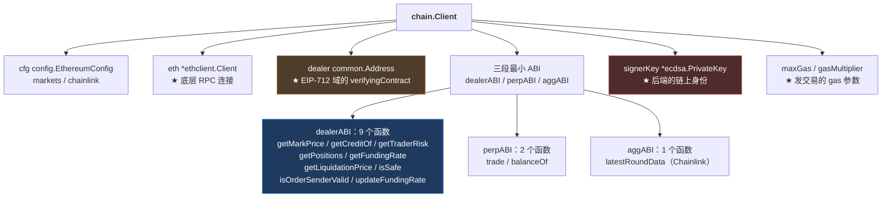
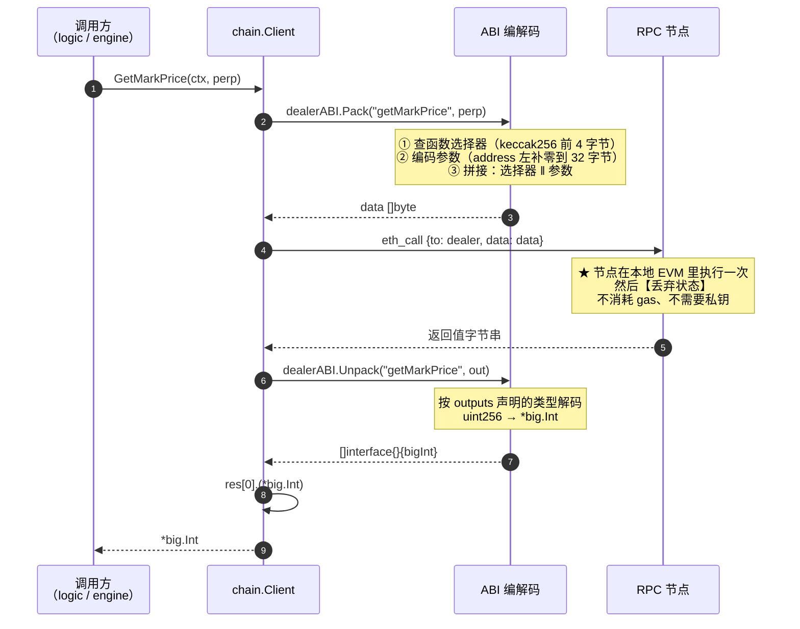
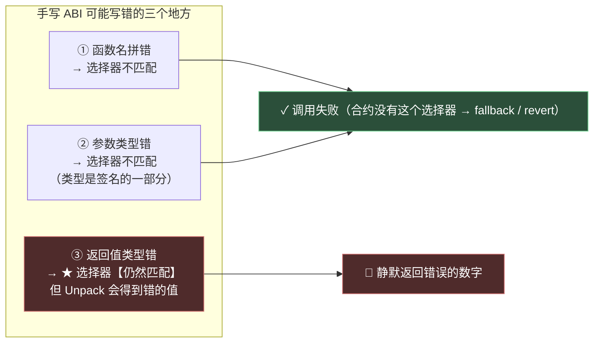

# 第 13 章：chain.Client — 手写最小 ABI、只读视图封装与发交易的 gas/nonce

> 主线（一笔订单的一生）在第 12 章结束了。从本章起进入**第四部分：链交互与后台服务**——我们回到最底层，看这个后端**究竟是怎么和链说话的**。
>
> 前面十二章里，"链上"一直是个黑盒：我们反复说"读链上状态"、"发交易到链上"、"等区块确认"，但**这些动作具体是怎么完成的**，一直没有展开。本章要打开 `internal/chain/client.go` 这个 425 行的文件——它承担了整个后端**与区块链的全部通信**。
>
> 本章会回答三个很实际的问题：
>
> 1. **为什么不用 `abigen` 生成完整绑定，而是手写最小 ABI 片段？**（手写意味着可能写错，而写错的后果是"静默返回错误的值"）
> 2. **`callDealer` / `callPerp` 这两个只读封装有什么讲究？**（为什么读和写走不同的合约？）
> 3. **`SubmitPerpTrade` 里那段"取 nonce → 估 gas → 设 gasPrice → 签名 → 广播"，每一处的取值依据是什么？**
>
> 而在写这一章时，我做了一件前面十二章都没做过的事：**用密码学方法验证了那三段手写 ABI 的正确性**——把手写 ABI 解析出的函数选择器，和从 Solidity 源码规范签名独立算出的选择器逐字节比对。**结果是 12 个函数全部一致 ✓**。这是一个值得肯定的结果，也引出本章要讨论的"手写 ABI 的风险管理"这个话题。

---

## 1. 本章导读

### 1.1 链交互层要做三件事

`chain.Client` 这个结构体承担的工作，可以清晰地分成三类：

```text
① 只读调用（eth_call）—— 不花 gas、不需要私钥、不产生交易
   · 查标记价、资金费率、用户 credit、风险、仓位、清算价、是否安全
   · 查订单发送者白名单
   · 查 Chainlink 预言机的最新报价

② 发交易（写操作）—— 花 gas、需要私钥、产生交易
   · Perpetual.trade(tradeData)          ← 成交上链（第 10 章）
   · Dealer.updateFundingRate(...)       ← 资金费率更新（第 14 章）

③ 辅助能力
   · 暴露底层 RPC 客户端（给 bind.WaitMined 用）
   · 暴露 Dealer 地址、From 地址
   · 提供 ABI 编码/解码所需的最小 ABI 定义
```

**⚠️ 这三类工作的边界非常清晰**——而"读"和"写"的分流方式，是本项目一个值得注意的设计（1.2 节）。

### 1.2 读写分流：读走 Dealer，写走 Perp

**这是本项目链交互的一个基础约定**，写在包注释里（第 2 章 3.(8) 表扬过）：

```go
// Package chain 封装与 MetaNodeDealer / Perpetual 的链上交互：
// 只读调用走 Dealer；成交走 Perp.trade；资金费率更新走 Dealer.updateFundingRate。
// 订单签名域必须与链上 MetaNodeStorage.domainSeparator 一致（MetaNode / v1 / chainId / Dealer 地址）。
```

**对应的两个封装：**

```go
func (c *Client) callDealer(ctx context.Context, data []byte) ([]byte, error) {
	msg := ethereum.CallMsg{To: &c.dealer, Data: data}     // ★ 目标：Dealer
	return c.eth.CallContract(ctx, msg, nil)
}

func (c *Client) callPerp(ctx context.Context, perp common.Address, data []byte) ([]byte, error) {
	msg := ethereum.CallMsg{To: &perp, Data: data}          // ★ 目标：传入的 Perp 地址
	return c.eth.CallContract(ctx, msg, nil)
}
```

**⚠️ 为什么"读走 Dealer"？** 因为 `MetaNodeDealer` 继承了 `MetaNodeView`：

```solidity
// src/MetaNodeDealer.sol
contract MetaNodeDealer is MetaNodeExternal, MetaNodeOperation, MetaNodeView {
```

**而 `MetaNodeView` 是"只读查询面"**（Solidity 篇第 15 章的主题）——它提供了 `getMarkPrice`、`getTraderRisk`、`isSafe`、`getLiquidationPrice` 这些**聚合查询**：

```solidity
// src/MetaNodeView.sol
function getMarkPrice(address perp) external view returns (uint256)
function isSafe(address trader) external view returns (bool safe)
function getLiquidationPrice(address trader, address perp) external view returns (uint256 liquidationPrice)
```

**⚠️ 这些查询**需要跨市场聚合**（比如 `getTraderRisk` 要遍历用户的所有仓位），**所以它们只能在 Dealer 层实现——因为 `Perpetual` 是"每个市场一个合约"，单个 `Perpetual` 看不到用户在别的市场的仓位。

**⟹ 这就是"读走 Dealer"的根本原因：Dealer 是全局视角，Perpetual 是局部视角。**

**⚠️ 唯一的例外是 `balanceOf`：**

```go
// BalanceOf 调用 Perpetual.balanceOf：paper 仓位、credit 含资金费累计调整后的值。
func (c *Client) BalanceOf(ctx context.Context, perp, trader common.Address) (paper, credit *big.Int, err error) {
	data, err := c.perpABI.Pack("balanceOf", trader)
	// ...
	out, err := c.callPerp(ctx, perp, data)      // ★ 走 Perp，不是 Dealer
	// ...
}
```

**✅ 这个例外是**正确的**——因为 `balanceOf` 是**单个市场**的状态（`balanceMap` 在 `Perpetual` 里），必须问那个具体的 `Perpetual` 合约。**

**🔑 所以分流规则可以精确地表述为：**

> ```text
> 需要【跨市场聚合】的查询  → Dealer（它继承了 MetaNodeView）
> 只涉及【单个市场】的查询  → 那个市场的 Perpetual 合约
> 写操作                  → 看合约的权限设计（trade 在 Perp，updateFundingRate 在 Dealer）
> ```

**⚠️ 而写操作的分流又是另一套逻辑**：

```solidity
// src/Perpetual.sol —— trade 是 Perp 自己的函数
function trade(bytes calldata tradeData) external { ... }
```

```solidity
// src/MetaNodeOperation.sol —— updateFundingRate 只在 Dealer 上
function updateFundingRate(address[] calldata perpList, int256[] calldata rateList)
    external onlyFundingRateKeeper
```

**⟹ `trade` 在 Perp 上（因为它是"某个市场的成交"）**，**而 `updateFundingRate` 在 Dealer 上（因为它是"一次性更新所有市场的费率"）✓**

**🔑 这揭示了一个更普遍的观察：**

> **合约的接口划分，反映的是"这个操作的作用域"。**
> ```text
> 作用域 = 单个市场  → 接口在 Perpetual
> 作用域 = 全局/跨市场 → 接口在 Dealer
> ```
> **⚠️ 所以链下封装的分流，不是在"选择用哪个合约"，而是在**遵循合约已经定好的作用域划分**。**

### 1.3 本章的验证结果（先说结论）

**手写 ABI 是本章最需要验证的东西**，因为：

```text
· 它不是从合约自动生成的（后面的章节会讲为什么）
· 写错了不会有编译错误
· 后果是"静默返回错误的值"，而不是"报错"
```

**我用密码学方法做了验证：**

```text
方法：ABI 里每个函数的"选择器"是函数规范签名的 keccak256 前 4 字节
     ⟹ 从手写 ABI 解析出的选择器，与从 Solidity 规范签名独立算出的选择器比对

结果（实测）：
  ✓ getMarkPrice           手写=5d6f9c14  合约=5d6f9c14
  ✓ getCreditOf            手写=c97ab30c  合约=c97ab30c
  ✓ getTraderRisk          手写=6e753010  合约=6e753010
  ✓ getPositions           手写=3eeb530e  合约=3eeb530e
  ✓ getFundingRate         手写=0baaa528  合约=0baaa528
  ✓ getLiquidationPrice    手写=1867b480  合约=1867b480
  ✓ isSafe                 手写=769a28ac  合约=769a28ac
  ✓ updateFundingRate      手写=854a8041  合约=854a8041
  ✓ isOrderSenderValid     手写=fc92b495  合约=fc92b495
  ✓ trade                  手写=1037ea51  合约=1037ea51
  ✓ balanceOf              手写=70a08231  合约=70a08231
  ✓ latestRoundData        手写=feaf968c  合约=feaf968c

  ⟹ 全部 12 个函数的选择器一致 —— 手写 ABI 与合约签名完全对应 ✓
```

**⚠️ 也逐项核对了**参数和返回值的类型**（`getCreditOf` 的 5 个输出、`getTraderRisk` 的 4 个输出等），全部与 Solidity 声明一致 ✓**

**🔑 这个结果值得肯定，也值得作为"手写 ABI 该怎么验证"的范例**（3.(10) 会详细讨论）。

**⚠️ 但本章仍然找到了三个值得改进的地方**（都在 3.(7)~(9) 展开）：

| # | 问题 | 后果 |
| --- | --- | --- |
| 1 | **`ChainlinkAnswer8` 硬编码 `decimals = 8`**，从不查询链上 | 如果 feed 用别的精度，价格会差若干个数量级 |
| 2 | **gas 兜底策略在两个 submit 函数里不一致** | 一处静默截断、一处用固定值，都可能 out-of-gas |
| 3 | **`EstimateGas` 失败时兜底为 `maxGas`（300 万）** | 钱包必须持有 300 万 × gasPrice 的余额，否则报"余额不足" |

---

## 2. 架构 / 流程图

### 2.1 `chain.Client` 的结构



**读图要点：**

- **红色 `signerKey` 是后端的"链上人格"**（第 1 章 4.6 讨论过）——它决定了 `msg.sender` 是谁、手续费进哪个账户、谁付 gas。
- **橙色 `dealer` 地址身兼两职**：既是只读调用的目标，**又是 EIP-712 域的 `verifyingContract`**（第 2 章 4.4 讲过：改它会让所有用户签名失效）。
- **蓝色的 `dealerABI` 有 9 个函数，比其他两个加起来还多** —— 印证了 1.2 节"读走 Dealer"的结论。

### 2.2 只读调用（`eth_call`）的路径



**⚠️ 这张图里最值得注意的是第 4 步的注释**：

```text
eth_call = "在本地节点上模拟执行一次，然后丢弃结果"
⟹ 不消耗 gas、不需要私钥、不需要 nonce、不产生交易
```

**🔑 这条性质决定了本项目的很多设计**（第 3 章 4.5 讨论过）：

> **查询是免费的 ⟹ "能读链就读链"是划算的** ⟹ 本项目的仓位、风险、标记价都直接读链，不缓存。
>
> **⚠️ 而反过来：写操作是昂贵的（每次都要 gas）⟹ 能少写就少写** ⟹ 这解释了"链上成功才写库"（第 11 章）、"批量提交"（第 10 章）这些设计的动机。

### 2.3 发交易的七步

```mermaid
%%{init: {'flowchart': {'wrappingWidth': 1000}}}%%
flowchart TB
    S1["① 检查私钥<br/>if c.signerKey == nil → error"]
    S1 --> S2["② ABI 编码调用数据<br/>perpABI.Pack(\"trade\", tradeData)"]
    S2 --> S3["③ 取 nonce<br/>PendingNonceAt(ctx, c.fromAddr)<br/>★ 含内存池中的待打包交易"]
    S3 --> S4["④ 取 gasPrice<br/>SuggestGasPrice(ctx)<br/>× GasPriceMultiplier（1.2）"]
    S4 --> S5["⑤ 估 gasLimit<br/>EstimateGas(CallMsg{...})<br/>⚠️ 失败 → 兜底 maxGas<br/>⚠️ 超过 maxGas → 静默截断"]
    S5 --> S6["⑥ 构造并签名<br/>types.NewTx(&LegacyTx{...})<br/>types.SignTx(tx, signer, key)<br/>★ LatestSignerForChainID"]
    S6 --> S7["⑦ 广播<br/>SendTransaction(ctx, signed)"]
    S7 --> R["返回 *types.Transaction<br/>（★ 还没确认）"]
    R -.->|"调用方再等"| W["bind.WaitMined<br/>（第 10 章）"]

    style S3 fill:#4f3d2b,stroke:#d0a070,color:#fff
    style S4 fill:#4f3d2b,stroke:#d0a070,color:#fff
    style S5 fill:#4f2b2b,stroke:#d07070,color:#fff
    style S6 fill:#1f3a5f,stroke:#4a9eff,color:#fff
```

**⚠️ 图中三处标记是本章重点：**

- **橙色 ③④**：nonce 和 gasPrice 都是**从网络现取的**（不是自己维护的），各有讲究（3.(7)）。
- **红色 ⑤**：gasLimit 的兜底策略是本章发现的问题之一。
- **蓝色 ⑥**：签名用 `LatestSignerForChainID` —— **`chainID` 参与签名**（EIP-155），这是防跨链重放的机制。

**⚠️ 特别注意最后一步**：`SubmitPerpTrade` **返回时交易还没有确认**——它只是"广播出去了"。**确认是调用方的责任**（`bind.WaitMined`）。**这个职责划分很重要**（第 11 章 3.(9) 讨论 `txHash` 丢失时提过）。

### 2.4 手写 ABI 的风险面



**⚠️ 这张图揭示了一个重要的不对称：**

```text
函数名或【参数】类型写错 → 选择器变了 → ★ 调用会失败（能发现）
返回值类型写错           → 选择器不变 → ★ 调用成功但解出错误的值（发现不了）
```

**🔑 因为选择器只取函数的"输入签名"**：

```text
选择器 = keccak256("函数名(参数类型1,参数类型2,...)")[:4]
                                     ↑ 只有输入，没有输出
```

**⚠️ 所以"返回值类型写错"是最危险的一类手写 ABI 错误。**

**举例：如果把 `getMarkPrice` 的返回值从 `uint256` 写成 `int256`**：

```text
选择器：仍然是 5d6f9c14 ✓（因为参数没变）
调用：成功
Unpack：int256 和 uint256 都是 32 字节，解码出来的 *big.Int 数值【相同】
       ⟹ ⚠️ 在这个例子里恰好无害（因为价格不会是负数）

但如果把 getCreditOf 的 primaryCredit（int256，可为负）
写成 uint256：
  ⟹ 一个负数 credit 会被解码成一个巨大的正数
  ⟹ ★ 而且调用成功、没有任何错误
```

**🔑 这就是"手写 ABI 必须验证"的根本原因** —— **它有一类错误是"完全静默"的。**

**⚠️ 而验证方法就是 1.3 节用的那个（选择器比对）—— 但它只能覆盖前两类错误，覆盖不了第三类。**

**⟹ 要覆盖第三类，需要"已知答案测试"**（用真实链上数据比对，见 3.(10)）。

---

## 3. 核心代码拆解

### (1) 三段最小 ABI

```go
const dealerABIStr = `[
  {"name":"getMarkPrice","type":"function","stateMutability":"view","inputs":[{"name":"perp","type":"address"}],"outputs":[{"name":"","type":"uint256"}]},
  {"name":"getCreditOf","type":"function","stateMutability":"view","inputs":[{"name":"trader","type":"address"}],"outputs":[
    {"name":"primaryCredit","type":"int256"},
    {"name":"secondaryCredit","type":"uint256"},
    {"name":"pendingPrimaryWithdraw","type":"uint256"},
    {"name":"pendingSecondaryWithdraw","type":"uint256"},
    {"name":"executionTimestamp","type":"uint256"}
  ]},
  // ... 另外 7 个函数 ...
]`

const perpetualABIStr = `[
  {"name":"trade","type":"function","stateMutability":"nonpayable","inputs":[{"name":"tradeData","type":"bytes"}],"outputs":[]},
  {"name":"balanceOf","type":"function","stateMutability":"view","inputs":[{"name":"trader","type":"address"}],"outputs":[
    {"name":"paper","type":"int256"},
    {"name":"credit","type":"int256"}
  ]}
]`

const aggregatorV3ABIStr = `[
  {"name":"latestRoundData","type":"function","stateMutability":"view","inputs":[],"outputs":[
    {"name":"roundId","type":"uint80"},
    {"name":"answer","type":"int256"},
    {"name":"startedAt","type":"uint256"},
    {"name":"updatedAt","type":"uint256"},
    {"name":"answeredInRound","type":"uint80"}
  ]}
]`
```

**作者为什么这么设计（设计思想）：**

**设计点一：文件头的注释说明了动机。**

```go
// 最小 ABI 片段（与 src 中 IDealer / IPerpetual / Chainlink Aggregator 对齐），避免引入完整 abigen 生成代码。
// dealer：视图与 updateFundingRate；perpetual：trade / balanceOf；aggregator：latestRoundData。
```

**"避免引入完整 abigen 生成代码"——这就是动机。**

**⚠️ 那 `abigen` 生成的代码有什么问题？** 3.(10) 会展开对比，这里先给结论：

```text
abigen 的产物：
  · 完整绑定的合约对象（所有函数、事件、错误类型）
  · Deploy 函数（部署合约用）
  · 事件订阅的过滤器
  · ★ 体积大：一个 MetaNodeDealer 的完整绑定可能上千行

本项目的需要：
  · 12 个函数（9 + 2 + 1）
  · 不需要部署、不需要事件订阅（第 1 章 4.7 讲过：本项目"自产自销"，不用事件驱动）
  ⟹ ★ 用不到 abigen 的 90%
```

**✅ 所以"手写最小 ABI"是一个**合理的取舍**——**用"需要自己保证正确"换取"代码量小、无生成依赖"。

**⚠️ 但它的代价是**必须自己验证正确性** —— 这正是本章 1.3 节所做的工作。**

**设计点二：三段 ABI 分开定义，而不是拼成一大段。**

```go
dealerABIStr     // 9 个函数，目标 = c.dealer
perpetualABIStr  // 2 个函数，目标 = 各个 Perp 合约
aggregatorV3ABIStr // 1 个函数，目标 = Chainlink feed
```

**⚠️ 为什么要分开？因为它对应三个**不同的调用目标**：**

```text
dealerABI     → c.callDealer（目标固定为 c.dealer）
perpABI       → c.callPerp（目标由调用方传入）
aggregatorV3ABI → 直接调 c.eth.CallContract（目标是 Chainlink feed 地址）
```

**✅ 分开定义让"某个 ABI 只能用在某个目标上"这件事在代码结构上可见** —— **比"拼成一个大 ABI，靠调用方自己搞清楚用哪个"要安全。**

**⚠️ 但要注意：这个"安全"是**约定层面**的，不是**类型层面**的** —— `perpABI.Pack("getMarkPrice", ...)` 会返回错误（因为 perpABI 里没有这个函数），**但 `dealerABI.Pack("balanceOf", ...)` 也会返回错误** ✓ 所以 ABI 的分离是有效的 ✓

### (2) `NewClient` —— 初始化与自检的时机

```go
// NewClient 连接 RPC 并解析 ABI。若配置 PrivateKey，则 From() 可用于发交易（撮合、资金费等）。
func NewClient(cfg config.EthereumConfig, markets []config.MarketConfig, chainlink config.ChainlinkConfig) (*Client, error) {
	// ① 建立 RPC 连接
	ethc, err := ethclient.Dial(cfg.RpcUrl)
	if err != nil {
		return nil, fmt.Errorf("eth dial: %w", err)
	}

	// ② 解析三段 ABI
	dABI, err := abi.JSON(strings.NewReader(dealerABIStr))
	if err != nil {
		return nil, err                              // ⚠️ 没有包装上下文
	}
	pABI, err := abi.JSON(strings.NewReader(perpetualABIStr))
	if err != nil {
		return nil, err
	}
	aABI, err := abi.JSON(strings.NewReader(aggregatorV3ABIStr))
	if err != nil {
		return nil, err
	}

	c := &Client{
		cfg: cfg, markets: markets, chainlink: chainlink,
		eth:           ethc,
		dealer:        common.HexToAddress(cfg.DealerAddress),
		dealerABI:     dABI, perpABI: pABI, aggABI: aABI,
		chainID:       big.NewInt(cfg.ChainId),
		maxGas:        uint64(cfg.MaxGasLimit),
		gasMultiplier: cfg.GasPriceMultiplier,
	}
	if cfg.GasPriceMultiplier <= 0 {
		c.gasMultiplier = 1.0                        // ★ 防御：非法配置兜底为 1.0
	}

	// ③ 私钥（可选）
	if cfg.PrivateKey != "" {
		key, err := crypto.HexToECDSA(strings.TrimPrefix(cfg.PrivateKey, "0x"))
		if err != nil {
			return nil, fmt.Errorf("private key: %w", err)     // ★ 这里包装了上下文
		}
		c.signerKey = key
		c.fromAddr = crypto.PubkeyToAddress(key.PublicKey)
	}
	return c, nil
}
```

**作者为什么这么设计（设计思想）：**

**✅ 设计点一：`abi.JSON` 解析失败会返回 error，而 `NewClient` 把它上抛——这是对的。**

```go
dABI, err := abi.JSON(strings.NewReader(dealerABIStr))
if err != nil {
	return nil, err
}
```

**⚠️ 这段代码的价值在于：它让"手写 ABI 写成了非法 JSON"这个错误**在启动时就被发现**（而不是运行时）。**

**⚠️ 但注意：它只能发现"JSON 语法错误"，**不能发现"语义错误"**（比如函数名拼错、类型写错——那些 JSON 都是合法的）。**

**🔑 这正是 1.3 节那个选择器比对的价值所在** —— **它补上了 JSON 解析覆盖不了的那部分。**

**⚠️ 设计点二：三个 ABI 的错误处理没有包装上下文。**

```go
dABI, err := abi.JSON(strings.NewReader(dealerABIStr))
if err != nil {
	return nil, err                    // ★ 直接返回，不知道是哪个 ABI 出错
}
```

**对比下面私钥的错误处理：**

```go
return nil, fmt.Errorf("private key: %w", err)     // ★ 有上下文
```

**⚠️ 同一个函数里两种风格。** 如果三段 ABI 中有一段写错了，错误信息是 `invalid character 'x' ...` 之类，**完全看不出是哪一段的问题**。

**修法（一行）：**

```go
dABI, err := abi.JSON(strings.NewReader(dealerABIStr))
if err != nil {
	return nil, fmt.Errorf("dealer ABI: %w", err)      // ★ 加上是哪一段
}
```

**🔑 这与第 10 章 6.5 那条"错误信息缺少关键细节"是同一个主题** —— **错误信息应该让排查者少走弯路。**

**✅ 设计点三：`if cfg.GasPriceMultiplier <= 0 { c.gasMultiplier = 1.0 }` 是一个好的防御。**

**⚠️ 为什么需要？** 因为 `gasMultiplier` 会被用来乘 `gasPrice`：

```go
if c.gasMultiplier > 0 && c.gasMultiplier != 1 {
	f := big.NewFloat(c.gasMultiplier)
	gp, _ := f.Mul(f, new(big.Float).SetInt(gasPrice)).Int(nil)
	if gp.Sign() > 0 {
		gasPrice = gp
	}
}
```

**⚠️ 注意这里的双重保护：**

```text
① 构造函数里把非法值兜底为 1.0
② 使用点又检查了 gasMultiplier > 0
```

**✅ 两层防御都做了，是对的 ✓** —— **如果 multiplier 是 0 或负数，乘出来会导致 gasPrice = 0，交易永远不被打包。**

**🔑 一个可迁移的判断：**

> **凡是"用户配置数值 × 系统计算值"的场景，都要对配置值做范围检查。**
> ```text
> 乘数为 0    → 结果 0（这里的后果：交易卡在内存池）
> 乘数为负    → 结果为负（后果：交易被拒绝或未定义行为）
> 乘数极大    → 结果溢出或付天价 gas
> ```
> **⚠️ 而"构造时兜底 + 使用时再检查"是很好的做法** —— 因为它同时防住了"配置非法"和"代码路径绕过了构造函数"两种情况。

### (3) `callDealer` / `callPerp` —— 只读封装的极简实现

```go
func (c *Client) callDealer(ctx context.Context, data []byte) ([]byte, error) {
	msg := ethereum.CallMsg{To: &c.dealer, Data: data}
	return c.eth.CallContract(ctx, msg, nil)
}

func (c *Client) callPerp(ctx context.Context, perp common.Address, data []byte) ([]byte, error) {
	msg := ethereum.CallMsg{To: &perp, Data: data}
	return c.eth.CallContract(ctx, msg, nil)
}
```

**作者为什么这么设计（设计思想）：**

**设计点一：只有 4 行，但每一个字段的选择都有讲究。**

```go
msg := ethereum.CallMsg{
	To:   &c.dealer,     // ① 目标地址
	Data: data,          // ② 编码后的调用数据
	// ③ From    留空 —— eth_call 不需要 from（除非合约检查 msg.sender）
	// ④ Gas     留空 —— eth_call 的 gas 由节点决定上限
	// ⑤ GasPrice 留空 —— 不花 gas
	// ⑥ Value   留空 —— 不转账
}
return c.eth.CallContract(ctx, msg, nil)
//                                    ↑ ⑦ 区块参数为 nil = "最新区块"
```

**⚠️ 两个值得注意的点：**

**点一：`From` 留空。**

```text
eth_call 里的 From 影响 msg.sender
→ 如果合约有 onlyOwner 之类的检查，From 留空会用零地址，调用会 revert
→ 本项目的只读函数都是 view（无权限检查），所以留空没问题 ✓
```

**⚠️ 但如果将来要调用一个"需要 msg.sender"的 view 函数（比如 `onlyOperator` 的查询），就必须填 `From`。** **这是一个隐含的前提，代码里没有注释说明。**

**点二：`nil` 表示"最新区块"。**

```go
return c.eth.CallContract(ctx, msg, nil)     // nil = LatestBlockNumber
```

**⚠️ 这个选择的影响：读到的状态是"节点当前看到的最新区块"——而不同节点可能在不同高度。**

```text
场景：连续两次读取（比如 getTraderRisk 和 isSafe）
  第一次读到区块 N
  第二次读到区块 N+1（新区块刚产生）
⟹ ★ 两次读到的状态不同 → 可能得到"自相矛盾"的结果
```

**⚠️ 本项目里有一处确实连续读了两次：**

```go
// getriskinfologic.go
nv, exp, _, maint, err := l.svcCtx.Chain.GetTraderRisk(l.ctx, trader)   // ← 读一次
// ...
safe, _ := l.svcCtx.Chain.IsSafe(l.ctx, trader)                         // ← 又读一次
```

**⚠️ 如果中间产生了新区块，用户可能看到"风险指标说我安全，但 isSafe 说我不安全"（或者反过来）。**

**🔑 修法是"固定区块高度"**（用 `big.NewInt(int64(blockNum))` 替代 `nil`）：

```go
// 理想形态：一次查询内固定块高
block := latestBlockNumber()
nv, exp, _, maint, _ := ch.GetTraderRiskAt(ctx, trader, block)
safe, _ := ch.IsSafeAt(ctx, trader, block)
```

**⚠️ 但这需要在 `CallMsg` 的第三个参数里传具体的块号，而当前的封装都是 `nil`。**

**🔑 这是一个很实际的 Web3 后端问题：**

> **"读最新状态"看起来是最正确的选择，但它在"同一次业务逻辑内多次读取"时会导致不一致。**
>
> ```text
> 单次读取     → 读最新 ✓ 合理
> 一次业务内多次读取 → ★ 应该固定同一个块高，否则可能自相矛盾
> ```

### (4) 只读封装的统一模式

**9 个只读函数（`GetMarkPrice`、`GetFundingRate`、`IsSafe` 等）都遵循同一个 6 步模板：**

```go
func (c *Client) GetMarkPrice(ctx context.Context, perp common.Address) (*big.Int, error) {
	// ① 编码
	data, err := c.dealerABI.Pack("getMarkPrice", perp)
	if err != nil {
		return nil, err
	}
	// ② 调用
	out, err := c.callDealer(ctx, data)
	if err != nil {
		return nil, err
	}
	// ③ 解码
	res, err := c.dealerABI.Unpack("getMarkPrice", out)
	if err != nil {
		return nil, err
	}
	// ④ 取值
	return res[0].(*big.Int), nil
}
```

**作者为什么这么设计（设计思想）：**

**✅ 设计点一：这个模板虽然重复了 9 次，但它的重复是**有价值**的。**

```text
优点：
  · 每一处都是【显式】的：看得出调了什么函数、返回什么类型
  · 出错时能精确知道是哪个函数的问题
  · 不需要反射、不需要泛型

缺点：
  · 9 个函数共约 200 行模板代码
  · 改一处逻辑（比如加 metrics）要改 9 处
```

**⚠️ 如果要用泛型消除这个重复，可以这样写：**

```go
func callAndUnpack[T any](ctx context.Context, c *Client, a abi.ABI, fn string, to common.Address, args ...interface{}) (T, error) {
	// ...
}
```

**⚠️ 但这样会**牺牲可读性**（调用点变成 `callAndUnpack[*big.Int](ctx, c, c.dealerABI, "getMarkPrice", c.dealer, perp)`），**而且处理"多个返回值"的泛型会更复杂。

**🔑 所以"重复 9 次"在这里是一个**合理的取舍** —— 类似于第 2 章 3.(4) 讲的"17 个模板化 handler"。**

**⚠️ 设计点二：`res[0].(*big.Int)` 这个类型断言**可能会 panic**。**

```go
return res[0].(*big.Int), nil
```

**⚠️ 什么情况下会 panic？**

```text
Unpack 返回的 []interface{} 里的元素类型，是由【ABI 声明】决定的：
  · int256 / uint256 → *big.Int
  · address          → common.Address
  · bool             → bool
  · address[]        → []common.Address

⟹ 如果 ABI 里把 getMarkPrice 的返回类型写成了 "address"
  ⟹ Unpack 会返回 common.Address
  ⟹ ★ res[0].(*big.Int) 会 panic
```

**⚠️ 但等等 —— 如果 ABI 里写成了 address，选择器不变（1.3 节 2.4 讲过），调用会成功，然后 panic。**

**🔑 所以这个 panic 的触发条件是"返回值类型写错"—— 而 2.4 节刚说过，这是手写 ABI 里**唯一不会被选择器检查发现的错误类型**。**

**⟹ ★ 这两个问题叠加起来，构成了一条完整的故障路径：手写 ABI 返回值类型写错 → 调用成功 → 类型断言 panic。**

**⚠️ 缓解措施：本项目的 ABI 已经验证正确 ✓（1.3 节）。但**这个故障模式本身没有防护** —— 如果将来有人改了 ABI 或换了合约版本，panic 会在第一次调用时发生。**

**修法（一行防御）：**

```go
v, ok := res[0].(*big.Int)
if !ok {
	return nil, fmt.Errorf("getMarkPrice: 意外的返回类型 %T（检查 ABI 的 outputs 声明）", res[0])
}
return v, nil
```

**🔑 一条通用建议：**

> **`x.(T)` 形式（不带 ok）的类型断言，只在"类型不可能错"时使用。**
> ```text
> ABI 解码结果、JSON 反序列化结果、interface{} 取值 → ★ 都应该用 x, ok := ... 形式
> ```
> **⚠️ 因为 panic 的代价（服务崩溃 / 请求 500）远大于多写两个字符。**

### (5) `GetCreditOf` 的 arity 检查 —— 一个值得表扬的细节

```go
func (c *Client) GetCreditOf(ctx context.Context, trader common.Address) (
	primaryCredit *big.Int, secondaryCredit *big.Int,
	pendingPrimary *big.Int, pendingSecondary *big.Int, execTs *big.Int, err error,
) {
	data, err := c.dealerABI.Pack("getCreditOf", trader)
	if err != nil {
		return nil, nil, nil, nil, nil, err
	}
	out, err := c.callDealer(ctx, data)
	if err != nil {
		return nil, nil, nil, nil, nil, err
	}
	res, err := c.dealerABI.Unpack("getCreditOf", out)
	if err != nil {
		return nil, nil, nil, nil, nil, err
	}
	// ★ 这里：检查输出个数
	if len(res) != 5 {
		return nil, nil, nil, nil, nil, fmt.Errorf("getCreditOf: unexpected arity %d", len(res))
	}
	return res[0].(*big.Int), res[1].(*big.Int), res[2].(*big.Int), res[3].(*big.Int), res[4].(*big.Int), nil
}
```

**作者为什么这么设计（设计思想）：**

**✅ `if len(res) != 5` 这个检查是**全项目唯一一处**对解码结果做个数校验的地方。**

**⚠️ 它防的是什么？**

```text
Unpack 的返回值个数由 ABI 的 outputs 决定
⟹ len(res) 不可能不是 5（除非 ABI 被改了）
⟹ ★ 所以这个检查防的是"有人改了 ABI 的 outputs 但没同步改这里"
```

**⚠️ 而这个场景是**真实存在**的：如果合约升级后 `getCreditOf` 增加了一个返回值，而链下 ABI 也同步更新了，那么 `len(res)` 会变成 6。**

**⟹ 这时：**

```text
没有这个检查：res[5] 被忽略，前 5 个照常返回 ⟹ ⚠️ 可能语义错位（如果新字段被插在中间）
有这个检查：  ★ 直接报错，说明"ABI 变了，代码要同步更新" ✓
```

**✅ 所以这是一个**有价值的前瞻性防御** ✓**

**⚠️ 但它**只在这一个函数里有** —— 其余 8 个只读函数都直接 `res[0].(*big.Int)`，没有个数检查。**

**🔑 这个不一致值得指出：**

> **同一个文件里，一处做了 arity 检查、其余七处没做 —— 而它们面临的风险是相同的。**
>
> **⚠️ 更值得思考的是：**为什么只有这一处做了？** 可能的原因：**
> ```text
> · getCreditOf 有 5 个返回值，写代码时"数了一遍" → 顺手加了检查
> · 其他函数只有 1-2 个返回值 → "不会数错" → 没加
> ⟹ ★ 这是"防御性代码取决于当时的注意力"，而不是"取决于风险"
> ```

### (6) `SubmitPerpTrade` 全流程

```go
// SubmitPerpTrade 以配置私钥账户调用 perp.trade(tradeData)。该账户须为 Dealer 上登记的 validOrderSender。
func (c *Client) SubmitPerpTrade(ctx context.Context, perp common.Address, tradeData []byte) (*types.Transaction, error) {
	// ① 私钥检查
	if c.signerKey == nil {
		return nil, fmt.Errorf("no PrivateKey configured for on-chain submit")
	}

	// ② ABI 编码
	data, err := c.perpABI.Pack("trade", tradeData)
	if err != nil {
		return nil, err
	}

	// ③ 取 nonce
	nonce, err := c.eth.PendingNonceAt(ctx, c.fromAddr)
	if err != nil {
		return nil, err
	}

	// ④ 取 gasPrice 并加价
	gasPrice, err := c.eth.SuggestGasPrice(ctx)
	if err != nil {
		return nil, err
	}
	if c.gasMultiplier > 0 && c.gasMultiplier != 1 {
		f := big.NewFloat(c.gasMultiplier)
		gp, _ := f.Mul(f, new(big.Float).SetInt(gasPrice)).Int(nil)
		if gp.Sign() > 0 {
			gasPrice = gp
		}
	}

	// ⑤ 估 gasLimit
	msg := ethereum.CallMsg{From: c.fromAddr, To: &perp, Gas: c.maxGas, GasPrice: gasPrice, Data: data}
	gasLimit, err := c.eth.EstimateGas(ctx, msg)
	if err != nil {
		gasLimit = c.maxGas                       // ⚠️ 兜底
	}
	if gasLimit > c.maxGas {
		gasLimit = c.maxGas                       // ⚠️ 静默截断
	}

	// ⑥ 构造并签名
	tx := types.NewTx(&types.LegacyTx{
		Nonce:    nonce,
		GasPrice: gasPrice,
		Gas:      gasLimit,
		To:       &perp,
		Value:    big.NewInt(0),
		Data:     data,
	})
	signer := types.LatestSignerForChainID(c.chainID)
	signed, err := types.SignTx(tx, signer, c.signerKey)
	if err != nil {
		return nil, err
	}

	// ⑦ 广播
	if err := c.eth.SendTransaction(ctx, signed); err != nil {
		return nil, err
	}
	return signed, nil
}
```

**作者为什么这么设计（设计思想）：**

**⚠️ 设计点一（问题）：`gasMultiplier` 用 `big.Float` 做乘法——引入了浮点误差。**

```go
f := big.NewFloat(c.gasMultiplier)                              // float64 → big.Float
gp, _ := f.Mul(f, new(big.Float).SetInt(gasPrice)).Int(nil)     // 乘完再截断成整数
```

**⚠️ `big.Float` 的默认精度是 53 位（等于 float64）**，所以这个乘法**并不比直接用 float64 更精确**。

```text
· gasPrice 是 20 gwei = 20000000000
· × 1.2 = 24000000000 ✓ 恰好整除

但如果 gasPrice 是奇数、multiplier 是 1.1：
  20000000001 × 1.1 = 22000000001.1
  big.Float → Int(nil) 会【截断】还是【四舍五入】？
  ⟹ big.Float.Int() 返回的是【截断】后的整数部分
  ⟹ ★ 结果是 22000000001（丢了 0.1）
```

**⚠️ 而 `Int(nil)` 的第二个返回值是 `Accuracy`（表示是否精确），代码用 `_` 丢弃了。**

**⚠️ 实际影响很小**（gasPrice 差 1 wei 无关紧要），**但它揭示了一个原则问题：在金额/精度的场景里用浮点，本身就是需要警惕的。**

**🔑 更稳妥的写法是用整数运算：**

```go
// 用整数比例（比如把 multiplier 存成"百分比"整数）
// 1.2 → 120
gasPrice = new(big.Int).Div(new(big.Int).Mul(gasPrice, big.NewInt(120)), big.NewInt(100))
```

**⚠️ 但这需要改配置格式。对本项目来说，**gasPrice 差几个 wei 无关紧要**，所以这是一个"知道就好、不必改"的问题。**

**🔴 设计点二（本章发现的问题）：gasLimit 的两个处理都有隐患。**

```go
gasLimit, err := c.eth.EstimateGas(ctx, msg)
if err != nil {
	gasLimit = c.maxGas                       // ⚠️ 场景 A
}
if gasLimit > c.maxGas {
	gasLimit = c.maxGas                       // ⚠️ 场景 B
}
```

**场景 A：估算失败 → 兜底为 `maxGas`（300 万）。**

```text
EstimateGas 失败的原因：
  · 合约逻辑会 revert（比如订单已过期）→ ★ 这种情况下发交易也是 revert，gasLimit 多少都一样
  · 节点不支持 eth_estimateGas / 超时
  · 参数有问题

⚠️ 用 300 万兜底的后果：
  ① 如果实际需要的 gas > 300 万 → ★ out-of-gas revert
  ② ★ 更重要的是【余额门槛】：gasLimit × gasPrice 必须 <= 钱包余额
     300 万 × 20 gwei = 0.06 ETH
     ⟹ 如果钱包余额低于 0.06 ETH，交易被拒（报"insufficient funds"）
     ⟹ ⚠️ 而实际可能只需要 15 万 gas（0.003 ETH）
```

**场景 B：估算值超过 `maxGas` → 静默截断到 `maxGas`。**

```text
⚠️ 截断后 gas 不足 → ★ out-of-gas revert → 白烧 gas

⚠️ 而且这个截断【没有任何日志】：
   · 运维看不到"估算值是 500 万，被截断成 300 万了"
   · 只能从"交易 revert 了"这个结果反推
```

**🔑 两个场景的共同问题是：它们都在"用一种可能不正确的值继续尝试"，而不是"报错让调用方知道"。**

**修法（三个方向）：**

```go
// 修法 1（最小）：至少记录日志
gasLimit, err := c.eth.EstimateGas(ctx, msg)
if err != nil {
	logx.Errorf("EstimateGas 失败，兜底为 MaxGasLimit=%d: %v", c.maxGas, err)
	gasLimit = c.maxGas
}
if gasLimit > c.maxGas {
	logx.Errorf("⚠️ EstimateGas 返回 %d 超过 MaxGasLimit=%d，截断（可能导致 out-of-gas）", gasLimit, c.maxGas)
	gasLimit = c.maxGas
}

// 修法 2（更好）：估算失败就返回错误，不盲目兜底
gasLimit, err := c.eth.EstimateGas(ctx, msg)
if err != nil {
	return nil, fmt.Errorf("estimate gas 失败，拒绝发送（避免白烧 gas）: %w", err)
}

// 修法 3（最好）：区分"估算失败的原因"
//   · 如果是 contract revert → 说明这笔交易注定失败 → 不发送（省 gas）
//   · 如果是节点问题 → 可以兜底或重试
```

**⚠️ 修法 3 需要解析 RPC 错误**（go-ethereum 会返回 `rpc.Error` 或带 revert 数据的错误），**复杂度较高但收益明确**：

```text
★ 如果 EstimateGas 因为"合约 revert"而失败，那这笔交易【注定失败】，
  发出去的每一笔都是白烧 gas（第 9、10、11 章那些"无限重试"的场景）
⟹ ★ 这是一个可以【在发送前】就识别出"必然失败"的机会！
```

**🔑 这是一个很有价值的观察：**

> **`EstimateGas` 失败，在很多情况下就是"这笔交易会 revert"的**提前信号**。**
>
> ```text
> ✅ 正确用法：把 EstimateGas 的 revert 当作"这笔交易不该发"的判据
> ✗ 本项目的用法：兜底一个 gasLimit，然后照发不误 → ★ 白烧 gas
> ```
>
> **⚠️ 而且这能**直接缓解**第 9~11 章发现的那几种"无限重试烧 gas"**：
> ```text
> 自成交、高 s 签名、int128 越界、陈旧 filled_amount
>   ⟹ 这些在 EstimateGas 阶段【就已经会 revert】
>   ⟹ ★ 如果估算失败就放弃发送，这些交易根本发不出去，一分钱都不烧
> ```
>
> **🔑 这是一处"改动很小、收益极大"的改进** —— **它把一个"事后回滚"的机制（`rollbackMatch`）变成了"事前拦截"。**

**✅ 设计点三：`types.LatestSignerForChainID(c.chainID)` 是正确且重要的。**

```go
signer := types.LatestSignerForChainID(c.chainID)
signed, err := types.SignTx(tx, signer, c.signerKey)
```

**⚠️ 为什么重要？因为它实现的是 **EIP-155**：**

```text
EIP-155 把 chainId 加入签名的内容
⟹ 同一个 nonce、同一个 gasPrice 的交易，在不同链上签出的哈希不同
⟹ ★ 防止"在一套链上签的交易被重放到另一条链"（比如测试网 → 主网）
```

**⚠️ 如果用 `types.HomesteadSigner{}`（不带 chainId），签名就不含链信息 —— 那是一个**真实的安全问题**（在以太坊历史上出现过：ETC 分叉后的重放攻击）。**

**✅ 本项目用对了 ✓**

**⚠️ 设计点四：`LegacyTx` vs `DynamicFeeTx`（EIP-1559）。**

```go
tx := types.NewTx(&types.LegacyTx{          // ★ 旧式交易
	Nonce:    nonce,
	GasPrice: gasPrice,                     // 单一的价格参数
	Gas:      gasLimit,
	// ...
})
```

**⚠️ 本项目的链是 Sepolia（EIP-1559 已激活），所以有两种可选的交易类型：**

| | LegacyTx（本项目） | DynamicFeeTx（EIP-1559） |
| --- | --- | --- |
| 费用参数 | `gasPrice`（单一值） | `maxFeePerGas` + `maxPriorityFeePerGas` |
| `SuggestGasPrice` 返回 | 一个综合估计值 | 应改用 `SuggestGasTipCap` + `Header.BaseFee` |
| 能否工作 | ✅ 能（向后兼容） | ✅ |
| 费用效率 | ⚠️ 可能多付（单一价格无法区分基础费和优先费） | ✅ 更优 |
| 类型标识 | `0x0` | `0x2` |

**⚠️ 所以 `LegacyTx` 在 EIP-1559 网络上是**能工作的，但可能多付 gas**** —— **因为 `SuggestGasPrice` 返回的是一个"能保证被打包"的综合价格，而不是最优的 baseFee + tip 组合。**

**⚠️ 对本项目（测试网、GasPriceMultiplier 1.2）来说，这个多付无关紧要。** **但如果部署到主网且交易量大，改造成 EIP-1559 是一个明确的优化点。**

### (7) gas 参数的三个决策

**把 3.(6) 里涉及的 gas 参数梳理成一张表：**

| 参数 | 取值方式 | 依据 | 风险 |
| --- | --- | --- | --- |
| **nonce** | `PendingNonceAt` | 含内存池的待打包交易 | ⚠️ 并发发送会撞车（第 3 章 4.3） |
| **gasPrice** | `SuggestGasPrice` × 1.2 | 当前网络建议价 + 20% 加价 | ✅ 合理 |
| **gasLimit** | `EstimateGas`，失败兜底 `maxGas` | 模拟执行的结果 | 🔴 兜底和截断都可能导致 out-of-gas |
| **maxGas** | 配置 `MaxGasLimit: 3000000` | 人工设定 | ⚠️ 需要与合约实际消耗匹配 |

**⚠️ 逐条分析：**

**关于 nonce：**

```go
nonce, err := c.eth.PendingNonceAt(ctx, c.fromAddr)
```

**⚠️ `Pending`（而不是 `Latest`）的含义：**

```text
LatestNonceAt  → "已确认交易的下一个 nonce"
PendingNonceAt → ★ "包含内存池中待打包交易的下一个 nonce"

用 Pending 的原因：允许连续发送多笔交易（第二笔不会撞上第一笔的 nonce）
代价：★ 如果有交易卡在内存池里，新交易会排在它后面
```

**✅ 本项目是**串行发送**（第 10 章 3.(2)：发一笔、等确认、再发下一笔），所以两种都不会撞车。** **但 `FundingRateKeeper` 是另一个 goroutine**（第 3 章 4.3 分析过撞车风险）。

**关于 gasPrice 的 1.2 倍加价：**

**⚠️ 第 3 章 4.2 已经分析过**（"用钱买确定性"）。**这里补充一个观察：**

```text
20% 的加价 = "我愿意多付 20% 来换取'在一个区块内被打包'"
但【多付的部分只有实际被打包时才产生】，而且 gasPrice 就是你付的价格
⟹ ★ 所以这 20% 是【净支出】，不是"上限"
```

**⚠️ 如果网络不拥堵，这 20% 是白花的。** **但它换来了"更少的重试"**（重试一次的代价可能远大于 20%）。**✅ 这个取舍是合理的。**

**关于 gasLimit：**

**⚠️ 3.(6) 设计点二已经详细分析。这里补一个**数量级**的对比：**

```text
一笔 Perpetual.trade 的实际 gas 消耗（估算）：
  · 基础成本            21,000
  · approveTrade 里的 ECDSA 恢复（2 个订单）2 × 3,000 = 6,000
  · _settle 更新余额（多次 SSTORE）     约 40,000 ~ 80,000
  · isAllSafe 检查（读取多个市场）       约 5,000 ~ 20,000
  · calldata（tradeData 约 600 字节）    约 10,000
  ────────────────────────────────────────────
  合计                                 约 80,000 ~ 140,000

而 MaxGasLimit = 3,000,000
⟹ ★ 上限是实际需求的 20~35 倍
```

**⚠️ 这个"富余"的意义是：**

```text
✅ 好处：EstimateGas 失败时，3,000,000 的兜底【大概率够用】
🔴 坏处：余额门槛提高到 0.06 ETH（20 gwei 时）
```

**🔑 所以 `MaxGasLimit` 这个配置的取值，实际上是在**"容错空间"和"余额门槛"之间权衡**：**

```text
设得大 → 估算失败时更可能成功，但要求钱包余额更高
设得小 → 余额门槛低，但估算失败时容易 out-of-gas
```

**⚠️ 而 3,000,000 相对实际需求（约 12 万）有 25 倍富余，**说明作者倾向于"容错"而非"低门槛"** —— 对于一个有充足测试币的开发项目，这是合理的。**

### (8) 两个 submit 函数的不一致

**这是本章发现的第二个问题。把两个函数并排比对（实测 `diff`）：**

```go
// SubmitPerpTrade 里
gasLimit, err := c.eth.EstimateGas(ctx, msg)
if err != nil {
	gasLimit = c.maxGas                    // ← 兜底 = maxGas
}
if gasLimit > c.maxGas {
	gasLimit = c.maxGas                    // ← ★ 有截断
}
```

```go
// SubmitFundingRateUpdate 里
gasLimit, err := c.eth.EstimateGas(ctx, msg)
if err != nil {
	gasLimit = 500000                      // ← 兜底 = 500000（硬编码）
}
// ★ 没有截断
```

**⚠️ 两处差异：**

| | `SubmitPerpTrade` | `SubmitFundingRateUpdate` |
| --- | --- | --- |
| 估算失败时的兜底 | `c.maxGas`（可配置，默认 300 万） | **硬编码 500,000** |
| 是否截断到上限 | ✅ 有 | ❌ **没有** |

**⚠️ 后果分析：**

```text
SubmitFundingRateUpdate 没有截断：
  ⟹ 如果 EstimateGas 返回一个很大的值（比如因为某个市场状态异常），
    gasLimit 会是一个很大的值
  ⟹ ★ 不会被 MaxGasLimit 限制住

⚠️ 而这个函数是 FundingRateKeeper 每 8 小时调一次（第 14 章）
  ⟹ 频率低，风险相对小
```

**⚠️ 硬编码 500,000 的问题：**

```text
· 它不受配置控制 → 运维无法调整
· 它是否够用？updateFundingRate 要遍历 perpList 逐个更新
  ⟹ 2 个市场时大概够；如果市场数量增加到 20 个，可能不够
  ⟹ ★ 而且不够的时候没有告警
```

**🔑 这两个函数的差异，是第 3 章 6.4 那条"Stop() 实现不一致"的同类问题：**

> **同一个文件里、做同一类事情的两个函数，用了不同的策略 —— 而它们面临的问题完全相同。**
>
> **⚠️ 判断方法**：看到"两个相似函数"时，把它们的**错误处理路径**也 diff 一下（不只是正常路径）。**因为错误处理最容易在复制粘贴后被"顺手改动"。**

**修法：抽出一个公共的 gas 估算函数。**

```go
// 统一：估算失败就用 maxGas 兜底，并【记录日志】；估算成功则截断到 maxGas
func (c *Client) estimateGasLimit(ctx context.Context, to *common.Address, data []byte, gasPrice *big.Int) uint64 {
	msg := ethereum.CallMessage{From: c.fromAddr, To: to, Gas: c.maxGas, GasPrice: gasPrice, Data: data}
	gasLimit, err := c.eth.EstimateGas(ctx, msg)
	if err != nil {
		logx.Errorf("EstimateGas 失败（to=%s），兜底为 MaxGasLimit=%d: %v", to.Hex(), c.maxGas, err)
		return c.maxGas
	}
	if gasLimit > c.maxGas {
		logx.Errorf("⚠️ EstimateGas 返回 %d > MaxGasLimit=%d，截断（可能 out-of-gas）", gasLimit, c.maxGas)
		return c.maxGas
	}
	return gasLimit
}
```

**⟹ 两个 submit 函数都用它，行为就统一了 ✓**

### (9) `ChainlinkAnswer8` 的 `decimals = 8` 假设

```go
// ChainlinkAnswer8 返回 Chainlink feed 的 answer（通常为 8 位小数），放大到 1e18 精度以与标记价格口径对齐。
func (c *Client) ChainlinkAnswer8(ctx context.Context, feed common.Address) (*big.Int, error) {
	if feed == (common.Address{}) {
		return nil, fmt.Errorf("empty feed address")        // ✅ 有零地址检查
	}
	data, err := c.aggABI.Pack("latestRoundData")
	if err != nil {
		return nil, err
	}
	out, err := c.eth.CallContract(ctx, ethereum.CallMsg{To: &feed, Data: data}, nil)
	if err != nil {
		return nil, err
	}
	res, err := c.aggABI.Unpack("latestRoundData", out)
	if err != nil {
		return nil, err
	}
	answer := res[1].(*big.Int)
	// 假设 decimals=8：answer * 1e10 -> 1e18
	scale := new(big.Int).Exp(big.NewInt(10), big.NewInt(10), nil)
	return new(big.Int).Mul(answer, scale), nil
}
```

**⚠️ 这是本章发现的第三个问题，而且它的潜在后果最严重。**

**问题在哪：**

```text
Chainlink 的 AggregatorV3Interface 有一个 decimals() 函数，用来声明该 feed 的小数位数
⟹ ★ 每个 feed 的 decimals 是【各自声明的】，不是固定的

实测（go-ethereum 的聚合器 ABI 里应该有 decimals，但本项目的 aggABI 只定义了 latestRoundData）：
  · 本项目的 aggABI：【没有】decimals()
  · 全项目搜索 "decimals"：只有这一行注释，★ 从没查询过链上的 decimals
```

**⚠️ 真实世界的情况：**

```text
· BTC/USD、ETH/USD 等主流 USD 计价 feed → 8 位小数（占大多数）
· 部分 feed（比如某些跨币种、某些 L2 上的）→ 18 位小数
· 历史上有过变更（Chainlink 可以在升级时改 decimals）
```

**⚠️ 如果 decimals 实际是 18 而不是 8：**

```text
真实价格 30000 → answer = 30000 × 10^18 = 3 × 10^22
本代码：answer × 10^10 = 3 × 10^32
⟹ ★ 价格被放大 10^10 倍

后果（第 15 章会讲这条链路）：
  ⟹ 资金费率的 delta 计算：premium = (mark - index) × 1e18 / index
  ⟹ index 变成 10^10 倍 → premium 变成一个极小的数（接近 -1e18）
  ⟹ ★ 资金费率会被推向极端值
  ⟹ 而第 14 章会讲：链上的 updateFundingRate 【不做任何计算】，直接用传入的值
  ⟹ ★ 所以这个错误会【直接写进链上合约】，影响所有持仓者
```

**🔑 这个后果链条很值得注意 —— 它是"链下计算错误 → 链上无法纠正"的一个典型：**

> **第 14 章会讲：`FundingRateKeeper` 只是"推送预先算好的累计值"，合约不做任何费率计算（只存不验）。**
>
> ```text
> ⟹ ★ 链下算错了，链上照单全收
> ⟹ 而资金费率影响【所有持仓者的余额】
> ```
>
> **⚠️ 这与第 1 章 1.3 讲的"合约会验证撮合结果"形成鲜明对比：**
> ```text
> 撮合：合约会验签、验价格交叉、验超量 ⟹ 链下犯错会被拦住
> 资金费率：合约只检查 onlyFundingRateKeeper ⟹ ★ 链下犯错【不会】被拦住
> ```

**修法（读取链上的 decimals）：**

```go
// 在 aggABI 里加上 decimals
const aggregatorV3ABIStr = `[
  {"name":"latestRoundData", ...},
  {"name":"decimals","type":"function","stateMutability":"view","inputs":[],"outputs":[{"name":"","type":"uint8"}]}
]`

// 使用前查询一次（可以缓存，因为 decimals 极少变化）
func (c *Client) ChainlinkAnswer(ctx context.Context, feed common.Address) (*big.Int, error) {
	// ① 查 decimals
	data, _ := c.aggABI.Pack("decimals")
	out, err := c.eth.CallContract(ctx, ethereum.CallMsg{To: &feed, Data: data}, nil)
	if err != nil {
		return nil, err
	}
	res, _ := c.aggABI.Unpack("decimals", out)
	dec := res[0].(uint8)                        // ★ 用链上声明的精度，而不是假设

	// ② 查 answer
	// ...
	answer := res[1].(*big.Int)

	// ③ 按实际精度放大到 1e18
	scale := new(big.Int).Exp(big.NewInt(10), big.NewInt(int64(18-dec)), nil)
	return new(big.Int).Mul(answer, scale), nil
}
```

**⚠️ 更稳妥的做法**：在启动时**查询并记录**各 feed 的 decimals，**如果与预期不符就告警**（第 3 章 3.(3) 讲的"启动自检"模式）。

**🔑 一条可以带走的经验：**

> **凡是"外部系统声明了某个参数，而你的代码假设了它的值"的地方，都要问一句"我能不能读它，而不是猜它"。**
> ```text
> ✗ 猜：假设 decimals = 8              → 错了就是 10^10 倍的偏差
> ✓ 读：调 decimals() 查询一次并缓存    → 一次 eth_call（免费），永远不会错
> ```
>
> **⚠️ 而"免费"这一点在本例里特别关键**：`eth_call` 不花 gas（2.2 节讲过），**所以"读一次而不是猜一个"的成本几乎为零。**

### (10) 最小 ABI vs `abigen`：一个值得展开的取舍

**1.3 节验证了本项目的 ABI 是对的。这里从"工程选择"的角度讨论这个决定。**

**先看 `abigen` 会生成什么（以 `MetaNodeDealer` 为例）：**

```text
abigen --abi MetaNodeDealer.json --pkg contracts --out dealer.go

产物包括：
  ① 类型定义：MetaNodeDealer 结构体（含 ABI、地址绑定）
  ② Deploy 函数：部署合约（本项目【不需要】—— 合约已经部署好了）
  ③ 所有函数的绑定方法：约 30+ 个（本项目只用 9 个）
  ④ 事件类型与过滤器：约 15+ 个（本项目★ 完全不用，见第 1 章 4.7）
  ⑤ 错误类型
  ⟹ 估计 800~1500 行
```

**对比本项目的手写 ABI：**

```text
abigen 产物     ：约 1000+ 行，覆盖 30+ 函数 + 15+ 事件
本项目手写      ：47 行，覆盖 12 个函数
⟹ ★ 代码量相差 20 倍以上
```

**🔑 所以"手写"的核心优势是**信噪比**：**

| 维度 | `abigen` | 手写最小 ABI |
| --- | --- | --- |
| 代码量 | 1000+ 行 | 47 行 |
| 覆盖范围 | 合约的全部接口 | **只用到的 12 个** |
| 可读性 | 需要在一堆生成代码里找要用的 | ★ 47 行全看完 |
| 生成依赖 | 需要 ABI JSON + abigen 工具 | ✅ **无** |
| 正确性保证 | ✅ **工具生成，不会错** | ⚠️ **需要自己验证** |
| 合约升级时 | 重新生成即可 | ★ **需要手工同步** |

**⚠️ 最后两行是这个取舍的关键。**

**🔑 手写 ABI 的真实代价：合约升级时的同步负担。**

```text
场景：合约升级，getCreditOf 增加了一个返回值

用 abigen：
  ① 拿新的 ABI JSON
  ② abigen 重新生成
  ③ ⟹ ★ 调用点的编译错误会立刻告诉你哪里要改（因为返回值的 Go 类型变了）

用手写 ABI：
  ① 手动改 abi_json.go（可能漏改）
  ② ★ 编译【不会报错】（因为 Go 代码看到的是 []interface{}）
  ③ 只有在运行时，Unpack 的结果个数不对 → 才可能发现问题
     ⚠️ 而且只有 getCreditOf 那个 arity 检查会发现（3.(5) 提到了：
        全项目只有那一处有检查）
```

**🔑 所以手写 ABI 的风险集中在"合约升级"这个场景上。**

**⚠️ 缓解措施（本项目可以补的）：**

```text
① ★ 启动时做"选择器自检"（就是本章 1.3 节用的方法）
   在 NewClient 里，把手写 ABI 解析出的每个函数的选择器，
   与一个【硬编码的期望值列表】比对
   ⟹ 成本：一张 12 行的表
   ⟹ 收益：合约升级导致 ABI 不匹配时，启动就会失败

② ★ 已知答案测试（KAT）
   用固定的输入调用链上函数，与一个已知的正确输出比对
   ⟹ 覆盖 2.4 节说的第三类错误（返回值类型写错，选择器仍然匹配）

③ 定期与合约源码/AI 核对（人工，成本高）
```

**✅ 措施 ① 的具体实现：**

```go
// 期望的选择器（从 Solidity 源码的规范签名算出，硬编码进来）
var expectedSelectors = map[string]string{
	"getMarkPrice":       "5d6f9c14",
	"getCreditOf":        "c97ab30c",
	"getTraderRisk":      "6e753010",
	"getPositions":       "3eeb530e",
	"getFundingRate":     "0baaa528",
	"getLiquidationPrice": "1867b480",
	"isSafe":             "769a28ac",
	"updateFundingRate":  "854a8041",
	"isOrderSenderValid": "fc92b495",
}

func validateABISelectors(a abi.ABI, expected map[string]string) error {
	for name, want := range expected {
		m, ok := a.Methods[name]
		if !ok {
			return fmt.Errorf("ABI 里缺少函数 %s", name)
		}
		got := fmt.Sprintf("%x", m.ID)
		if got != want {
			return fmt.Errorf("函数 %s 的选择器不匹配：ABI=%s 期望=%s"+
				"（说明 ABI 定义与合约不一致，可能是合约升级了）", name, got, want)
		}
	}
	return nil
}
```

**⚠️ 加上这个之后，`NewClient` 就多了一道**启动自检**（与第 3 章 3.(3) 讲的 `ValidateOrderSender` 是同一类）。**

**🔑 这条经验值得记住：**

> **当"正确性依赖人工同步"时，应该加一个自动检查来发现"没同步"。**
>
> ```text
> 手写 ABI 的风险：合约改了，链下没改 → ★ 静默出错
> 自动检查的价值：把"静默出错"变成"启动失败"
> ```
>
> **⚠️ 判断方法：问一句"如果这个东西错了，我多久能发现？"**
> ```text
> · 立刻发现（编译错误 / 启动失败）  → ✅ 好
> · ★ 运行时静默出错               → 🔴 必须加检查
> ```

---

## 4. Web3 特有机制

### 4.1 `eth_call` 与交易的边界：免费与付费

**本章反复出现的一个区分，值得单独总结：**

```text
eth_call（本项目的 callDealer / callPerp）
  · 节点在本地 EVM 里执行一次，然后【丢弃状态】
  · 不消耗 gas、不需要私钥、不需要 nonce、不产生交易
  · ★ 可以任意调用，成本为零（除了 RPC 配额）

交易（本项目的 SubmitPerpTrade / SubmitFundingRateUpdate）
  · 广播到网络 → 被打包 → 状态【永久变更】
  · 消耗 gas、需要私钥、需要 nonce
  · ★ 每一次调用都是真实支出
```

**🔑 这个边界决定了本项目的很多设计：**

| 设计 | 动机 |
| --- | --- |
| "能读链就读链"（仓位、风险、标记价） | `eth_call` 免费 → 没必要缓存 |
| "链上成功才写库"（第 11 章） | 写操作有成本且不可逆 → 保守策略 |
| "启动自检用 eth_call"（第 3 章） | 零成本地验证配置正确性 |
| "EstimateGas 也算 eth_call" | ✅ 免费 → 可以在发送前充分模拟 |

**🔑 而最后一条特别值得展开 —— 它是本项目**没有充分利用**的一个免费资源：**

> **`EstimateGas` 本质是一次 `eth_call`——它**真的执行了**这笔交易，只是不提交。**
>
> ```text
> ⟹ ★ 如果这笔交易会 revert，EstimateGas 会告诉你
> ⟹ 而这是【免费的】、在【发送之前】就能知道的
>
> ⚠️ 本项目怎么用的？估算失败 → 兜底一个 gasLimit → ★ 照发不误
> ⟹ 把"免费的预警"变成了"付费的失败"
> ```

**🎯 这是本章最重要的一条改进建议（3.(6) 设计点二也提过），值得重复：**

> **把 EstimateGas 的 revert 当作"这笔交易不该发"的判据。**
>
> 它能直接缓解第 9~11 章发现的那几种"无限重试烧 gas"：
> ```text
> 自成交（ORDER_SELF_MATCH）        ⟹ EstimateGas 会 revert ✓
> 高 s 签名（InvalidSignatureS）    ⟹ EstimateGas 会 revert ✓
> 陈旧 filled_amount（OVERFLOW）    ⟹ EstimateGas 会 revert ✓
> int128 越界（decode 失败）        ⟹ EstimateGas 会 revert ✓
> 零量订单（ORDER_PRICE_NEGATIVE）  ⟹ EstimateGas 会 revert ✓
> ```
>
> **⚠️ 五分之四的已知问题，都能被这一个免费的检查拦住。**

### 4.2 ABI 编码是"接口契约"的二进制形式

**本章 1.3 节做的"选择器比对"，本质上是在验证一个**二进制契约**。**

**把这个契约讲清楚：**

```text
Solidity 侧：       function getMarkPrice(address perp) external view returns (uint256)
                    ⟹ 编译器生成选择器 0x5d6f9c14，并写入合约的【函数分发表】

Go 侧：             abi.NewType + JSON 定义
                    ⟹ abi.JSON 解析后计算选择器（同样是 keccak256 前 4 字节）
                    ⟹ Pack 时把选择器放在 data 的前 4 字节

调用时：            Go 发出 eth_call{data: 0x5d6f9c14 + 参数}
                    ⟹ 节点的 EVM 用前 4 字节【在合约的分发表里查】
                    ⟹ 找到就执行，找不到就走 fallback（通常 revert）
```

**🔑 所以"选择器"就是"函数在 ABI 层的名字"** —— **它是一个 4 字节的哈希，而不是可读的字符串。**

**⚠️ 这带来一个重要的性质：**

> **调用一个不存在的函数时，失败信息是"没有匹配的函数"（或者 fallback 的行为），而不是"getMarkPrice 不存在"。**
>
> ```text
> ⟹ ★ 调试时看到一个含糊的 revert，很难立刻想到"是不是 ABI 里的函数名拼错了"
> ```
>
> **⚠️ 而选择器碰撞（两个不同签名算出同样的 4 字节）在理论上是可能的**（2^32 的空间），**虽然概率极低（约 1/40 亿），但**这意味着"选择器匹配"不是"签名匹配"的严格证明**。**
>
> **🔑 所以更严格的验证应该是**同时比对选择器和参数个数/类型** —— 而 1.3 节的测试做到了这一点（`abi.Methods[name].ID` 与实际解析出的 ABI 都来自同一份数据，而我又核对了 Solidity 源码的签名）。**

### 4.3 为什么"最小 ABI"这个模式值得学

**抛开本项目，这个模式本身有通用价值：**

```text
场景：你的服务只用到某个外部合约/API 的 5% 的能力
选项 A：生成/引入完整的接口定义（覆盖 100%）
选项 B：手写/裁剪出用到的那 5%

本项目的选择：★ B
```

**🔑 判断标准（我总结的三条）：**

```text
① 接口是否稳定？
   · 稳定（比如 ERC-20 标准）→ 用现成的
   · ★ 会变（比如本项目这种自研合约）→ 手写的维护成本反而更高？
     ⟹ 不，因为【用到的部分】一般不会变（getMarkPrice 不会改签名）

② 用到的比例？
   · 大部分都要用 → 生成完整绑定更划算
   · ★ 只用到一小部分（本项目 12/30+ ≈ 40%，但事件完全不用）→ 手写更划算

③ 有没有自动同步机制？
   · 有（CI 里跑 abigen 并 diff）→ 生成更安全
   · ★ 没有 → 手写 + 启动自检 也是一种选择
```

**⚠️ 本项目的答案是：用了 40% 的函数、0% 的事件、不需要部署 ⟹ 手写是合理的。**

**⚠️ 但它**必须**配上启动自检（3.(10) 措施 ①）—— 因为"手写"的正确性完全依赖人工同步。**

**🔑 一条可以带走的经验：**

> **"最小化"是一种正确的工程直觉，但它把"正确性保证"从工具转移到了人身上。**
> ```text
> 工具保证的正确性：不需要验证（编译器/生成器负责）
> ★ 人工保证的正确性：必须验证（而且要【自动化地】验证）
> ```
> **⚠️ 所以选择"手写最小 ABI"的同时，就应该把"选择器自检"作为这个选择的一部分一起实现** —— **否则这个取舍是不完整的。**

---

## 5. 本章小结与思考题

### 5.1 核心知识点回顾

| 知识点 | 一句话总结 |
| --- | --- |
| **链交互层的三类工作** | 只读调用（免费）/ 发交易（付费）/ 辅助能力 |
| **读写分流规则** | 需跨市场聚合 → Dealer；单市场 → Perpetual；写操作看合约的权限设计 |
| **为什么读走 Dealer** | 因为 `MetaNodeDealer is MetaNodeView`，聚合查询只能在 Dealer 层实现 |
| **`eth_call` 的性质** | 本地模拟执行后丢弃状态 ⟹ **免费、无需私钥、无副作用** |
| **`SubmitPerpTrade` 七步** | 查私钥 → 编码 → nonce → gasPrice → gasLimit → 签名 → 广播 |
| **✅ 手写 ABI 验证通过** | 12 个函数的选择器与 Solidity 规范签名**全部一致**（实测） |
| **手写 ABI 的三类错误** | 函数名错 / 参数类型错 → **选择器不匹配（能发现）**；**返回值类型错 → 选择器仍匹配（静默）** |
| **选择器只取输入签名** | `keccak256("名(参数类型)")[:4]` —— **不含返回值** |
| **nonce 用 `Pending`** | 含内存池中的待打包交易；串行发送下安全，并发下会撞车 |
| **gasPrice × 1.2** | "用钱买确定性"，代价是网络不拥堵时白花 20% |
| **🔴 `EstimateGas` 失败兜底 `maxGas`** | 余额门槛 0.06 ETH（3M × 20 gwei），实际只需 0.003 ETH |
| **🔴 `EstimateGas` 超限静默截断** | 截断后 gas 不足 → out-of-gas，**且无日志** |
| **🔴 两个 submit 函数 gas 策略不一致** | 一个用 `maxGas` + 截断，一个用硬编码 `500000` 且不截断 |
| **🟠 只读调用未固定块高** | 一次业务内多次读取可能落在不同区块 → 自相矛盾（如 `GetTraderRisk` + `IsSafe`） |
| **🔴 `ChainlinkAnswer8` 硬编码 `decimals=8`** | 全项目从不查询链上的 `decimals()`；错了就是 10^10 倍偏差，**且链上不会纠正** |
| **`LatestSignerForChainID`** | EIP-155：chainId 参与签名 → 防跨链重放 ✓ 用对了 |
| **`LegacyTx` vs EIP-1559** | Legacy 能工作但可能多付；Sepolia 已支持 EIP-1559 |
| **`res[0].(*big.Int)` 无防御** | 类型断言 panic 的触发条件与"返回值类型写错"完全重合 |
| **✅ `GetCreditOf` 的 arity 检查** | 全项目唯一一处；但其余 7 个只读函数没有 |
| **💡 `EstimateGas` 是免费的事前预警** | 它的 revert 就是"这笔交易会失败"的信号，可拦住第 9~11 章 4/5 的烧 gas 场景 |

### 5.2 思考题

#### 思考题 1：本项目选择了"手写最小 ABI"而不是 `abigen` 生成完整绑定。请回答：（a）这个选择在什么条件下是划算的？（b）手写 ABI 的三类错误里，哪一类**不会被任何现有机制发现**？（c）设计一个自动化检查来覆盖它，并说明这个检查为什么必须是自动的。

<details>
<summary>点击查看参考答案</summary>

**（a）什么条件下划算**

**先量化对比（基于本项目的实际情况）：**

| 维度 | `abigen` 完整绑定 | 手写最小 ABI |
| --- | --- | --- |
| 代码量 | 约 1000+ 行 | **47 行** |
| 覆盖函数 | 30+ | 12（实际用到的） |
| 覆盖事件 | 15+ | **0**（本项目不用事件驱动，第 1 章 4.7） |
| 部署函数 | ✅ 有 | ❌ 不需要（合约已部署） |
| 生成依赖 | ABI JSON + abigen 工具 | **无** |

**🔑 划算的条件可以总结成三条：**

```text
条件 1：只用到接口的一小部分
  本项目：12/30+ 函数、0/15+ 事件
  ⟹ ★ 生成完整绑定 = 90% 的代码是你永远不看的

条件 2：用到的部分【不会变】
  getMarkPrice(address) → uint256 这种签名，一旦部署就不会变
  ⟹ ★ 所以"手写一次，长期有效"

条件 3：不需要部署、不需要事件订阅
  本项目都是 ⟹ 手写的缺失部分不影响
```

**⚠️ 但反过来，如果满足这些条件，`abigen` 就更划算：**

```text
· 需要用到大部分接口
· 需要订阅事件（索引器类的服务）
· 需要部署合约（测试脚本、集成测试）
· ★ 合约会频繁升级（生成能自动跟随）
```

**（b）哪一类错误不会被现有机制发现**

**先列出三类错误：**

| # | 错误 | 选择器是否匹配 | 现有机制能否发现 |
| --- | --- | --- | --- |
| 1 | 函数名拼错 | ❌ 不匹配 | ✅ `abi.JSON` 解析成功，但**调用时会 revert**（找不到函数） |
| 2 | **参数**类型错 | ❌ 不匹配 | ✅ 同上（参数类型是签名的一部分） |
| 3 | **返回值**类型错 | ✅ **仍然匹配** | 🔴 **完全没有机制发现** |

**⚠️ 为什么第 3 类完全不能被现有机制发现？**

**现有机制逐条检查：**

```text
① abi.JSON 解析
   ⟹ 只检查 JSON 语法合法性
   ⟹ ★ 返回值类型写成 int256 还是 uint256，JSON 都是合法的

② 选择器匹配（调用时由 EVM 完成）
   ⟹ 选择器 = keccak256("函数名(参数类型...)")[:4] —— ★ 只含【输入】
   ⟹ 返回值类型改了，选择器不变 ⟹ 调用【仍然成功】

③ abi.Unpack 解码
   ⟹ 按【ABI 声明的输出类型】解码
   ⟹ ★ 解码【不会失败】（32 字节的字，按 int256 解或按 uint256 解都"成功"）
   ⟹ 只是数值可能不同

④ res[0].(*big.Int) 类型断言
   ⟹ int256 和 uint256 都映射到 *big.Int ⟹ ★ 断言【成功】
   ⟹ 只有把类型写成 address/bool 等才会 panic

⑤ GetCreditOf 的 arity 检查
   ⟹ 只检查【个数】，不检查【类型】
   ⟹ ★ 而且只有那一个函数有

⟹ ★ 结论：返回值类型写错，会【一路通过】所有检查，
   得到一个"看起来正常但数值错误"的结果
```

**⚠️ 举一个具体的、会造成损失的例子：**

```text
假设把 getCreditOf 的 primaryCredit 从 int256 误写成 uint256：

Solidity 真实返回：-30000000000（用户欠 30000 USDC，因为开了多仓）
ABI 声明：uint256
Go 解码：2^256 - 30000000000 ≈ 1.15 × 10^77    ★ 一个巨大的正数

⟹ 后果：
  · getbalancelogic.go 里 primaryMerged = pc + ledgerAmt
    ⟹ 余额显示为一个天文数字
  · 用户看到"我有 10^77 个 USDC"
  · ★ 而且【没有任何错误、没有任何日志】
```

**（c）设计一个自动化检查**

**检查 1：选择器自检（覆盖第 1、2 类）**

```go
// 期望值从 Solidity 源码的规范签名算出，硬编码进来
var expectedDealerSelectors = map[string]string{
	"getMarkPrice":        "5d6f9c14",
	"getCreditOf":         "c97ab30c",
	"getTraderRisk":       "6e753010",
	"getPositions":        "3eeb530e",
	"getFundingRate":      "0baaa528",
	"getLiquidationPrice": "1867b480",
	"isSafe":              "769a28ac",
	"updateFundingRate":   "854a8041",
	"isOrderSenderValid":  "fc92b495",
}

func validateSelectors(a abi.ABI, expected map[string]string) error {
	for name, want := range expected {
		m, ok := a.Methods[name]
		if !ok {
			return fmt.Errorf("ABI 缺少函数 %s", name)
		}
		if got := fmt.Sprintf("%x", m.ID); got != want {
			return fmt.Errorf("函数 %s 选择器不匹配: ABI=%s 期望=%s（合约可能升级了）", name, got, want)
		}
	}
	return nil
}
```

**⚠️ 但这个检查**覆盖不了第 3 类**（返回值类型），**因为选择器不含返回值。

**检查 2：输出的"类型指纹"检查（覆盖第 3 类）**

**思路：把每个函数的**完整输出签名**也硬编码，与 ABI 声明比对。**

```go
// 完整的输出类型声明（从 Solidity 源码抄来）
var expectedDealerOutputs = map[string]string{
	"getMarkPrice":        "uint256",
	"getCreditOf":         "int256,uint256,uint256,uint256,uint256",
	"getTraderRisk":       "int256,uint256,uint256,uint256",
	"getPositions":        "address[]",
	"getFundingRate":      "int256",
	"getLiquidationPrice": "uint256",
	"isSafe":              "bool",
	"isOrderSenderValid":  "bool",
}

func validateOutputs(a abi.ABI, expected map[string]string) error {
	for name, want := range expected {
		m, ok := a.Methods[name]
		if !ok {
			return fmt.Errorf("ABI 缺少函数 %s", name)
		}
		got := make([]string, len(m.Outputs))
		for i, o := range m.Outputs {
			got[i] = o.Type.String()
		}
		if strings.Join(got, ",") != want {
			return fmt.Errorf("函数 %s 的输出类型不匹配:\n  ABI = %s\n  期望 = %s",
				name, strings.Join(got, ","), want)
		}
	}
	return nil
}
```

**✅ 这个检查**确实能覆盖第 3 类 —— 因为它直接比对了 ABI 里声明的输出类型，与"从 Solidity 源码人工抄来的期望值"。

**检查 3：已知答案测试（KAT）—— 最强但最重的检查**

**前两个检查都依赖"人工抄写的期望值"——而人工抄写本身也可能错。KAT 用**真实数据**验证：**

```go
func TestKnownAnswers(t *testing.T) {
	// 从链上真实合约读一次，与已知的正确值比对
	// 这些"已知正确值"由测试网的确定性状态保证（或者用一个固定的测试快照）
	
	c := newTestClient(t)      // 连 Sepolia
	
	// 例：用 getMarkPrice 读 BTC-PERP
	mp, err := c.GetMarkPrice(ctx, btcPerp)
	require.NoError(t, err)
	
	// ★ 与其他来源交叉验证（比如直接读预言机、或者链上浏览器）
	// 更实用的做法：用一个【已知的、不会变的】账户做测试
	//   比如一个从未交易过的地址，getCreditOf 应该返回全 0
	tmp, err := c.GetCreditOf(ctx, randomUnusedAddress)
	require.NoError(t, err)
	require.Equal(t, "0", tmp.Holdings.String())    // ★ 负数会被解成巨大正数 → 立刻暴露
}
```

**⚠️ KAT 的设计要点：**

```text
✅ 用【确定性的、已知的】输入和输出
   · 空账户的 getCreditOf → 全 0（如果类型错，负数会变成巨大正数，一眼看出）
   · 已知合约的 isSafe → false
   · 已知地址的 balanceOf → (0, 0)

✗ 不要用"会变的值"（比如实时价格）—— 那样测试不稳定
```

**🔑 为什么这个检查**必须**是自动的**

**三个理由：**

```text
理由 1：人工检查会漏
  · 9 个函数 × 平均 2 个输出 = 约 18 个类型要核对
  · 而"int256 vs uint256"这种差异，肉眼扫过去几乎看不出
  · ★ 而且它【看起来完全正常】（都是整数类型）

理由 2：错误是静默的
  · 不会报错、不会崩溃、不会 commit 失败
  · ★ 只会让某个数字悄悄地不对
  · ⟹ 人不会主动去查"这个数字对不对"（因为它看起来正常）

理由 3：★ 错误会在"合约升级"时【重新出现】
  · 今天验证过，不代表明天还对
  · 合约一升级，ABI 就可能不同步
  · ⟹ ★ 只有【每次启动/每次构建都跑】的自动检查，才能持续保证
```

**🎯 本题的核心结论：**

> **第一，关于"最小化"这个工程直觉：**
> ```text
> ✅ 它减少了你【需要读】的代码量
> 🔴 但它把"正确性保证"从工具【转移到了人】身上
>
> ⟹ ★ 所以"最小化"的正确姿势是：最小化 + 【自动化的正确性检查】
>    两者是一体的，缺一个就是不完整的取舍
> ```
>
> **第二，关于"哪类错误最危险"：**
> ```text
> 会把程序打挂的错误（panic、revert）  → ⚠️ 麻烦，但【能被发现】
> ★ 静默产生错误数据的错误            → 🔴 最危险（因为没人会去查）
> ```
> **⚠️ 判断方法：问一句"如果这个错了，我会在什么时候、以什么方式发现？"**
> ```text
> · 立刻发现（编译/启动/运行时 panic）→ 可接受
> · ★ 永远不会自己发现（只是数字不对）→ 必须加自动检查
> ```
>
> **第三，一个更普遍的观察：**
>
> **本章 1.3 节那个"选择器比对"测试，我写它只用了不到 20 行——但它一次性验证了 12 个函数 × 参数类型 + 函数名。**
> ```text
> ★ 这就是"自动检查"的杠杆：一次投入，永久有效，而且是【确定性】的
> ```
> **⚠️ 而它在实际项目里的成本是"一张 12 行的表"** —— **这是一个几乎零成本、零风险的改进。**

</details>

#### 思考题 2：`SubmitPerpTrade` 里 `EstimateGas` 失败时兜底为 `maxGas`（300 万），并且把超过上限的估算值**静默截断**。请回答：（a）这两个处理各自会造成什么问题？（b）为什么说"估算失败就返回错误"在链上场景里是更好的选择？（c）结合第 9~11 章的发现，说明这个改动为什么能一次性缓解多个问题。

<details>
<summary>点击查看参考答案</summary>

**（a）两个处理各自的问题**

**问题一：估算失败 → 兜底 300 万，后果是"余额门槛"被抬高。**

```text
gasLimit × gasPrice ≤ 钱包余额    ← 这是以太坊的硬性要求

300 万 × 20 gwei = 0.06 ETH

而实际的 Perpetual.trade 大约消耗 8~14 万 gas
  ⟹ 实际需要 0.0016 ~ 0.0028 ETH 的余额

⚠️ 所以：
  · 钱包余额在 0.003 ~ 0.06 ETH 之间时
    ⟹ ★ 明明够用，却被拒绝（报 "insufficient funds for gas * price + value"）
  · 而且这个错误信息【不会告诉你"是因为 gasLimit 设太大了"】
    ⟹ ★ 排查方向会被误导到"钱包没充够钱"
```

**问题二：估算值超过上限 → 静默截断，后果是 out-of-gas。**

```text
EstimateGas 返回 500 万 > MaxGasLimit 300 万
  ⟹ 静默截断为 300 万
  ⟹ 交易执行到 300 万 gas 时【强制停止】
  ⟹ ★ out-of-gas → 交易 revert → ★ gas 已经花了，但不产生任何效果

⚠️ 而"静默"这一点更糟：
  · 没有日志说"我截断了"
  · 运维只能看到"交易 revert 了"，然后去猜原因
  · ★ 而"gas 不足"和"合约逻辑 revert"在链上都是 revert，从回执上看不出区别
```

**⚠️ 还有第三个隐藏问题：`EstimateGas` 失败往往是"这笔交易必然失败"的信号。**

```text
EstimateGas 的本质：在节点本地【真的执行一次】这笔交易
  ⟹ 如果合约逻辑会 revert，EstimateGas 就会失败
  ⟹ ★ 这时候兜底一个 gasLimit 再发出去，等于【明知会失败还要花钱试】
```

**（b）为什么"估算失败就返回错误"更好**

**核心论点：`EstimateGas` 是一个**免费的、事前的**模拟——它的失败是一个高价值的信号。**

**对比两种处理：**

| | 兜底 maxGas 再发 | 直接返回错误 |
| --- | --- | --- |
| 信息量 | ❌ 丢弃了"这笔交易会失败"这个信号 | ✅ 保留并上抛 |
| 成本 | 🔴 **白烧一笔 gas** | ✅ **零成本** |
| 错误信息 | ⚠️ 延迟到"交易 revert"才暴露 | ✅ 立刻暴露，且在 EstimateGas 阶段 |
| 要不要人工介入 | 需要（去链上查为什么 revert） | 可以先看日志 |

**⚠️ 但要处理一个反驳：**"有些 EstimateGas 失败是**暂时的**（节点超时、RPC 抖动），这时候不发交易反而是损失。"

**🔑 这个反驳是对的，所以正确的做法是**区分失败原因**：**

```go
gasLimit, err := c.eth.EstimateGas(ctx, msg)
if err != nil {
	// ① 判断：是"合约 revert"还是"节点/网络问题"？
	var rpcErr rpc.Error
	if errors.As(err, &rpcErr) {
		// RPC 层错误（超时、连接失败）→ 可能是暂时的
		logx.Errorf("EstimateGas RPC 错误（可能是暂时性的）: %v", err)
		return nil, fmt.Errorf("estimate gas 失败: %w", err)
	}
	// ② 带 revert 数据的错误 → 合约逻辑拒绝
	//   go-ethereum 会返回类似 "execution reverted: META_ORDER_SELF_MATCH"
	logx.Errorf("★ EstimateGas 显示这笔交易会被合约拒绝，不发发送以免白烧 gas: %v", err)
	return nil, fmt.Errorf("交易预检失败: %w", err)
}
```

**⚠️ 关键洞察**：**go-ethereum 的 `EstimateGas` 在合约 revert 时，错误信息里通常会带 revert 的原因字符串**（比如 `META_ORDER_SELF_MATCH`、`META_ORDER_EXPIRED`）。

```text
⟹ ★ 这意味着：你能在【发送之前】就知道"这笔交易为什么会被拒绝"
⟹ 而这个信息可以用来：
   · 直接放弃发送（省 gas）
   · 记录下来（知道链下哪里算错了）
   · ★ 甚至用来【修正链下状态】（比如发现订单已过期 → 从内存簿里剪掉）
```

**（c）为什么能一次性缓解多个问题**

**把第 9~11 章发现的"无限重试烧 gas"场景逐个过一遍：**

| # | 场景 | 链上拒绝原因 | EstimateGas 会不会 revert？ |
| --- | --- | --- | --- |
| 1 | 自成交（第 9 章） | `ORDER_SELF_MATCH` | ✅ 会（`approveTrade` 里的 require） |
| 2 | 高 s 签名（第 10 章） | `InvalidSignatureS` | ✅ 会（`ECDSA.tryRecover` 在 require 里） |
| 3 | 陈旧 `filled_amount`（第 11 章） | `ORDER_FILLED_OVERFLOW` | ✅ 会 |
| 4 | 订单过期（第 8/9 章） | `ORDER_EXPIRED` | ✅ 会（虽然有 `pruneExpiredAtHead` 兜着） |
| 5 | int128 越界（第 7 章） | `abi.decode` 失败 | ✅ 会（解码在 `approveTrade` 开头） |
| 6 | 零量订单（第 8 章） | `ORDER_PRICE_NEGATIVE` | ✅ 会 |

**🔑 六种场景，六种都会在 `EstimateGas` 阶段 revert。**

**⟹ 所以"估算失败就不发送"这一处改动，能同时拦住这六种情况。**

**⚠️ 而它和第 9 章 6.2 建议的"重试上限"是什么关系？**

```text
两者是【互补】的，覆盖不同的失败类型：

EstimateGas 预检     → 拦住"链下【能预见】的失败"
                      （合约逻辑必然拒绝的输入）
重试上限 + 告警      → 拦住"链下【不能预见】的失败"
                      （链上状态在决策后变化了：余额被别处扣、订单在别处成交）

⟹ ★ 两者都需要：
   · 只有预检 → 无法处理"链上状态变化"导致的失败
   · 只有重试上限 → 会白烧 N 次 gas 才发现该放弃
```

**🔑 而"预检"的性价比明显更高**，因为：

```text
预检：★ 零成本（eth_call 免费）+ 事前（不烧 gas）
重试上限：⚠️ 要烧 N 次 gas 才知道该放弃
⟹ ★ 所以预检应该是【第一道防线】，重试上限是【兜底】
```

**🎯 本题的核心结论：**

> **第一，关于"兜底"这个模式：**
> ```text
> 兜底的适用场景：★ 失败是【暂时性】的，而且"继续尝试"的代价小于"停下来"
> 兜底的危险场景：★ 失败是【永久性】的，或者"继续尝试"要花钱
>
> ⟹ ★ 在"发交易"这个场景里，兜底是危险的 —— 因为每一次尝试都花钱
> ```
>
> **第二，关于"免费的信号"：**
> ```text
> 区块链上有一个很特殊的东西：★ 免费的"事前模拟"（eth_call / EstimateGas）
>   · 它真的执行了你的交易
>   · 但不提交、不花钱
>   · 而且会告诉你"会不会失败、为什么失败"
>
> ⚠️ 这个信号的价值极高，但很容易被"兜底重试"的写法浪费掉
> ```
>
> **第三，一条可以带走的判断：**
>
> **在任何"重试要花钱"的系统里，"先免费试一次"都应该是标准流程。**
>
> ```text
> ✗ 本项目：估算失败 → 兜底 → 发出去 → 烧 gas → revert → rollback → 再试
> ✓ 应该：  估算失败 → ★ 不发 → 记录原因 → 从链下找根因
> ```
>
> **⚠️ 而这条改动的成本是多少？** **在 `SubmitPerpTrade` 里改 4 行（把 `gasLimit = c.maxGas` 换成 `return nil, err`），加上日志。**
>
> **🔑 4 行代码，换回第 9~11 章那六种场景的全部 gas 损失** —— **这可能是本指南给出的所有建议里，性价比最高的一条。**

</details>

---

## 6. 踩坑提示

### ✅ 先说一个好消息：手写 ABI 经过验证是正确的

**这是本章唯一一处"发现问题之前先确认没发现问题"的地方，值得单独说。**

**验证方法（密码学层面，不是"看了一遍"）：**

```text
ABI 中每个函数的"选择器" = keccak256(规范签名)[:4]
⟹ 从手写 ABI 解析出的选择器，与从 Solidity 源码规范签名独立算出的，逐字节比对
```

**实测结果：12 个函数全部一致。**

```text
✓ getMarkPrice        5d6f9c14     ✓ isSafe             769a28ac
✓ getCreditOf         c97ab30c     ✓ updateFundingRate  854a8041
✓ getTraderRisk       6e753010     ✓ isOrderSenderValid fc92b495
✓ getPositions        3eeb530e     ✓ trade              1037ea51
✓ getFundingRate      0baaa528     ✓ balanceOf          70a08231
✓ getLiquidationPrice 1867b480     ✓ latestRoundData    feaf968c
```

**⚠️ 也逐项核对了参数和返回值类型**（`getCreditOf` 的 5 个输出、`getTraderRisk` 的 4 个输出等），全部与 Solidity 声明一致 ✓

**🔑 这个结果值得肯定 —— 因为手写 ABI 里最危险的一类错误（返回值类型写错）是**完全静默**的（详见 6.6）。**

### 🔴 严重：`ChainlinkAnswer8` 硬编码 `decimals = 8`，从不查询链上

```go
answer := res[1].(*big.Int)
// 假设 decimals=8：answer * 1e10 -> 1e18
scale := new(big.Int).Exp(big.NewInt(10), big.NewInt(10), nil)
return new(big.Int).Mul(answer, scale), nil
```

**⚠️ 实测：全项目搜索 `decimals`，只有这一行注释——从未查询过链上的 `decimals()`。**

**⚠️ 而 Chainlink 的每个 feed 都各自声明自己的精度：**

```text
· 主流 USD 计价 feed（BTC/USD、ETH/USD）→ 8 位（占大多数）
· 部分 feed → 18 位
· ★ Chainlink 可以在升级时改 decimals
```

**如果实际精度是 18 而不是 8：**

```text
真实价格 30000 → answer = 3 × 10^22
本代码：× 10^10 = ★ 3 × 10^32（放大 10^10 倍）
```

**⚠️ 而这个错误会**一路传到链上，不会被纠正**：**

```text
第 14 章会讲：FundingRateKeeper 把【预先算好的】累计值推给合约
             而合约的 updateFundingRate 【不做任何费率计算，只存不验】
⟹ ★ 链下算错了，链上照单全收
⟹ 而资金费率影响【所有持仓者的余额】
```

**修法（加一个 `decimals()` 调用）：**

```go
// ① aggABI 里加上 decimals
const aggregatorV3ABIStr = `[
  {"name":"latestRoundData", ...},
  {"name":"decimals","type":"function","stateMutability":"view","inputs":[],"outputs":[{"name":"","type":"uint8"}]}
]`

// ② 使用前查询（可以缓存，因为 decimals 极少变化）
func (c *Client) ChainlinkAnswer(ctx context.Context, feed common.Address) (*big.Int, error) {
	data, _ := c.aggABI.Pack("decimals")
	out, err := c.eth.CallContract(ctx, ethereum.CallMsg{To: &feed, Data: data}, nil)
	if err != nil { return nil, err }
	res, _ := c.aggABI.Unpack("decimals", out)
	dec := res[0].(uint8)                      // ★ 用链上声明的精度，而不是假设

	// ... 查 answer ...
	if dec > 18 { return nil, fmt.Errorf("unexpected decimals %d", dec) }
	scale := new(big.Int).Exp(big.NewInt(10), big.NewInt(int64(18-dec)), nil)
	return new(big.Int).Mul(answer, scale), nil
}
```

**⚠️ 更稳妥的**：在启动时查询并记录各 feed 的 decimals，**与预期不符就告警**（第 3 章 3.(3) 的"启动自检"模式）。

**🎯 这条坑的通用教训：**

> **凡是"外部系统声明了某个参数，而你的代码假设了它的值"的地方，都要问："我能不能读它，而不是猜它？"**
> ```text
> ✗ 猜：假设 decimals = 8              → 错了就是 10^10 倍偏差，且无人发现
> ✓ 读：调 decimals() 查询一次并缓存    → 一次 eth_call（★ 免费），永远不会错
> ```
> **⚠️ "免费"这一点很关键**——`eth_call` 不花 gas，**所以"读一次而不是猜一个"的成本几乎为零。**

### 🔴 严重：`EstimateGas` 失败时兜底 `maxGas`，超限时静默截断

```go
gasLimit, err := c.eth.EstimateGas(ctx, msg)
if err != nil {
	gasLimit = c.maxGas                       // ⚠️ 兜底 300 万
}
if gasLimit > c.maxGas {
	gasLimit = c.maxGas                       // ⚠️ 静默截断，无日志
}
```

**两个后果：**

```text
场景 A（估算失败 → 兜底 300 万）：
  300 万 × 20 gwei = 0.06 ETH 的余额门槛
  ⚠️ 而实际只需 8~14 万 gas（0.002~0.003 ETH）
  ⟹ ★ 余额在 0.003~0.06 ETH 之间时，明明够用却被拒（"insufficient funds"）
  ⟹ 而错误信息不会提示"是因为 gasLimit 设太大了"

场景 B（估算值 > 上限 → 静默截断）：
  ⟹ ★ gas 不足 → out-of-gas revert → 白烧 gas
  ⟹ 而且【没有日志】，运维只能从"交易 revert"反推
```

**⚠️ 更关键的是第三条：**`EstimateGas` 失败往往是"这笔交易必然失败"的信号。****

```text
EstimateGas = 在节点本地【真的执行一次】
⟹ 合约逻辑 revert ⟹ EstimateGas 失败
⟹ ★ 兜底 gasLimit 再发出去 = 明知会失败还要花钱试
```

**修法（见思考题 2 的详细方案）：**

```go
gasLimit, err := c.eth.EstimateGas(ctx, msg)
if err != nil {
	// ★ 合约 revert 时，错误信息通常带 revert 原因（如 META_ORDER_SELF_MATCH）
	logx.Errorf("EstimateGas 显示这笔交易会被拒绝，不发送以免白烧 gas: %v", err)
	return nil, fmt.Errorf("交易预检失败: %w", err)
}
if gasLimit > c.maxGas {
	logx.Errorf("EstimateGas 返回 %d > MaxGasLimit=%d，拒绝发送", gasLimit, c.maxGas)
	return nil, fmt.Errorf("估算 gas %d 超过上限 %d", gasLimit, c.maxGas)
}
```

**🎯 这条坑的通用教训（也是本章最有价值的一条）：**

> **在"重试要花钱"的系统里，"先免费试一次"应该是标准流程。**
>
> ```text
> 区块链上有一个很特殊的东西：★ 免费的"事前模拟"（EstimateGas）
>   · 它真的执行了你的交易
>   · 但不提交、不花钱
>   · ★ 而且会告诉你"会不会失败、为什么失败"
> ```
>
> **⚠️ 而这个信号能一次性拦住第 9~11 章发现的六种"无限重试烧 gas"场景**：

| 场景 | 链上拒绝原因 | EstimateGas 会 revert？ |
| --- | --- | --- |
| 自成交（第 9 章） | `ORDER_SELF_MATCH` | ✅ |
| 高 s 签名（第 10 章） | `InvalidSignatureS` | ✅ |
| 陈旧 `filled_amount`（第 11 章） | `ORDER_FILLED_OVERFLOW` | ✅ |
| 订单过期 | `ORDER_EXPIRED` | ✅ |
| int128 越界（第 7 章） | `abi.decode` 失败 | ✅ |
| 零量订单（第 8 章） | `ORDER_PRICE_NEGATIVE` | ✅ |

**🔑 改动成本：`SubmitPerpTrade` 里 4 行。收益：上述六种场景的全部 gas 损失。**

### 🟠 中等：两个 `submit` 函数的 gas 策略不一致

```go
// SubmitPerpTrade
if err != nil { gasLimit = c.maxGas }        // 兜底：可配置值
if gasLimit > c.maxGas { gasLimit = c.maxGas }  // ★ 有截断

// SubmitFundingRateUpdate
if err != nil { gasLimit = 500000 }          // 兜底：★ 硬编码
// ★ 没有截断
```

| | `SubmitPerpTrade` | `SubmitFundingRateUpdate` |
| --- | --- | --- |
| 估算失败兜底 | `c.maxGas`（可配置） | **硬编码 500,000** |
| 是否截断 | ✅ 有 | ❌ **没有** |

**⚠️ 硬编码 500,000 的问题**：不受配置控制（运维无法调整），**而 `updateFundingRate` 的 gas 消耗随市场数量增长**（第 14 章会讲它是批量更新）——2 个市场时够用，20 个市场时可能不够，**且不够时无告警**。

**修法：抽一个公共函数。**

```go
func (c *Client) estimateGasLimit(ctx context.Context, to *common.Address, data []byte, gasPrice *big.Int) uint64 {
	// 统一的估算 + 兜底 + 截断 + 日志
}
```

**🎯 这条坑的通用教训：**

> **看到"两个相似函数"时，把它们的**错误处理路径**也 diff 一下。**
> ```text
> 正常路径通常在复制粘贴时保持一致
> ★ 而错误处理最容易在复制后被"顺手改动"
> ```
> **⚠️ 实测方法**：`diff <(sed -n '/func A/,/^}/p' f) <(sed -n '/func B/,/^}/p' f)` —— 本章就是这么发现这个问题的。

### 🟠 中等：只读调用未固定区块高度，一次业务内多次读取可能自相矛盾

```go
func (c *Client) callDealer(ctx context.Context, data []byte) ([]byte, error) {
	msg := ethereum.CallMsg{To: &c.dealer, Data: data}
	return c.eth.CallContract(ctx, msg, nil)     // ★ nil = "最新区块"
}
```

**⚠️ 后果：同一段业务逻辑里的连续读取，可能落在不同区块上。**

```go
// getriskinfologic.go —— 连续读两次
nv, exp, _, maint, err := l.svcCtx.Chain.GetTraderRisk(l.ctx, trader)   // ← 区块 N
// ...
safe, _ := l.svcCtx.Chain.IsSafe(l.ctx, trader)                         // ← ★ 可能是区块 N+1
```

**如果中间产生了新区块（12 秒一个），用户可能看到：**

```text
"你的风险指标显示你还安全，但 isSafe 说你不安全"（或者反过来）
⟹ ★ 一个自相矛盾的响应
```

**修法（一次业务内固定块高）：**

```go
// 在封装里支持传入块号
func (c *Client) callDealerAt(ctx context.Context, data []byte, block *big.Int) ([]byte, error)

// 业务层：先取一次最新块号，整段逻辑都用它
block, _ := c.eth.BlockNumber(ctx)
nv, _, _, maint, _ := ch.GetTraderRiskAt(ctx, trader, big.NewInt(int64(block)))
safe, _ := ch.IsSafeAt(ctx, trader, big.NewInt(int64(block)))
```

**🎯 这条坑的通用教训：**

> **"读最新状态"在单次读取时是正确的，但在"一次业务内多次读取"时会导致不一致。**
> ```text
> 单次读取       → 读最新 ✓
> ★ 一次业务内多次 → 应该固定同一个块高
> ```

### 🟡 轻微：`res[0].(*big.Int)` 类型断言无防御，且触发条件与"手写 ABI 最危险的错误"重合

```go
return res[0].(*big.Int), nil        // ★ 不带 ok 的类型断言
```

**⚠️ 触发条件分析（第 2.4 节）：**

```text
Unpack 返回的元素类型由【ABI 的 outputs 声明】决定：
  int256 / uint256 → *big.Int
  address          → common.Address
  bool             → bool

⟹ 如果 ABI 里把 getMarkPrice 的输出类型写成了 "address"
  ⟹ Unpack 返回 common.Address
  ⟹ ★ res[0].(*big.Int) 会 panic
```

**🔑 而"返回值类型写错"正是 2.4 节说的**唯一不会被选择器检查发现的错误类型**。**

**⚠️ 两个问题叠加，构成一条完整故障路径：手写 ABI 返回值类型写错 → 调用成功 → 类型断言 panic。**

**修法（一行）：**

```go
v, ok := res[0].(*big.Int)
if !ok {
	return nil, fmt.Errorf("getMarkPrice: 意外的返回类型 %T（检查 ABI 的 outputs 声明）", res[0])
}
return v, nil
```

**🎯 这条坑的通用教训：**

> **`x.(T)` 形式（不带 ok）的类型断言，只在"类型不可能错"时使用。**
> ```text
> ABI 解码结果、JSON 反序列化结果、interface{} 取值 → ★ 都应该用 x, ok := ... 形式
> ```
> **⚠️ panic 的代价（请求 500 / 服务崩溃）远大于多写两个字符。**

### 🟡 轻微：其余 7 个只读函数缺少 `GetCreditOf` 那样的 arity 检查

**实测：`if len(res) != 5` 这个检查是全项目唯一一处。**

```text
GetCreditOf        → ✅ 有 arity 检查
其余 7 个只读函数   → ❌ 直接 res[0].(*big.Int)
```

**⚠️ 它们面临的风险完全相同**（合约升级导致输出个数变化时，只有 `GetCreditOf` 会报错）。

**🔑 更值得思考的是**为什么只有这一处做了**：**

```text
· getCreditOf 有 5 个返回值 → 写代码时"数了一遍" → 顺手加了检查
· 其他只有 1-2 个返回值     → "不会数错" → 没加
⟹ ★ 这是"防御性代码取决于当时的注意力"，而不是"取决于风险"
```

**🎯 一条可以带走的经验：**

> **防御性代码应该由"风险"驱动，而不是由"写代码时想到了"驱动。**
> ```text
> ✗ 想到就加、没想到就不加  → ★ 防御强度随机分布，与风险无关
> ✓ 按统一标准加            → 比如"所有 ABI 解码结果都检查个数和类型"
> ```

### 📌 本章的正反面总结

**把本章的发现放在一起，可以看到一个和前面几章不太一样的图景：**

| 类别 | 内容 |
| --- | --- |
| **✅ 做得好的** | 手写 ABI 经过验证**完全正确**（12/12）；`v` 值归一化完整（比第 6 章的登录模块好）；`LatestSignerForChainID` 用对；`GetCreditOf` 有 arity 检查；`gasMultiplier` 有双重防御 |
| **🔴 需要修的** | `ChainlinkAnswer8` 硬编码 decimals（后果最严重，会写进链上）；`EstimateGas` 兜底/截断策略（**改 4 行能拦住六种烧 gas 场景**） |
| **🟠 值得改进** | 两个 submit 函数策略不一致；只读调用未固定块高 |
| **🟡 小问题** | 类型断言无防御；arity 检查只有一处；`NewClient` 的 ABI 错误缺上下文；`big.Float` 做 gas 乘法 |

**🔑 而我认为本章最重要的收获是那条"改 4 行"的建议：**

> **`EstimateGas` 是一个**免费的、事前的**模拟——它的失败就是"这笔交易会失败"的信号。**
>
> ```text
> 本项目当前的用法：估算失败 → 兜底 gasLimit → ★ 照发不误 → 烧 gas → revert → 重试
> 应该的用法：      估算失败 → ★ 不发 → 记录原因 → 从链下找根因
> ```
>
> **⚠️ 这 4 行改动，能一次性拦住第 9~11 章发现的六种"无限重试烧 gas"场景。**
>
> **🔑 而且它体现了一个更普遍的原则：**
> ```text
> 在"重试要花钱"的系统里，"免费的事前检查"应该是标准流程
> ⟹ ★ 而区块链恰好提供了这个能力（eth_call 免费）
> ⟹ 不用它，等于白白放弃了最大的优势
> ```

---

> **下一章预告**：本章讲了链交互的**基础设施**（怎么读、怎么发）。第 14 章会讲一个**完整的定时任务**：`FundingRateKeeper`。
>
> 那一章会看到：一个标准的 ticker 循环 + 优雅退出是怎么写的、溢价 delta 是怎么算的（以及它和合约的关系）、上限裁剪为什么必要、以及本项目一条重要的分工原则——**keeper 只是"推送预先算好的累计值"，合约不做任何费率计算**。
>
> 而本章发现的"`ChainlinkAnswer8` 精度假设"会在那一章**真正发挥作用**——因为资金费率的计算正是"标记价与指数价之差"，而指数价就来自这个函数。
