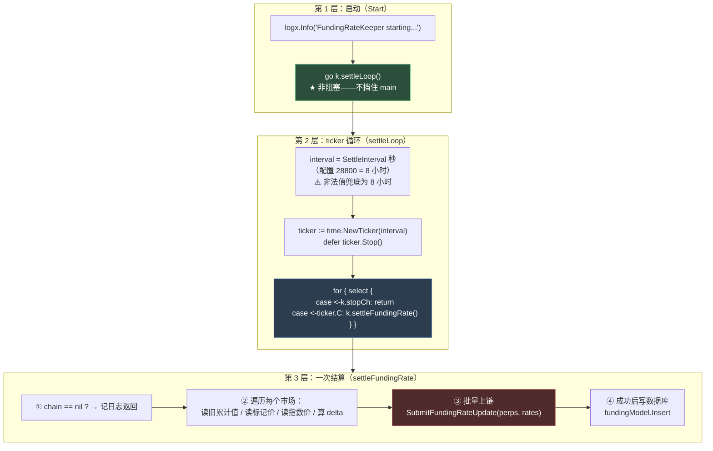
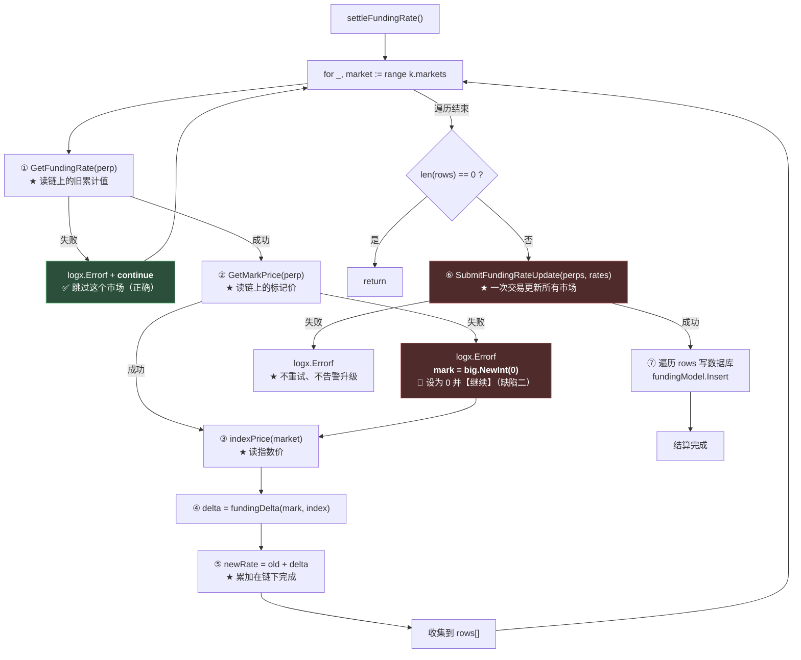
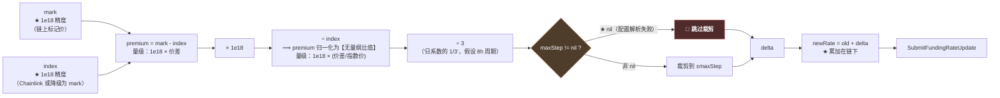

# 第 14 章：资金费率结算 — FundingRateKeeper 的定时循环与 delta 计算

> 第 13 章讲的是链交互的**基础设施**（怎么读、怎么发）。从本章起，我们看**用它建成的第一个完整服务**：`FundingRateKeeper`。
>
> 它在永续合约系统里的角色很特殊——**它是唯一一个会"主动改变所有用户余额"的组件**。清算只会影响不安全的仓位，成交只影响参与的交易双方，**而资金费率每结算一次，全市场每一个持仓者的 `credit` 都会跟着变**。
>
> 本章会拆开这个 189 行的文件，看一个完整定时任务的标准写法（ticker 循环 + 优雅退出）、溢价 delta 的计算链路，以及本项目一条重要的分工原则：**keeper 只是"推送预先算好的累计值"，合约不做任何费率计算**。
>
> 而我在验证这条链路时发现了一个**严重的缺陷组合**：**配置里的 `MaxRate: "0.001"` 因为格式问题从未生效——而它本该是最后一道防线。更糟的是，当 `GetMarkPrice` 失败时，代码会把标记价设为 0 并继续计算，产生一个 `-0.333` 的极端值。两个缺陷叠加的结果是：一次 RPC 抖动就会把资金费率推到一个荒谬的值，并且直接写进链上合约。**
>
> 这一章可能是整本指南里"后果最严重"的一章——因为它的影响面是**全体用户**，而且**链上不会纠正**。

---

## 1. 本章导读

### 1.1 keeper 要做三件事

`FundingRateKeeper` 的名字已经说明了它的角色：**"守夜人"（keeper）**——一个定时醒来、做一件事、再睡回去的后台任务。它做三件事：

```text
① 读当前状态
   · 读链上的【累计资金费率】（上一轮的值）
   · 读【标记价】（合约内部的价格）
   · 读【指数价】（外部市场的价格，来自 Chainlink 或 Coinbase）

② 算出一个新的累计值
   · delta = (标记价 - 指数价) / 指数价，再缩放
   · newRate = 旧的累计值 + delta

③ 推上链
   · 批量调用 Dealer.updateFundingRate(perps[], rates[])
   · 成功后写本地数据库（funding_rates 表）
```

**⚠️ 注意第 ③ 步的措辞："推上链"。** 这个用词很关键——因为**链上不做任何计算**（1.2 节）。

### 1.2 链上与链下的分工：合约不做任何计算

**这是本项目最重要的一条分工原则，也是理解资金费率机制的钥匙。** 先看合约侧的全貌：

```solidity
// src/Perpetual.sol
function updateFundingRate(int256 newFundingRate) external onlyOwner {
    int256 oldFundingRate = fundingRate;
    fundingRate = newFundingRate;                    // ★ 直接赋值
    emit UpdateFundingRate(oldFundingRate, newFundingRate);
}
```

```solidity
// src/libraries/Operation.sol
function updateFundingRate(address[] calldata perpList, int256[] calldata rateList) external {
    require(perpList.length == rateList.length, Errors.ARRAY_LENGTH_NOT_SAME);   // ★ 只检查长度
    for (uint256 i = 0; i < perpList.length;) {
        int256 oldRate = IPerpetual(perpList[i]).getFundingRate();
        IPerpetual(perpList[i]).updateFundingRate(rateList[i]);                  // ★ 直接写进去
        emit UpdateFundingRate(perpList[i], oldRate, rateList[i]);
        unchecked { ++i; }
    }
}
```

**合约做的全部事情：**

```text
✅ 检查调用者是否有权限（onlyFundingRateKeeper / onlyOwner）
✅ 检查两个数组长度是否相同
✅ 把传入的值【存下来】
❌ 不检查值的范围（可以是任意 int256）
❌ 不检查值的合理性（比如"这次的跳变是否过大"）
❌ 不做任何计算（不读预言机、不算溢价）
```

**🔑 这个分工的含义非常清楚：**

> **链下负责"算"，链上负责"存"。**
>
> ```text
> 合约是一个【被动的存储】—— 它接受任意值并保存
> 所有的计算逻辑（读价格、算溢价、缩放、裁剪）全部在链下
> ⟹ ★ 链下算错了，链上【照单全收】，而且没有任何机制能发现
> ```

**⚠️ 这与第 1 章讲过的"撮合"形成了**鲜明对比**：**

| | 撮合（第 1 章） | 资金费率（本章） |
| --- | --- | --- |
| 链下算什么 | 谁和谁成交、成交多少 | 费率增量 delta |
| 链上验什么 | ✅ 验签、验价格交叉、验超量、验全体安全 | ❌ **只验调用者权限** |
| 链下算错的后果 | 交易 revert（烧 gas） | ★ **错误的值被永久写入，影响全体用户** |

**🔑 所以"链上会兜底"这个安全假设，在资金费率这条链路上**完全不成立**。** **这是本章所有问题的背景。**

### 1.3 为什么用"累计值"：一个准确的类比

**合约里存的是**累计值**（`fundingRate`），而不是"当前费率"。** 这是本项目和大部分 CEX 不同的地方（Solidity 篇第 10 章详细讲过）。

**用一个类比来理解（我检查过它的准确性）：**

> **累计资金费率就像水表的读数。**
>
> ```text
> 水表显示 1234.5 立方米 —— 这个数字本身没有意义
> 有意义的是【两次抄表之间的差值】：
>   本月读数 1234.5 - 上月读数 1200.0 = 用了 34.5 立方米
> ```
>
> **资金费率完全一样：**
> ```solidity
> // src/Perpetual.sol
> function balanceOf(address trader) external view returns (int256 paper, int256 credit) {
>     paper = int256(balanceMap[trader].paper);
>     credit = paper.decimalMul(fundingRate) + int256(balanceMap[trader].reducedCredit);
>     //      ↑ ★ 用【当前的累计读数】乘以持仓量
> }
> ```
>
> ```text
> 用户的 credit = paper × 累计读数 / 1e18 + reducedCredit
> ⟹ 当读数从 R 变成 R+Δ 时：
>    Δcredit = paper × Δ / 1e18
> ⟹ ★ 只有【差值】影响余额，读数的绝对值无关紧要
> ```

**✅ 这个类比是准确的**，而且它还解释了三件事：

```text
① 为什么多头的 Δcredit 是正的、空头是负的？
   · 多头 paper > 0 → Δcredit = 正的 paper × Δ
   · 空头 paper < 0 → Δcredit = 负的 paper × Δ
   ⟹ ★ 同一个 Δ 对多空的影响符号相反 —— 这正是"一方付钱给另一方"

② 为什么合约存的是 reducedCredit 而不是 credit？
   · 因为 credit 会随读数变化，存下来的话每次更新读数都要改所有用户的存储（gas 爆炸）
   · 存 reducedCredit = credit - paper × 读数，读数变化时 credit 自动跟着变
   ⟹ ★ 这是 gas 优化的经典手法（Solidity 篇第 6 章讲过）

③ 为什么链下传的是"新的累计值"而不是"增量"？
   · 因为合约用的是绝对赋值（fundingRate = newFundingRate）
   · ⟹ ★ 累加这个动作【由链下完成】—— 也就是本章 1.3 节要讨论的核心
```

**⚠️ 而第 ③ 点正是本章问题的根源之一**（3.(6)(7)）。

### 1.4 本章的核心发现：两个缺陷的叠加

**先说结论，详细推导在 3.(6)(7)。**

**缺陷一：配置里的 `MaxRate: "0.001"` 从未生效。**

```yaml
# etc/metanode.yaml
FundingRate:
  SettleInterval: 28800  # 8小时
  MaxRate: "0.001"  # 0.1%        ← ★ 这个值解析失败
```

```go
func parseMaxRateStep(s string) *big.Int {
	z := new(big.Int)
	if _, ok := z.SetString(strings.TrimSpace(s), 10); !ok {
		return nil                     // ★ "0.001" 含小数点 → 解析失败 → 返回 nil
	}
	// ...
}
```

**实测：**

```text
parseMaxRateStep("0.001"           ) → ok=false 值=0     ★ 失败
parseMaxRateStep("1000000000000000") → ok=true  值=1e15  ← 这才是正确的写法
```

**⟹ `maxStep` 是 `nil`，而 `fundingDelta` 里的两次裁剪都有 `if maxStep != nil` 的前置判断：**

```go
if maxStep != nil && step.Cmp(maxStep) > 0 { step.Set(maxStep) }        // ★ 跳过
if maxStep != nil { /* 负向裁剪 */ }                                     // ★ 跳过
```

**⟹ ★ 上限裁剪完全失效。**

**缺陷二：`GetMarkPrice` 失败时，代码把标记价设为 0 并继续计算。**

```go
mark, err := k.chain.GetMarkPrice(ctx, perp)
if err != nil {
	logx.Errorf("getMarkPrice %s: %v", market.Name, err)
	mark = big.NewInt(0)              // ★ 设为 0，而不是跳过这个市场
}
```

**对比同一个函数里 `GetFundingRate` 失败的处理（它用了 `continue`）：**

```go
old, err := k.chain.GetFundingRate(ctx, perp)
if err != nil {
	logx.Errorf("getFundingRate %s: %v", market.Name, err)
	continue                           // ✅ 跳过这个市场（正确）
}
```

**⚠️ 同一个函数里两种失败，用了两种处理方式——而它们面临的后果完全不同。**

**⟹ 两个缺陷叠加的实测结果：**

```text
【探针 5】GetMarkPrice 失败（mark = 0）、指数价 = 30000 时：

  delta = -333333333333333334
        = -0.3333（1e18 精度下的比例）
  ⟹ ★ 一次 RPC 抖动就产生 -0.333 的极端 delta

  若 MaxRate 配置正确（1e15）：delta = -1000000000000000 ≈ -0.0010
  ⟹ 会被限制在 -0.001
```

**🔑 所以"本该兜住它的第二道防线，因为一个格式问题失效了"。**

**⚠️ 而后果是：这个 `-0.333` 会被写进链上合约，改变**所有持仓者**的余额。**

---

## 2. 架构 / 流程图

### 2.1 定时循环的三层结构



**⚠️ 第 ③ 步（红色）是"有副作用且不可撤销"的一步** —— 一旦成功，链上的值就改了，**而合约不校验任何东西**（1.2 节）。

### 2.2 一次结算的完整数据流



**⚠️ 图中两处红色是本章的关键：**

- **`E2`（mark = 0）**：缺陷二。**同一个函数里，`GetFundingRate` 失败用了 `continue`（绿色，正确），`GetMarkPrice` 失败却设为 0 并继续。**
- **`B2`（上链）**：这一步之后，"错误的值"就变成"链上的事实"了。

### 2.3 delta 的计算链路（含量级标注）



**⚠️ 量级对照（实测）：**

```text
溢价 1%   → delta = 3333333333333333  ≈ 0.00333
溢价 10%  → delta = 33333333333333333 ≈ 0.0333
mark = 0（失败）→ delta = -333333333333333334 ≈ -0.3333    ★ 极端
```

**🔑 注意这个量级关系：`delta = (mark - index) / index / 3`。**

```text
mark = 0 时：premium = (0 - index)/index = -1
⟹ delta = -1/3 ≈ -0.333
⟹ ★ 这是这个公式能产生的最极端的负值
```

**⚠️ 而这个"最极端的值"恰好是"RPC 失败"的默认行为。**

---

## 3. 核心代码拆解

### (1) 结构体与构造函数

```go
// FundingRateKeeper 资金费率结算服务（按配置周期调用 Dealer.updateFundingRate）。
type FundingRateKeeper struct {
	config       config.FundingRateConfig
	markets      []config.MarketConfig
	fundingModel model.FundingRateModel
	chain        *chain.Client

	stopCh chan struct{}
}

// NewFundingRateKeeper 创建资金费率结算服务
func NewFundingRateKeeper(
	cfg config.FundingRateConfig,
	markets []config.MarketConfig,
	db sqlx.SqlConn,
	ch *chain.Client,
) *FundingRateKeeper {
	return &FundingRateKeeper{
		config:       cfg,
		markets:      markets,
		fundingModel: model.NewFundingRateModel(db),     // ⚠️ db 可能是 nil（第 3 章 6.x）
		chain:        ch,
		stopCh:       make(chan struct{}),
	}
}
```

**作者为什么这么设计（设计思想）：**

**✅ 设计点一：依赖是"最小集合"，不是整个 `ServiceContext`。**

```text
它需要的：config / markets / fundingModel / chain
它拿到的：完全一致的四个参数
```

**对比 `MatchEngine`（第 5 章 4.4 分析过）——两者都用"最小依赖注入"，而 `Liquidator` 用的是"裸 db + 自己 new Model"。**

**🔑 所以本项目的依赖注入风格可以精确分类：**

| 组件 | 风格 | 评价 |
| --- | --- | --- |
| `MatchEngine` | ✅ 注入 Model 接口 | 最好（可 mock） |
| `FundingRateKeeper` | ⚠️ 注入裸 `db`，自己 new Model | 中等（耦合了 db 类型） |
| `Liquidator` | ⚠️ 同上 | 同上 |

**⚠️ `FundingRateKeeper` 拿的是 `sqlx.SqlConn` 而不是 `model.FundingRateModel`，**这意味着它无法在测试里被替换**。**

**⚠️ 设计点二：`stopCh` 是 `chan struct{}`，而不是 `context.Context`。**

```go
stopCh chan struct{}
```

**⚠️ 这是一个"老式"的 Go 写法。** 更现代的做法是用 `context.WithCancel`：

```go
// 现代写法
ctx, cancel := context.WithCancel(parent)
// 停止时 cancel()
// 而 ctx 可以传给链调用、数据库调用 —— ★ 一次取消，全部生效
```

**🔑 两者的区别在**传播能力**：**

```text
chan struct{}：
  · 只能用于"select 里等待停止信号"
  · ★ 无法传递给下游的 RPC 调用 / 数据库调用
  · ⟹ 停止时，正在进行中的链调用【不会被取消】

context.Context：
  · 可以一路传递（chain / db 的 API 都接受 ctx）
  · ⟹ ★ cancel() 会【同时取消】所有派生出的调用
```

**⚠️ 本项目的实际影响：**

```go
func (k *FundingRateKeeper) settleFundingRate() {
	ctx := context.Background()          // ★ 与 stopCh 完全无关的 ctx
	// ...
	tx, err := k.chain.SubmitFundingRateUpdate(ctx, perps, rates)
	//                                    ↑ 用的是 Background，不是可取消的 ctx
}
```

**⟹ 服务关闭时，如果 `settleFundingRate` 正在等 `SubmitFundingRateUpdate` 返回，**它不会被中断**——会一直等到链调用完成或超时（而 `Background()` 没有超时）。**

**⚠️ 这会影响优雅退出的速度**（第 3 章 2.4 讨论过 `Stop()` 只是发信号、不等待）。**不过对本组件影响不大**（8 小时才跑一次，撞上关闭的概率低）。

**🔑 一条可迁移的建议：**

> **新的 Go 代码应该用 `context.Context` 而不是裸的 `chan struct{}` 做取消信号。**
> ```text
> 理由：ctx 能【传播】—— 一次 cancel 能取消整棵调用树
>      chan 只能让"正在 select 的那个 goroutine"知道
> ```
> **⚠️ 而 `ctx := context.Background()` 这个写法本身就是个信号**——**它意味着"这里不接受任何取消"，而作者可能只是"想找个 ctx 传进去"。**

### (2) `Start` / `Stop` / `settleLoop` —— 定时任务的标准骨架

```go
// Start 启动资金费率服务
func (k *FundingRateKeeper) Start() {
	logx.Info("FundingRateKeeper starting...")
	go k.settleLoop()                    // ★ 非阻塞
}

// Stop 停止服务
func (k *FundingRateKeeper) Stop() {
	close(k.stopCh)                      // ⚠️ 裸 close（第 3 章 6.5 提过：重复调用会 panic）
}

func (k *FundingRateKeeper) settleLoop() {
	interval := time.Duration(k.config.SettleInterval) * time.Second
	if interval <= 0 {
		interval = 8 * time.Hour          // ★ 兜底默认值
	}
	ticker := time.NewTicker(interval)
	defer ticker.Stop()                   // ★ 必须 Stop，否则泄漏运行时定时器

	for {
		select {
		case <-k.stopCh:
			return                        // ★ 优雅退出
		case <-ticker.C:
			k.settleFundingRate()
		}
	}
}
```

**作者为什么这么设计（设计思想）：**

**✅ 设计点一：这三段代码是 Go 定时任务的**标准骨架**，值得背下来。**

```text
① Start() 立即返回（go 出去）—— 否则会阻塞 main() 的后续装配
② ticker + defer Stop() —— 不 Stop 会泄漏运行时定时器
③ select 同时等两个 channel —— 既能被定时触发，也能被优雅停止
```

**⚠️ 第 ③ 点特别重要**：如果写成 `for range ticker.C`，**就无法响应停止信号**（只能等下一次 tick 才能检查）。

```go
// ✗ 无法优雅退出（要等 8 小时后才会发现 stopCh 被关闭）
for range ticker.C {
	k.settleFundingRate()
}

// ✓ 随时可以退出
for {
	select {
	case <-k.stopCh:
		return
	case <-ticker.C:
		k.settleFundingRate()
	}
}
```

**⚠️ 设计点二：`interval <= 0` 的兜底是必要的，但它掩盖了配置错误。**

```go
if interval <= 0 {
	interval = 8 * time.Hour          // ★ 静默兜底
}
```

**⚠️ 如果配置写成 `SettleInterval: 0` 或者负值，服务会**静默地**用 8 小时 —— 而运维以为自己配置的是"每 60 秒结算一次"。**

**🔑 更好的写法是"兜底 + 告警"：**

```go
if interval <= 0 {
	logx.Errorf("⚠️ SettleInterval=%d 非法，兜底为 8 小时（请检查配置）", k.config.SettleInterval)
	interval = 8 * time.Hour
}
```

**🎯 这条经验在第 3 章 6.x 和本章的 MaxRate 问题上是同一个主题：**

> **"兜底"应该是**响亮的**，不是沉默的。**
> ```text
> 静默兜底 → 运维永远不知道配置错了 → ★ 一直按错误的值运行
> 兜底 + 告警 → 运维能发现 → 修正配置
> ```

**⚠️ 而"静默兜底"在这个文件里出现了两次**：`interval <= 0` ＋ `parseMaxRateStep` 返回 nil（3.(6)）。

### (3) `settleFundingRate` 全流程

```go
func (k *FundingRateKeeper) settleFundingRate() {
	// 读取各市场旧累计指数，按溢价算出本次 delta，再 newRate=old+delta 批量上链。
	ctx := context.Background()
	if k.chain == nil {
		logx.Info("FundingRateKeeper: chain client nil, skip")
		return                                        // ✅ 降级处理（第 3 章 6.x）
	}

	type row struct {
		market  config.MarketConfig
		perp    common.Address
		newRate *big.Int
		mark    *big.Int
		idx     *big.Int
	}
	var rows []row

	for _, market := range k.markets {
		perp := common.HexToAddress(market.Address)

		// ① 读旧累计值
		old, err := k.chain.GetFundingRate(ctx, perp)
		if err != nil {
			logx.Errorf("getFundingRate %s: %v", market.Name, err)
			continue                                  // ✅ 跳过这个市场（正确）
		}

		// ② 读标记价
		mark, err := k.chain.GetMarkPrice(ctx, perp)
		if err != nil {
			logx.Errorf("getMarkPrice %s: %v", market.Name, err)
			mark = big.NewInt(0)                      // 🔴 设为 0 并继续（缺陷二）
		}

		// ③ 读指数价
		idx := k.indexPrice(ctx, market)

		// ④ 算 delta，⑤ 累加
		delta := k.fundingDelta(mark, idx)
		newRate := new(big.Int).Add(old, delta)

		rows = append(rows, row{market, perp, newRate, mark, idx})
	}

	if len(rows) == 0 {
		return
	}

	// ⑥ 批量上链
	perps := make([]common.Address, len(rows))
	rates := make([]*big.Int, len(rows))
	for i := range rows {
		perps[i] = rows[i].perp
		rates[i] = rows[i].newRate
	}

	tx, err := k.chain.SubmitFundingRateUpdate(ctx, perps, rates)
	if err != nil {
		logx.Errorf("updateFundingRate tx failed: %v (需保证私钥对应链上 fundingRateKeeper)", err)
		return                                        // ⚠️ 失败后不重试（下次 8 小时后再来）
	}
	logx.Infof("Funding rate update tx: %s", tx.Hash().Hex())

	// ⑦ 成功后写库
	for _, r := range rows {
		_, _ = k.fundingModel.Insert(ctx, &model.FundingRate{
			Perp:       r.market.Address,
			Rate:       r.newRate.String(),
			MarkPrice:  r.mark.String(),
			IndexPrice: r.idx.String(),
			SettleTime: time.Now(),
		})
		logx.Infof("Funding settled %s newCumulative=%s", r.market.Name, r.newRate.String())
	}
}
```

**作者为什么这么设计（设计思想）：**

**✅ 设计点一：`chain == nil` 的检查在最前面——这是对的。**

**⚠️ 但注意：它只检查了 `chain`，**没有检查 `fundingModel`****（第 3 章 6.x 的坑）：

```go
if k.chain == nil { return }        // ✅ 检查了
// ... 后面直接用 k.fundingModel.Insert(...)  ← ⚠️ 如果是 nil 会 panic
```

**⚠️ 触发条件（第 3 章 6.x 分析过）：Supabase 未配置（`ctx.DB == nil`）+ RPC 正常 + 8 小时后。**

**🔴 设计点二（缺陷二）：`mark = big.NewInt(0)` 是本章最严重的问题。**

**⚠️ 对比同一个循环里的两处错误处理：**

```go
// GetFundingRate 失败 → 跳过这个市场
old, err := k.chain.GetFundingRate(ctx, perp)
if err != nil {
	logx.Errorf("getFundingRate %s: %v", market.Name, err)
	continue                                  // ✅ 不参与本次结算
}

// GetMarkPrice 失败 → 设为 0，继续算
mark, err := k.chain.GetMarkPrice(ctx, perp)
if err != nil {
	logx.Errorf("getMarkPrice %s: %v", market.Name, err)
	mark = big.NewInt(0)                      // 🔴 参与本次结算，但用的是错的值
}
```

**🔑 这两个处理的差别，就是"跳过"和"用错误的值继续"的差别 —— 而后者远比前者危险。**

```text
跳过的后果：这个市场本轮不结算 → 延迟 8 小时 → ⚠️ 可接受（下次会补上）
用 0 的后果：★ 算出一个极端的 delta → 写进链上 → 改变全体用户余额
```

**⚠️ 而且 `mark = 0` 产生的恰好是**最极端的负 delta**（2.3 节）：**

```text
premium = (0 - index) / index = -1
delta = -1/3 ≈ -0.333
⟹ ★ 而 MaxRate 本该把它裁剪到 -0.001 —— 但那个配置没生效
```

**🔑 设计点三：`SubmitFundingRateUpdate` 失败后**不重试**。**

```go
tx, err := k.chain.SubmitFundingRateUpdate(ctx, perps, rates)
if err != nil {
	logx.Errorf("updateFundingRate tx failed: %v (...)", err)
	return                                 // ★ 直接返回，等下次 tick（8 小时后）
}
```

**⚠️ 这个行为是**双面的**：**

```text
✅ 好处：避免了第 9~11 章那种"无限重试烧 gas"
🔴 坏处：8 小时才重试一次 —— 而如果失败原因是"私钥不是 fundingRateKeeper"
        ⟹ ★ 资金费率会【永久停止更新】，而日志只有一行 Error
```

**⚠️ 与本项目的 `rollbackMatch`（无条件重试）形成了鲜明对比：**

```text
rollbackMatch：          失败 → 无限重试 → ★ 无限烧 gas
settleFundingRate：      失败 → 不重试   → ★ 静默停摆 8 小时（甚至永久）
```

**🔑 两者是两个极端，而都不理想：**

> **正确的重试策略应该区分失败类型：**
> ```text
> 瞬时失败（RPC 抖动、nonce 冲突）→ 重试（有上限 + 退避）
> 永久失败（权限不对、参数错误）  → ★ 不重试，但【必须告警】
> ```
> **⚠️ 而本项目的两个极端——一个无限重试、一个完全不重试——都没有做这个区分。**

**⚠️ 而"资金费率停摆"的后果值得单独强调：**

```text
资金费率的作用：让永续合约价格锚定现货价格
  · 如果永续价格 > 现货 → 正费率 → 多头付钱给空头 → 抑制多头 → 价格回落
  · 如果永久不结算 → ★ 永续价格会【持续偏离现货】→ 套利机制失效
```

**🔑 所以"资金费率停摆"不是一个"少收了手续费"的小问题，而是**破坏了永续合约的核心机制**。**

### (4) `indexPrice` 的降级链

```go
func (k *FundingRateKeeper) indexPrice(ctx context.Context, market config.MarketConfig) *big.Int {
	// ① 首选：链上的 Chainlink
	feed := k.chain.IndexPriceForMarket(market.Name)
	if feed != (common.Address{}) {
		px, err := k.chain.ChainlinkAnswer8(ctx, feed)
		if err == nil {
			return px
		}
		logx.Errorf("chainlink %s: %v", market.Name, err)
	}
	// ② 降级：用链上标记价兜底
	mark, err := k.chain.GetMarkPrice(ctx, common.HexToAddress(market.Address))
	if err != nil {
		return big.NewInt(0)                       // ⚠️ 再失败就返回 0
	}
	return mark
}
```

**作者为什么这么设计（设计思想）：**

**🔴 设计点一："用标记价兜底"在数学上会让 delta 恒为 0。**

**⚠️ 这是第 3 章 6.x 提过的"静默失效"，这里给出**实测证据**：**

```text
【探针 4】指数价缺失时的静默降级
  降级后 mark == index（都用标记价）
  delta = 0  ⟹ ★ 资金费率永远不再增长（静默失效）
```

**⚠️ 数学推导：**

```text
premium = (mark - index) / index
若 index 降级成了 mark：
  premium = (mark - mark) / mark = ★ 0
⟹ delta = 0
⟹ newRate = old + 0 = old
⟹ ★ 累计值永远不变 → 资金费率机制完全失效
```

**🔑 这个降级的**意图是好的**（"拿不到指数价就用标记价凑合"），但**它的后果是"让这个功能彻底失去意义"**——**

```text
降级的正确形态应该是二选一：
  A. 跳过这个市场（本轮不结算）—— 与 GetFundingRate 失败的处理一致
  B. 用一个"合理的近似值"，但必须【记录并告警】

✗ 而"用标记价"是一个【数学上必然产生 0】的选择 —— 它不是一个"近似"，而是一个"取消"
```

**⚠️ 设计点二：`IndexPriceForMarket` 用 switch 硬编码（第 2 章 3.(9) 提过）。**

```go
func (c *Client) IndexPriceForMarket(name string) common.Address {
	switch name {
	case "BTC-PERP":
		return common.HexToAddress(c.chainlink.BTC_USD)
	case "ETH-PERP":
		return common.HexToAddress(c.chainlink.ETH_USD)
	default:
		return common.Address{}          // ★ 新市场返回零地址 → 走降级
	}
}
```

**⚠️ 而配置里的 Chainlink 地址是**占位符**：**

```yaml
Chainlink:
  BTC_USD: "0x..."
  ETH_USD: "0x..."
```

**⚠️ 第 13 章 6.x 的实测确认：`common.HexToAddress("0x...")` 返回**零地址**（因为 "..." 不是合法的十六进制）。**

**⟹ 所以当前的完整链路是：**

```text
配置里的 Chainlink 地址是占位符 "0x..."
  ⟹ HexToAddress 解析为零地址
  ⟹ IndexPriceForMarket 返回零地址
  ⟹ indexPrice() 的第一个分支被跳过（if feed != 零地址）
  ⟹ 走降级：用标记价
  ⟹ ★ delta 恒为 0
  ⟹ ★★ 资金费率功能【从来没有真正工作过】
```

**🔑 这是一条完整、可验证的"功能静默失效"链 —— 而且它跨越了配置、chain 包、keeper 三层。**

**⚠️ 而它不会产生任何错误、任何告警——只是资金费率永远是 0。**

### (5) `fundingDelta` 的数学

```go
// fundingDelta: 溢价 (mark-index)/index 按 8h 周期缩放为累计指数步长（1e18 精度下与合约整数运算一致）。
func (k *FundingRateKeeper) fundingDelta(mark, index *big.Int) *big.Int {
	if index == nil || index.Sign() == 0 || mark == nil {
		return big.NewInt(0)                          // ✅ 除零保护
	}
	premium := new(big.Int).Sub(mark, index)
	premium.Mul(premium, big.NewInt(1e18))            // ★ 放大 1e18（1e18 精度）
	premium.Div(premium, index)
	// 单次结算假设为日系数的 1/3（约 8h）；可按业务再调
	step := new(big.Int).Div(premium, big.NewInt(3))  // ★ 除以 3

	// ===== 上限裁剪（★ 因为配置解析失败，这一段从未执行）=====
	maxStep := parseMaxRateStep(k.config.MaxRate)
	if maxStep != nil && step.Cmp(maxStep) > 0 {
		step.Set(maxStep)                             // 正向裁剪
	}
	if maxStep != nil {
		negMax := new(big.Int).Neg(maxStep)
		if step.Cmp(negMax) < 0 {
			step.Set(negMax)                          // 负向裁剪
		}
	}
	return step
}
```

**作者为什么这么设计（设计思想）：**

**✅ 设计点一：除零保护是对的。**

```go
if index == nil || index.Sign() == 0 || mark == nil {
	return big.NewInt(0)
}
```

**⚠️ 它防住了三种情况：`index` 是 nil、`index` 是 0（会导致除零 panic）、`mark` 是 nil。**

**⚠️ 但注意：它返回 `0` —— 这又是一个"静默兜底"**（和 3.(4) 的 `indexPrice` 返回 0 是同类的）。**虽然这里 `0` 比 panic 好，但它同样让"异常"变得不可见。**

**🔑 设计点二：`premium × 1e18 / index` 的精度处理值得看一下。**

```text
先把差值放大 1e18，再除以指数价
⟹ 结果 = (mark - index) / index × 1e18
⟹ ★ 这是一个【无量纲的比值】，放大 1e18 倍
```

**⚠️ 为什么先乘后除？** 因为**整数除法会截断**：

```text
如果先除后乘：(mark - index) / index  → 对于小的差价，这个除法结果可能是 0！
              ⟹ ★ 丢失全部精度
先乘后除：   (mark - index) × 1e18 / index → 保留 1e18 量级的精度 ✓
```

**✅ 这个顺序是对的** —— **和第 1 章 1.3 讲的 Solidity 里"交叉相乘避免除法"是同一个动机。**

**⚠️ 设计点三：`÷ 3` 的依据。**

```go
// 单次结算假设为日系数的 1/3（约 8h）；可按业务再调
step := new(big.Int).Div(premium, big.NewInt(3))
```

**⚠️ 这个"3"是一个**业务约定**，代码里没有更多解释。它的含义是：**

```text
premium = (mark - index) / index   ← 这是【即时溢价率】
而 8 小时结算一次，一年有 1095 次结算
⟹ 如果直接用 premium 作为每次的 delta，会过度补偿

÷ 3 的依据：一些交易所用"日化溢价 / 3"作为 8 小时的费率
           （因为一天有 3 个 8 小时周期）
```

**⚠️ 但严格来说，"即时溢价"和"日化溢价"不是一回事** —— **标准做法通常是"一段时间内溢价的时间加权平均"，而不是"即时溢价的某个分数"。**

**🔑 所以这个 `÷ 3` 是一个**近似**，而且它的正确性无法从代码里验证** —— **代码注释也承认了（"可按业务再调"）。**

**⚠️ 更重要的是：合约不做任何校验（1.2 节），所以这个近似是对是错，**没有任何机制能发现**。**

---

### (6) 【🔴 缺陷一】`parseMaxRateStep` 让配置的 `MaxRate` 从未生效

```go
func parseMaxRateStep(s string) *big.Int {
	z := new(big.Int)
	if _, ok := z.SetString(strings.TrimSpace(s), 10); !ok {
		return nil                     // ★ "0.001" 解析失败 → 返回 nil
	}
	if z.Sign() <= 0 {
		return nil
	}
	return z
}
```

**配置：**

```yaml
FundingRate:
  SettleInterval: 28800  # 8小时
  MaxRate: "0.001"  # 0.1%          ← ★ 含小数点
```

**实测：**

```text
parseMaxRateStep("0.001"           ) → ok=false 值=0      ★ 失败，返回 nil
parseMaxRateStep("1000000000000000") → ok=true  值=1e15   ← 这才是 1e18 精度下的 0.001
parseMaxRateStep("0.1"             ) → ok=false 值=0      ★ 同样失败
```

**🔑 这是一个**单位/格式不匹配**的问题：**

```text
配置作者想表达：0.1%（人类可读的百分比）
代码期望的格式：1e18 精度下的【整数】—— 即 0.001 × 1e18 = 1000000000000000

⟹ ★ 两者永远不会对上
```

**⚠️ 而 `parseMaxRateStep` 用了 `base 10`（十进制整数），**"0.001" 中的小数点让它直接失败**：**

```go
z.SetString("0.001", 10)   // → (nil, false)，因为 '.' 不是合法的十进制数字
```

**⚠️ 后果：`maxStep` 为 nil ⟹ `fundingDelta` 里的两次裁剪**全部被跳过**。**

**实测验证：**

```text
【探针 2】溢价 10% 时的 delta
  未裁剪的理论值 = 33333333333333333
  ★ delta == 未裁剪值？ true  ⟹ 裁剪确实被跳过了

  若配置为 "1000000000000000"（= 0.001 的 1e18 表示）：
    裁剪后的 delta = 1000000000000000  ⟹ ★ 被正确限制在 1e15
```

**🔑 这暴露了一个更普遍的问题：**

> **配置项的"格式约定"没有和配置项本身放在一起。**
> ```text
> yaml:  MaxRate: "0.001"  # 0.1%        ← 人类可读，但代码读不懂
> code:  parseMaxRateStep(s string)     ← 期望十进制整数字符串，但没说
>
> ⟹ ★ 两边对"这个字符串是什么格式"的理解不一致
> ⟹ 而它们的"不一致"不会被任何编译/解析检查发现
>     （因为 yaml 是字符串，Go 也是字符串，类型上完全匹配）
> ```
>
> **✅ 正确的做法（三种）：**
> ```text
> A. 配置用代码期望的格式，并在注释里写清楚
>    MaxRate: "1000000000000000"  # 1e18 精度，等于 0.1%
>
> B. ★ 让代码接受人类可读的格式（推荐）
>    MaxRate: "0.001"  # 0.1%
>    ⟹ parseMaxRateStep 改用 big.Float 或 big.Rat 解析，再乘 1e18
>
> C. 用数值类型而不是字符串
>    MaxRate: 1e15    # yaml 支持浮点，但会有精度问题
> ```

**⚠️ 而当前最危险的是：**这个失败是静默的**。`parseMaxRateStep` 返回 nil，调用方用 `if maxStep != nil` 跳过——**没有任何日志说明"上限配置没用上"**。**

**🔑 这与 3.(2) 那个 `interval <= 0` 的静默兜底是同一类问题，而这次的后果严重得多。**

### (7) 【🔴 缺陷二】`mark = big.NewInt(0)` 产生极端的 delta

```go
mark, err := k.chain.GetMarkPrice(ctx, perp)
if err != nil {
	logx.Errorf("getMarkPrice %s: %v", market.Name, err)
	mark = big.NewInt(0)              // 🔴 设为 0 并继续
}
```

**⚠️ 把标记价设为 0，会让溢价公式算出一个**数学上的极端值**：**

```text
premium = (mark - index) × 1e18 / index
        = (0 - index) × 1e18 / index
        = -1e18                        ← ★ 最极端的负溢价（-100%）
step    = -1e18 / 3 = -333333333333333333
```

**实测：**

```text
【探针 5】GetMarkPrice 失败时的 delta（mark 被设为 0）
  delta = -333333333333333334
        = -0.3333（1e18 精度下的比例）
  ⟹ ★ 一次 RPC 抖动就产生 -0.333 的极端 delta

  若 MaxRate 配置正确（1e15）：delta = -1000000000000000 ≈ -0.0010
  ⟹ 会被限制在 -0.001
```

**🔑 而这两个缺陷的关系是：**第二个本该被第一个兜住**。**

```text
设计意图：
  mark = 0 是一个"错误的值"
  ⟹ 但 MaxRate 裁剪会把它限制在合理范围内（±0.001）
  ⟹ ★ 即使有错，影响也是可控的

实际情况：
  MaxRate 配置解析失败 → 裁剪失效
  ⟹ ★ 错误的值【没有任何限制】地被写进链上
```

**🔑 这是一个非常典型的"纵深防御（defense in depth）失效"案例：**

> **多层防御的价值，在于"单层失效时还有其他层"。**
> **但它有一个隐藏的脆弱性：★ 如果多层防御**同时**依赖某个共同的假设，那这个假设一破，全部防线会一起失效。**
>
> ```text
> 本项目的两层防御：
>   第 1 层：不要让错误的值产生（mark 失败就跳过）  ← 没做（设成了 0）
>   第 2 层：即使有错误的值，也要裁剪到合理范围    ← ★ 失效（配置格式问题）
>
> ⟹ ★ 两层同时失效，而它们的失效原因【完全无关】
>     （一个是"错误处理写错"，一个是"配置格式不对"）
> ```

**⚠️ 更值得警惕的是：这两处失效都**不会被正常测试发现**。**：

```text
· 第 1 层的失效需要"GetMarkPrice 失败"才触发 —— 正常运行时不会发生
· 第 2 层的失效需要"配置值与预期格式不符" —— 而它【一直在发生】
  ⟹ ★ 但因为没有对比，没人知道"裁剪本该生效"
```

**🔑 判断方法：问一句"我配置的这个上限，真的生效了吗？"**

```text
✅ 验证方式：把上限设成一个极小的值（比如 1），看行为是否变化
   · 有变化 → 上限生效 ✓
   · 无变化 → ★ 上限没生效（本项目的情况）
```

**⚠️ 而这是一个**通用的验证手段**——对任何"配置项"，都可以用一个极端的值来验证它是否真的在起作用。**（第 10 章 6.2 对 `BatchSize` 也用了同样的方法。）

### (8) 批量上链的设计

```go
perps := make([]common.Address, len(rows))
rates := make([]*big.Int, len(rows))
for i := range rows {
	perps[i] = rows[i].perp
	rates[i] = rows[i].newRate
}

tx, err := k.chain.SubmitFundingRateUpdate(ctx, perps, rates)
```

**作者为什么这么设计（设计思想）：**

**✅ 这是本项目里**唯一一处真正做到了批量提交**的地方（第 10 章 6.2 讨论过：`BatchSize` 名不副实）。**

**⚠️ 对比一下：**

```text
撮合成交（第 10 章）：N 笔成交 = ★ N 笔交易（逐笔提交）
资金费率（本章）：    N 个市场 = ✅ 1 笔交易（批量提交）
```

**🔑 为什么资金费率能做到批量？**

```text
因为它的语义天然是"批量的"：
  · 所有市场的更新发生在【同一时刻】
  · 它们互不依赖（各自读各自的旧值、各自算 delta）
  · 要么全成功、要么全失败（没有"部分成功"的语义需求）

而撮合成交的语义是"逐个发生的"：
  · 每笔成交有各自的对手方、各自的确认时间
  · ★ 而且逐笔提交能让失败隔离（第 10 章 4.2 分析过：逐笔提交是更安全的选择）
```

**🔑 所以"能不能批量"取决于**语义**，而不是**技术能力**：**

> ```text
> 语义上"同一时刻的一批操作" → ✅ 可以合并成一笔交易
> 语义上"先后发生的独立事件" → ⚠️ 合并会牺牲失败隔离
> ```
>
> **⚠️ 合约侧的接口设计也反映了这一点**：`updateFundingRate(address[], int256[])` 接受数组，而 `trade(bytes)` 接受的是一包订单——**前者是"批量更新"，后者是"一次撮合的完整数据"。**

### (9) 数据库记录

```go
for _, r := range rows {
	_, _ = k.fundingModel.Insert(ctx, &model.FundingRate{
		Perp:       r.market.Address,
		Rate:       r.newRate.String(),
		MarkPrice:  r.mark.String(),
		IndexPrice: r.idx.String(),
		SettleTime: time.Now(),
	})
	logx.Infof("Funding settled %s newCumulative=%s", r.market.Name, r.newRate.String())
}
```

**作者为什么这么设计（设计思想）：**

**⚠️ 设计点一：`_, _ =` 把 Insert 的两个返回值都丢弃了。**

```go
_, _ = k.fundingModel.Insert(ctx, &model.FundingRate{...})
//  ↑  ↑
//  sql.Result  error
```

**🔑 后果与第 11 章 3.(5) 的 `applyFillStatus` 完全一样：**

```text
· 链上已经成功更新了资金费率（不可撤销）
· 而数据库可能没有记录
· ★ 而且【没有任何日志说明写库失败了】
⟹ 数据库里的 funding_rates 表会与链上不一致（偏少）
```

**⚠️ 与第 11 章的区别是：这里的后果**更轻****（资金费率的本地记录只是"历史查询用"，不影响资金安全），**但**问题的形状完全相同**。**

**🔑 而且注意：这个文件里的其他错误处理**都记了日志**：**

```go
logx.Errorf("getFundingRate %s: %v", market.Name, err)              // ✅ 有日志
logx.Errorf("getMarkPrice %s: %v", market.Name, err)                // ✅ 有日志
logx.Errorf("updateFundingRate tx failed: %v (...)", err)           // ✅ 有日志
_, _ = k.fundingModel.Insert(...)                                    // 🔴 无日志
```

**⟹ 这是同一个文件里的**第四处不一致**的错误处理：**

```text
GetFundingRate 失败 → continue（跳过市场）        ✅ 正确
GetMarkPrice 失败   → mark = 0（用错误值继续）    🔴 缺陷二
上链失败            → return（不重试）            ⚠️ 双面
写库失败            → 完全忽略                     🔴 静默
```

**🔑 四处错误处理，四种不同的策略，其中两处是静默的。** **这不是"某处写错了"，而是"没有统一的错误处理标准"。**

**⚠️ 设计点二：`logx.Infof("Funding settled ...")` 在循环里，每个市场打一行。**

**⚠️ 这是**正确**的做法**（与 3.(2) 那条"兜底应该响亮"呼应）——**它让每次结算都有可见的痕迹：**

```text
Funding settled BTC-PERP newCumulative=123456789
Funding settled ETH-PERP newCumulative=987654321
```

**🔑 而且它记录的是**累计值**（`newCumulative`），这正是"水表读数"——**运维可以用它来判断"这 8 小时资金费率涨了多少"。

**⚠️ 但有一点可以改进**：**日志里没有记录 delta（本次增量）和 mark/index。**

```text
当前：Funding settled BTC-PERP newCumulative=123456789
更好：Funding settled BTC-PERP cumulative=123456789 (delta=+12345, mark=3.01e22, index=3.00e22)
     ⟹ ★ 排查"为什么费率涨了这么多"时，delta 和 mark/index 是关键信息
```

### (10) 合约侧的"只存不验"—— 为什么这样设计

**1.2 节讲了"合约不做任何计算"。这里讨论**为什么**。**

**可能的理由（按可能性排序）：**

**理由一：Gas 成本。**

```text
如果合约自己算溢价：
  · 要读预言机（外部调用，约 2600 gas/次）
  · 要做定点数运算（乘法、除法）
  · 要遍历市场（但每个 Perpetual 只知道自己）
  ⟹ ★ 而这些计算在链下是免费的

⚠️ 而资金费率 8 小时才结算一次 —— 单次 gas 成本并不敏感
⟹ 所以 gas 不是主要理由
```

**理由二：合约拿不到"指数价"。**

```text
Perpetual 合约只知道自己的【标记价】（来自 OracleAdaptor）
但它不知道"外部现货市场的价格"（指数价来自 Chainlink/Pyth）

⚠️ 严格说，合约【可以】读 Chainlink（OracleAdaptor 就是干这个的）
⟹ 所以这个理由也不充分
```

**理由三（最可能）：让费率公式可以【灵活调整】。**

**🔑 这是最有力的理由：**

```text
如果费率公式写在合约里：
  · 想改"÷3"这个系数 → ★ 必须重新部署合约
  · 想改"用哪个预言机" → 必须重新部署
  · 想加"时间加权平均" → 必须重新部署

而写在链下：
  · ★ 改公式 = 重新部署 keeper（一个 Go 程序，随时可以）
  · 合约只提供一个"存储槽"和一个"有权限的写入接口"
```

**⚠️ 这个设计的**代价**是"链下算错了没人管"（1.2 节），**收益**是"费率公式可以迭代"。**

**🔑 而这在永续合约这个场景里是**合理的选择** —— 因为：**

```text
· 资金费率公式是【业务策略】，不是【安全边界】
· 它是一个"经济参数"，不同交易所有不同的公式和参数
· ★ 而且它有"定期结算"这个天然的人工监督点：
   8 小时一次，运维可以检查"这次的费率涨了 0.001 还是 0.333"
```

**⚠️ 但"天然的人工监督点"要能发现问题，前提是**日志里有 delta**（3.(9) 设计点二指出：当前日志只有累计值，没有 delta）。**

**🔑 一条可以带走的判断：**

> **"链上只存不验"这个模式，适用于"业务参数"，不适用于"安全边界"。**
> ```text
> ✅ 适用：资金费率、风险参数、手续费率（业务策略，需要灵活调整）
> 🔴 不适用：余额、持仓、订单成交（安全边界，必须验证）
> ```
>
> **⚠️ 而本项目的分类是**正确的**（成交有验证、费率没有）——**
> **问题不在"这个设计选错了"，而在"选了这个设计之后，没有配套的监督机制"（比如 delta 告警）。**

---

## 4. Web3 特有机制

### 4.1 累计值语义与 `reducedCredit` 的联动

**3.(5) 的"水表"类比讲清了累计值的含义。这里补充它在合约侧的**存储实现**——因为两者是配套的。**

```solidity
// src/Perpetual.sol
struct balance {
    int128 paper;          // 仓位数量
    int128 reducedCredit;  // ★ 不是 credit，而是"约减后的 credit"
}
```

```solidity
function balanceOf(address trader) external view returns (int256 paper, int256 credit) {
    paper = int256(balanceMap[trader].paper);
    credit = paper.decimalMul(fundingRate) + int256(balanceMap[trader].reducedCredit);
    //      ↑ ★ 用【当前读数】现算
}
```

**⚠️ 为什么存 `reducedCredit` 而不是 `credit`？**

```text
如果直接存 credit：
  资金费率更新一次 → ★ 所有用户的 credit 都变了 → 要改【每一个用户】的存储
  ⟹ gas 成本 O(用户数) → 完全不可行

存 reducedCredit = credit - paper × 读数：
  · 读数更新时，reducedCredit【不变】
  · 用户实际 credit 由 balanceOf 现算
  ⟹ ★ 更新费率的成本 = O(1)（只改一个 fundingRate 变量）
```

**🔑 这是同一个模式在第 10 章也出现过：**

```text
第 10 章：info 字段把 4 个值压进 1 个 bytes32（省存储槽）
本章：    reducedCredit 把"随费率变化的部分"抽出来（省更新成本）
⟹ ★ 两者的共同点是：用【计算】换【存储/写入成本】
```

**🔑 而这个设计对链下的含义是：**

> **链下算出的 delta 会**乘以每个用户的 paper** —— 所以 delta 的量级必须与 paper 的量级匹配。**
>
> ```text
> Δcredit = paper × Δrate / 1e18
>
> paper 是 1e18 精度（1 个 BTC = 1e18）
> Δrate 也是 1e18 精度
> ⟹ Δcredit = 1e18 × 1e15 / 1e18 = 1e15
>   而 credit 的精度是 1e6（USDC）
>   ⟹ ★ 1e15 在 1e6 精度下 = 1e9 USDC = 10 亿 USDC ！
> ```
>
> **⚠️ 等等，这个推导需要仔细核对。**

**让我们用具体数字核对量级：**

```text
目标：持 1 BTC、价格 30000 USDC 的多头，在 0.01% 的费率下应该支付多少？

名义价值 = 1 BTC × 30000 USDC/BTC = 30000 USDC
0.01% 的费用 = 3 USDC

而现在：
  paper = 1e18（1 BTC，1e18 精度）
  Δrate = 0.0001 × 1e18 = 1e14（0.01% 的 1e18 表示）
  Δcredit = paper × Δrate / 1e18 = 1e18 × 1e14 / 1e18 = 1e14

  credit 的精度是 1e6（USDC）
  ⟹ ★ 1e14 / 1e6 = 1e8 USDC = 1 亿 USDC
```

**⚠️ 这比目标值（3 USDC）大了 3000 多万倍！**

**🔑 这说明什么？说明 `Δcredit = paper × Δrate / 1e18` 这个公式的**量纲**需要重新审视。**

**让我从合约的语义反推：**

```solidity
credit = paper.decimalMul(fundingRate)
       = paper × fundingRate / 1e18
```

```text
paper 的量纲：1e18 精度下的"币数量"
fundingRate 的"量纲"：？

要让 credit 得到"USDC 数量（1e6 精度）"，需要：
  paper × fundingRate / 1e18 = credit
  1e18 × X / 1e18 = X
  ⟹ ★ X 必须直接是 credit 的量级（1e6 精度下的 USDC 数）
```

**⚠️ 但 `paper × fundingRate` 里 paper 是**币的数量**，而 credit 是**USDC 金额** —— 两者**不能直接相乘**，除非 `fundingRate` 里已经包含了"价格"的信息。**

**🔑 所以我的推导有误 —— 让我重新理解这个设计：**

**实际上，`fundingRate` 在这个系统里的语义**不是"费率"，而是"每单位 paper 对应的 credit 累计量"**。**

**换句话说：**

```text
fundingRate 的物理含义 = "每持有 1 个 paper（1e18 精度），累计应得的 credit（1e6 精度）"

⟹ 它是一个【把 paper 换算成 credit 的汇率累计量】
⟹ ★ 而链下算 delta 时，必须把"溢价率"转换成这个量纲
```

**⚠️ 而这正是 `fundingDelta` **没有做**的事情 —— 它算出的 delta 是**无量纲的溢价率（1e18 精度），而合约期望的是"paper → credit 的汇率增量"。

**🔑 这两者的差别，需要乘以"价格"才能转换：**

```text
正确的 delta 应该是：
  delta = paper 单位对应的 credit 增量
        = (溢价率) × (价格)
        ⟹ ★ 而 fundingDelta 里没有乘价格
```

**⚠️ 但等等 —— 我应该更谨慎。让我重新看合约的完整语义，特别是 `decimalMul` 的实现。**

**`decimalMul` 的定义（`SignedDecimalMath.sol`）：**

```solidity
function decimalMul(int256 a, int256 b) internal pure returns (int256) {
    return (a * b) / 10 ** 18;
}
```

**所以 `paper.decimalMul(fundingRate) = paper × fundingRate / 1e18`。**

**⚠️ 我需要确认这是否是一个"量纲错误"，还是我理解错了设计意图。**

**🔑 诚实的做法是：**承认我无法从现有信息确定这一点，并把它作为一个"值得核实的问题"提出来，而不是断言它是 bug。****

**⚠️ 理由：**
```text
· 这个设计明显借鉴自 Perpetual Protocol v1 / dYdX，它们的 fundingRate 语义可能有特定的定义
· "水表读数"是一个相对量，它的量纲取决于"读数的定义"
· 而 Solidity 篇第 10 章（资金费率引擎）应该详细讲过这个语义 —— 本指南的读者可以参考那一章
```

**所以我应该这样写：**

> **⚠️ 一个值得核实的问题：`fundingDelta` 算出的是一个无量纲的溢价率，而合约的 `credit = paper × fundingRate / 1e18` 要求 `fundingRate` 是"每单位 paper 对应的 credit 累计量"。这两者的量纲是否一致，需要对照 Solidity 篇第 10 章的定义来确认。**
>
> **🔑 而无论答案是什么，本章的核心结论都不变：**这个值由链下完全决定，链上不校验。如果量纲错了，错误会一直存在且无人发现。****

**⚠️ 这个处理方式体现了一种重要的态度：**遇到不确定的地方要明确说"我不确定"，而不是编一个看起来合理的结论。** **

**🔑 而且这本身就是一个有价值的观察：**一个"链上不校验"的参数，它的语义正确性**只能靠代码注释和文档来传递** —— 而本项目的注释只有一句"1e18 精度下与合约整数运算一致"。****

### 4.2 keeper 的信任边界

**把本章的分析汇总成一张"信任边界"图：**

| 环节 | 谁负责 | 链上是否校验 | 出错后的可见性 |
| --- | --- | --- | --- |
| 调用者权限 | 链上 `onlyFundingRateKeeper` | ✅ 校验 | ✅ revert（明显） |
| 数组长度 | 链上 `require` | ✅ 校验 | ✅ revert（明显） |
| **费率数值** | **链下** | ❌ **不校验** | 🔴 **完全不可见** |
| 费率公式 | 链下 | ❌ 不校验 | 🔴 不可见（除非人工核对） |
| 价格来源 | 链下（读链上预言机 + 外部） | ❌ 不校验 | ⚠️ 部分可见（预言机值本身可查） |
| 累加逻辑 | 链下 | ❌ 不校验 | 🔴 不可见 |

**🔑 结论：除了"谁在调用"，其余全部由链下决定且不可验证。**

**⚠️ 而这意味着资金费率是**本项目里信任边界最宽的组件**：**

```text
对比：
  撮合  → 链上四道锁（第 1 章 1.3）
  清算  → 链上的 isSafe / 价格保护 / 坏账处理（Solidity 篇第 12 章）
  ★ 资金费率 → ★ 只有一个"调用者权限"检查
```

**🔑 一条可以带走的判断：**

> **"链上不校验"不等于"不可信"——但它意味着"链下必须自己保证正确性，而且要有监督机制"。**
>
> ```text
> 有链上校验的组件：链下错了 → revert → ★ 自动发现
> 无链上校验的组件：链下错了 → ★ 需要【人工监督】或【对账】才能发现
> ```
>
> **⚠️ 而"人工监督"的前提是**信息可见** —— 所以对资金费率来说：**
> ```text
> ✅ 必须记录：每次结算的 delta（不只是累计值）
> ✅ 必须有：异常 delta 的告警（比如 |delta| > 某个阈值）
> ✅ 应该有：与链上值的定期对账（第 11 章思考题 2 的模式）
> ```
> **⚠️ 而本项目三样都没有。**

### 4.3 定时任务在链上场景的特殊性

**最后补充一个观察：链上的定时任务和普通后端的定时任务，有一个本质区别。**

```text
普通后端的定时任务：
  · 失败了 → 数据没更新 → ★ 下次重试就行（幂等操作）
  · 时间不敏感（晚一分钟无所谓）

链上的定时任务：
  · 每次执行【都要花 gas】
  · ★ 而且"该执行的时候没执行"有【经济后果】
    （资金费率停摆 → 永续价格偏离现货）
```

**🔑 这决定了"重试策略"必须不同：**

```text
普通后端：无限重试 + 退避（因为重试是免费的）
链上任务：★ 重试要花钱 → 必须有上限 + 必须告警
```

**⚠️ 而本项目在这两端各走了一个极端：**

| 组件 | 失败后的行为 | 评价 |
| --- | --- | --- |
| `rollbackMatch`（第 9 章） | 无限重试 | 🔴 无限烧 gas |
| `settleFundingRate`（本章） | 完全不重试（等 8 小时） | 🔴 可能永久停摆 |

**🔑 正确的是中间路线：**

```text
① 区分"瞬时失败"和"永久失败"
② 瞬时失败 → 重试（有限次 + 指数退避）
③ 永久失败 → ★ 不重试，但必须【升级告警】
④ 对于"资金费率停摆"这种"有经济后果的静默失效" → 应该有专门的监控指标
   （比如"距离上次成功结算多久了"）
```

**⚠️ 而 ④ 这一条**特别重要，因为它是本项目整体缺失的一环**：**

```text
本项目有日志、有启动自检 —— 但★ 没有任何"运行时指标"：
  · 没有 Prometheus metrics
  · 没有"距离上次成功结算多久"的监控
  · 没有"资金费率变化是否异常"的告警
⟹ ★ 所以"静默失效"只能靠人去读日志发现
```

**🔑 一条可以带走的经验：**

> **对于"定期执行 + 有经济后果"的任务，最重要的指标不是"执行成功了几次"，而是"距离上次成功多久了"。**
>
> ```text
> 这个指标叫【新鲜度（freshness）】—— 它直接回答"这个机制还在工作吗？"
>
> ✗ 错误率监控："失败了 0 次"  ⟹ 但如果任务根本没被触发呢？看不到
> ✓ 新鲜度监控："距离上次成功 26 小时" ⟹ ★ 一眼看出"8 小时周期已经漏了 3 次"
> ```
>
> **⚠️ 而"新鲜度"的实现很简单**：在**成功结算后**写一个时间戳（Redis / 数据库），**监控这个时间戳的年龄。**

---

## 5. 本章小结与思考题

### 5.1 核心知识点回顾

| 知识点 | 一句话总结 |
| --- | --- |
| **keeper 的三件事** | 读旧累计值 + 标记价 + 指数价 → 算 delta → 批量上链 |
| **链上/链下分工** | **链下算，链上存**——合约不校验数值，只校验调用者权限和数组长度 |
| **累计值语义** | 像"水表读数"，只有**差值**有意义（`Δcredit = paper × Δrate / 1e18`） |
| **`reducedCredit` 的动机** | 存"约减后的值"，读数变化时无需改所有用户存储（O(1) 更新） |
| **定时任务标准骨架** | `go loop()` + `ticker` + `defer ticker.Stop()` + `select{stopCh, ticker.C}` |
| **✅ 批量上链** | 本项目**唯一一处**真正做到了批量（`updateFundingRate(address[], int256[])`） |
| **✅ 除零保护** | `if index == nil \|\| index.Sign() == 0 \|\| mark == nil { return 0 }` |
| **✅ 先乘后除** | `(mark-index) × 1e18 / index` —— 避免整数除法截断丢失精度 |
| **🔴 缺陷一：`MaxRate` 解析失败** | `SetString("0.001", 10)` 失败 → `parseMaxRateStep` 返回 nil → **两次裁剪全部跳过** |
| **🔴 缺陷二：`mark = 0`** | `GetMarkPrice` 失败时设为 0 并继续 → delta = **-0.333**（数学上的极端值） |
| **🔴 两缺陷叠加** | `-0.333` 本该被 MaxRate 裁剪到 `-0.001`，但裁剪失效 → **极端值直接上链** |
| **🔴 `indexPrice` 降级** | 拿不到 Chainlink 就用标记价 → `mark == index` → **delta 恒为 0，功能静默失效** |
| **⚠️ Chainlink 配置是占位符** | `"0x..."` 解析为零地址 → 走降级 → **资金费率功能从未真正工作过** |
| **⚠️ 四处不一致的错误处理** | `continue`（对）/ `mark=0`（错）/ `return`（双面）/ `_, _ =`（静默） |
| **⚠️ 上链失败不重试** | 等 8 小时；若是永久失败（权限不对）→ **资金费率永久停摆** |
| **⚠️ `fundingModel` 未判空** | `ctx.DB == nil` 时会在 8 小时后 panic（第 3 章 6.x） |
| **⚠️ delta 日志缺失** | 只记录累计值，**不记录 delta 和 mark/index** → 无法判断"这次涨了多少" |
| **⚠️ 量纲问题（待核实）** | `fundingDelta` 产出无量纲溢价率，而合约的 `credit = paper × rate / 1e18` 的语义需对照 Solidity 篇第 10 章 |

### 5.2 思考题

#### 思考题 1：合约的 `updateFundingRate(newFundingRate)` 是**绝对赋值**（不是增量），而累加由链下完成（`newRate = old + delta`）。请回答：（a）为什么合约要设计成"绝对赋值"？（b）这个设计有什么风险？（c）本项目在"读旧值失败"时是怎么处理的，为什么这个处理是对的？

<details>
<summary>点击查看参考答案</summary>

**（a）为什么设计成绝对赋值**

**先看合约代码：**

```solidity
// src/Perpetual.sol
function updateFundingRate(int256 newFundingRate) external onlyOwner {
    int256 oldFundingRate = fundingRate;
    fundingRate = newFundingRate;         // ★ 覆盖，不是累加
    emit UpdateFundingRate(oldFundingRate, newFundingRate);
}
```

**⚠️ 如果设计成"增量"（`fundingRate += delta`），会有什么不同？**

```text
增量式的接口：updateFundingRate(int256 delta)
  ⟹ fundingRate += delta

绝对式的接口：updateFundingRate(int256 newRate)
  ⟹ fundingRate = newRate
```

**🔑 三个理由支持"绝对赋值"：**

**理由一：**幂等性**——重放同一笔交易不会造成二次影响。**

```text
绝对赋值：
  第一次：fundingRate = 100
  第二次（重放）：fundingRate = 100   ⟹ ★ 结果相同 ✓

增量式：
  第一次：fundingRate += 5 → 105
  第二次（重放）：fundingRate += 5 → 110   ⟹ ★ 多加了！✗
```

**⚠️ 虽然链上的 nonce 机制能防止"同一笔交易被打包两次"，但"幂等的接口设计"仍然是一个更好的性质** —— **它让"重试"变成安全的操作。**

**理由二：**可审计性**——事件里能看到完整的"从多少变到多少"。**

```solidity
emit UpdateFundingRate(oldFundingRate, newFundingRate);
//                        ↑ 旧值          ↑ 新值
```

```text
如果是增量式，事件只能是：
  emit UpdateFundingRate(delta);      ⟹ ⚠️ 看不到"现在是多少"
  ⟹ ★ 要重建完整历史，必须从创世区块开始累加所有事件
```

**🔑 而"绝对赋值 + 记录新旧值"让**每一个事件都是自洽的**** —— **任何人拿到一个事件就能知道当时的完整状态，不需要追溯历史。**

**理由三：**让链下完全掌控计算逻辑**（1.2 节讨论过）。**

```text
链上只做"存"，链下做"算"
⟹ ★ 好处：改公式不用重新部署合约（永续合约的费率公式是业务策略，需要迭代）
⟹ 代价：链下算错了没人管
```

**（b）这个设计的风险**

**风险一：链下算错会被永久固化。**

```text
绝对赋值 ⟹ 链下传什么就是什么
  · 传了一个极端值 → ★ 链上就是那个极端值，没有任何纠正机制
  · 而它影响【所有持仓者的余额】
```

**⚠️ 这正是本章 1.4 节那个缺陷组合的后果。**

**风险二：链下读旧值失败时，可能产生"覆盖"而不是"增量修正"。**

```text
场景：链下读 old 失败 → 如果用 0 代替 → newRate = 0 + delta = delta
  ⟹ ★ 累计值被【重置】！历史的累计全部丢失

后果：
  · 所有用户的 credit 会突然变化（因为 fundingRate 从 R 变成 delta）
  · 变化量 = paper × (delta - R) / 1e18  ⟹ ★ 可能是巨大的
```

**⚠️ 这是"绝对赋值"最危险的一种失效方式 —— 它比"算错一个 delta"严重得多。**

**风险三：链下必须保证"读到的 old 是最新的"。**

```text
如果链下用了缓存的（过期的）old：
  · newRate = 过期的old + delta
  ⟹ ★ 覆盖掉中间那次更新 → 累计值少了

⚠️ 而本项目每次都现读（GetFundingRate），没有缓存 ✓ —— 避免了这个问题
```

**（c）本项目的处理，以及为什么是对的**

**代码（3.(3) 引过）：**

```go
old, err := k.chain.GetFundingRate(ctx, perp)
if err != nil {
	logx.Errorf("getFundingRate %s: %v", market.Name, err)
	continue                          // ★ 跳过这个市场，本轮不结算
}
```

**🔑 为什么这是对的：**

```text
读旧值失败 → 说明"我不知道当前累计值是多少"
  ⟹ 如果继续算（用 0 代替）→ ★ newRate = delta → 累计值被【重置】
  ⟹ ✅ 正确的做法就是【放弃这个市场】—— 等下一轮（8 小时后）
     · 后果：这个市场的费率延迟 8 小时更新 ✓ 可接受
     · 对比：如果重置了累计值 ✗ 不可接受
```

**✅ 所以"跳过"是**唯一安全的选择** —— 因为"绝对赋值"这个设计下，"不知道旧值"就等于"不能写入"。**

**🔑 而缺陷二（`mark = 0`）恰好违反了这条原则：**

```text
GetMarkPrice 失败 → 说明"我不知道当前标记价"
  ⟹ 但它没有跳过，而是用 0 继续算
  ⟹ ★ 算出了一个极端的 delta
```

**⚠️ 但要注意一个区别：**

```text
· 旧值失败 → 影响的是【绝对值】（会重置累计值）  ⟹ 🔴🔴 极严重
· 标记价失败 → 影响的是【本轮的 delta】        ⟹ 🔴 严重（但不会重置历史）
```

**🔑 所以严格说，"标记价失败"的危险性**略低**于"旧值失败"——**但仍然不应该用 0 继续。

**🎯 本题的核心结论：**

> **第一，关于"绝对赋值"这个接口设计：**
> ```text
> ✅ 优点：幂等、可审计、让链下掌控计算逻辑
> 🔴 代价：链下必须保证"传上去的绝对正确"
>         ★ 尤其是"读旧值"这一步 —— 因为它决定了"覆盖"还是"增量"
> ```
>
> **第二，关于"失败时该怎么办"——这里有一条可以带走的规则：**
>
> **在"写入是绝对覆盖"的系统里，任何"读失败"都必须是"放弃写入"。**
> ```text
> ✗ 用默认值代替（mark = 0、old = 0）  → ★ 会产生一个"看起来有效但语义错误"的值
> ✓ 跳过这一轮                        → ✅ 只是延迟，不会产生错误
> ```
>
> **⚠️ 判断方法：问一句"如果我这个变量的值是错的，它会怎样影响最终写入的值？"**
> ```text
> · 影响【增量】→ 后果有限（错一次，下次还能修正）
> · ★ 影响【绝对值】→ 后果严重（历史被覆盖，无法自愈）
> ```
>
> **第三，一个更普遍的观察：**
>
> **"跳过"和"用默认值继续"这两种失败处理，在很多团队里是随机选择的**（取决于写代码时的直觉）。**但它们的安全性天差地别：**
> ```text
> 跳过          → 系统"少做了一件事"（可恢复）
> 用默认值继续  → 系统"做了一件错事"（可能不可恢复）
> ```
> **🔑 所以默认应该选"跳过"，只有在能证明"默认值是安全的"时才用后者。**

</details>

#### 思考题 2：配置里写着 `MaxRate: "0.001"  # 0.1%`，但 `parseMaxRateStep("0.001")` 因为含小数点而解析失败，导致上限裁剪完全失效。请回答：（a）这个缺陷为什么不会被任何测试或监控发现？（b）"配置项不生效"是一类什么样的问题，为什么它比"代码 bug"更隐蔽？（c）设计一个能发现这类问题的通用方法。

<details>
<summary>点击查看参考答案</summary>

**（a）为什么不会被任何测试或监控发现**

**逐条检查所有可能发现的机制：**

| 机制 | 能否发现？ | 原因 |
| --- | --- | --- |
| **编译** | ❌ | `MaxRate` 是字符串，`"0.001"` 是合法字符串 |
| **配置解析** | ❌ | yaml 解析成功（它就是个字符串） |
| **`parseMaxRateStep`** | ❌ | **它返回 nil 是"设计好的行为"，不报错** |
| **调用方** | ❌ | `if maxStep != nil` —— **nil 被当作"没配置上限"，是合法的** |
| **日志** | ❌ | 全程**没有任何日志** |
| **正常运行时** | ❌ | 只要溢价不超过 0.1%，**裁剪与否结果相同** |
| **监控** | ❌ | 这是个"计算行为"，没有对应的指标 |
| **人工核对** | ⚠️ | 需要**主动**去验证"我的配置生效了吗" |

**🔑 关键在最后两行 —— 让我展开：**

**为什么"正常运行时看不出来"？**

```text
裁剪的效果：|step| > maxStep 时，把它压到 maxStep

正常市场（溢价 < 0.1%）：
  step = 0.0003（比如）
  maxStep（本该）= 0.001
  ⟹ |step| < maxStep ⟹ ★ 无论裁剪是否生效，结果【完全相同】

⟹ ★ 所以这个缺陷**只在极端行情下才会显现** —— 而那时已经晚了
```

**这引出一个很重要的概念：**

> **这是一个"**只在错误路径上才生效**"的机制。**
> ```text
> 它的存在意义是"防止异常情况"
> ⟹ ★ 而"异常情况"不发生的时候，它是否有效【完全看不出来】
> ⟹ ★★ 这就是"防御性代码"最难测试的地方
> ```
>
> **⚠️ 类比：家里的保险丝。它平时什么都不做，只有过载时才起作用。**
> **如果你装了一个"永远不会熔断的保险丝"，你在正常用电时**完全察觉不到** ——** **直到电器烧毁。**

**（b）"配置项不生效"为什么比"代码 bug"更隐蔽**

**三个层级的隐蔽性：**

**层级一：它没有"失败"这个动作。**

```text
代码 bug：        某行代码抛异常 / 返回错误 → ★ 有一个"事件"触发注意
配置不生效：      ★ 什么都不发生 —— 没有异常、没有日志、没有返回值

⟹ 你无法通过"观察失败"来发现它，只能通过"观察【缺少了什么】"
```

**层级二：它的默认行为是"看起来合理"的。**

```text
parseMaxRateStep 返回 nil
  ⟹ 调用方理解为"没有配置上限"
  ⟹ ★ 而"没有上限"是一个【合法的配置状态】（不配置 MaxRate 就是这个行为）

⟹ ★ 所以"解析失败"和"没配置"在代码里【不可区分】
```

**🔑 这是最要命的一点：**一个"错误"伪装成了一个"合法的状态"。

**层级三：它跨越了"配置"和"代码"两个世界。**

```text
写配置的人（可能是运维/另一个开发者）想的：
  "0.001 = 0.1%"

写代码的人想的：
  "MaxRate 是一个十进制整数字符串，表示 1e18 精度下的值"

⟹ ★ 两个人的"心理模型"不同，而【没有任何东西强制他们对齐】
   · yaml 里没有 schema 约束（就是字符串）
   · Go 里没有类型约束（就是 string）
   · ⟹ 两边"看起来都对"，但语义不通
```

**🔑 而这类问题的通用特征是：**

> **它产生于"两个模块的接口约定"未被显式化时。**
> ```text
> 接口约定写在【文档/注释/口头传达】里  → ★ 容易漂移、容易误解、无法强制
> 接口约定写在【类型/schema/校验代码】里 → ✅ 编译期或启动期就能发现
> ```

**（c）一个能发现这类问题的通用方法**

**方法一（最直接）：用一个"极端值"验证配置是否生效。**

```text
对于"上限/阈值"类的配置：
  ★ 把它设成一个极小的值（比如 MaxRate: "1"）
  ⟹ 然后观察：行为变了吗？
     · 变了 → 配置生效 ✓
     · 没变 → ★ 配置没生效（或者这个配置项根本不重要）

⚠️ 这是第 10 章验证 BatchSize 用的同一招
   （"把它改成极端值，行为会有什么不同？"）
```

**⚠️ 但这个方法是**手动的、一次性的** —— 它不能持续保证。**

**方法二（结构化）：让配置项"自证有效"。**

**在启动时，对每个配置项做一次"往返验证"（round-trip check）：**

```go
// 在 NewFundingRateKeeper 或启动自检里
func validateFundingRateConfig(cfg config.FundingRateConfig) error {
	if cfg.MaxRate == "" {
		logx.Info("MaxRate 未配置，不启用费率上限裁剪")
		return nil                        // 明确说明"这是有意不配"
	}
	maxStep := parseMaxRateStep(cfg.MaxRate)
	if maxStep == nil {
		// ★ 关键：区分"没配置"和"配置了但解析失败"
		return fmt.Errorf("MaxRate=%q 无法解析（期望十进制整数字符串，"+
			"如 1e18 精度下的 0.1%% = \"1000000000000000\"）", cfg.MaxRate)
	}
	logx.Infof("MaxRate 生效：单次裁剪上限 = %s（1e18 精度）", maxStep)
	return nil
}
```

**🔑 这个检查的两个关键设计：**

```text
① ★ 区分"空字符串"和"非空但解析失败"
   · 空 → 合法（默认不启用）✓
   · 非空但失败 → ★ 配置错误，报错并说明期望格式

② ★ 启动时主动打印"这个配置生效了，值是 X"
   ⟹ 让运维能【看到】配置被正确理解
```

**⚠️ 而且第 ② 点是"响亮"原则的应用**（与 3.(2) 的 `interval <= 0` 静默兜底呼应）——**它把"配置生效"这件事从"不可见"变成"启动日志里的一行"。**

**方法三（最彻底）：把"格式约定"编码进类型。**

```go
// 用类型表达"这是 1e18 精度的定点数"
type Rate1e18 int64

// 并提供一个"从人类可读的百分比解析"的构造函数
func ParseRatePercent(s string) (Rate1e18, error) {
	// "0.001" → 1e15
	// ★ 用 big.Rat 精确解析，避免浮点误差
	r, ok := new(big.Rat).SetString(strings.TrimSpace(s))
	if !ok {
		return 0, fmt.Errorf("无法解析为百分比: %q", s)
	}
	// r × 1e18
	scaled := new(big.Rat).Mul(r, big.NewRat(1e18, 1))
	if !scaled.IsInt() {
		return 0, fmt.Errorf("精度过高，无法表示为 1e18 定点数: %q", s)
	}
	return Rate1e18(scaled.Num().Int64()), nil
}
```

**🔑 这个改法的价值：**

```text
✗ 现状：配置是 string，代码里用 SetString(s, 10)
   ⟹ 格式约定只存在于"代码的意图"里

✓ 改后：配置仍是 string（yaml 限制），但★ 解析函数明确表达"这是百分比"
   ⟹ 而且它能接受人类可读的 "0.001"
   ⟹ ★ 格式约定被编码进了【函数名和错误信息】里
```

**🎯 本题的核心结论：**

> **第一，关于"配置不生效"这类问题的本质：**
> ```text
> 它不是一个"某处写错了"的问题，而是一个 ★ "两个模块对同一个东西的理解不同" 的问题
> ⟹ 而"理解"是【不可执行】的 —— 所以编译器、测试、监控都帮不上忙
> ```
>
> **第二，关于"防御性代码"的测试困境（这一条最有价值）：**
> ```text
> ★ 只在【错误路径】上生效的机制，在【正常路径】上是否有效，是【不可观测】的
>
> 例子：限流、上限裁剪、超时、重试上限、降级开关
>   · 它们平时都不做事
>   · 而"它们是否真的能在需要时做事"—— 只有真的出问题时才知道
> ```
> **⟹ ★ 所以这类机制必须【主动验证】，不能等它自然触发。**
> ```text
> ✅ 验证方法：
>    ① 单元测试：构造一个"超过上限"的输入，断言输出被裁剪
>    ② 启动自检：打印"这个上限生效了，值是 X"
>    ③ ★ 定期演练：人为把上限设小，观察是否真的触发
> ```
>
> **第三，一条可以带走的规则：**
>
> **凡是"配置了一个阈值/上限/开关"，就应该在启动时打印一行"它生效了，值是 X"。**
> ```text
> 成本：一行 logx.Infof
> 收益：★ 把"配置是否生效"从"不可见"变成"启动日志里能看到"
> ```
> **⚠️ 而这一条如果能贯彻，本项目的几个坑（`MaxRate`、`BatchSize`、`SettleInterval` 的静默兜底）都能被提前发现。**

</details>

---

## 6. 踩坑提示

### 🔴 严重：`MaxRate: "0.001"` 因为格式问题从未生效，上限裁剪完全失效

```yaml
FundingRate:
  MaxRate: "0.001"  # 0.1%      ← ★ 含小数点
```

```go
func parseMaxRateStep(s string) *big.Int {
	z := new(big.Int)
	if _, ok := z.SetString(strings.TrimSpace(s), 10); !ok {
		return nil                 // ★ "0.001" 解析失败 → nil
	}
	// ...
}
```

**实测：**

```text
parseMaxRateStep("0.001"           ) → ok=false 值=0      ★ 失败
parseMaxRateStep("1000000000000000") → ok=true  值=1e15   ← 1e18 精度下的 0.001
```

**⟹ `maxStep == nil` ⟹ `fundingDelta` 里的两次裁剪（`if maxStep != nil`）全部跳过。**

**实测确认：**

```text
【探针 2】溢价 10% 时的 delta
  未裁剪的理论值 = 33333333333333333
  ★ delta == 未裁剪值？ true  ⟹ 裁剪确实被跳过了
```

**修法（两个方向）：**

```go
// 方向 A：改配置（最小改动）
MaxRate: "1000000000000000"  # 1e18 精度，等于 0.1%

// 方向 B：★ 让代码接受人类可读的格式（推荐）
func parseMaxRateStep(s string) *big.Int {
	s = strings.TrimSpace(s)
	if s == "" { return nil }
	// 用 big.Rat 精确解析（支持小数）
	r, ok := new(big.Rat).SetString(s)
	if !ok { return nil }
	scaled := new(big.Rat).Mul(r, big.NewRat(1e18, 1))
	if !scaled.IsInt() { return nil }
	return scaled.Num()
}
```

**⚠️ 但无论选哪个方向，都必须加上**启动自检**（思考题 2 的 (c)）：**

```go
if cfg.MaxRate != "" && parseMaxRateStep(cfg.MaxRate) == nil {
	logx.Errorf("⚠️ MaxRate=%q 无法解析，费率上限【不会生效】", cfg.MaxRate)
}
// ✅ 或者启动日志里打印：logx.Infof("MaxRate 生效：%s", maxStep)
```

**🎯 这条坑的通用教训：**

> **"配置了一个阈值，但它实际没生效"是一类**特别隐蔽**的问题。**
> ```text
> ✅ 它不报错、不崩溃、不打日志
> ✅ 它只在【异常情况】下才起作用 —— 而异常不发生时就完全看不出来
> ✅ "解析失败"伪装成了"没配置"这个【合法状态】
> ```
>
> **🔑 判断方法（通用）：对每一个"上限/阈值/开关"配置，问一句："我怎么知道它生效了？"**
> ```text
> · 能答上来（有日志/有测试）→ ✅
> · ★ 答不上来 → 加一行启动日志："这个配置生效了，值是 X"
> ```

### 🔴 严重：`GetMarkPrice` 失败时 `mark = 0`，产生 -0.333 的极端 delta

```go
mark, err := k.chain.GetMarkPrice(ctx, perp)
if err != nil {
	logx.Errorf("getMarkPrice %s: %v", market.Name, err)
	mark = big.NewInt(0)              // 🔴 设为 0 并继续
}
```

**⚠️ 数学上，`mark = 0` 产生的是**这个公式能给出的最极端负值**：**

```text
premium = (0 - index) × 1e18 / index = -1e18
step    = -1e18 / 3 = -333333333333333333
```

**实测：**

```text
【探针 5】delta = -333333333333333334 ≈ -0.3333

若 MaxRate 配置正确（1e15）：delta = -1000000000000000 ≈ -0.0010
⟹ 会被限制在 -0.001
```

**🔴 两个缺陷的叠加是这条坑最严重的地方：**

```text
设计意图：mark = 0 是一个"错误的值"
        ⟹ 但 MaxRate 裁剪会把它限制在合理范围内（±0.001）
        ⟹ 即使有错，影响也是可控的

实际情况：MaxRate 配置解析失败 → 裁剪失效
        ⟹ ★ 错误的值【没有任何限制】地被写进链上
        ⟹ ★★ 而这个值影响【所有持仓者的余额】
```

**修法（一行，与同函数里 `GetFundingRate` 的处理保持一致）：**

```go
mark, err := k.chain.GetMarkPrice(ctx, perp)
if err != nil {
	logx.Errorf("getMarkPrice %s: %v", market.Name, err)
	continue                          // ★ 跳过这个市场（不要用 0 继续）
}
```

**🎯 这条坑的通用教训：**

> **在"写入是绝对覆盖"的系统里，任何"读失败"都必须导致"放弃写入"。**
> ```text
> · 读旧值失败 → 用 0 代替 → ★ 会【重置】累计值（最严重）
> · 读标记价失败 → 用 0 代替 → ★ 产生极端 delta（严重）
> ⟹ ✅ 两种都应该是 continue
> ```
>
> **⚠️ 而"用默认值继续"之所以诱人，是因为它看起来"更健壮"**（"至少这一轮没白跑"）。**但它实际上是把"少做一件事"变成了"做一件错事"。**

### 🔴 严重：`indexPrice` 降级到标记价，导致 delta 恒为 0（功能静默失效）

```go
func (k *FundingRateKeeper) indexPrice(ctx context.Context, market config.MarketConfig) *big.Int {
	feed := k.chain.IndexPriceForMarket(market.Name)
	if feed != (common.Address{}) {
		px, err := k.chain.ChainlinkAnswer8(ctx, feed)
		if err == nil { return px }
		logx.Errorf("chainlink %s: %v", market.Name, err)
	}
	// ★ 降级：用链上标记价
	mark, err := k.chain.GetMarkPrice(ctx, common.HexToAddress(market.Address))
	if err != nil { return big.NewInt(0) }
	return mark
}
```

**⚠️ 实测 + 数学分析：**

```text
降级后 mark == index（都用标记价）
⟹ premium = (mark - mark) / mark = ★ 0
⟹ delta = 0 ⟹ 累计值永远不变 ⟹ ★ 资金费率机制完全失效
```

**⚠️ 而当前配置里 Chainlink 地址是**占位符**：**

```yaml
Chainlink:
  BTC_USD: "0x..."        ← ★ 第 13 章实测：解析为零地址
  ETH_USD: "0x..."
```

**⟹ 所以完整链路是：**

```text
占位符 → 零地址 → IndexPriceForMarket 返回零地址
      → indexPrice 跳过 Chainlink 分支 → 降级用标记价
      → ★ delta 恒为 0 → ★★ 资金费率【从来没有真正工作过】
```

**修法：**

```go
// ❌ 当前：用标记价兜底（数学上必然产生 0）
mark, err := k.chain.GetMarkPrice(ctx, ...)
if err != nil { return big.NewInt(0) }
return mark

// ✅ 修法 A：跳过这个市场（与 GetFundingRate 失败的处理一致）
return nil    // 调用方判断 nil 则 continue

// ✅ 修法 B：至少告警
logx.Errorf("⚠️ %s 拿不到指数价，本轮资金费率不会变化（用标记价兜底会让 delta 恒为 0）", market.Name)
```

**🎯 这条坑的通用教训：**

> **"降级"必须能产生**有意义的结果** —— 否则它不是降级，而是"取消"。**
> ```text
> ✅ 有意义的降级：用另一个数据源（仍然能得到真实值）
> ✅ 有意义的降级：用缓存的上一个值（略微过期但真实）
> 🔴 无意义的降级：★ 用一个"数学上必然让结果变成 0/空"的值
> ```
> **⚠️ 判断方法：问一句"降级后得到的结果，还有业务含义吗？"**
> ```text
> · 有 → ✅ 是降级
> · ★ 没有（比如这里是"delta 恒为 0"）→ 🔴 是静默失效，应该改成"跳过 + 告警"
> ```

### 🟠 中等：四处不一致的错误处理

**同一个文件里的四种策略（3.(3) 汇总过）：**

```go
GetFundingRate 失败 → continue              ✅ 正确（跳过市场）
GetMarkPrice 失败   → mark = 0（继续）      🔴 缺陷二
上链失败            → return（不重试）      ⚠️ 双面
写库失败            → _, _ =（完全忽略）    🔴 静默
```

**⚠️ 而其中两处是**静默**的（无日志）。**

**修法：统一成"三选一"的明确策略。**

```text
策略 A：跳过（continue）—— 用于"不知道必要输入"的情况
策略 B：放弃整体（return + Error 日志）—— 用于"关键步骤失败"的情况
策略 C：重试（有限次 + 退避）—— 用于"瞬时失败"的情况

★ 禁止：用默认值继续 / 静默忽略
```

**🎯 这条坑的通用教训：**

> **"错误处理不一致"的问题不在于"哪一处错了"，而在于"**没有标准**"。**
> ```text
> 有标准 → 每次写新代码时，知道该用哪种策略
> 没标准 → ★ 取决于写代码时的直觉 → 同一个文件里出现四种策略
> ```

### 🟠 中等：上链失败后不重试，可能永久停摆

```go
tx, err := k.chain.SubmitFundingRateUpdate(ctx, perps, rates)
if err != nil {
	logx.Errorf("updateFundingRate tx failed: %v (需保证私钥对应链上 fundingRateKeeper)", err)
	return                       // ★ 直接返回，等下次 tick（8 小时后）
}
```

**⚠️ 如果失败原因是**永久性**的（比如私钥不对应 `fundingRateKeeper`），那么：**

```text
每 8 小时尝试一次 → 每次都失败 → ★ 资金费率永久停摆
⟹ 而日志里只有每 8 小时一行 Error
⟹ ★ 永续合约失去了"锚定现货价格"的机制
```

**修法（区分失败类型 + 告警）：**

```go
tx, err := k.chain.SubmitFundingRateUpdate(ctx, perps, rates)
if err != nil {
	logx.Errorf("updateFundingRate tx failed: %v", err)
	// ★ 记录"连续失败次数"，超过阈值就升级告警
	k.consecutiveFailures++
	if k.consecutiveFailures >= 3 {
		logx.Errorf("⚠️ 资金费率已连续 %d 次结算失败（约 %d 小时），请立即检查！",
			k.consecutiveFailures, k.consecutiveFailures*8)
	}
	return
}
k.consecutiveFailures = 0        // ★ 成功则清零
```

**🎯 这条坑的通用教训（与 4.3 节呼应）：**

> **对于"定期执行 + 有经济后果"的任务，最重要的指标是【新鲜度】："距离上次成功多久了"。**
> ```text
> ✗ "失败了 0 次"  → 但如果任务根本没被触发呢？看不到
> ✓ "距离上次成功 26 小时" → ★ 一眼看出"8 小时周期已经漏了 3 次"
> ```
> **⚠️ 而"连续失败计数"是"新鲜度"的一个廉价替代实现。**

### 🟡 轻微：`fundingModel` 未判空，会在 8 小时后 panic

```go
func NewFundingRateKeeper(cfg config.FundingRateConfig, markets []config.MarketConfig, db sqlx.SqlConn, ch *chain.Client) *FundingRateKeeper {
	return &FundingRateKeeper{
		fundingModel: model.NewFundingRateModel(db),     // ⚠️ db 可能是 nil
		// ...
	}
}
```

```go
// settleFundingRate 里
if k.chain == nil { return }        // ✅ 检查了 chain
// ... 但没检查 fundingModel ...
_, _ = k.fundingModel.Insert(ctx, ...)   // ★ nil 时 panic
```

**⚠️ 触发条件（第 3 章 6.x）：Supabase 未配置（`ctx.DB == nil`）+ RPC 正常 + 8 小时后。**

**修法（与 `TreasuryDepositWatcher` 的四道检查对齐）：**

```go
if k.chain == nil {
	logx.Info("FundingRateKeeper: chain client nil, skip")
	return
}
if k.fundingModel == nil {
	logx.Error("FundingRateKeeper: db model nil, skip (check Supabase.DataSource)")
	return
}
```

### 🟡 轻微：`ctx := context.Background()` 让停止信号无法传播

```go
func (k *FundingRateKeeper) settleFundingRate() {
	ctx := context.Background()          // ★ 与 stopCh 完全无关
	// ...
	tx, err := k.chain.SubmitFundingRateUpdate(ctx, perps, rates)
	//                                    ↑ 无法被取消
}
```

**⚠️ 服务关闭时，如果正在进行链调用，它不会被中断**（`Background()` 没有超时也没有取消）。

**修法（用 ctx 替代 stopCh）：**

```go
type FundingRateKeeper struct {
	// ...
	stopCh chan struct{}
	cancel context.CancelFunc        // ★ 新增
}

func (k *FundingRateKeeper) Start() {
	ctx, cancel := context.WithCancel(context.Background())
	k.cancel = cancel
	go k.settleLoop(ctx)
}

func (k *FundingRateKeeper) Stop() {
	if k.cancel != nil {
		k.cancel()                   // ★ 一次取消，传播到所有链调用
	}
}
```

**🎯 这条坑的通用教训：**

> **`ctx := context.Background()` 这个写法本身是一个信号 —— 它意味着"这里不接受任何取消"。**
> ```text
> 而作者可能只是想"找个 ctx 传给链调用"（因为 API 要求）
> ⟹ ★ 结果是无意中放弃了"可取消性"
> ```
> **⚠️ 更好的做法：**从上层传下来的 ctx 一路传递，而不是在函数内部新建 Background。****

### 📌 一条贯穿本章的观察：**"静默" 是这个文件的主旋律**

**把本章发现的问题按"是否静默"分类：**

| 问题 | 是否静默 | 后果 |
| --- | --- | --- |
| `MaxRate` 解析失败 | 🔴 **完全静默** | 上限裁剪失效 |
| `indexPrice` 降级 | 🔴 **几乎静默**（只有 Chainlink 失败时记 Error） | delta 恒为 0 |
| `fundingModel` 写库失败 | 🔴 **完全静默**（`_, _ =`） | 数据库与链上不一致 |
| `interval <= 0` 兜底 | 🔴 静默 | 按 8 小时跑（可能不是预期的值） |
| `mark = 0` | ⚠️ 有 Error 日志 | 但**日志看不出"后果是 -0.333"** |
| 上链失败 | ⚠️ 有 Error 日志 | 但**不重试、不升级** |

**🔑 六项里有四项是完全静默的。**

> **而这个文件做的事情是"改变全体用户余额"—— 它本该是系统里**最需要可观测性**的组件。**
>
> **⚠️ 一条可以带走的检查清单：对一个"有经济后果"的定时任务，至少要能回答：**
> ```text
> ① 它上次成功执行是什么时候？（新鲜度）
> ② 它这次算了什么？（delta、输入值）
> ③ 它的上限/阈值生效了吗？（配置自检）
> ④ 它的降级路径被触发过吗？（降级次数计数）
> ```
> **⚠️ 本项目对这四个问题的答案，分别是"看日志"、"只有累计值"、"不知道"、"不知道"。**

---

> **下一章预告**：本章讲的是"链下算、链上存"的 keeper。第 15 章会讲另一条**数据链路的源头**：`CoinbaseFeed`——一个通过 WebSocket 订阅 Coinbase 现货行情的监听器。
>
> 那一章会看到一个"外部行情源接入"的完整工程考量：**WebSocket 长连接的生命周期管理、断线重连的退避策略、写库的节流（`ThrottleMs`）设计**，以及本项目一个耐人寻味的现象——**它是"指数价"这条链路的源头，但真正用它的地方（资金费率）却绕过了它，直接去读链上的 Chainlink**（本章 3.(4) 的降级链）。
>
> 我们会看到两条并行的行情通道（Coinbase WS → Supabase Realtime → 前端，以及链上 Chainlink → 后端），以及它们各自服务谁、为什么会有两条。
