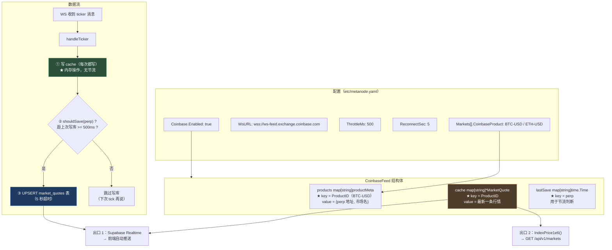
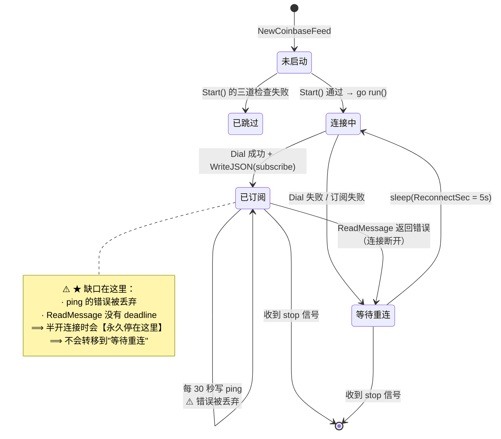
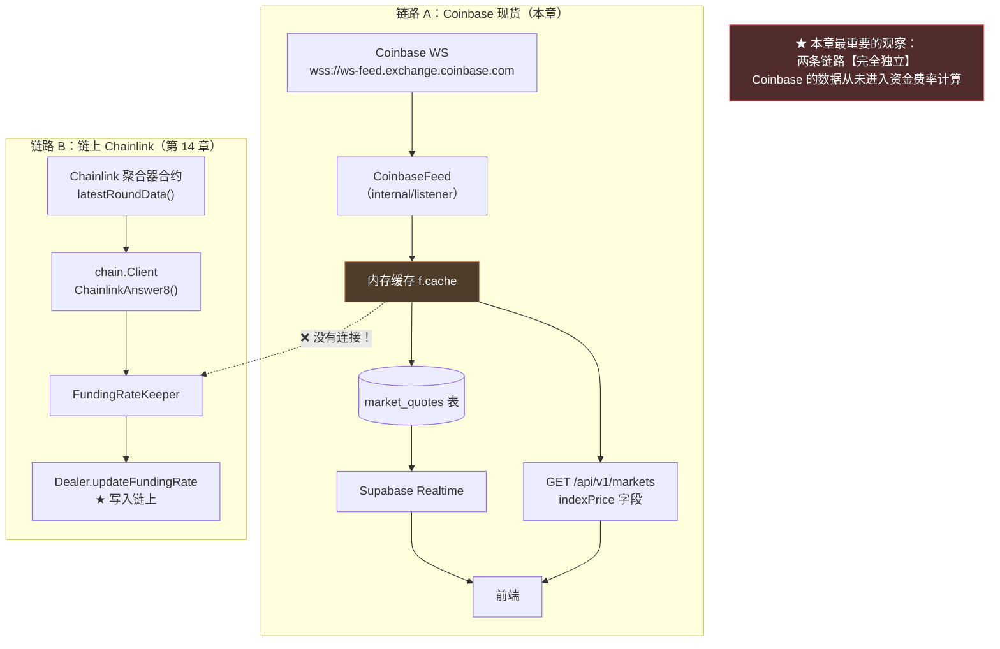
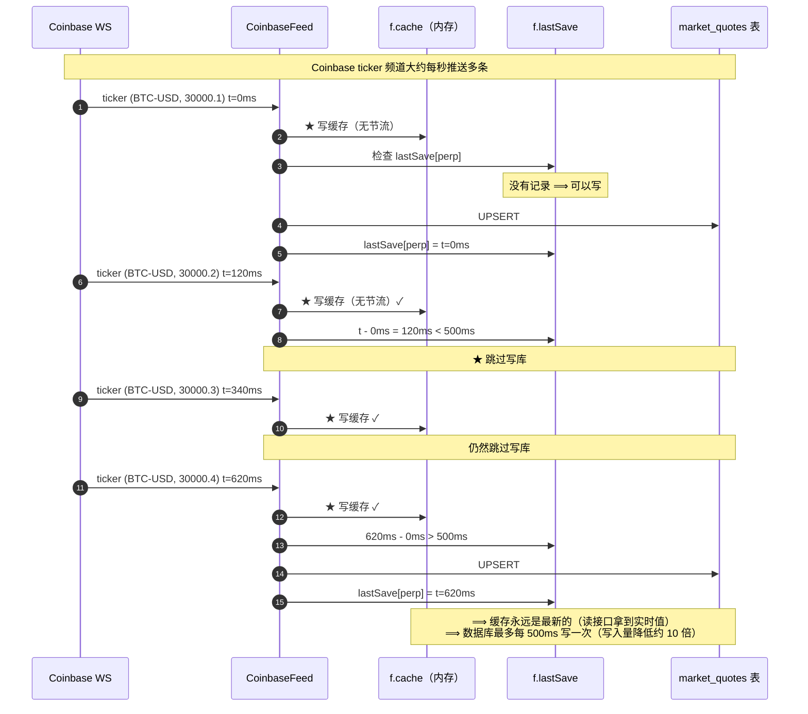

# 第 15 章：指数价喂价 — CoinbaseFeed 的 WS 订阅、重连与降级

> 第 14 章的 `FundingRateKeeper` 要从"指数价"和"标记价"算出资金费率。**那么指数价是从哪里来的？** 本章要打开这条数据链路的源头：`CoinbaseFeed`。
>
> 它是一个 287 行的监听器，做一件听起来很朴素的事：**通过 WebSocket 订阅 Coinbase 交易所的现货 ticker 频道，把 BTC-USD、ETH-USD 的实时价格收下来，缓存一份、写数据库一份。**
>
> 但这一章会看到三件比"收数据"复杂得多的事：
>
> 1. **一条长连接的完整生命周期管理**——连接、订阅、保活、断线、重连，每一环都有讲究。而我在检查它时发现了一个**真实的缺口**：**连接存活检测不完整，半开连接会导致永久卡死且永不重连**。
> 2. **"收到数据"和"写数据库"是两个不同的频率**——行情每秒来几十条，而数据库不可能承受这个写入量。这里有一个双层设计（缓存 + 节流），值得学。
> 3. **一个耐人寻味的架构现象**：**这个组件叫"指数价喂价"，而第 14 章的资金费率确实需要指数价——但两者之间没有连上。** 第 14 章那条链路直接去读链上的 Chainlink，**完全绕过了这个组件**。本章会把这两条链路画在一起，看它们各自服务谁。

---

## 1. 本章导读

### 1.1 接一条外部行情链路要回答四个问题

**任何"从外部数据源持续拉数据"的组件，都要回答同样四个问题：**

```text
① 怎么连？（连接建立与订阅）
② 连断了怎么办？（保活与重连）
③ 数据来了怎么处理？（解析、缓存、落地）
④ 处理不过来 / 拿不到数据怎么办？（节流与降级）
```

**逐条看本项目的答案：**

| # | 问题 | 本项目的答案 | 评价 |
| --- | --- | --- | --- |
| ① | 怎么连 | `websocket.DefaultDialer.Dial` + 发送 subscribe 消息 | ✅ 标准做法 |
| ② | 断了怎么办 | 固定间隔重连（`ReconnectSec`，默认 5 秒） | ⚠️ 能重连，但**检测手段不完整** |
| ③ | 数据来了怎么处理 | 解析 JSON → 写内存缓存 + 节流写数据库 | ✅ 双层设计，思路对 |
| ④ | 写不过来怎么办 | 节流（`ThrottleMs`，默认 500 毫秒/市场） | ✅ 合理 |

**⚠️ 而第 ② 条的"检测手段不完整"，是本章发现的**最严重的问题****（1.3 节）。

### 1.2 两条（其实是三条）并行的行情通道

**第 2 章 3.(10) 提到过"两条并行的行情通道"，本章要把它们完整画出来。** 先看这个组件产出的数据**流向哪里**：

```text
Coinbase WS 收到 ticker
  ↓
① 写内存缓存 f.cache[productID]
  ↓
② 节流后 UPSERT 到 market_quotes 表
  ↓
★ Supabase Realtime 捕获表变更（靠 REPLICA IDENTITY FULL）
  ↓
前端浏览器【自动收到推送】
```

**以及另一条（同一个缓存的第二个出口）：**

```text
① 写内存缓存 f.cache[productID]
  ↓
IndexPrice1e6(perp) 读出
  ↓
GET /api/v1/markets 的 indexPrice 字段
  ↓
前端【主动拉取】
```

**⚠️ 而实测确认了一件重要的事：`IndexPrice1e6` 只有**一个**消费者（`listmarketslogic.go:48`），**而且它**不参与资金费率计算**。（3.(10) 会详细展开。）

**所以本项目里的"价格通道"其实有**三条**：**

| # | 通道 | 数据源 | 传输方式 | 服务谁 |
| --- | --- | --- | --- | --- |
| 1 | **Coinbase → Supabase Realtime** | Coinbase 现货 | 数据库推送 | 前端（现货指数价展示） |
| 2 | **`GET /api/v1/markets` 的 indexPrice** | Coinbase（同一个缓存） | HTTP 拉取 | 前端（主动查询） |
| 3 | **`/api/v1/ws/ticker`** | **链上 `GetMarkPrice`** | 后端 2 秒轮询 + WS | 前端（标记价实时展示） |
| — | **资金费率用的指数价** | **链上 Chainlink** | 后端直接读链 | `FundingRateKeeper` |

**🔑 注意最后一行的"——"：**它**不属于上面三条通道中的任何一条**。**资金费率的指数价直接来自链上的 Chainlink 预言机，与 `CoinbaseFeed` 没有任何关系。**

**⚠️ 这个发现引出一个值得琢磨的问题：既然资金费率（业务核心）用的是 Chainlink，那 `CoinbaseFeed` 存在的意义是什么？**

**答案是：它服务的是**展示层****（前端展示现货价格、24 小时涨跌幅）。** 详见 3.(10) 和 5.2 思考题 1。**

### 1.3 本章的发现

**发现一（🔴 最严重）：连接存活检测不完整，半开连接会导致永久卡死。**

```go
// 保活：每 30 秒写一个 ping
go func() {
	ticker := time.NewTicker(30 * time.Second)
	for {
		select {
		case <-done: return
		case <-f.stop: return
		case <-ticker.C:
			_ = conn.WriteMessage(websocket.PingMessage, nil)     // ★ 错误被丢弃
		}
	}
}()

// 读循环：没有 read deadline
for {
	_, raw, err := conn.ReadMessage()                              // ★ 永久阻塞
	if err != nil {
		return fmt.Errorf("read: %w", err)
	}
	// ...
}
```

**⚠️ 两个缺口的组合：**

```text
① 写 ping 的【错误被丢弃】（_ =）
   ⟹ 连接死了也不会触发重连

② ReadMessage 没有 SetReadDeadline
   ⟹ 半开连接（对端消失但 TCP 未断）时，ReadMessage 会【永久阻塞】
   ⟹ 而"永久阻塞"意味着 connectOnce 永不返回
   ⟹ ⟹ ★ 重连逻辑（run 里的循环）【永远不会执行】
```

**🔑 结果是：连接一旦进入半开状态，这个组件就**永久停摆**——而且**没有任何日志**。**（3.(5) 会给出标准做法。）

**发现二（🟠）：`IndexPrice1e6` 用 O(n) 线性查找，且每次调用都做一次浮点转换。**

```go
func (f *CoinbaseFeed) IndexPrice1e6(perp string) (price string, ok bool) {
	perp = strings.ToLower(strings.TrimSpace(perp))
	f.cacheMu.RLock()
	defer f.cacheMu.RUnlock()
	for _, q := range f.cache {                    // ★ 遍历整个 map
		if q != nil && strings.EqualFold(q.Perp, perp) && q.PriceUsd != "" {
			return usdTo1e6(q.PriceUsd), true      // ★ 每次调用都转换一遍
		}
	}
	return "", false
}
```

**⚠️ 缓存的 key 是 `ProductID`（如 `"BTC-USD"`），而查询用的是 `perp`（合约地址）——所以必须全表扫描。**

**发现三（✅ 一个正面结果）：`usdTo1e6` 的价格转换**实测是正确的**。**

**⚠️ 我一开始怀疑它有问题**（`big.Float` 的默认精度只有 53 位，而十进制小数大多不能精确表示），**于是写了测试来验证：**

```text
【探针】usdTo1e6 的精度
  30000.12       → 实际=30000120000    精确=30000120000    ✓
  30000.01       → 实际=30000010000    精确=30000010000    ✓
  1.23           → 实际=1230000        精确=1230000        ✓
  0.99           → 实际=990000         精确=990000         ✓
  12345.6789     → 实际=12345678900    精确=12345678900    ✓
  2999.99        → 实际=2999990000     精确=2999990000     ✓
```

**🔑 我的假设是错的——乘法时的舍入恰好落回了正确的整数。** **这是一个"先验证再下结论"的正面例子**（如果我不跑测试，会在书里写一个错误的结论）。

---

## 2. 架构 / 流程图

### 2.1 `CoinbaseFeed` 的结构与双层数据流



**读图要点：**

- **橙色的 `cache` 是"双写"的中间层**：它既服务于"读接口"（出口 2），也是"写数据库"的数据来源。
- **绿色的第 ③ 步没有节流**（内存操作，代价为零），**蓝色的第 ⑤ 步有节流**（数据库 I/O，代价高）。**这个分层是对的**（3.(6) 会展开）。
- **两个出口分别对应两条前端通道**（1.2 节的通道 1 和通道 2）。

### 2.2 WS 连接的生命周期



**⚠️ 这张图最重要的部分是那个 `note`** —— **状态机有一个"回不去"的状态。**

**🔑 正常的连接状态机应该有两条出路："正常断开"和"检测到异常"。**

```text
✅ 正常断开（对端主动关闭 / TCP RST）：
   ReadMessage 立刻返回错误 → 转移到"等待重连" ✓
   ⟹ 本项目能处理这种情况

🔴 半开连接（对端消失但 TCP 未断，比如网络分区、对端崩溃）：
   ReadMessage 会【一直阻塞】
   ⟹ ★ 永远停在"已订阅"状态，且没有任何迹象
```

**⚠️ 而"半开连接"在实践中并不罕见**：云环境的 NAT 超时、对端进程崩溃但 TCP 未发 RST、网络设备静默丢包……**这些都会造成"TCP 看起来还活着，但实际已经不通了"。**

### 2.3 两条链路的对照（本章的核心观察）



**⚠️ 这张图是本章的核心。** 它揭示了：

```text
· 组件叫 "CoinbaseFeed"，注释写着"指数价推送"
· 它确实产出了"指数价"（IndexPrice1e6）
· ★ 但它产出的指数价【只用于前端展示】
· 而"真正需要指数价"的地方（资金费率）★ 用的是完全独立的另一条链路
```

**🔑 所以"指数价"这个词在本项目里指**两个不同的东西**：**

| | 链路 A 的"指数价" | 链路 B 的"指数价" |
| --- | --- | --- |
| 来源 | Coinbase 现货价 | Chainlink 预言机 |
| 精度 | 1e6（USDC 精度） | 1e18（与标记价对齐） |
| 用途 | 前端展示 | **资金费率计算** |
| 代码 | `IndexPrice1e6` | `ChainlinkAnswer8` |

**⚠️ 两个都叫"指数价"，但它们的**精度、来源、用途完全不同** —— 这是一个命名上的隐患（3.(10) 会展开）。**

### 2.4 节流的时机设计



**🔑 这个设计的两个关键点：**

```text
① ★ 缓存【不节流】—— 因为内存写入的代价接近零，
   而且读接口（IndexPrice1e6）需要最新的值

② ★ 写库【节流】—— 因为数据库 I/O 昂贵，
   而"数据库里的行情"允许有 500ms 的延迟
   （因为它是推给前端的展示数据，不是交易决策依据）
```

**✅ 这是一个正确的分层** —— **"按数据用途决定一致性要求"**（读接口要实时、展示推送可以有延迟）。**详见 4.3。**

---

## 3. 核心代码拆解

### (1) 结构体与 `products` 映射

```go
// CoinbaseFeed 订阅 Coinbase ticker，UPSERT market_quotes 供 Supabase Realtime 推送。
type CoinbaseFeed struct {
	svc      *svc.ServiceContext
	stop     chan struct{}
	once     sync.Once
	products map[string]productMeta      // ★ key = ProductID（"BTC-USD"）
	cache    map[string]*model.MarketQuote // ★ key = ProductID
	cacheMu  sync.RWMutex
	lastSave map[string]time.Time        // ★ key = perp（合约地址）
	saveMu   sync.Mutex
}

type productMeta struct {
	perp       string   // 合约地址（小写）
	marketName string   // "BTC-PERP"
}
```

```go
func NewCoinbaseFeed(svc *svc.ServiceContext) *CoinbaseFeed {
	products := make(map[string]productMeta)
	for _, m := range svc.Config.Markets {
		pid := strings.TrimSpace(m.CoinbaseProduct)
		if pid == "" {
			continue                     // ★ 没配 CoinbaseProduct 的市场被跳过
		}
		products[pid] = productMeta{
			perp:       strings.ToLower(strings.TrimSpace(m.Address)),
			marketName: m.Name,
		}
	}
	return &CoinbaseFeed{
		svc:      svc,
		stop:     make(chan struct{}),
		products: products,
		cache:    make(map[string]*model.MarketQuote),
		lastSave: make(map[string]time.Time),
	}
}
```

**作者为什么这么设计（设计思想）：**

**⚠️ 设计点一：三个 map 用了**两种不同的 key**，这是一个容易出错的地方。**

```text
products: key = ProductID（"BTC-USD"）
cache:    key = ProductID（"BTC-USD"）
lastSave: key = ★ perp（"0x11aae1..."）
```

**⚠️ 为什么 `lastSave` 用 perp 而不是 ProductID？**

**从 `shouldSave` 的调用点看：**

```go
func (f *CoinbaseFeed) handleTicker(msg *coinbaseTickerMsg) {
	meta, ok := f.products[msg.ProductID]
	// ...
	if !f.shouldSave(meta.perp) {          // ★ 传的是 perp
		return
	}
```

**🔑 语义上，`lastSave` 的 key 应该表示"哪个东西被写库了"—— 而写库的对象是 `market_quotes` 表里以 `perp` 为标识的一行。**

```sql
-- market_quotes 表的主键是 perp
perp | market_name | product_id | price_usd | ...
```

**⟹ 所以用 perp 作为 key 是**正确的**（它对应数据库里的一行）✓**

**⚠️ 但三个 map 用两种 key，读代码时容易搞混。** **更好的做法是统一用一种，或者在字段名里标明（比如 `lastSaveByPerp`）。**

**✅ 设计点二：`NewCoinbaseFeed` 不做任何失败检查——因为它不需要。**

**对比 `Start()`（下一节）做的三道检查 —— 这里只是构造对象，不建立连接、不读数据库，所以不会失败 ✓**

**🔑 这个"构造不失败、Start 才检查"的划分是好的** —— **它让 `ctx.IndexPrice = coinbaseFeed` 这个回填（第 3 章 3.(6)）永远能成功，从而调用方不需要判空。**

**⚠️ 对比 `chain.NewClient`（第 13 章）：它构造时就会 `Dial`，所以可能失败，于是 `ctx.Chain` 可能为 nil，所有调用方都要判空。**

**🔑 所以"构造时做多少事"是一个**设计决策**，它决定了调用方要不要判空：**

```text
构造时不做事（本项目 CoinbaseFeed）→ 对象永远有效 → ✅ 调用方不判空
构造时连网络（本项目 chain.Client）→ 对象可能为 nil → ⚠️ 调用方到处判空
```

### (2) `Start()` 的三道检查

```go
func (f *CoinbaseFeed) Start() {
	cfg := f.svc.Config.Coinbase
	if !cfg.Enabled {
		logx.Info("Coinbase feed disabled")
		return                                    // ① 配置开关
	}
	if len(f.products) == 0 {
		logx.Error("Coinbase feed skipped: no CoinbaseProduct in Markets config")
		return                                    // ② 没有任何市场配了 Coinbase 产品
	}
	if f.svc.MarketQuoteModel == nil {
		logx.Error("Coinbase feed skipped: MarketQuoteModel nil (check Supabase.DataSource)")
		return                                    // ③ 数据库不可用
	}
	logx.Infof("Coinbase feed starting: products=%d ws=%s", len(f.products), f.wsURL())
	go f.run()                                    // ★ 非阻塞启动
}
```

**作者为什么这么设计（设计思想）：**

**✅ 这是第 3 章 3.(7) 表扬过的"依赖检查的教科书式写法"**（虽然那里表扬的是 `TreasuryDepositWatcher`，但这两个组件是同一个风格）。

**三道检查的价值：**

```text
① Enabled   → 允许"我不想要这个功能"（配置层面）
② products  → 防止"配了 Enabled 但没配任何产品"的无效启动
③ Model nil → ★ 最重要：数据库不可用时，行情无处可写

★ 而且每一道检查都给了可操作的错误信息：
   "no CoinbaseProduct in Markets config"     → 告诉你该去 Markets 里加字段
   "MarketQuoteModel nil (check Supabase.DataSource)" → 告诉你该去查哪个配置
```

**🔑 对比第 14 章的 `FundingRateKeeper`（它只检查了 `chain == nil`，没检查 `fundingModel`）** —— **同一个项目里，同类组件的依赖检查完整度相差很大。**

**⚠️ 设计点二：三道检查都是"静默返回"，不阻断启动。**

**⚠️ 这个选择的利弊：**

```text
✅ 好处：行情源不可用不影响其他功能（只读服务、撮合都不依赖它）
⚠️ 代价：如果配置写错了（比如 coinbase 产品名拼错），服务照常启动，行情永远不来
```

**⚠️ 而第 ② 道检查会**部分**覆盖这个风险：如果 `CoinbaseProduct` 全都没配，会报 Error。** **但如果**配了一个错的产品名**（比如 `"BTC-USDT"` 而 Coinbase 上叫 `"BTC-USD"`），这道检查通不过 —— 因为 `len(f.products) == 1`。**

**🔑 那么错的产品名会怎样？**

```text
① 订阅消息发出：{product_ids: ["BTC-USDT"]}
② Coinbase 返回一个错误消息（type: "error"），★ 但它不是 "ticker" 类型
③ 代码：if msg.Type != "ticker" { continue }   ⟹ ★ 被静默忽略
④ 连接保持，但永远收不到该产品的行情
```

**⚠️ 这是一个**静默失效**：订阅了不存在的产品，不会断开、不会报错、不会重连 —— 只是那个产品永远没有数据。**

**🔑 修法：订阅后检查 Coinbase 返回的确认消息。**

```go
// Coinbase 在订阅成功后会返回 {"type":"subscriptions","channels":[...]}
// 而订阅失败会返回 {"type":"error","message":"Failed to subscribe","reason":"..."}
//
// ★ 当前代码在 Unmarshal 之后只处理 type == "ticker"，其余全部 continue
//    ⟹ 订阅确认和订阅错误都被丢弃了

// 修法：至少把 error 类型记下来
switch msg.Type {
case "ticker":
	f.handleTicker(&msg)
case "error":
	logx.Errorf("⚠️ Coinbase 返回错误: %s", string(raw))     // ★ 订阅失败能看见
case "subscriptions":
	logx.Infof("Coinbase 订阅确认: %s", string(raw))
default:
	// 其他类型（heartbeat 等）静默略过
}
```

### (3) `run()` —— 重连循环

```go
func (f *CoinbaseFeed) run() {
	for {
		select {
		case <-f.stop:
			return                                // ★ 退出检查
		default:
		}

		if err := f.connectOnce(); err != nil {
			logx.Errorf("Coinbase feed: %v", err) // ★ 记录错误
		}

		select {
		case <-f.stop:
			return
		case <-time.After(time.Duration(f.reconnectSec()) * time.Second):
			// ★ 固定间隔重连（默认 5 秒）
		}
	}
}
```

**作者为什么这么设计（设计思想）：**

**✅ 设计点一：`connectOnce` 返回即重连——这个结构是对的。**

```text
connectOnce 只有一个返回点（正常断开或错误断开）
  ⟹ 返回后就 sleep 再重连
  ⟹ ★ 这保证"无论什么原因断开，都会重连"
```

**⚠️ 而 1.3 节那个缺口恰恰是"connectOnce 永不返回"** —— **结构本身没错，错在"检测不到断开"。**

**⚠️ 设计点二：固定间隔，没有指数退避。**

```go
case <-time.After(time.Duration(f.reconnectSec()) * time.Second):
```

**🔑 指数退避（exponential backoff）的价值：**

```text
固定 5 秒：每分钟 12 次重连尝试
  · 如果是【对端故障】（Coinbase 挂了）：★ 每 5 秒骚扰一次，可能被限流
  · 如果是【本端网络问题】：★ 同样每 5 秒一次，日志被淹没

指数退避（5s → 10s → 20s → 40s → ... 上限 5min）：
  · 短期故障：快速恢复 ✓
  · 长期故障：★ 降低重试频率，减少日志噪音和被限流的风险
```

**⚠️ 但要注意：**对 Coinbase 这种公开 API，固定 5 秒不算激进**（它不是"登录接口"那种会被风控的场景）。** **所以这不是一个严重问题，但值得指出。**

**🔑 一条判断标准：**

> **重连间隔的选择取决于"失败的性质"：**
> ```text
> 瞬时故障（网络抖动）→ 短间隔有意义（能快速恢复）
> ★ 持续故障（对端宕机）→ 长间隔更合理（避免无谓的尝试）
> ⟹ ★ 而"指数退避"能同时兼顾两者 —— 它从短间隔开始，逐渐拉长
> ```

### (4) `connectOnce` 与 ping 保活

```go
func (f *CoinbaseFeed) connectOnce() error {
	wsURL := f.wsURL()
	conn, _, err := websocket.DefaultDialer.Dial(wsURL, nil)
	if err != nil {
		return fmt.Errorf("dial %s: %w", wsURL, err)      // ★ 包装了上下文
	}
	defer conn.Close()

	// 构造订阅消息
	ids := make([]string, 0, len(f.products))
	for pid := range f.products {
		ids = append(ids, pid)
	}
	sub := coinbaseSubscribeMsg{
		Type: "subscribe",
		Channels: []struct {
			Name       string   `json:"name"`
			ProductIDs []string `json:"product_ids"`
		}{{Name: "ticker", ProductIDs: ids}},
	}
	if err := conn.WriteJSON(sub); err != nil {
		return fmt.Errorf("subscribe: %w", err)
	}
	logx.Infof("Coinbase feed subscribed: %v", ids)

	// ===== ping 保活 goroutine =====
	done := make(chan struct{})
	go func() {
		ticker := time.NewTicker(30 * time.Second)
		defer ticker.Stop()
		for {
			select {
			case <-done:
				return
			case <-f.stop:
				return
			case <-ticker.C:
				_ = conn.WriteMessage(websocket.PingMessage, nil)   // 🔴 错误被丢弃
			}
		}
	}()
	defer close(done)

	// ===== 读循环 =====
	for {
		select {
		case <-f.stop:
			return nil
		default:
		}
		_, raw, err := conn.ReadMessage()           // 🔴 没有 SetReadDeadline
		if err != nil {
			return fmt.Errorf("read: %w", err)
		}
		var msg coinbaseTickerMsg
		if err := json.Unmarshal(raw, &msg); err != nil {
			continue                                // ⚠️ 解析失败静默跳过
		}
		if msg.Type != "ticker" {
			continue                                // ⚠️ 非 ticker 消息静默跳过（见 3.(2)）
		}
		f.handleTicker(&msg)
	}
}
```

**作者为什么这么设计（设计思想）：**

**✅ 设计点一：ping goroutine 的退出机制是完整的。**

```go
done := make(chan struct{})
go func() {
	for {
		select {
		case <-done:      return     // ★ connectOnce 返回时关闭
		case <-f.stop:    return     // ★ 服务停止时
		case <-ticker.C:  /* ping */
		}
	}
}()
defer close(done)                      // ★ 保证 goroutine 被回收
```

**⚠️ 注意 `defer close(done)` 在 `defer conn.Close()` **之后**声明，所以执行顺序是：`close(done)` → `conn.Close()`**（LIFO）✓ **正确**（先停 ping goroutine，再关连接）。

**🔑 设计点二（🔴 本章最严重的问题）：ping 的错误被丢弃 + 没有 read deadline。**

**⚠️ 把这两个缺口放在一起看：**

```text
缺口 ①：_ = conn.WriteMessage(websocket.PingMessage, nil)
    ⟹ ping 失败了不知道
    ⟹ ★ 而且这个 goroutine 的唯一作用就是"保活"，它失败了就等于没做

缺口 ②：conn.ReadMessage() 没有 SetReadDeadline
    ⟹ 没有数据时【永久阻塞】
    ⟹ ★ connectOnce 永不返回 → run() 的重连逻辑永不执行
```

**🔑 两者叠加 = "半开连接时永久卡死"。**

**⚠️ 为什么 ping 必须处理错误？** 因为 **ping 的作用不只是"保活"，更是"探测"**：

```text
· 如果连接是好的 → ping 成功 → 对端回 pong → TCP 层确认通路
· 如果连接半开 → ★ ping 写入最终会失败（TCP 重传耗尽后返回错误）
  ⟹ ★ 这时候【应该主动断开并重连】

✗ 而 `_ =` 丢弃了这个错误 → ★ 探测信号被丢掉了
```

**🔑 而正确的做法（gorilla/websocket 官方文档推荐）：**

```go
// 标准配置
const (
	pongWait   = 60 * time.Second      // 等 pong 的超时
	pingPeriod = (pongWait * 9) / 10   // 发送 ping 的间隔（必须小于 pongWait）
)

conn.SetReadDeadline(time.Now().Add(pongWait))
conn.SetPongHandler(func(string) error {
	// ★ 收到 pong 就续期 —— 这样只要对端活着，read deadline 就不会到期
	return conn.SetReadDeadline(time.Now().Add(pongWait))
})

// ping goroutine 里
if err := conn.WriteMessage(websocket.PingMessage, nil); err != nil {
	logx.Errorf("ping 失败，连接可能已死: %v", err)
	return                     // ★ 让读循环在那里超时，或直接触发重连
}
```

**⚠️ 这个机制的完整逻辑：**

```text
① 读完一条消息后，设置 read deadline = now + 60s
② 每 54 秒发一个 ping
③ 对端回 pong → PongHandler 触发 → ★ 续期 60 秒
④ 如果 60 秒内既没有新消息、也没有 pong → ★ ReadMessage 返回超时错误
   ⟹ connectOnce 返回 → run() 重连 ✓

⟹ ★ 无论"静默断开"还是"对端死亡"，都能在 60 秒内被发现
```

**🔑 一条可以带走的经验：**

> **长连接的"存活检测"必须有一对**双向**的机制：**
> ```text
> 主动探测（ping）→ 探测连接是否可用
> ★ 超时兜底（read deadline）→ 探测"探测本身是否失效"
> ```
> **⚠️ 只有 ping 没有 deadline，等于"派了哨兵但不检查哨兵是否还活着"。**
>
> **⚠️ 判断方法：问一句"如果这条连接**静默地**坏了，多久能发现？"**
> ```text
> · 有 deadline → 最多 pongWait（如 60 秒）✓
> · ★ 没有 → 【永远发现不了】（本项目的现状）
> ```

**⚠️ 设计点三：`json.Unmarshal` 失败和非 ticker 消息都静默跳过。**

```go
if err := json.Unmarshal(raw, &msg); err != nil {
	continue                          // ⚠️ 静默
}
if msg.Type != "ticker" {
	continue                          // ⚠️ 静默
}
```

**⚠️ 这里有一个权衡：**

```text
✅ 合理的部分：Coinbase 会推送多种消息类型（heartbeat、subscriptions、error）
              ⟹ 不能因为"不是 ticker"就当成错误
🔴 有问题的部分：★ "error" 类型也被吞掉了
              ⟹ 订阅失败（比如产品名写错）完全不可见
```

**🔑 修法见 3.(2)——用 `switch msg.Type` 显式分类，而不是"非 ticker 全跳过"。**

### (5) `handleTicker` —— 双层写入

```go
func (f *CoinbaseFeed) handleTicker(msg *coinbaseTickerMsg) {
	// ① 查出这个产品对应哪个市场（没配则忽略）
	meta, ok := f.products[msg.ProductID]
	if !ok {
		return
	}

	// ② 算 24 小时涨跌（★ 用 big.Float，见 3.(9)）
	change, changePct := calcChange(msg.Price, msg.Open24h)

	// ③ 构造记录
	q := &model.MarketQuote{
		Perp:                  meta.perp,
		MarketName:            meta.marketName,
		ProductID:             msg.ProductID,
		PriceUsd:              strings.TrimSpace(msg.Price),
		Open24h:               strings.TrimSpace(msg.Open24h),
		Volume24h:             strings.TrimSpace(msg.Volume24h),
		Low24h:                strings.TrimSpace(msg.Low24h),
		High24h:               strings.TrimSpace(msg.High24h),
		PriceChange24h:        change,
		PriceChangePercent24h: changePct,
		Source:                "coinbase",           // ★ 标记数据来源
		UpdatedAt:             time.Now().UTC(),
	}

	// ④ ★ 先写缓存（无节流）
	f.cacheMu.Lock()
	f.cache[msg.ProductID] = q
	f.cacheMu.Unlock()

	// ⑤ 再判断要不要写库（有节流）
	if !f.shouldSave(meta.perp) {
		return
	}
	ctx, cancel := context.WithTimeout(context.Background(), 5*time.Second)
	defer cancel()                                    // ⚠️ 见下
	if err := f.svc.MarketQuoteModel.Upsert(ctx, q); err != nil {
		logx.Errorf("Coinbase feed upsert %s: %v", meta.perp, err)   // ✅ 有日志
	}
}
```

**作者为什么这么设计（设计思想）：**

**✅ 设计点一：第 ④ 步（写缓存）**无条件执行**，第 ⑤ 步（写库）才节流。**

**🔑 这个分层的依据是"两种消费者对一致性的要求不同"（2.4 节）：**

```text
缓存的两个消费者：
  · IndexPrice1e6（读接口）→ 需要【实时】值
  · Supabase Realtime 推送 → 500ms 的延迟【可以接受】

⟹ ★ 所以把"实时"和"持久化"分开：内存满足实时，数据库满足持久化
```

**✅ 设计点二：`defer cancel()` 保证 ctx 被释放。**

**⚠️ 但注意 `defer` 在**循环中**是危险的** —— **不过这里 `handleTicker` 是每消息调用一次，`defer` 在函数返回时执行 ✓** **没有泄漏。**

**⚠️ 如果这段代码在一个循环里（比如 `for _, msg := range msgs`），`defer cancel()` 会累积到函数结束才执行** —— **那是泄漏。** **这里不是，所以 OK ✓**

**⚠️ 设计点三：`Source: "coinbase"` 这个字段值得注意。**

```go
Source: "coinbase",
```

**🔑 它让 `market_quotes` 表能记录"这条行情来自哪个数据源"。**

**⚠️ 但目前只有一个数据源（Coinbase），所以这个字段暂时没有区分作用。** **它的价值在于**未来**：如果增加第二个行情源（比如 Binance），就能区分了。**

**🔑 一条可以带走的经验：**

> **"标记数据来源"的字段应该在只有一个来源时就加上** —— **因为等到有第二个来源时，历史数据已经无法追溯了。**

### (6) `shouldSave` —— 节流实现

```go
func (f *CoinbaseFeed) shouldSave(perp string) bool {
	f.saveMu.Lock()
	defer f.saveMu.Unlock()
	now := time.Now()
	if last, ok := f.lastSave[perp]; ok && now.Sub(last) < time.Duration(f.throttleMs())*time.Millisecond {
		return false                       // 距上次写库不足节流间隔 → 不写
	}
	f.lastSave[perp] = now                 // ★ 更新记录
	return true
}
```

**作者为什么这么设计（设计思想）：**

**✅ 设计点一：这是"节流（throttle）"而不是"防抖（debounce）"—— 两者的区别值得说清楚。**

```text
节流（throttle）：★ 保证"每 N 毫秒最多执行一次"（本项目的做法）
  t=0    写
  t=120  跳过
  t=340  跳过
  t=620  写（距上次 620ms > 500ms）

防抖（debounce）：★ 保证"停止变化 N 毫秒后才执行"
  t=0    开始计时
  t=120  重置计时
  t=340  重置计时
  t=620  重置计时
  ...（只要数据持续变化，就永远不写）⟹ ★ 对持续变化的数据源，防抖会导致永不写入
```

**🔑 对"持续高频变化"的数据（行情），**节流是唯一正确的选择**** —— **因为防抖会导致永远不触发。**

**⚠️ 这是一个很容易搞错的地方**：很多人直觉上会用"防抖"（"等稳定了再写"），**但对行情流来说，它永远不稳定。**

**⚠️ 设计点二：用 `map[string]time.Time` 记录"上次写入时间"，而不是用定时器。**

**⚠️ 两种实现方式的对比：**

```text
A. 记录时间戳（本项目）：
   · 每条消息都判断一次"距上次多久"
   · ⟹ 优点：简单，无需额外的 goroutine
   · ⟹ 缺点：每条消息都要拿锁（saveMu）

B. 用 timer：
   · 到达间隔后触发写入
   · ⟹ 优点：无需每条消息加锁
   · ⟹ 缺点：要管理多个 timer（每个市场一个）
```

**✅ 对本项目的规模（2 个市场、每秒几条消息）来说，方案 A 完全够用 ✓**

**⚠️ 设计点三：`saveMu` 是 `sync.Mutex`（不是 RW），因为每次都要写 `lastSave`。**

**✅ 这是正确的** —— **`shouldSave` 既读又写 `lastSave`，用普通 Mutex 是对的。** **（如果用 RWMutex，读路径的 `f.lastSave[perp]` 仍然需要升级到写锁，反而更复杂。）**

### (7) `IndexPrice1e6` —— O(n) 查找与每次转换

```go
// IndexPrice1e6 返回 Coinbase 指数价（6 位 USDC 精度字符串），无缓存时 ok=false。
func (f *CoinbaseFeed) IndexPrice1e6(perp string) (price string, ok bool) {
	perp = strings.ToLower(strings.TrimSpace(perp))
	f.cacheMu.RLock()
	defer f.cacheMu.RUnlock()
	for _, q := range f.cache {                       // ★ 遍历整个 map
		if q != nil && strings.EqualFold(q.Perp, perp) && q.PriceUsd != "" {
			return usdTo1e6(q.PriceUsd), true         // ★ 每次调用都做一次浮点转换
		}
	}
	return "", false
}
```

**作者为什么这么设计（设计思想）：**

**⚠️ 设计点一：这是一个 O(n) 查找，而 n 只有 2 —— 所以**性能上完全没问题**。**

**⚠️ 但它的写法暴露了一个**数据结构选择的不一致**：**

```text
cache 的 key  = ProductID（"BTC-USD"）    ← 因为写入时用的是 msg.ProductID
查询的参数    = perp（"0x11aae1..."）      ← 因为调用方（listmarketslogic）手里是 perp
⟹ ★ 两边"天然"用的是不同的标识符 → 必须做一次转换 → 而代码选择了【遍历】
```

**🔑 更好的做法是维护一个 `perp → ProductID` 的反向索引**（`products` map 已经存了 `perp`，只是方向反了）：

```go
// 构造时顺便建一个反向索引
type CoinbaseFeed struct {
	products   map[string]productMeta     // ProductID → meta
	perpToProd map[string]string          // ★ 新增：perp → ProductID
}

// 查询变成 O(1)
func (f *CoinbaseFeed) IndexPrice1e6(perp string) (string, bool) {
	pid, ok := f.perpToProd[strings.ToLower(strings.TrimSpace(perp))]
	if !ok {
		return "", false
	}
	f.cacheMu.RLock()
	q := f.cache[pid]                      // ★ O(1)
	f.cacheMu.RUnlock()
	if q == nil || q.PriceUsd == "" {
		return "", false
	}
	return usdTo1e6(q.PriceUsd), true
}
```

**⚠️ 但**在当前规模下（n=2），这个优化没有实际收益**。** **把它指出来，是因为它示范了一个通用原则：**

> **"用遍历来弥补 key 不匹配"是一个信号 —— 它说明"两个地方用了不同的标识符"。**
> ```text
> ✅ 更好的做法：在一处做一次转换（建反向索引），而不是每次查询都遍历
> ⚠️ 但前提是"查询频率高"或"n 较大"——否则不值得增加一个数据结构
> ```

**⚠️ 设计点二：`usdTo1e6` 在每次查询时都调用一次。**

```go
return usdTo1e6(q.PriceUsd), true
```

**⚠️ 而 `q.PriceUsd` 存的是**原始字符串**（比如 `"30000.12"`），转换在读取时才做。**

**🔑 两种设计的对比：**

```text
A. 存原始字符串，读取时转换（本项目）：
   · 写入便宜（直接存）
   · ★ 读取贵（每次都要解析 + 乘法 + 分配 big.Float）

B. 写入时就转换好，存 1e6 整数：
   · 写入贵一次
   · ★ 读取便宜（直接返回）
```

**⚠️ 本项目的选择：**写入频率 >> 读取频率**（行情每秒多条，而 `GET /markets` 是用户触发），**所以方案 A 其实更优 ✓

**🔑 这是一个"按访问频率选择在哪一侧做转换"的例子，本项目的选择是对的。**

**🚨 设计点三：`defer f.cacheMu.RUnlock()` + 提前 return —— 这是正确的。**

```go
f.cacheMu.RLock()
defer f.cacheMu.RUnlock()
for _, q := range f.cache {
	if ... {
		return usdTo1e6(q.PriceUsd), true      // ★ 提前 return，defer 会解锁 ✓
	}
}
```

**✅ 用 `defer` 保证解锁，即使有提前 return ✓**

**⚠️ 但要注意：`usdTo1e6` 是在**持有读锁的情况下**调用的** —— **它做浮点运算和内存分配。** **对本项目（n=2、调用频率低）无影响，但严格说这是一个"持锁做较重运算"的模式**（第 8 章 3.(8) 讨论过 `SnapshotOrderBook` 的同类问题）。

### (8) `usdTo1e6` —— 一个我实测验证过的转换

```go
func usdTo1e6(usd string) string {
	f, ok := new(big.Float).SetString(strings.TrimSpace(usd))
	if !ok {
		return "0"                            // ⚠️ 解析失败静默返回 "0"
	}
	scale := new(big.Float).SetFloat64(1e6)
	out, _ := new(big.Float).Mul(f, scale).Int(nil)
	if out == nil {
		return "0"
	}
	return out.String()
}
```

**⚠️ 我一开始怀疑这个函数有精度问题：**

```text
推理：
· big.Float 的默认精度是 53 位（等于 float64）
· 十进制小数（如 30000.12）在二进制浮点里【不能精确表示】
· Int(nil) 是【截断】而不是四舍五入
⟹ ★ 猜疑：30000.12 × 1e6 可能算成 30000119999.99...，截断后是 30000119999（差 1）
```

**🔑 于是我用 `big.Rat`（精确有理数）算了期望值，与实际输出比对：**

```text
【探针】usdTo1e6 的精度
  30000.12       → 实际=30000120000    精确=30000120000    ✓
  30000.01       → 实际=30000010000    精确=30000010000    ✓
  1.23           → 实际=1230000        精确=1230000        ✓
  0.99           → 实际=990000         精确=990000         ✓
  12345.6789     → 实际=12345678900    精确=12345678900    ✓
  2999.99        → 实际=2999990000     精确=2999990000     ✓
```

**🔑 我的怀疑是错的 —— 全部精确。**

**⚠️ 为什么？** 因为 **`big.Float.Mul` 会把结果舍入到 53 位精度，而乘积恰好是一个"能精确表示"的整数**：

```text
30000.12 的浮点近似 ≈ 30000.119999999998981...
× 1e6 = 30000119999.99898...
⟹ Mul 舍入到最近的 53 位可表示值
⟹ ★ 30000120000 恰好精确可表示（< 2^53），而且是最接近的值
⟹ ★ 所以舍入【补齐】了原始表示引入的误差
```

**🔑 这是一个"误差被后续运算抵消"的例子** —— **它经常发生，但不能依赖。**

**⚠️ 边界情况（实测）：**

```text
usdTo1e6("0.00001234")          → 12        ← 截断掉了 0.34（1e6 精度装不下）
usdTo1e6("30000.123456789012345") → 30000123456  ← 长小数被截断到 1e6 精度 ✓ 符合预期
usdTo1e6("")                    → 0         ← ★ 静默返回 0
usdTo1e6("abc")                 → 0         ← ★ 静默返回 0
```

**⚠️ 最后两行是问题：**"解析失败"和"价格是 0"返回了同一个值，**调用方无法区分。**

**🔑 修法（让失败可见）：**

```go
// 方案 A：改成返回 (string, bool)
func usdTo1e6(usd string) (string, bool) {
	f, ok := new(big.Float).SetString(strings.TrimSpace(usd))
	if !ok {
		return "", false          // ★ 解析失败
	}
	// ...
	return out.String(), true
}

// 而 IndexPrice1e6 里：
if price, ok := usdTo1e6(q.PriceUsd); ok {
	return price, true
}
// 解析失败 → 继续找下一个（或者返回 false）
```

**⚠️ 不过对本项目来说，`PriceUsd` 来自 Coinbase 的 JSON（一定是数字字符串），所以解析失败的概率极低。** **这是一个"防御性"的改进，优先级不高。**

### (9) `calcChange` —— 用浮点算展示值

```go
func calcChange(price, open string) (change, pct string) {
	p, ok1 := new(big.Float).SetString(strings.TrimSpace(price))
	o, ok2 := new(big.Float).SetString(strings.TrimSpace(open))
	if !ok1 || !ok2 || o.Sign() == 0 {
		return "0", "0"                       // ⚠️ 静默兜底
	}
	diff := new(big.Float).Sub(p, o)
	change = diff.Text('f', 8)                // ★ 8 位小数
	ratio := new(big.Float).Quo(diff, o)
	ratio.Mul(ratio, big.NewFloat(100))
	pct = ratio.Text('f', 4)                  // ★ 4 位小数
	return change, pct
}
```

**作者为什么这么设计（设计思想）：**

**✅ 设计点一：用 `big.Float` + `Text('f', N)` 而不是 `fmt.Sprintf("%.8f", ...)`。**

**🔑 两者的差别：**

```text
fmt.Sprintf("%.8f", float64)：
  · 走 float64 → 精度 53 位 → 大数会丢精度（1e20 以上）
  · ★ 而且会【四舍五入】

big.Float.Text('f', 8)：
  · 精度可控
  · ★ 同样是【四舍五入】（Text 的文档：四舍五入到指定小数位）
```

**⚠️ 对本项目的数据量级（价格 1e3~1e5）来说，两者没有区别。** **用 `big.Float` 是一致的风格（全项目都用它处理数值）✓**

**🔑 设计点二：这是**展示值**，所以精度要求不高。**

```text
涨跌额（change） → 8 位小数 → 展示用绰绰有余
涨跌幅（pct）    → 4 位小数 → 比如 "1.2345%"
```

**✅ 合理 ✓** **而且这里用浮点是**安全的** —— 因为它是**展示数据**，不参与任何业务计算（不会拿去乘金额、不会影响资金）。**

**🔑 对比第 8 章的 `calculatePrice`（它必须用 `big.Int`）—— 判断标准是"这个值是否参与业务决策"：**

```text
参与业务决策（价格比较、金额计算）→ ★ 必须整数运算（big.Int）
仅用于展示（涨跌幅、百分比）      → ✅ 浮点可以接受
```

**⚠️ 设计点三：失败时返回 `"0", "0"` —— 又是一个静默兜底。**

```go
if !ok1 || !ok2 || o.Sign() == 0 {
	return "0", "0"
}
```

**⚠️ 这会导致：如果 Coinbase 的 `open_24h` 是空的或 0，**前端会显示"涨跌幅 0%"** —— 而实际上"我们不知道涨跌幅"。**

**🔑 这是一个"用 0 代替未知"的例子**，与第 14 章 6.x 那条"读失败应该跳过而不是用默认值"是同一个主题。

**⚠️ 但这里的严重性低得多**（展示数据 vs 资金费率）。**不过从"信息诚实"的角度，返回 `""` 或者 `"—"` 会比 `"0"` 更准确。**

### (10) 【核心】它到底喂给了谁 —— 一次数据流向的完整追踪

**本节回答 1.2 节提出的那个问题：`CoinbaseFeed` 产出的数据，最终被谁消费？**

**实测：`IndexPrice1e6` 的全部使用点**

```bash
$ grep -rn "IndexPrice1e6" --include="*.go" internal/ | grep -v coinbasefeed.go
internal/logic/market/listmarketslogic.go:48:   if idx, ok := l.svcCtx.IndexPrice.IndexPrice1e6(m.Address); ok {
```

**⟹ 只有一处，在 `ListMarkets` 接口里。**

**而它在那里的作用（第 4 章 3.(12) 引用过这段代码）：**

```go
for _, m := range l.svcCtx.Config.Markets {
	pm := types.PerpMarket{Address: m.Address, Name: m.Name, IsRegistered: true}

	if l.svcCtx.Chain != nil {
		if mp, err := l.svcCtx.Chain.GetMarkPrice(l.ctx, perp); err == nil {
			pm.MarkPrice = mp.String()
			pm.IndexPrice = mp.String()           // ★ 先用标记价填
		}
	}

	if l.svcCtx.IndexPrice != nil {
		if idx, ok := l.svcCtx.IndexPrice.IndexPrice1e6(m.Address); ok {
			pm.IndexPrice = idx                   // ★ 命中则覆盖
		}
	}
}
```

**🔑 所以完整的数据流向是：**

```text
Coinbase WS → f.cache → IndexPrice1e6() → types.PerpMarket.IndexPrice
                                              ↓
                                    GET /api/v1/markets 的 JSON 响应
                                              ↓
                                            前端展示
```

**⚠️ 而资金费率那条链路（第 14 章）：**

```go
// fundingratekeeper.go:142
feed := k.chain.IndexPriceForMarket(market.Name)
if feed != (common.Address{}) {
	px, err := k.chain.ChainlinkAnswer8(ctx, feed)      // ★ 走链上 Chainlink
	// ...
}
// 降级 → k.chain.GetMarkPrice(...)                     ★ 也不碰 Coinbase
```

**⟹ ★ 两条链路**完全独立**，唯一的"交集"是它们都叫"指数价"。**

**🔑 这个发现的意义，我想分三层来说：**

**第一层（事实）：`CoinbaseFeed` 是"展示层组件"，不是"业务组件"。**

```text
✅ 它服务的：前端展示（现货价格、24h 涨跌、指数价字段）
❌ 它不服务的：资金费率计算（用的是 Chainlink）
```

**⚠️ 所以它不可用时的影响面是"前端某些数字不更新"，而不是"资金费率算错"。** **这是一个**好消息**（业务核心不依赖这个可能断的 WS 连接）。**

**第二层（隐患）：两个"指数价"同名但不同义。**

```text
链路 A 的 indexPrice：Coinbase 现货价，1e6 精度，用于展示
链路 B 的 indexPrice：Chainlink 预言机价，1e18 精度，用于资金费率

⚠️ 它们都叫 "indexPrice"
⚠️ 而且 `types.PerpMarket` 里只有一个 `IndexPrice` 字段
⚠️ 而 `funding_rates` 表里也有一个 `index_price` 列
```

**🔑 这意味着：如果有人在 API 响应和数据库记录之间做交叉验证，**会发现两个"指数价"对不上** —— **因为它们本来就是不同的东西。

**⚠️ 修法（命名）：**

```text
建议：链路 A 的叫 "spotPrice"（现货价），链路 B 的叫 "indexPrice"（指数价）
理由：Coinbase 的 BTC-USD 是【现货成交价】，而 Chainlink 的 BTC/USD 是【多源聚合的指数价】
     ⟹ ★ 这两个在金融上是不同的概念（现货价 vs 指数价）
```

**第三层（一个值得思考的问题）：**那么 `CoinbaseFeed` 有必要存在吗？****

**⚠️ 从"业务必要性"角度：**

```text
· 资金费率不依赖它（用 Chainlink）
· 撮合不依赖它（用订单簿里的价格）
· 清算不依赖它（用链上标记价）
⟹ ★ 它对【业务逻辑】没有贡献
```

**✅ 从"产品必要性"角度：**

```text
· 前端需要展示"现货参考价"和 24h 涨跌
· 永续合约交易者习惯同时看到现货价和合约价
· 而链上的 Chainlink 只能读价格，读不到 24h 涨跌幅/成交量
⟹ ✅ 它对【用户体验】有明确价值
```

**🔑 所以结论是：`CoinbaseFeed` 是一个**合理的产品需求**，但它的**命名和定位容易让人误解**（"指数价喂价"听起来像是资金费率的输入源）。**

---

## 4. Web3 特有机制

### 4.1 为什么 Web3 后端要自己接外部行情

**这是本章最需要解释的一个问题：链上已经有预言机了（Chainlink 就是干这个的），为什么后端还要自己接 Coinbase？**

**🔑 三个理由：**

**理由一：链上预言机提供的"数据维度"有限。**

```text
Chainlink 的 BTC/USD feed 提供：latestRoundData() → 一个价格
⟹ ★ 只有价格，没有 24h 涨跌、成交量、最高/最低价

而前端要展示的：
  · 24h 涨跌幅（需要 open_24h）
  · 24h 成交量（需要 volume_24h）
  · 24h 最高/最低（需要 high/low）
⟹ ★ 这些链上没有，必须从外部数据源取
```

**理由二：链上读取的成本和延迟。**

```text
读 Chainlink：一次 eth_call（免费但要走 RPC，约 50~200ms）
读本地缓存：内存直接返回（微秒级）

⚠️ 如果前端每秒轮询一次 /markets，每次都读链
  ⟹ 每秒 N 次 RPC 调用（N = 市场数）
  ⟹ ★ 对公共 RPC 是压力，而且慢
```

**⚠️ 但要注意：本项目的 `/ws/ticker` **确实**在每 2 秒轮询链上 `GetMarkPrice`（第 2 章 3.(10) 提过）：**

```go
// internal/handler/market/ws_ticker.go
for {
	tickers := marketlogic.ChainTickers(r.Context(), serverCtx)   // ★ 每次都读链
	if err := c.WriteJSON(...); err != nil { return }
	time.Sleep(2 * time.Second)
}
```

**⟹ 所以本项目**两种策略都用**：标记价走"每次读链"，现货行情走"缓存 Coinbase"。**

**理由三：链下数据源可以做"聚合"。**

```text
Chainlink 本身已经是聚合的（多个数据源加权）
而自己接 Coinbase 可以得到：
  · 单交易所的实时数据（用于展示"某个交易所的价格"）
  · 更高频的更新（Coinbase WS 是逐笔推送，而 Chainlink 是定期聚合更新）
```

**🔑 所以两类数据源的分工是：**

| 数据 | 来源 | 用途 | 为什么 |
| --- | --- | --- | --- |
| **标记价** | 链上（`GetMarkPrice`） | 撮合、风控、展示 | ★ 必须与合约一致（第 1 章：价格写在签名里） |
| **指数价（资金费率用）** | 链上 Chainlink | 资金费率计算 | ★ 需要与合约侧的预言机口径一致 |
| **现货行情（展示用）** | 链下 Coinbase | 前端展示 | 链上没有这些维度（24h 统计） |

**🔑 一条可以带走的判断：**

> **"链上有数据"不等于"链上有你需要的一切数据"。**
> ```text
> ✅ 链上有：价格（预言机）、余额、持仓
> ❌ 链上没有：24h 统计、成交量、订单簿深度、历史 K 线
> ⟹ ★ 凡是"统计类/聚合类"的数据，链下必须自己算或自己接
> ```
>
> **⚠️ 而判断标准是：**这个数据需要"全局视角"吗？****
> ```text
> · 需要（24h 内所有成交的总和）→ ★ 链上做不到（合约无法遍历历史）
> · 不需要（当前价格）→ ✅ 链上可以（预言机）
> ```

### 4.2 链上预言机 vs 链下行情源：两种"可信"的定义

**把 4.1 的分工再从"信任"的角度看一遍，因为它揭示了一个重要的区分：**

```text
链上预言机（Chainlink）：
  · 可信性来自【去中心化聚合 + 链上可验证】
  · ★ 任何人都能读同一个值，且知道它没被篡改
  · 代价：更新频率低（心跳 + 偏差阈值）、维度少

链下行情源（Coinbase WS）：
  · 可信性来自【交易所本身的信誉】
  · ★ 只有拿到数据的那个进程知道它是什么
  · 优点：高频、多维度
```

**🔑 这个区别决定了它们能支撑什么：**

```text
✅ 可以用链下数据做的：
   · 前端展示（用户看得见，自己会判断）
   · 监控告警（错误了也不影响资金）
   · ★ 参考信息（"现货价大约是这个数"）

❌ 不能用链下数据做的：
   · ★ 资金费率的计算（因为它直接改变用户余额）
   · ★ 清算判断（决定谁被清算）
   · ★ 任何"用户无法自己核对"的决策
```

**⚠️ 本项目在这一点上**做对了**：**

```text
资金费率 → 用链上 Chainlink ✓
清算判断 → 用链上 GetMarkPrice ✓
前端展示 → 用链下 Coinbase ✓
```

**🔑 一条可以带走的判断（这是本指南里最重要的几条之一）：**

> 选择数据源的标准不是"哪个更方便/更快"，而是：
> "这个数据驱动的决策，用户能不能自己核对？"
>
> ```text
> 用户能核对（前端展示、行情参考）→ ✅ 链下数据可以
> ★ 用户不能核对（余额变化、强制平仓）→ 必须用链上数据
> ```
>
> **⚠️ 理由：如果用户无法核对，那么"数据源被篡改"就变成了"用户无法察觉的损失"。**
> ```text
> · 前端显示的现货价错了 → 用户看到奇怪的数字 → 会去别处核对 ✓
> · ★ 资金费率算错了 → 用户的余额悄悄少了 → 用户【无法察觉】
> ```

### 4.3 Supabase Realtime：把推送外包给数据库

**本项目的通道 1 用了一个很有意思的设计：Go 后端只负责"写数据库"，推送工作完全交给 Supabase。**

```text
Coinbase WS → Go 后端 → UPSERT market_quotes
                              ↓
                    ★ Supabase Realtime（PostgreSQL 逻辑复制）
                              ↓
                      前端浏览器（订阅表变更）
```

**⚠️ 支撑这个设计的两个前提（第 2 章 3.(10) 提过）：**

```sql
-- ① 表必须开启 REPLICA IDENTITY FULL
ALTER TABLE public.market_quotes REPLICA IDENTITY FULL;
-- 否则 PostgreSQL 的逻辑复制日志里【只有主键】，前端拿不到完整的行数据

-- ② 前端订阅这张表
// JS 侧（Supabase 客户端）
supabase.channel('quotes').on('postgres_changes',
  { event: '*', schema: 'public', table: 'market_quotes' }, callback).subscribe()
```

**🔑 这个设计的取舍：**

| | 用 Supabase Realtime（本项目） | 自己实现 WS 推送 |
| --- | --- | --- |
| 后端工作量 | ✅ 只写数据库 | ⚠️ 要管理连接、广播、心跳 |
| 延迟 | ⚠️ 多一跳（DB → Realtime 服务 → 前端） | ✅ 直接 |
| 扩展性 | ✅ Supabase 负责 fan-out | ⚠️ 自己处理 |
| 依赖 | ⚠️ 绑定 Supabase | ✅ 独立 |
| 可控性 | ⚠️ 推送行为由 Supabase 决定 | ✅ 完全可控 |

**⚠️ 而本项目**两种都用了**：**

```text
market_quotes（现货行情）→ ✅ Supabase Realtime
/ticker 的标记价          → ⚠️ 后端自己实现的 WS（ws_ticker.go）
```

**🔑 为什么同一个项目里两种方式并存？**

**答案在两个数据的**性质**上：**

```text
市场行情（Coinbase 推送驱动）：
  · 变化频率不高（节流后 500ms 一次）
  · ★ 适合"数据库变更 → 推送"这个模型

标记价（需要主动去链上拉）：
  · ★ 链上是"拉"模型，不是"推"模型（第 1 章 4.1：预言机是被动可读的）
  · 所以后端必须【主动轮询】，再把结果推给前端
  ⟹ ★ 没有"数据库变更"这个事件可以依赖，只能自己实现 WS
```

**🔑 这是一个很好的观察：**

> **"把推送外包给数据库"这个模式，只适用于"数据变化的源头是数据库写入"的场景。**
> ```text
> ✅ 适用：外部推送 → 后端写库 → 数据库变更事件 → 推送（本项目的 market_quotes）
> ❌ 不适用：★ 后端主动拉取的数据（链上状态）—— 没有天然的"数据库变更事件"可用
>            （除非后端也把它写库，但那样又多了一次写）
> ```

---

## 5. 本章小结与思考题

### 5.1 核心知识点回顾

| 知识点 | 一句话总结 |
| --- | --- |
| **接外部行情要回答四个问题** | 怎么连 / 断了怎么办 / 数据怎么处理 / 处理不过来怎么办 |
| **✅ 标准的重连结构** | `for { connectOnce(); sleep() }` —— 返回即重连 |
| **🔴 连接存活检测有缺口** | ping 错误被丢弃 + `ReadMessage` 无 deadline ⟹ **半开连接永久卡死** |
| **✅ 分层写入（缓存 + 节流）** | 缓存无条件写（满足实时读），数据库节流写（满足持久化） |
| **✅ 节流 vs 防抖** | 节流保证"每 N ms 至多一次"；**防抖对持续变化的数据会永不触发** |
| **✅ 三道启动检查** | `Enabled` / `products` / `MarketQuoteModel`，每道都有可操作的错误信息 |
| **✅ `usdTo1e6` 精度实测正确** | 我的怀疑是错的——乘法的舍入恰好抵消了原始表示误差 |
| **⚠️ 订阅失败静默** | `if msg.Type != "ticker" { continue }` 把 Coinbase 的 `error` 消息也吞了 |
| **⚠️ 无指数退避** | 固定 5 秒重连；持续故障时会持续骚扰 + 日志淹没 |
| **🟠 `IndexPrice1e6` 是 O(n) 遍历** | cache 的 key 是 ProductID，查询用 perp ⟹ 必须扫描（n=2，无实际影响） |
| **⚠️ 两个"指数价"同名不同义** | Coinbase 现货价（1e6，展示）vs Chainlink 预言机价（1e18，资金费率） |
| **🔑 核心观察：两条链路完全独立** | **CoinbaseFeed 的数据从未进入资金费率计算**（实测：`IndexPrice1e6` 只有 1 个消费者） |
| **数据源的选择标准** | "这个数据驱动的决策，用户能不能自己核对？"——不能核对就必须用链上 |
| **把推送外包给数据库** | 只适用于"写入驱动"的数据；**拉取型数据（链上状态）必须自己实现推送** |

### 5.2 思考题

#### 思考题 1：本项目有两套"指数价"——`CoinbaseFeed` 的（1e6 精度，现货价）和 `FundingRateKeeper` 用的（1e18 精度，Chainlink 预言机价）。它们同名但用途完全不同，而且**第一条链路的数据从未进入第二条**。请回答：（a）这个设计是"冗余"还是"分工"？（b）如果想让资金费率用 Coinbase 的价格，会有什么问题？（c）从"命名"的角度，你会怎么改进？

<details>
<summary>点击查看参考答案</summary>

**（a）冗余还是分工**

**先看两条链路的实际角色（实测确认）：**

```text
链路 A（CoinbaseFeed）：
  · 唯一消费者：listmarketslogic.go:48（GET /api/v1/markets 的 indexPrice 字段）
  · 另外写 market_quotes 表供 Supabase Realtime 推给前端
  ⟹ ★ 服务于【展示层】

链路 B（Chainlink）：
  · 唯一消费者：fundingratekeeper.go 的 indexPrice()
  · 其产出被写进链上合约，影响全体用户余额
  ⟹ ★ 服务于【业务层】
```

**🔑 判断结论：是**分工**，而不是冗余。**

**支持"分工"的论据（逐条）：**

```text
① ★ 数据维度不同
   · Coinbase 能提供：现货价 + 24h 涨跌 + 成交量 + 最高/最低
   · Chainlink 只能提供：一个价格
   ⟹ 前端需要的 24h 统计，链上【拿不到】

② ★ 数据的新鲜度要求不同
   · 展示：用户希望"实时看到价格跳动"（秒级）
   · 资金费率：8 小时结算一次，对"某毫秒的价格"不敏感
   ⟹ ★ 两者对"实时性"的要求差 4~5 个数量级

③ ★ 信任要求不同（这一条最关键）
   · 展示出错 → 用户会去别处核对 → ✅ 可发现、可恢复
   · 资金费率出错 → 用户余额悄悄变了 → ★ 不可发现（第 14 章的经验）
   ⟹ ★ 所以资金费率必须用"用户能自己核对的链上数据"
```

**⚠️ 但有一个**合理的质疑**：**

```text
"如果 CoinbaseFeed 对业务没有贡献，那它的复杂度（WS + 重连 + 节流 + 两处写）
 是不是过度设计？"

反驳：
  · 前端确实需要现货行情（产品需求）
  · 而"接一个外部行情源"的复杂度是【固有】的（不是本项目可选择的）
  ⟹ ★ 所以这不是过度设计，而是"这个需求本身的成本"
```

**🔑 而真正值得质疑的不是"要不要这个组件"，而是"它的命名和定位"**（见 (c)）。

**（b）如果让资金费率用 Coinbase 的价格，会有什么问题**

**逐条分析：**

**问题一（最严重）：**数据不可验证，且错误无法被发现。****

```text
资金费率的产出：一个直接改变全体用户余额的数值
  · 写进链上合约（绝对赋值，不校验）
  · 用户无法核对自己"应该"被收多少费率

如果用 Coinbase 的价格：
  · 这个价格的正确性依赖"Coinbase 的 API 没被篡改"
  · 而且依赖"本进程收到的数据是完整的"
  ⟹ ★ 如果 Coinbase 的 WS 推送被中间人篡改（或者本进程被攻破）
     ⟹ 攻击者可以操纵资金费率 ⟹ ★ 直接获利
```

**⚠️ 而用 Chainlink 时，这个攻击面**小得多**：**

```text
· Chainlink 的价格是【多源聚合】的（不易被单一来源操纵）
· 而且它在链上 ⟹ ★ 任何人可以事后核对"当时链上的价格是多少"
· 攻击者要操纵它，需要攻破多个数据源 + 链上合约
```

**问题二：**WS 连接不可靠。****

```text
CoinbaseFeed 的连接可能断（本章 1.3 节那个"永久卡死"就是例子）
  · 如果资金费率依赖它，断连期间：
    - 要么"用陈旧的价格" → ★ 算出的费率不对
    - 要么"跳过结算" → ★ 资金费率停摆
  ⟹ ★ 把"展示层的可用性问题"升级成了"业务层的可用性问题"
```

**问题三：**降级的语义会更混乱。****

```text
当前（用 Chainlink）：
  Chainlink 拿不到 → 降级用标记价 → ★ delta 恒为 0（第 14 章发现的静默失效）

如果改成 Coinbase：
  Coinbase 拿不到 → 降级用什么？
    · 用标记价 → 同样 delta = 0
    · 用 Chainlink → ★ 那不就是现在的方案吗？
  ⟹ ★ 降级链会更长、更难推理
```

**问题四：**口径不一致。****

```text
★ 链上合约用的标记价来自 OracleAdaptor（读 Chainlink/Pyth）
  ⟹ 如果资金费率用 Coinbase 价，而标记价用 Chainlink 价
  ⟹ ★ 两者的"基准"不同 → 溢价的计算会有系统性偏差
```

**🔑 这一条最技术性，但也最本质：**资金费率算的是"标记价与指数价之差"，而标记价本身来自链上预言机 —— 如果指数价来自另一个源，两者的价差里就混入了"两个数据源的口径差异"。****

**🎯 所以结论是：不应该改。** **当前的方案（资金费率用链上 Chainlink）是**正确且必要**的。**

**（c）从命名角度怎么改进**

**问题的根源：**两个不同的东西共用了"指数价"这个名字。****

```text
链路 A：Coinbase 的 BTC-USD 现货成交价        → 叫 "indexPrice"
链路 B：Chainlink 的 BTC/USD 聚合价格         → 也叫 "indexPrice"

⚠️ 而它们在金融上是【不同的概念】：
  · 现货价（spot price）= 某交易所的实际成交价
  · 指数价（index price）= 多个交易所的加权平均，用于衍生品定价
```

**🔑 所以改进的核心是"让名字反映数据的确切来源和用途"。**

**改进方案：**

| 位置 | 当前名字 | 建议名字 | 理由 |
| --- | --- | --- | --- |
| `CoinbaseFeed.IndexPrice1e6` | `IndexPrice1e6` | **`SpotPrice1e6`** | 它是**单交易所的现货成交价**，不是指数 |
| `types.PerpMarket.IndexPrice` | `IndexPrice` | **`SpotPrice`**（如果是 Coinbase 来源的） | 让 API 消费者知道这是现货价 |
| `FundingRateKeeper` 用的 | （无独立名字） | **`IndexPrice`**（保持） | 它确实是指数价（Chainlink 是多源聚合） |
| `funding_rates.index_price` 列 | `index_price` | 保持 | 它记的确实是 Chainlink 的价 |

**⚠️ 还有一个更细的问题：**`types.PerpMarket.IndexPrice` 的**来源是二义的**。****

```go
// listmarketslogic.go —— 同一个字段，两个来源
pm.IndexPrice = mp.String()                    // ① 先用【标记价】填
if idx, ok := l.svcCtx.IndexPrice.IndexPrice1e6(m.Address); ok {
	pm.IndexPrice = idx                        // ② Coinbase 命中则【覆盖】
}
```

**🔑 所以这个字段的语义是：**

```text
· Coinbase 有数据 → 它是【现货价】（1e6 精度）
· Coinbase 没数据 → 它是【标记价】（1e18 精度）
⟹ ★★ 同一个字段，两种含义，而且【精度都不一样】！
```

**⚠️ 这是一个**严重的问题**（比命名更严重）：**

```text
1e6 精度："30000120000" = 30000.12 USDC
1e18 精度："30000120000000000000000" = 30000.12 USDC（同一个价格，多 12 个零）

⟹ ★ 前端拿到 "30000120000" 时，无法判断该按 1e6 还是 1e18 解读
⟹ ⟹ 如果前端统一按 1e18 解读，Coinbase 命中时会显示 "0.00000003000012 USDC"
```

**🔑 这是一个"同名字段承载不同精度"的经典陷阱** —— **第 2 章 4.3 讨论过"精度是接口契约的一部分"，而这里恰好违反了这个原则。**

**修法（两个方向）：**

```go
// 方向 A：统一精度（推荐）
// 无论来源是什么，都转换到同一个精度（比如 1e18）
if idx, ok := l.svcCtx.IndexPrice.IndexPrice1e6(m.Address); ok {
	pm.IndexPrice = scale1e6To1e18(idx)        // ★ 统一转成 1e18
}

// 方向 B：分成两个字段
type PerpMarket struct {
	MarkPrice    string `json:"markPrice"`      // 始终来自链上，1e18
	SpotPrice    string `json:"spotPrice"`      // 来自 Coinbase，1e6（可能为空）
	IndexPrice   string `json:"indexPrice"`     // 只在有明确来源时才填
}
```

**🎯 本题的核心结论：**

> **第一，关于"两条链路"：**
> ```text
> ✅ 是分工，不是冗余——它们服务不同的层（展示 vs 业务），有不同的信任要求
> ✅ 而"业务层用链上数据"这个选择是【必须】的，不是可选的
> ```
>
> **第二，关于"命名"——这一条最有普遍价值：**
>
> **当两个不同的东西共用一个名字时，受害的往往是"精度"和"语义"这类不显眼的属性。**
> ```text
> "indexPrice" 这个名字看起来没问题
>   ⟹ 但它掩盖了"两个来源、两种精度、两种信任级别"
>   ⟹ ★ 而在 listmarketslogic 里，它甚至【同一个字段两种精度】
> ```
>
> **🔑 判断方法：**看到一个数据字段时，问一句"它的值有几种可能的来源？这些来源的格式一致吗？"****
> ```text
> · 单一来源 → ✅ 无需担心
> · ★ 多来源（本项目的 IndexPrice）→ 必须统一格式，或者分成不同的字段
> ```
>
> **第三，一条可以带走的工程习惯：**
>
> **"精度"应该出现在字段名里，或者出现在文档里 —— 但不能"靠约定"。**
> ```text
> ✗ IndexPrice    string     ← 1e6 还是 1e18？不知道
> ✓ IndexPrice1e18 string    ← 一目了然（本项目 CoinbaseFeed 的 IndexPrice1e6 就做对了）
> ✓ SpotPrice1e6   string
> ```
> **⚠️ 有趣的是：`CoinbaseFeed.IndexPrice1e6` 这个方法名**带**了精度，而 `types.PerpMarket.IndexPrice` 这个字段名**没带** —— **同一个项目里，一处做对了、一处没做。

</details>

#### 思考题 2：`CoinbaseFeed` 的连接保活有两个缺口：① ping 的错误被丢弃（`_ = conn.WriteMessage(...)`）；② `ReadMessage` 没有设置 read deadline。请回答：（a）这两个缺口单独存在时，各自的后果是什么？（b）为什么它们**组合**起来会导致"永久卡死"？（c）给出正确的实现，并说明它为什么能在有限时间内发现问题。

<details>
<summary>点击查看参考答案</summary>

**（a）两个缺口单独的后果**

**缺口 ①：ping 错误被丢弃。**

```go
_ = conn.WriteMessage(websocket.PingMessage, nil)
```

**后果分析：**

```text
· ping 的作用是"保活 + 探测"
· 如果连接是好的 → ping 成功 → 对端回 pong（TCP 层确认）✓
· 如果连接坏了 → ★ ping 写入最终会失败（TCP 重传耗尽后返回错误）
  ⟹ 而这个错误被丢弃 → ★ 探测信号丢失

⚠️ 但【单独】这个缺口不会导致卡死：
   · ping 失败通常意味着 TCP 已断
   · 而 TCP 断了之后，★ ReadMessage 也会返回错误
   · ⟹ 还是能触发重连 ✓（虽然慢了一拍）
```

**🔑 所以单独看，缺口 ① 的后果是"**检测延迟**"而不是"检测失败"。**

**缺口 ②：没有 read deadline。**

```go
_, raw, err := conn.ReadMessage()      // 没有 SetReadDeadline
```

**后果分析：**

```text
· ReadMessage 会在【没有数据时永久阻塞】
· 正常情况下这没问题（行情每秒都在来）
· ★ 但如果连接进入"半开"状态（TCP 看起来活着，但实际不通）
  ⟹ 没有数据来，也没有断开信号
  ⟹ ★ ReadMessage 永久阻塞
```

**⚠️ 所以单独看，缺口 ② 的后果是"**能检测到断开，但检测不到静默失效**"。**

**（b）为什么组合起来会永久卡死**

**🔑 关键在于"什么情况下会进入半开状态"，以及"为什么两个缺口都无法覆盖它"。**

**先定义"半开连接"：**

```text
半开（half-open）= 一端认为连接还在，另一端已经消失（或中间的路径断了）

成因：
  · 对端进程崩溃（未发 RST）—— 比如 Coinbase 的服务器被 kill -9
  · 网络设备静默丢包（NAT 表项超时、防火墙丢状态）
  · 云环境的连接空闲超时（某些 LB 会静默丢弃空闲连接）

★ 特征：本端的 TCP 状态仍是 ESTABLISHED
     ⟹ 本端的【写】会进入发送缓冲区，暂时不报错
     ⟹ 本端的【读】会一直阻塞
```

**现在看两个缺口在这个场景下各自的表现：**

```text
缺口 ①（ping 错误被丢弃）：
  · ping 写入了发送缓冲区 → ★ 立刻"成功"（不报错）
  · 数据包被发出，但对端不存在 → 无 ACK → TCP 开始重传
  · TCP 重传会持续【几分钟到十几分钟】（取决于系统配置）
  · 在这段时间里，WriteMessage 一直返回成功
  ⟹ ★ 即使【处理了】ping 的错误，也要等 TCP 重传耗尽才知道

缺口 ②（没有 read deadline）：
  · ReadMessage 一直阻塞，因为没有数据来
  · 而 TCP 层【不会】主动告诉应用层"对端不见了"
    （TCP 是有连接状态的协议，但这个"状态"只是本端的记录）
  ⟹ ★ ReadMessage 不会因为"对端消失"而返回错误

⟹ ★★ 组合结果：
   · 没有任何数据到达
   · 没有任何错误返回
   · 应用层【无法区分】"对端挂了"和"对端只是暂时没数据"
   · ⟹ 永久停在 ReadMessage
   · ⟹ connectOnce 永不返回
   · ⟹ run() 里的重连循环永不执行
```

**🔑 所以关键洞察是：**

> **TCP 的"连接"是一个**本端的记录**，不是"两端的共识"。**
> ```text
> · 对端消失时，本端的 TCP 状态【不会自动改变】
> · 只有"主动发包并等待响应"才能发现（而 TCP 的重传超时是按分钟计的）
> ⟹ ★ 所以【应用层】必须自己实现"心跳 + 超时"
>     不能指望 TCP 帮你检测
> ```

**⚠️ 而且要注意：**ping 是"主动探测"，它确实是必要的——但它的**结果必须被用来做决策。**

```text
✅ ping 的完整作用链：
   ping 成功 → 说明连接可用 → 什么都不用做
   ★ ping 失败 → 说明连接有问题 → 【主动断开，触发重连】
                          ↑
                    而这一步依赖"检查错误"
```

**（c）正确的实现**

**核心思路：**用一个"read deadline + pong 续期"的循环，把"连接是否活着"变成一个**有明确时限的判断**。****

```go
const (
	pongWait   = 60 * time.Second       // 等任何数据的超时
	pingPeriod = (pongWait * 9) / 10    // 发送 ping 的间隔，必须 < pongWait
	writeWait  = 10 * time.Second       // 单次写入的超时
)

func (f *CoinbaseFeed) connectOnce() error {
	conn, _, err := websocket.DefaultDialer.Dial(f.wsURL(), nil)
	if err != nil {
		return fmt.Errorf("dial: %w", err)
	}
	defer conn.Close()

	// ★★ 关键 1：设置 pong 处理器 —— 收到 pong 就续期 deadline
	conn.SetReadDeadline(time.Now().Add(pongWait))
	conn.SetPongHandler(func(string) error {
		// 只要对端还活着，它就会回 pong，我们就续期
		return conn.SetReadDeadline(time.Now().Add(pongWait))
	})

	// ... 发送订阅消息 ...

	// ★★ 关键 2：ping goroutine 必须【检查错误】
	done := make(chan struct{})
	go func() {
		ticker := time.NewTicker(pingPeriod)
		defer ticker.Stop()
		for {
			select {
			case <-done:
				return
			case <-f.stop:
				return
			case <-ticker.C:
				if err := conn.WriteMessage(websocket.PingMessage, nil); err != nil {
					// ★ 写失败说明连接已死 —— 不返回错误，
					//   而是让读循环的超时来兜底（避免并发关闭连接）
					logx.Errorf("Coinbase feed ping 失败: %v", err)
					return
				}
			}
		}
	}()
	defer close(done)

	// ★★ 关键 3：每次读到消息后【也续期】deadline
	for {
		_, raw, err := conn.ReadMessage()
		if err != nil {
			return fmt.Errorf("read: %w", err)      // 超时或断开都走这里
		}
		conn.SetReadDeadline(time.Now().Add(pongWait))   // ★ 有数据也说明连接活着

		// ... 解析与处理 ...
	}
}
```

**🔑 为什么这个实现能在有限时间内发现问题 —— 逐场景验证：**

| 场景 | 会发生什么 | 多久发现 |
| --- | --- | --- |
| **对端正常关闭（TCP FIN）** | `ReadMessage` 立刻返回 EOF | 立即 ✓ |
| **对端崩溃（TCP RST）** | `ReadMessage` 立刻返回连接重置 | 立即 ✓ |
| ★ **半开连接（对端消失）** | 60 秒内既无数据也无 pong<br/>→ `ReadMessage` 返回 **i/o timeout** | ★ **≤ 60 秒** ✓ |
| **对端只在发心跳，不发数据** | pong 续期 → ✅ 不会误判 | 永不误判 ✓ |
| **本端网络中断** | 同上（无 pong） | ≤ 60 秒 ✓ |

**⚠️ 关键在第三行 —— 这正是原来无法处理的场景。**

**🔑 机制的本质：**

```text
把"连接是否活着"这个【无法直接观测】的状态，
转换成一个【有时间上限的等待】：

  · 每 54 秒发一个 ping（主动探测）
  · 对端回 pong → PongHandler 续期
  · ★ 如果 60 秒内没有【任何】数据（包括 pong）
    ⟹ ReadMessage 超时 → ★ 判定连接已死 → 返回错误 → 重连
```

**⚠️ 而 `pingPeriod < pongWait` 这个关系是必须的：**

```text
· pingPeriod = 54s < pongWait = 60s
⟹ 在 deadline 到期之前，至少会发出一次 ping
⟹ ★ 如果对端活着，它一定有机会回 pong
⟹ ★ 所以"超时"一定意味着"对端真的不在"，而不是"我们还没来得及探测"
```

**如果反过来（pingPeriod > pongWait）：**

```text
⟹ ★ 可能在 ping 还没发出时 deadline 就到了 → 误判连接已死 → 频繁重连
```

**🎯 本题的核心结论：**

> **第一，关于"两个缺口"：**
> ```text
> 缺口 ①（ping 错误被丢弃）→ 单独存在时：检测延迟
> 缺口 ②（无 read deadline）→ 单独存在时：检测不到静默失效
> ★ 组合起来      → 永久卡死
> ```
> **⚠️ 这个"1+1 > 2"的效应值得注意**：**两个各自"不太严重"的缺陷，组合后变成了"服务永久停摆"。**
>
> **第二，关于长连接的本质（这一条最重要）：**
>
> **TCP 的"连接"是本端的记录，不是两端的共识。**
> ```text
> 对端消失时，本端的状态【不会自动改变】
> ⟹ ★ "连接还活着"这个判断，必须由【应用层】用"心跳 + 超时"来实现
>   不能指望 TCP 帮你发现
> ```
>
> **⚠️ 而这也解释了为什么长连接库（gorilla/websocket、gRPC、MQTT）都提供了一个"ping/pong + 超时"的标准模式** —— **它不是可选的优化，而是"发现连接已死"的唯一手段。**
>
> **第三，一条可以带走的检查清单：**
>
> **对于任何长连接（WS / gRPC stream / 数据库连接池），问三个问题：**
> ```text
> ① 有没有主动探测（心跳/ping）？       → 没有 ⟹ 静默失效永远发现不了
> ② ★ 探测的结果【有没有被检查】？       → 没有 ⟹ 探测等于没做（本项目的缺口 ①）
> ③ ★ 有没有"多久没收到任何数据就认为连接已死"的超时？ → 没有 ⟹ 半开连接会永久卡死
> ```
> **⚠️ 本项目的答案：① 有 ✓　② 没有 ✗　③ 没有 ✗**
>
> **🔑 而修复的成本是**十几行代码**（`SetReadDeadline` + `SetPongHandler` + 检查 ping 的错误）—— **换回的是"连接坏了能在 60 秒内被发现"而不是"永远发现不了"。

</details>

---

## 6. 踩坑提示

### 🔴 严重：连接存活检测不完整，半开连接会导致永久卡死

**两个缺口：**

```go
// 缺口 ①：ping 的错误被丢弃
_ = conn.WriteMessage(websocket.PingMessage, nil)

// 缺口 ②：ReadMessage 没有 read deadline
_, raw, err := conn.ReadMessage()
```

**⚠️ 组合后果：**

```text
半开连接（对端消失但 TCP 未断）：
  · ReadMessage 永久阻塞（无 deadline）
  · ping 的错误被丢弃 → 无法触发重连
  ⟹ ★ connectOnce 永不返回 → run() 的重连循环永不执行
  ⟹ ★★ 组件永久停摆，且【没有任何日志】
```

**修法（十几行）：**

```go
const (
	pongWait   = 60 * time.Second
	pingPeriod = (pongWait * 9) / 10
)

conn.SetReadDeadline(time.Now().Add(pongWait))
conn.SetPongHandler(func(string) error {
	return conn.SetReadDeadline(time.Now().Add(pongWait))     // ★ 收到 pong 就续期
})

// ping goroutine 里
if err := conn.WriteMessage(websocket.PingMessage, nil); err != nil {
	logx.Errorf("Coinbase feed ping 失败: %v", err)          // ★ 不再丢弃
	return
}

// 读循环里
conn.SetReadDeadline(time.Now().Add(pongWait))               // ★ 有数据也续期
```

**🎯 这条坑的通用教训：**

> **TCP 的"连接"是本端的记录，不是两端的共识。**
> ```text
> 对端消失时本端状态【不会自动改变】
> ⟹ ★ "连接还活着"必须由【应用层】用"心跳 + 超时"来判断
> ```
>
> **⚠️ 而"有心跳"不等于"心跳有效"** —— **本项目有 ping，但它的结果被丢弃了。**
>
> **🔑 检查清单（对任何长连接）：**
> ```text
> ① 有主动探测吗？                    本项目：✅ 有
> ② ★ 探测的结果被检查了吗？            本项目：✗ 被 _ = 丢弃
> ③ ★ 有"多久没数据就判死"的超时吗？    本项目：✗ 没有
> ```

### 🟠 中等：订阅失败静默——Coinbase 的 `error` 消息被吞掉

```go
if msg.Type != "ticker" {
	continue                          // ⚠️ 把 error / subscriptions 也一起跳过了
}
```

**⚠️ 后果：如果 `CoinbaseProduct` 配错了（比如 `"BTC-USDT"` 而 Coinbase 上叫 `"BTC-USD"`）：**

```text
① 订阅消息发出：{product_ids: ["BTC-USDT"]}
② Coinbase 返回 {"type":"error","message":"Failed to subscribe","reason":"..."}
③ 代码：type != "ticker" → ★ 静默 continue
④ 连接保持，但那个产品永远没有行情
⟹ ★ 静默失效，没有任何日志
```

**修法：**

```go
switch msg.Type {
case "ticker":
	f.handleTicker(&msg)
case "error":
	logx.Errorf("⚠️ Coinbase 返回错误（可能是产品名配错）: %s", string(raw))   // ★
case "subscriptions":
	logx.Infof("Coinbase 订阅确认: %s", string(raw))                          // ★
default:
	// heartbeat 等其他类型静默略过
}
```

**🎯 这条坑的通用教训：**

> **"忽略不认识的类型"和"忽略错误类型"是两件事。**
> ```text
> ✅ 合理的：忽略 heartbeat（正常的协议消息）
> 🔴 危险的：★ 忽略 error（这是一条【明确的失败信号】）
> ```
> **⚠️ 而 `if type != "expected" { continue }` 这个写法把它们混在一起了。**

### 🟠 中等：`IndexPrice1e6` 用 O(n) 遍历，且每次调用都做浮点转换

```go
for _, q := range f.cache {                    // ★ 遍历整个 map（key 是 ProductID）
	if q != nil && strings.EqualFold(q.Perp, perp) && q.PriceUsd != "" {
		return usdTo1e6(q.PriceUsd), true      // ★ 每次都转换
	}
}
```

**⚠️ 根因：cache 的 key 是 `ProductID`（"BTC-USD"），而查询用 `perp`（合约地址）—— 两边用了不同的标识符。**

**⚠️ 当前 n=2，性能无影响。** **但它是一个"数据结构与访问模式不匹配"的信号。**

**修法（建反向索引）：**

```go
type CoinbaseFeed struct {
	products   map[string]productMeta    // ProductID → meta
	perpToProd map[string]string         // ★ perp → ProductID
}
// 查询变成 O(1) 的两次 map 查找
```

**🎯 这条坑的通用教训：**

> **"用遍历来弥补 key 不匹配"是一个信号 —— 它说明两个地方用了不同的标识符。**
> ```text
> ✅ 更好的做法：在一处做一次转换（建反向索引）
> ⚠️ 但要看"查询频率"和"n 的大小"—— 本项目不值得改
> ```

### 🟠 中等：两个"指数价"同名不同义，而且精度不同

**实测确认：**

```text
链路 A（Coinbase）：IndexPrice1e6 → 1e6 精度 → 用于展示
链路 B（Chainlink）：ChainlinkAnswer8 → 1e18 精度 → 用于资金费率
```

**⚠️ 而更严重的是 `types.PerpMarket.IndexPrice` 这**一个字段**有**两种精度**：**

```go
pm.IndexPrice = mp.String()                    // ① 标记价，★ 1e18 精度
if idx, ok := l.svcCtx.IndexPrice.IndexPrice1e6(m.Address); ok {
	pm.IndexPrice = idx                        // ② Coinbase，★ 1e6 精度
}
```

**🔑 同一个 JSON 字段，可能返回两种精度的值 —— 前端无法区分。**

```text
Coinbase 命中："30000120000"          （1e6，= 30000.12）
Coinbase 未命中："30000120000000000000000"  （1e18，同一个价格）
```

**修法：**

```go
// 方向 A：统一精度
if idx, ok := l.svcCtx.IndexPrice.IndexPrice1e6(m.Address); ok {
	pm.IndexPrice = scale1e6To1e18(idx)        // ★ 统一转 1e18
}

// 方向 B：拆成不同字段
type PerpMarket struct {
	MarkPrice  string `json:"markPrice"`   // 链上，1e18
	SpotPrice  string `json:"spotPrice"`   // Coinbase，1e6（可能为空）
}
```

**🎯 这条坑的通用教训：**

> **当两个不同的东西共用一个名字时，受害的往往是"精度"和"语义"这类不显眼的属性。**
> ```text
> "indexPrice" 看起来没问题
>   ⟹ 但它掩盖了"两个来源、两种精度、两种信任级别"
> ```
> **🔑 判断方法：问一句"这个字段的值有几种可能的来源？格式一致吗？"**
> **⚠️ 有趣的是 `CoinbaseFeed.IndexPrice1e6` 这个方法名带了精度，而 `PerpMarket.IndexPrice` 这个字段名没带 —— 同一个项目里一处做对、一处没做。**

### 🟡 轻微：重连用固定间隔，没有指数退避

```go
case <-time.After(time.Duration(f.reconnectSec()) * time.Second):     // 固定 5 秒
```

**⚠️ 持续故障时（比如 Coinbase 宕机、本端网络断了）：**

```text
每分钟 12 次重连尝试
  · 日志被淹没（每分钟 12 条 Error）
  · 如果是会被限流的服务，可能触发风控
```

**修法：**

```go
// 指数退避：5s → 10s → 20s → 40s → ... → 上限 5min
backoff := time.Duration(f.reconnectSec()) * time.Second
const maxBackoff = 5 * time.Minute

for {
	if err := f.connectOnce(); err == nil {
		backoff = time.Duration(f.reconnectSec()) * time.Second     // ★ 成功则重置
	} else {
		logx.Errorf("Coinbase feed: %v (下次重连 %v 后)", err, backoff)
	}
	select {
	case <-f.stop:
		return
	case <-time.After(backoff):
		backoff *= 2
		if backoff > maxBackoff {
			backoff = maxBackoff
		}
	}
}
```

**🎯 这条坑的通用教训：**

> **重连间隔的选择取决于"失败的性质"：**
> ```text
> 瞬时故障 → 短间隔有意义（快速恢复）
> ★ 持续故障 → 长间隔更合理（避免无谓尝试 + 日志淹没）
> ⟹ ★ 指数退避能兼顾两者：从短开始，逐渐拉长
> ```

### 🟡 轻微：`usdTo1e6` 和 `calcChange` 解析失败时静默返回 "0"

```go
func usdTo1e6(usd string) string {
	f, ok := new(big.Float).SetString(strings.TrimSpace(usd))
	if !ok {
		return "0"                    // ⚠️ 与"价格真的是 0"无法区分
	}
	// ...
}
```

**⚠️ 同类问题在 `calcChange` 也存在（失败返回 `"0", "0"`）。**

**⚠️ 实际影响很低**（Coinbase 发的一定是数字字符串），**但它是一个"信息不诚实"的模式** —— **调用方无法区分"值是 0"和"我不知道"。**

**修法：**

```go
func usdTo1e6(usd string) (string, bool) {
	f, ok := new(big.Float).SetString(strings.TrimSpace(usd))
	if !ok {
		return "", false
	}
	// ...
	return out.String(), true
}
```

**🎯 这条坑的通用教训（与第 14 章 6.x 同源）：**

> **"用 0 代替未知"会让"数据缺失"和"真实的 0"无法区分。**
> ```text
> ✅ 更好的做法：返回 (值, ok) 或者返回空字符串
>    ⟹ 让调用方能区分"值是 0"和"我不知道"
> ```
> **⚠️ 严重性取决于数据用途**：**展示数据（本章）影响小；业务数据（第 14 章的资金费率）后果严重。**

### ✅ 一个正面结果：`usdTo1e6` 的精度实测正确

**我一开始怀疑它有问题：**

```text
推理：
· big.Float 默认精度 53 位 = float64
· 十进制小数（30000.12）在二进制浮点里不能精确表示
· Int(nil) 是截断而非四舍五入
⟹ ★ 猜疑：可能算成 30000119999（差 1）
```

**用 `big.Rat`（精确有理数）验证的结果：**

```text
  30000.12   → 实际=30000120000   精确=30000120000   ✓
  30000.01   → 实际=30000010000   精确=30000010000   ✓
  1.23       → 实际=1230000       精确=1230000       ✓
  12345.6789 → 实际=12345678900   精确=12345678900   ✓
  （全部一致）
```

**🔑 原因：`big.Float.Mul` 的舍入恰好把"原始表示引入的误差"补齐了**（乘积落在了一个精确可表示的整数上）。

**⚠️ 这是一条值得记住的经验：**

> **"看起来有精度问题"和"真的有精度问题"是两件事 —— 需要实测才能区分。**
> ```text
> 我的推理链每一环都对：
>   · big.Float 默认 53 位 ✓
>   · 十进制小数不能精确表示 ✓
>   · Int() 是截断 ✓
> ⟹ ★ 但结论是错的 —— 因为漏算了"乘法舍入"这一环
> ```
> **🔑 这和第 13 章我误判"abi.Pack 会做范围检查"是同一类错误：**从正确的原理推出了错误的结论。****

---

> **下一章预告**：本章讲的是"外部数据怎么进来"。第 16 章会讲另一条数据链路：**`TreasuryDepositWatcher`——扫链监听用户的 USDC 充值**。
>
> 那一章会看到本项目**唯一一个真正基于链上事件工作的监听器**（因为充值不是后端发起的，只能靠扫链发现），以及一个"链下索引器"的完整要素：**扫块游标（Redis 记录 + 数据库兜底）、确认数等待、重启后回溯范围、以及幂等入账为什么必须靠数据库唯一约束而不是应用层判断。**
>
> 而它和本章的 `CoinbaseFeed` 会形成一个有趣的对照：**两个监听器，一个连的是交易所的 WS，一个连的是区块链的 RPC —— 而它们的"断点续传"机制完全不是一个量级。**
