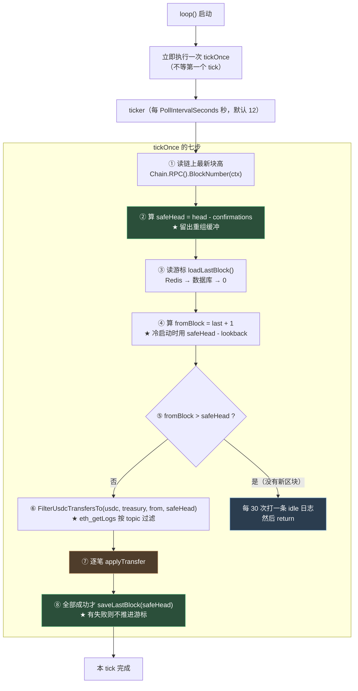
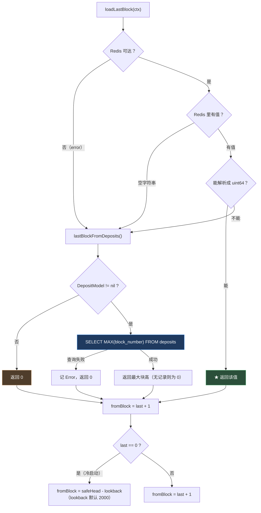
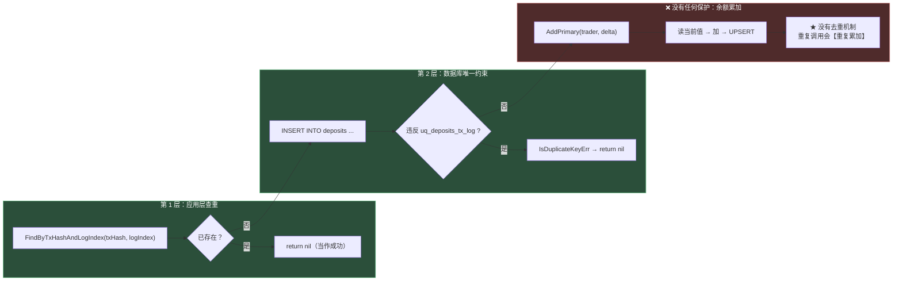

# 第 16 章：扫链入账 — TreasuryDepositWatcher 的游标、确认数与幂等

> 第 15 章的 `CoinbaseFeed` 连的是交易所的 WebSocket。本章要看的 `TreasuryDepositWatcher` 连的是**区块链的 RPC**——而这两条链路在"断点续传"这个问题上的难度**完全不是一个量级**。
>
> WS 断了的处理很简单：重连，重新订阅，**丢掉的数据不要了**（因为下一批行情马上就来）。**但链上事件不能丢**——用户往收款地址转的 USDC 是真实资产，**漏掉一笔就是漏掉一笔钱**。
>
> 这就带来了链下索引器（indexer）这个经典问题的全套要素：**扫到哪了（游标）、扫到多新才算安全（确认数）、重启后从哪里接着扫（回溯范围）、重复扫到同一条怎么办（幂等）**。
>
> 本章会看到本项目对这四点的完整实现——**其中三点做得很好，而第四点有一个真实的分裂**。我会给出实测推导：**一笔充值可能被记录在案，但用户的余额永远不会增加**——而且这个失败是**静默**的。

---

## 1. 本章导读

### 1.1 为什么这个监听器是"必需的"——与其他组件的本质区别

**第 1 章 4.7 提过一句话：本项目几乎不用事件做业务驱动**，因为所有链上交易都是后端自己发起的（`submitBatch` 发完交易、等到回执就知道结果了）。**唯一的例外就是本章这个组件。**

**为什么它是例外？**

```text
其他所有链上交互：
  后端发起 → 链上执行 → 后端拿到回执
  ⟹ ★ 后端"在场"，它知道自己做了什么

用户充值：
  用户【自己】从钱包转 USDC 到收款地址
  ⟹ ★ 后端【不在场】—— 它是一个被动的接收方
  ⟹ 只能靠【扫描链上事件】来发现"有人给我转钱了"
```

**🔑 这个区别决定了它必须是一个"索引器"：**

| | 后端发起的交易（第 10、14 章） | 用户发起的转账（本章） |
| --- | --- | --- |
| 谁知道发生了什么 | 后端自己（拿到回执） | **只有链知道** |
| 需要扫链吗 | ❌ 不需要 | ✅ **必须** |
| 漏掉的后果 | 已知（有 txHash 可以查） | ★ **未知**（不知道漏了什么） |
| 能否重放 | 可以（有数据） | ★ **必须重新扫**（否则永远不知道） |

**🔑 所以"扫链"这个动作有一个本质要求：**不能跳过任何区块**。**

```text
· 后端发起的交易漏了 → 至少知道"我发过这笔"，可以去链上查
· ★ 扫链漏了一个区块 → 【永远不知道】那个区块里有什么
```

**⟹ 这就是为什么"游标"是这个组件最核心的东西**——**它必须保证"从上次扫到的位置继续，一个块都不跳过"。**

### 1.2 链下索引器的四个通用要素

**任何"扫链把数据搬到本地"的组件，都要解决同样四个问题：**

```text
① 游标（cursor）：扫到哪个区块了？怎么保存？丢了怎么办？
② 确认数（confirmations）：扫到多新的区块才算安全？
③ 重启回溯：游标丢了，从哪里重新开始？
④ 幂等（idempotency）：同一笔事件被扫到两次，怎么办？
```

**逐条看本项目的答案：**

| # | 问题 | 本项目的答案 | 评价 |
| --- | --- | --- | --- |
| ① | 游标怎么存 | **Redis 主存 + 数据库兜底**（三层降级） | ✅ **设计得很好** |
| ② | 确认数 | `Confirmations: 1`（`safeHead = head - 1`） | ⚠️ 偏低（但有参数可调） |
| ③ | 重启回溯 | `InitialLookbackBlocks: 2000`（从 `safeHead - 2000` 开始） | ✅ 合理 |
| ④ | 幂等 | 应用层查重 + **数据库唯一约束**（`uq_deposits_tx_log`） | ⚠️ **只保护了一半**（1.3 节） |

**⚠️ 第 ④ 条的"只保护了一半"是本章的核心发现。**

### 1.3 本章的发现：一个"记录成功但余额没加"的静默失败

**先说结论，详细推导在 3.(8)。**

**`applyTransfer` 做了两步写入，而它们**不是原子的**：**

```go
func (w *TreasuryDepositWatcher) applyTransfer(ctx context.Context, tr chain.UsdcTreasuryTransfer) error {
	// ① 幂等检查：这笔充值记过了吗？
	exist, err := w.svc.DepositModel.FindByTxHashAndLogIndex(ctx, txHex, tr.LogIndex)
	if err != nil {
		return err
	}
	if exist != nil {
		return nil                              // ★★ 关键：已存在则直接返回
	}

	// ② 插入充值记录
	_, err = w.svc.DepositModel.Insert(ctx, &model.Deposit{ /* ... */ })
	if err != nil {
		if model.IsDuplicateKeyErr(err) {
			return nil
		}
		return err
	}

	// ③ 累加链下余额
	if err := w.svc.LedgerBalanceModel.AddPrimary(ctx, traderLower, tr.Value); err != nil {
		return err                             // ★ 这里失败 → 游标不推进 → 下轮重试
	}
	return nil
}
```

**🔴 故障路径（逐步推导）：**

```text
第 1 轮：
  ① FindByTxHashAndLogIndex → nil（没记过）
  ② Insert 成功 ✓                ⟹ deposits 表里有了这一行
  ③ AddPrimary 失败 ✗（数据库抖动、超时……）
     ⟹ 返回 error ⟹ applyErr = true ⟹ ★ 游标【不推进】

第 2 轮（下一个 tick，10 秒后）：
  重新扫同一段区块 → 又看到这同一笔 transfer
  ① FindByTxHashAndLogIndex → ★ 返回了【上一轮插入的那一行】
     ⟹ `if exist != nil { return nil }`  ⟹ ★ 返回成功！
     ⟹ applied++ ⟹ 游标推进 ✓
  ③ ★ AddPrimary 【永远不会再执行】

⟹ ⟹ ★★ 结果：deposits 表里有这笔充值，但 ledger_balances 里永远不会有它的金额
```

**⚠️ 而这个失败的**三个特征**让它特别危险：**

```text
① ★ 静默：第 2 轮的"重试"显示成功，日志里是 "new_transfers=1"（看得见"成功"）
② ★ 用户可见的不一致：GET /api/v1/deposits 能看到这笔充值，GET /api/v1/balance 却没有这笔钱
③ ★ 不可自愈：没有任何重试机制会补上它（因为查重逻辑认为"已经处理过了"）
```

**🔑 这可能是本指南发现的**最直接"丢钱"的缺陷**——不是"可能少收手续费"，也不是"可能算错费率"，而是**"用户的充值金额可能永远不会到账"。

**⚠️ 而且它的触发条件很普通**：只需要在"插入成功"和"余额累加"之间发生一次数据库错误（超时、连接池耗尽、瞬时不可用）。**这在生产环境里是必然会发生的。**

---

## 2. 架构 / 流程图

### 2.1 扫块循环的完整流程



**读图要点：**

- **绿色两处是正确的设计**：`safeHead` 留出确认数缓冲；**有失败就不推进游标**（保证"至少一次"语义）。
- **橙色的第 ⑦ 步是本章问题的所在**（1.3 节）。
- **`tickOnce` 在进入循环前**先执行一次**（`loop()` 里的 `w.tickOnce(...)` 在 `for` 之前）** —— **这是好的设计**：服务启动后立刻扫一次，而不是等 12 秒。

### 2.2 游标的三层降级



**🔑 这个三层降级的设计**思路是对的**：**

```text
第 1 优先：Redis（快、频繁更新）
第 2 优先：数据库的 MAX(block_number)（持久、但粒度粗）
第 3 优先：0 → 触发冷启动回溯
```

**✅ 而它的**保守性**是正确的**：

```text
数据库兜底给出的是"最后一笔【已记录充值】的块高"
⟹ 它【可能小于】真实扫到的位置（如果有一段是空扫的）
⟹ ⟹ ★ 后果是"重扫一段已扫过的区块"，而不是"跳过未扫的区块"
        ✓ 重扫是安全的（幂等），跳过是不安全的
```

**🔑 一条可以带走的判断：**

> **任何"断点续传"的兜底机制，都应该偏向"**多做一些**"而不是"**少做一些**"。**
> ```text
> ✅ 保守的兜底：可能重复处理（幂等能兜住）
> 🔴 激进的兜底：可能跳过未处理的（永远无法补救）
> ```
> **⚠️ 判断方法：问一句"如果兜底给出的位置不准确，会偏向哪边？"**
> ```text
> · 偏向"更早" → ✅ 安全（最多重扫）
> · ★ 偏向"更晚" → 🔴 危险（会漏数据，且不可恢复）
> ```

### 2.3 幂等的两层保护



**🔑 这张图揭示了本章问题的**结构**：**

```text
✅ deposits 的写入有【两层】幂等保护（应用层 + 数据库约束）
❌ ★ 余额的累加【一层都没有】

⟹ 而这个不对称，正是 1.3 节那个 bug 的根源：
   第 1 层的"已存在 → return nil"把【两步】当成【一步】来对待
```

### 2.4 【核心】两步写入的断裂 —— 时序图

```mermaid
%%{init: {'flowchart': {'wrappingWidth': 1000}}}%%
sequenceDiagram
    autonumber
    participant W as TreasuryDepositWatcher
    participant DB as Postgres

    Note over W,DB: 第 1 轮（tick N）

    W->>DB: ① FindByTxHashAndLogIndex(tx, 0)
    DB-->>W: nil（不存在）
    W->>DB: ② INSERT INTO deposits
    DB-->>W: OK ✓
    Note over DB: ★ deposits 表里现在有这一行了

    W->>DB: ③ AddPrimary(trader, 100e6)
    DB-->>W: ✗ ERROR（超时 / 连接池耗尽 / 瞬时不可用）
    Note over W: applyErr = true<br/>★ 游标【不推进】

    Note over W,DB: 第 2 轮（tick N+1，12 秒后）

    W->>W: 从同一个 fromBlock 重新扫描
    Note over W: 又扫到同一笔 transfer
    W->>DB: ① FindByTxHashAndLogIndex(tx, 0)
    DB-->>W: ★ 返回了第 1 轮插入的那一行
    Note over W: if exist != nil → return nil<br/>⟹ ★ 当作"成功"

    Note over W: applied++ → 游标推进 ✓
    Note over DB: ★★ AddPrimary 永远不会再执行<br/>ledger_balances 永远少这 100e6

    rect rgb(80, 40, 40)
        Note over W,DB: 最终状态：deposits 有记录，余额没有钱<br/>用户看到"充值成功"，但账户余额不变<br/>且没有任何机制会修复它
    end
```



**⚠️ 这张图里最关键的一步是第 7 步**：**"已存在 → 返回成功"这个判断，把"记账完成"和"余额入账完成"混为一谈了。**

**🔑 而这个缺陷的根源是**状态机不完整****：

```text
一个充值实际上有三个状态：
  ① 未处理（deposits 里没有，ledger 里没有）
  ② ★ 部分处理（deposits 里【有】，ledger 里【没有】）← 本项目无法表达这个状态
  ③ 完全处理（deposits 里有，ledger 里也有）

而代码只用了【一个标志】（deposits 里有没有那一行）来判断"处理完了吗"
⟹ ★ 无法区分状态 ② 和 ③
```

---

## 3. 核心代码拆解

### (1) 结构体与 `Start()` 的四道防御

```go
type TreasuryDepositWatcher struct {
	svc       *svc.ServiceContext
	stop      chan struct{}
	once      sync.Once
	tickCount int                          // ★ 用于"每 N 次打一条日志"
}

func (w *TreasuryDepositWatcher) Start() {
	cfg := w.svc.Config.TreasuryDeposit
	if !cfg.Enabled {
		logx.Info("TreasuryDeposit watcher disabled")
		return                                        // ① 配置开关
	}
	if w.svc.Chain == nil {
		logx.Error("TreasuryDeposit watcher skipped: chain client nil (check RpcUrl)")
		return                                        // ② 链客户端
	}
	// ③ 地址配置
	if strings.TrimSpace(w.svc.Config.Ethereum.UsdcAddress) == "" ||
		strings.TrimSpace(w.svc.Config.Ethereum.UsdcTreasuryAddress) == "" {
		logx.Error("TreasuryDeposit watcher skipped: UsdcAddress or UsdcTreasuryAddress empty")
		return
	}
	// ④ 数据库
	if w.svc.DepositModel == nil || w.svc.LedgerBalanceModel == nil {
		logx.Error("TreasuryDeposit watcher skipped: Supabase unavailable (DepositModel/LedgerBalanceModel nil)")
		return
	}
	logx.Infof("TreasuryDeposit watcher starting: usdc=%s treasury=%s poll=%ds confirmations=%d lookback=%d",
		/* ... 把所有关键参数都打出来 ... */)
	go w.loop()
}
```

**作者为什么这么设计（设计思想）：**

**✅ 第 3 章 3.(7) 表扬过这四道检查（"教科书式写法"）。这里从**第 16 章的角度**补充一个观察：**

**🔑 第 ④ 道检查特别重要 —— 因为 `DepositModel` 和 `LedgerBalanceModel` **正是本章那个 bug 涉及的两个模型**：**

```text
这次检查保证了"两个模型要么都有，要么都不启动"
⟹ ⚠️ 但它保证的是【存在性】，不是【写入的原子性】
⟹ ★ 两个模型都存在，但它们的写入是两次独立的操作
```

**🔑 这揭示了一个容易被忽略的区别：**

> **"依赖检查"能保证"依赖存在"，但保证不了"依赖之间的一致性"。**
> ```text
> ✅ 检查到了：DepositModel != nil && LedgerBalanceModel != nil
> ❌ 没检查到：★ 这两个写入需要【原子性】—— 而这需要事务，不是判空能解决的
> ```

**✅ 设计点二：启动日志把所有关键参数都打出来了。**

```go
logx.Infof("TreasuryDeposit watcher starting: usdc=%s treasury=%s poll=%ds confirmations=%d lookback=%d", ...)
```

**🔑 第 3 章 6.7 表扬过这个习惯**（"启动日志应该是一份可审计的运行记录"）—— **`poll` / `confirmations` / `lookback` 这三个参数直接决定了扫描行为，把它们记下来，排查"为什么充值没到账"时第一眼就能看到。**

**✅ 设计点三：`tickCount` 用于日志节流。**

```go
tickCount int      // 用于"每 30 次打一条 idle 日志"、"每 20 次打一条 ok 日志"
```

**⚠️ 为什么要节流日志？** 因为这个组件每 12 秒跑一次，**一天 7200 次**。**如果每次都打日志，日志会被淹没。**

**🔑 这个设计是对的** —— **但要注意 `tickCount` 是**非原子的** `int`，如果它只被 `loop` 这个 goroutine 访问，那是安全的 ✓**（实际上确实只有一个 goroutine）。

### (2) `tickOnce` 全流程

```go
func (w *TreasuryDepositWatcher) tickOnce(ctx context.Context) {
	w.tickCount++

	// ① 读链上最新块高
	head, err := w.svc.Chain.RPC().BlockNumber(ctx)
	if err != nil {
		logx.Errorf("treasury watcher BlockNumber: %v", err)
		return                                    // ★ 早返回，本 tick 什么都不做
	}

	// ② 算 safeHead（留出确认数缓冲）
	conf := w.confirmations()
	var safeHead uint64
	if head > conf {
		safeHead = head - conf
	} else {
		safeHead = 0                               // ★ 链太年轻时的保护
	}

	// ③ 读游标
	last, err := w.loadLastBlock(ctx)
	if err != nil {
		logx.Errorf("treasury watcher loadLastBlock: %v", err)
		return
	}

	// ④ 算起始块
	fromBlock := last + 1
	if last == 0 {
		// ★ 冷启动：回溯 lookback 个块
		if safeHead > w.lookback() {
			fromBlock = safeHead - w.lookback()
		} else {
			fromBlock = 0                          // ★ 链还没那么长，从头扫
		}
	}

	// ⑤ 没有新区块可扫
	if fromBlock > safeHead {
		if w.tickCount%30 == 0 {
			logx.Infof("treasury watcher idle: head=%d safe=%d last=%d", head, safeHead, last)
		}
		return
	}

	// ⑥ 扫日志
	usdc := common.HexToAddress(strings.TrimSpace(w.svc.Config.Ethereum.UsdcAddress))
	treasury := common.HexToAddress(strings.TrimSpace(w.svc.Config.Ethereum.UsdcTreasuryAddress))
	transfers, err := w.svc.Chain.FilterUsdcTransfersTo(ctx, usdc, treasury, fromBlock, safeHead)
	if err != nil {
		logx.Errorf("treasury watcher FilterLogs blocks %d-%d: %v", fromBlock, safeHead, err)
		return                                    // ★ 失败不推进游标 ✓
	}

	// ⑦ 逐笔处理
	var applied int
	var applyErr bool
	for _, tr := range transfers {
		if err := w.applyTransfer(ctx, tr); err != nil {
			applyErr = true
			logx.Errorf("treasury watcher apply tx=%s log=%d: %v", tr.TxHash.Hex(), tr.LogIndex, err)
		} else {
			applied++
		}
	}
	if applyErr {
		return                                    // ★★ 有失败就不推进游标 ✓
	}

	// ⑧ 推进游标
	w.saveLastBlock(ctx, safeHead)

	if applied > 0 || w.tickCount%20 == 0 {
		logx.Infof("treasury watcher ok: scanned %d-%d, new_transfers=%d, last=%d",
			fromBlock, safeHead, applied, safeHead)
	}
}
```

**作者为什么这么设计（设计思想）：**

**✅ 设计点一：`applyErr` 时不推进游标 —— 这是**整章最重要的正确性保证**。**

```go
if applyErr {
	return                    // ★ 不调用 saveLastBlock
}
w.saveLastBlock(ctx, safeHead)
```

**🔑 这个设计的语义是"至少一次（at-least-once）"：**

```text
· 如果有一段区块里有任何一笔没处理成功
  ⟹ 游标停在原处 ⟹ 下一轮重扫这一段
  ⟹ ★ 保证"没有事件被永久跳过"

· 代价：已经成功处理过的事件会被【重复处理】
  ⟹ ★ 所以必须有幂等机制（2.3 节的第 1、2 层）
```

**🔑 这是一个经典的分布式系统模式：**

> **"至少一次投递 + 幂等消费" = 事实上的"恰好一次"效果。**
> ```text
> 至少一次（本项目的选择）：
>   · 保证不漏
>   · ★ 但要求消费者幂等
>
> 至多一次（不重试）：
>   · 保证不重
>   · ★ 但会漏（而漏了就无法恢复）
>
> ★ 在"漏了无法恢复"的场景（充值、支付），必须选"至少一次"
> ```
>
> **⚠️ 而本项目**确实**选了至少一次 ✓ —— 问题在于"幂等"这一半没有做全（1.3 节）。**

**⚠️ 设计点二（问题）：这个设计有一个"毒丸"风险。**

```go
if applyErr {
	return                    // ★ 只要【有一笔】失败，整段都重扫
}
```

**⚠️ 如果某一笔 transfer **永远无法成功**（比如它的数据有问题、或者 `trader` 字段超长）：**

```text
每一轮：
  · 重扫同一段
  · 那一笔又失败
  · ★ 游标永远不推进
  ⟹ ★★ 整个充值功能停摆 —— 后续所有新充值都不会被处理
```

**🔑 这引出一个重要的设计问题：**

> "有失败就整段重试"的策略，在"失败是瞬时的"前提下是对的。
> 但如果失败是**永久性**的（一条坏数据），它会把"局部问题"放大成"全局停摆"。
>
> ```text
> 局部问题：一笔 transfer 处理不了
> ★ 全局停摆：所有充值都处理不了（因为游标卡住了）
> ```
>
> **⚠️ 这与第 9 章那个"零量订单冻结整个市场"是**同构的问题**：**
> ```text
> 第 9 章：一张坏订单 → break 掉整个撮合循环 → ★ 全市场停摆
> 本章：  一笔坏 transfer → 不推进游标 → ★ 全部充值停摆
>
> ★ 共同点：把"局部异常"当成了"整体终止"的信号
> ```

**🔑 修法（区分"可重试"和"永久失败"）：**

```go
for _, tr := range transfers {
	if err := w.applyTransfer(ctx, tr); err != nil {
		if isPermanentError(err) {
			// ★ 永久失败：记下来、告警，但【不阻塞游标】
			logx.Errorf("⚠️ 永久失败，跳过（需人工处理）: tx=%s log=%d: %v", tr.TxHash.Hex(), tr.LogIndex, err)
			// 可以写一条"待人工处理"的记录
			continue
		}
		applyErr = true                    // 瞬时失败：保持原策略
		logx.Errorf("treasury watcher apply tx=%s log=%d: %v", tr.TxHash.Hex(), tr.LogIndex, err)
	}
}
```

**⚠️ 但"如何区分永久和瞬时"是个难题** —— **所以更实际的做法可能是"重试 N 次后跳过并告警"**（与第 9 章 6.2 给 `rollbackMatch` 加 `FailCount` 是同一个思路）。

### (3) 确认数 `safeHead` 的计算

```go
conf := w.confirmations()          // 配置值，默认 1
var safeHead uint64
if head > conf {
	safeHead = head - conf          // ★ 落后 head 若干块
} else {
	safeHead = 0                    // ★ 链的块高还不到 conf
}
```

**作者为什么这么设计（设计思想）：**

**🔑 为什么需要确认数？因为区块链会发生**重组（reorg）**。**

```text
重组 = 已经"确认"过的区块被另一条链取代

例子：
  t=0   链上有 A-B-C-D（head = D）
  t=12  出现了一条更长的链 A-B-C'-D'-E
        ⟹ ★ D 被"踢出"了主链，它的交易回到了内存池

⟹ ★ 如果我们在 t=0 就读了 D 里的 Transfer 并入了账
   ⟹ 这条转账"从未真正发生过"（或者说，它的位置变了）
   ⟹ ★ 而我们已经给用户加了钱 —— 无法撤销
```

**🔑 确认数的作用就是"等足够多的区块堆在上面，让重组的概率降到你愿意接受的水平"。**

| 确认数 | 重组风险 | 延迟 |
| --- | --- | --- |
| 0（读 head） | 🔴 高（任何重组都会影响） | 0 |
| **1（本项目）** | ⚠️ 中（只防 1 块以内的重组） | **12 秒** |
| 12（交易所常见） | ✅ 低 | 144 秒 |
| 64（大额入金常见） | ✅ 极低 | 768 秒 |

**⚠️ `Confirmations: 1` 是一个**偏保守不足**的选择** —— **它只能防住"1 个块的重组"，而以太坊的 1 块重组是**相对常见**的（尤其是网络拥堵时）。**

**✅ 但它至少不是 0** —— **`safeHead = head - 1` 说明作者知道重组的风险**。

**🔑 一条可以带走的经验：**

> **确认数的选择是一个**风险与延迟的权衡**，而权衡的依据应该是"入账金额的量级"。**
> ```text
> 小额充值（< $100）→ 1~3 个确认（快速到账，风险可接受）
> 大额充值（> $10000）→ ★ 12~64 个确认（宁可慢，不能错）
> ```
>
> **⚠️ 而本项目的 `Confirmations` 是**全局配置**（对所有金额用同一个值）——**
> **更精细的做法是"按金额分级确认"，但那需要额外的复杂度。**

**⚠️ 设计点二：`else { safeHead = 0 }` 是必要的保护。**

```text
如果 head = 5 而 conf = 12：
  head - conf 会发生【无符号整数下溢】
  ⟹ ★ 5 - 12 = 一个巨大的数（2^64 - 7）
  ⟹ 那 fromBlock 和 safeHead 的比较会完全错乱

⟹ ✅ `if head > conf` 挡住了它
```

**🔑 这是一个"无符号整数下溢"的经典防护** —— **而 Go 编译器**不会**警告这种写法**（`uint64 - uint64` 是合法的，只是结果不是你以为的那个）。

**⚠️ 判断方法：看到 `a - b` 而 a、b 都是无符号整数时，问一句"b > a 时会怎样？"**

### (4) `FilterUsdcTransfersTo` —— 事件日志的 topic 过滤

```go
var erc20TransferSig = crypto.Keccak256Hash([]byte("Transfer(address,address,uint256)"))
```

```go
func (c *Client) FilterUsdcTransfersTo(ctx context.Context, usdc, treasury common.Address, fromBlock, toBlock uint64) ([]UsdcTreasuryTransfer, error) {
	topicTo := common.BytesToHash(common.LeftPadBytes(treasury.Bytes(), 32))
	q := ethereum.FilterQuery{
		FromBlock: new(big.Int).SetUint64(fromBlock),
		ToBlock:   new(big.Int).SetUint64(toBlock),
		Addresses: []common.Address{usdc},            // ① 只看 USDC 合约
		Topics: [][]common.Hash{
			{erc20TransferSig},                       // ② topic[0] = Transfer 签名
			nil,                                      // ③ topic[1] = from（不过滤）
			{topicTo},                                // ④ topic[2] = to（必须是我们）
		},
	}
	logs, err := c.eth.FilterLogs(ctx, q)
	if err != nil {
		return nil, err
	}
	// ... 逐个解析 ...
}
```

**作者为什么这么设计（设计思想）：**

**✅ 设计点一：三层过滤（合约地址 + 事件签名 + to 地址）把数据量压到了最小。**

**🔑 这是链上事件查询的标准做法，值得理解每一层的作用：**

```text
① Addresses: [usdc]
   ⟹ 不扫其他合约的日志（一个区块里有成百上千条日志）

② Topics[0] = keccak256("Transfer(address,address,uint256)")
   ⟹ 只在 USDC 合约的日志里找 Transfer 事件
   ⟹ 因为一个合约可能 emit 很多种事件

③ Topics[2] = treasury（左补零到 32 字节）
   ⟹ 只在【转入 treasury】的 Transfer 里找
   ⟹ 因为 USDC 的 Transfer 有成千上万条（所有人都在转账）

⟹ ★ 三层过滤后，剩下的通常只有"我们关心"的那几条
```

**⚠️ 设计点二：`nil` 表示"这个位置的 topic 不限制"。**

```go
Topics: [][]common.Hash{
	{erc20TransferSig},   // 第 0 位：必须匹配
	nil,                  // 第 1 位（from）：★ nil = 任意值
	{topicTo},            // 第 2 位（to）：必须匹配
}
```

**🔑 这是 `eth_getLogs` 的语义：`Topics` 是**位置敏感的**——第 i 个元素对应日志的第 i 个 topic。**

**⚠️ 而 ERC-20 的 `Transfer` 事件定义是：**

```solidity
event Transfer(address indexed from, address indexed to, uint256 value);
//              ↑ indexed          ↑ indexed        ↑ 不 indexed（放在 data 里）
```

**⟹ 所以 topics 是：**

```text
topic[0] = keccak256("Transfer(address,address,uint256)")   ← 事件签名（自动）
topic[1] = from（indexed）
topic[2] = to（indexed）
data     = value（不 indexed，所以放在 data 里）
```

**✅ 代码里 `{erc20TransferSig}, nil, {topicTo}` 正好对应这三个位置 ✓**

**✅ 设计点三：解析时的防御性检查。**

```go
for _, lg := range logs {
	if len(lg.Topics) != 3 || len(lg.Data) < 32 {
		continue                    // ★ 防御：格式不对就跳过
	}
	from := common.BytesToAddress(lg.Topics[1][12:])     // ★ 地址在 topic 的后 20 字节
	to := common.BytesToAddress(lg.Topics[2][12:])
	if to != treasury {
		continue                    // ★ 二次确认（虽然 getLogs 已经过滤了）
	}
	val := new(big.Int).SetBytes(lg.Data[:32])           // ★ value 在 data 的前 32 字节
	// ...
}
```

**🔑 三个细节值得注意：**

```text
① lg.Topics[1][12:] —— 地址是 20 字节，而 topic 是 32 字节
   ⟹ ★ 地址在【后】20 字节（前面 12 字节是补零）
   ⟹ 写错成 [0:20] 会得到一个完全错误的地址

② lg.Data[:32] —— value 是 uint256，正好 32 字节
   ⟹ ✅ 取前 32 字节

③ if to != treasury { continue } —— 二次确认
   ⟹ ⚠️ 理论上 getLogs 已经过滤了，但这是"不信任外部输入"的好习惯 ✓
```

**⚠️ 注意这里**没有**检查 `lg.Removed`** —— 那是"日志因重组被移除"的标志。

```go
// go-ethereum 的 types.Log 有一个字段：
type Log struct {
	// ...
	Removed bool `json:"removed"`
	// ★ Removed 为 true 表示"这条日志因为链重组被移除了"
}
```

**⚠️ 不过 `eth_getLogs` 返回的日志通常 `Removed = false`（那个字段主要用于订阅场景）。** **所以这里不检查是可以接受的**，但**确认数（`safeHead`）才是防重组的正解** ✓

### (5) 【🔴 核心】`applyTransfer` 的两步写入

```go
func (w *TreasuryDepositWatcher) applyTransfer(ctx context.Context, tr chain.UsdcTreasuryTransfer) error {
	txHex := tr.TxHash.Hex()

	// ===== 第 1 步：幂等检查 =====
	exist, err := w.svc.DepositModel.FindByTxHashAndLogIndex(ctx, txHex, tr.LogIndex)
	if err != nil {
		return err
	}
	if exist != nil {
		return nil                     // 🔴 关键：已存在就直接返回（把"两步"当成"一步"）
	}

	traderLower := strings.ToLower(tr.From.Hex())

	// ===== 第 2 步：插入充值记录 =====
	_, err = w.svc.DepositModel.Insert(ctx, &model.Deposit{
		TxHash:          txHex,
		LogIndex:        int64(tr.LogIndex),
		Trader:          traderLower,
		PrimaryAmount:   tr.Value.String(),
		SecondaryAmount: "0",
		BlockNumber:     int64(tr.BlockNumber),
		CreateTime:      time.Now(),
	})
	if err != nil {
		if model.IsDuplicateKeyErr(err) {
			return nil                 // ✅ 数据库层的幂等兜底
		}
		return err
	}

	// ===== 第 3 步：累加链下余额 =====
	if err := w.svc.LedgerBalanceModel.AddPrimary(ctx, traderLower, tr.Value); err != nil {
		return err                     // ★ 这里失败 → 游标不推进 → 下轮重试
	}

	logx.Infof("treasury deposit credited: trader=%s amount=%s tx=%s", traderLower, tr.Value.String(), txHex)
	return nil
}
```

**🔑 这是本章的核心。问题的本质不是"某一行写错了"，而是**状态机缺了一个状态**。**

**⚠️ 一个充值实际上有三个状态，而代码只区分了两个：**

```text
状态 ①：deposits 里没有        → 未处理
状态 ②：deposits 里有、ledger 里没有  → ★★ 部分处理（代码无法识别）
状态 ③：deposits 里有、ledger 里也有  → 已处理

而代码的判断是：`if exist != nil { return nil }`
⟹ ★ 把状态 ② 和 ③ 都当成了"已处理"
⟹ ⟹ 状态 ② 永远不会被修复
```

**🔑 修法（三个方向，各有取舍）：**

**方向 A（最推荐）：把两步放进一个数据库事务。**

```go
// 在 model 层提供一个"原子入账"方法
func (m *gormDepositModel) InsertAndCredit(ctx context.Context, d *Deposit, db *gorm.DB) error {
	return db.Transaction(func(tx *gorm.DB) error {
		// ① 插入 deposit
		if err := tx.Create(&depositRow{...}).Error; err != nil {
			return err
		}
		// ② 累加余额（同一个事务）
		key := normalizeTraderKey(d.Trader)
		var cur string
		if err := tx.Raw(`SELECT primary_balance FROM ledger_balances WHERE trader = ? FOR UPDATE`, key).
			Scan(&cur).Error; err != nil && !errors.Is(err, gorm.ErrRecordNotFound) {
			return err
		}
		// ... 计算 sum ...
		return tx.Exec(`INSERT INTO ledger_balances ... ON CONFLICT (trader) DO UPDATE SET ...`, ...).Error
	})
}
```

**✅ 这样：要么两步都成功，要么两步都失败 → 重试时状态是干净的 ✓**

**⚠️ 而且事务还顺带解决了 `AddPrimary` 的另一个问题**（见下）。

**方向 B：让余额累加也幂等。**

```go
// 用一个"已处理日志"表记录"哪些 (txHash, logIndex) 已经加过余额"
// 或者：把 logIndex 也记进 ledger_balances 的处理记录里
```

**⚠️ 这个方向需要额外的表/字段，复杂度高。**

**方向 C（最小改动）：把幂等检查移到"余额累加之后"。**

```go
// 先做余额累加 —— 如果这一步失败，什么都不写
// 但这样又无法保证"deposits 必有一行"...
```

**⚠️ 方向 C 不成立 —— 因为"先加钱后记录"和"先记录后加钱"都有各自的失败窗口。**

**🎯 所以唯一的正确解法是**方向 A（事务）**。**

**⚠️ 顺带指出 `AddPrimary` 自身的一个问题：读-改-写不是原子的。**

```go
func (m *gormLedgerBalanceModel) AddPrimary(ctx context.Context, traderLower string, delta *big.Int) error {
	if delta == nil || delta.Sign() <= 0 {
		return nil
	}
	key := normalizeTraderKey(traderLower)
	cur, err := m.GetPrimary(ctx, key)          // ★ ① 读
	if err != nil {
		return err
	}
	sum := new(big.Int).Add(cur, delta)          // ★ ② 改
	now := time.Now().UTC()
	return m.db.WithContext(ctx).Exec(`         // ★ ③ 写
INSERT INTO ledger_balances (trader, primary_balance, updated_at)
VALUES (?, ?, ?)
ON CONFLICT (trader) DO UPDATE
SET primary_balance = EXCLUDED.primary_balance, updated_at = EXCLUDED.updated_at`,
		key, sum.String(), now,
	).Error
}
```

**⚠️ ①②③ 不是原子的 —— 如果两个 goroutine 同时对同一个 trader 调用：**

```text
T1: 读 cur = 100
T2: 读 cur = 100
T1: sum = 100 + 50 = 150，写入
T2: sum = 100 + 30 = 130，写入
⟹ ★ 最终是 130 而不是 180 —— T1 的 50 丢了
```

**⚠️ 当前**不会发生**（因为 `applyTransfer` 是串行调用的），**但这个安全性依赖"只有一个写入者"这个前提。

**🔑 修法（用原子的 SQL 累加）：**

```sql
INSERT INTO ledger_balances (trader, primary_balance, updated_at)
VALUES ($1, $2, $3)
ON CONFLICT (trader) DO UPDATE
SET primary_balance = (ledger_balances.primary_balance::numeric + EXCLUDED.primary_balance::numeric)::text,
    updated_at = EXCLUDED.updated_at
-- ★ 关键：在 SQL 里做【累加】，而不是在应用层算好再写
```

**⚠️ 注意 `primary_balance` 是 `TEXT` 类型**（第 2 章 3.(10) 的表结构），**所以要用 `::numeric` 转换 —— 而 `numeric` 在 PostgreSQL 里是**任意精度**的，正好对应 Go 的 `big.Int` ✓**

**🔑 一条可以带走的经验：**

> **"读-改-写"必须用**数据库的原子操作**（`UPDATE ... SET x = x + delta`），而不是"应用层读出来、加一下、再写回去"。**
> ```text
> ✅ 原子：UPDATE t SET v = v + $1 WHERE k = $2
> 🔴 非原子：cur = SELECT v; new = cur + $1; UPDATE t SET v = new
> ```
>
> **⚠️ 后者的正确性依赖"只有一个写入者"—— 而那个前提在系统演进中【极易被破坏】**
> （加一个后台任务、把循环改成并发、部署第二个实例……）

### (6) 与 `CoinbaseFeed` 的对照：两个监听器的"断点续传"

**第 15 章讲过 `CoinbaseFeed` 的重连。这里把两个监听器放在一起对比，因为它们**同样叫"监听"，但对"丢数据"的容忍度完全不同**：**

| | `CoinbaseFeed`（第 15 章） | `TreasuryDepositWatcher`（本章） |
| --- | --- | --- |
| 监听什么 | 交易所 WS（行情） | 链上事件（充值） |
| 丢数据可以吗 | ✅ **可以**（下一批行情马上来） | 🔴 **绝对不可以**（那是钱） |
| 需要游标吗 | ❌ 不需要（只要最新值） | ✅ **必须**（不能跳过任何块） |
| 需要确认数吗 | ❌ 不需要 | ✅ 需要（防重组） |
| 需要幂等吗 | ❌ 不需要（覆盖写） | ✅ **必须** |
| 断线重连的影响 | ⚠️ 丢失期间的行情（无害） | ★ 必须从断点续传 |
| 断点续传的机制 | 无（重新订阅即可） | **Redis 游标 + 数据库兜底** |

**🔑 这个对照揭示了一个重要的区分：**

> **同样是"监听外部数据"，"**状态型**"和"**事件型**"的要求完全不同。**
> ```text
> 状态型（行情价格）：
>   · 关心的是"当前值是多少"
>   · ⟹ 只需要最新的一份，历史可以丢
>   · ⟹ 幂等 = 覆盖写
>
> ★ 事件型（转账、订单成交）：
>   · 关心的是"发生过哪些事"
>   · ⟹ ★ 必须【全部】收到，一条都不能少
>   · ⟹ 幂等 = 按唯一标识去重
> ```
>
> **⚠️ 而"状态型"比"事件型"简单得多** —— **这就是为什么第 15 章的组件没有游标，而本章必须有。**

**🔑 判断方法：问一句"如果我漏掉了一条，会怎样？"**

```text
· 下一条会覆盖它 → ✅ 状态型，不用游标
· ★ 永远补不回来 → 🔴 事件型，必须游标 + 幂等
```

---

## 4. Web3 特有机制

### 4.1 为什么"充值"必须扫链，而"成交"不用

**这是本章开头 1.1 节提出的问题，这里给出更完整的回答。**

**本质上是一个"谁是发起方"的问题：**

```text
后端发起的交易（成交、资金费率）：
  ① 后端构造交易 → ② 签名广播 → ③ 等回执
  ⟹ ★ 后端【全程在场】，它知道交易的 txHash、知道结果
  ⟹ 数据来源是"自己的回执"，不需要扫链

用户发起的转账（充值）：
  ① 用户在钱包里操作（后端完全不知道）
  ② 链上产生 Transfer 事件
  ⟹ ★ 后端【不在场】，它只能事后去链上找
  ⟹ 数据来源是"链上的事件日志"，必须扫链
```

**🔑 但这个区分有**反例**—— 有些"后端发起的交易"也需要扫链：**

```text
场景：后端发了交易，但在等回执时崩溃了（第 11 章 3.(9) 讨论过的 T2/T3 窗口）
  ⟹ ★ 交易可能已经上链，但后端不知道结果
  ⟹ 这时候"扫链找自己发的交易"就是唯一的补救方式
```

**⚠️ 而第 11 章指出本项目**没有**这个机制**（`txHash` 只存在内存里，崩溃即丢失）。

**⟹ 所以更准确的说法是：**

> **"后端发起的交易"通常不需要扫链——**前提是它可靠地记录了自己发过什么**。**
> ```text
> ✅ 有 WAL（先记录"我要发了"）→ 崩溃后可以去链上查 → 不需要扫链
> ★ 没有 WAL（本项目的现状）  → 崩溃后【无从查起】→ 只能靠扫链（而链下也没有）
> ```

**🔑 所以"要不要扫链"取决于"能不能可靠地追踪自己发起的操作"，而不是"谁发起的"。**

### 4.2 确认数与重组：一个"概率"而非"确定性"的问题

**重组（reorg）是区块链的一个基本性质，理解它才能理解"确认数"的意义。**

```text
区块链的"共识"不是"确定"，而是"概率"：
  · 一个区块被打包 ⟹ 它现在在主链上
  · ★ 但如果有另一条更长的链出现 ⟹ 这条会被取代（重组）
  · 区块越深（上面堆的块越多）⟹ 被重组掉的概率越低（指数下降）
```

**🔑 所以"确认数"是在买"确定性"：**

```text
1 个确认   → 重组概率可能 0.1%（网络正常时更低）
6 个确认   → 概率降到 1e-6 量级
12 个确认  → 交易所的常见标准
```

**⚠️ 对本项目（`Confirmations: 1`）的含义：**

```text
· 它防住了"最浅的重组"（1 块以内）
· ★ 但如果发生 2 块以上的重组：
  ⟹ 已经入账的那笔转账"从未发生"
  ⟹ ★ 而 `ledger_balances` 里的钱已经加上了 —— 无法回滚
```

**⚠️ 而本项目的 `deposits` 表里**也没有"已重组"的标记：

```sql
CREATE TABLE deposits (
    tx_hash VARCHAR(66) NOT NULL,
    log_index BIGINT NOT NULL,
    -- ...
    CONSTRAINT uq_deposits_tx_log UNIQUE (tx_hash, log_index)
);
```

**🔑 所以一个完整的"重组处理"应该是这样的（本项目未实现）：**

```text
① 记录每一笔入账是【在哪个块】被确认的（本项目有 block_number ✓）
② 定期检查"最近 N 个块是否发生了重组"
   ⟹ 方法：记录每个块的 hash，重新读链上与本地记录的 hash 比对
③ 如果发现重组：
   ⟹ ★ 撤销受影响的入账（deposits 删掉、ledger 减回去）
   ⟹ 这是一个"反向操作"，需要谨慎实现
```

**⚠️ 而"撤销入账"本身是一个**危险操作**（用户可能已经把余额花掉了）。** **所以更实际的做法是"用足够的确认数，让重组概率低到可以忽略"。**

**🔑 一条可以带走的判断：**

> **确认数的选择是一个**风险定价**问题：**
> ```text
> 风险 = P(重组深度 > 确认数) × 单笔损失金额
> 成本 = 用户的等待时间
>
> ⟹ ★ 所以"大额入金用更多确认"是有道理的（同样的等待时间，换更低的损失期望）
> ```
>
> **⚠️ 而本项目的**全局配置**（对所有金额用同一个确认数）是一种简化** —— **对测试网来说完全够用，但对主网的大额入金偏激进。**

### 4.3 幂等：为什么必须靠唯一约束，而不是应用层判断

**这是本章最通用的一条经验，值得完整展开。**

**先看本项目**同时用了**两种幂等机制（2.3 节）：**

```go
// 第 1 层：应用层查重
exist, err := w.svc.DepositModel.FindByTxHashAndLogIndex(ctx, txHex, tr.LogIndex)
if exist != nil { return nil }

// 第 2 层：数据库唯一约束
_, err = w.svc.DepositModel.Insert(ctx, ...)
if model.IsDuplicateKeyErr(err) { return nil }
```

**🔑 为什么需要两层？因为应用层查重**挡不住并发**：**

```text
时刻 T1：请求 A 查询 → 不存在
时刻 T1：请求 B 查询 → 不存在      ← ★ 两个都通过了第 1 层
时刻 T2：A 插入 → 成功
时刻 T2：B 插入 → ★ 违反唯一约束（被第 2 层挡住）✓
```

**⚠️ 而这个"并发"在本项目里**不会发生**（`applyTransfer` 是串行调用的）。** **那第 2 层还有必要吗？**

**✅ 有 —— 因为它的价值不只是"防并发"，还有"防未来的改动"：**

```text
· 如果将来把 tickOnce 改成并发处理多笔 transfer
· 如果将来部署了第二个 watcher 实例（同时扫同一段）
· 如果在恢复期手工重跑了一段
⟹ ★ 只要唯一约束在，这些情况都不会产生重复入账
```

**🔑 这是"数据库约束"相对于"应用层检查"的根本优势：**

> **应用层的检查是"**建议性"的——它依赖"所有写入者都记得检查"。
> 数据库的约束是"**强制性**"的——它不关心是谁在写、怎么写。
>
> ```text
> ✅ 唯一约束：无论谁、用什么方式、并发多少次 → 都不可能重复
> ⚠️ 应用层检查：只在"代码按预期执行"时有效
> ```
>
> **🔑 判断方法：问一句"如果这段业务逻辑换一种写法（或者被并发调用），幂等还成立吗？"**
> ```text
> · 靠应用层判断 → ★ 换个写法就失效
> · 靠数据库约束 → ✅ 永远成立
> ```

**⚠️ 而本章的 bug 恰好是这个原则的**反面教材**：**

```text
deposits 的写入：✅ 有唯一约束（uq_deposits_tx_log）
ledger 的累加：  🔴 没有任何约束，也没有版本号/去重标记
⟹ ★ 所以"重复累加"是可能的（虽然当前路径下不会发生）
⟹ ★★ 而更糟的是"漏掉累加"（1.3 节）—— 这个确实会发生
```

**🔑 一条可以带走的经验：**

> **幂等性应该"一步到位"地覆盖**整个操作**，而不是"每个子操作各自幂等"。**
> ```text
> ✗ 本项目：deposit 幂等 ✓ + ledger 累加不幂等 ✗
>   ⟹ ★ 组合起来，整个"入账"操作不幂等
>
> ✓ 正确：把"插入 + 累加"当成一个原子单元，整体幂等
>   ⟹ 方法就是"放进一个事务"（3.(5) 方向 A）
> ```

### 4.4 链上事件与数据库唯一约束的"天然配合"

**最后补充一个正面观察：为什么"用 (txHash, logIndex) 做唯一键"是一个**天然正确**的选择。**

```sql
CONSTRAINT uq_deposits_tx_log UNIQUE (tx_hash, log_index)
```

**🔑 因为 `(txHash, logIndex)` 是**链上事件的天然唯一标识**：**

```text
· txHash：一笔交易的哈希 —— 全局唯一
· logIndex：该日志在**整个区块**里的序号 —— 而不是"在交易内的序号"
  ⟹ ★ 所以 (txHash, logIndex) 在整个链上是唯一的

⚠️ 但如果只用 txHash 就不够：
   一笔交易可能产生多个 Transfer 事件（比如合约批量转账）
   ⟹ ★ 同 txHash 的多条日志会被误判为"重复"
```

**✅ 本项目用的是 `lg.Index`（区块内全局序号）而不是 `lg.TxIndex`（交易内序号）：**

```go
LogIndex: lg.Index,
```

**⚠️ 这个选择是**对的** —— 如果用 `TxIndex`，那么"同一笔交易里的第 0 条日志"和"另一笔交易里的第 0 条日志"会碰撞。**

**🔑 一条可以带走的经验：**

> **给链上事件做唯一键时，应该用"链本身保证唯一的字段组合"，而不是"看起来唯一的字段"。**
> ```text
> ✅ (blockNumber, txHash, logIndex) —— 三者都是链上固有的
> ⚠️ (txHash) 单独使用 —— 一笔交易可能有多条同类事件
> 🔴 (txHash, TxIndex) —— TxIndex 是交易内的序号，不同交易会重复
> ```

---

## 5. 本章小结与思考题

### 5.1 核心知识点回顾

| 知识点 | 一句话总结 |
| --- | --- |
| **为什么这个组件必须扫链** | 后端**不在场**（用户自己转账），只能事后从链上找 |
| **索引器的四个要素** | 游标 / 确认数 / 重启回溯 / 幂等 |
| **✅ 游标设计** | **Redis 主存 + 数据库 `MAX(block_number)` 兜底**，三层降级 |
| **✅ 兜底偏保守** | 数据库兜底可能"重扫"而不会"跳过"——**多做事安全，少做事危险** |
| **✅ 失败不推进游标** | `if applyErr { return }` ⟹ 保证**至少一次（at-least-once）**语义 |
| **✅ 启动即扫一次** | `loop()` 在 `for` 之前先调一次 `tickOnce` |
| **✅ 四道依赖检查** | 每道都有可操作的错误信息（第 3 章表扬过） |
| **✅ topic 三层过滤** | 合约地址 + `Transfer` 签名 + `to` 地址，把数据量压到最小 |
| **✅ `LogIndex` 用 `lg.Index`** | 区块内 **全局**序号（不是交易内序号），保证唯一性 |
| **✅ 无符号下溢防护** | `if head > conf` 防止 `head - conf` 变成巨大的数 |
| **✅ 幂等两层保护（deposits）** | 应用层查重 + **数据库唯一约束**（`uq_deposits_tx_log`） |
| **🔴 两步写入不是原子的** | 插入 deposit 成功、累加余额失败 → **重试时被"已存在"短路 → 余额永远不加** |
| **🔴 状态机缺一个状态** | 无法表达"deposits 有、ledger 没有"这个部分完成态 |
| **🟠 毒丸会阻塞游标** | 一笔永久失败的 transfer → 游标永不推进 → **全部充值停摆** |
| **🟠 `AddPrimary` 是读-改-写** | 非原子；当前靠"只有一个写入者"保证，但这是**隐式前提** |
| **⚠️ 确认数只有 1** | 只防 1 块以内的重组；无 reorg 处理逻辑 |
| **两个监听器的对比** | **状态型**（行情，可丢）vs **事件型**（充值，不能丢） |
| **"要不要扫链"的判断** | 取决于"**能不能可靠追踪自己发起的操作**"，而不是"谁发起的" |

### 5.2 思考题

#### 思考题 1：`applyTransfer` 里有两次数据库写入（插入 deposit + 累加 ledger 余额），而幂等检查只覆盖了第一次。请回答：（a）为什么"两次写入"不能各自幂等？（b）修复的核心手段是什么，为什么它必须落在数据库层？（c）如果不用事务，还有别的可行方案吗？

<details>
<summary>点击查看参考答案</summary>

**（a）为什么"两次写入"不能各自幂等**

**先看"各自幂等"是什么意思：**

```text
· 插入 deposit 幂等：同一个 (txHash, logIndex) 只插一次 ✓（有唯一约束）
· 累加 ledger 幂等：同一个 (txHash, logIndex) 只加一次 ★ 做不到
```

**🔑 关键问题在于"累加"这个操作的**本质**：**

```text
幂等（idempotent）的定义：f(f(x)) = f(x)
  · "设置为 100"    → ✅ 幂等（做两次结果相同）
  · ★ "增加 100"    → 🔴 不幂等（做两次变成 200）
```

**⚠️ 所以"累加"这个动作**天然不幂等**** —— **要让它幂等，必须引入一个"是否已经加过"的判据。**

**🔑 而那个判据就是 `deposits` 表里的一行 —— 于是问题变成了：**

```text
"deposits 里有这一行" 能否代表 "ledger 里已经加过了"？
  ⟹ 设计意图上：能（它们是一次业务操作的两半）
  ⟹ ★ 实现上：不能（插入成功和累加成功是两次独立的提交）
```

**🔑 所以更本质的表述是：**

> **"两次写入各自幂等"是不够的 —— 需要的是"**整个操作**的幂等"。**
> ```text
> 整个操作 = 插入 deposit + 累加 ledger
>   ⟹ ★ 它的幂等性要求是："这两步要么都做过，要么都没做过"
>   ⟹ 而这正是【原子性】的定义
> ```
>
> **⚠️ 所以"幂等"这个问题在这里其实退化成了"原子性"问题。**

**（b）修复的核心手段，以及为什么必须在数据库层**

**核心手段：把两步放进一个数据库事务。**

```go
return db.Transaction(func(tx *gorm.DB) error {
	// ① 插入 deposit
	if err := tx.Create(&depositRow{...}).Error; err != nil {
		return err                     // 失败 → 整个事务回滚
	}
	// ② 累加余额（★ 在同一个事务里）
	if err := addPrimaryTx(tx, key, delta); err != nil {
		return err                     // 失败 → ★ deposit 的插入也会回滚
	}
	return nil
})
```

**🔑 事务保证了原子性后，"部分完成"这个状态就**不可能存在**了：**

```text
· 事务成功 → 两步都完成 → 状态 ③
· 事务失败 → 两步都没做 → 状态 ①（干净的未处理状态，可以安全重试）
⟹ ★★ 状态 ②（部分完成）被从事后状态里【消除了】
```

**⚠️ 而这正好回答了"为什么必须在数据库层"：**

```text
① 原子性只有数据库能提供
   · 应用层的"先做 A 再做 B" 永远是两步 —— 中间可能崩溃/失败
   · ★ 数据库的事务是【唯一】能保证"多步操作要么全成要么全败"的机制

② 隔离性也是
   · 即使实现了"检查是否已加过"，两个并发事务可能同时通过检查
   · ★ 只有数据库的行锁 / 唯一约束能真正串行化

③ 崩溃恢复
   · 应用层崩溃时，未提交的事务会被数据库回滚 ✓
   · ★ 应用层的"逻辑状态"没有这个能力
```

**🔑 一条可以带走的判断：**

> **凡是"多个数据结构的写操作必须一起生效"的场景，答案都是"放进一个事务"。**
> ```text
> ✅ 事务：数据库保证原子性 + 隔离性 + 崩溃恢复
> 🔴 应用层顺序执行：每一步都可能失败，且失败后【无法判断完成到哪一步】
> ```
>
> **⚠️ 而"无法判断完成到哪一步"正是本章那个 bug 的根源** —— **代码用一个布尔（`exist != nil`）去表示一个三态的状态机，信息量不够。**

**（c）不用事务，还有别的可行方案吗**

**有，但都不如事务。逐个分析：**

**方案 1：**调整顺序**——先累加余额，再插入 deposit。**

```go
// 先 AddPrimary，再 Insert
if err := AddPrimary(...); err != nil { return err }
if _, err := Insert(...); err != nil { /* ... */ }
```

**⚠️ 问题：换成"余额加了但 deposit 没记"这个失败模式。**

```text
· 从"用户看不到钱"变成"用户看到钱但查不到充值记录"
· ⚠️ 而且重试时会【重复累加】（因为幂等检查（deposit 查重）没拦住）
⟹ ★ 更糟：从"少给钱"变成"多给钱"
```

**🔴 所以这个方向是**错的**。**

**方案 2：用一个"处理状态"字段，把三态显式化。**

```sql
ALTER TABLE deposits ADD COLUMN credited BOOLEAN NOT NULL DEFAULT false;
```

```go
// 插入时 credited = false
// AddPrimary 成功后，UPDATE deposits SET credited = true
// 重试时：if exist != nil && exist.Credited { return nil }   ← ★ 检查的是"真正完成了"
//         if exist != nil && !exist.Credited { 补做 AddPrimary }
```

**✅ 这个方案**能工作**，而且它显式表达了状态 ②。**

**⚠️ 但它的代价：**

```text
· 多一个字段、多一次 UPDATE
· ★ 仍然不是原子的：AddPrimary 成功、UPDATE credited 失败 → 重新回到"部分完成"
  ⟹ 而这次是"加了钱但标记为未加" → 重试会★ 重复加钱
```

**🔴 所以方案 2 只是**把问题挪了个位置**，没有消除它。**

**方案 3：让 AddPrimary 本身幂等（用"已处理日志"）。**

```sql
CREATE TABLE ledger_credits (
    tx_hash VARCHAR(66) NOT NULL,
    log_index BIGINT NOT NULL,
    trader VARCHAR(42) NOT NULL,
    amount TEXT NOT NULL,
    PRIMARY KEY (tx_hash, log_index)          -- ★ 唯一约束保证只加一次
);
```

```go
// 在一个事务里：① 插入 ledger_credits（唯一约束兜底）② 累加余额
```

**✅ 这个方案是对的** —— **但它**本质上就是方案 1 的变体（还是需要事务）**，只是多了一张表。**

**🔴 而且它引入了冗余**（`ledger_credits` 和 `deposits` 记录的是同一件事）。

**🔑 三个方案的对比：**

| 方案 | 能消除"部分完成"吗 | 代价 |
| --- | --- | --- |
| **事务（推荐）** | ✅ **能** | 低（一次改动的重构） |
| 调整顺序 | ❌ 换了个方向 | 🔴 **从"少给钱"变成"多给钱"（更糟）** |
| 状态字段 | ⚠️ 减小概率 | 中（多字段 + 仍然非原子） |
| 已处理日志表 | ✅ 能 | 高（多一张表 + 冗余） |

**🎯 本题的核心结论：**

> **第一，关于"幂等"和"原子性"的关系：**
> ```text
> ★ "多次执行同一操作，结果相同"（幂等）和"要么全做要么全不做"（原子性）
>   在"多步操作"的场景里是【同一个问题的两个面】
>
> ⟹ 本项目的错误在于：用"第一步的幂等"去代表"整个操作的幂等"
>    ⟹ ★ 而第一步的完成 ≠ 整个操作的完成
> ```
>
> **第二，关于"两步写入"这个模式（这一条最通用）：**
>
> **任何"先做 A、再做 B"的代码，都要问一句："如果 A 成功而 B 失败，会怎样？"**
> ```text
> ✅ 有明确答案（重试能修复，或者 A 是幂等的）→ 可接受
> ★ 答不上来（像本项目这样）→ 🔴 必须用事务合并
> ```
>
> **⚠️ 而"重试能修复吗"这个问题的答案，取决于"重试时的幂等检查覆盖了哪些步骤"：**
> ```text
> · 检查覆盖【整个操作】→ ✅ 重试安全
> · ★ 检查只覆盖【一部分】→ 🔴 重试会跳过未完成的部分（本项目的 bug）
> ```
>
> **第三，一条可以带走的检查方法：**
>
> **对每一个"幂等检查点"，问一句："这个检查通过时，我能确定**后面所有的步骤**都做完了吗？"**
> ```text
> 《本项目》
> 检查：deposits 里有这一行吗？
> 通过时能确定什么：★ 只能确定【插入那一步】做完了
> ⟹ ★ 不能确定"余额累加"做完了 —— 而重试的语义要求它能
> ```

</details>

#### 思考题 2：`tickOnce` 的策略是"只要有一段里有任何一笔 transfer 处理失败，就不推进游标"（`if applyErr { return }`）。请回答：（a）这个策略保证了什么？（b）它有什么风险？（c）第 9 章也发现过一个"break 掉整个循环"的问题（零量订单冻结撮合），两者有什么共同点？

<details>
<summary>点击查看参考答案</summary>

**（a）这个策略保证了什么**

```go
if applyErr {
	return                    // ★ 不调用 saveLastBlock
}
w.saveLastBlock(ctx, safeHead)
```

**🔑 它保证的是**至少一次（at-least-once）**语义：**

```text
· 游标只在"这一段全部处理成功"时才前进
  ⟹ ★ 如果有任何一笔没成功，下一轮会重扫这一段
  ⟹ ★★ 保证"没有任何事件被永久跳过"
```

**⚠️ 这个保证对本章的组件是**必需的**** —— **因为漏一笔充值就是漏一笔钱，而且事后无法知道漏了什么。**

**🔑 而实现"至少一次"的代价是"可能重复"，所以必须有幂等：**

```text
至少一次（本项目的选择）：
  ✅ 不漏
  ⚠️ 要求消费者幂等（2.3 节的两层保护）

至多一次（不重试）：
  ✅ 不重
  🔴 会漏（而漏了无法恢复）
```

**✅ 所以在"漏了无法恢复"的场景，选"至少一次"是**唯一正确**的。**

**（b）风险：毒丸（poison message）导致全局停摆**

**⚠️ 如果有一笔 transfer**永远无法成功**：**

```go
// 假设某笔 transfer 的数据有问题，导致 Insert 一直失败
for _, tr := range transfers {
	if err := w.applyTransfer(ctx, tr); err != nil {
		applyErr = true                    // ★ 永远是 true
		logx.Errorf(...)
	}
}
if applyErr {
	return                                 // ★ 永远不推进游标
}
```

**⟹ 后果：**

```text
每一轮（每 12 秒）：
  · 从同一个 fromBlock 重扫
  · 那一笔又失败
  · 游标永不推进
⟹ ★★ 整个充值功能停摆 —— 后续所有新充值都不会被处理
```

**⚠️ 而且这个停摆是**渐进的**：**

```text
· 前几轮：日志里有 Error，但运维可能没注意到
· 几十轮后：fromBlock 和 safeHead 的差距越来越大（每轮多 1 个块）
  ⟹ ★ 扫描范围越来越长 → 每轮耗时越来越久
  ⟹ ★★ 最终可能"每轮扫不完所有块"，让积压持续增长
```

**🔑 后一点尤其值得注意 —— 它是一个**正反馈**：**

```text
积压变多 → 单轮扫描更久 → 下一轮积压更多 → ...
⟹ ★ 与第 11 章那个"pendingTrades 无背压"是同一类问题
```

**🔑 修法（与第 9 章 6.2 给 `rollbackMatch` 加 `FailCount` 同源）：**

```go
// 记录每笔 transfer 的失败次数
type failureKey struct {
	txHash   string
	logIndex uint
}
failures := make(map[failureKey]int)      // ★ 跨 tick 保持

for _, tr := range transfers {
	if err := w.applyTransfer(ctx, tr); err != nil {
		k := failureKey{tr.TxHash.Hex(), tr.LogIndex}
		failures[k]++
		if failures[k] >= 3 {
			// ★ 连续失败 3 次 → 视为永久失败 → 跳过并告警，但不阻塞游标
			logx.Errorf("⚠️ 充值入账连续失败 %d 次，跳过（需人工处理）: tx=%s log=%d",
				failures[k], tr.TxHash.Hex(), tr.LogIndex)
			delete(failures, k)
			continue                      // ★ 不设置 applyErr
		}
		applyErr = true
		logx.Errorf("treasury watcher apply tx=%s log=%d: %v", tr.TxHash.Hex(), tr.LogIndex, err)
	} else {
		delete(failures, failureKey{tr.TxHash.Hex(), tr.LogIndex})   // ★ 成功则清除
	}
}
```

**⚠️ 但"跳过"意味着**这笔钱永远不会入账** —— 所以必须有：**

```text
① 一条明确的告警（"这笔充值需要人工处理"）
② 一个可供人工补账的接口或脚本
③ ★ 最好是能自动重试的"人工处理队列"
```

**🔑 所以这个修法的完整形态是"三次重试 + 落库待处理 + 告警"，而不是"简单跳过"。**

**（c）与第 9 章那个问题的共同点**

**第 9 章的问题回顾（零量订单冻结撮合）：**

```go
// matchOrderBook
matchAmount := min(buyRem, sellRem)
if matchAmount.Sign() == 0 {
	break                    // ★ 跳出整个撮合循环
}
```

**⟹ 一张零量订单（局部异常）→ `break` → ★ 整个市场停止撮合（全局停摆）**

**本章的问题：**

```go
if applyErr {
	return                   // ★ 不推进游标
}
```

**⟹ 一笔坏 transfer（局部异常）→ 游标卡住 → ★ 全部充值停止处理（全局停摆）**

**🔑 两者的共同结构：**

| | 第 9 章 | 第 16 章 |
| --- | --- | --- |
| 局部异常 | 一张零量订单 | 一笔无法处理的 transfer |
| 处理方式 | `break`（终止循环） | `return`（不推进游标） |
| **后果** | **本市场全部停摆** | **全部充值停摆** |
| 恢复条件 | 订单过期（`pruneExpiredAtHead`） | ★ **无**（毒丸永远不会自己消失） |
| 攻击成本 | 一次下单 | ⚠️ 需要一个"能让入账失败"的条件（较难） |

**🔑 核心共同点是**这个模式**：**

> **"把局部异常当成'整体终止'的信号"。**
> ```text
> 局部问题：一个数据项处理不了
> ⟹ ★ 系统选择的反应是"停下来"
> ⟹ ⟹ 局部问题被【放大】成了全局问题
> ```
>
> **⚠️ 而这种放大效应是**攻击者最喜欢**的：一点输入换全局瘫痪。**

**🔑 但要注意两者的一个**重要区别**：**

```text
第 9 章的 break：
  · ★ "停下来"是【错误的选择】—— 因为循环里还有别的订单可以撮合
  · ✅ 正确的做法：continue + 摘除异常订单

第 16 章的 return：
  · ⚠️ "停下来"是【有理由的】—— 因为"跳过一笔充值"意味着"少给用户钱"
  · ⟹ ★ 这是一个真实的权衡："全局停摆" vs "漏掉一笔钱"
  · ⟹ ✅ 所以在【当前选择下】，停下来是更安全的
     （停摆是可见的、可恢复的；漏钱是不可见的、不可恢复的）
```

**🔑 所以本章这个"设计"不能简单地说是错的 —— 它是在两个坏选择里挑了较轻的一个。**

**🎯 本题的核心结论：**

> **第一，关于"至少一次"的策略：**
> ```text
> ✅ 保证：不漏
> 🔴 风险：毒丸会让游标永久卡住 → 全局停摆
> ⟹ ★ 而"全局停摆"比起"漏一笔钱"是可接受的 —— 因为它【可见、可恢复】
> ```
>
> **第二，关于"局部 vs 全局"这个模式（这一条最通用）：**
>
> **任何时候你写下"遇到错误就终止整个流程"，都应该问：**
> ```text
> ① 剩下的工作里，有没有【不依赖】这个失败部分的？
>    · 有 → ★ 应该"跳过 + 继续"（第 9 章的零量订单就是这样）
>    · 没有 → 终止是合理的
>
> ② 终止之后，怎么恢复？
>    · 有自动恢复 → ✅
>    · ★ 需要人工介入 → ⚠️ 必须有【显眼的告警】（否则没人知道要介入）
> ```
>
> **⚠️ 而本章的问题恰恰在 ②：毒丸会让游标【永远】卡住，而日志里只有每 12 秒一条 Error —— 很容易被忽略。**
>
> **第三，一个跨章节的观察：**
>
> **本指南已经在三个地方发现了"局部异常导致全局停摆"：**
> ```text
> 第 8 章：零量订单 → break 掉撮合循环 → 市场停摆
> 第 11 章：陈旧 filled_amount → rollbackMatch 重试 → ★ 无限烧 gas
> 第 16 章：毒丸 transfer → 游标卡住 → 充值停摆
> ```
> **🔑 三者的共同修法都是"**给局部异常一个出路**"：**
> ```text
> · 第 8 章：continue + 摘除
> · 第 11 章：★ 重试上限 + 告警
> · 第 16 章：★ 重试上限 + 待处理队列 + 告警
> ```
> **⚠️ 而"重试上限"在第 11 和 16 章都出现了 —— 它几乎是"防全局停摆"的通用答案。**

</details>

---

## 6. 踩坑提示

### 🔴 严重：两次写入不是原子的——充值被记录但余额永远不增加

```go
// ① 幂等检查
exist, err := w.svc.DepositModel.FindByTxHashAndLogIndex(ctx, txHex, tr.LogIndex)
if exist != nil {
	return nil                              // ★ 已存在 → 直接当作成功
}

// ② 插入 deposit
_, err = w.svc.DepositModel.Insert(ctx, &model.Deposit{ /* ... */ })
if err != nil {
	if model.IsDuplicateKeyErr(err) { return nil }
	return err
}

// ③ 累加余额
if err := w.svc.LedgerBalanceModel.AddPrimary(ctx, traderLower, tr.Value); err != nil {
	return err                              // ★ 失败 → 游标不推进 → 下轮重试
}
```

**🔴 故障路径：**

```text
第 1 轮：① 不存在 → ② Insert 成功 ✓ → ③ AddPrimary 失败 ✗
        ⟹ applyErr = true ⟹ ★ 游标不推进

第 2 轮：重扫同一段 → 同一笔 transfer
        ① FindByTxHashAndLogIndex → ★ 返回上一轮插入的那一行
           ⟹ `return nil` ⟹ ★ 当作成功 → 游标推进 ✓
        ③ ★ AddPrimary 永远不会再执行

⟹⟹ ★★ 最终状态：
    · deposits 表里有这笔充值（用户查得到）
    · ledger_balances 里没有这笔钱（用户余额不变）
    · ★ 没有任何机制会修复它
```

**触发条件（很普通）：**

```text
只需要在"插入成功"和"余额累加"之间发生一次数据库错误
  · 连接池耗尽
  · 查询超时
  · Supabase 瞬时不可用
⟹ ★ 在生产环境里这是必然会发生的
```

**修法（放进一个事务）：**

```go
func (m *gormDepositModel) InsertAndCredit(ctx context.Context, d *Deposit, db *gorm.DB) error {
	return db.Transaction(func(tx *gorm.DB) error {
		if err := tx.Create(&depositRow{ /* ... */ }).Error; err != nil {
			return err                     // ★ 失败则整个事务回滚
		}
		key := normalizeTraderKey(d.Trader)
		// ★ 用原子的 SQL 累加（见 6.3），而不是应用层读-改-写
		return tx.Exec(`
INSERT INTO ledger_balances (trader, primary_balance, updated_at)
VALUES (?, ?, ?)
ON CONFLICT (trader) DO UPDATE
SET primary_balance = (ledger_balances.primary_balance::numeric + EXCLUDED.primary_balance::numeric)::text,
    updated_at = EXCLUDED.updated_at`,
			key, d.PrimaryAmount, time.Now().UTC(),
		).Error
	})
}
```

**🎯 这条坑的通用教训：**

> **任何"先做 A、再做 B"的代码，都要问："如果 A 成功而 B 失败，会怎样？"**
> ```text
> ✅ 有明确答案（重试能修复）→ 可接受
> ★ 答不上来 → 🔴 必须用事务合并
> ```
>
> **⚠️ 而"重试能修复吗"取决于"幂等检查覆盖了哪些步骤"：**
> ```text
> 《本项目》
> 幂等检查：deposits 里有这一行吗？
> ⟹ ✅ 能确定【插入】做完了
> ⟹ ★ 不能确定【余额累加】做完了 —— 而重试的语义要求它能
> ```

### 🟠 中等：毒丸会导致游标永久卡住，全部充值停摆

```go
if applyErr {
	return                    // ★ 只要有一笔失败，游标就不推进
}
```

**⚠️ 如果某一笔 transfer 永久失败（数据问题、字段超长……）：**

```text
每一轮：重扫同一段 → 那一笔又失败 → 游标永不推进
⟹ ★★ 后续所有新充值都不会被处理
```

**⚠️ 而且这是一个**正反馈**：**

```text
积压变多 → 单轮扫描更久 → 下一轮积压更多 → ...
⟹ ★ 与第 11 章的"pendingTrades 无背压"是同一类问题
```

**修法（重试上限 + 待处理队列 + 告警）：**

```go
failures := make(map[failureKey]int)          // ★ 跨 tick 保持失败计数

for _, tr := range transfers {
	if err := w.applyTransfer(ctx, tr); err != nil {
		k := failureKey{tr.TxHash.Hex(), tr.LogIndex}
		failures[k]++
		if failures[k] >= 3 {
			logx.Errorf("⚠️ 充值入账连续失败 %d 次，跳过并告警: tx=%s log=%d",
				failures[k], tr.TxHash.Hex(), tr.LogIndex)
			// ★ 应该把这条记录落到一个"待人工处理"的表里
			delete(failures, k)
			continue                            // ★ 不阻塞游标
		}
		applyErr = true
		logx.Errorf("treasury watcher apply tx=%s log=%d: %v", tr.TxHash.Hex(), tr.LogIndex, err)
	} else {
		delete(failures, failureKey{tr.TxHash.Hex(), tr.LogIndex})
	}
}
```

**🎯 这条坑的通用教训（与第 9 章同源）：**

> **"把局部异常当成整体终止的信号"会把局部问题放大成全局问题。**
> ```text
> 第 8 章：零量订单  → break 撮合循环 → 市场停摆
> 第 11 章：陈旧 filled_amount → 无限重试 → 无限烧 gas
> 第 16 章：毒丸 transfer → 游标卡住 → 充值停摆
> ⟹ ★ 三者共同的修法都是"给局部异常一个出路"
> ```
>
> **⚠️ 但要注意：**"跳过"在这里是有代价的（少给用户钱）** —— 所以它必须配"待处理队列 + 告警"，而不是简单丢弃。**

### 🟠 中等：`AddPrimary` 是"读-改-写"，不是原子操作

```go
func (m *gormLedgerBalanceModel) AddPrimary(ctx context.Context, traderLower string, delta *big.Int) error {
	cur, err := m.GetPrimary(ctx, key)              // ★ ① 读
	if err != nil { return err }
	sum := new(big.Int).Add(cur, delta)              // ★ ② 改
	return m.db.Exec(`INSERT INTO ledger_balances ... 
		ON CONFLICT (trader) DO UPDATE SET primary_balance = ?`, sum.String()).Error   // ★ ③ 写
}
```

**⚠️ ①②③ 不是原子的 —— 两个并发调用会丢失更新：**

```text
T1: 读 cur = 100
T2: 读 cur = 100
T1: sum = 150，写入
T2: sum = 130，写入         ← ★ T1 的 50 被覆盖掉了
```

**⚠️ 当前**不会发生**（`applyTransfer` 串行调用），**但这依赖"只有一个写入者"这个**隐式前提**。** **一旦有人把循环改成并发、或者部署第二个实例，就会出问题。

**修法（用 SQL 原子累加）：**

```sql
INSERT INTO ledger_balances (trader, primary_balance, updated_at)
VALUES ($1, $2, $3)
ON CONFLICT (trader) DO UPDATE
SET primary_balance = (ledger_balances.primary_balance::numeric + EXCLUDED.primary_balance::numeric)::text,
    updated_at = EXCLUDED.updated_at
-- ★ 关键：在 SQL 里做累加，而不是在应用层算好再写
```

**⚠️ 注意 `primary_balance` 是 `TEXT` 类型，所以要用 `::numeric` 转换** —— **而 PostgreSQL 的 `numeric` 是任意精度的，正好对应 Go 的 `big.Int` ✓**

**🎯 这条坑的通用教训：**

> **"读-改-写"必须用数据库的原子操作，而不是"应用层读出来、算一下、再写回去"。**
> ```text
> ✅ 原子：UPDATE t SET v = v + $1 WHERE k = $2
> 🔴 非原子：cur = SELECT v; new = cur + $1; UPDATE t SET v = new
> ```
> **⚠️ 后者的正确性依赖"只有一个写入者"—— 而那个前提在系统演进中**极易被破坏**。**

### 🟠 中等：确认数只有 1，且没有重组处理

```yaml
TreasuryDeposit:
  Confirmations: 1        # ★ 只防 1 块以内的重组
```

**⚠️ 后果：**

```text
· 发生 2 块以上的重组时，已入账的充值"从未发生"
· ★ 而 ledger_balances 里的钱已经加上了 —— 无法回滚
· ★ 而且 deposits 表里没有"已重组"的标记，无法识别哪些需要撤销
```

**⚠️ 对比行业标准：**

```text
· 交易所常见：12 个确认（约 2.5 分钟）
· 大额入金：64 个确认
· ★ 本项目：1 个（约 12 秒）
```

**修法（两个方向）：**

```text
方向 A（最小）：把确认数调大
  Confirmations: 12       # 主网建议值

方向 B（更精细）：按金额分级确认
  · 小额（< $100）→ 3 个确认（快速到账）
  · 大额（> $10000）→ ★ 64 个确认
  ⟹ 需要引入"待确认"的中间状态（用户看到"充值确认中"）
```

**🎯 这条坑的通用教训：**

> **确认数是一个**风险定价**问题：**
> ```text
> 风险 = P(重组深度 > 确认数) × 单笔损失
> 成本 = 用户的等待时间
> ⟹ ★ 而"按金额分级"能让这个权衡更精细
> ```

### 🟡 轻微：`MaxBlockNumber` 兜底可能跳过"失败过但没有记录"的块

```go
func (w *TreasuryDepositWatcher) lastBlockFromDeposits(ctx context.Context) (uint64, error) {
	n, err := w.svc.DepositModel.MaxBlockNumber(ctx)      // SELECT MAX(block_number)
	// ...
}
```

**⚠️ 场景：**

```text
· 块 150 有一笔充值，但入账失败（没有 deposit 记录）
· 块 200 有一笔充值，入账成功（有 deposit 记录）
· Redis 被清空
⟹ 兜底给出 MAX = 200
⟹ ★ fromBlock = 201 → 【块 150 的那笔失败充值永远不会被重试】
```

**⚠️ 但这需要"Redis 被清空"** **并且** **"之前有失败"** ——**概率很低。**

**🔑 更稳妥的兜底是"MAX(block_number) - N"（留一个安全余量）：**

```go
// 多回溯一些，确保"最近失败过但没记录的块"也能被重扫
const safetyMargin = 100
if n > safetyMargin {
	return n - safetyMargin, nil
}
return 0, nil
```

**⚠️ 代价是多扫一些已处理的块（幂等能兜住）—— 符合 2.2 节那条"兜底要偏保守"的原则。**

### 🟡 轻微：`Removed` 字段未检查

```go
for _, lg := range logs {
	if len(lg.Topics) != 3 || len(lg.Data) < 32 {
		continue
	}
	// ★ 没有检查 lg.Removed
}
```

**⚠️ `types.Log.Removed` 表示"这条日志因链重组被移除"。**

**⚠️ 但 `eth_getLogs` 返回的日志通常 `Removed = false`**（那个字段主要用于 `eth_subscribe` 的订阅场景）。**所以这里不检查是可以接受的** —— **确认数（`safeHead`）才是防重组的正解。**

**🔑 顺带一提**：`safeHead = head - 1` 意味着**被扫的区块都是"至少 1 个确认"的** —— **这正是保护机制所在。**

### 📌 本章的定位总结：一个"设计思路对、实现有裂缝"的组件

**把本章的发现按"做得好"和"有裂缝"分类：**

| 类别 | 内容 |
| --- | --- |
| **✅ 做得好的（6 项）** | 游标三层降级（偏保守）/ 失败不推进游标（至少一次语义）/ 启动即扫一次 / 四道依赖检查 / topic 三层过滤 / 幂等两层保护（deposits 侧） |
| **🔴 严重（1 项）** | **两步写入非原子 → 充值可能记录成功但余额永不增加** |
| **🟠 中等（3 项）** | 毒丸阻塞游标 / `AddPrimary` 读-改-写 / 确认数偏低且无重组处理 |
| **🟡 轻微（2 项）** | `MaxBlockNumber` 兜底可能跳过 / `Removed` 未检查 |

**🔑 而我认为本章最有价值的一条结论是：**

> **"至少一次 + 幂等"这个模式本身是正确的，而本项目的错误在于**幂等的覆盖面不够****。
>
> ```text
> ✅ 正确的形态：整个【入账操作】幂等（插入 + 累加是一个原子单元）
> 🔴 本项目的形态：只有【插入】幂等，累加不在幂等覆盖范围内
>
> ⟹ ★ 结果：至少一次语义（保证不漏）与不完整的幂等（重试会跳过未完成的部分）
>    组合起来 → 产生了【既没漏、也没做】的中间状态
> ```
>
> **⚠️ 这是一条很有普遍性的教训**：**"重试"能修复什么，完全取决于"重试的入口检查"能识别什么状态。**

---

> **下一章预告**：第 17 章会解剖本项目**唯一一个未完成的模块**：`Liquidator`（清算机器人）。
>
> 那一章的价值不在于"学到一个精妙的实现"，而在于**"看清一个占位模块的完整形态"**：`checkAllPositions` 的 `traders` 是空切片、`checkSafeOnChain` 直接 `return true`、`executeLiquidation` 整段被注释——**三道防线全是空的，而日志里它会一直打印"Liquidator starting..."**。
>
> 我们会把它和合约侧**完整实现且经过精心设计**的清算能力（价格保护、坏账处理、保险基金）对照，思考一个生产级的清算机器人"本该怎么做"，以及第 1 章那句"链上代码的正确性 ≠ 系统的安全性"在这里的最直白体现。
