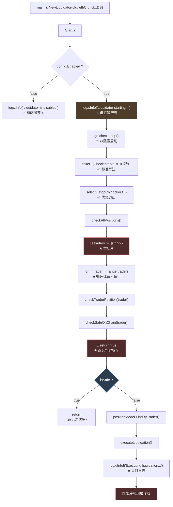
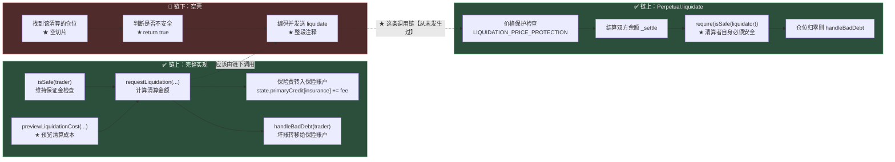
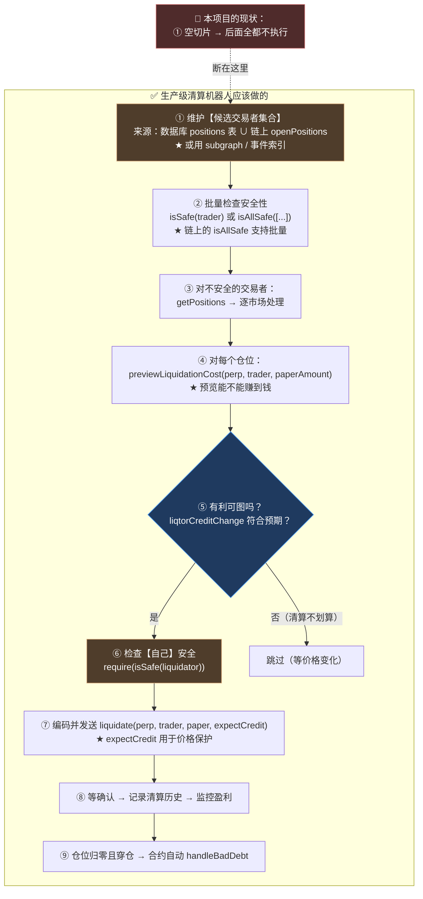

# 第 17 章：清算机器人 — 一个未完成模块的解剖

> 前面 16 章读的都是"能跑的代码"。本章要读的是**本项目唯一一个明确的占位模块**：`liquidator.go`（156 行）。
>
> 它的骨架看起来完全正常——有结构体、有 `Start`/`Stop`、有定时循环、有"检查仓位"和"执行清算"两个函数。**配置里 `Enabled: true`，启动时它会打印 `Liquidator starting...`。**
>
> 但如果顺着调用链读下去，你会发现**三道防线全是空的**：要检查的交易者列表是个空切片、安全状态判断直接 `return true`、执行清算的整段代码被注释掉了。
>
> **所以本章的价值不在于"学到一个精妙的实现"，而在于三件别的事：**
>
> 1. **看清"占位模块"的完整形态**——以及它为什么比"没有这个模块"更危险。
> 2. **对照合约侧的清算能力**——那边有价格保护、坏账处理、保险基金，是一套完整且经过精心设计的机制。**而它躺着不动，等一个永远不会来的调用者。**
> 3. **做一次设计练习**：一个生产级的清算机器人**本该怎么做**。而这次练习有一个重要前提——**基础设施其实都已经就位了**（第 13 章的链交互层已经把清算需要的只读函数都实现好了），**缺的只是业务逻辑。**

---

## 1. 本章导读

### 1.1 为什么值得单独用一章讲"没写完的代码"

**本指南前面已经点过好几次这个模块**（第 1 章 3.(8) 作为"静默失效"的范例、第 3 章 3.(8) 作为"依赖检查缺失"的反面教材）。**但单独成章的理由是：它示范了一类特别危险的软件工程问题。**

**先看它"看起来"的样子：**

```text
✅ 配置里有 Liquidator 段（Enabled: true, CheckInterval: 10）
✅ main() 里创建并启动了它（第 3 章 3.(8)）
✅ Start() 会打印 "Liquidator starting..."
✅ checkLoop() 每 10 秒真的会跑一次
✅ 日志、错误处理、优雅退出都有
⟹ ★ 从任何"服务健康度"的指标看，它都是正常的
```

**而它"实际"的样子：**

```go
func (l *Liquidator) checkAllPositions() {
	// 模拟交易者列表
	traders := []string{
		// 从数据库查询有仓位的交易者     ← ★ 永远是空的
	}
	for _, trader := range traders {
		l.checkTraderPosition(ctx, trader)   // ← 循环体一次都不执行
	}
}

func (l *Liquidator) checkSafeOnChain(trader string) bool {
	// TODO: 调用 MetaNodeDealer.isSafe(trader)
	return true                              // ★ 永远返回"安全"
}

func (l *Liquidator) executeLiquidation(...) {
	logx.Infof("Executing liquidation for trader %s, perp %s", ...)   // ← 只打日志
	// TODO: 实现链上清算
	/*
		...（整段被注释掉的实现）...
	*/
}
```

**🔑 这个对比就是本章的核心：**一个永远不做事的组件，和一个工作正常的组件，在可观测性上的表现是**完全一样**的。****

> **"能跑起来但不干活"比"跑不起来"危险得多。**
>
> ```text
> 跑不起来 → 立刻发现 → 修
> ★ 能跑但不干活 → 所有人都以为它在工作 → 直到出事才发现
> ```
>
> **⚠️ 而这个模块负责的事情是**清算**——它是永续合约系统里**防止坏账的最后一道防线**（1.2 节）。**

### 1.2 清算机器人本该做什么

**先把"清算"这件事的业务含义讲清楚，因为它决定了这个机器人该长什么样。**

**为什么需要清算？**

```text
永续合约是【杠杆】交易：
  · 用户用 1000 USDC 的保证金，开了价值 10000 USDC 的仓位（10 倍杠杆）
  · 如果价格向不利方向变动 10%，仓位就亏掉 1000 USDC —— ★ 用户的保证金归零
  · ★ 如果继续亏下去，用户会欠交易所钱（"穿仓"）

⟹ 所以系统必须在一个临界点【强制平仓】：
   · 在保证金还没亏完之前，把仓位卖掉
   · 这样用户不会穿仓，交易所不会亏钱
   ⟹ ★ 这个动作就叫"清算"
```

**🔑 而这个"临界点"是怎么判定的？** 合约里有明确的定义（Solidity 篇第 11、12 章）：

```solidity
// 保证金率低于【维持保证金率】→ 可以被清算
function _isMMSafe(Types.State storage state, address trader) internal view returns (bool) {
	// maintainMarginRatio <= netValue / exposure  ?
}

// Dealer 暴露的只读接口
function isSafe(address trader) external view returns (bool);
```

**⚠️ 关键点**：合约只提供"判断"和"执行"，**它自己不会主动去查谁该被清算**。

```solidity
// src/MetaNodeExternal.sol —— 清算函数是【被动】的
function requestLiquidation(address executor, address liquidator, address liquidatedTrader, int256 requestPaperAmount)
	external onlyRegisteredPerp                          // ★ 必须由 Perpetual 合约调用
	returns (...)
```

```solidity
// src/Perpetual.sol —— liquidate 也是【被动】的
function liquidate(address liquidator, address liquidatedTrader, int256 requestPaper, int256 expectCredit)
	external
	// ★ 必须有人从外部调用它
```

**⟹ 所以"谁该被清算、什么时候清算"这件事，**完全落在链下**。**

**🔑 这就是第 1 章 4.1 那条"合约是被动的"在这个模块上的具体体现：**

> ```text
> 合约提供的是【能力】（判断 + 执行）
> ★ 链下必须提供【意志】（什么时候、对谁、用多少量去调用）
>
> 而"意志"这部分 —— 本项目【完全没有实现】。
> ```

### 1.3 三道防线全是空的

**把 1.1 节那个对比精确化——清算机器人的执行链上有三个环节，每一个都是空的：**

```text
环节 ①：找到"有仓位的交易者"
  · 空实现：traders := []string{}（空切片）
  · 应该：从链上或数据库查出所有持有仓位的地址

环节 ②：判断"这个交易者安全吗"
  · 空实现：return true（永远安全）
  · 应该：调用合约的 isSafe(trader)

环节 ③：执行清算
  · 空实现：整段被注释
  · 应该：编码并发送 liquidate 交易
```

**🔑 而这三道防线是**串联**的 —— 任何一道空了，整条链就断了：**

```text
① 空 ⟹ 连循环都不会进入（后面的代码根本不执行）
② 空 ⟹ 即使有交易者，也会被判定为"安全"（直接 return）
③ 空 ⟹ 即使发现不安全，也什么都不做

⟹ ★ 三重保险的失效 —— 三道防线全部失效，且有【两种不同的失效方式】：
   · ① 是"结构性失效"（数据源为空，代码逻辑正确但永远不执行）
   · ②③ 是"功能性失效"（代码路径会执行，但结果是错的/什么都不做）
```

**⚠️ 而这三道防线的失效**都不会报错**：**

```text
· ① 空的切片 → for 循环不执行 → ★ 没有任何输出（连日志都没有）
· ② return true → 调用方看到"安全" → 正常返回
· ③ 只打日志 → 日志看起来像"正在执行清算"
```

**🔑 特别值得注意第 ③ 点** —— **它会打印 `"Executing liquidation for trader %s, perp %s"`，一个"看起来正在工作"的日志。** **这是"静默失效"里最坏的一种：它会主动产生"我在工作"的假象。**

---

## 2. 架构 / 流程图

### 2.1 骨架：一个标准的 keeper 结构

**先承认一件事：这个模块的**骨架**是对的。**



**⚠️ 这张图里有意思的是**颜色的分布**：**

```text
✅ 绿色的部分：启动、配置开关、定时循环、优雅退出 —— 骨架的标准写法
🔴 红色的三处：三道防线全是空的
⚠️ 橙色的 D：那句"starting..."日志，制造了"它在工作"的假象
🔵 蓝色的 J：判断分支 —— ★ 结构是对的，只是输入永远是"安全"
```

**🔑 所以这个模块的形态是：**"一个正确的外壳，包着一个空的内核"。****

**⚠️ 而这个形态**特别容易被误判为"已完成"**：**

```text
· 读代码的人看到 Start/Stop/checkLoop/checkAllPositions/checkTraderPosition/
  checkSafeOnChain/executeLiquidation —— ★ 七个函数，名字都合理
· 一眼看去像是"分层清晰的实现"
· ⟹ ★ 只有逐行读进去，才会发现中间三层是空的
```

### 2.2 对照：合约侧的完整清算能力

**这是本章最重要的对比图。** **同一个功能，链上那半边是完整的，链下这半边是空的。**



**🔑 这张图说明了本章的核心事实：**

> ```text
> · 链上的清算机制：【完整、精心设计、经过测试】（Solidity 篇第 12 章）
> · 链下的清算触发：【完全不存在】
>
> ⟹ ★★ 结果 = 没有清算机制
> ```

**⚠️ 而"链上完整"这件事，反而**加深了这个问题的隐蔽性**：**

```text
· 审计者看合约 → 发现清算逻辑完备 → ✅ 打个勾
· 审计者看链下 → 发现有个 "Liquidator" 模块 → ★ 以为两边都做了
· ⟹ ★ 而实际上，那个"Liquidator 模块"什么都没做
```

**🔑 这正是第 1 章 3.(8) 那句话的最直白体现：**

> **链上代码的正确性 ≠ 系统的安全性。**
> ```text
> 一个功能完备的清算合约 + 一个空壳的清算机器人
>   = ★★ 一套【没有清算机制】的系统
> ```

### 2.3 链上已经准备好的"工具"

**这一节是本章最有实用价值的部分。** **因为"实现清算机器人"这件事，比看起来容易得多——基础设施都已经就位了。**

**清算机器人需要的**只读**能力（第 13 章的链交互层已经全部实现）：**

| 需要什么 | 合约侧的接口 | Go 侧有没有？ |
| --- | --- | --- |
| 判断某地址是否不安全 | `isSafe(address)` | ✅ **`chain.Client.IsSafe` 已实现** |
| 列出某地址持仓的市场 | `getPositions(address)` | ✅ **`chain.Client.GetPositions` 已实现** |
| 查某市场的标记价 | `getMarkPrice(address)` | ✅ **`chain.Client.GetMarkPrice` 已实现** |
| 参考清算价 | `getLiquidationPrice(trader, perp)` | ✅ **`chain.Client.GetLiquidationPrice` 已实现** |
| 预览清算成本 | `previewLiquidationCost(...)` | ❌ **未实现（但 ABI 加一条就行）** |
| 查用户的风险指标 | `getTraderRisk(address)` | ✅ **`chain.Client.GetTraderRisk` 已实现** |

**🔑 六项能力，五项已经就位。**

**⚠️ 而唯一的缺口 `previewLiquidationCost`，在 ABI 里加一条就够了**（第 13 章 3.(1) 的手写 ABI 模式）：

```json
{"name":"previewLiquidationCost","type":"function","stateMutability":"view",
 "inputs":[
   {"name":"perp","type":"address"},
   {"name":"liquidatedTrader","type":"address"},
   {"name":"requestPaperAmount","type":"int256"}],
 "outputs":[
   {"name":"liqtorPaperChange","type":"int256"},
   {"name":"liqtorCreditChange","type":"int256"}]}
```

**🔑 所以结论是：**"实现清算机器人"缺的不是基础设施，而是**业务逻辑**（大约 50~100 行）。****

**⚠️ 这一点很重要，因为它改变了"这个模块未完成"这件事的性质：**

```text
· 它不是"因为技术难度太大而搁置"
· ★ 而是"因为没有写"（基础设施明明都在）
```

### 2.4 一个生产级清算机器人的完整流程

**这是本章的设计练习。** **我会把"应该怎么做"和"本项目的现状"并排画出来。**



**⚠️ 图中三个标记的步骤，是"生产级"和"能跑"之间的差别：**

**🔑 橙色的 ①（候选集合）：这是整个流程的**起点**，也是本项目断掉的地方。**

```text
问题：怎么知道"谁有仓位"？

链上有 `state.openPositions[trader]`（一个反向索引）
  ⟹ ⚠️ 但合约没有提供"列出所有有仓位的地址"的接口
  ⟹ ★ 因为那是一个【全局遍历】，链上做不到（gas 无限）

⟹ 所以候选集合只能来自链下：
   · 数据库的 positions 表（本项目有这张表，但没维护）
   · 或者：扫描历史上的 openPosition / 交易事件
   · 或者：维护一个"所有交易过的地址"列表
```

**⚠️ 而本项目连这条路都没走** —— `positions` 表在 `ServiceContext` 里是**死字段**（第 5 章 1.5 发现的六分之一）。

**🔑 蓝色的 ⑤（有利可图吗）：这是"机器人"和"脚本"的差别。**

```text
清算是有成本的：
  · gas 成本
  · ★ 保险费（insuranceFee，按清算额的比例扣）
  · ★ 清算者要【真金白银】接手仓位（付出 credit 换来 paper）

而收益是：清算折扣（liquidationPriceOff）
  ⟹ 用低于市价的价格接手多头仓位（或高于市价接手空头）

⚠️ 如果折扣 < 成本 → ★ 清算会亏钱
⟹ ★ 所以"要不要清算"是一个【经济学判断】，不是"发现不安全就清算"
```

**⚠️ 这一条很重要**：**一个"发现不安全就清算"的机器人会亏钱**，**而一个"只在有利可图时清算"的机器人才能持续运行。**

**🔑 橙色的 ⑥（检查清算者自己的安全）：合约**强制**要求这一条。**

```solidity
// src/Perpetual.sol → liquidate
require(IDealer(owner()).isSafe(liquidator), "LIQUIDATOR_NOT_SAFE");
```

**⚠️ 这意味着：清算者接手仓位后，**自己**也必须满足维持保证金要求。**

```text
⟹ ★ 清算不是"无本生意"—— 你需要有足够的保证金来接手别人的仓位
⟹ ★ 而且如果一次性接手太多，你自己可能变得不安全 → 交易被 revert（白烧 gas）
```

**🔑 所以生产级机器人还需要"仓位规模管理"** —— **一次清算多少量、自己的保证金够不够。**

---

## 3. 核心代码拆解

### (1) `Liquidator` 结构体

```go
// Liquidator 清算机器人
type Liquidator struct {
	config           config.LiquidatorConfig
	ethConfig        config.EthereumConfig        // ⚠️ 拿了完整的以太坊配置，但只用到 RpcUrl 和 DealerAddress
	positionModel    model.PositionModel
	liquidationModel model.LiquidationModel

	stopCh chan struct{}
}

func NewLiquidator(cfg config.LiquidatorConfig, ethCfg config.EthereumConfig, db sqlx.SqlConn) *Liquidator {
	return &Liquidator{
		config:           cfg,
		ethConfig:        ethCfg,
		positionModel:    model.NewPositionModel(db),        // ⚠️ db 可能是 nil（第 3 章 6.x）
		liquidationModel: model.NewLiquidationModel(db),
		stopCh:           make(chan struct{}),
	}
}
```

**作者为什么这么设计（设计思想）：**

**⚠️ 设计点一：它拿的是**裸 `db`**，而不是注入 Model 接口。**

**对比同目录的另两个组件（第 5 章 4.4 分析过）：**

| 组件 | 依赖风格 |
| --- | --- |
| `MatchEngine` | ✅ 注入 `model.OrderModel` / `model.TradeModel` 接口 |
| `FundingRateKeeper` | ⚠️ 注入裸 `db`，自己 new |
| **`Liquidator`** | ⚠️ **同上** |

**🔑 这决定了它**无法被单元测试****（因为 `sqlx.SqlConn` 是一个大接口，难以 mock）。**不过考虑到它本来就没有实现，这一点倒不是主要问题。**

**⚠️ 设计点二：`ethConfig` 是整个 `EthereumConfig`，而不是只需要的两三个字段。**

**从被注释掉的实现看，它需要的是：**

```go
privateKey, _ := crypto.HexToECDSA(l.ethConfig.PrivateKey)                    // 私钥
auth, _ := bind.NewKeyedTransactorWithChainID(privateKey, big.NewInt(l.ethConfig.ChainId))  // 链 ID
auth.GasLimit = uint64(l.ethConfig.MaxGasLimit)                               // gas 上限
perp, _ := contracts.NewPerpetual(common.HexToAddress(position.Perp), client) // 目标地址
```

**⚠️ 注意这里有一个**架构上的问题**：**

```text
★ 被注释的实现里用了 `bind.NewKeyedTransactorWithChainID` 和 `contracts.NewPerpetual`
  ⟹ 这是 **abigen 风格的代码**（`contracts` 包根本不存在，第 13 章讲过本项目不用 abigen）
  ⟹ ⟹ ★ 所以这段注释掉的代码【即使取消注释也编译不过】
```

**🔑 这是一个很有说明力的细节**：那段被注释的实现不仅没写完，而且**它用的技术路线和本项目实际采用的路线不一致**。

```text
· 本项目实际用的：手写最小 ABI + 自己构造交易（第 13 章）
· 注释里写的：abigen 生成的 contracts 包 + bind.NewKeyedTransactor
⟹ ★ 说明这段代码是【从别处抄来的模板】，从未真正适配过本项目
```

**🔑 一条可以带走的判断：**

> **"被注释掉的实现"是一个危险的东西 —— 它让人以为"只差取消注释"。**
> ```text
> 而实际上它可能是：
>   · 从未适配当前代码库的模板
>   · 依赖不存在的包
>   · ★ 或者早就过时了
>
> ⟹ ★ 正确的做法：要么删掉它，要么把它改成【能编译的】注释（比如放到文档里）
> ```

**✅ 设计点三：`stopCh` 用 `chan struct{}`（第 14 章 3.(1) 讨论过）—— 同样的模式，同样的局限。**

### (2) `Start` 与 `Stop`

```go
// Start 启动清算机器人
func (l *Liquidator) Start() {
	if !l.config.Enabled {
		logx.Info("Liquidator is disabled")
		return                          // ✅ 有配置开关
	}
	logx.Info("Liquidator starting...") // 🔴 ★ 这句话制造了"它在工作"的假象
	go l.checkLoop()
}

// Stop 停止清算机器人
func (l *Liquidator) Stop() {
	close(l.stopCh)                     // ⚠️ 裸 close（第 3 章 6.5）
}
```

**作者为什么这么设计（设计思想）：**

**🔴 设计点一：`logx.Info("Liquidator starting...")` 是本章最值得批评的一行。**

**为什么？** 因为它**主动产生了一个错误的信号**：

```text
对比一下"没有这个组件"的情况：
  · 用户/运维看到日志里没有 Liquidator → ★ 会问"清算做了吗？"
  · ⟹ 这是一个【正确的怀疑】

而当前：
  · 日志里有 "Liquidator starting..." → ★ 看起来"清算已经在跑了"
  · ⟹ ★★ 没有人会再去问这个问题
```

**🔑 这条日志的信息量是零**（它没有说"检查了多少仓位"、"清算了多少"），**但它产生的误导是完整的**。

**⚠️ 对比第 15 章 `CoinbaseFeed` 的启动日志：**

```go
logx.Infof("Coinbase feed starting: products=%d ws=%s", len(f.products), f.wsURL())
//                              ↑ ★ 带上了关键参数（订阅了几个产品、连的是哪个地址）
```

**🔑 差别在哪？**

```text
CoinbaseFeed 的日志：说明了"启动的【是什么】"
Liquidator 的日志： 只说了"启动了"（而它什么都没启动）
```

**✅ 修法（让日志诚实）：**

```go
func (l *Liquidator) Start() {
	if !l.config.Enabled {
		logx.Info("Liquidator is disabled")
		return
	}
	// ★ 明确的警告，而不是"starting"
	logx.Error("⚠️ Liquidator 未实现（占位模块）：不会执行任何清算。")
	logx.Error("   链上清算机制完整（Perpetual.liquidate），但缺少链下触发。")
	logx.Error("   如有仓位需要清算，必须人工处理。")
	return                              // ★ 干脆不启动那个空循环
}
```

**🔑 一条可以带走的经验（这是本章最通用的一条）：**

> **占位实现的日志必须是"**响亮的错误**"，而不是"看起来正常的启动日志"。**
>
> ```text
> ✗ logx.Info("X starting...")        → ★ 让人以为 X 在工作
> ✓ logx.Error("X 未实现，不会做任何事") → ✅ 让人知道 X 不能依赖
> ```
>
> **⚠️ 判断标准：问一句"如果运维只看日志，他会以为这个组件在工作吗？"**
> ```text
> · 会 → 🔴 日志在撒谎，必须改
> · 不会 → ✅
> ```

**⚠️ 设计点二：更好的做法是**让配置默认关闭**。**

```yaml
Liquidator:
  CheckInterval: 10
  Enabled: true          # ★ 默认 true，而实现是空的
```

**🔑 一个未实现的模块，默认应该是 `Enabled: false`** —— **因为 `true` 意味着"我相信它能工作"。**

**✅ 三种修法的优先级：**

```text
① 实现它（最好）
② ★ 如果暂时不实现：Enabled 默认 false + 启动时 Error 告警
③ 最差：Enabled: true + "starting..." 日志（本项目的现状）
```

### (3) `checkLoop` —— 骨架是对的

```go
// checkLoop 检查循环
func (l *Liquidator) checkLoop() {
	ticker := time.NewTicker(time.Duration(l.config.CheckInterval) * time.Second)
	defer ticker.Stop()

	for {
		select {
		case <-l.stopCh:
			return
		case <-ticker.C:
			l.checkAllPositions()
		}
	}
}
```

**作者为什么这么设计（设计思想）：**

**✅ 这是第 14 章 3.(2) 讲过的**标准定时任务骨架**，这里一模一样：**

```text
· time.NewTicker + defer Stop()  → 不泄漏运行时定时器
· select 同时等 stopCh 和 ticker.C → 可被优雅停止
· Start() 里 go 出去 → 不阻塞 main
```

**🔑 所以这个模块在**结构上**是完全正确的 —— 问题只在**内容**上。**

**⚠️ 一个细节：`checkLoop` 和 `FundingRateKeeper.settleLoop` 的差别。**

```text
FundingRateKeeper.settleLoop：
  · 有 interval <= 0 的兜底（第 14 章 3.(2)）
  · 有 settleFundingRate 的完整实现

Liquidator.checkLoop：
  · ★ 没有 interval <= 0 的兜底（如果 CheckInterval = 0，time.NewTicker(0) 会 panic）
  · 有 checkAllPositions 的空实现
```

**⚠️ 所以这里还有一个小问题：**`CheckInterval: 0` 会导致 panic。****

```go
ticker := time.NewTicker(time.Duration(l.config.CheckInterval) * time.Second)
//                 ↑ ★ CheckInterval = 0 → NewTicker(0) → panic: non-positive interval
```

**🔑 修法（加一行兜底，与 `FundingRateKeeper` 对齐）：**

```go
interval := time.Duration(l.config.CheckInterval) * time.Second
if interval <= 0 {
	logx.Errorf("⚠️ CheckInterval=%d 非法，兜底为 10 秒", l.config.CheckInterval)
	interval = 10 * time.Second
}
ticker := time.NewTicker(interval)
```

**⚠️ 这个 bug 当前不会触发**（配置写在 10）—— **但配置是用户可改的，而 `0` 是一个很容易手滑写出的值。**

### (4) 【占位一】`checkAllPositions` 的空切片

```go
// checkAllPositions 检查所有仓位
func (l *Liquidator) checkAllPositions() {
	ctx := context.Background()

	// TODO: 从链上获取所有有仓位的交易者
	// traders := l.getAllTraders()

	// 模拟交易者列表
	traders := []string{
		// 从数据库查询有仓位的交易者
	}

	for _, trader := range traders {
		l.checkTraderPosition(ctx, trader)
	}
}
```

**⚠️ 这段代码有一个很有意思的地方：注释说"模拟交易者列表"，但列表是**空的**。**

```text
"模拟"通常意味着"用假数据代替真数据"（比如塞两个硬编码的地址）
★ 而这里是【空的】—— 连模拟数据都没有
⟹ ★ 所以它不是"模拟"，而是"什么都没有"
```

**🔑 这个差别不小：**

```text
· 如果 traders 里有几个硬编码的地址：
  ⟹ 整个流程会【跑起来】→ 会调用 isSafe → 会走到 executeLiquidation → 会打日志
  ⟹ ★ 至少能验证"骨架是通的"

· 而它是空的：
  ⟹ ★ 循环体一次都不执行 → 后面三个函数的代码【从未被执行过】
  ⟹ ⟹ 这意味着（5）(6) 里的占位实现，连"跑到那里"的机会都没有
```

**🔑 所以三道防线的失效是**有层次**的：**

```text
第 1 层（空切片）：★ 结构性失效 —— 流程根本不进入
第 2 层（return true）：功能性失效 —— 会执行，但结果错
第 3 层（整段注释）：功能性失效 —— 会执行，但什么都不做

⟹ 而因为第 1 层是空的，第 2、3 层的代码【从来没有真正运行过】
```

**⚠️ 这个观察有一个实际含义**：**即使你只修好第 1 层（填上真实的交易者列表），第 2 层会立刻让流程"看起来正常但什么都不做"。**

**🔑 所以修复必须**三层一起修** —— 单独修任何一层都不会带来任何改善，只会让"静默失效"更隐蔽。**

**✅ 那么正确的第 1 层该怎么做？** **3.(9) 会展开，这里先给结论：**

```go
// 思路：维护一个"候选交易者"集合
func (l *Liquidator) candidateTraders(ctx context.Context) ([]string, error) {
	// 来源 A：数据库的 positions 表（如果它被维护的话）
	//   ⚠️ 但第 5 章发现 PositionModel 是死字段 —— 这张表可能根本没数据

	// 来源 B：从链上"所有交易过的地址"里筛
	//   ⚠️ 合约没有提供"列出所有地址"的接口（全局遍历链上做不到）

	// 来源 C：★ 事件索引 —— 扫描历史上的持仓变化事件
	//   ✅ 这是生产级的做法（同第 16 章的扫链模式）

	// 来源 D：★ 维护一个"曾经开过仓的地址"列表
	//   在 openPosition 事件发生时把它加进去（增量，不需要全量扫描）
}
```

**🔑 而本题的真正难点在来源 B/C/D** —— **"怎么枚举所有有仓位的地址"是链下索引器的经典问题**（同第 16 章的"扫链"）。

### (5) 【占位二】`checkSafeOnChain` 的 `return true`

```go
// checkSafeOnChain 检查链上安全状态
func (l *Liquidator) checkSafeOnChain(trader string) bool {
	// TODO: 调用 MetaNodeDealer.isSafe(trader)
	// client, _ := ethclient.Dial(l.ethConfig.RpcUrl)
	// dealer, _ := contracts.NewMetaNodeDealer(common.HexToAddress(l.ethConfig.DealerAddress), client)
	// safe, _ := dealer.IsSafe(nil, common.HexToAddress(trader))
	// return safe

	return true // 占位
}
```

**作者为什么这么设计（设计思想）：**

**🔴 这个占位最危险的地方不是"没实现"，而是**它的默认值是 `true`**。**

```text
如果它 return false  → 所有交易者都会被判定为"不安全" → 会尝试清算所有人
                       ⟹ ⚠️ 混乱，但【可见】（会大量报错）
如果它 return true   → ★ 所有交易者都被判定为"安全" → 什么都不做
                       ⟹ 🔴 安静，且【看起来正常】
```

**🔑 这就是"失败方向"（fail-safe vs fail-open）的选择问题：**

> **对一个"安全判断"函数来说，返回 `true` 意味着"我确认它是安全的"——**
> **而一个未实现的函数**没有资格做这个确认**。**
>
> ```text
> ✅ 正确的默认值：return false（"我不能确认它是安全的"）
>    ⟹ 调用方会走"需要处理"的分支 → ★ 至少能看到"有人在尝试处理"
>    ⟹ 或者：★ 直接 panic / 返回 error（"这个函数没实现，别调用我"）
>
> 🔴 本项目的选择：return true（假装"我确认过了"）
> ```
>
> **⚠️ 这是"静默失效"的一种常见成因：**用一个"看起来合理"的默认值，掩盖了"没有实现"这件事。****

**🔑 而且更讽刺的是：**这个功能**一行代码就能实现** —— 因为 `chain.Client.IsSafe` 已经存在（2.3 节）。****

```go
// 如果按本项目实际的技术路线实现（手写 ABI + chain.Client）：
func (l *Liquidator) checkSafeOnChain(ctx context.Context, trader string) (bool, error) {
	if l.svc.Chain == nil {
		return false, fmt.Errorf("chain client nil")
	}
	return l.svc.Chain.IsSafe(ctx, common.HexToAddress(trader))   // ★ 一行
}
```

**⚠️ 但注意：`Liquidator` 的结构体里**没有 `*chain.Client`**（只有 `ethConfig`）。**

```go
type Liquidator struct {
	config           config.LiquidatorConfig
	ethConfig        config.EthereumConfig      // ★ 只有配置，没有链客户端
	positionModel    model.PositionModel
	liquidationModel model.LiquidationModel
	stopCh           chan struct{}
}
```

**🔑 这说明它当初的设计思路是"自己 dial 一个 ethclient"**（注释里就是 `ethclient.Dial(l.ethConfig.RpcUrl)`），**而不是复用 `ctx.Chain`。**

**⚠️ 这条路线和本项目的实际架构**不一致**：**

```text
· 本项目其他所有链交互都通过【共享的 chain.Client】（第 13 章）
· ★ 而 Liquidator 打算自己 dial —— 会创建第二个 RPC 连接、第二份配置解析
```

**🔑 所以正确的修法是：把 `*chain.Client` 注入进来（改造构造函数），而不是自己 dial。**

### (6) 【占位三】`executeLiquidation` 的整段注释

```go
// executeLiquidation 执行清算
func (l *Liquidator) executeLiquidation(ctx context.Context, trader string, position *model.Position) {
	logx.Infof("Executing liquidation for trader %s, perp %s", trader, position.Perp)
	// ★ 只打日志，然后什么都不做

	// TODO: 实现链上清算
	// 1. 计算清算数量和价格
	// 2. 调用 perpetual.liquidate(liquidator, trader, paperAmount, expectCredit)
	// 3. 等待交易确认
	// 4. 记录清算记录

	/*
		// 获取清算人私钥
		privateKey, _ := crypto.HexToECDSA(l.ethConfig.PrivateKey)
		auth, _ := bind.NewKeyedTransactorWithChainID(privateKey, big.NewInt(l.ethConfig.ChainId))
		// 设置 gas 参数
		auth.GasLimit = uint64(l.ethConfig.MaxGasLimit)
		// 执行清算
		perp, _ := contracts.NewPerpetual(common.HexToAddress(position.Perp), client)
		tx, _ := perp.Liquidate(auth,
			common.HexToAddress(l.ethConfig.LiquidatorAddress),
			common.HexToAddress(trader),
			paperAmount,
			expectCredit,
		)
		// 等待确认
		receipt, _ := bind.WaitMined(ctx, client, tx)
		// 保存记录
		l.liquidationModel.Insert(ctx, &model.Liquidation{ ... })
	*/
}
```

**作者为什么这么设计（设计思想）：**

**🔴 设计点一：`logx.Infof("Executing liquidation for...")` 是**第二条"撒谎的日志"**。**

```text
这句日志的措辞很明确："正在执行清算"
⟹ ★ 而实际上它只是打印了这一行，什么都没做
⟹ ★★ 如果运维 grep 日志看到这条，会以为"清算机器人正在工作"
```

**🔑 与 `Start()` 那句 `"Liquidator starting..."` 是同一个问题** —— **日志描述的是"意图"，而不是"事实"。**

**✅ 修法：**

```go
func (l *Liquidator) executeLiquidation(ctx context.Context, trader string, position *model.Position) {
	logx.Errorf("⚠️ 清算未实现：trader=%s perp=%s（需要人工处理）", trader, position.Perp)
	// ★ 用 Error 级别，明确说"没实现"
	// ★ 或者更激进：把这条记录写进一个"待人工清算"的表 + 告警
}
```

**⚠️ 设计点二：被注释的代码用了不存在的包。**

**从注释里可以看出：**

```go
perp, _ := contracts.NewPerpetual(common.HexToAddress(position.Perp), client)
//           ↑ ★ `contracts` 包在本项目里不存在（第 13 章确认：本项目用手写 ABI，不用 abigen）
```

```go
auth, _ := bind.NewKeyedTransactorWithChainID(privateKey, big.NewInt(l.ethConfig.ChainId))
//           ↑ ★ 这是 abigen 风格的交易构造方式
//             而本项目用的是手写 LegacyTx + types.SignTx（第 13 章 3.(6)）
```

**🔑 所以这段代码即使取消注释也**编译不过**，而且**技术路线也不对**。**

**⚠️ 还有两个细节暴露了它是"未完成品"：**

```go
common.HexToAddress(l.ethConfig.LiquidatorAddress)
//                        ↑ ★ EthereumConfig 里【没有】LiquidatorAddress 这个字段
//                          （第 2 章 3.(9) 列过完整字段：RpcUrl/ChainId/DealerAddress/
//                            UsdcAddress/UsdcTreasuryAddress/PrivateKey/GasPriceMultiplier/MaxGasLimit）
```

```go
receipt, _ := bind.WaitMined(ctx, client, tx)
//                ↑ ★ `client` 这个变量在函数里【没有定义】（它是注释里假设存在的）
```

**🔑 所以这段注释是**从别的项目抄来的模板**，从未适配过本项目。**

**✅ 正确的处理方式：**

```text
① ★ 删掉它 —— 因为它编译不过、技术路线也不对，留着只会误导
② 如果一定要保留"实现思路"，把它写成【文档】而不是【注释代码】
   ⟹ 因为注释代码会腐烂（它不参与编译，所以不会有人更新它）
```

**🔑 一条可以带走的经验：**

> **"注释掉的代码"是一种**不会腐烂的谎言**——它看起来像"随时可以启用"，但实际上可能早就过时了。**
> ```text
> 代码会腐烂（编译错误会暴露）
> ★ 注释代码不会腐烂（它不参与编译，所以烂了也没人知道）
> ⟹ ★ 所以宁可删掉，也不要留着
> ```
>
> **⚠️ 版本控制（git）已经帮你保存了历史** —— **"以后可能要用"这个理由不成立。**

### (7) 对照：合约侧的完整实现

**为了感受差距，我们把合约侧对应的那段代码完整看一遍。**

```solidity
// src/libraries/Liquidation.sol → getLiquidateCreditAmount
function getLiquidateCreditAmount(
    Types.State storage state,
    address perp,
    address liquidatedTrader,
    int256 requestPaperAmount
)
    public view
    returns (int256 liqtorPaperChange, int256 liqtorCreditChange, uint256 insuranceFee)
{
    // ① 检查被清算者是否真的不安全
    require(!_isMMSafe(state, liquidatedTrader), Errors.ACCOUNT_IS_SAFE);

    // ② 获取并验证仓位
    (int256 brokenPaperAmount,) = IPerpetual(perp).balanceOf(liquidatedTrader);
    require(brokenPaperAmount != 0, Errors.TRADER_HAS_NO_POSITION);

    // ③ 清算方向必须与仓位方向一致
    require(requestPaperAmount * brokenPaperAmount > 0, Errors.LIQUIDATION_REQUEST_AMOUNT_WRONG);

    // ④ 限制清算数量不超过实际仓位
    liqtorPaperChange = requestPaperAmount.abs() > brokenPaperAmount.abs()
        ? brokenPaperAmount
        : requestPaperAmount;

    // ⑤ 计算清算价格（★ 折扣机制）
    Types.RiskParams storage params = state.perpRiskParams[perp];
    uint256 price = IPriceSource(params.markPriceSource).getMarkPrice();
    uint256 priceOffset = (price * params.liquidationPriceOff) / Types.ONE;
    // 清算多头给折扣价（低于市价），清算空头加溢价（高于市价）
    price = liqtorPaperChange > 0 ? price - priceOffset : price + priceOffset;

    // ⑥ 计算 credit 变化：清算者付出 credit 获得 paper
    liqtorCreditChange = -1 * liqtorPaperChange.decimalMul(SafeCast.toInt256(price));

    // ⑦ 计算保险费
    insuranceFee = (liqtorCreditChange.abs() * params.insuranceFeeRate) / Types.ONE;
}
```

**以及 `Perpetual.liquidate` 里的价格保护：**

```solidity
// src/Perpetual.sol → liquidate
(int256 liqtorPaperChange, int256 liqtorCreditChange, int256 liqedPaperChange, int256 liqedCreditChange) =
    IDealer(owner()).requestLiquidation(msg.sender, liquidator, liquidatedTrader, requestPaper);

// ★ 价格保护检查
if (liqtorPaperChange < 0) {
    // 开空仓，执行价格 >= 期望价格
    require(liqtorCreditChange * requestPaper <= expectCredit * liqtorPaperChange, "LIQUIDATION_PRICE_PROTECTION");
} else {
    // 开多仓，执行价格 <= 期望价格
    require(liqtorCreditChange * requestPaper >= expectCredit * liqtorPaperChange, "LIQUIDATION_PRICE_PROTECTION");
}
```

**🔑 合约侧做了七件事，而链下**一件都没做**：**

| # | 合约做的事 | 链下需要做什么 |
| --- | --- | --- |
| ① | 检查被清算者确实不安全 | ★ **链下必须先 `isSafe`，否则 transaction 会 revert（`ACCOUNT_IS_SAFE`）** |
| ② | 检查有仓位 | 链下应该先 `getPositions` / `balanceOf` |
| ③ | 检查方向一致 | ★ **链下必须传对 `requestPaperAmount` 的符号** |
| ④ | 限制清算量 | 链下自己决定清算多少 |
| ⑤ | 按折扣价计算 | ★ **链下要用 `previewLiquidationCost` 预览，判断是否划算** |
| ⑥ | 计算 credit 变化 | ★ **链下要把结果作为 `expectCredit` 传入（价格保护）** |
| ⑦ | 计算保险费 | 链下应该把它算进成本 |

**🔑 其中 ⑤⑥ 是"生产级"的关键** —— **它们让清算从"盲目执行"变成"有利可图才执行"。**

**⚠️ 而注意 `expectCredit` 的语义**（从价格保护的代码反推）：

```text
· 它是清算者【愿意接受的】credit 变化的边界
· 如果实际执行价格比预期差 → ★ revert（保护清算者）
⟹ ★ 所以链下的 `previewLiquidationCost` 结果【直接】就是 `expectCredit` 的输入
```

**🔑 这是一个"链上保护 + 链下预览"的配合模式：**

```text
链下：previewLiquidationCost → 得到预期值 C
链下：发送 liquidate(..., expectCredit = C)
链上：★ 如果实际算出的不是 C（价格变了）→ revert
⟹ ★ 保证"清算者不会被价格波动坑到"
```

**⚠️ 而这个模式需要一个前提**：链下传的 `expectCredit` 必须是**准确的**。传一个过宽的值（比如 0）等于放弃保护；传一个过窄的值会导致频繁 revert。

### (8) 生产级的清算机器人该怎么做

**把 2.4 节的流程展开成具体的设计。** **这是本章的设计练习。**

**第 1 步：候选交易者集合。**

```go
// 方案 A：查数据库（如果 positions 表被维护的话）
//   ⚠️ 第 5 章发现 PositionModel 是死字段 —— 这张表可能没数据

// 方案 B：★ 增量维护"曾经开过仓的地址"集合
//   监听 openPosition 事件（合约里有：emit ... openPosition(trader)）
//   ⟹ 把地址加进一个集合（Redis Set）
//   ⟹ ⚠️ 但"曾经开过仓"不等于"现在有仓位" —— 会查到很多已平仓的地址

// 方案 C：★ 链上逐个检查（配合方案 B 的候选集）
//   对候选集里的每个地址调用 isSafe(trader)
//   ⟹ 不安全的才需要进一步处理
//   ⟹ ⚠️ N 个地址 = N 次 eth_call（免费但慢）
//      ⟹ 可以用 isAllSafe(traderList) 批量检查（合约提供了！）
```

**🔑 方案 B + C 的组合是实际可行的**，而且**合约提供了 `isAllSafe(address[])` 来批量检查**（2.3 节的表里没有列它，但它存在于 `IDealer`）。

**⚠️ 而 `isAllSafe` 的 Go ABI 里没有** —— **需要加一条**（同 `previewLiquidationCost`）。

**第 2 步：对不安全的地址，逐市场检查。**

```go
perps, err := ch.GetPositions(ctx, trader)      // ✅ chain.Client 已有
for _, perp := range perps {
	paper, credit, err := ch.BalanceOf(ctx, perp, trader)   // ✅ 已有
	if paper.Sign() == 0 {
		continue                                  // 这个市场没仓位
	}
	// 决定清算多少：★ 这里可以用 getLiquidationPrice 或直接全清
	requestPaper := paper                          // 简化：全清
	// ...
}
```

**第 3 步：预览成本，判断是否划算。**

```go
// ★ 需要新增这个方法（ABI 加一条 + 一个封装函数）
liqtorPaper, liqtorCredit, err := ch.PreviewLiquidationCost(ctx, perp, trader, requestPaper)
if err != nil {
	// ⚠️ ACCOUNT_IS_SAFE（安全了）或 TRADER_HAS_NO_POSITION（没仓位）
	// ⟹ 这两种"revert"其实是正常情况，应该跳过而不是报错
	continue
}

// 计算成本与收益
// 收益 = 清算折扣（合约已经算进 liqtorCredit 里了）
// 成本 = gas + 保险费（合约已经扣了）
// ⟹ ★ 判断：liqtorCredit 是否"值得"接手这个仓位
//    （这需要评估：接手后的仓位风险、后续平仓的成本……）
```

**第 4 步：检查清算者自己的安全。**

```go
// ★ 合约会 require(isSafe(liquidator), "LIQUIDATOR_NOT_SAFE")
// ⟹ 链下应该【提前】检查，避免白烧 gas
safe, err := ch.IsSafe(ctx, liquidatorAddr)
if err != nil || !safe {
	logx.Errorf("⚠️ 清算者自身不安全，跳过本次清算（接手后会被 revert）")
	continue
}
```

**⚠️ 这是**最容易遗漏**的一步 —— 因为"我能清算别人"和"我自己也安全"是两个独立的判断。**

**第 5 步：发送交易（复用第 13 章的链交互层）。**

```go
// ★ 需要给 chain.Client 加一个 SendLiquidate 方法（模式同 SubmitPerpTrade）
tx, err := ch.SendLiquidate(ctx, perp, trader, requestPaper, expectCredit)
if err != nil { ... }

rec, err := bind.WaitMined(ctx, ch.RPC(), tx)
if err != nil || rec.Status != 1 { ... }        // ★ 同第 10 章：必须查 Status
```

**第 6 步：记录与监控。**

```go
_, _ = l.liquidationModel.Insert(ctx, &model.Liquidation{   // ⚠️ 别学这个 `_, _ =`（第 14/16 章的教训）
	TxHash:           tx.Hash().Hex(),
	Perp:             perp,
	Liquidator:       liquidatorAddr,
	LiquidatedTrader: trader,
	// ...
})
```

**🔑 把六步汇总，一个最小可用的实现大约**100~150 行**：**

| 步骤 | 代码量 | 依赖 |
| --- | --- | --- |
| ① 候选集合 | ~30 行 | 需要事件索引（或简化为"从 DB 查"） |
| ② 逐市场检查 | ~20 行 | ✅ `GetPositions` / `BalanceOf` 已有 |
| ③ 预览成本 | ~15 行 | ⚠️ **需要加 `PreviewLiquidationCost`** |
| ④ 检查自身安全 | ~5 行 | ✅ `IsSafe` 已有 |
| ⑤ 发送交易 | ~40 行 | ⚠️ **需要加 `SendLiquidate`**（模式同 `SubmitPerpTrade`） |
| ⑥ 记录 | ~10 行 | ✅ `LiquidationModel` 已有 |

**🔑 所以真正需要新增的只有两处：`PreviewLiquidationCost` 和 `SendLiquidate`** —— **而且两者的模式在第 13 章都已经示范过了**（一个只读封装、一个发交易封装）。

**⚠️ 而"难度最低"的部分（③④⑤⑥）恰恰是**最能产生价值**的部分。**

```text
★ 一个"只处理数据库里已经标记为不安全的仓位"的简化版清算机器人
  ⟹ 不需要事件索引（跳过第 ① 步的难点）
  ⟹ ✅ 用 DB 的 positions 表作为候选集
  ⟹ 大约 60~80 行

⚠️ 这不能覆盖全部场景（如果 positions 表没维护，就会漏掉）
   ⟹ ★ 但它比"完全不做"好得多
```

**🔑 一条可以带走的工程判断：**

> **"完整实现"和"完全不做"之间，有一个"部分实现"的中间地带 —— 而它往往被忽略了。**
> ```text
> · 完整实现需要：事件索引 + 成本评估 + 风险管理 + 监控  ⟹ 工作量大
> · ★ 最小可用：从已有的数据源出发，做最基本的判断和执行  ⟹ 可能只要 100 行
>
> ⟹ ★ 而"最小可用"能防住的坏账，和"完整实现"防住的【大部分是同一批】
>    （因为真正需要清算的仓位，通常就是那些明显不安全的）
> ```

### (9) 静默失效的完整链条

**把本章的所有发现串成一条链，看这个模块的失效是如何"层层叠加"的。**

```mermaid
%%{init: {'flowchart': {'wrappingWidth': 1000}}}%%
flowchart TB
    L0["配置：Liquidator.Enabled = true<br/>★ 声称"已启用""]
    L1["main(): 创建并 Start()<br/>★ 证明了"作者认为它应该跑""]
    L2["Start(): logx.Info(\"Liquidator starting...\")<br/>★ 日志声称"正在启动""]
    L3["checkLoop(): 每 10 秒真的执行<br/>★ 监控上它是"活的""]
    L4["checkAllPositions(): traders = []<br/>🔴 第一次失效：循环体不执行"]
    L5["checkSafeOnChain(): return true<br/>🔴 第二次失效：永远判定安全"]
    L6["executeLiquidation(): 只打日志<br/>🔴 第三次失效：什么都不做"]

    L0 --> L1 --> L2 --> L3 --> L4 -.->|"到不了"| L5 -.->|"到不了"| L6

    RESULT["<b>外部观察者的结论</b><br/>· 配置说启用了<br/>· 日志说启动了<br/>· 定时器在跑<br/>⟹ ★★ '清算机器人工作正常'"]

    L4 --> RESULT
    L2 --> RESULT
    L3 --> RESULT

    REALITY["<b>实际情况</b><br/>★ 从来没有任何清算发生过<br/>★ 而且没有任何迹象"]

    L6 --> REALITY

    style L4 fill:#4f2b2b,stroke:#d07070,color:#fff
    style L5 fill:#4f2b2b,stroke:#d07070,color:#fff
    style L6 fill:#4f2b2b,stroke:#d07070,color:#fff
    style RESULT fill:#4f3d2b,stroke:#d0a070,color:#fff
    style REALITY fill:#4f2b2b,stroke:#d07070,color:#fff
```

**🔑 这张图的核心：**"证据链"指向"A"，而事实是"B"，且没有任何东西能发现这个矛盾。****

**⚠️ 注意 `L4 --> L5` 那条虚线写的是"到不了"** —— **这是本章 3.(4) 的观察：因为第 1 层是空的，后两层从来没有真正执行过。**

**🔑 而这有一个**反直觉的推论**：**

```text
★ 如果你只修好第 1 层（填上真实的交易者列表）：
  ⟹ 流程会开始执行 → 调用 checkSafeOnChain → ★ 得到"安全" → return
  ⟹ ★★ 结果"看起来更正常了"（有函数被调用、有返回值、可能还有日志）
  ⟹ 但【仍然没有清算发生】
  ⟹ ⟹ 这比"完全不做"更危险 —— 因为它让"静默失效"变得更难被发现
```

**🔑 一条可以带走的经验：**

> **修复"占位模块"时，必须**三层一起修** —— 修好一层反而可能让问题更隐蔽。**
> ```text
> 全空：至少"没什么在跑"（虽然日志在撒谎）
> 修一层：★ 流程跑起来了，但结果是错的 → ⟹ 更容易被误判为"已工作"
> 修三层：✅ 真正工作
> ```
> **⚠️ 这与第 11 章 6.x 那条"降级不要忽略校验"是同一个主题：**部分实现 > 完全不做 > 部分实现但看起来正常**。**

---

## 4. Web3 特有机制

### 4.1 清算的经济激励：为什么有人愿意做

**这是理解"清算机器人"这个角色的关键 ——**它不是一份工作，而是一门生意**。**

```text
清算者的收益：清算折扣（liquidationPriceOff）

// src/libraries/Liquidation.sol
uint256 priceOffset = (price * params.liquidationPriceOff) / Types.ONE;
// 清算多头给折扣价（低于市价），清算空头加溢价（高于市价）
price = liqtorPaperChange > 0 ? price - priceOffset : price + priceOffset;
```

**🔑 用一个具体例子理解：**

```text
场景：某个用户的多头仓位变得不安全了
  · 标记价 30000 USDC
  · liquidationPriceOff = 1%（假设）
  · 清算者要接手 1 BTC 的多头

清算价格 = 30000 × (1 - 1%) = ★ 29700

⟹ 清算者付 29700 USDC，得到 1 BTC 的多头仓位（市值 30000）
⟹ ★★ 立刻赚 300 USDC（如果不考虑后续平仓的成本和风险）
```

**⚠️ 而清算者承担的成本和风险：**

```text
成本：
  · gas
  · ★ 保险费（insuranceFeeRate，按清算额的比例扣给保险基金）
  · 平仓的成本（如果想立刻卖掉这个仓位，需要挂单或吃单）

风险：
  · ★ 接手后价格继续下跌 → 清算者也会亏
  · ★ 接手后的仓位如果继续恶化 → 清算者自己可能变得不安全
  · 流动性风险（找不到对手方平仓）
```

**🔑 所以"清算"本质上是**一个套利机会**：**

> **清算者用折扣价买入一个"别人被迫卖出"的仓位，赚取折扣与平仓成本之间的差价。**
>
> ```text
> 清算者的利润 = 折扣 - (gas + 保险费 + 平仓滑点 + 风险溢价)
>
> ⟹ ★ 只有当这个值为正时，清算才会发生
> ```
>
> **⚠️ 这解释了一个重要的系统性风险：**如果折扣太小（或者市场流动性太差），清算者就不会来。****
> ```text
> · 折扣 < 成本   → ★ 没人清算 → 坏账累积
> · 折扣 >> 成本  → 清算者蜂拥而至 → 但被清算者损失更大
> ⟹ ★ 所以"清算折扣"参数的设计是一个【微妙的平衡】
> ```

**🔑 而本项目的情况更特殊**：**清算机器人是项目方自己跑的**（配置里用的是后端的私钥）。

```text
· 它不是为了盈利，而是为了"系统能正常工作"
· ★ 但它仍然必须考虑"划不划算"—— 否则会持续亏 gas 和保险费
```

### 4.2 清算者本身也是一种风险

**这是 4.1 节的延伸，也是合约里一条容易被忽略的约束。**

```solidity
// src/Perpetual.sol → liquidate
// 确保清算者是安全的
require(IDealer(owner()).isSafe(liquidator), "LIQUIDATOR_NOT_SAFE");
```

**🔑 这条约束的含义：**清算者自己必须是一个"健康的交易者"。****

```text
· 清算者接手仓位后，它的仓位变大了
⟹ ★ 如果接手太多，它自己可能变得不安全
⟹ ★ 而合约会在结算后检查 → revert（白烧 gas）
```

**⚠️ 所以清算机器人需要**仓位规模管理**：**

```text
· 不是"发现不安全就全清"，而是"在保证自己安全的前提下清多少"
· ⚠️ 这需要预估"接手后的仓位价值"和自己的保证金
```

**🔑 而这条约束在**极端行情**下会变成一个系统性风险：**

```text
场景：市场暴跌，大量多头仓位同时变得不安全

⟹ 所有清算者都想清算（因为折扣诱人）
⟹ 但他们接手仓位后，自己也会变得不安全
⟹ ★★ 结果：没有人能清算 → 坏账累积

⚠️ 这在真实的 DeFi 清算事件里出现过（"清算螺旋"）
```

**🔑 所以"清算能力"本身是**有上限的**，而这个上限在极端行情下会暴露出来。**

**⚠️ 应对方式（行业里的做法）：**

```text
· 保险基金（本项目有：state.insurance）—— 承担坏账
· ★ 分级清算（先清算小的、健康的仓位）
· ★ 引入更多清算者（竞争降低单个清算者的规模压力）
· 动态调整清算折扣（折扣越大，越能吸引清算者）
```

### 4.3 坏账与保险基金：系统的最后一道防线

**合约侧的坏账处理（1.2 节提过，这里完整看）：**

```solidity
// src/libraries/Liquidation.sol → handleBadDebt
function handleBadDebt(Types.State storage state, address liquidatedTrader) external {
    // 只有当所有仓位已清空且账户不安全时才处理
    if (state.openPositions[liquidatedTrader].length == 0 && !Liquidation._isMMSafe(state, liquidatedTrader)) {
        int256 primaryCredit = state.primaryCredit[liquidatedTrader];
        uint256 secondaryCredit = state.secondaryCredit[liquidatedTrader];
        // 清空被清算者余额
        state.primaryCredit[liquidatedTrader] = 0;
        state.secondaryCredit[liquidatedTrader] = 0;
        // ★ 坏账转入保险账户（负数意味着保险账户承担损失）
        state.primaryCredit[state.insurance] += primaryCredit;
        state.secondaryCredit[state.insurance] += secondaryCredit;
        emit HandleBadDebt(liquidatedTrader, primaryCredit, secondaryCredit);
    }
}
```

**🔑 这段代码揭示了一个重要的机制：**坏账不会消失，它会被转移给保险基金。****

```text
· 被清算者欠的钱（primaryCredit 是负数）→ 加给保险账户（★ 所以保险账户的余额减少）
· 被清算者的余额归零 → 它不再欠钱
⟹ ★ 系统整体是平的（一个人的债务变成了保险基金的损失）
```

**⚠️ 而它是**自动触发**的（从 `Perpetual.liquidate` 里调用）：**

```solidity
// src/Perpetual.sol → liquidate 的最后一段
if (balanceMap[liquidatedTrader].paper == 0) {
    IDealer(owner()).handleBadDebt(liquidatedTrader);
}
```

**✅ 这意味着**：只要清算发生了，坏账处理就会自动进行 —— **链下不需要额外做什么**。

**🔑 所以本项目的问题不是"坏账处理没实现"，而是**"清算根本没发生，所以坏账处理也永远不会触发"。****

**⚠️ 这个链条值得完整写出来：**

```text
① 链下清算机器人是空壳
   ⟹ ② 仓位永远不会被清算
   ⟹ ③ 穿仓的账户永远不会被 handleBadDebt
   ⟹ ④ ★ 保险基金永远不会承担损失（因为没人调用它）
   ⟹ ⑤ ★★ 系统的"最后一道防线"从未被激活
```

**🔑 这就是 1.2 节说的"链上代码的正确性 ≠ 系统的安全性"的完整形态：**

> **合约里那套机制（清算 → 价格保护 → 坏账转移 → 保险基金）设计得很完整，**
> **但它们全都挂在"有人调用 liquidate"这个前提上。**
> **而那个前提 —— 没有被满足。**

### 4.4 keeper 的活性：一个被低估的系统性风险

**最后补充一个概念性的观察，它把前面几章串起来。**

**在传统的后端系统里，"定时任务不跑"通常只是一个功能问题。** **但在"链上 + keeper"的架构里，它是**一个安全性问题**。**

```text
传统后端：
  · 定时任务没跑 → 数据没更新 → ★ 补跑一次就好了
  · 时间不敏感（晚一分钟无所谓）

链上 keeper：
  · 资金费率没推 → 永续价格偏离现货 → ★ 套利机制失效
  · 清算没跑     → 坏账累积 → ★★ 保险基金可能穿仓
  ⟹ ★ 时间【敏感】—— 错过的时间窗口无法补回
```

**🔑 而本项目的三个 keeper，活性状况各不相同：**

| Keeper | 实现状况 | 失效的表现 |
| --- | --- | --- |
| `FundingRateKeeper` | ✅ 实现了 | ⚠️ 但配置问题导致上限失效（第 14 章）；降级会导致 delta 恒为 0 |
| `Liquidator` | 🔴 **空壳** | ★★ **完全没有清算** |
| `TreasuryDepositWatcher` | ✅ 实现了 | ⚠️ 但两步写入非原子（第 16 章） |

**🔑 所以三个 keeper 里，一个是"没实现"，两个是"实现了但有缺陷"。**

**⚠️ 而"没实现"的那一个，恰好是**后果最严重**的：**

```text
· 资金费率不推 → 价格偏离 → ⚠️ 可恢复（下次推上去就行）
· 充值有缺陷   → 部分用户少拿钱 → ⚠️ 可人工补
· ★ 清算不做   → ★★ 坏账累积 → 不可恢复（钱已经亏掉了）
```

**🔑 一条可以带走的经验：**

> **在"链上协议 + 链下 keeper"的架构里，keeper 的活性（liveness）是**协议安全性的一部分**。**
> ```text
> 所以对 keeper 的监控指标，不能只看"它有没有报错"
> ★ 更要看"它有没有在做事"：
>    · FundingRateKeeper → ★ 距离上次成功结算多久了？（第 14 章 4.3）
>    · Liquidator       → ★ 距离上次清算多久了？（而"从未清算过"本身就是一个信号）
>    · TreasuryDeposit  → ★ 距离上次扫描的块高差多少？
> ```
>
> **⚠️ 而"从未清算过"这个信号特别值得注意** ——
> **在一个有杠杆的永续合约系统里，长期没有清算事件本身就应该触发怀疑**：
> ```text
> · 要么市场极度平稳（可能，但不太可能长期如此）
> · ★ 要么清算机制根本没在工作
> ```

---

## 5. 本章小结与思考题

### 5.1 核心知识点回顾

| 知识点 | 一句话总结 |
| --- | --- |
| **清算的业务含义** | 在保证金亏完前强制平仓，防止用户穿仓、交易所坏账 |
| **合约是被动的** | 合约提供"判断"和"执行"，**"何时、对谁"完全在链下** |
| **三道防线全是空的** | ① `traders` 空切片 ② `return true` ③ 整段注释 |
| **🔴 三种失效方式** | ① 结构性（循环不执行）② 功能性（永远判安全）③ 功能性（只打日志） |
| **🔴 两条"撒谎的日志"** | `"Liquidator starting..."` 和 `"Executing liquidation for..."` |
| **🔑 关键对比** | **链上清算机制完整（价格保护/坏账/保险基金），链下触发完全不存在** |
| **🔑 基础设施已就位** | 清算需要的六项只读能力，**五项已在 `chain.Client` 里实现** |
| **真正缺的两处** | `previewLiquidationCost`（ABI 加一条）+ `SendLiquidate`（模式同 `SubmitPerpTrade`） |
| **`return true` 的危险** | 对一个"安全判断"函数，未实现时**没有资格返回"安全"** |
| **注释代码的腐烂** | 被注释的实现用了不存在的 `contracts` 包 → **取消注释也编译不过** |
| **`CheckInterval: 0` 会 panic** | `time.NewTicker(0)` —— 缺少 `FundingRateKeeper` 那样的兜底 |
| **清算的经济学** | 收益 = 清算折扣；成本 = gas + 保险费 + 平仓滑点；**折扣 < 成本则无人清算** |
| **清算者自身也受约束** | 合约 `require(isSafe(liquidator))` → 清算能力有上限（极端行情下会暴露） |
| **坏账转移给保险基金** | `handleBadDebt` 由 `liquidate` 自动触发 → **清算不发生则保险基金永不激活** |
| **keeper 活性 = 协议安全** | 监控不能只看"有没有报错"，要看"有没有在做事" |
| **"从未清算过"本身就是信号** | 有杠杆的系统长期无清算事件 ⟹ ★ 应该触发怀疑 |

### 5.2 思考题

#### 思考题 1：本项目的清算合约**完整且精心设计**（价格保护、坏账处理、保险基金），而链下清算机器人是**空壳**。请回答：（a）为什么这种"一半完整一半空"的组合比"两边都没有"更危险？（b）如果你要给这个项目做安全审计，会用什么方法发现这类问题？（c）从工程管理的角度，一个"暂时不实现"的模块应该怎么标注？

<details>
<summary>点击查看参考答案</summary>

**（a）为什么"一半完整"比"两边都没有"更危险**

**先看"两边都没有"的情况：**

```text
· 合约里没有 liquidate 函数
· 链下没有 Liquidator 模块
⟹ ★ 任何人都能一眼看出"这个系统没有清算机制"
⟹ 这是一个【显而易见】的缺口，会在设计评审时被提出来
```

**而"一半完整"的情况：**

```text
· 合约里 liquidate 完整实现（还带价格保护、坏账处理、保险基金）
· 链下有一个叫 "Liquidator" 的模块，配置 Enabled: true，日志说"starting..."
⟹ ★★ 三个"证据"都指向"清算已经实现"
```

**🔑 危害体现在三个层面：**

**层面一：审计视角的盲区。**

```text
审计者看链上：
  · 清算逻辑完备 ✓
  · 价格保护 ✓
  · 坏账处理 ✓
  · 保险基金 ✓
  ⟹ "清算模块" 检查完毕

审计者看链下：
  · ★ 有个 "Liquidator" 模块 —— 名字对应上了
  · 配置里 Enabled: true
  ⟹ "链下触发器" 检查完毕

⟹ ★★ 而实际上，那个"触发器"什么都没做
```

**🔑 关键洞察**：**审计是按"功能"组织的，而"功能的实现"被拆分在两个代码库里 —— 每个代码库各自看都"完整"，但拼起来是断的。**

**层面二："完整的合约"会让人**降低警惕**。**

```text
如果一个项目【连合约都没有清算】：
  ⟹ 审计者会问："清算怎么做的？"
  ⟹ ★ 然后发现"哦，没做"

如果合约里有一个 400 行的 Liquidation 库：
  ⟹ ★ 审计者会默认"这个功能是完整的"
  ⟹ 而链下的缺口会被忽略
```

**⚠️ 这与第 11 章讨论的"虚假的安全感"是同一个机制**：**一个看起来完整的实现，会让人停止追问。**

**层面三：它掩盖了"这个功能从未被验证过"这个事实。**

```text
· 链上的 liquidate 从未被真实调用过（因为没有链下触发）
· ★ 这意味着：那些"精心设计"的价格保护、坏账处理**
  从来没有在真实场景里跑过一次**
⟹ ⚠️ 它们可能有我们不知道的问题（边界条件、gas、精度……）
⟹ ★★ 而这些只有真正跑起来才会暴露
```

**🔑 一条可以带走的判断：**

> **"功能的完整性"必须**端到端**地评估，而不是"每个模块各自完整"。**
> ```text
> ✅ 端到端：从"用户变得不安全"到"仓位被清算"的完整链路上，每一环都在
> 🔴 分模块：链上 ✓ + 链下 ✓，但中间的调用（链下 → 链上）断了
> ```
> **⚠️ 判断方法**：对每一个功能，画一条"从触发到完成"的链路，**逐环确认**。**任何一环标着"TODO"或"占位"，整条链就等于不存在。**

**（b）审计时怎么发现这类问题**

**方法一（最直接）**：从入口向下追，而不是从模块向上看。

```text
✗ 错误的方法（模块视角）：
   "有哪些模块？" → Liquidator ✓、MatchEngine ✓、FundingRateKeeper ✓
   ⟹ ★ 每个模块都存在，打勾

✓ 正确的方法（链路视角）：
   "用户变得不安全之后，会发生什么？"
     → 谁会发现？→ Liquidator.checkAllPositions()
     → 它怎么知道谁不安全？→ ★ traders = []（空切片！）
     ⟹ ★★ 发现缺口
```

**🔑 核心区别是**提问的方向**：**

```text
· 模块视角问："这个模块实现了吗？"  → ★ 空壳也会回答"实现了"（有函数、有结构）
· ★ 链路视角问："这个功能怎么完成的？" → 会一路追到空切片
```

**方法二：**grep 占位标记**（成本最低，收益最高）。**

```bash
# 一条命令找出所有占位实现
grep -rn "TODO\|FIXME\|占位\|placeholder\|not implemented\|未实现" --include="*.go" .
```

**⚠️ 本项目的结果（第 1 章 6.x 扫过）：**

```text
internal/engine/liquidator.go:70:    // TODO: 从链上获取所有有仓位的交易者
internal/engine/liquidator.go:108:   // TODO: 调用 MetaNodeDealer.isSafe(trader)
internal/engine/liquidator.go:114:   return true // 占位
internal/engine/liquidator.go:121:   // TODO: 实现链上清算
```

**⟹ ★ 四条，全部集中在一个文件里 —— 一次 grep 就能定位。**

**🔑 所以"占位实现"其实很容易发现 —— 前提是**你去找它**。**

**方法三：**检查"返回值可疑"的函数**。**

```go
func (l *Liquidator) checkSafeOnChain(trader string) bool {
	return true // 占位                     ← ★ 注释直接写了"占位"
}
```

**⚠️ 更隐蔽的情况是"没有注释的硬编码返回"：**

```go
// 如果写成这样，就很难发现了
func (l *Liquidator) checkSafeOnChain(trader string) bool {
	return true
}
```

**🔑 所以审计时要**特别关注那些"永远返回同一个值"的函数** —— 它们要么是合理的常量，要么是占位。**

**方法四：**检查日志与实际行为的一致性**。**

```text
logx.Info("Liquidator starting...")     ← ★ 它启动了什么？
logx.Infof("Executing liquidation for trader %s...")   ← ★ 它执行了什么？
```

**🔑 规则：**凡是"声称做了某事"的日志，都应该能在代码里找到对应的【实际动作】。****

**（c）"暂时不实现"的模块应该怎么标注**

**从"最容易发现"到"最不容易被误判"排序：**

**做法一（最差，本项目的现状）：**

```go
logx.Info("Liquidator starting...")
return true // 占位
```

```yaml
Liquidator:
  Enabled: true
```

**问题**：`Enabled: true` + `starting...` 日志 = **"我声称在工作"**。

**做法二（好一些）：配置默认关闭 + 显式告警。**

```go
func (l *Liquidator) Start() {
	if !l.config.Enabled {
		logx.Info("Liquidator is disabled")
		return
	}
	logx.Error("⚠️ Liquidator 未实现（占位模块）——不会执行任何清算")
	return
}
```

```yaml
Liquidator:
  CheckInterval: 10
  Enabled: false        # ★ 默认关闭
  # ⚠️ 注意：本模块尚未实现，开启也不会执行任何清算
```

**做法三（更好）：让代码**无法被误用**。**

```go
func (l *Liquidator) Start() {
	// ★ 直接 panic 或者拒绝启动，让问题【立刻可见】
	logx.Must(fmt.Errorf("Liquidator 未实现：请勿在生产环境启用"))
}
```

**⚠️ 但这会让"启用它的服务"起不来** —— **对于"其他功能还需要跑"的场景不合适。**

**做法四（最好）：把"未实现"编码进**类型****。

```go
// 用一个"未实现的清算者"类型，它的方法直接返回错误
type unimplementedLiquidator struct{}

func (unimplementedLiquidator) CheckAndLiquidate(ctx context.Context) error {
	return errors.New("清算功能未实现")
}

// ★ 而 main() 里根据配置选择用哪个实现
// ★ 甚至更好：如果配置要求启用清算但只有未实现版本 → 启动失败
```

**🔑 四种做法的对比：**

| 做法 | 能被发现吗 | 代价 |
| --- | --- | --- |
| 一（本项目） | 🔴 **不能**（日志说在工作） | — |
| 二 | ⚠️ 能（如果看启动日志的 Error） | 低 |
| 三 | ✅ **能**（服务起不来） | 高（影响其他功能） |
| 四 | ✅ 能（类型系统强制） | 中 |

**🎯 本题的核心结论：**

> **第一，关于"一半完整"的危害：**
> ```text
> ★ 一个"看起来完整的实现"，比"明显的缺失"更危险
>   ⟹ 因为它会让人【停止追问】
> ```
> **⚠️ 这与第 11 章的"虚假的安全感"、第 6 章"不工作的安全机制比没有更危险"是同一个模式 —— 本指南已经反复遇到它。**
>
> **第二，关于审计方法（这一条最实用）：**
>
> **按"链路"审计，而不是按"模块"审计。**
> ```text
> ✗ "这个模块实现了吗？"     → 空壳的结构体也会回答"实现了"
> ✓ ★ "这个功能怎么完成的？" → 一路追到空切片/return true
> ```
> **🔑 而成本最低的第一步是那个 grep** —— **`grep -rn "TODO\|占位\|未实现"`，四行输出直接定位问题。**
>
> **第三，关于"占位模块"的标注原则：**
>
> **占位实现必须是"响亮的、会打扰人的"，而不是"安静的、看起来正常的"。**
> ```text
> 安静的占位（本项目）：配置 Enabled + "starting..." 日志  → 🔴 误导
> 响亮的占位：          Error 级日志 / 启动失败 / 类型系统  → ✅ 诚实
> ```
> **⚠️ 判断标准：**如果运维只看启动日志和配置文件，他会以为这个模块在工作吗？****
> ```text
> · 会 → 🔴 标注不合格
> · 不会 → ✅ 合格
> ```

</details>

#### 思考题 2：假设你要给这个项目实现一个**最小可用**的清算机器人。请回答：（a）"最小可用"应该覆盖哪些功能，可以省略哪些？（b）为什么"候选交易者集合"是这个功能最难的一步？（c）结合第 13 章，说明"实现它"在技术上到底缺什么？

<details>
<summary>点击查看参考答案</summary>

**（a）"最小可用"应该覆盖什么，可以省略什么**

**先定义"最小可用"的标准：**能防住"最明显的坏账"，而不是"覆盖所有情况"。****

```text
✅ 必须有的（缺了就完全没用）：
  ① 能发现"某个仓位不安全了"
  ② 能对它执行清算
  ③ ★ 执行前检查"自己是否安全"（否则会被合约 revert，白烧 gas）

⚠️ 可以简化的（影响覆盖率，但不影响正确性）：
  ④ 候选集合的来源（可以先用数据库，不做事件索引）
  ⑤ 成本评估（可以简化成"总是清算"，靠监控发现亏损）
  ⑥ 批量优化（可以逐个处理，不用 isAllSafe 批量）

❌ 可以省略的（不影响"能工作"）：
  ⑦ 多清算者协调
  ⑧ 动态调整清算量
  ⑨ 复杂的风险管理
```

**🔑 所以"最小可用"的边界是**① ② ③** —— 这三条缺一条，它就完全没用。**

**⚠️ 但要注意第 ③ 条容易被忽略**：

```text
· 它不产生任何"功能"，只是避免一次失败
· ★ 但缺了它，清算会持续失败（因为合约 require(isSafe(liquidator))）
· ⟹ ★ 而"持续失败"在日志上看起来像"清算在工作"（有 Error，但不是"没实现"）
   ⟹ ⚠️ 这比"完全不做"更隐蔽（同 3.(9) 的那个反直觉推论）
```

**🔑 一个"最小可用"的实现（约 80 行）：**

```go
func (l *Liquidator) checkAndLiquidate(ctx context.Context, trader string) error {
	// ① 检查是否不安全
	safe, err := l.chain.IsSafe(ctx, common.HexToAddress(trader))
	if err != nil {
		return fmt.Errorf("isSafe: %w", err)
	}
	if safe {
		return nil                        // 安全，无需清算
	}

	// ② 逐市场处理
	perps, err := l.chain.GetPositions(ctx, common.HexToAddress(trader))
	if err != nil {
		return fmt.Errorf("getPositions: %w", err)
	}
	for _, perp := range perps {
		paper, _, err := l.chain.BalanceOf(ctx, perp, common.HexToAddress(trader))
		if err != nil || paper.Sign() == 0 {
			continue                      // 这个市场没仓位
		}

		// ③ ★ 检查清算者自己的安全（缺这一条会持续 revert）
		selfSafe, err := l.chain.IsSafe(ctx, l.chain.From())
		if err != nil || !selfSafe {
			return fmt.Errorf("清算者自身不安全，跳过")
		}

		// ④ 预览清算成本（得到 expectCredit）
		liqtorPaper, liqtorCredit, err := l.chain.PreviewLiquidationCost(ctx, perp, common.HexToAddress(trader), paper)
		if err != nil {
			// ⚠️ ACCOUNT_IS_SAFE / TRADER_HAS_NO_POSITION 是正常的
			continue
		}

		// ⑤ 发送清算交易
		tx, err := l.chain.SendLiquidate(ctx, perp, common.HexToAddress(trader), liqtorPaper, liqtorCredit)
		if err != nil {
			logx.Errorf("清算交易发送失败: %w", err)
			continue
		}

		// ⑥ 等确认 + 记录
		rec, err := bind.WaitMined(ctx, l.chain.RPC(), tx)
		if err != nil || rec.Status != 1 {
			logx.Errorf("清算交易失败: tx=%s", tx.Hash().Hex())
			continue
		}
		// ★ 记录清算历史（别用 `_, _ =`，第 14/16 章的教训）
		if err := l.liquidationModel.Insert(ctx, &model.Liquidation{ /* ... */ }); err != nil {
			logx.Errorf("记录清算历史失败: %v", err)
		}
		logx.Infof("清算成功: trader=%s perp=%s tx=%s", trader, perp.Hex(), tx.Hash().Hex())
	}
	return nil
}
```

**（b）为什么"候选交易者集合"是最难的一步**

**这是一个**链上做不到、链下必须自己解决**的经典问题。**

```text
问题：怎么知道"系统里有哪些地址持有仓位"？

链上：
  · 有 state.openPositions[trader]（某个地址的持仓市场列表）
  · ★ 但【没有】"列出所有有仓位的地址"的接口
  ⟹ ★ 因为那需要【遍历所有地址】—— 链上做不到（gas 无上限、且没人付）

链下：
  · 数据库的 positions 表（★ 但第 5 章发现 PositionModel 是死字段，这张表可能没数据）
  · 事件索引（需要扫链维护，工作量大）
  · ★ 或者：维护一个"曾经开过仓的地址"集合（增量维护，但仍要监听事件）
```

**🔑 为什么这是难点？因为它需要**一个额外的索引系统**，而这个系统本身要解决第 16 章那一整套问题：**

```text
· 游标（扫到哪了）
· 确认数（多新算安全）
· 幂等（重复扫到怎么办）
· ★ 而且它要监听的事件比"USDC Transfer"多得多（开仓、平仓、清算……）
```

**⚠️ 而它还要面对一个第 16 章没有的困难：**地址集合会随时间增长，且需要"失效判定"。****

```text
· "曾经开过仓" ≠ "现在有仓位"
  ⟹ ★ 候选集里会有大量已平仓的地址 → 每次都要 isSafe 检查 → N 次调用
· 或者：需要在"平仓时"把地址移出集合 → ★ 更复杂的事件处理
```

**🔑 几种可行的简化（按工作量排序）：**

| 方案 | 工作量 | 覆盖率 | 适用 |
| --- | --- | --- | --- |
| **从 DB 的 positions 表查** | ✅ 低 | ⚠️ 取决于表是否被维护 | **最小可用** |
| **维护"曾开仓地址"集合**（Redis Set + 事件监听） | 中 | ⚠️ 会有已平仓的冗余 | 中等规模 |
| **全量事件索引**（扫链重建持仓表） | 🔴 高 | ✅ 完整 | 生产级 |
| **外部索引服务**（The Graph / Ponder） | 中 | ✅ 完整 | 生产级（但要引入依赖） |

**🔑 一条工程判断：**

> **"从 DB 查"看起来是取巧，但它可能是**最实际**的起点 —— 因为它不需要任何新的基础设施。**
> ```text
> ★ 前提是：positions 表被可靠地维护着
>   ⟹ 而本项目里它是死字段 —— 所以这个前提【不成立】
>   ⟹ ⟹ 所以真正的第一步是"让 positions 表活起来"
>      （在开仓/平仓时写入 —— 这又需要事件监听……）
> ```
>
> **⚠️ 而这就是"清算机器人"看起来简单、实际牵扯很多的原因：**它依赖一个"持仓索引"，而那个索引本项目没有。****

**（c）技术上到底缺什么**

**把第 13 章的结论拿过来对照（2.3 节的表）：**

| 需要的能力 | chain.Client 有吗 |
| --- | --- |
| `isSafe(trader)` | ✅ **有** |
| `getPositions(trader)` | ✅ **有** |
| `balanceOf(perp, trader)` | ✅ **有** |
| `getMarkPrice(perp)` | ✅ **有** |
| `previewLiquidationCost(...)` | ❌ **没有** |
| `liquidate(...)`（写） | ❌ **没有** |

**🔑 所以技术缺口只有**两个函数**：**

**缺口一：`PreviewLiquidationCost`（只读，约 15 行）**

```go
// ① ABI 里加一条（第 13 章 3.(1) 的模式）
// {"name":"previewLiquidationCost", ... }

// ② 封装函数（模式同 GetMarkPrice，第 13 章 3.(4)）
func (c *Client) PreviewLiquidationCost(ctx context.Context, perp, trader common.Address, requestPaper *big.Int) (liqtorPaper, liqtorCredit *big.Int, err error) {
	data, err := c.dealerABI.Pack("previewLiquidationCost", perp, trader, requestPaper)
	if err != nil { return nil, nil, err }
	out, err := c.callDealer(ctx, data)
	if err != nil { return nil, nil, err }
	res, err := c.dealerABI.Unpack("previewLiquidationCost", out)
	if err != nil { return nil, nil, err }
	if len(res) != 2 {
		return nil, nil, fmt.Errorf("previewLiquidationCost: unexpected arity %d", len(res))
	}
	return res[0].(*big.Int), res[1].(*big.Int), nil
}
```

**缺口二：`SendLiquidate`（写，约 40 行）**

```go
// ★ 模式与 SubmitPerpTrade 完全一致（第 13 章 3.(6)）
//   唯一的区别是：调用的是 Perpetual.liquidate 而不是 trade，
//   参数从 (bytes) 变成 (address, address, int256, int256)

func (c *Client) SendLiquidate(ctx context.Context, perp, liquidator, liquidatedTrader common.Address, requestPaper, expectCredit *big.Int) (*types.Transaction, error) {
	// ① 检查私钥
	// ② ABI 编码：perpABI.Pack("liquidate", liquidator, liquidatedTrader, requestPaper, expectCredit)
	//    ⚠️ 需要给 perpetualABIStr 加一条
	// ③ 取 nonce / gasPrice / gasLimit（复制 SubmitPerpTrade 的那段）
	// ④ 构造 LegacyTx + 签名 + 广播
}
```

**🔑 所以技术上的总缺口：**

```text
· ABI 加 2 条（previewLiquidationCost + liquidate）
· chain 包加 2 个方法（约 55 行）
· ★ 而这两个模式的样板在第 13 章【已经完整示范过】
· Liquidator 的业务逻辑（约 80 行）
────────────────────────────────────
合计：约 150~200 行
```

**⚠️ 但要注意：真正难的**不是这 150 行**，而是 (b) 那个"候选交易者集合"** —— **它需要一个本项目没有的持仓索引。**

**🔑 所以完整的结论是：**

> ```text
> ✅ 技术缺口小：约 150 行，两个 ABI 条目 + 两个封装方法 + 业务逻辑
> 🔴 ★ 数据缺口大：需要一个"持仓索引"，而本项目没有
>
> ⟹ ★ 所以最实际的路径是：
>    ① 先做一个"从 DB 查候选集"的版本（哪怕 DB 里数据不全）
>    ② 让它跑起来、能清算"DB 里记录着的"那部分仓位
>    ③ 再逐步补上事件索引，扩大覆盖率
> ```

**🎯 本题的核心结论：**

> **第一，关于"最小可用"：**
> ```text
> ✅ 必须：发现不安全 → 检查自身安全 → 执行清算
> ⚠️ 可简化：候选集来源、成本评估、批量优化
> ❌ 可省略：多清算者协调、动态清算量
> ```
> **⚠️ 特别注意"检查自身安全"容易被当成可选项** —— **但缺了它，清算会持续失败，而且失败方式（合约 revert）看起来像"在执行"。**
>
> **第二，关于"最难的一步"（这一条最有价值）：**
>
> **"清算机器人"看起来是"一个执行者"，实际上它依赖一个"持仓索引"—— 而那些难做的工作，往往不在主流程上，而在它依赖的数据源上。**
> ```text
> 主流程：isSafe → liquidate  ← ★ 看起来很直接，约 20 行
> 数据源：谁需要被检查？      ← 🔴 这才是真正的难点（需要事件索引）
> ```
> **🔑 判断方法：拿到一个任务时，先问"它的输入从哪来？"**
> ```text
> · 输入是现成的 → ✅ 任务简单
> · ★ 输入需要自己构建一个系统 → 🔴 任务的真实工作量在【输入侧】
> ```
>
> **第三，一条可以带走的工程建议：**
>
> **当一个功能"技术难度不大但一直没做"时，通常说明**真正卡住它的不是技术**。**
> ```text
> 本项目：150 行代码 + 两个 ABI 条目 → 技术上完全可行
>        但"持仓索引"这个前提不存在
> ⟹ ★ 所以"未实现"的真实原因可能是：作者知道"做个空壳容易，
>    但要真正让它工作，得先解决数据来源问题"
> ```
> **⚠️ 而这个判断有一个实际含义：如果你要接手这个项目，**不要从"补上那 150 行"开始，而要从"解决持仓索引"开始** —— 否则做出来的仍然是一个"能跑但清不了任何仓位"的模块。**

</details>

---

## 6. 踩坑提示

### 🔴 严重：三道防线全是空的，而日志声称它在工作

**三道防线（1.3 节）：**

```go
// ① traders 空切片
traders := []string{
	// 从数据库查询有仓位的交易者     ← ★ 永远为空
}

// ② 永远判定安全
func (l *Liquidator) checkSafeOnChain(trader string) bool {
	return true // 占位
}

// ③ 整段注释
func (l *Liquidator) executeLiquidation(...) {
	logx.Infof("Executing liquidation for trader %s, perp %s", trader, position.Perp)   // ★ 只打日志
	// TODO: 实现链上清算
	/* ... */
}
```

**⚠️ 而它的外部表现是"完全正常"：**

```yaml
Liquidator:
  Enabled: true          # ★ 声称已启用
```

```text
启动日志：  "Liquidator starting..."              ← ★ 声称已启动
定时循环：  每 10 秒真的执行 checkAllPositions()   ← ★ 看起来是"活的"
```

**🔴 后果的完整链条：**

```text
① 链下清算机器人是空壳
   ⟹ ② 仓位永远不会被清算
   ⟹ ③ 穿仓的账户永远不会被 handleBadDebt
   ⟹ ④ ★ 保险基金永远不会被激活（最后一道防线从未生效）
```

**修法（三层一起修，见思考题 2）：**

```text
① 候选集：从 DB 查（哪怕是部分的）或建事件索引
② 安全判断：调 chain.Client.IsSafe（★ 已经存在，一行代码）
③ 执行：★ 需要给 chain 包加 SendLiquidate（约 40 行，模式同 SubmitPerpTrade）
```

**⚠️ 而"暂时不实现"的诚实做法：**

```go
func (l *Liquidator) Start() {
	if !l.config.Enabled { return }
	// ★ 用 Error 级别明确说"没实现"，而不是"starting..."
	logx.Error("⚠️ Liquidator 未实现（占位模块）：不会执行任何清算")
	return
}
```

```yaml
Liquidator:
  Enabled: false        # ★ 未实现的模块默认应该关闭
```

**🎯 这条坑的通用教训：**

> **"能跑起来但不干活"比"跑不起来"危险得多。**
> ```text
> 跑不起来 → 立刻发现 → 修
> ★ 能跑但不干活 → 所有人都以为它在工作 → 直到出事
> ```
>
> **⚠️ 而占位实现的日志必须是"响亮的错误"，而不是"看起来正常的启动日志"：**
> ```text
> ✗ logx.Info("X starting...")             → ★ 让人以为 X 在工作
> ✓ logx.Error("X 未实现，不会做任何事")    → ✅ 让人知道 X 不能依赖
> ```
> **🔑 判断标准：**如果运维只看启动日志和配置，他会以为这个模块在工作吗？****

### 🔴 严重：链上机制完整但从未被触发——"最后一道防线"从未生效

**这是一个比"某处写错了"更根本的问题。**

```text
链上（✅ 完整）：
  · isSafe / isAllSafe —— 风险判断
  · previewLiquidationCost —— 清算预览
  · requestLiquidation —— 计算清算金额
  · 价格保护（LIQUIDATION_PRICE_PROTECTION）
  · handleBadDebt —— 坏账转移
  · 保险基金（state.insurance）

链下（🔴 空壳）：
  · ★ 没有任何东西会调用 Perpetual.liquidate
```

**⟹ ★★ 结果 = 一套没有清算机制的系统。**

**⚠️ 而"链上完整"加深了问题的隐蔽性**（思考题 1 的 (a)）：

```text
审计者看链上 → 清算逻辑完备 ✓ 打勾
审计者看链下 → 有个 "Liquidator" 模块 ✓ 打勾
⟹ ★★ 而中间的调用链是断的
```

**修法**：见思考题 2 的完整实现。

**🎯 这条坑的通用教训：**

> **功能的完整性必须**端到端**地评估，而不是"每个模块各自完整"。**
> ```text
> ✅ 端到端：从"用户变得不安全"到"仓位被清算"的完整链路上，每一环都在
> 🔴 分模块：链上 ✓ + 链下 ✓，但中间的调用断了
> ```
> **🔑 判断方法：画一条"从触发到完成"的链路，逐环确认。任何一环标着 TODO，整条链就等于不存在。**
>
> **⚠️ 而最经济的第一步是那个 grep：**
> ```bash
> grep -rn "TODO\|FIXME\|占位\|未实现" --include="*.go" .
> # 本项目：四条输出，全部集中在 liquidator.go
> ```

### 🟠 中等：被注释的实现用了不存在的包，取消注释也编译不过

```go
/*
	privateKey, _ := crypto.HexToECDSA(l.ethConfig.PrivateKey)
	auth, _ := bind.NewKeyedTransactorWithChainID(privateKey, big.NewInt(l.ethConfig.ChainId))
	perp, _ := contracts.NewPerpetual(common.HexToAddress(position.Perp), client)
	//           ↑ ★ `contracts` 包在本项目里【不存在】（第 13 章：本项目用手写 ABI）
	tx, _ := perp.Liquidate(auth,
		common.HexToAddress(l.ethConfig.LiquidatorAddress),
		//                ↑ ★ EthereumConfig 里【没有】这个字段
		...)
	receipt, _ := bind.WaitMined(ctx, client, tx)
	//                               ↑ ★ `client` 变量没有定义
*/
```

**⚠️ 三个问题：**

```text
① 依赖不存在的包（contracts）
② 引用不存在的配置字段（l.ethConfig.LiquidatorAddress）
③ 引用未定义的变量（client）
⟹ ★ 即使取消注释也【编译不过】
⟹ ★★ 而且技术路线也不对（本项目用手写 ABI + 手写 Tx，不是 abigen）
```

**修法：删掉它。**

```text
① 代码会腐烂（编译错误会暴露）—— 但这只对【参与编译】的代码成立
② ★ 注释代码不会腐烂 —— 它不参与编译，所以烂了也没人知道
⟹ ★ 所以"注释掉的代码"是一种【不会腐烂的谎言】
```

**🔑 版本控制（git）已经保存了历史** —— **"以后可能要用"这个理由不成立。**

**🎯 这条坑的通用教训：**

> **注释掉的代码看起来像"随时可以启用"，实际上可能早就过时了。**
> ```text
> ✅ 正确做法：删掉它（git 会记住）
> ✅ 或者：把实现思路写成【文档】而不是【注释代码】
> 🔴 最差：留在那里，让人以为"只差取消注释"
> ```

### 🟠 中等：`CheckInterval: 0` 会导致 panic

```go
func (l *Liquidator) checkLoop() {
	ticker := time.NewTicker(time.Duration(l.config.CheckInterval) * time.Second)
	//                 ↑ ★ CheckInterval = 0 → NewTicker(0) → panic
	defer ticker.Stop()
	// ...
}
```

**⚠️ 对比 `FundingRateKeeper.settleLoop`（第 14 章 3.(2)）—— 它有兜底：**

```go
interval := time.Duration(k.config.SettleInterval) * time.Second
if interval <= 0 {
	interval = 8 * time.Hour          // ✅ 有兜底
}
ticker := time.NewTicker(interval)
```

**🔑 同一个项目里，同类组件的一处有兜底、一处没有 —— 这是第 3 章 6.4 那条"Stop() 实现不一致"的同类问题。**

**修法：**

```go
interval := time.Duration(l.config.CheckInterval) * time.Second
if interval <= 0 {
	logx.Errorf("⚠️ CheckInterval=%d 非法，兜底为 10 秒", l.config.CheckInterval)
	interval = 10 * time.Second
}
ticker := time.NewTicker(interval)
```

**🎯 这条坑的通用教训：**

> **`time.NewTicker(0)` 和 `time.NewTicker(-1)` 都会 panic** —— **而配置值是用户可改的，`0` 是一个很容易手滑写出的值。**
> ```text
> ✅ 凡是"从配置读出来直接用于 time.Duration"的地方，都应该有 <= 0 的兜底
> ```

### 🟡 轻微：`Liquidator` 拿的是裸 `db` 而不是注入 Model 接口

```go
func NewLiquidator(cfg config.LiquidatorConfig, ethCfg config.EthereumConfig, db sqlx.SqlConn) *Liquidator {
	return &Liquidator{
		positionModel:    model.NewPositionModel(db),        // ⚠️ db 可能是 nil
		liquidationModel: model.NewLiquidationModel(db),     // ⚠️ 同上
		// ...
	}
}
```

**⚠️ 两个问题：**

```text
① ★ 无法单元测试（sqlx.SqlConn 是大接口，难以 mock）
   ⟹ 而第 5 章 4.4 发现 MatchEngine 用的是【注入 Model 接口】—— 可以做单测
   ⟹ ★ 同一个 engine 包里两种风格

② ctx.DB 为 nil 时会 panic（第 3 章 6.x）
   ⟹ 当前不会触发（因为 traders 是空的），但如果实现了清算逻辑就会
```

**修法：改成注入 Model 接口（与 `MatchEngine` 对齐）：**

```go
func NewLiquidator(cfg config.LiquidatorConfig, chain *chain.Client,
	positionModel model.PositionModel, liquidationModel model.LiquidationModel) *Liquidator
```

**⚠️ 这次改造还有一个额外收益**：**它顺带解决了第 5 章 1.5 那个"六个 Model 死字段"的问题**（因为 `PositionModel` 和 `LiquidationModel` 会变成"有使用者"）。**一次重构修两个问题。**

### 🟡 轻微：注释里的"模拟"其实是"空"

```go
// 模拟交易者列表
traders := []string{
	// 从数据库查询有仓位的交易者
}
```

**⚠️ "模拟"通常意味着"用假数据代替真数据"（比如塞两个硬编码地址），而这里是**空的**。**

**🔑 这个差别不小（3.(4)）**：

```text
· 如果 traders 里有几个硬编码地址：
  ⟹ 流程会跑起来 → 会调用 isSafe → 会走到 executeLiquidation → 会打日志
  ⟹ ★ 至少能验证"骨架是通的"

· 而它是空的：
  ⟹ ★ 循环体一次都不执行 → 后面三层代码【从未被执行过】
```

**🎯 这条坑的通用教训：**

> **"未实现"应该显式表达（`panic("not implemented")` 或返回错误），而不是用"空数据让它自然不执行"。**
> ```text
> ✗ 空切片 → ★ 代码"安静地不执行"（没人知道它没跑过）
> ✓ panic / error → ✅ "这里有东西没实现"（一目了然）
> ```

### 📌 本章的定位总结：一个"结构正确、内容为空"的模块

**把本章的发现分类：**

| 类别 | 内容 |
| --- | --- |
| **✅ 骨架正确（5 项）** | 结构体定义 / `Start` 的配置开关 / 标准定时循环 / 优雅退出 / 分层清晰的函数命名 |
| **🔴 三道防线全空（3 项）** | 空切片 / `return true` / 整段注释 |
| **🔴 两条撒谎的日志（2 项）** | `"Liquidator starting..."` / `"Executing liquidation for..."` |
| **🟠 技术债（2 项）** | 注释代码用了不存在的包 / `CheckInterval: 0` 会 panic |
| **🟡 设计不一致（2 项）** | 裸 `db` 注入（与其他组件不一致）/ "模拟"其实是空 |

**🔑 而我认为本章最有价值的一条结论是：**

> **"未实现"这件事，必须被**响亮地**表达出来 —— 因为空壳模块在可观测性上和正常模块完全一样。**
>
> ```text
> 本项目的表现：
>   配置 Enabled: true          → 声称启用
>   日志 "starting..."          → 声称启动
>   定时器在跑                  → 看起来是活的
>   ⟹ ★★ 三条证据都指向"工作正常"，而事实是"从未清算过一次"
> ```
>
> **⚠️ 而这条教训的适用范围远不止这一个模块**：
> ```text
> · 第 6 章：JWT 签发了但从未校验 → "有登录功能"的假象
> · 第 11 章：applyFillStatus 静默失败 → "写库成功了"的假象
> · 第 14 章：MaxRate 配置解析失败 → "有费率上限"的假象
> · 第 16 章：两步写入断裂 → "充值已入账"的假象
> · ★ 本章：空壳清算机器人 → "有清算机制"的假象
>
> ⟹ ★★ 本指南贯穿始终的一个主题：【看起来在工作】和【真的在工作】之间的距离
> ```

---

> **下一章预告**：第 17 章结束了第四部分（链交互与后台服务）。第 18 章开始进入**第五部分：数据与接口**。
>
> 那一章会讲**数据访问层**：`internal/model/` 下为什么会同时存在 go-zero `sqlx` 与 GORM 两套写法、**"哪些表必须走 GORM"这个约束的由来**（第 2 章 3.(7) 提过：`sqlx` 的 `?` 占位符与 pgx 驱动不兼容），以及如何读 `internal/db/migrate.go` 里的那 215 行数据库迁移代码。
