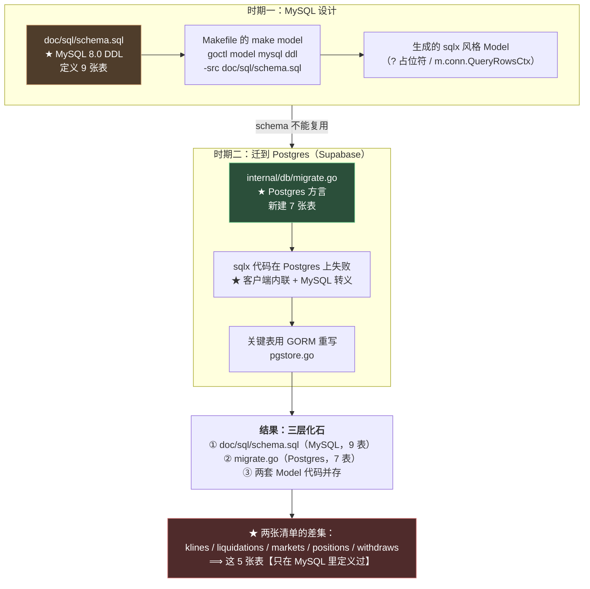
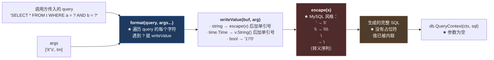
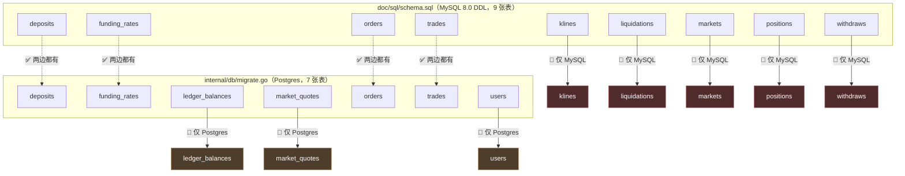

# 第 18 章：数据访问层 — 12 个 Model 与 sqlx/GORM 双实现

> 第 2 章 3.(7) 留了一个悬念：`internal/model/` 下**同时存在两套数据访问写法**——`models.go` 用 go-zero 的 `sqlx`，`pgstore.go` 用 GORM。当时给出的解释是一句代码注释："Postgres 上必须用 GORM（go-zero sqlx 的 `?` 与 pgx 不兼容）"。
>
> **本章要把那句话拆开看清楚。** 因为"`?` 占位符不兼容"这个说法**并不准确**——我用实测追踪到了真正的机制，它比"占位符风格不同"深得多，也更值得记住。
>
> 而在追查的过程中，我还发现了一件更有意思的事：**这整个"双实现"的局面，是一个数据库迁移没有做完留下的化石。** 顺着这条线往下捋，能解释第 5 章那个"六个死字段"的真正成因——**那五个 Model 之所以没人用，是因为它们的表**在 Postgres 里根本不存在**。**

---

## 1. 本章导读

### 1.1 一个项目，两套数据访问代码

**先看事实。** `internal/model/` 下 7 个文件、1308 行，但它们用的是**两种完全不同的技术栈**：

| 文件 | 技术栈 | 覆盖的表 |
| --- | --- | --- |
| `models.go`（366 行） | go-zero `sqlx` | positions / withdraws / funding_rates / liquidations / markets / klines / deposits |
| `pgstore.go`（525 行） | GORM | deposits / ledger_balances / orders / trades |
| `order.go`（145 行） | go-zero `sqlx` | orders |
| `trade.go`（113 行） | go-zero `sqlx` | trades |
| `ledger_balance.go`（70 行） | go-zero `sqlx` | ledger_balances |
| `market_quote.go`（73 行） | GORM | market_quotes |
| `wallet_user.go`（16 行） | GORM 标签 | users |

**⚠️ 注意几处重复：**

```text
orders        → order.go（sqlx）  +  pgstore.go 的 gormOrderModel（GORM）
trades        → trade.go（sqlx）  +  pgstore.go 的 gormTradeModel（GORM）
deposits      → models.go（sqlx） +  pgstore.go 的 gormDepositModel（GORM）
ledger_balances → ledger_balance.go（sqlx）+ pgstore.go 的 gormLedgerBalanceModel（GORM）
```

**⟹ 四张表有**两套实现**。**

**⚠️ 而且 GORM 版本的文件位置也不统一：**

```text
GORM 的 orders/trades/deposits/ledger_balances → 都在 pgstore.go 里
GORM 的 market_quotes                          → ★ 单独在 market_quote.go 里
```

**🔑 那个注释说"必须用 GORM"，但 `market_quote.go` 里的 GORM 实现**并没有解释为什么** —— 它只是默默地用了 GORM。**

### 1.2 本章的核心发现：这不只是"风格差异"，而是一次没做完的迁移

**"两套写法"这个现象，通常的解释是"技术选型不统一"。但本章的追查显示：它是一个**数据库迁移的化石**。**

**证据链（每一步都可验证）：**

**证据一：项目的数据库设计是**从 MySQL 开始的**。**

```sql
-- doc/sql/schema.sql 的头部
-- MetaNode 数据库表结构
-- 使用 MySQL 8.0+

CREATE DATABASE IF NOT EXISTS metanode DEFAULT CHARSET utf8mb4 COLLATE utf8mb4_unicode_ci;
USE metanode;

CREATE TABLE IF NOT EXISTS `orders` (
    `id` BIGINT UNSIGNED AUTO_INCREMENT PRIMARY KEY,
    ...
) ENGINE=InnoDB DEFAULT CHARSET=utf8mb4 COMMENT='订单表';
```

**🔑 这段 DDL 里有一串**只在 MySQL 里有意义**的东西：**

```text
· CREATE DATABASE ... CHARSET utf8mb4 COLLATE utf8mb4_unicode_ci   ← MySQL 的字符集语法
· 反引号 `column`                                                  ← MySQL 的标识符引用
· ENGINE=InnoDB                                                    ← MySQL 的存储引擎
· TINYINT / BIGINT UNSIGNED                                        ← MySQL 的类型
· COMMENT '...'                                                    ← MySQL 的列注释
· ON UPDATE CURRENT_TIMESTAMP                                      ← MySQL 的特性
```

**证据二：Makefile 里有一个专门生成 Model 的目标。**

```makefile
# 生成数据库模型
model:
	@echo "生成数据库模型..."
	goctl model mysql ddl -src doc/sql/schema.sql -dir internal/model -c
```

**🔑 注意这条命令的两个关键词：**

```text
goctl model mysql ddl     ← ★ 从 MySQL DDL 生成模型
-src doc/sql/schema.sql   ← ★ 源头是那份 MySQL 的建表语句
```

**⚠️ 而它生成出来的代码，就是 go-zero 的 `sqlx` 风格（`?` 占位符、`m.conn.QueryRowsCtx`）——也就是 `models.go` 那一套。**

**证据三：后来换成了 Postgres（Supabase）。**

```yaml
# etc/metanode.yaml
Supabase:
  DataSource: "postgresql://postgres:<密码>@db.<项目ID>.supabase.co:5432/postgres?sslmode=require"
```

**🔑 而 `internal/db/migrate.go` 是**另一套**建表语句（Postgres 方言）：**

```go
`CREATE TABLE IF NOT EXISTS public.orders (...)`,
`ALTER TABLE public.users ADD COLUMN IF NOT EXISTS wallet_address text NOT NULL DEFAULT ''`,
`ALTER TABLE public.market_quotes REPLICA IDENTITY FULL`,
```

**⟹ 所以完整的迁移故事是：**

```text
① 按 MySQL 设计（doc/sql/schema.sql + Makefile 的 make model）
   ⟹ 生成 sqlx 风格的 Model（models.go / order.go / trade.go / ledger_balance.go）
   ↓
② 改用 Postgres（Supabase）
   · doc/sql/schema.sql 是 MySQL 的，用不了
   · ★ 于是新写了一套 Postgres 迁移（internal/db/migrate.go）
   ↓
③ sqlx 的代码在 Postgres 上不工作（1.3 节会讲清为什么）
   ⟹ ★ 于是关键表被用 GORM 重写（pgstore.go）
   ↓
④ 结果：两套代码并存，而其中一部分成了化石
```

**🔑 所以"双实现"不是"技术选型不统一"这么轻描淡写，而是一次**迁移做了一半**的痕迹。**

### 1.3 "sqlx 与 pgx 不兼容"这个说法不准确——真正的机制

**这是本章最有价值的部分。** **代码注释里写的是：**

```go
// 充值 / 链下余额 / 订单 / 成交：Postgres 上必须用 GORM（go-zero sqlx 的 ? 与 pgx 不兼容）
```

**⚠️ 这句话让人以为"只要把 `?` 换成 `$1` 就行"。** **但我去读了 go-zero sqlx 的源码，机制完全不同。**

**go-zero 的 sqlx **不做参数化查询** —— 它把参数值**直接内联进 SQL 字符串**：**

```go
// go-zero v1.6.0 → core/stores/sqlx/utils.go
func format(query string, args ...any) (val string, err error) {
	// ...
	for i := 0; i < bytes; i++ {
		ch := query[i]
		switch ch {
		case '?':
			if argIndex >= numArgs { /* 报错 */ }
			writeValue(&b, args[argIndex])       // ★ 把【值】写进去，而不是占位符
			argIndex++
		case ':', '$':
			// ★ 同样处理 $1 / :1 风格——也还是内联
			index, _ := strconv.Atoi(query[i+1 : j])
			writeValue(&b, args[index])
		// ...
		}
	}
	return b.String(), nil                        // ★ 返回的是【完整 SQL 字符串】
}
```

**🔑 而 `writeValue` 做的事情，决定了它为什么在 Postgres 上会出问题：**

```go
func writeValue(buf *strings.Builder, arg any) {
	switch v := arg.(type) {
	case bool:
		if v { buf.WriteByte('1') } else { buf.WriteByte('0') }
	case string:
		buf.WriteByte('\'')
		buf.WriteString(escape(v))               // ★ 用 MySQL 风格转义
		buf.WriteByte('\'')
	case time.Time:
		buf.WriteByte('\'')
		buf.WriteString(v.String())              // ★ 用 Go 的 time 格式
		buf.WriteByte('\'')
	// ...
	}
}
```

**以及 `escape`：**

```go
func escape(input string) string {
	for _, ch := range input {
		switch ch {
		case '\x00': b.WriteString(`\x00`)
		case '\r':   b.WriteString(`\r`)
		case '\n':   b.WriteString(`\n`)
		case '\\':   b.WriteString(`\\`)
		case '\'':   b.WriteString(`\'`)         // ★ 反斜杠转义单引号 —— MySQL 风格
		case '"':    b.WriteString(`\"`)
		case '\x1a': b.WriteString(`\x1a`)       // ★ \x1a (SUB) 是 MySQL 特有的
		}
	}
}
```

**🔑 所以真正的机制是：**

> **go-zero 的 sqlx 做的是客户端内联（client-side interpolation）+ MySQL 风格转义**，
> 而不是**服务端参数化查询（parameterized query）**。

**⚠️ 这个区别很重要，因为它意味着：**

```text
· 换成 $1 占位符【也救不了】—— 值还是被内联，转义风格还是 MySQL 的
· ★ 真正的问题是【转义和格式】，不是【占位符风格】
```

### 1.4 实测：它生成的 SQL 长什么样

**为了不靠推理，我复刻了 go-zero 的 `format` / `writeValue` / `escape`（逐字抄自源码），看它到底生成什么：**

```text
=== go-zero sqlx 生成的 SQL（客户端内联值）===

【1】普通字符串（无特殊字符）
SELECT * FROM orders WHERE signer = '0xabc123'
     ⟹ ✅ 这个在 Postgres 上没问题

【2】带单引号的字符串
SELECT * FROM orders WHERE signer = 'it\'s'
     ⟹ 🔴 ★ MySQL 的 `\'` 转义

【3】带反斜杠的字符串
SELECT * FROM orders WHERE signer = 'a\\b'
     ⟹ 🔴 同样是 MySQL 风格

【4】time.Time（★ 每个表都有 create_time / update_time）
INSERT INTO orders (create_time) VALUES ('2026-09-18 19:30:00.123456789 +0800 CST')
     ⟹ 🔴 ★ 这是 Go 的 time.Time.String() 格式（带时区【名称】 CST）
```

**🔑 逐条分析这三个"不兼容点"：**

**问题一：`'it\'s'` —— MySQL 的反斜杠转义。**

```text
PostgreSQL 自 9.1 起默认 standard_conforming_strings = on
  ⟹ ★ 字符串里的反斜杠是【普通字符】，不是转义符
  ⟹ 'it\'s' 被解析为：
       'it\'  ← 字符串 "it\"（反斜杠是字面量）
       然后 s' ← ★ 语法错误
```

**⚠️ 而且这个错误是**静默的、偶发的**——只有参数里出现单引号/反斜杠时才触发。**

**问题二：`'2026-09-18 19:30:00.123456789 +0800 CST'` —— Go 的时区名称格式。**

```text
Go 的 time.Time.String() 格式：2006-01-02 15:04:05.999999999 -0700 MST
                                                          ↑     ↑
                                                    数字偏移量  时区【名称】

PostgreSQL 的 timestamp 解析器：
  · 接受 "2026-09-18 19:30:00.123456+08"（ISO 风格）✓
  · ★ 但不接受结尾的 " CST"（时区名称，不是合法的时间戳后缀）
```

**🔴 而这个问题**比第一个严重得多**，因为：**

```text
· ★ 每一张表都有 create_time / update_time 列
· ★ 每一次【写入】都要传 time.Time
⟹ ★★ 所以它不是一个"偶发"的问题，而是"每次写库都会失败"
```

**问题三（推理，未实测）：`bool` 被写成 `1`/`0`。**

```go
case bool:
	if v { buf.WriteByte('1') } else { buf.WriteByte('0') }
```

**⚠️ PostgreSQL 的 `boolean` 类型不接受 `1`/`0` 字面量**（它接受 `true`/`false`/`'t'`/`'f'`）。

**⚠️ 我**没有实测这一点**（因为不确认 go-zero 的 `mapping.Repr` 是否会介入），所以这里只作为"可能的问题"列出。**

**🔑 但前两个问题已经足够解释"为什么必须换 GORM"了** —— **尤其是问题二：它让每一次带时间戳的写入都失败。**

**🔑 一条可以带走的经验：**

> **"客户端内联值"的 ORM/驱动，其兼容性取决于**它的转义/格式化规则与目标数据库的方言是否匹配**。**
> ```text
> ✅ 参数化查询（parameterized）：值通过协议传，转义由【数据库】负责 → 天然跨方言
> 🔴 客户端内联（interpolation）：值被拼进 SQL 字符串，转义由【驱动】负责 → ★ 绑定方言
> ```
>
> **⚠️ 判断方法：**把你的驱动生成的 SQL 完整打出来看一眼。****
> ```text
> · 如果是 "... WHERE a = $1"（带占位符）→ ✅ 参数化
> · ★ 如果是 "... WHERE a = 'foo'"（值已在里面）→ 🔴 客户端内联，要警惕方言问题
> ```
> **⚠️ 本项目正好有这个便利条件**：go-zero sqlx 的 `realSqlGuard` 会把完整 SQL 记进日志（`logSql` 开启时）。
> **这也是一个可用的排查手段。**

---

## 2. 架构 / 流程图

### 2.1 两套实现的分工

```mermaid
%%{init: {'flowchart': {'wrappingWidth': 1000}}}%%
flowchart TB
    SVC["svc.NewServiceContext<br/>（第 5 章）"]

    SVC -->|"if sqlConn != nil"| SQLX["<b>sqlx 一套</b><br/>model.NewXxxModel(sqlConn)"]
    SVC -->|"if pgDB != nil"| GORM["<b>GORM 一套</b><br/>model.NewGormXxxModel(pgDB)"]

    SQLX --> S1["PositionModel ← positions"]
    SQLX --> S2["WithdrawModel ← withdraws"]
    SQLX --> S3["FundingRateModel ← funding_rates"]
    SQLX --> S4["LiquidationModel ← liquidations"]
    SQLX --> S5["MarketModel ← markets"]
    SQLX --> S6["KlineModel ← klines"]
    SQLX --> S7["<s>DepositModel</s> ← ★ 死代码，被 GORM 版取代"]
    SQLX --> S8["<s>OrderModel</s> ← ★ 死代码"]
    SQLX --> S9["<s>TradeModel</s> ← ★ 死代码"]
    SQLX --> S10["<s>LedgerBalanceModel</s> ← ★ 死代码"]

    GORM --> G1["OrderModel ← orders"]
    GORM --> G2["TradeModel ← trades"]
    GORM --> G3["DepositModel ← deposits"]
    GORM --> G4["LedgerBalanceModel ← ledger_balances"]
    GORM --> G5["MarketQuoteModel ← market_quotes"]

    style S7 fill:#4f2b2b,stroke:#d07070,color:#fff
    style S8 fill:#4f2b2b,stroke:#d07070,color:#fff
    style S9 fill:#4f2b2b,stroke:#d07070,color:#fff
    style S10 fill:#4f2b2b,stroke:#d07070,color:#fff
    style GORM fill:#2b4f3a,stroke:#70d090,color:#fff
    style SQLX fill:#4f3d2b,stroke:#d0a070,color:#fff
```



**⚠️ 图中红色的四个是**死代码**——它们被 GORM 版本取代了，但代码还留着。**

**🔑 所以"两套实现"实际上有三种状态：**

```text
① ✅ 活的 sqlx（6 个）：Position / Withdraw / FundingRate / Liquidation / Market / Kline
② 🔴 死的 sqlx（4 个）：Deposit / Order / Trade / LedgerBalance —— 已被 GORM 取代
③ ✅ 活的 GORM（5 个）：Order / Trade / Deposit / LedgerBalance / MarketQuote
```

**⚠️ 而第 ① 类里，有 5 个的**表根本不存在**（2.3 节）。**

### 2.2 【核心】MySQL → Postgres 的迁移痕迹



**🔑 这张图是本章的核心。它解释了"双实现"的由来，也解释了一个更大的问题（2.3 节）。**

### 2.3 一次完整的表盘点

**把两边的建表语句都抓出来对比（实测）：**

```text
MySQL（doc/sql/schema.sql）定义 9 张表：
  deposits, funding_rates, klines, liquidations, markets,
  orders, positions, trades, withdraws

Postgres（internal/db/migrate.go）创建 7 张表：
  deposits, funding_rates, ledger_balances, market_quotes,
  orders, trades, users

★ 差集（只在 MySQL 里定义过、Postgres 里没有的）：
  klines, liquidations, markets, positions, withdraws
```

**🔴 这五张表**在 Supabase 上根本不存在**。**

**⚠️ 也就是说：任何针对它们的查询，在运行时都会报"表不存在"（`relation "positions" does not exist`）。**

**🔑 而这正好解释了第 5 章那个发现（"六个 Model 是死字段"）：**

| 死字段（第 5 章） | 对应的表 | 表在 Postgres 里存在吗？ |
| --- | --- | --- |
| `PositionModel` | positions | ❌ **不存在** |
| `WithdrawModel` | withdraws | ❌ **不存在** |
| `LiquidationModel` | liquidations | ❌ **不存在** |
| `MarketModel` | markets | ❌ **不存在** |
| `KlineModel` | klines | ❌ **不存在** |
| `FundingRateModel` | funding_rates | ✅ 存在（但 Model 是死字段——因为 `FundingRateKeeper` 自己 new 了一个） |

**🔑 所以第 5 章的结论需要**修正/深化**：**

```text
第 5 章的结论：
  "六个 Model 是死字段，因为对应的接口未实现（或走了别的数据源）"

★ 更准确的说法：
  "其中五个 Model 之所以死，是因为它们的【表不存在】——
   而那些表不存在，是因为它们只被 MySQL 的 DDL 定义过，
   迁移到 Postgres 时没有重建。"

⟹ ★★ 所以因果方向是反的：
   不是"接口没实现所以 Model 没人用"
   而是"表不存在 → 查也没用 → 接口不实现（或改用别的数据源）"
```

**⚠️ 注意最后一个：`funding_rates`。** **它的表存在，Model 也是活的（`FundingRateKeeper` 用了它）——只是 `svcCtx.FundingRateModel` 那个字段没人用。**

**🔑 所以六个死字段其实是**两个不同的原因**：**

```text
5 个：★ 表不存在（MySQL → Postgres 迁移的遗漏）
1 个：表存在，但组件自己 new 了实例（第 5 章 4.4 的"依赖注入风格不一致"）
```

### 2.4 死代码的第四类：被取代的 sqlx 实现

**除了"表不存在的 5 个"和"重复实例的 1 个"，还有一类死代码：**

```text
★ 4 个从未被调用的 sqlx 构造函数（实测）：
  model.NewDepositModel(conn sqlx.SqlConn)         ← 被 NewGormDepositModel 取代
  model.NewOrderModel(conn sqlx.SqlConn)           ← 被 NewGormOrderModel 取代
  model.NewTradeModel(conn sqlx.SqlConn)           ← 被 NewGormTradeModel 取代
  model.NewLedgerBalanceModel(conn sqlx.SqlConn)   ← 被 NewGormLedgerBalanceModel 取代
```

**⟹ 这是"迁移的化石"的最直接体现：**旧实现还在，新实现在用，两者都不知道对方存在。****

**⚠️ 而它们不是"无害的冗余"** —— **它们会误导读者：**

```text
· 读到 order.go 的人会以为"订单走 sqlx"
· 而实际上 main → svc 里用的是 pgstore.go 的 gormOrderModel
· ★ 两者的行为不同（一个会在 Postgres 上报错）
⟹ ★★ 如果有人"顺手"把 svc 里的 NewGormOrderModel 改成 NewOrderModel，
   订单功能会立刻全线崩溃
```

**🔑 一条可以带走的判断：**

> **"两套实现并存"最危险的地方不是"多了些代码"，而是**它让人分不清哪套是活的**。**
> ```text
> ✅ 安全的形态：旧实现被删除（git 记着历史）
> ⚠️ 次优：旧实现保留但被明确标注为"废弃"
> 🔴 最差：两套并存且不加区分（本项目的现状）
> ```

---

## 3. 核心代码拆解

### (1) 两套 Model 的构造与命名

**先看命名约定（实测）：**

```go
// ==== sqlx 一套（models.go / order.go / trade.go / ledger_balance.go）====
func NewPositionModel(conn sqlx.SqlConn) PositionModel
func NewDepositModel(conn sqlx.SqlConn) DepositModel
func NewOrderModel(conn sqlx.SqlConn) OrderModel
func NewTradeModel(conn sqlx.SqlConn) TradeModel
func NewLedgerBalanceModel(conn sqlx.SqlConn) LedgerBalanceModel

// ==== GORM 一套（pgstore.go / market_quote.go）====
func NewGormDepositModel(db *gorm.DB) DepositModel
func NewGormLedgerBalanceModel(db *gorm.DB) LedgerBalanceModel
func NewGormOrderModel(db *gorm.DB) OrderModel
func NewGormTradeModel(db *gorm.DB) TradeModel
func NewGormMarketQuoteModel(db *gorm.DB) MarketQuoteModel
```

**作者为什么这么设计（设计思想）：**

**✅ 设计点一：`Gorm` 前缀是一个**有意的区分**，而且是好的。**

```text
· sqlx 版本：New<表名>Model
· GORM 版本：NewGorm<表名>Model

⟹ ★ 从名字就能看出"这是哪一套实现"
⟹ ⚠️ 但这也说明"两套并存"是【有意识的】，而不是偶然的
```

**⚠️ 设计点二：命名前缀解决了"区分"，但没解决"哪套是活的"。**

```text
看到 NewOrderModel 和 NewGormOrderModel 并存时：
  · 知道它们是两套实现 ✓
  · ★ 但不知道【哪套在用】（需要去 svc 里查）
```

**✅ 一个可选的改进**：给废弃的加 `Deprecated:` 注释：

```go
// NewOrderModel 创建订单模型（sqlx 版）。
//
// Deprecated: 在 Postgres 上不可用（go-zero sqlx 做客户端内联 + MySQL 转义）。
// 请使用 NewGormOrderModel。
func NewOrderModel(conn sqlx.SqlConn) OrderModel
```

**🔑 Go 的 `Deprecated:` 标记有一个实际好处：IDE 和 `staticcheck` 会识别它并给出提示。**

**⚠️ 设计点三：GORM 版本的文件位置不统一。**

```text
GORM 的 orders/trades/deposits/ledger_balances → pgstore.go
GORM 的 market_quotes                          → ★ market_quote.go
```

**⚠️ 这破坏了"按技术栈分文件"的一致性**（如果按技术栈分，`market_quote.go` 应该在 `pgstore.go` 里；如果按表分，那 `pgstore.go` 应该拆开）。

**🔑 一个很可能的解释是"时间顺序"：`pgstore.go` 是迁移时集中重写的（所以放一起），而 `market_quote.go` 是后来加行情功能时单独建的。**

**⚠️ 这是"按时间组织的代码"和"按职责组织的代码"之间的经典冲突**——**前者在写的时候很方便，后者在读的时候很方便。**

### (2) sqlx 版本的实现

```go
// models.go → Position 模型
type PositionModel interface {
	FindByTrader(ctx context.Context, trader string) ([]*Position, error)
	Upsert(ctx context.Context, position *Position) error
}

type defaultPositionModel struct {
	conn sqlx.SqlConn                     // ★ go-zero 的 SQL 抽象
}

func NewPositionModel(conn sqlx.SqlConn) PositionModel {
	return &defaultPositionModel{conn: conn}
}

func (m *defaultPositionModel) FindByTrader(ctx context.Context, trader string) ([]*Position, error) {
	var resp []*Position
	query := `SELECT * FROM positions WHERE trader = ?`              // ★ ? 占位符
	err := m.conn.QueryRowsCtx(ctx, &resp, query, trader)             // ★ sqlx 的 API
	if err != nil {
		return nil, err
	}
	return resp, nil
}
```

**作者为什么这么设计（设计思想）：**

**🔑 设计点一：注意模型里**没有 `table` 字段、没有 `fmt.Sprintf`**。**

**⚠️ 这一点值得说明，因为它和我一开始的猜测不同。**

**goctl 生成的 Model 长这样：**

```go
// goctl 生成的风格（有 table 字段 + fmt.Sprintf）
type defaultOrdersModel struct {
	conn  sqlx.SqlConn
	table string                        // ★ 表名字段
}

func (m *defaultOrdersModel) FindOne(ctx context.Context, id int64) (*Orders, error) {
	query := fmt.Sprintf("select * from %s where `id` = ? limit 1", m.table)   // ★ Sprintf
	// ...
}
```

**⟹ 但本项目的 `models.go` **不是这个风格** —— 它用**反引号的静态 SQL**，没有 `table` 字段。**

**🔑 所以 `models.go` **很可能是手写的**（虽然遵循了 MySQL 的 `?` 占位符约定）。**

**⚠️ 这个判断很重要，因为它影响"`make model` 会不会覆盖它"这个问题（3.(10)）：**

```text
· 如果 models.go 是 goctl 生成的 → make model 会覆盖它 → ★ 危险
· ★ 如果它是手写的 → make model 会生成【新文件】（如 ordersModel.go），不会覆盖它
  ⟹ 但会在 internal/model/ 下产生一堆重复的、命名不同的文件 → 混乱
```

**⚠️ 两种情况的结论不同，所以这一章我不能断言"`make model` 会覆盖" —— 只能说它有风险。**

**🔑 设计点二：`SELECT *` 这种写法。**

```go
query := `SELECT * FROM positions WHERE trader = ?`
```

**⚠️ `SELECT *` 是一个值得注意的选择：**

```text
✅ 优点：代码短，加列不用改 SQL
🔴 缺点：
   · 依赖"结构体的字段和表的列一一对应"（否则 sqlx 扫描会失败）
   · ★ 多读不需要的列（本项目的表不宽，影响小）
   · 如果表结构变了（加列），扫描可能失败
```

**⚠️ 而本项目**恰好依赖**这一点** —— 因为 `models.go` 的模型是"结构体直接扫描"（没有 `xxxRow` 中间层，第 2 章 3.(7) 分析过）。

**🔑 所以它的一个隐含要求是：**Go 结构体的字段必须和表的列一一对应。****

```text
⚠️ 如果表里有个列在结构体里没有 → sqlx 可能报错（取决于实现）
⚠️ 如果结构体有个字段在表里没有 → 同上
```

**✅ 而 GORM 版本用了 `xxxRow` 中间层**（`orderRow` / `tradeRow`），**它显式声明了每一列的映射** —— **所以对表结构变化更健壮。**

**🔑 这其实是"两套实现"的一个**实质性差异**，不只是"技术栈不同"：**

```text
sqlx（models.go）：结构体直接扫描 → ★ 隐式依赖列名
GORM（pgstore.go）：有 Row 中间层 + 显式 tag → ✅ 显式声明映射
```

### (3) GORM 版本的实现

```go
// pgstore.go
type orderRow struct {
	ID           int64     `gorm:"column:id;primaryKey;autoIncrement"`
	OrderId      string    `gorm:"column:order_id;size:66;not null;uniqueIndex"`
	ChainId      int64     `gorm:"column:chain_id;not null"`
	Perp         string    `gorm:"column:perp;size:42;not null;index"`
	PerpAddress  string    `gorm:"column:perp_address;size:42;not null"`   // ★ Supabase 旧表列名
	// ...
}

func (orderRow) TableName() string { return "orders" }

// ★ 关键：显式的转换函数
func orderToRow(o *Order) orderRow        { /* ... */ }
func orderRowToModel(r *orderRow) *Order  { /* ... */ }

type gormOrderModel struct {
	db *gorm.DB
}

func (m *gormOrderModel) Insert(ctx context.Context, order *Order) (sql.Result, error) {
	row := orderToRow(order)
	if err := m.db.WithContext(ctx).Create(&row).Error; err != nil {
		return nil, err
	}
	return gormResult{lastID: row.ID, rows: 1}, nil
}
```

**作者为什么这么设计（设计思想）：**

**✅ 设计点一：GORM 用**结构体 tag 声明映射**，而不是靠命名约定。**

```go
OrderId string `gorm:"column:order_id;size:66;not null;uniqueIndex"`
//      ↑ Go 字段名        ↑ ★ SQL 列名（显式）      ↑ 约束（也是显式声明）
```

**🔑 对比 sqlx 版本的 `db:"trader"` tag —— 规格小得多（只有列名），因为 sqlx 不做建表/校验。**

**⚠️ 注意 tag 里有 `uniqueIndex` / `size` / `not null` —— 这些都是**建表信息**。**

```text
⚠️ 但本项目的建表【不是】GORM 做的（是 migrate.go 里的手写 DDL）
⟹ ★ 所以这些 tag 里的约束信息是"装饰性"的 —— 它们不会真的生效
   （除非有人调用 db.AutoMigrate，而本项目没有）
```

**🔑 这是一个值得注意的点：**tag 里的约束和实际的 DDL 是**两个独立的真相源**。****

```text
· tag 说：order_id 有唯一索引
· migrate.go 说：CREATE UNIQUE INDEX uq_orders_order_id ON orders (order_id) WHERE order_id <> ''
  ⟹ ★ 后者才是真的（而前者只是"看起来像"）
  ⚠️ 两者不一致时，没有任何机制能发现
```

**⚠️ 本项目的两者是**基本一致**的（都是唯一索引），但有一个细节差异：**

```text
tag：     uniqueIndex（无条件的唯一）
migrate： 唯一索引带 WHERE order_id <> ''（★ 部分索引）
```

**🔑 这个 `WHERE order_id <> ''` 条件是有意的**（允许空字符串重复），但 **GORM 的 tag 无法表达它** —— 所以如果有人用 `AutoMigrate` 建表，会得到一个不同的约束。

**✅ 设计点二：`orderToRow` / `orderRowToModel` 的显式转换是对的**（第 2 章 3.(7) 分析过）。

**⚠️ 但要注意 `orderToRow` 里的一处硬编码（第 12 章 6.7 提过）：**

```go
if row.ChainId == 0 {
	row.ChainId = 11155111        // ★ 硬编码 Sepolia chain ID
}
```

**🔑 这又是一个"静默兜底"** —— **如果 `ChainId` 因为某种原因是 0，代码会默默写入 Sepolia 的 chain ID，而不是报错。**

**⚠️ 而 `chain_id` 是 EIP-712 域的一部分**（第 2 章 4.4）—— **静默写错会导致签名验不过。**

### (4) 【核心】go-zero sqlx 的 `format` 函数

**3.(2) 节引用了源码。这里给出完整的机制图（1.3 节已经引用过关键片段，这里做总览）：**



**🔑 对照标准的参数化查询流程：**

```text
标准（database/sql + PostgreSQL 驱动）：
  Query("SELECT * FROM t WHERE a = $1", "it's")
    ⟹ ★ SQL 文本【原样】发给数据库
    ⟹ 参数值通过【协议】单独传输（Binary/Text format）
    ⟹ 数据库负责"把值放进查询"—— 它知道怎么正确转义
    ⟹ ✅ 天然跨方言（值不经过字符串拼接）

go-zero sqlx（本项目）：
  Query("SELECT * FROM t WHERE a = ?", "it's")
    ⟹ sqlx 先在【客户端】把值拼进 SQL
    ⟹ ★ 结果："SELECT * FROM t WHERE a = 'it\'s'"
    ⟹ 数据库收到的是一条【已经完成的】SQL 语句
    ⟹ 🔴 转义规则由【驱动】决定 —— 而它是 MySQL 的
```

**🔑 所以核心区别是**"谁负责转义"**：**

| | 转义责任方 | 跨方言 | 注入风险 |
| --- | --- | --- | --- |
| **参数化查询** | ★ **数据库** | ✅ 天然兼容 | ✅ 低（值不参与解析） |
| **客户端内联** | ★ **驱动** | 🔴 绑定方言 | ⚠️ 取决于转义完备性 |

**⚠️ 顺带一提**：go-zero 的 `escape` **在防注入上做得是到位的**（覆盖了 `'`、`"`、`\`、`\x00`、`\x1a`）——**所以这不是一个安全漏洞，而是一个**方言兼容**问题。**

**🔑 一条可以带走的经验：**

> **"客户端内联"的驱动，它的转义函数决定了它能连什么数据库。**
> ```text
> ✅ 参数化驱动：换数据库只需换 DSN
> 🔴 内联驱动：  ★ 换数据库要审计它的转义规则
> ```
> **⚠️ 判断方法（沿用 1.4 节）：把生成的 SQL 打出来看** —— **如果值已经在 SQL 里了，那它就是个内联驱动。**

### (5) `db/migrate.go` 的幂等迁移

```go
// MigrateAccountTables 确保 users / deposits / ledger_balances / orders / trades 存在。
// Supabase 上若已有旧表结构，会先 ADD COLUMN IF NOT EXISTS 再建索引。
func MigrateAccountTables(pg *gorm.DB) error {
	if pg == nil {
		return fmt.Errorf("postgres nil")
	}
	batches := [][]string{
		userStmts(), depositStmts(), ledgerStmts(),
		orderStmts(), tradeStmts(), fundingRateStmts(), marketQuoteStmts(),
	}
	for _, batch := range batches {
		for _, s := range batch {
			if err := pg.Exec(s).Error; err != nil {
				return fmt.Errorf("%w\nSQL: %s", err, s)      // ★ 错误里带上 SQL
			}
		}
	}
	// Supabase Realtime 需要这个设置才能推送 UPDATE 事件
	if err := pg.Exec(`ALTER TABLE public.market_quotes REPLICA IDENTITY FULL`).Error; err != nil {
		_ = err                                               // ⚠️ 静默忽略
	}
	return nil
}
```

**作者为什么这么设计（设计思想）：**

**✅ 设计点一：逐条执行、错误里带 SQL —— 这个错误处理很好。**

```go
return fmt.Errorf("%w\nSQL: %s", err, s)
//                      ↑ ★ 把失败的那条 SQL 也带上
```

**🔑 为什么这很重要？** 因为 `CREATE TABLE IF NOT EXISTS` / `ALTER TABLE ADD COLUMN IF NOT EXISTS` 有**很多条**，**光说"执行失败"根本不知道是哪条。**

**⚠️ 对比第 13 章 6.x 那条批评**（`NewClient` 里三段 ABI 的解析错误没包装上下文）—— **同一个项目里，一处的错误信息做得很好，另一处不够。**

**⚠️ 设计点二：最后一个 `REPLICA IDENTITY` 的错误被静默忽略。**

```go
if err := pg.Exec(`ALTER TABLE public.market_quotes REPLICA IDENTITY FULL`).Error; err != nil {
	_ = err                    // ⚠️ 连日志都没有
}
```

**🔑 作者的意图写在注释里了吗？没有** —— **但可以推断：这个设置只在 Supabase 上有意义，自建 Postgres 上失败是无所谓的。**

**⚠️ 问题在于：**"可以忽略"和"应该记录"是两件事**。**

```text
场景：确实在用 Supabase，但数据库用户权限不足 → 这句执行失败
⟹ 服务正常启动
⟹ ★ Realtime 推送静默失效 → 前端再也收不到实时行情
⟹ ★★ 而日志里【什么都没有】
```

**🔑 修法（一行）：**

```go
if err := pg.Exec(`ALTER TABLE public.market_quotes REPLICA IDENTITY FULL`).Error; err != nil {
	logx.Infof("REPLICA IDENTITY 设置跳过（非 Supabase 或权限不足）: %v", err)
}
```

**🔑 设计点三：迁移是**服务启动时执行**的（在 `NewServiceContext` 里）。**

```go
if err := db.MigrateAccountTables(pgDB); err != nil {
	fmt.Println("postgres migrate:", err)
} else {
	fmt.Println("postgres migrate: ok (users, deposits, ledger_balances, orders, trades, funding_rates, market_quotes)")
}
```

**✅ 这个设计的合理性（第 2 章 3.(10) 分析过）：**

```text
· 所有 DDL 都是幂等的（IF NOT EXISTS）→ 重复执行无害
· Supabase 是托管服务，作者没有独立的 DBA 流程
· ★ Fast fail：权限不足或表结构不对，启动时就能发现
```

**⚠️ 但有一个**明显的缺口**：**它只创建 7 张表，而项目的 Model 引用了 12 张表。****

**🔴 那 5 张缺失的表（klines / liquidations / markets / positions / withdraws）**没有任何 Postgres 建表语句**。** **（2.3 节）**

**🔑 所以从"迁移"这个角度看，它是**不完整的** —— 而这正是本章的核心发现。**

### (6) 【核心】表清单的对比与差集

**这一节是本章最重要的实证部分。**



**🔑 三个类别，各自说明一个问题：**

| 类别 | 表 | 说明 |
| --- | --- | --- |
| ✅ **两边都有**（4 张） | deposits / funding_rates / orders / trades | 迁移时**重建了** |
| 🔴 **仅 MySQL 有**（5 张） | klines / liquidations / markets / positions / withdraws | ★ **迁移时遗漏了** |
| 🟠 **仅 Postgres 有**（3 张） | ledger_balances / market_quotes / users | 迁移后**新加的功能** |

**🔑 而"仅 MySQL 有的 5 张"**精确对应了第 5 章的五个死 Model**（2.3 节）。**

**⚠️ 这个对应关系不是巧合，而是**因果关系**：**

```text
表不存在 → 针对它的查询会运行时报错
        → ★ 所以对应的接口要么不实现，要么改用别的数据源
        → Model 没人用 → 成为死字段
```

**🔑 一条可以带走的经验（本章最有价值的一条）：**

> **"某个组件没人用"这个现象，可能不是"没人写业务逻辑"，而是**它依赖的东西不存在**。**
> ```text
> 第 5 章的观察：六个 Model 是死字段
> 第 5 章的推测：因为对应的接口未实现
>
> ★ 本章的修正：五个是因为【表不存在】
>              （接口不实现是【结果】，不是原因）
> ```
> **⚠️ 判断方法：**追一个"没人用"的东西时，先确认它的**依赖是否存在** —— 数据库表、外部服务、配置项。****
> ```text
> · 依赖不存在 → ★ 根本原因在依赖侧（修"用法"没用）
> · 依赖存在   → 才轮到讨论"为什么没人写业务逻辑"
> ```

### (7) 死代码：四个从未被调用的 sqlx 构造函数

**实测（用 grep 统计每个构造函数的调用次数）：**

```text
NewPositionModel             被调用 2 次   ✅ 活
NewWithdrawModel             被调用 1 次   ✅ 活
NewFundingRateModel          被调用 2 次   ✅ 活
NewLiquidationModel          被调用 2 次   ✅ 活
NewMarketModel               被调用 1 次   ✅ 活
NewKlineModel                被调用 1 次   ✅ 活

NewDepositModel              被调用 0 次   🔴 死
NewOrderModel                被调用 0 次   🔴 死
NewTradeModel                被调用 0 次   🔴 死
NewLedgerBalanceModel        被调用 0 次   🔴 死

NewGormDepositModel          被调用 1 次   ✅ 活
NewGormLedgerBalanceModel    被调用 1 次   ✅ 活
NewGormOrderModel            被调用 1 次   ✅ 活
NewGormTradeModel            被调用 1 次   ✅ 活
NewGormMarketQuoteModel      被调用 1 次   ✅ 活
```

**🔑 四对"旧 vs 新"，旧的全部死了：**

| 表 | 死的（sqlx） | 活的（GORM） |
| --- | --- | --- |
| deposits | `NewDepositModel` | ✅ `NewGormDepositModel` |
| orders | `NewOrderModel` | ✅ `NewGormOrderModel` |
| trades | `NewTradeModel` | ✅ `NewGormTradeModel` |
| ledger_balances | `NewLedgerBalanceModel` | ✅ `NewGormLedgerBalanceModel` |

**⚠️ 这四个死的 sqlx Model 各有 50~100 行实现代码（在 `models.go` / `order.go` / `trade.go` / `ledger_balance.go` 里）—— **加起来大约 300 行**。**

**🔑 而它们不是"无害的冗余"（2.4 节分析过）——**它们会误导人**：**

```text
· 读到 order.go 的人会以为"订单走 sqlx"
· ⚠️ 甚至更糟：如果有人看到两套实现，可能会想"应该统一一下"
  ⟹ 然后把 svc 里的 NewGormOrderModel 改成 NewOrderModel
  ⟹ ★★ 订单功能立刻全线崩溃（因为 sqlx 在 Postgres 上不可用）
```

**🔑 修法：删掉它们（git 记着历史）或者标注 `Deprecated:`。**

### (8) `Makefile` 里的 `make model` —— 一个隐藏的风险

```makefile
# 生成数据库模型
model:
	@echo "生成数据库模型..."
	goctl model mysql ddl -src doc/sql/schema.sql -dir internal/model -c
```

**⚠️ 这条命令做的事情是：从 `doc/sql/schema.sql`（MySQL DDL）生成 Model 到 `internal/model/`。**

**🔑 它有三个问题：**

**问题一：源头是 MySQL DDL，而项目已经用 Postgres 了。**

```text
⟹ ★ 生成出来的代码是 sqlx 风格（`?` 占位符）—— 在当前数据库上【不能用】
```

**问题二：它会把文件生成到 `internal/model/` —— 那里已经有手写的代码。**

**⚠️ 至于会不会覆盖现有的 `models.go`：**

```text
· goctl model mysql ddl 生成的通常是按表命名的文件（如 ordersModel.go）
  ⟹ 所以★ 大概不会直接覆盖 models.go（一个手写命名的文件）
  ⚠️ 但会在同一个目录里产生一批【新的、命名风格不同的】文件
  ⟹ ★ 结果：目录里会有两套并存的 Model（一套手写、一套生成），更加混乱
```

**⚠️ 我**没有实际运行这条命令**（那会污染仓库），所以这里只能说"有风险"，不能断言具体行为。**

**问题三：它没有被 `make gen` 包含。**

```makefile
gen:
	@echo "生成 API 代码..."
	goctl api go -api metanode.api -dir .

model:                                    # ★ 单独的目标
	@echo "生成数据库模型..."
	goctl model mysql ddl -src doc/sql/schema.sql -dir internal/model -c
```

**🔑 这个"分开"其实是个**好事**** —— **它让误触发的概率降低了。**

**✅ 但更好的做法是**删掉这个目标**，或者加上明确的警告：**

```makefile
# ⚠️ 危险：本目标从 MySQL DDL 生成 sqlx 风格的 Model，
#    而本项目已迁移到 Postgres（sqlx 在 Postgres 上不可用）。
#    执行它会污染 internal/model/ 目录。除非你要做 MySQL 迁移，否则不要运行。
model:
	@echo "⚠️ 警告：此目标已废弃（项目已迁移到 Postgres）"
	@echo "   如需强制运行，请 exec 进容器手工执行 goctl 命令"
	@exit 1
```

**🔑 一条可以带走的经验（与第 2 章 6.1 同源）：**

> **"代码生成命令"必须随着技术栈的变化而更新或废弃 —— 否则它就是一个**定时炸弹**。**
> ```text
> 第 2 章：goctl api go 会删掉手改的 auth 路由
> 本章：  make model 会生成无法使用的 sqlx 代码
> ⟹ ★ 两者的共同点是"生成源头与当前技术栈脱节"
> ```
> **⚠️ 判断方法：**每一个生成命令，都要问"它的源头现在还对吗？"****

### (9) 迁移不完整带来的运行时后果

**把 2.3 节的静态分析落到运行时：**

```text
假设有人调用 svcCtx.PositionModel.FindByTrader(...)
  ⟹ SQL: SELECT * FROM positions WHERE trader = '0x...'
  ⟹ Postgres: ERROR: relation "positions" does not exist
  ⟹ ★ 接口返回 500（或者 panic，取决于错误处理）
```

**⚠️ 而当前**不会发生** —— 因为那五个 Model 是死字段（没人调用）。**

**🔑 所以局面是"巧合地安全"：**

```text
· 表不存在 → 查询会失败
· 但没人查     → 所以不会失败
⟹ ★ 两个问题互相抵消，谁都没暴露
```

**⚠️ 而这种"巧合的安全"有一个风险：**

```text
如果有人"顺手"实现那个未完成的接口（比如第 4 章 6.7 提到的 GetKlines），
  ⟹ 他会去调用 KlineModel
  ⟹ ★★ 然后在运行时发现"表不存在"
  ⟹ 而这个问题在编译期【完全看不出来】
```

**🔑 一条可以带走的经验：**

> **"未被使用的代码"和"不可用的依赖"如果同时存在，会形成一个**看起来正常的假象**。**
> ```text
> · 表不存在（依赖问题）+ 没人查（使用问题）
> ⟹ ★ 系统运行正常 —— 但一旦有人开始用，立刻崩
> ```
> **⚠️ 判断方法：对一个"未实现的功能"，不仅要问"为什么没实现"，还要问"**如果现在实现，它能工作吗？**"**
> ```text
> · 能 → 只是"没做"（可以直接做）
> · ★ 不能 → 有前置依赖问题要先解决（比如本章的表不存在）
> ```

---

## 4. Web3 特有机制

### 4.1 为什么金额字段用 `TEXT` / `VARCHAR(78)` 而不是 `NUMERIC`

**看 `orders` 表的定义：**

```sql
-- doc/sql/schema.sql (MySQL)
`paper_amount` VARCHAR(78) NOT NULL COMMENT '仓位数量',
`credit_amount` VARCHAR(78) NOT NULL COMMENT '资金数量',
```

```sql
-- internal/db/migrate.go (Postgres)
paper_amount text NOT NULL,
credit_amount text NOT NULL,
```

**🔑 为什么用文本而不是数值类型？**

**理由一：`NUMERIC` 在某些驱动下会有精度问题。**

```text
· PostgreSQL 的 numeric 是任意精度的 ✓
· ★ 但从 numeric 读出来时，驱动可能把它转成 float64 → 丢精度
· ⚠️ 而这取决于驱动和 ORM 的配置
```

**理由二：Go 侧统一用 `string` + `big.Int`（第 2 章 4.1、第 8 章 4.2 讨论过）。**

```text
· 项目里所有金额都是 string → big.Int
· ⟹ ★ 存成 text 是"端到端一致"的选择（不做类型转换）
```

**⚠️ 但代价是：数据库层面无法做数值运算和比较**。

```text
· 想查"金额大于 1000 的订单" → WHERE CAST(paper_amount AS numeric) > 1000
  ⟹ ★ 无法用索引（函数索引除外）
· 想求和"总成交量" → SUM(CAST(...)) ⟹ 全表扫描
```

**🔑 而 GORM 的 `AddPrimary` 正好遇到了这个问题**（第 16 章 6.3）：

```sql
-- 它需要做数值累加，但列是 text
SET primary_balance = (ledger_balances.primary_balance::numeric + EXCLUDED.primary_balance::numeric)::text
--                    ↑ ★ 必须显式 CAST，因为列是 TEXT
```

**🔑 所以结论是：**

> **"金额用文本"是一个**Web3 特有的取舍**：**
> ```text
> ✅ 换来：端到端精度无损（链上 int256 ↔ Go big.Int ↔ 数据库 text）
> 🔴 代价：数据库层面失去数值运算能力（求和、范围查询都要 CAST）
> ```
> **⚠️ 判断：如果业务需要**聚合查询**（总成交量、持仓量），这个取舍会变成负担。**
> ```text
> 本项目：成交量在 GetVolume24h 里需要 SUM ⟹ ★ 会遇到这个问题（第 19 章会看）
> ```

### 4.2 唯一约束在链下索引器里的作用

**第 16 章 4.3 详细讨论过"为什么幂等必须靠唯一约束"。这里补充一个**数据访问层**的视角。**

**本项目里有两类唯一约束，它们服务于不同的目的：**

```sql
-- ① 业务身份：订单哈希
CREATE UNIQUE INDEX uq_orders_order_id ON public.orders (order_id) WHERE order_id <> ''
-- ⟹ ★ 服务于"防重放"（第 1 章 4.3 / 第 7 章 3.(1)）
--    因为 orderId = EIP-712 digest，同样的签名订单只能入库一次

-- ② 事件去重：链上事件坐标
CONSTRAINT uq_deposits_tx_log UNIQUE (tx_hash, log_index)
-- ⟹ ★ 服务于"扫链幂等"（第 16 章 2.3）
--    因为 (txHash, logIndex) 是链上事件的天然唯一标识
```

**🔑 而第二类的设计有一个值得学的点（第 16 章 4.4）：**

```text
· tx_hash 单独用【不够】—— 一笔交易可能产生多个 Transfer 事件
· (tx_hash, log_index) 才是【链上天然唯一】的
  ⟹ ★ 而且 log_index 必须用【区块内全局序号】（lg.Index），
     不是【交易内序号】（lg.TxIndex）—— 后者在不同交易间会重复
```

**⚠️ 注意 Postgres 的**部分索引**写法：**

```sql
CREATE UNIQUE INDEX uq_orders_order_id ON public.orders (order_id) WHERE order_id <> ''
--                                                                    ↑ ★ WHERE 子句
```

**🔑 为什么需要这个 `WHERE`？**

```text
· 如果没有它，"多个 order_id 为空字符串"的行会冲突
· ⚠️ 而 orderToRow 里有 `if row.FilledAmount == "" { row.FilledAmount = "0" }`
  ⟹ ★ 但 order_id 没有这样的兜底
  ⟹ 所以用部分索引排除空值，是【防御性】的做法
```

**⚠️ 但 GORM 的 tag 无法表达部分索引：**

```go
OrderId string `gorm:"column:order_id;size:66;not null;uniqueIndex"`
//                                                       ↑ ★ 无条件的唯一索引
```

**⟹ 两者不一致**（3.(3) 分析过）**—— 而由于建表是手写 DDL，实际生效的是部分索引 ✓**

### 4.3 数据库不是真相源

**最后把这一章放回本指南的大图景里。**

**第 2 章 4.1 讲过"三个真相源"：链上（权威）、数据库（副本）、配置（人工）。本章讲的就是中间那个。**

**🔑 而本章的发现给"数据库是副本"这个定位补充了一个新的证据：**这个副本本身是不完整的**。**

```text
· 12 个 Model 引用的表里，5 张在 Postgres 里不存在
· 4 个 sqlx Model 是死代码
· 两套数据访问技术栈并存
⟹ ★ 所以"数据库里有什么"这件事，你需要【实际去查库】才能确定
   （光读代码会以为 12 张表都在）
```

**🔑 一条可以带走的经验：**

> **在"链下副本"的架构里，**数据库 schema 的真实状态**和**代码里引用的表**可能不一致 —— 而这种不一致在编译期是看不见的。**
> ```text
> ✅ 参数化驱动的项目：表不存在 → 运行时立刻报错（容易发现）
> ★ 而本项目的 5 张表不存在，但因为对应的代码没人用，
>   所以【完全没有暴露】
> ```
>
> **⚠️ 判断方法（对一个"数据库是副本"的系统）：**
> ```text
> ① 把两份清单拿出来对比：
>    · 代码里引用的表（grep TableName / FROM / INSERT INTO）
>    · 数据库里实际存在的表（\dt 或 information_schema）
> ② ★ 差集就是"会出问题的部分"
> ```
> **🔑 而本项目还有一个更省事的做法**：`migrate.go` 里的 7 张表**就是**"Postgres 上实际存在的表"的权威清单（因为它是启动时执行的）—— **拿它和 Model 引用的表对比，差集立刻出来。**

---

## 5. 本章小结与思考题

### 5.1 核心知识点回顾

| 知识点 | 一句话总结 |
| --- | --- |
| **两套数据访问代码** | `models.go` / `order.go` / `trade.go` / `ledger_balance.go` 用 sqlx；`pgstore.go` / `market_quote.go` 用 GORM |
| **🔑 真正的成因** | **一次没做完的 MySQL → Postgres 迁移留下的化石** |
| **证据** | `doc/sql/schema.sql` 是 MySQL 8.0 DDL；Makefile 有 `goctl model mysql ddl`；`migrate.go` 是 Postgres 方言 |
| **🔴 "`?` 占位符不兼容"这个说法不准确** | ★ 真正的机制是 **go-zero sqlx 做客户端内联 + MySQL 风格转义** |
| **实测的三个不兼容点** | ① `'it\'s'`（反斜杠转义）② `'... +0800 CST'`（Go 的 time 格式）③ `bool → 1/0`（未实测） |
| **🔴 第 ② 点最致命** | **每张表都有时间戳列 ⟹ 每次写入都会失败** |
| **为什么 `$1` 也救不了** | 值还是被内联，转义风格还是 MySQL 的 |
| **🔴 表清单的差集** | MySQL 9 张表 vs Postgres 7 张表；**klines / liquidations / markets / positions / withdraws 只在 MySQL 里定义过** |
| **🔑 这解释了第 5 章的"六个死字段"** | **其中五个是因为表不存在**（因果方向是反的：不是"接口没实现"，而是"表不存在"） |
| **🔴 四个死构造函数** | `NewDepositModel` / `NewOrderModel` / `NewTradeModel` / `NewLedgerBalanceModel` —— 被 GORM 版取代但没删 |
| **两套实现的实质性差异** | sqlx 直接扫进领域模型（隐式依赖列名）；GORM 有 `xxxRow` 中间层（显式声明映射） |
| **`migrate.go` 的幂等 DDL** | `IF NOT EXISTS` + 错误里带 SQL ✓；但 `REPLICA IDENTITY` 的错误被静默吞掉 |
| **⚠️ GORM tag 与 DDL 是两个真相源** | tag 说"唯一索引"，DDL 说"部分唯一索引"（带 `WHERE`）—— **不一致时无人发现** |
| **🔴 `make model` 是定时炸弹** | 从 MySQL DDL 生成 sqlx 代码到已迁移的 Postgres 项目 |
| **金额用 TEXT 的取舍** | ✅ 端到端精度无损；🔴 数据库层面失去数值运算能力（求和/范围查询要 CAST） |
| **"巧合的安全"** | 表不存在 + 没人查 = 看起来正常，**但一旦有人实现那个接口就立刻崩** |

### 5.2 思考题

#### 思考题 1：代码注释写着"Postgres 上必须用 GORM（go-zero sqlx 的 `?` 与 pgx 不兼容）"。请回答：（a）这个解释为什么不准确？（b）真正的机制是什么？（c）如果仅仅把 `?` 换成 `$1`，问题能解决吗？

<details>
<summary>点击查看参考答案</summary>

**（a）为什么不准确**

**那句话给人的印象是："这是一个**占位符风格**的问题 —— sqlx 用 `?`，Postgres 用 `$1`，所以不兼容。"**

**⚠️ 如果这个理解成立，解决方案就很简单：把 SQL 里的 `?` 改成 `$1`。**

**🔑 但实测（1.4 节）表明：这不是问题的所在。**

**（b）真正的机制**

**核心是：**go-zero 的 sqlx 不做参数化查询，它做客户端内联。****

```go
// go-zero v1.6.0 → core/stores/sqlx/utils.go
func format(query string, args ...any) (val string, err error) {
	for i := 0; i < bytes; i++ {
		switch query[i] {
		case '?':
			writeValue(&b, args[argIndex])       // ★ 把【值】写进去
			argIndex++
		case ':', '$':                            // ★ $1 / :1 也是【同样处理】
			index, _ := strconv.Atoi(query[i+1 : j])
			writeValue(&b, args[index])
		}
	}
	return b.String(), nil                        // ★ 返回完整 SQL
}
```

**🔑 注意那个 `case ':', '$':`** —— 它也支持 `$1` 风格，但**同样是内联**。

**所以真正的三个不兼容点是（实测）：**

| # | 生成的东西 | 为什么 Postgres 不接受 |
| --- | --- | --- |
| **①** | `'it\'s'` | ★ **反斜杠转义**。Postgres 自 9.1 起默认 `standard_conforming_strings = on`，反斜杠是【字面量】⟹ `'it\'` 是字符串 `it\`，然后 `s'` 是语法错误 |
| **②** | `'2026-09-18 19:30:00.123456789 +0800 CST'` | ★ **Go 的 `time.Time.String()` 格式**（带时区**名称**）—— Postgres 的时间戳解析器不接受结尾的 `CST` |
| **③** | `1` / `0`（bool） | ⚠️ Postgres 的 `boolean` 不接受数字字面量（**未实测**，仅从类型推断） |

**🔴 其中 ② 最致命：**

```text
· ★ 每一张表都有 create_time / update_time
· ★ 每一次写入都要传 time.Time
⟹ ★★ 所以"写入失败"不是偶发的，而是【每次都会发生】
```

**（c）只把 `?` 换成 `$1` 能解决吗**

**🔴 不能。** **理由有三条：**

**理由一：`$1` 同样被内联。**

```go
case ':', '$':
	index, _ := strconv.Atoi(query[i+1 : j])
	writeValue(&b, args[index])       // ★ 还是内联
```

```text
Query("SELECT * FROM t WHERE a = $1", "it's")
  ⟹ 生成的 SQL: "SELECT * FROM t WHERE a = 'it\'s'"
  ⟹ ★ 和用 ? 时【一模一样】
```

**理由二：转义风格没变。**

```text
· escape() 函数还是那个（`\'`、`\\`、`\x1a`）
· writeValue 里 time.Time 还是 v.String()
⟹ ★ 改占位符风格完全没碰到这两个函数
```

**理由三：问题不在"占位符"，而在"谁负责转义"。**

```text
参数化查询：值通过【协议】传，数据库负责转义 → ✅ 跨方言
客户端内联：驱动负责转义 → ★ 绑定方言

⟹ ★ 换占位符风格，改变不了"谁负责转义"这件事
```

**🎯 所以正确的修法是"换一个**真正参数化**的驱动"：**

```text
✅ GORM（本项目实际的选择）
   · 底层用 database/sql 的参数化查询（pgx 驱动）
   · 值通过协议传，不参与 SQL 解析
   · ✅ 天然跨方言

✅ 或者：直接用 database/sql + lib/pq / pgx
   · Query("SELECT ... WHERE a = $1", "it's")
   · ✅ 参数化

🔴 或者：修 go-zero sqlx 的转义（改 escape 和 writeValue）
   · 要让它感知方言 ⟹ ★ 那是 fork 一个库的工作量
```

**🎯 本题的核心结论：**

> **第一，关于"技术注释的准确性"（这一条最实用）：**
> ```text
> 代码注释里那句"`?` 与 pgx 不兼容"，
> ★ 是一个【结果正确但机制错误】的解释。
> ```
> **⚠️ 这类注释的危害是：**它会让后来的人按错误的方向去排查。****
> ```text
> 误解："换个占位符风格就好"  → ★ 试了一次，没用，浪费时间
> 真相："驱动做客户端内联"    → ✅ 直接知道要换驱动
> ```
> **🔑 判断方法：**当一个注释给出"X 与 Y 不兼容"这样的结论时，问一句"**具体是哪个函数、哪一行导致的？**"****
> ```text
> · 能指出来 → ✅ 可信
> · ★ 指不出来 → ⚠️ 可能只是"试出来的结论"，机制未必清楚
> ```
>
> **第二，关于"客户端内联 vs 参数化"（这是一个通用知识）：**
>
> **这是数据库驱动设计里的一条根本分界线：**
> ```text
> ✅ 参数化（parameterized）：值和 SQL 分开传输，数据库负责放进查询
>    · 跨方言、防注入、可复用执行计划
>
> 🔴 内联（interpolation）：驱动把值拼进 SQL
>    · ★ 转义正确性取决于驱动、绑定方言、无执行计划复用
> ```
> **🔑 本项目正好**同时用了两种**：**
> ```text
> sqlx（内联）→ 🔴 在 Postgres 上不可用
> GORM（参数化）→ ✅ 可用
> ⟹ ★ 这就解释了为什么"必须用 GORM"
> ```
> **⚠️ 而识别方法很简单：把生成的 SQL 打出来看** —— **值在 SQL 里就是内联，是占位符就是参数化。**

</details>

#### 思考题 2：第 5 章发现 `ServiceContext` 里有 6 个 Model 是死字段，当时的结论是"因为对应的接口未实现"。本章发现那 6 个里有 5 个的**表在 Postgres 里不存在**。请回答：（a）这两个发现的关系是什么——哪个是原因？（b）"表不存在但代码没人用"这个状态为什么能长期存在而不被发现？（c）如果你要给这个项目做一次"数据库层体检"，会怎么做？

<details>
<summary>点击查看参考答案</summary>

**（a）两者的关系：表不存在是【原因】**

**先看两个发现的表述：**

```text
第 5 章：6 个 Model 字段从未被访问 → 推测"对应的接口未实现"
本章：  klines / liquidations / markets / positions / withdraws
        ★ 这 5 张表【只在 MySQL 的 DDL 里定义过】，Postgres 里没有
```

**🔑 而两者的对应是精确的：**

| 死字段 | 表 | 表存在吗 |
| --- | --- | --- |
| `PositionModel` | positions | ❌ |
| `WithdrawModel` | withdraws | ❌ |
| `LiquidationModel` | liquidations | ❌ |
| `MarketModel` | markets | ❌ |
| `KlineModel` | klines | ❌ |
| `FundingRateModel` | funding_rates | ✅（另一个原因） |

**🔑 所以因果关系是：**

```text
★ 表不存在（Postgres 里没建）
    ↓
针对它的查询会运行时报错（relation "xxx" does not exist）
    ↓
所以对应的接口【无法实现】—— 实现出来也是坏的
    ↓
Model 没人用 → 成为死字段
```

**⚠️ 而"接口未实现"是**中间结果**，不是原因：**

```text
第 5 章的表述："接口未实现 → 死字段"
★ 更完整的链条："表不存在 → 接口无法实现 → 死字段"

⟹ ★ 所以修"接口"没用 —— 要先建表
```

**⚠️ 但要区分那唯一的一个例外：**

```text
`FundingRateModel` → funding_rates 表【存在】
  ⟹ 它的死亡原因是【另一回事】：FundingRateKeeper 自己 new 了一个实例
     （第 5 章 4.4 的"依赖注入风格不一致"）
  ⟹ ★ 所以六个死字段其实是【两个不同的原因】
```

**（b）为什么能长期存在而不被发现**

**🔑 三个原因叠加：**

**原因一：编译期看不见。**

```text
· Go 不会检查"表是否存在"
· ★ SQL 是【字符串】—— 编译器和静态分析都看不懂
· ⟹ 只有真正执行那条 SQL 时才会报错
```

**原因二：那五个 Model 没人用。**

```text
· 表不存在 → 查询会失败
· ★ 但没人查询 → 所以不会失败
⟹ ★★ 两个问题【互相抵消】，谁都没暴露
```

**🔑 这就是 3.(9) 说的"巧合的安全"：**

```text
单独看：
  · "表不存在" → 🔴 严重问题
  · "代码没人用" → ⚠️ 冗余代码

组合起来：
  ⟹ ★ 系统运行正常，问题【完全不可见】
```

**原因三：没有任何"schema 与代码一致性"的检查。**

```text
· 没有 CI 检查"代码引用的表是否都存在"
· 没有集成测试真的去查那些表
· ★ 而 migrate.go 里的 7 张表和 Model 引用的 12 张表，
  从来没有人把它们放在一起对比过
```

**⚠️ 而原因三是根本** —— **前两个是"为什么不会自然暴露"，第三个是"为什么没有人主动去查"。**

**🔑 一个反直觉的点：如果那五个接口**实现了一半**，问题反而会暴露得更早。**

```text
· 完全没实现 → 没人调用 → 表不存在这件事【永远发现不了】
· ★ 实现了一半 → 会去查表 → 立刻报错 → 问题暴露
⟹ ⚠️ 所以"彻底的未实现"比"半成品"更隐蔽
```

**（c）怎么做"数据库层体检"**

**体检的核心是：**把"代码认为存在的"和"实际存在的"放在一起对比**。**

**第 1 步：拿到"实际存在的表"清单。**

```bash
# 方式 A：从 migrate.go 提取（本项目最方便，因为它是启动时执行的权威清单）
grep -oP 'CREATE TABLE IF NOT EXISTS public\.\K\w+' internal/db/migrate.go | sort
# ⟹ deposits, funding_rates, ledger_balances, market_quotes, orders, trades, users

# 方式 B：直接查库（最权威）
psql "$DATABASE_URL" -c "\dt public.*"
# 或
SELECT tablename FROM pg_tables WHERE schemaname = 'public';
```

**第 2 步：拿到"代码引用的表"清单。**

```bash
# 方式 A：从 TableName() 提取
grep -oP 'TableName\(\) string \{ return "\K[^"]+' internal/model/*.go | sort -u

# 方式 B：从 SQL 字符串里提取（覆盖 sqlx 那套，它们没有 TableName）
grep -ohP '(FROM|INTO|UPDATE)\s+\K\w+' internal/model/*.go | sort -u

# 方式 C：★ 合并两者（推荐）
{ grep -oP 'TableName\(\) string \{ return "\K[^"]+' internal/model/*.go
  grep -ohP '(FROM|INTO|UPDATE)\s+\K[a-z_]+' internal/model/*.go
} | sort -u
```

**第 3 步：求差集。**

```bash
comm -13 <(第1步的输出) <(第2步的输出)
# ⟹ ★ 这些就是"代码引用但库里没有"的表
```

**⚠️ 本项目的预期结果：**

```text
klines
liquidations
markets
positions
withdraws
```

**第 4 步：反向检查（库里有的、代码没用的表）。**

```bash
comm -23 <(第1步) <(第2步)
```

**🔑 这个方向也有价值：**

```text
· 表存在但代码不引用 → 可能是"遗留的表"（可以清理）
· ★ 或者"应该有代码但没写"（功能缺口）
```

**第 5 步：加进 CI（让体检自动化）。**

```bash
#!/bin/bash
# check_schema.sh —— 在 CI 里跑，或者作为启动自检
set -e
DB_TABLES=$(psql "$DATABASE_URL" -tAc "SELECT tablename FROM pg_tables WHERE schemaname='public'" | sort)
CODE_TABLES=$(./extract_code_tables.sh | sort)
MISSING=$(comm -13 <(echo "$DB_TABLES") <(echo "$CODE_TABLES"))
if [ -n "$MISSING" ]; then
	echo "⚠️ 以下表被代码引用但数据库里不存在:"
	echo "$MISSING"
	exit 1
fi
```

**🔑 而这个检查的**成本极低、收益极高**：**

```text
· 成本：一个脚本 + 一条 CI 步骤
· ★ 收益：把"运行时才会发现的表不存在"变成"CI 就拦住"
```

**🎯 本题的核心结论：**

> **第一，关于"追查一个反常现象"（这一条最通用）：**
> ```text
> 第 5 章看到"6 个字段没人用"，推测是"接口没实现"
> ★ 但那只是【现象的描述】，不是【原因】
>
> 本章往前追了一步：为什么接口没实现？
>   ⟹ ★ 因为表不存在 —— 这才是根因
> ```
> **🔑 判断方法：**遇到"某东西没人用"时，往前追一层 —— 它的依赖存在吗？****
> ```text
> 追问链：字段没人用 → 为什么？→ 接口没实现
>                    → 为什么？→ ★ 表不存在 ← 到这里才是根因
> ```
> **⚠️ 停在"接口没实现"会得出错误的修法**（"去实现那个接口"）—— **而实现出来会立刻崩（表不存在）。**
>
> **第二，关于"两个问题互相掩盖"：**
> ```text
> · "表不存在" + "代码没人用"
>   ⟹ ★ 系统看起来正常，两个问题都不暴露
> ```
> **⚠️ 这类"问题互相抵消"的状态特别危险，因为：**
> ```text
> · 单独修其中一个 → ★ 另一个立刻暴露（而且是"修的人"背锅）
> · 不修 → 保持现状（但它是"靠巧合维持的"）
> ```
> **🔑 所以本章的 (c) 那个体检脚本的价值就在于：**它让"两个问题"同时可见**，而不是等它们互相抵消之后才发现一个。**
>
> **第三，关于"数据库是链下副本"这个定位：**
>
> **本章给第 2 章 4.1 的"三个真相源"补充了一个重要事实：**
> ```text
> ★ 链下副本本身可能是【不完整的】—— 而这一点在编译期和静态分析里都看不见
> ```
> **⚠️ 所以对"链下副本"的可靠性，不能只靠"代码看起来对"来判断。**
> ```text
> ✅ 需要一次实际的 schema 对账（本章的 (c)）
> ✅ 或者更好的：把 schema 检查加进 CI（让"不对账"这件事不可能悄悄发生）
> ```

</details>

---

## 6. 踩坑提示

### 🔴 严重：五张表只在 MySQL 里定义过，Postgres 里根本不存在

**实测的两份清单：**

```text
MySQL（doc/sql/schema.sql，9 张表）：
  deposits, funding_rates, klines, liquidations, markets, orders, positions, trades, withdraws

Postgres（internal/db/migrate.go，7 张表）：
  deposits, funding_rates, ledger_balances, market_quotes, orders, trades, users

★ 差集（只在 MySQL 里定义）：
  klines, liquidations, markets, positions, withdraws
```

**🔴 后果：任何对这些表的查询都会报 `relation "xxx" does not exist`。**

**⚠️ 而当前**不会暴露** —— 因为对应的五个 Model 是死字段（没人调用）。**

**🔑 所以局面是"巧合地安全"（3.(9)）：**

```text
· 表不存在 → 查询会失败
· 但没人查   → 所以不会失败
⟹ ★ 两个问题互相抵消
⟹ ★★ 但一旦有人实现那个接口（比如 GetKlines），立刻崩
```

**修法（两个方向）：**

```text
方向 A：在 migrate.go 里补上这 5 张表的 Postgres 建表语句
  ⟹ ✅ 让"代码引用的表"和"实际存在的表"一致
  ⚠️ 但要确认：这些表的设计还需要吗？（有些可能已经被别的数据源取代）

方向 B：删掉那 5 个 Model 和它们的接口声明
  ⟹ ✅ 如果确认不需要（比如 GetPositions 直接读链了）
  ⚠️ 但要确认：真的永远不需要落库吗？

★ 推荐：逐个判断每个表"还需不需要"，然后 A 或 B
```

**🎯 这条坑的通用教训：**

> **"数据库迁移"必须有一份"完整性检查" —— 否则遗漏的表不会被发现。**
> ```text
> ✅ 检查方法：把"代码引用的表"和"库里实际存在的表"求差集
> ★ 而这个检查的成本极低（一个脚本），却能发现【编译期完全看不见】的问题
> ```
> **⚠️ 判断方法：**问一句"我怎么知道代码引用的每张表都存在？"****
> ```text
> · 能答上来（有检查脚本 / 集成测试）→ ✅
> · ★ 答不上来 → 🔴 可能已经有遗漏了
> ```

### 🔴 严重：go-zero sqlx 做客户端内联 + MySQL 风格转义，在 Postgres 上不可用

**代码注释写的是"`?` 与 pgx 不兼容"，但实测的机制完全不同（1.3 节）。**

```go
// go-zero v1.6.0 → core/stores/sqlx/utils.go
func format(query string, args ...any) (val string, err error) {
	case '?':
		writeValue(&b, args[argIndex])       // ★ 把值写进去
	case ':', '$':
		writeValue(&b, args[index])          // ★ $1 也是内联
}

func escape(input string) string {
	case '\'': b.WriteString(`\'`)           // ★ MySQL 风格反斜杠转义
	case '\x1a': b.WriteString(`\x1a`)       // ★ MySQL 特有的 \x1a
}
```

**实测生成的 SQL：**

```text
SELECT * FROM orders WHERE signer = 'it\'s'                                  ← 🔴 反斜杠转义
INSERT INTO orders (create_time) VALUES ('2026-09-18 19:30:00.123456789 +0800 CST')  ← 🔴 Go 时间格式
```

**🔴 第二个最致命**：**每张表都有时间戳列 ⟹ 每次写入都会失败。**

**修法：用参数化的驱动（GORM / database/sql + pgx）。**

```text
🔴 换成 $1 占位符 —— ★ 没用（值还是被内联）
🔴 修 go-zero 的 escape —— ★ 相当于 fork 一个库
✅ 换驱动（GORM）—— 本项目实际的选择
```

**🎯 这条坑的通用教训：**

> **数据库驱动分两类，它们的跨方言能力完全不同：**
> ```text
> ✅ 参数化（parameterized）：值和 SQL 分开传输，数据库负责转义 → 跨方言
> 🔴 内联（interpolation）：驱动把值拼进 SQL → ★ 绑定方言
> ```
> **🔑 识别方法：把生成的 SQL 打出来看** —— 值在 SQL 里（而不是占位符）就是内联。
>
> **⚠️ 以及一条关于"技术注释"的经验：**
> ```text
> 注释里的"X 与 Y 不兼容"是【结论】，不是【机制】
> ⟹ ★ 按结论去排查（"换个占位符"）会浪费时间
> ⟹ ✓ 找到机制（"客户端内联"）才知道该换什么
> ```

### 🔴 严重：四个 sqlx Model 是被取代的死代码（约 300 行）

**实测：**

```text
NewDepositModel            被调用 0 次   🔴
NewOrderModel              被调用 0 次   🔴
NewTradeModel              被调用 0 次   🔴
NewLedgerBalanceModel      被调用 0 次   🔴
```

**⚠️ 它们不是"无害的冗余"（2.4 节）——**它们会误导人**：**

```text
场景：有人看到"两套实现"，决定"统一一下"
  ⟹ 把 svc 里的 NewGormOrderModel 改成 NewOrderModel
  ⟹ ★★ 订单功能立刻全线崩溃（sqlx 在 Postgres 上不可用）
```

**修法：删掉，或者标注 `Deprecated:`。**

```go
// NewOrderModel 创建订单模型（sqlx 版）。
//
// Deprecated: 在 Postgres 上不可用（go-zero sqlx 做客户端内联 + MySQL 转义）。
// 请使用 NewGormOrderModel。
func NewOrderModel(conn sqlx.SqlConn) OrderModel
```

**🔑 Go 的 `Deprecated:` 标记会被 IDE 和 `staticcheck` 识别并提示 ✓**

**🎯 这条坑的通用教训：**

> **"两套实现并存"最危险的不是"多了代码"，而是**分不清哪套是活的**。**
> ```text
> ✅ 删掉旧实现（git 记着）
> ⚠️ 保留但标注 Deprecated
> 🔴 并存且不区分（本项目的现状）
> ```

### 🟠 中等：`make model` 从 MySQL DDL 生成代码到已迁移的项目

```makefile
model:
	@echo "生成数据库模型..."
	goctl model mysql ddl -src doc/sql/schema.sql -dir internal/model -c
	#                    ↑ ★ MySQL DDL        ↑ ★ 生成到已有的 model 目录
```

**⚠️ 三个问题（3.(8) 分析过）：**

```text
① 源头是 MySQL DDL，而项目已经用 Postgres 了
   ⟹ 生成的是 sqlx 风格代码 → ★ 在当前数据库上不能用
② 会把文件生成到 internal/model/ —— 那里已经有手写的代码
   ⟹ 大概率不会覆盖 models.go（它不在 goctl 的命名规范里）
   ⟹ ⚠️ 但会产生一批【新的、命名风格不同】的文件 → 更混乱
③ ★ 我没有实际运行它（会污染仓库），所以只能说"有风险"
```

**修法：删掉或加警告（3.(8) 给了具体写法）。**

**🎯 这条坑的通用教训（与第 2 章 6.1 同源）：**

> **"代码生成命令"必须随技术栈变化而更新或废弃 —— 否则它就是一个**定时炸弹**。**
> ```text
> 第 2 章：goctl api go 会删掉手改的 auth 路由
> 本章：  make model 会生成无法使用的 sqlx 代码
> ⟹ ★ 共同点："生成源头与当前技术栈脱节"
> ```
> **⚠️ 判断方法：**每一个生成命令，都要问"它的源头现在还对吗？"****

### 🟠 中等：`REPLICA IDENTITY` 的错误被静默吞掉

```go
if err := pg.Exec(`ALTER TABLE public.market_quotes REPLICA IDENTITY FULL`).Error; err != nil {
	_ = err                    // ⚠️ 连日志都没有（注释说"可忽略"）
}
```

**🔴 场景：**

```text
确实在用 Supabase，但数据库用户权限不足 → 这句执行失败
⟹ 服务正常启动
⟹ ★ Realtime 推送静默失效 → 前端再也收不到实时行情
⟹ ★★ 而日志里【什么都没有】
```

**修法（一行）：**

```go
if err := pg.Exec(`ALTER TABLE public.market_quotes REPLICA IDENTITY FULL`).Error; err != nil {
	logx.Infof("REPLICA IDENTITY 设置跳过（非 Supabase 或权限不足）: %v", err)
}
```

**🎯 这条坑的通用教训：**

> **"可以忽略"不等于"不该记录"。**
> ```text
> ✅ 记录但不阻断 —— 让运维能发现"这个设置没生效"
> 🔴 静默吞掉 —— ★ 出问题时无从下手
> ```

### 🟡 轻微：GORM tag 与手写 DDL 是两个不一致的真相源

```go
OrderId string `gorm:"column:order_id;size:66;not null;uniqueIndex"`
//                                                       ↑ ★ 无条件的唯一索引
```

```sql
CREATE UNIQUE INDEX uq_orders_order_id ON public.orders (order_id) WHERE order_id <> ''
--                                                                    ↑ ★ 部分索引
```

**⚠️ 两者不一致，而**实际生效的是 DDL**（因为建表是手写的，GORM 的 `AutoMigrate` 从未被调用）。**

```text
· tag 里的 uniqueIndex 只是"看起来像"约束声明
· ★ 如果哪天有人调用 db.AutoMigrate，会得到一个【不同的】约束
```

**修法：在 tag 旁加注释说明"真正的约束在 migrate.go 里"。**

**🎯 这条坑的通用教训：**

> **当同一件事有两个声明处时，必须明确"哪个是真的"。**
> ```text
> ✅ 注释说明："此 tag 仅作文档，实际约束见 migrate.go"
> 🔴 两个都留着且不说明 → ★ 有人会按错的那个去理解
> ```

### 🟡 轻微：金额用 TEXT 导致数据库层面无法做数值运算

```sql
paper_amount text NOT NULL,
credit_amount text NOT NULL,
```

**🔑 取舍（4.1 节）：**

```text
✅ 换来：端到端精度无损（链上 int256 ↔ Go big.Int ↔ 数据库 text）
🔴 代价：聚合查询要 CAST
```

```sql
-- 求和/范围查询必须显式转换
SELECT SUM(CAST(paper_amount AS numeric)) FROM trades WHERE perp = $1
--          ↑ ★ 无法用索引（除非建函数索引）
```

**⚠️ 而本项目的 `GetVolume24h` 正好需要求和**（第 19 章会看）。

**🎯 这条坑的通用教训：**

> **"金额用文本"是 Web3 特有的取舍，它把**精度问题**换成了**查询能力问题**。**
> ```text
> ✅ 适合：只做"存取单条记录"（本项目的主要用法）
> ⚠️ 不适合：需要频繁聚合（求和、范围过滤、排序）
> ⟹ ★ 判断：如果业务需要聚合，考虑加一个"冗余的数值列"专门用于统计
> ```

### 📌 本章的定位：一次没做完的迁移，留下了三层化石

**把本章的发现汇总：**

| 层 | 化石 | 影响 |
| --- | --- | --- |
| **DDL 层** | `doc/sql/schema.sql`（MySQL，9 表）与 `migrate.go`（Postgres，7 表）**并存** | 🔴 **5 张表只在 MySQL 里定义** |
| **代码层** | sqlx 与 GORM **两套 Model 并存** | 🔴 **4 个 sqlx 构造函数是死代码** |
| **工具层** | `make model` 仍从 MySQL DDL 生成 | 🔴 **会生成不能用的代码** |

**🔑 而这三层化石的关系是：**

```text
① DDL 层的不完整（5 张表缺失）
     ↓
② 导致那 5 个 Model 无法工作 → 成为死字段（第 5 章的发现）
     ↓
③ 而 sqlx 在 Postgres 上的不可用，又导致 4 个 Model 被 GORM 取代
   （这是另一个独立的原因 —— 技术栈不兼容）
```

**🔑 一条可以带走的经验（本章最通用的一条）：**

> **"技术栈迁移"必须做完整 —— 半途而废的迁移比"没迁移"更糟糕。**
> ```text
> ✅ 完整的迁移：旧的东西全删掉，新的全建好
> 🔴 半途而废  ：★★ 新旧并存 —— 而"哪套是活的"变成需要考古的问题
> ```
> **⚠️ 而判断"迁移做完了没有"的方法：**
> ```text
> ① DDL 层：有几份建表语句？它们一致吗？
> ② 代码层：有几套数据访问实现？哪些是活的？
> ③ 工具层：生成命令的源头还对吗？
> ④ ★ 依赖层：代码引用的表，在【新数据库】里都存在吗？
> ```
> **⚠️ 而第 ④ 条最容易被漏掉** —— **因为前三层是"看得见的化石"，第四层是"看不见的空洞"。**

---

> **下一章预告**：第 18 章讲完了"数据怎么存"。第 19 章会讲"数据怎么查"——**查询接口的取数来源，以及本项目最根本的一个架构现实：链上和链下有两本账。**
>
> 那一章会对比两类查询接口：**仓位与风险直接调 `Dealer` 的视图函数**（能读链就读链），而**订单与成交读数据库**。我们会看到这种策略的取舍，也会面对一个绕不开的问题——**当链上的 `credit` 和链下的 `ledger_balances` 对不上时，系统相信谁？**
