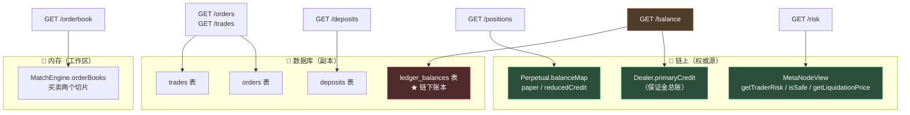
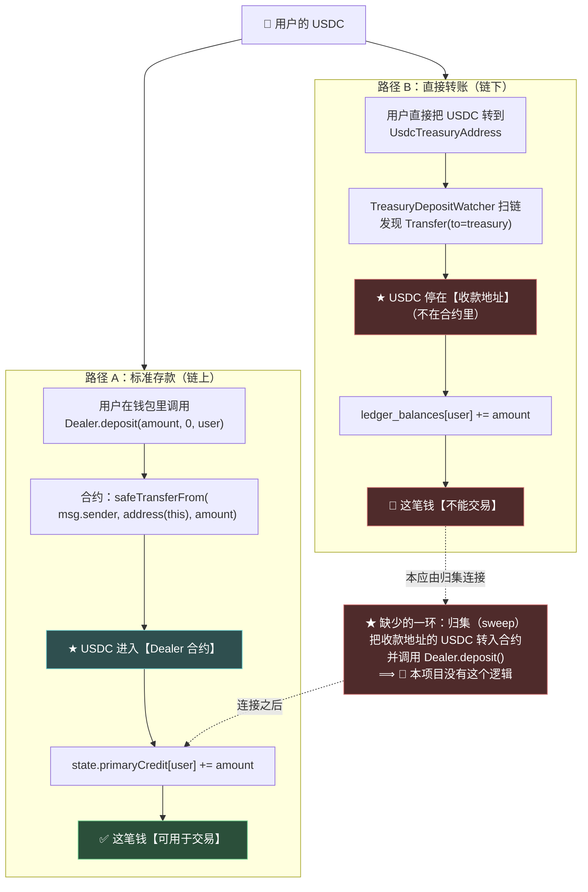
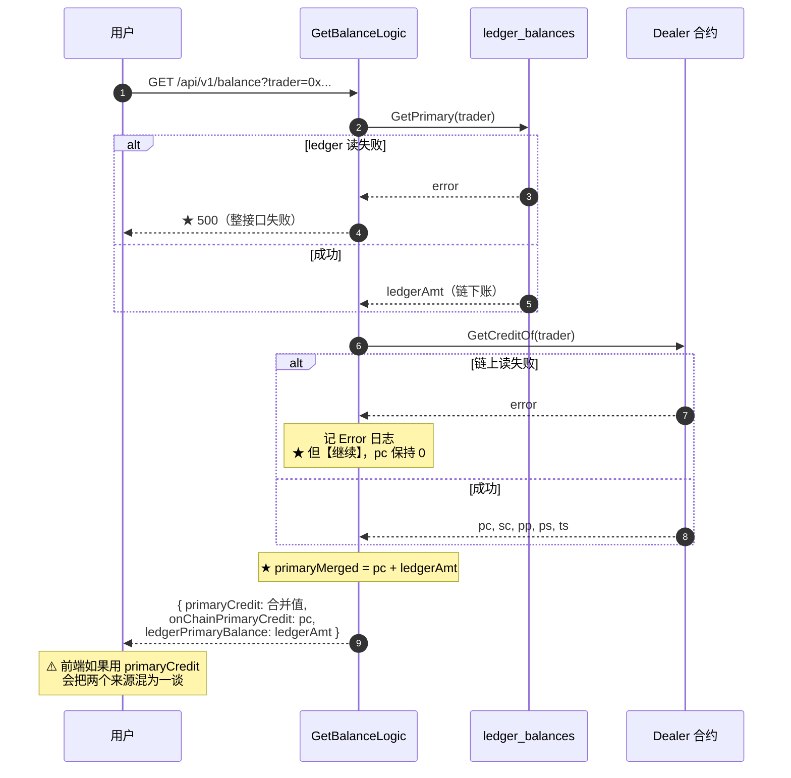

# 第 19 章：查询接口 — 直接读链 vs 读库，以及链上/链下双账本现实

> 第 18 章讲完了"数据怎么存"。本章讲"数据怎么查"——**这是用户唯一能直接看到的那一层。**
>
> 这一章会做两件事：
>
> 1. **把 15 个查询接口的取数来源盘一遍**，你会看到本项目对"数据从哪来"这个问题有三种不同的答案，而它们背后的判断标准是一致的（而且是对的）。
> 2. **面对本项目最根本的一个架构现实**：**链上和链下有两本账。** 而经过追查我发现——**这两本账不仅来源不同，而且**从来没有被连通过**；而余额接口把它们**相加**了。**
>
> 这个问题的后果是具体的：**用户看到余额增加，但尝试交易时会失败**。而它背后还有一个更值得留意的事实——**用户的 USDC 被转到了一个"收款地址"，而把那些钱变成可用于交易的保证金，需要一个本项目没有实现的动作。**

---

## 1. 本章导读

### 1.1 15 个查询接口的取数来源盘点

**先把全部查询接口的数据来源列清楚（实测，用 grep 判断每个 logic 文件访问了哪些依赖）：**

| # | 接口 | 取数来源 | 说明 |
| --- | --- | --- | --- |
| 1 | `GET /positions` | 🔗 **链** + ⚙️ 配置 | `GetPositions` / `BalanceOf` / `GetMarkPrice` / `GetLiquidationPrice` |
| 2 | `GET /risk` | 🔗 **链** | `GetTraderRisk` / `IsSafe` |
| 3 | `GET /balance` | 🔗 **链 + 💾 库** | ★ **两本账相加** |
| 4 | `GET /orders/:id` | 💾 库 | `OrderModel.FindOne` |
| 5 | `GET /orders` | 💾 库 | `OrderModel.FindByTrader` |
| 6 | `GET /trades` | 💾 库 | `TradeModel.FindByTrader` |
| 7 | `GET /deposits` | 💾 库 | `DepositModel.FindByTrader` |
| 8 | `GET /markets` | ⚙️ 配置 + 🔗 链 + 📡 Coinbase | 静态信息来自配置，价格来自链，指数价来自缓存 |
| 9 | `GET /markets/:addr` | ⚙️ 配置 + 🔗 链 | 同上（不含 Coinbase 分支） |
| 10 | `GET /ticker` | 🔗 **链** | `ChainTickers` → `GetMarkPrice` |
| 11 | `GET /orderbook` | 🧠 **内存订单簿** | `OrderBook.SnapshotOrderBook` |
| 12 | `GET /klines` | ★ **未实现** | 空壳 |
| 13 | `GET /funding-rates` | ★ **未实现** | 空壳 |
| 14 | `GET /liquidations` | ★ **未实现** | 空壳 |
| 15 | `GET /withdraws` | ★ **未实现** | 空壳 |

**🔑 四类数据源，各自对应一个"数据的新鲜度和权威性"：**

```text
🔗 链上（5 个接口）        → ★ 最权威，实时，但受 RPC 可用性影响
💾 数据库（4 个接口）      → ⚠️ 是副本，可能滞后（第 11、16 章的发现）
🧠 内存订单簿（1 个）      → ★ 最实时，但重启即丢（第 12 章）
⚙️ 配置（3 个接口用到）    → ✅ 静态，不会错（但可能过期）
```

### 1.2 "能读链就读链"——一条贯穿项目的取数原则

**把这 11 个已实现的接口按数据源分类，能看出一条清晰的规律：**

```text
✅ 读到【链上状态】的接口，一律直接读链：
   · 仓位      → BalanceOf(perp, trader)
   · 风险      → GetTraderRisk(trader) / IsSafe(trader)
   · 余额      → GetCreditOf(trader)
   · 行情      → GetMarkPrice(perp)
   · 深度      → ★ 例外：读内存订单簿（因为链上没有订单簿，第 1 章 1.2）

✅ 读到【链下记录】的接口，一律读库：
   · 订单      → orders 表
   · 成交      → trades 表
   · 充值      → deposits 表
   · 深度      → 内存订单簿
```

**🔑 这个划分的依据是**"这个数据在链上存在吗"**：**

| 数据 | 链上有吗 | 所以从哪读 |
| --- | --- | --- |
| 用户的仓位（paper/credit） | ✅ 有（`Perpetual.balanceMap`） | 🔗 **读链** |
| 用户的风险指标 | ✅ 有（`MetaNodeView` 现算） | 🔗 **读链** |
| 订单簿深度 | ❌ **没有**（链上不撮合，第 1 章 1.2） | 🧠 **内存** |
| 历史订单 | ⚠️ 只有事件，没有"当前状态" | 💾 库 |
| 历史成交 | ⚠️ 只有事件 | 💾 库 |
| 充值记录 | ⚠️ 只有 Transfer 事件，"谁充的"是链下推断的（第 16 章） | 💾 库 |

**🔑 一条可以带走的判断：**

> **"能读链就读链"是一条**正确的默认策略** —— 但它的适用条件是"这个数据在链上有权威版本"。**
> ```text
> ✅ 链上有 → 读链（免受"副本滞后"影响）
> ★ 链上没有 → 只能读库/内存（并且要意识到它是【副本】）
> ```
>
> **⚠️ 而本项目的例外（订单簿读内存）恰好说明了一条更根本的原则：**
> ```text
> 读"权威源"（链）和读"副本"（库/内存）的【代价不同】：
>   · 读链：慢（RPC 往返）、可能失败
>   · 读副本：快、但可能滞后
> ⟹ ★ 所以真正的判断是："这个数据【滞后的代价】有多大？"
>    · 仓位滞后 → 用户可能基于错误信息下单 → ★ 代价大 → 读链
>    · 深度滞后几百毫秒 → 无伤大雅 → ★ 代价小 → 读内存
> ```

### 1.3 本章的核心问题：两本账相加

**先看这段代码（`internal/logic/account/getbalancelogic.go` 的核心）：**

```go
// ① 读链下的 ledger 余额
ledgerAmt, lerr := l.svcCtx.LedgerBalanceModel.GetPrimary(l.ctx, req.Trader)
if lerr != nil {
	return &types.GetBalanceResp{Code: 500, Message: lerr.Error()}, nil
}

pc := big.NewInt(0)
// ...

// ② 读链上的 credit
if l.svcCtx.Chain != nil {
	var cerr error
	pc, sc, pp, ps, ts, cerr = l.svcCtx.Chain.GetCreditOf(l.ctx, common.HexToAddress(req.Trader))
	if cerr != nil {
		// RPC/链上读失败时仍返回链下 ledger 余额，避免整接口 500
		l.Errorf("GetCreditOf %s: %v", req.Trader, cerr)
	}
}

// ③ ★ 把两者相加
primaryMerged := new(big.Int).Add(pc, ledgerAmt)

return &types.GetBalanceResp{
	Code: 0, Message: "ok",
	Balance: types.AccountBalance{
		Trader:                   req.Trader,
		PrimaryCredit:            primaryMerged.String(),   // ★ 相加后的值
		OnChainPrimaryCredit:     pc.String(),              // ✅ 分列出来了
		LedgerPrimaryBalance:     ledgerAmt.String(),       // ✅ 分列出来了
		// ...
	},
}, nil
```

**🔑 代码本身写得是**清楚的**——它把两个来源分别列出来了（`OnChainPrimaryCredit` 和 `LedgerPrimaryBalance`）。** 但主字段 `PrimaryCredit` 是**两者之和**。

**⚠️ 而这个"和"有一个严重的问题：这两笔钱**性质完全不同**。**

```text
链上的 credit（pc）
  · 来源：用户调用 Dealer.deposit() 把 USDC 存进合约
  · ★ 性质：可用于交易（它是合约承认的保证金）
  · 位置：USDC 在 Dealer 合约里

链下的 ledger（ledgerAmt）
  · 来源：用户把 USDC 转到收款地址，后端扫链记录（第 16 章）
  · ★ 性质：不可用于交易（合约完全不知道）
  · 位置：USDC 在收款地址 UsdcTreasuryAddress 里（不在合约里）
```

**⟹ 相加之后的 `PrimaryCredit`**混合了"能用的钱"和"不能用的钱"**。**

**⚠️ 而后果是具体的：**

```text
① 用户往收款地址转 1000 USDC
② 后端扫到 → ledger_balances += 1000
③ 用户查余额 → PrimaryCredit 显示 1000（看起来"到账了"）
④ 用户尝试下单 → ★ 链上保证金是 0 → 订单永远不成交（第 9 章的失败模式）
```

**🔑 这就是本章的核心发现。** 而它背后还有一个更深的问题：**那 1000 USDC 现在在收款地址里 —— 而"把它变成合约里的保证金"需要一个动作，而那个动作本项目没有实现。**（3.(7) 会展开。）

---

## 2. 架构 / 流程图

### 2.1 三类数据源的分工



**⚠️ 图中红色和橙色的部分就是本章的问题所在：**

```text
· 🔴 ledger_balances 是一本【链下账】
· ⚠️ 而 /balance 同时读了链上的 credit 和这本链下账，然后【相加】
⟹ ★ 两个不同性质的量被加在了一起
```

### 2.2 【核心】两条资金路径——为什么会有两本账



**🔑 这张图是本章的核心。它揭示了三个层次的问题：**

**层次一：两条路径的资金**物理位置不同**。**

```text
路径 A：USDC 在 Dealer 合约里 → ✅ 合约可以用它结算（清算、交易）
路径 B：USDC 在 UsdcTreasuryAddress 里 → ⚠️ 合约完全看不到它
```

**层次二：路径 B 记了账，但账和钱**没有对应关系**。**

```text
· ledger_balances 说"用户有 1000 USDC"
· 但这 1000 USDC 在收款地址里，而不在合约里
· ★ 而 ledger_balances 只是一个数字 —— 它不代表任何【可提取】的东西
```

**层次三：连接两者的动作（归集）缺失。**

```text
要把路径 B 的钱变成可交易的保证金，需要：
  ① 收款地址的私钥持有者调用 <br/>
     USDC.transfer(Dealer 地址, 金额)          ← 把钱转进合约
  ② 然后调用 Dealer.deposit(金额, 0, 用户地址)  ← 给用户记账
  
⟹ ★ 而本项目【没有任何代码做这两步】
   ⟹ ★★ 所以 ledger_balances 是一本"悬空的账"
```

**⚠️ 注意第 ① 步需要**收款地址的私钥**。**

```text
问题：UsdcTreasuryAddress 的私钥在谁手里？
  · 配置里只有一个地址（0x149F...），没有对应的私钥
  · 而后端的 PrivateKey 是另一个地址（用于发交易）
  ⟹ ★ 从代码和配置里，看不出这个收款地址的私钥归谁管
  ⟹ ⟹ ⚠️ 如果没有人持有它，那些 USDC 就【永远无法动用】
```

**🔑 这是一个必须向项目方确认的问题** —— **它不是代码能回答的。**

### 2.3 余额接口的完整数据流



**🔑 这张图里有三处值得注意的不对称：**

**不对称一：两个数据源的**失败处理**不同。**

```go
// ① ledger 读失败 → ★ 返回 500（整接口失败）
ledgerAmt, lerr := l.svcCtx.LedgerBalanceModel.GetPrimary(l.ctx, req.Trader)
if lerr != nil {
	return &types.GetBalanceResp{Code: 500, Message: lerr.Error()}, nil
}

// ② 链上读失败 → ★ 只记日志，继续（pc 保持 0）
if cerr != nil {
	l.Errorf("GetCreditOf %s: %v", req.Trader, cerr)
}
```

**⚠️ 这个不对称的后果：**

```text
· ledger 读不到 → ★ 整接口 500（用户什么都看不到）
· 链上读不到   → ⚠️ 返回"链上部分是 0"的余额（★ 用户看到余额变少了）
```

**🔑 第二种更危险** —— **它把"读不到"伪装成了"余额是 0"。** **而第 3 章 2.3 讨论过的"静默谎言"就是这个模式。**

**⚠️ 但公平地说，这个选择**是有理由的**（注释写了）：**

```go
// RPC/链上读失败时仍返回链下 ledger 余额，避免整接口 500
```

**🔑 作者的意图是"别让链上故障拖垮整个接口"。这个意图是好的 —— 但**实现方式**有问题：**

```text
✅ 好的做法：返回一个明确的"部分数据"标记（比如 degraded: true，或者 onChainUnavailable: true）
🔴 当前做法：把缺失的部分当成 0（★ 无法与"真的是 0"区分）
```

**不对称二：`pc` 的类型和初始值。**

```go
pc := big.NewInt(0)     // ★ 先初始化成 0
// ...
if l.svcCtx.Chain != nil {
	pc, sc, pp, ps, ts, cerr = l.svcCtx.Chain.GetCreditOf(...)   // ★ 覆盖
}
```

**⟹ 所以"`Chain == nil`"和"链上读失败"都会导致 `pc = 0`** —— **两种不同的情况，同一个表现。**

**不对称三：`Chain == nil` 的降级与第 3 章 2.3 的降级矩阵一致。**

（第 3 章分析过：这个接口在链不可用时会返回链下余额，属于"勉强可接受"的降级。）

### 2.4 风险接口的口径问题

**看 `GET /risk` 返回的 `marginRatio`（`getriskinfologic.go`）：**

```go
nv, exp, _, maint, err := l.svcCtx.Chain.GetTraderRisk(l.ctx, trader)
if err != nil {
	return &types.GetRiskInfoResp{Code: 500, Message: err.Error()}, nil
}
safe, _ := l.svcCtx.Chain.IsSafe(l.ctx, trader)      // ⚠️ 错误被忽略
avail := new(big.Int).Sub(nv, maint)

ratio := "0"
if exp.Sign() > 0 && maint.Sign() > 0 {
	ratio = new(big.Int).Div(new(big.Int).Mul(nv, big.NewInt(1e18)), exp).String()
	//         ↑ ★ marginRatio = netValue / exposure
}
```

**⚠️ 而链上的安全判断是（`Liquidation._isMMSafe`）：**

```solidity
function _isMMSafe(Types.State storage state, address trader) internal view returns (bool) {
    (int256 netValue,,, uint256 maintenanceMargin) = getTotalExposure(state, trader);
    return netValue >= SafeCast.toInt256(maintenanceMargin);
    //     ↑ ★ 比较的是【净值】和【维持保证金】这两个绝对量
}
```

**🔑 把两者摆在一起：**

```text
链上判定：netValue >= maintenanceMargin
  ⟹ 而 maintenanceMargin = exposure × maintenanceMarginRatio（由风险参数决定）
  ⟹ 等价于：netValue / exposure >= maintenanceMarginRatio

链下返回：ratio = netValue / exposure          ← ★ 只是【左边】那一半

⟹ ★★ 链下返回了一个"比例"，但【没有返回它该和什么比较】
```

**🔴 后果：前端拿到 `marginRatio: "1500000000000000000"`（= 1.5）时，**无法判断这个值安不安全**** —— **因为它不知道阈值是多少。**

**⚠️ 而那个阈值（`maintenanceMarginRatio`）是可以通过 `getRiskParams(perp)` 从链上读到的**（第 17 章看到 `MetaNodeView` 有这个方法）—— **但本项目没有暴露它。**

**🔑 所以这个接口的正确用法是：**

```text
✅ 用 isSafe 字段判断安全性（它直接来自链上）
✅ 用 marginRatio 做展示（"你的保证金率是 150%"）
🔴 不要用 marginRatio 自己判断安全（因为缺阈值）
```

**⚠️ 而接口没有说明这一点** —— **它只是把两个字段都返回了，让使用者自己猜该用哪个。**

**🔑 一条可以带走的经验：**

> **返回一个"比例"时，必须同时提供"判定标准"—— 否则这个值是不可用的。**
> ```text
> ✗ 只给 marginRatio      → ★ 使用者不知道 1.5 是好还是坏
> ✓ 给 marginRatio + 阈值  → ✅ 使用者能自己判断
> ✓ 或者直接给判断结果（isSafe）→ ✅ 更省事
> ```
> **⚠️ 本项目**两个都给了**（`marginRatio` 和 `isSafe`）—— 但没说明"哪个才是判定依据"，所以仍然可能被误用。**

**🔑 顺带指出一处错误处理的不一致：**

```go
nv, exp, _, maint, err := l.svcCtx.Chain.GetTraderRisk(l.ctx, trader)
if err != nil {
	return &types.GetRiskInfoResp{Code: 500, Message: err.Error()}, nil    // ✅ 正确处理
}
safe, _ := l.svcCtx.Chain.IsSafe(l.ctx, trader)                             // ⚠️ 错误被忽略
```

**⚠️ `IsSafe` 失败时 `safe` 是零值 `false`** —— **⟹ 一次 RPC 抖动会显示"用户不安全"。**

**🔑 这个方向是"fail-safe"的（宁可说"不安全"也不说"安全"），但它仍然是**错误的信息** —— 而且**静默**。**

**⚠️ 而更麻烦的是：如果前端在 `isSafe == false` 时做某些危险操作（比如提示用户"你的仓位将被清算"），这个误报会造成真实的困扰。**

---

## 3. 核心代码拆解

### (1) 读链的接口模式

**以 `GetPositions` 为例（`getpositionslogic.go`）：**

```go
func (l *GetPositionsLogic) GetPositions(req *types.GetPositionsReq) (resp *types.GetPositionsResp, err error) {
	// ① 链不可用 → 直接返回空（第 3 章 2.3 的降级）
	if l.svcCtx.Chain == nil {
		return &types.GetPositionsResp{Code: 0, Message: "ok", Positions: nil}, nil
	}

	trader := common.HexToAddress(req.Trader)

	// ② 从链上拿"这个用户在哪些市场有仓位"（★ 跨市场聚合，只能问 Dealer）
	perps, err := l.svcCtx.Chain.GetPositions(l.ctx, trader)
	if err != nil {
		return &types.GetPositionsResp{Code: 500, Message: err.Error()}, nil
	}

	var out []types.Position
	for _, perp := range perps {
		// ③ 逐个市场拿仓位详情（★ 单市场状态，问那个 Perpetual）
		paper, credit, err := l.svcCtx.Chain.BalanceOf(l.ctx, perp, trader)
		if err != nil || paper.Sign() == 0 {
			continue                       // 没仓位或读失败 → 跳过
		}

		// ④ 补充展示用的派生数据
		mark, _ := l.svcCtx.Chain.GetMarkPrice(l.ctx, perp)
		liq, _ := l.svcCtx.Chain.GetLiquidationPrice(l.ctx, trader, perp)

		absP := new(big.Int).Abs(new(big.Int).Set(paper))
		ac := new(big.Int).Abs(credit)
		// 展示用近似开仓价：|credit|/|paper|（1e18 精度），与合约内 credit/paper 比一致。
		entryPrice := new(big.Int).Div(new(big.Int).Mul(ac, big.NewInt(1e18)), absP).String()

		// ⑤ 从配置里补市场名
		name := ""
		for _, m := range l.svcCtx.Config.Markets {
			if common.HexToAddress(m.Address) == perp {
				name = m.Name
				break
			}
		}

		out = append(out, types.Position{
			Trader:     req.Trader,
			Perp:       perp.Hex(),
			PerpName:   name,
			Paper:      paper.String(),
			Credit:     credit.String(),
			EntryPrice: entryPrice,
			MarkPrice:  mark.String(),
			LiqPrice:   liq.String(),
		})
	}
	return &types.GetPositionsResp{Code: 0, Message: "ok", Positions: out}, nil
}
```

**作者为什么这么设计（设计思想）：**

**✅ 设计点一：两次不同的链上调用——这个设计对应了第 13 章 1.2 讲的"读写分流规则"。**

```text
GetPositions(trader)            → ★ 跨市场聚合 → 问 Dealer
BalanceOf(perp, trader)         → ★ 单市场状态 → 问那个 Perpetual
```

**🔑 而且这个组合是**必要的**：**

```text
· Dealer 知道"用户在哪些市场有仓位"（state.openPositions）
· 但它【不知道】每个市场的具体仓位 —— 那在各自的 Perpetual 里
⟹ ★ 所以必须"先问 Dealer 有哪些，再逐个问 Perpetual"
```

**⚠️ 设计点二：`entryPrice` 是**算出来的**，不是链上读的。**

```go
// 展示用近似开仓价：|credit|/|paper|（1e18 精度），与合约内 credit/paper 比一致。
entryPrice := new(big.Int).Div(new(big.Int).Mul(ac, big.NewInt(1e18)), absP).String()
```

**🔑 注意注释里那句"与合约内 credit/paper 比一致"** —— **作者意识到了"链下算的必须和链上一致"这个问题**（第 8 章 3.(3) 讨论 `calculatePrice` 时也是同一个公式）。

**⚠️ 但它**真的是开仓价吗？** —— **不一定。** 因为：**

```text
· credit 包含了【资金费率的累计调整】（第 14 章：credit = paper × fundingRate + reducedCredit）
· 所以 |credit|/|paper| 是"当前的平均持仓成本"，而不是"开仓时的价格"
· ★ 如果持有期间经历过多次资金费率结算，这个值会偏离真实开仓价
```

**🔑 而代码注释说的是"展示用近似开仓价"** —— **"近似"两个字是诚实的 ✓**

**⚠️ 但这引出一个更大的问题**（第 4 章 6.x 提过）：**`UnrealizedPnl` 和 `Leverage` 这两个字段**恒为空**。**

```go
out = append(out, types.Position{
	// ...
	// ★ UnrealizedPnl / Leverage / UpdateTime 都没填
})
```

**🔑 而它们本该是可以算的：**

```text
未实现盈亏 = credit + paper × markPrice / 1e18     （需要正确处理精度和符号）
杠杆倍数   = |paper| × markPrice / |credit|          （或者基于净值的算法）
```

**⚠️ 但第 2 章 4.3 讲过：链下自己算 PnL 有风险**（必须和链上的算法完全一致，否则链下显示的数字和用户实际能提取的对不上）。

**✅ 更稳妥的做法是从链上读** —— 而 `MetaNodeView` 里**有** `getTraderRisk`（返回 `netValue`，那是包含仓位价值的）✓ **项目只是没有把它用在这个接口上。**

### (2) 【核心】余额接口的两本账

**3.(1) 的 1.3 节已经给出了这段代码。这里做逐行拆解。**

```go
func (l *GetBalanceLogic) GetBalance(req *types.GetBalanceReq) (resp *types.GetBalanceResp, err error) {
	// ===== 第 ① 步：链下账（前置检查）=====
	if l.svcCtx.LedgerBalanceModel == nil {
		return &types.GetBalanceResp{Code: 503, Message: "database unavailable: configure Supabase.DataSource"}, nil
	}
	// ★ 这个 503 是【正确】的降级（第 3 章 2.3 表扬过：区分了"业务空"和"基础设施故障"）

	ledgerAmt, lerr := l.svcCtx.LedgerBalanceModel.GetPrimary(l.ctx, req.Trader)
	if lerr != nil {
		return &types.GetBalanceResp{Code: 500, Message: lerr.Error()}, nil
	}

	// ===== 第 ② 步：链上账 =====
	pc := big.NewInt(0)
	sc := big.NewInt(0)
	pp := big.NewInt(0)
	ps := big.NewInt(0)
	ts := big.NewInt(0)

	if l.svcCtx.Chain != nil {
		var cerr error
		pc, sc, pp, ps, ts, cerr = l.svcCtx.Chain.GetCreditOf(l.ctx, common.HexToAddress(req.Trader))
		if cerr != nil {
			// RPC/链上读失败时仍返回链下 ledger 余额，避免整接口 500
			l.Errorf("GetCreditOf %s: %v", req.Trader, cerr)
		}
	}

	// ===== 第 ③ 步：合并 =====
	primaryMerged := new(big.Int).Add(pc, ledgerAmt)

	return &types.GetBalanceResp{
		Code:    0,
		Message: "ok",
		Balance: types.AccountBalance{
			Trader:                   req.Trader,
			PrimaryCredit:            primaryMerged.String(),   // ★ 两个来源之和
			OnChainPrimaryCredit:     pc.String(),              // 链上部分
			LedgerPrimaryBalance:     ledgerAmt.String(),       // 链下部分
			SecondaryCredit:          sc.String(),
			PendingPrimaryWithdraw:   pp.String(),
			PendingSecondaryWithdraw: ps.String(),
			ExecutionTimestamp:       ts.Int64(),
		},
	}, nil
}
```

**作者为什么这么设计（设计思想）：**

**🔑 设计点一：把三个值都返回（合并值 + 两个分项）—— 这个设计**在信息上是完整的**✓**

```text
PrimaryCredit        = pc + ledgerAmt    ← 合并
OnChainPrimaryCredit = pc                ← 分项 1
LedgerPrimaryBalance = ledgerAmt         ← 分项 2
```

**✅ 所以一个**细心的前端**可以区分这两个来源。**

**⚠️ 但问题在于：主字段 `PrimaryCredit` 的**语义是模糊的**。**

```text
· 字段名 "PrimaryCredit" 直接借用了链上的术语（合约里 state.primaryCredit）
  ⟹ ★ 暗示"这是链上的保证金余额"
· 而它的值实际上是 pc + ledgerAmt
  ⟹ ★★ 名不副实
```

**🔑 而一个前端最自然的写法是：**

```javascript
const balance = resp.balance.primaryCredit;      // ★ 拿主字段
if (balance >= orderValue) { /* 允许下单 */ }     // ★ 基于它做判断
```

**⟹ 然后用户下单失败（因为链上保证金不足）。**

**🔴 设计点二：最根本的问题是"这两个量能不能相加"。**

```text
数学上：✅ 能（都是数字）
语义上：🔴 不能

类比：
  你有 100 元现金（钱包里）+ 100 元押金（房东那里）
  问"你有多少钱？"
    · 回答 200 是【误导】—— 押金你不能拿去花
    ✅ 正确回答："100 元可用 + 100 元押金（待退还）"
```

**🔑 注意这个类比里的对应关系：**

```text
现金 100 元           ←→  链上 credit（可以直接用来交易）
押金 100 元（房东处） ←→  链下 ledger（用户的钱，但在收款地址里，需要"归集"才能用）
```

**✅ 这个类比是准确的** —— **因为两者的共同点是"钱是你的，但你暂时不能直接用它做当前这件事"。**

**⚠️ 但有一点不同，值得说明：**

```text
押金：合同约定会退还 → 是【确定的】资产
链下 ledger：★ 取决于"收款地址的私钥是否有人管" → ⚠️ 可能是不确定的所有权
```

**⟹ 所以链下 ledger 比"押金"更不确定。**

### (3) 【关键】两条资金路径的完整对比

**这一节把 2.2 节的图落成代码层面的对照。**

**路径 A：`Dealer.deposit()`（链上，用户自己调）**

```solidity
// src/MetaNodeExternal.sol
function deposit(uint256 primaryAmount, uint256 secondaryAmount, address to) external nonReentrant {
    Funding.deposit(state, primaryAmount, secondaryAmount, to);
}
```

```solidity
// src/libraries/Funding.sol
function deposit(Types.State storage state, uint256 primaryAmount, uint256 secondaryAmount, address to) external {
    if (primaryAmount > 0) {
        // ★ 关键：钱从 msg.sender 转到【本合约】
        IERC20(state.primaryAsset).safeTransferFrom(msg.sender, address(this), primaryAmount);
        state.primaryCredit[to] += SafeCast.toInt256(primaryAmount);
    }
    // ...
    emit Deposit(to, msg.sender, primaryAmount, secondaryAmount);
}
```

**🔑 三个关键点：**

```text
① safeTransferFrom(msg.sender, address(this), ...)
   ⟹ ★ 钱进了【Dealer 合约】
② state.primaryCredit[to] += amount
   ⟹ ★ 合约承认了这笔保证金
③ emit Deposit(to, msg.sender, primaryAmount, secondaryAmount)
   ⟹ ★ 产生了一个链上事件（可用于索引，但本项目没监听它）
```

**路径 B：转账到收款地址（链下，后端扫链）**

```go
// internal/listener/treasurydepositwatcher.go → applyTransfer
traderLower := strings.ToLower(tr.From.Hex())
_, err = w.svc.DepositModel.Insert(ctx, &model.Deposit{
	TxHash:          txHex,
	LogIndex:        int64(tr.LogIndex),
	Trader:          traderLower,
	// ★ 注意 Trader 是【转出方】（tr.From），不是收款地址
	PrimaryAmount:   tr.Value.String(),
	// ...
})
// ...
if err := w.svc.LedgerBalanceModel.AddPrimary(ctx, traderLower, tr.Value); err != nil {
	return err
}
```

**🔑 三个关键点：**

```text
① 监听的是 Transfer(to = UsdcTreasuryAddress)（第 16 章 3.(4) 的 topic 过滤）
   ⟹ ★ 钱在【收款地址】，不在 Dealer 合约里
② Trader 取的是 tr.From（转出方）
   ⟹ ★ 这是"谁转的钱"的【链下推断】（链上无法区分）
③ ★ 完全没有调用 Dealer.deposit()
   ⟹ ★★ 所以链上的 primaryCredit 不会变
```

**🔴 把两条路径的差异列出来：**

| | 路径 A（deposit） | 路径 B（转账到收款地址） |
| --- | --- | --- |
| 谁发起 | 用户（调合约） | 用户（直接转账） |
| 钱去哪 | **Dealer 合约** | **收款地址** |
| 链上账 | `primaryCredit += amount` | ❌ **不变** |
| 链下账 | ❌ 不变 | `ledger_balances += amount` |
| 能否交易 | ✅ **能** | 🔴 **不能** |
| 有没有归集 | 不需要 | ★ **需要一个归集流程连接它** |

**🔑 而"归集"这个动作在本项目里的**具体内容**是：**

```text
需要有人（持有 UsdcTreasuryAddress 私钥的人）执行：
  ① USDC.transfer(Dealer 地址, 总额)              ← 把钱从收款地址转进合约
  ② 对每个用户：Dealer.deposit(金额, 0, 用户地址)   ← 记账到各自名下
  
  ⚠️ 而第 ② 步需要【逐个用户】调用 —— 
     或者，如果合约支持，用一个批量转账的方式
  ⚠️ 而且要注意：deposit 里的 safeTransferFrom 是从【msg.sender】扣钱
     ⟹ 所以调用者必须先把 USDC 转给自己，或者用授权的方式
```

**⚠️ 这是一个**运维流程**，不是一次性的代码 —— 它的实现方式取决于运营方的资金管理策略。**

**🔑 一条可以带走的判断：**

> **当系统里出现"两本账"时，必须能回答一个问题：**这两本账是怎么转换的？****
> ```text
> ✅ 有明确的转换流程（本项目的归集）→ 两本账是"同一个东西的两个阶段"
> 🔴 没有转换流程 → ★★ 其中一本账是"悬空的"（记了数，但不对应任何可用资产）
> ```
> **⚠️ 判断方法：**问"这本账上的钱，怎么变成那本账上的钱？"****
> ```text
> · 能答上来（有代码或运维流程）→ ✅
> · ★ 答不上来 → 🔴 那本账是虚的
> ```

### (4) 深度接口：唯一读"非链、非库"的接口

```go
func (l *GetOrderBookLogic) GetOrderBook(req *types.GetOrderBookReq) (resp *types.GetOrderBookResp, err error) {
	perp := strings.TrimSpace(req.Perp)
	if perp == "" {
		return &types.GetOrderBookResp{Code: 400, Message: "perp is required"}, nil
	}
	limit := req.Limit
	if limit <= 0 {
		limit = 20
	}
	if limit > 100 {
		limit = 100                                    // ✅ 有上限（第 4 章 6.3 提到 .api 里没有 validate）
	}

	var bids, asks []types.OrderBookEntry
	if l.svcCtx.OrderBook != nil {
		rawBids, rawAsks := l.svcCtx.OrderBook.SnapshotOrderBook(perp, limit)
		//                  ↑ ★ 读【内存订单簿】（第 8 章 3.(8)）
		bids = toOrderBookEntries(rawBids)
		asks = toOrderBookEntries(rawAsks)
	}
	// ★ 保证返回空数组而不是 null（前端友好）
	if bids == nil {
		bids = []types.OrderBookEntry{}
	}
	if asks == nil {
		asks = []types.OrderBookEntry{}
	}
	return &types.GetOrderBookResp{Code: 0, Message: "ok", Bids: bids, Asks: asks}, nil
}
```

**作者为什么这么设计（设计思想）：**

**✅ 设计点一：`limit` 的防护做得对（虽然 `.api` 里没有 `validate`）。**

```go
if limit <= 0 { limit = 20 }
if limit > 100 { limit = 100 }     // ★ 硬上限
```

**🔑 对比第 4 章 6.3 的发现**（`.api` 里 `GetKlinesReq.Limit` 没有上界）：**这个接口在 logic 里手动加了上限 ✓**

**⚠️ 但**它的兄弟接口 `GetKlines` 是空壳**，所以那个漏洞暂时不可达** —— **不过一旦实现，就得记得加上限。**

**⚠️ 设计点二：`nil` 切片被转成空数组。**

```go
if bids == nil {
	bids = []types.OrderBookEntry{}
}
```

**🔑 这是**前端友好**的做法：**

```text
· JSON 里 null 和 [] 是不同的
· 前端遍历 null 会报错（TypeError: Cannot read property 'map' of null）
· ★ 而 [] 是安全的
```

**✅ 这个细节做得很好** —— **但它**只在这一个接口里做了**。**

**⚠️ 对比：`GetPositions` 在链不可用时返回 `Positions: nil`** —— **那是 `null`。**

```go
if l.svcCtx.Chain == nil {
	return &types.GetPositionsResp{Code: 0, Message: "ok", Positions: nil}, nil    // ★ null
}
```

**🔑 项目里两种做法并存**（一处转空数组、一处返回 nil）—— **又是一处"同类问题不同处理"**（第 3 章 6.4、第 14 章 6.x、第 16 章 6.x 都出现过）。

### (5) 行情接口：一半字段是占位

```go
func ChainTickers(ctx context.Context, svc *svc.ServiceContext) []types.Ticker {
	if svc.Chain == nil {
		return nil
	}
	var out []types.Ticker
	for _, m := range svc.Config.Markets {
		perp := common.HexToAddress(m.Address)
		mp, err := svc.Chain.GetMarkPrice(ctx, perp)
		if err != nil {
			mp = big.NewInt(0)                          // ⚠️ 失败 → 0
		}
		fr, err := svc.Chain.GetFundingRate(ctx, perp)
		if err != nil {
			fr = big.NewInt(0)                          // ⚠️ 失败 → 0
		}
		out = append(out, types.Ticker{
			Perp:               m.Address,
			Price:              mp.String(),
			PriceChange:        "0",                    // 🔴 占位
			PriceChangePercent: "0",                    // 🔴 占位
			High24h:            mp.String(),            // 🔴 占位（= 当前价）
			Low24h:             mp.String(),            // 🔴 占位（= 当前价）
			Volume24h:          "0",                    // 🔴 占位
			UpdateTime:         time.Now().Unix(),
		})
		_ = fr // 如需下发可把 FundingRate 扩到 Ticker 类型
		//      ↑ ★★ 白拿了一次 RPC，然后丢掉
	}
	return out
}
```

**作者为什么这么设计（设计思想）：**

**🔴 发现一：`Ticker` 的 8 个字段里，**5 个是占位的**。**

```text
✅ 真实数据：Perp / Price / UpdateTime      （3 个）
🔴 占位数据：PriceChange / PriceChangePercent / High24h / Low24h / Volume24h  （5 个）
```

**⚠️ 而 `High24h` 和 `Low24h` 被填成了**当前价格** —— 这比填 `"0"` 更**误导**：**

```text
· 填 "0"     → 用户看到"24h 最高价 0" → 明显是坏的 ✓ 会被发现
· ★ 填当前价 → 用户看到"24h 最高 = 24h 最低 = 当前价"
             → ⚠️ 看起来像"这个市场 24 小时没波动"
             → ★★ 不会被发现
```

**🔑 这是第 4 章 6.x 那条"用 0 代替未知"的**升级版** —— "用**看起来合理的值**代替未知"更危险。**

**⚠️ 发现二：`_ = fr` 是一次**白白浪费的 RPC 调用**。**

```go
fr, err := svc.Chain.GetFundingRate(ctx, perp)      // ★ 一次 eth_call
if err != nil {
	fr = big.NewInt(0)
}
// ... 然后
_ = fr // 如需下发可把 FundingRate 扩到 Ticker 类型    ← ★ 结果被丢弃
```

**🔴 而代价是**每次调用都要多一次 RPC**：**

```text
· ChainTickers 被两处调用：
  ① GET /api/v1/ticker
  ② GET /api/v1/ws/ticker（★ 每 2 秒轮询一次，第 2 章 3.(10)）
  
⟹ 对 2 个市场：
   · /ws/ticker 每 2 秒 → 2 个市场 × 2 次调用（mark + funding）= 4 次 eth_call
   · ★ 其中一半（2 次）的结果被【直接丢弃】
```

**🔑 修法（一行）：删掉那两行。**

```go
// 直接删掉，需要时再加
// fr, err := svc.Chain.GetFundingRate(ctx, perp)
// if err != nil { fr = big.NewInt(0) }
// _ = fr
```

**⚠️ 而作者的注释说明他知道这一点**（"如需下发可把 FundingRate 扩到 Ticker 类型"）—— **但"先取着备用"这个想法在这里的代价是**每次请求多一次 RPC**。**

**🔑 一条可以带走的经验：**

> **"先取着备用"在链上场景里是**有成本的** —— 每一次 eth_call 都是一次 RPC 往返。**
> ```text
> ✅ 需要时再加 → 零成本
> 🔴 先取着    → ★ 每次请求都多一次 RPC（而且是永久性的）
> ```
> **⚠️ 判断方法：**问"这个值现在有人用吗？"—— 没有就删掉。****

### (6) 各接口的降级方式对比

**把已实现接口的"链不可用时怎么办"汇总，能看到项目里有**五种不同的策略**：**

| 接口 | `Chain == nil` 时 | 链调用失败时 |
| --- | --- | --- |
| `GET /positions` | 返回空数组 | **500**（`GetPositions` 失败时） |
| `GET /risk` | 返回全零（`Code: 0`） | **500**（`GetTraderRisk` 失败时）；`IsSafe` 失败**忽略** |
| `GET /balance` | 链上部分为 0，链下照常 | 链上失败**只记日志**，继续返回 |
| `GET /markets` | 价格字段留空 | 价格**留空**（`if err == nil` 才填） |
| `GET /ticker` | 返回 `nil` | **价格变成 `"0"`**（`mp = big.NewInt(0)`） |
| `GET /orderbook` | 与链无关（读内存） | — |

**🔑 五种策略的对比（第 3 章 2.3 的降级矩阵在这里得到了细化）：**

```text
✅ 最正确：GET /balance 的 db 分支 —— 返回 503（明确说"依赖不可用"）
⚠️ 可接受：GET /markets —— 价格字段留空（前端能看出"没数据"）
🔴 危险：  GET /risk —— 返回 code:0 + 全零（伪装成"风险为 0"）
🔴 危险：  GET /ticker —— 价格变成 "0"（伪装成"价格是 0"）
🔴 危险：  GET /balance 的链上部分 —— 变成 0（伪装成"链上余额是 0"）
```

**🔑 一条可以带走的判断（第 3 章 2.3 那条的强化版）：**

> **"降级时返回什么"这个问题的答案，决定了这个接口是否可信。**
> ```text
> ✅ 明确失败（500/503）     → ★ 调用方知道"没拿到"
> ⚠️ 空数据（""/null/[]）   → 调用方能看出"没数据"
> 🔴 伪装成合法值（0/"0"）   → ★★ 调用方以为"数据就是 0"
> ```
> **⚠️ 而第三种（伪装）在本项目里出现了三次，每次的后果都是"用户看到错误的数字"。**

---

## 4. Web3 特有机制

### 4.1 为什么"能读链就读链"是对的

**4.1 节的盘点显示：5 个接口直接读链，4 个读库。这个划分背后的判断标准值得完整说清楚。**

**🔑 核心判断：这个数据的"权威版本"在哪？**

```text
✅ 链上有权威版本（仓位、风险、余额）
  ⟹ ★ 读链
  ⟹ 理由：链上的值【不会被本地故障影响】
     · 数据库可能滞后（第 11 章的"陈旧 filled_amount"）
     · 内存可能丢失（重启）
     · ★ 而链上的 balanceMap 永远是当前的真相

⚠️ 链上只有"事件"没有"当前状态"（历史订单、成交）
  ⟹ 读库
  ⟹ 理由：链上没有"订单表"这种东西，要重建历史必须靠索引
     · 而且链上查询是 O(1) 单点读，做不了分页/排序/聚合（第 1 章 1.4）

❌ 链上完全没有（订单簿深度）
  ⟹ 读内存
  ⟹ 理由：链上不撮合（第 1 章 1.2），订单簿只存在于链下
```

**🔑 而这个策略的代价，在前面的章节里已经见过了：**

```text
· ★ 可用性：读链的接口依赖 RPC 的可用性（第 3 章的降级矩阵）
· ★ 性能：每次查询一次 RPC 往返（几十到几百毫秒）
· ⚠️ 而且 /ws/ticker 每 2 秒轮询一次链 —— 对公共 RPC 是压力（3.(5)）
```

**🔑 一条可以带走的判断：**

> **"能读链就读链"的价值在于**消除"副本滞后"这一整类问题** —— 而它的代价是"引入 RPC 可用性这一整类问题"。**
> ```text
> 读链   → ✅ 数据永远新  🔴 依赖外部服务
> 读副本 → ✅ 快、可控    🔴 可能滞后
> ```
> **⚠️ 所以真正的判断标准是**"滞后和不可用，哪个的代价更大"**：**
> ```text
> · 仓位/余额滞后 → ★ 用户基于错误信息下单 → 代价大 → 读链
> · 行情快照滞后几百毫秒 → 无伤大雅 → 可以缓存
> ```
> **🔑 而本项目**两种都用了**：仓位读链、Coinbase 行情缓存（第 15 章）—— **这个划分是合理的 ✓

### 4.2 链上/链下双账本的必然后果

**这是本章最重要的一节。它讨论的**不是本项目的具体缺陷**，而是"链下记账"这个模式的固有性质。**

**🔑 当一个系统在链下记账（`ledger_balances`）时，它必然面临三个问题：**

**问题一：链下账和链上账**没有必要相等**。**

```text
· 链上账（primaryCredit）：由链上事件驱动（deposit / trade / liquidate）
· 链下账（ledger_balances）：由【链下进程】驱动（扫链入账）
  ⟹ ★ 两个驱动源不同 ⟹ 两本账会独立演化
  ⟹ ★★ 而没有任何机制保证它们同步
```

**⚠️ 而本项目的做法是**把它们相加展示** —— **这等于**默认**了两本账是"同一个东西的两个部分"**（2.3 节的类比：现金 + 押金）。**而这个默认**在本项目里不成立**（因为没有归集流程）。

**问题二：链下账的**兑现路径**必须存在。**

```text
· 链下账说"用户有 1000 USDC"
  ⟹ ★ 用户会期待"我能用这 1000 USDC"
  ⟹ 而兑现的方式只能是：
     ① 归集到链上（调用 deposit）→ 用户能在链上交易
     ② 或者：链下提现（从收款地址转回给用户）
  
⟹ ★★ 本项目两条路【都没有实现】
```

**问题三：谁持有那笔钱？**

```text
· 链上 credit：钱在 Dealer 合约里，由合约的代码控制 → ✅ 规则明确
· 链下 ledger：钱在 UsdcTreasuryAddress 里
  ⟹ ★ 由【该地址的私钥】控制
  ⟹ ⚠️ 而配置里只有一个地址，没有私钥
  ⟹ ⟹ ★★ 所以"这笔钱能不能动"取决于一个代码之外的事实
```

**🔑 三个问题合起来，指向一个结论：**

> **链下记账本身不是问题 —— 问题是**它必须配一条"兑现路径"，而且那条路径的所有权必须明确**。**
> ```text
> ✅ 完整的形态：
>    用户转账 → 链下记账 → ★ 归集到链上 → 用户可交易
>                    ↑
>              这条路径存在、且有人负责
>
> 🔴 本项目的形态：
>    用户转账 → 链下记账 → ★ 到此为止
> ```

**🔑 一条可以带走的判断（这是本章最通用的一条）：**

> **在设计"链下账本"时，必须同时回答三个问题：**
> ```text
> ① 这本账的【资金来源】是什么？（本项目：用户转到收款地址的 USDC）
> ② 它的【兑现路径】是什么？（★ 本项目：没有）
> ③ 兑现所需的【权限在谁手里】？（★ 本项目：不明）
> ```
> **⚠️ 而这三个问题里，② 和 ③ 最容易被漏掉** —— **因为"记账"这个动作本身看起来是完整的（有钱、有数、有记录）。**
> ```text
> ★ 而"记账完成"和"用户能用到这笔钱"之间，隔着一个【必须有人做的动作】。
> ```

### 4.3 展示层与真相层的界限

**最后一节讲一个概念性的区分，它贯穿了本指南的很多发现。**

**🔑 本项目的接口可以分成两类：**

```text
① 🔗 真相层的透传：
   · GET /positions → 链上的 balanceMap
   · GET /risk      → 链上的 getTraderRisk / isSafe
   ⟹ ★ 这类接口的值【就是链上的值】（可能有格式转换，但没有引入新信息）

② ⚠️ 展示层的加工：
   · GET /balance 的 PrimaryCredit → ★ 链上 + 链下的和
   · GET /positions 的 EntryPrice  → ★ 链下算的近似值
   · GET /ticker 的 High24h/Low24h → ★ 占位值
   ⟹ ★ 这类接口的值【是链下产生的】，可能与链上不一致
```

**🔑 而这个区分为什么重要？**

```text
· 真相层的值：可以用作【决策依据】
  → 用户看到"我安全" → 可以相信（因为它就是链上的判断）

· ★ 展示层的值：只能用作【参考】
  → 用户看到"我余额 1500" → ⚠️ 不能据此判断"我能下 1500 的单"
```

**⚠️ 而问题在于：**接口没有标明哪些字段属于哪一类。****

```go
type AccountBalance struct {
	PrimaryCredit            string `json:"primaryCredit"`            // ★ 加工过的（链上+链下）
	OnChainPrimaryCredit     string `json:"onChainPrimaryCredit"`     // 🔗 真相层
	LedgerPrimaryBalance     string `json:"ledgerPrimaryBalance"`     // ⚠️ 链下账
	SecondaryCredit          string `json:"secondaryCredit"`          // 🔗 真相层
	// ...
}
```

**🔑 而**字段名**提供了一点线索：**

```text
· "OnChain..." 前缀 → 明确说了是链上的 ✓
· ★ 但 "PrimaryCredit"（无前缀）→ 没说它是加工过的
  ⟹ 使用者会以为它和 SecondaryCredit 是同一类（都是链上值）
  ⟹ ★★ 而实际上一个加工过、一个没有
```

**🔑 一条可以带走的经验：**

> **在"链上 + 链下"混合的系统里，接口字段应该**标明它的来源**。**
> ```text
> ✅ 好：onChainPrimaryCredit / ledgerPrimaryBalance / spotPrice（来源明确）
> 🔴 差：primaryCredit（★ 加工过的，但名字看起来像原始值）
> ```
> **⚠️ 判断方法：**看到一个数值字段时，问"它是**直接读来的**，还是**加工出来的**？"****
> ```text
> · 直接读来的 → 可以当决策依据
> · ★ 加工出来的 → 只能当参考（而且要知道加工规则）
> ```
> **🔑 而更稳妥的做法是：**如果一个字段是加工值，就不要给它一个"看起来像原始值"的名字。****
> ```text
> · 本项目：PrimaryCredit（加工值）vs OnChainPrimaryCredit（原始值）
>   ⟹ ★ 名字的对比反而暗示"PrimaryCredit 是主、OnChain 是补充"
>   ⟹ ⟹ 而这个暗示是【反的】—— 真正能做决策依据的是后者
> ```

---

## 5. 本章小结与思考题

### 5.1 核心知识点回顾

| 知识点 | 一句话总结 |
| --- | --- |
| **15 个查询接口的取数来源** | 🔗 链上 5 个 / 💾 库 4 个 / 🧠 内存 1 个 / ⚙️ 配置 3 个 / ★ 未实现 4 个 |
| **取数来源的判断标准** | **这个数据在链上有权威版本吗？** 有 → 读链；只有事件 → 读库；完全没有 → 读内存 |
| **"能读链就读链"的取舍** | ✅ 消除"副本滞后"；🔴 引入"RPC 不可用" |
| **真正的判断标准** | **"滞后和不可用，哪个的代价更大"**（仓位滞后代价大 → 读链；行情快照可缓存） |
| **读链的正确姿势** | 跨市场聚合问 `Dealer`；单市场状态问那个 `Perpetual`（第 13 章 1.2 的分流规则） |
| **🔴 两条资金路径** | A：`Dealer.deposit()` → 钱进合约 → **可交易**；B：转账到收款地址 → 钱在收款地址 → **不可交易** |
| **🔴 两本账相加** | `PrimaryCredit = 链上 credit + 链下 ledger` —— **语义上不能相加** |
| **🔴 缺少"归集"环节** | 把收款地址的 USDC 转进合约并 `deposit()` —— **本项目没有这个逻辑** |
| **🔴 收款地址的私钥归属不明** | 配置里只有地址，且与后端发交易的私钥不同 ⟹ **那笔钱能否动用取决于代码外的事实** |
| **降级的五种策略** | ✅ 503（最正确）/ ⚠️ 留空 / 🔴 伪装成 0（出现了三次） |
| **`marginRatio` 缺判定阈值** | 返回了"比例"但没给"该和什么比较" ⟹ **前端无法据此判断安全** |
| **`IsSafe` 的错误被忽略** | `safe, _ := ...` ⟹ RPC 故障会显示成"用户不安全" |
| **`Ticker` 一半字段是占位** | `High24h`/`Low24h` 被填成**当前价**（比填 0 更误导） |
| **`_ = fr` 浪费 RPC** | 取了资金费率然后丢弃 ⟹ `/ws/ticker` 每 2 秒多一次无用调用 |
| **`null` vs `[]` 不一致** | `/orderbook` 转空数组 ✓；`/positions` 返回 `nil` |
| **"真相层"与"展示层"的界限** | 接口没标明哪些字段是**直接读的**、哪些是**加工出来的** |

### 5.2 思考题

#### 思考题 1：`GET /api/v1/balance` 返回的 `PrimaryCredit` 是"链上 credit + 链下 ledger"的和。请回答：（a）这个加法在什么前提下是**正确的**？（b）本项目满足那个前提吗？（c）如果不满足，正确的接口设计应该是什么？

<details>
<summary>点击查看参考答案</summary>

**（a）加法正确的前提**

**两个量能相加，要求它们是**同一种东西的两个部分**。**

```text
✅ 可以相加的例子：
   · 工资收入 + 奖金收入 = 总收入（都是"钱"，而且在同一个口径上）
   · 现货余额 + 合约余额 = 总资产（都是"能用来交易的保证金"）

🔴 不能相加的例子：
   · 钱包里的现金 + 房东那儿的押金
     ⟹ ★ 都是"你的钱"，但【可用性不同】
```

**🔑 所以加法正确的前提是三条：**

```text
前提 ①：两个量【语义相同】（都是"可用于交易的保证金"）
前提 ②：两个量【口径相同】（同样的精度、同样的资产、同样的计算方式）
前提 ③：★ 两个量之间【有明确的转换路径】（能互相变成对方）
```

**🔑 第三条最容易漏，但它才是关键。**

```text
为什么？因为"相加"这个动作隐含了一个承诺：
  ⟹ ★ "这个和，就是你能用的钱"

而这个承诺要成立，必须：
  · 链下那部分能【变成】链上那部分（或者至少：用户能把它取出来）
  ⟹ ★★ 否则"和"就是一个虚数
```

**（b）本项目满足吗**

**逐条检查：**

| 前提 | 本项目 | 说明 |
| --- | --- | --- |
| ① 语义相同 | ❌ **不满足** | 链上 credit 可用于交易；链下 ledger **不能** |
| ② 口径相同 | ✅ 满足 | 都是 USDC，都是 1e6 精度（第 16 章：`tr.Value` 直接用于 `AddPrimary`） |
| ③ 转换路径存在 | ❌ **不满足** | ★ **没有任何归集逻辑** |

**🔑 所以三条里满足一条。**

**⚠️ 而前提 ① 和 ③ 是关联的：**

```text
· 因为【没有转换路径】（③ 不满足）
· 所以链下 ledger 永远【不能变成】可交易的保证金
· ⟹ 所以它们的【语义永远不同】（① 不满足）

⟹ ★ 反过来说：如果实现了归集，① 就自动满足了
   （因为链下 ledger 会变成链上 credit）
```

**🔑 所以问题可以归结为一句话：**本项目缺的是"归集"这一步，而它的缺失让"相加"变成了一个误导性的展示。****

**（c）正确的接口设计**

**方案一（最小改动）：不合并，只分列。**

```go
// 去掉 PrimaryCredit 这个合并字段，只保留分列
type AccountBalance struct {
	Trader string `json:"trader"`
	// ★ 不再有 PrimaryCredit（合并值）
	OnChainCredit      string `json:"onChainCredit"`      // 可用于交易的保证金
	PendingDeposit     string `json:"pendingDeposit"`     // ⚠️ 已收到但未入金的（命名要说清状态）
	SecondaryCredit    string `json:"secondaryCredit"`
	// ...
}
```

**🔑 关键改进是**命名**：**

```text
· "OnChainCredit" → ✅ 明确说"这是链上的"
· ★ "PendingDeposit"（而不是 "LedgerPrimaryBalance"）
  ⟹ 明确说"这是【待处理】的存款"
  ⟹ ★★ 让使用者知道它【不能用】
```

**方案二（更好）：引入明确的"可用/待处理"二分。**

```go
type AccountBalance struct {
	Trader string `json:"trader"`

	// ==== 可用于交易 ====
	AvailableCredit string `json:"availableCredit"`   // ★ 就是链上 credit，改名说明用途

	// ==== 已收到但不可用 ====
	PendingDeposit  string `json:"pendingDeposit"`    // 链下 ledger（待归集）
	PendingReason   string `json:"pendingReason"`     // ★ 比如 "awaiting on-chain credit"

	SecondaryCredit string `json:"secondaryCredit"`
	// ...
}
```

**🔑 `PendingReason` 这个字段是本题的关键改进：**

```text
· 它回答了用户最可能问的问题："为什么我的余额显示 1000，但下不了单？"
· ★ 而没有它，用户只能自己猜
```

**方案三（最彻底）：让"可用余额"有唯一的定义。**

```text
★ 原则：接口返回的"可用余额"，应该【只有一个来源】—— 链上。

理由：
  · 链上是唯一能真正"花"的钱
  · 任何链下的数字都只是"在途状态"
  · ⟹ ★ 把它们混在一个字段里，就是在制造歧义

具体做法：
  · availableCredit  ← 链上 credit（唯一可用于交易的）
  · pendingDeposits  ← 链下 ledger（明确标注为"待处理"）
  · ★ 并且不提供"总额"字段（因为总额没有业务含义）
```

**🔑 三个方案的对比：**

| 方案 | 改动量 | 解决的问题 |
| --- | --- | --- |
| 一（分列 + 改名） | 小 | ✅ 让使用者能区分 |
| **二（+ PendingReason）** | 中 | ✅ 还回答了"为什么不能用" |
| 三（可用余额唯一来源） | 中 | ✅ 从根上消除歧义 |

**🎯 本题的核心结论：**

> **第一，关于"相加"这个动作：**
> ```text
> ★ 两个数能相加，不只是"类型匹配"，还要【语义匹配 + 有转换路径】
> ```
> **⚠️ 而代码里 `big.Int.Add` 对任何两个数都成功 —— 它**不会告诉你**这两个数不能相加。**
> ```text
> 编译器、类型系统、静态分析都帮不上忙
> ⟹ ★ 只有"理解业务语义的人"能发现
> ```
>
> **第二，关于"多本账"的通用判断（这一条最实用）：**
>
> **只要系统里有两本账，就必须能画出"账 A → 账 B"的转换图。**
> ```text
> ✅ 能画出来（有代码或运维流程）→ 两本账是"同一资产的不同阶段"
> 🔴 画不出来 → ★★ 其中一本是虚的
> ```
> **🔑 而判断方法很简单：**问"这本账上的 1 块钱，怎么变成那本账上的 1 块钱？"****
> ```text
> · 能具体说出步骤 → ✅
> · ★ 答不上来 → 🔴 那本账代表的东西【不可兑现】
> ```
>
> **第三，关于"展示层"的责任：**
> ```text
> 接口是【展示层】，但它展示的数字会被用户当成【事实】来用。
> ⟹ ★ 所以"准确地展示"比"友好地展示"更重要
> ```
> **⚠️ 本项目在这里的选择是"友好"（给一个合并后的总额，用户看着高兴）——**
> **而这个友好是**有代价的**：用户会基于它做决策，然后失败。**

</details>

#### 思考题 2：用户的 USDC 转到了 `UsdcTreasuryAddress`，后端记录了 `ledger_balances`，但这些钱**不能用于交易**（它们在收款地址里，不在 Dealer 合约里）。请回答：（a）"让这些钱变得可用"需要哪些步骤？（b）为什么说这是一个"运维流程"而不是"一次代码改动"？（c）如果不做这件事，会有什么后果？

<details>
<summary>点击查看参考答案</summary>

**（a）让这些钱变得可用需要哪些步骤**

**目标：让链上的 `primaryCredit[user]` 增加，同时保证金额正确。**

**第 1 步：把 USDC 从收款地址转进 Dealer 合约。**

```
需要：持有 UsdcTreasuryAddress 私钥的人签名一笔交易
调用：USDC.transfer(DealerAddress, amount)
```

**⚠️ 但这里有一个细节问题：**

```solidity
// Funding.deposit 里的转账方向
IERC20(state.primaryAsset).safeTransferFrom(msg.sender, address(this), primaryAmount);
//                                                    ↑ ★ 从 msg.sender 扣钱
```

**🔑 `deposit()` 是从**调用者自己**扣钱 —— 所以不能"用收款地址的钱给别人充值"。**

**⟹ 所以有两种可能的实现方式：**

```text
方式 A：收款地址自己调用 deposit
  · 收款地址必须【就是】deposit 的调用者
  · 但它要给别人充值（to = 用户）—— 这本身是支持的（to 是参数）✓
  ⟹ ✅ 可行：收款地址直接调 Dealer.deposit(amount, 0, userAddress)
     （钱从收款地址扣，credit 记给用户）
  ⟹ ★ 所以其实【不需要】单独做 transfer —— 一步 deposit 就够了

方式 B：先把钱转到某个"运营地址"，再由它 deposit
  ⟹ ⚠️ 多一次转账（多一次 gas）
  ⟹ ✅ 但可能更符合某些资金管理策略（比如冷热钱包分离）
```

**🔑 所以最简的路径其实是**方式 A 一步到位**：**

```text
收款地址 → Dealer.deposit(金额, 0, 用户地址)
⟹ 钱进合约 ✓  用户 credit 增加 ✓
```

**⚠️ 但要注意：`deposit` 是 `nonReentrant` 的，而且一个一个用户调 = 一次一笔交易。**

```text
如果一天有 100 个用户充值：
  · 需要 100 笔交易（每笔都要 gas）
  ⟹ ★ 所以可能需要"批量归集"的合约支持
  ⟹ ⚠️ 而 Dealer.deposit 是单用户的 —— 没有批量版本
```

**第 2 步：更新链下账（或者清掉它）。**

```text
钱归集到链上之后，链下 ledger 应该：
  · 要么清零（因为钱已经变成链上 credit 了）
  · 要么标记为"已归集"
  
⟹ ★★ 否则会出现【双重计算】：
   链上 credit 有 1000（归集后）+ 链下 ledger 还有 1000（没清）
   ⟹ 接口显示 2000 —— ★ 虚高了 1000
```

**🔑 所以归集是一个**两本账同时更新**的操作 —— 而它必须原子（或者至少有明确的中间状态）。**

**（b）为什么是运维流程而不是一次代码改动**

**🔑 三个理由：**

**理由一：需要**私钥**，而私钥不该在服务进程里。**

```text
· UsdcTreasuryAddress 的私钥如果放在后端进程里
  ⟹ ★ 服务被攻破 = 所有用户的充值款被盗
  ⟹ ★★ 而本项目的配置里【已经】有一个私钥（Ethereum.PrivateKey）
     那个是用于发交易的（第 1 章 4.6 讨论过它的风险）
  ⟹ ⚠️ 再加上收款地址的私钥 = 风险翻倍

✅ 更稳妥的做法：收款地址是【多签钱包】或【冷钱包】
   ⟹ 归集需要人工审批 + 多方签名
   ⟹ ★ 这【必然】是一个运维流程
```

**理由二：涉及**真金白银**，不能全自动化。**

```text
· 自动归集的前提是"链下账完全可信"
· ★ 而第 16 章发现了链下账的 bug（两步写入非原子）
  ⟹ 如果基于一个有 bug 的账去自动转账
  ⟹ ★★ 可能把不属于某个用户的钱记到他名下
```

**理由三：需要**批量/聚合**的经济性考量。**

```text
· 每笔归集都是一次链上交易（gas）
· ★ 如果用户充值 1 USDC 而 gas 要 2 USDC → 归集是亏的
⟹ ★ 所以需要"攒够一定金额再归集"的策略
⟹ 而这需要人的判断（阈值多少？多久归集一次？）
```

**🔑 所以完整的形态应该是"**运维流程 + 辅助工具**"：**

```text
① 一个【查询工具】：列出待归集的记录（谁、多少、哪笔交易）
   ⟹ ★ 这可以是后端的一个内部接口（需要额外的鉴权）
② 一个【构造交易的脚本】：生成归集所需的交易（未签名）
③ 人工/多签审批后广播
④ 一个【标记已归集】的操作（更新链下账）
```

**⚠️ 而本项目连第 ① 步都没有** —— **`ledger_balances` 是一堆数字，没有"待归集"这个状态。**

**（c）不做这件事的后果**

**逐条列出：**

**后果一：用户的钱**实际上被冻结**了（从用户视角）。**

```text
· 用户转了 1000 USDC → 显示"到账"
· 想下单 → 链上保证金 0 → ★ 订单永远不成交
· 想提现 → 没有提现接口（第 4 章 6.x：ListWithdraws 是空壳）
⟹ ★★ 用户的钱进了一个"只进不出"的地址
```

**后果二：`GET /balance` 显示错误的数字（2.3 节）。**

```text
用户看到余额 1000，以为是可用的
⟹ ★ 基于这个数字做决策 → 失败
```

**后果三（最严重）：那些钱的所有权不明确。**

```text
· 钱在 UsdcTreasuryAddress 里
· 控制它的是【那个地址的私钥】
· ⚠️ 而配置里只有地址，没有私钥
⟹ ★★ 如果没有人持有那个私钥，那笔钱【永远拿不出来】
   ⟹ 这不是"暂时不可用"，而是"永久锁死"
```

**⚠️ 而这个后果有一个**法律/合规**的维度：**

```text
· 用户把 USDC 转给你 → 他认为是"充值"
· 如果这笔钱永远拿不出来 → ★ 这在实质上构成了"资金损失"
· ★★ 而它甚至不是"被盗"，而是"没有人能证明自己能动用它"
```

**🔑 所以我必须强调：**这是一个需要向项目方确认的**前置问题**，而不是一个可以慢慢修的技术债。****

**🎯 本题的核心结论：**

> **第一，关于"充值"这个动作的完整定义：**
> ```text
> ★ "用户转账" ≠ "充值完成"
>
> 完整的充值 = 转账 + 记账 + ★ 归集（把钱变成可用的保证金）
> ⟹ ★★ 本项目实现了前两步，第三步完全没有
> ```
> **⚠️ 而前两步的"完成感"会掩盖第三步的缺失** —— **因为用户看到"余额到账了"，会以为充值成功了。**
>
> **第二，关于"运维流程"和"代码"的边界（这一条最通用）：**
>
> **有些功能**天然不适合放在服务进程里** —— 尤其是"能动用用户资金"的那些。**
> ```text
> ✅ 适合代码自动化：查询、计算、记账（只读或只写本地数据）
> 🔴 不适合：动用私钥转账（★ 一旦进程被攻破，损失是全部资金）
> ```
> **🔑 判断方法：**问"如果这段代码被攻击者完全控制，他能造成什么损失？"****
> ```text
> · 能导致数据错误 → ⚠️ 可接受（能修复）
> · ★ 能把钱转走 → 🔴 必须用多签/冷钱包/人工审批
> ```
>
> **第三，关于"前置问题"的识别（这一条对你自己的项目也有用）：**
>
> **在实现任何功能之前，先确认"它依赖的东西是否真的可用"。**
> ```text
> 本项目的例子：
>   · 有人想实现 GetKlines → ★ 但 klines 表不存在（第 18 章）
>   · 有人想实现提现 → ★ 但收款地址的私钥归属不明
>   · 有人想实现清算 → ★ 但持仓索引不存在（第 17 章）
>
> ⟹ ★★ 三个"想做的功能"，卡住它们的都不是"代码难写"，而是【前置条件不成立】
> ```
> **🔑 而发现前置问题的方法很简单：**对每个待实现的功能，先问"它的输入从哪来？那些输入现在存在吗？"

</details>

---

## 6. 踩坑提示

### 🔴 严重：`PrimaryCredit` 把"可交易的"和"不可交易的"相加，余额虚高

```go
// getbalancelogic.go
primaryMerged := new(big.Int).Add(pc, ledgerAmt)
//                               ↑ 链上 credit   ↑ 链下 ledger
// ...
PrimaryCredit: primaryMerged.String(),       // ★ 合并值
OnChainPrimaryCredit: pc.String(),           // 分项（链上）
LedgerPrimaryBalance: ledgerAmt.String(),    // 分项（链下）
```

**🔴 而这两个量的性质完全不同（2.2 节）：**

| | 链上 credit | 链下 ledger |
| --- | --- | --- |
| 钱在哪 | **Dealer 合约** | **收款地址** |
| 能否交易 | ✅ 能 | 🔴 **不能** |
| 怎么来的 | `Dealer.deposit()` | 转账到收款地址 + 扫链 |

**⚠️ 后果：**

```text
① 用户往收款地址转 1000 USDC
② 后端扫到 → ledger_balances += 1000
③ 用户查余额 → PrimaryCredit 显示 1000（"到账了"）
④ 用户下单 → ★ 链上保证金是 0 → 订单永远不成交
```

**修法（思考题 1 给了三个方案）：**

```go
// ★ 推荐：不合并 + 命名说清状态
type AccountBalance struct {
	AvailableCredit string `json:"availableCredit"`   // = 链上 credit
	PendingDeposit  string `json:"pendingDeposit"`    // = 链下 ledger，明确"待处理"
	PendingReason   string `json:"pendingReason"`     // ★ "awaiting on-chain credit"
	// ★ 不提供"总额"字段（总额没有业务含义）
}
```

**🎯 这条坑的通用教训：**

> **两个数能相加，不只是"类型匹配"，还要【语义匹配 + 有转换路径】。**
> ```text
> ⚠️ 而 `big.Int.Add` 对任何两个数都成功 —— 它【不会告诉你】这两个数不能相加
> ⟹ ★ 编译器、类型系统、静态分析都帮不上忙
> ```
> **🔑 判断方法（对任何"多来源求和"的接口）：**问"这两笔钱怎么互相转换？"****
> ```text
> · 能画出转换路径 → ✅ 可以相加
> · ★ 画不出来 → 🔴 那个和是一个虚数
> ```

### 🔴 严重：缺少"归集"环节，且收款地址的私钥归属不明

**两条资金路径从未连通（2.2 节）：**

```text
路径 A：Dealer.deposit() → 钱进合约 → ✅ 可交易
路径 B：转账到收款地址 → 扫链记账 → 🔴 钱在收款地址，不可交易

★ 连接两者需要：收款地址调用 Dealer.deposit(金额, 0, 用户)
⟹ 🔴 本项目【没有这个逻辑】
```

**⚠️ 而更值得注意的是资金的所有权：**

```text
· 钱在 UsdcTreasuryAddress（配置里的一个地址）
· 控制它的是【那个地址的私钥】
· ★ 而配置里只有地址，且与 Ethereum.PrivateKey（发交易用的）是【不同的地址】
⟹ ★★ 所以"这笔钱能不能动"取决于一个【代码之外的事实】
   ⟹ 如果没有人持有那个私钥 → 那笔钱【永久锁死】
```

**修法（思考题 2 给了完整方案）：**

```text
① 确认收款地址的私钥归属（★ 这是前置问题，不是技术问题）
② 实现"待归集"的状态（链下账上标记哪些已归集）
③ 提供一个查询工具：列出待归集的记录
④ 归集本身做成【运维流程】（多签/冷钱包 + 人工审批），而不是进程内的自动操作
```

**🎯 这条坑的通用教训：**

> **"用户转账" ≠ "充值完成"。**
> ```text
> 完整的充值 = 转账 + 记账 + ★ 归集（把钱变成可用的保证金）
> ⟹ ★★ 本项目实现了前两步，第三步完全没有
> ```
> **⚠️ 而前两步的"完成感"会掩盖第三步的缺失** —— **因为用户看到"余额到账了"，会以为充值成功了。**
>
> **🔑 更重要的是那条资金安全原则：**
> ```text
> ★ 能动用用户资金的代码，不应该放在服务进程里
>   ⟹ 一旦进程被攻破，损失是【全部资金】
>   ⟹ ✅ 正确做法：多签 / 冷钱包 / 人工审批
> ```

### 🟠 中等：`IsSafe` 的错误被忽略，RPC 故障会显示"用户不安全"

```go
safe, _ := l.svcCtx.Chain.IsSafe(l.ctx, trader)
//    ↑ ★ 错误被丢弃 ⟹ 失败时 safe 是零值 false
```

**⚠️ 后果：一次 RPC 抖动 → `isSafe: false` → 用户看到"我的仓位要被清算了"。**

**🔑 而同一个函数里，上一行的错误**被正确处理了**：**

```go
nv, exp, _, maint, err := l.svcCtx.Chain.GetTraderRisk(l.ctx, trader)
if err != nil {
	return &types.GetRiskInfoResp{Code: 500, Message: err.Error()}, nil     // ✅
}
safe, _ := l.svcCtx.Chain.IsSafe(l.ctx, trader)                              // ⚠️
```

**⟹ 同一个函数里两种错误处理 —— 这是本指南反复见到的模式**（第 3 章 6.4、第 14 章 6.x、第 16 章 6.x）。

**修法：**

```go
safe, err := l.svcCtx.Chain.IsSafe(l.ctx, trader)
if err != nil {
	return &types.GetRiskInfoResp{Code: 500, Message: err.Error()}, nil
}
```

**🎯 这条坑的通用教训：**

> **`x, _ := ...` 的形式，对于返回 `bool` 的函数特别危险** —— **因为 `false` 是一个"看起来合理"的值。**
> ```text
> · 返回 error 的函数 → 忽略错误时得到 nil → 后续会 panic（★ 至少能发现）
> · ★ 返回 bool 的函数  → 忽略错误时得到 false → 【看起来完全正常】
> ```
> **🔑 判断方法：**看到 `x, _ := f()` 时，问"如果 f 失败了，x 会是什么？那个值会导致什么？"****

### 🟠 中等：`marginRatio` 返回了比例但没有判定阈值

```go
// getriskinfologic.go
ratio = new(big.Int).Div(new(big.Int).Mul(nv, big.NewInt(1e18)), exp).String()
//      ↑ ★ netValue / exposure
```

```solidity
// 链上的判定（Liquidation._isMMSafe）
return netValue >= SafeCast.toInt256(maintenanceMargin);
//     ↑ ★ 比较的是"净值"和"维持保证金"两个绝对量
```

**🔴 链下返回的是"比值的左半边"，但没有返回"它该和什么比较"。**

```text
前端拿到 marginRatio = 1.5
  ⟹ ★ 无法判断：1.5 是安全还是危险？
  ⟹ 因为它不知道 maintenanceMarginRatio 是多少
```

**⚠️ 而那个阈值是**可以**读到的（`MetaNodeView.getRiskParams(perp)` 返回 `RiskParams`，里面有 `maintenanceMarginRatio`）—— **但本项目没有暴露它。

**修法：**

```text
方向 A：同时返回阈值
  MarginRatio: "1500000000000000000",
  MaintenanceMarginRatio: "50000000000000000",     // ★ 让前端能自己比
  IsSafe: false,

方向 B：★ 明确文档化"用 isSafe 判断，marginRatio 仅用于展示"
  ⟹ 在 .api 的字段注释里写清楚
```

**🎯 这条坑的通用教训：**

> **返回一个"比例"时，必须同时提供"判定标准"—— 否则这个值是不可用的。**
> ```text
> ✗ 只给比例       → ★ 使用者不知道 1.5 是好还是坏
> ✓ 比例 + 阈值    → ✅ 使用者能自己判断
> ✓ 或者直接给结论 → ✅ 更省事（但丧失了展示的灵活性）
> ```
> **⚠️ 而本项目**两个都给了**（`marginRatio` 和 `isSafe`），但没说明哪个是判定依据** —— **所以仍然可能被误用。**

### 🟠 中等：`Ticker` 的 `High24h` / `Low24h` 被填成当前价（比填 0 更误导）

```go
out = append(out, types.Ticker{
	Perp:               m.Address,
	Price:              mp.String(),
	PriceChange:        "0",              // 🔴 占位
	PriceChangePercent: "0",              // 🔴 占位
	High24h:            mp.String(),      // 🔴 ★ 占位（= 当前价）
	Low24h:             mp.String(),      // 🔴 ★ 占位（= 当前价）
	Volume24h:          "0",              // 🔴 占位
	// ...
})
```

**🔴 为什么填"当前价"比填 `"0"` 更危险：**

```text
· 填 "0"     → 用户看到"24h 最高价 0" → ★ 明显是坏的 ✓ 会被发现
· ★ 填当前价 → 用户看到"24h 最高 = 24h 最低 = 当前价"
             → ⚠️ 看起来像"这个市场 24 小时没波动"
             → ★★ 不会被发现
```

**🔑 这是第 4 章 6.x 那条"用 0 代替未知"的**升级版** —— "用**看起来合理的值**代替未知"。**

**修法：**

```text
方向 A：返回空字符串（明确表示"没有数据"）
  High24h: "", Low24h: "", Volume24h: "", PriceChange: ""

方向 B：★ 如果这些字段确实不打算实现 → 从 .api 里删掉它们
  ⟹ 让接口诚实（第 4 章 6.x 讨论过同样的做法）
```

**🎯 这条坑的通用教训：**

> **"占位值"的危险程度，取决于它**看起来多合理**。**
> ```text
> ✅ 明显是坏的（"0"、""）→ 会被发现 → 危害小
> ★ 看起来合理的（= 当前价、= 0 的百分比）→ ★★ 不会被发现 → 危害大
> ```

### 🟠 中等：`_ = fr` 白拿一次 RPC 然后丢弃

```go
fr, err := svc.Chain.GetFundingRate(ctx, perp)      // ★ 一次 eth_call
if err != nil {
	fr = big.NewInt(0)
}
// ... 然后
_ = fr // 如需下发可把 FundingRate 扩到 Ticker 类型    ← ★ 结果被丢弃
```

**🔴 而 `/ws/ticker` **每 2 秒**就调用一次 `ChainTickers`**（第 2 章 3.(10)）：

```text
对 2 个市场：
  · 每次调用 = 2 个市场 × 2 次 eth_call（mark + funding）= 4 次
  · ★ 其中 2 次（funding）的结果被【直接丢弃】
  · 每 2 秒一轮 ⟹ ★ 每天约 86,400 次无用 RPC
```

**修法（删掉那两行）：**

```go
// ★ 直接删掉 —— 需要时再加
```

**🎯 这条坑的通用教训：**

> **"先取着备用"在链上场景里是**有成本的**。**
> ```text
> ✅ 需要时再加 → 零成本
> 🔴 先取着    → ★ 每次请求都多一次 RPC（而且是永久性的）
> ```
> **🔑 判断方法：**问"这个值现在有人用吗？"—— 没有就删掉。****

### 🟡 轻微：`null` 与 `[]` 的处理不一致

```go
// getorderbooklogic.go —— ✅ 转成空数组
if bids == nil {
	bids = []types.OrderBookEntry{}
}
```

```go
// getpositionslogic.go —— ⚠️ 返回 nil（JSON 里是 null）
if l.svcCtx.Chain == nil {
	return &types.GetPositionsResp{Code: 0, Message: "ok", Positions: nil}, nil
}
```

**⚠️ 前端遍历 `null` 会报错（`TypeError: Cannot read property 'map' of null`），遍历 `[]` 是安全的。**

**修法：统一转空数组。**

**🎯 这条坑的通用教训：**

> **API 返回的数组字段，应该永远是数组（哪怕是空的），而不是 `null`。**
> ```text
> ✅ "orders": []   → 前端安全
> 🔴 "orders": null → ★ 前端需要额外判空（而很多人会忘记）
> ```

### 📌 本章的定位：查询层是"链上与链下"的接缝处

**把本章的发现放在本指南的大图景里：**

| 层次 | 问题 | 章节 |
| --- | --- | --- |
| **写入层** | 撮合失败、上链重试、写库静默失败 | 第 9~11 章 |
| **存储层** | 表不存在、两套实现、迁移不完整 | 第 18 章 |
| **★ 查询层** | **两本账相加、缺少归集、降级伪装成 0** | **本章** |

**🔑 而查询层的特殊性在于：**它是用户唯一能看见的那一层**。**

```text
· 写入层的问题 → 表现为"订单没成交"（用户能感觉到异常）
· 存储层的问题 → 表现为"接口报错"（用户能看到失败）
· ★ 查询层的问题 → 表现为"数字不对"（★ 而用户【看不出来】）
```

**🔑 一条可以带走的经验：**

> **在一个"链上 + 链下"的系统里，查询层是两边的接缝 —— 而接缝处最容易出现"看起来合理但语义错误"的数据。**
> ```text
> ✅ 安全的设计原则：
>   ① 每个返回的数值字段，都应该能回答"它的来源是唯一的吗？"
>   ② ★ 如果来自多个来源，就必须标明各自是什么
>   ③ 永远不要"合并"语义不同的量 —— 哪怕它们的类型相同
> ```

---

> **下一章预告**：第 20 章是本指南的最后一章，也是一次**全局复盘**。
>
> 那一章会做四件事：**① 把全项目的 `TODO` 与占位实现汇总成一张清单**（前面 19 章散落发现的，全部集中起来）；**② 评估项目实际的完成度与可运行边界**（哪些能跑、哪些是空壳）；**③ 把这套代码里值得迁移到其他项目的工程模式提炼出来**（约定式代码生成、接口打破循环依赖、链上链下一致性策略、降级设计）；**④ 诚实地回答一个问题——这个项目教了什么，以及作为一个"学习样本"它最大的价值在哪里。**
