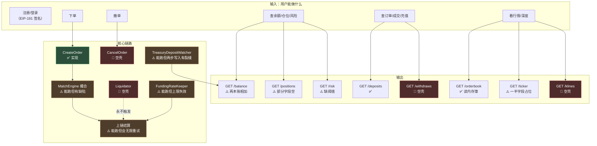

# 第 20 章：现状盘点 — 哪些能跑、哪些是占位、这套代码教了什么

> 这是本指南的最后一章。前 19 章我们逐层拆解了这个项目——从"为什么需要后端"，到代码地图、启动装配、请求入口、一笔订单的完整一生、链交互、后台服务、数据与接口。
>
> **而在拆解的过程中，我们发现了 60 多处真实的问题。** 这一章要做的，是把散落在各章的发现**收敛成三样东西**：
>
> 1. **一张完整的"占位与未完成清单"** —— 让你清楚知道"哪些能跑、哪些不能"
> 2. **一套可迁移的工程模式** —— 这个项目里**做对了的**那些设计（它们比问题更有价值）
> 3. **一个诚实的评价** —— 这套代码作为一个"学习样本"，它的价值到底在哪里
>
> 这一章不会有太多新代码，但它可能是全书**最需要你认真读**的一章——因为它回答的是"读完这 4 万字，我到底得到了什么"。

---

## 1. 本章导读

### 1.1 一次全局复盘要回答的四个问题

```text
① 哪些能跑？      → 端到端可用的功能清单
② 哪些是占位？    → TODO / 空壳 / 假实现的完整清单
③ 这套代码教了什么？ → 可迁移的工程模式（★ 这一条最重要）
④ 如果我要用它，优先修什么？ → 按"代价 × 概率"排序的修复清单
```

**⚠️ 而第 ④ 个问题有一个前提，必须先说清楚：**

```text
这个项目【不是一个可以直接上生产的系统】。
  · 0 个测试文件
  · 17 个接口里 5 个是空壳
  · 三个 keeper 里一个完全没实现
  · 5 张表在数据库里不存在
  · 60+ 处已确认的缺陷

⟹ ★ 所以"优先修什么"这个问题的真实含义是：
   "如果你要从它这里学东西并自己搭一个，哪些坑【必须先避开】"
```

### 1.2 先把数字摆出来

**代码规模（实测）：**

```text
internal/chain/       5 文件    832 行   ← 链交互层
internal/config/      2 文件    188 行
internal/db/          1 文件    215 行
internal/engine/      3 文件    968 行   ← 撮合 + 资金费 + 清算
internal/handler/    20 文件    769 行
internal/listener/    2 文件    541 行
internal/logic/      21 文件  1,235 行
internal/model/       7 文件  1,308 行
internal/repo/        1 文件     44 行
internal/svc/         1 文件    148 行
internal/types/       1 文件    413 行
metanode.go           —          97 行
metanode.api          —         532 行
─────────────────────────────────────
合计                          6,786 行

测试文件：0 个
```

**接口完成度（实测）：**

```text
.api 声明路由：  17 条
空壳 logic：      5 个（cancelorder / getklines / listwithdraws / 
                       listfundingrates / listliquidations）
实际实现：       12 个
⟹ ★ 实现率 71%
```

**⚠️ 但"实现率 71%"这个数字是**乐观的** —— 因为"实现了"不等于"能工作"：**

```text
· 12 个已实现的接口里：
  · ListMarkets 有 6/12 个字段恒为空（第 4 章）
  · GetRiskInfo 的 marginRatio 缺判定阈值（第 19 章）
  · GetTicker 有 5/8 个字段是占位（第 19 章）
  · GetPositions 的 UnrealizedPnl / Leverage 恒为空
  ⟹ ★ 所以"能返回 200" ≠ "接口可用"
```

---

## 2. 架构 / 流程图

### 2.1 项目的实际可运行边界

**这张图回答"哪些能跑"。绿色是端到端可用的，黄色是"能跑但结果可能不准"，红色是"完全不能跑"。**



**🔑 读图要点：**

```text
✅ 完全可用的（2 个）：下单入口、充值的扫链入账（部分）
⚠️ 能跑但有缺陷的（6 个）：撮合、上链、资金费率、余额/仓位/风险查询、深度、行情
🔴 完全不能用的（4 个）：撤单、清算、K线、提现记录
```

**⚠️ 而最值得注意的是**那条从 `Liquidator` 到清算的虚线**：**

```text
C5（Liquidator）→ C3（上链结算）
  ⟹ ★ 这条线【从来不存在】—— 清算机器人是空壳，它不会触发任何链上调用
  ⟹ ★★ 所以"清算"这个功能在这张图上是【缺失的】，而不是"有缺陷的"
```

### 2.2 一条订单在代码里能"走多深"

**这个视角比"接口清单"更能说明完成度——它追踪**一条数据在系统里能走多远**。**

```mermaid
%%{init: {'flowchart': {'wrappingWidth': 1000}}}%%
flowchart LR
    S1["① 用户签名<br/>✅ 前端/钱包"]
    S2["② POST /orders<br/>✅ HTTP 入口"]
    S3["③ EIP-712 验签<br/>✅ chain 包"]
    S4["④ orderId = digest<br/>✅ 与链上一致"]
    S5["⑤ 入库<br/>✅ orders 表"]
    S6["⑥ 入内存订单簿<br/>✅ MatchEngine"]
    S7["⑦ 撮合<br/>✅ 但时间优先失效"]
    S8["⑧ tradeData 编码<br/>✅ ABI 正确"]
    S9["⑨ 上链<br/>⚠️ 会无限重试"]
    S10["⑩ 链上结算<br/>✅ 合约完整"]
    S11["⑪ 写库<br/>⚠️ 可能静默失败"]
    S12["⑫ 重启恢复<br/>⚠️ 信任可能不准的 DB"]
    S13["⑬ 用户撤单<br/>🔴 空壳"]
    S14["⑭ 清算保护<br/>🔴 不存在"]

    S1 --> S2 --> S3 --> S4 --> S5 --> S6 --> S7 --> S8 --> S9 --> S10 --> S11 --> S12
    S12 -.-> S13
    S14 -.->|"用户穿仓时"| S10

    style S1 fill:#2b4f3a,stroke:#70d090,color:#fff
    style S2 fill:#2b4f3a,stroke:#70d090,color:#fff
    style S3 fill:#2b4f3a,stroke:#70d090,color:#fff
    style S4 fill:#2b4f3a,stroke:#70d090,color:#fff
    style S5 fill:#2b4f3a,stroke:#70d090,color:#fff
    style S6 fill:#2b4f3a,stroke:#70d090,color:#fff
    style S8 fill:#2b4f3a,stroke:#70d090,color:#fff
    style S10 fill:#2b4f3a,stroke:#70d090,color:#fff
    style S7 fill:#4f3d2b,stroke:#d0a070,color:#fff
    style S9 fill:#4f3d2b,stroke:#d0a070,color:#fff
    style S11 fill:#4f3d2b,stroke:#d0a070,color:#fff
    style S12 fill:#4f3d2b,stroke:#d0a070,color:#fff
    style S13 fill:#4f2b2b,stroke:#d07070,color:#fff
    style S14 fill:#4f2b2b,stroke:#d07070,color:#fff
```



**🔑 这张图揭示了一个重要的事实：**

```text
★ "下单 → 撮合 → 上链"这条【主链路是通的】（14 步里 8 步完全正确）
★★ 而两个关键缺口都在【主链路的旁边】：
   · 撤单（用户想取消时）
   · 清算（用户穿仓时）
```

**🔑 用一句话概括这个项目的状态：**

> **它走通了"正常路径"，但没有处理"异常路径"。**
> ```text
> ✅ 正常路径：下单 → 撮合 → 上链 → 用户成交
> 🔴 异常路径：
>    · 用户想撤单 → ★ 没有实现
>    · 用户穿仓 → ★ 没有清算
>    · 链上失败 → ⚠️ 无限重试（而不是优雅处理）
>    · 数据库抖动 → ⚠️ 静默不一致
> ```
> **⚠️ 而对一个交易系统来说，"异常路径"才是安全性的所在** —— **因为正常路径用户自己能看到结果，异常路径才需要系统兜底。**

### 2.3 完成度矩阵：按模块评估

| 模块 | 代码量 | 完成度 | 质量 | 备注 |
| --- | --- | --- | --- | --- |
| **`chain/client.go`** | 425 行 | ✅ **95%** | ✅ **好** | 手写 ABI 12/12 选择器验证正确（第 13 章） |
| **`chain/tradedata.go`** | 192 行 | ✅ **95%** | ⚠️ 中 | 编码正确，但缺 int128 范围检查（第 7 章） |
| **`chain/eip712.go`** | 105 行 | ✅ **100%** | ✅ **好** | 域、结构哈希、位打包全部正确 |
| **`engine/matchengine.go`** | 623 行 | ✅ **90%** | ⚠️ 中 | 主链路通；排序不稳定 + 缺自成交检查（第 8、9 章） |
| **`engine/fundingratekeeper.go`** | 189 行 | ✅ **85%** | 🔴 差 | 上限失效 + `mark=0` 会算出极端值（第 14 章） |
| **`engine/liquidator.go`** | 156 行 | 🔴 **10%** | 🔴 **空壳** | 三道防线全空（第 17 章） |
| **`listener/coinbasefeed.go`** | 287 行 | ✅ **85%** | ⚠️ 中 | 缺连接存活检测（第 15 章） |
| **`listener/treasurydepositwatcher.go`** | 254 行 | ✅ **85%** | ⚠️ 中 | 游标设计好；两步写入非原子（第 16 章） |
| **`logic/`** | 1,235 行 | ⚠️ **70%** | ⚠️ 中 | 12/17 实现；降级策略不统一（第 19 章） |
| **`model/`** | 1,308 行 | ⚠️ **70%** | 🔴 差 | 两套实现并存 + 4 个死构造函数（第 18 章） |
| **`db/migrate.go`** | 215 行 | 🔴 **60%** | ⚠️ 中 | 只建了 7/12 张表（第 18 章） |
| **`svc/servicecontext.go`** | 148 行 | ✅ **90%** | ✅ 好 | 三个小接口破解循环依赖（第 5 章） |
| **测试** | — | 🔴 **0%** | — | 零测试文件 |

**🔑 这张矩阵的结论：**

```text
✅ 做得好的：链交互层（chain 包 3 个文件）、依赖容器（svc）
  ⟹ ★ 这两个恰好是"技术性最强"的部分 —— 说明作者的强项在【链上交互】

🔴 最差的：liquidator（空壳）、model（两套实现）、db/migrate（表不全）、测试（零）
  ⟹ ★ 而最差的这几个恰好是"工程管理"的部分
```

---

## 3. 核心内容拆解

### 3.1 【清单】占位与 TODO 的完整清单

**这是本指南附录 D 的内容，这里作为"现状盘点"的核心部分给出。**

**第一类：完全没实现的模块（1 个）**

```text
🔴 engine/liquidator.go —— 清算机器人（第 17 章）
   · liquidator.go:70   // TODO: 从链上获取所有有仓位的交易者
   · liquidator.go:108  // TODO: 调用 MetaNodeDealer.isSafe(trader)
   · liquidator.go:114  return true // 占位
   · liquidator.go:121  // TODO: 实现链上清算
   
   ⚠️ 而配置里 Enabled: true，且 Start() 会打印 "Liquidator starting..."
   ⟹ ★★ 外部表现完全正常，但从未清算过一次
```

**第二类：空壳接口（5 个）**

```text
🔴 logic/order/cancelorderlogic.go        ← POST /orders/cancel   （撤单！）
🔴 logic/market/getklineslogic.go         ← GET  /klines
🔴 logic/account/listwithdrawslogic.go    ← GET  /withdraws
🔴 logic/funding/listfundingrateslogic.go ← GET  /funding-rates
🔴 logic/liquidation/listliquidationslogic.go ← GET /liquidations

   ⟹ ★ 它们返回 HTTP 200 + body `null`（第 4 章 6.x 详细分析过）
   ⚠️ 而其中最要紧的是【撤单】—— 它是交易系统的核心能力
```

**第三类：实现了但字段恒为空（6 处）**

```text
⚠️ types.PerpMarket 的 12 个字段里 6 个恒空（第 4 章 3.(12)）：
   · InitialMarginRatio   ← ★ 风控参数
   · LiquidationThreshold ← ★ 风控参数
   · LiquidationPriceOff  ← ★ 风控参数
   · InsuranceFeeRate     ← ★ 风控参数
   · OpenInterest
   · Volume24h

⚠️ types.Position 的 2 个字段恒空：
   · UnrealizedPnl        ← ★ 交易界面最需要的数字之一
   · Leverage

⚠️ types.AccountBalance 的 SecondaryCredit 恒空

⚠️ types.Ticker 的 5 个字段是占位（第 19 章 3.(5)）：
   · PriceChange / PriceChangePercent / Volume24h   ← "0"
   · High24h / Low24h  ← ★ 被填成【当前价】（比填 0 更误导）
```

**第四类：数据库层的缺失（3 处）**

```text
🔴 5 张表只在 MySQL DDL 里定义，Postgres 里不存在（第 18 章 2.3）：
   klines / liquidations / markets / positions / withdraws

🔴 4 个 sqlx Model 构造函数从未被调用（约 300 行死代码）：
   NewDepositModel / NewOrderModel / NewTradeModel / NewLedgerBalanceModel

⚠️ make model 仍从 MySQL DDL 生成代码（技术栈已迁移到 Postgres）
```

**第五类：缺失的关键机制（4 处）**

```text
🔴 对账（reconciliation）—— 链上与数据库之间没有任何核对（第 11、12 章）
🔴 归集（sweep）—— 收款地址的 USDC 无法变成可用保证金（第 19 章）
🔴 重试上限 —— rollbackMatch 无条件无限重试（第 9 章）
🔴 测试 —— 0 个测试文件
```

**🔑 五类清单的关系：**

```text
第一类（模块级空壳）  → 影响：★ 功能完全缺失
第二类（接口级空壳）  → 影响：★ 功能完全缺失（且伪装成"成功"）
第三类（字段级占位）  → 影响：⚠️ 功能存在但数据不完整
第四类（数据层缺失）  → 影响：★ 阻碍功能实现（想实现也做不了）
第五类（机制缺失）    → 影响：★★ 系统性的可靠性缺口
```

**🔑 一条可以带走的判断：**

> **"未完成"有五个层次，而它们的**可见度**完全不同。**
> ```text
> 第一类（模块空壳）：日志会"说"它在工作 → ★★ 最难发现
> 第二类（接口空壳）：返回 200 + null     → ★ 突然发现（前端会崩）
> 第三类（字段占位）：返回 "0" 或假值      → ★★ 融入正常数据流，极难发现
> 第四类（表不存在）：运行时报错           → ✅ 一旦用到就能发现
> 第五类（机制缺失）：没有任何表现         → ★★★ 最隐蔽（"没有发生过"不是异常）
> ```
> **⚠️ 所以做项目盘点时，**不能只 grep TODO** —— 那只能发现第一、二类。**
> ```text
> ✅ 更完整的盘点方法：
>   ① grep TODO / 占位 / 未实现        → 第一、二类
>   ② ★ 逐字段检查"契约 vs 实现"       → 第三类（本指南第 4 章用的方法）
>   ③ ★ 对比"代码引用的表 vs 库里有的表" → 第四类（第 18 章用的方法）
>   ④ ★ 问"哪些机制【本应该】存在？"    → 第五类（问"没有对账会怎样"而不是"对账有没有实现"）
> ```

### 3.2 【重点】可迁移的工程模式

**这部分是全书的**收获**——那些在这个项目里**做对了**、值得抄到自己项目里的设计。**

**🔑 我提炼了七条，按"可迁移性"从高到低排列。**

#### 模式一：用"消费者侧的小接口"打破循环依赖 ⭐⭐⭐⭐⭐

**问题：** `svc` 需要持有 `MatchEngine`，而 `MatchEngine` 需要 `svc.ServiceContext` —— 循环 import。

**解法（`internal/svc/servicecontext.go`）：**

```go
// ★ 接口定义在【消费者】（svc）侧，而不是生产者（engine）侧
type MatchBookSink interface {
	AddOrder(order *model.Order)
}

type OrderBookSource interface {
	SnapshotOrderBook(perp string, limit int) (bids, asks []OrderBookLevel)
}

// 而 ServiceContext 持有的是接口，不是具体类型
type ServiceContext struct {
	// ...
	MatchEngine MatchBookSink
	OrderBook   OrderBookSource
}
```

**粘合在 `main()`：**

```go
matchEngine := engine.NewMatchEngine(...)
ctx.MatchEngine = matchEngine      // *MatchEngine 隐式满足 MatchBookSink
ctx.OrderBook = matchEngine        // 同一个对象，满足另一个接口
```

**🔑 为什么值得学：**

```text
✅ 成本极低：三个几行的接口，不需要任何框架/注解/抽象层
✅ 依赖方向清晰：engine → svc（单向），svc 不依赖 engine
★ 而且符合 Go 社区最佳实践："accept interfaces, return structs"
```

**⚠️ 一个可以加固的细节（第 5 章 6.5 提过）：**

```go
// 在实现方加编译期断言 —— 零运行时开销，但把"我实现了这个接口"写在显眼处
var (
	_ svc.MatchBookSink   = (*MatchEngine)(nil)
	_ svc.OrderBookSource = (*MatchEngine)(nil)
)
```

#### 模式二：把"免费的事前模拟"当作第一道防线 ⭐⭐⭐⭐⭐

**这是本项目里**最被浪费**的一个机会，也是最有价值的改进方向。**

**事实：**

```text
EstimateGas 本质是一次 eth_call —— 它【真的执行了】这笔交易，只是不提交
⟹ 不消耗 gas、不需要私钥、不产生任何副作用
⟹ ★★ 而且它会告诉你"这笔交易会不会失败、为什么失败"
```

**而本项目的用法（`chain/client.go`）：**

```go
gasLimit, err := c.eth.EstimateGas(ctx, msg)
if err != nil {
	gasLimit = c.maxGas            // ★ 兜底，然后照发不误
}
```

**🔑 改成"估算失败就不发送"，能一次性拦住第 7~11 章发现的**六种"无限重试烧 gas"场景**：**

| 场景 | 链上拒绝原因 | EstimateGas 会 revert |
| --- | --- | --- |
| 自成交（第 9 章） | `ORDER_SELF_MATCH` | ✅ |
| 高 s 签名（第 10 章） | `InvalidSignatureS` | ✅ |
| 陈旧 filled_amount（第 11 章） | `ORDER_FILLED_OVERFLOW` | ✅ |
| 订单过期 | `ORDER_EXPIRED` | ✅ |
| int128 越界（第 7 章） | `abi.decode` 失败 | ✅ |
| 零量订单（第 8 章） | `ORDER_PRICE_NEGATIVE` | ✅ |

**🔑 一条可以迁移的原则：**

> **在"重试要花钱"的系统里，"先免费试一次"应该是标准流程。**
> ```text
> ✗ 本项目：估算失败 → 兜底 → 发出 → 烧 gas → revert → 回滚 → 再试
> ✓ 应该：  估算失败 → ★ 不发 → 记录原因 → 从链下找根因
> ```
> **⚠️ 而改动成本是 `SubmitPerpTrade` 里 4 行。**
> **🔑 推而广之**：任何"有成本的操作"（发邮件、调付费 API、写分布式存储），都应该先问"有没有免费的预检？"

#### 模式三："链上成功才写库"——把不一致变成单向的 ⭐⭐⭐⭐

**本项目的策略（第 11 章 3.(7)）：**

```text
① 发交易 → ② 等确认 → ③ 检查 rec.Status == 1 → ④ ★ 到这里才更新数据库
```

**🔑 这个策略的价值不在于"避免不一致"，而在于**把不一致变成了可修复的形状**：**

| | 先写库 | **链上成功才写库（本项目）** |
| --- | --- | --- |
| 不一致的方向 | 🔴 **双向**（本地可能多、也可能少） | ⚠️ **单向**（本地只会少） |
| 修复方式 | ★ 需要判断"该删还是该补"（**往往无法判断**） | ✅ 只需"把少的补上"（幂等、安全） |
| 对账可行性 | 🔴 不可行 | ✅ **可行** |

**⚠️ 但本项目**缺了配套的对账**（第 11、12 章），所以"单向不一致"没有被修复。**

**🔑 一条可以迁移的原则：**

> **在"异步 + 不可撤销"的架构里，让副本**落后**比让它**领先**安全得多。**
> ```text
> 落后的副本 → 可以靠"重放"追上（幂等、可重试）
> ★ 领先的副本 → 需要"撤销"，而撤销需要判断"该不该撤销"—— 这个判断往往是不可能的
> ```

#### 模式四：分层降级——按"能否区分"决定降级方式 ⭐⭐⭐⭐

**本项目的降级策略（第 3 章 2.3 的降级矩阵，第 19 章 3.(6) 细化）：**

**🔑 按"用户能否区分故障和正常结果"分成四级：**

```text
✅✅ 第一级：明确的错误码（503）
   ⟹ 调用方知道"没拿到"   ← 最佳（GET /balance 的 db 分支就是这一级）

⚠️ 第二级：空数据（""/null/[]）
   ⟹ 调用方能看出"没数据"  ← 可接受

🔴 第三级：伪装成合法值（0 / "0"）
   ⟹ 调用方以为"数据就是 0"  ← 危险（本项目出现了三次）

🔴🔴 第四级：伪装成**看起来合理的值**
   ⟹ 调用方以为"数据正常"    ← 最危险（Ticker 的 High24h = 当前价）
```

**🔑 一条可以迁移的判断：**

> **降级后的响应，和一个正常的业务结果**能区分开吗**？**
> ```text
> 能区分   → ✅ 降级是安全的
> ★ 不能区分 → 🔴 你在制造"静默谎言"
> ```

#### 模式五：契约的"字节级复现"与验证 ⭐⭐⭐⭐

**本项目的做法（第 7、10、13 章）：**

```text
链下必须【逐字节】复现链上的哈希计算：
  · EIP-712 的 typeHash 字符串必须一字不差（连逗号后的空格都不能有）
  · 字段编码必须一致（int128 vs int256 看似不同，但值合法时产出相同）
  · info 字段的位打包必须与合约一致
  · 签名格式必须归一化（v 值：0/1 ↔ 27/28）
```

**🔑 而**验证方法**比实现本身更有价值（第 13 章 1.3）：**

```text
★ 用"选择器比对"验证手写 ABI：
  手写 ABI 解析出的 keccak256(签名)[:4]  vs  从 Solidity 源码独立算出的
  ⟹ 实测：12/12 全部一致 ✓

★ 用"已知答案测试（KAT）"验证字节级一致性：
  构造固定输入，断言链下编码的字节串 == 链上 abi.encode 的结果
```

**🔑 一条可以迁移的原则：**

> **跨越"信任边界"的编码，必须验证**字节相同**，而不是"数学等价"。**
> ```text
> ✗ "两边都按 ABI 规范编码，应该一致"     → ★ 想当然
> ✓ "我构造了输入，观察到了相同的字节"      → ✅ 结论
> ```
> **⚠️ 而且验证必须是**自动化**的** —— **因为这类错误在"合约升级"时会重新出现。**

#### 模式六：keeper 的标准骨架 ⭐⭐⭐

**本项目里三个后台任务用了同一个骨架（第 14 章 3.(2)）：**

```go
func (k *XxxKeeper) Start() {
	logx.Info("... starting...")
	go k.loop()                      // ★ 非阻塞
}

func (k *XxxKeeper) Stop() {
	close(k.stopCh)                  // ⚠️ 应该加 sync.Once（第 3 章 6.5）
}

func (k *XxxKeeper) loop() {
	interval := ... 
	if interval <= 0 {
		interval = 默认值              // ✅ 兜底（但应该加告警，第 14 章 3.(2)）
	}
	ticker := time.NewTicker(interval)
	defer ticker.Stop()              // ★ 必须 Stop，否则泄漏

	for {
		select {
		case <-k.stopCh:
			return                    // ★ 优雅退出
		case <-ticker.C:
			k.doWork()
		}
	}
}
```

**🔑 三个要点：**

```text
① Start() 非阻塞（go 出去）—— 否则阻塞 main()
② ticker + defer Stop() —— 不 Stop 会泄漏运行时定时器
③ ★ select 同时等 stopCh 和 ticker.C —— 这是"可优雅退出"的关键
   （✗ for range ticker.C 无法响应停止信号）
```

**⚠️ 可以加固的两处：**

```go
// ① Stop 加 sync.Once
func (k *XxxKeeper) Stop() {
	k.once.Do(func() { close(k.stopCh) })
}

// ② 用 context 替代裸 chan（能传播取消到链调用/数据库调用）
ctx, cancel := context.WithCancel(context.Background())
```

#### 模式七：幂等——**唯一约束优先于应用层判断** ⭐⭐⭐

**本项目的做法（第 16 章 2.3，两层保护）：**

```go
// 第 1 层：应用层查重
exist, err := w.svc.DepositModel.FindByTxHashAndLogIndex(ctx, txHex, tr.LogIndex)
if exist != nil { return nil }

// 第 2 层：数据库唯一约束
_, err = w.svc.DepositModel.Insert(ctx, ...)
if model.IsDuplicateKeyErr(err) { return nil }     // ★ 兜底
```

**🔑 为什么两层都要？（第 16 章 4.3）**

```text
应用层查重：挡不住并发（两个请求可能同时通过检查）
★ 数据库约束：无论谁、用什么方式、并发多少次 → 都不可能重复
```

**⚠️ 而本项目**恰恰在这一点上出了问题**（第 16 章 1.3 的核心发现）：**

```text
deposits 的写入     → ✅ 有唯一约束
ledger 的累加       → 🔴 没有任何约束
⟹ ★★ 两步合起来，整个"入账"操作【不是幂等的】
⟹ 后果：充值被记录但余额永远不增加
```

**🔑 一条可以迁移的原则：**

> **幂等性必须覆盖**整个操作**，而不是"每个子操作各自幂等"。**
> ```text
> ✗ 本项目：deposit 幂等 ✓ + ledger 累加不幂等 ✗
> ✓ 正确：  把"插入 + 累加"放进一个【事务】，整体幂等
> ```
> **⚠️ 判断方法：**找出一个"幂等检查点"，问"这个检查通过时，我能确定**后面所有步骤**都做完了吗？"****

### 3.3 这套代码最值得学的地方

**前 19 章发现了 60 多处问题。这一节要诚实地回答：**那它还有什么价值？****

**🔑 我认为有三个层次的价值，且第三个是最大的。**

**价值一：一套完整的、可运行的链下架构骨架。**

```text
· 分层清晰：handler → logic → engine → chain，每层职责明确
· 依赖装配：main() 集中装配 + ServiceContext 作为唯一容器
· 代码生成：.api → types/routes/handler 三层产物
· 后台任务：三个 keeper 的标准骨架

⟹ ★ 如果你想从零搭一个"DEX 后端"，这个骨架可以直接参考
```

**价值二：一份"链上链下如何对接"的完整样本。**

```text
这是最难从文档里学到的东西 —— 因为它涉及大量【细节约定】：
  · EIP-712 域必须与链上 domainSeparator 一致
  · orderId 必须等于链上的 orderHash
  · info 字段的位打包规则
  · tradeData 的三元组结构
  · 签名的 v/s 归一化
  · 精度约定（1e18 / 1e6）

⟹ ★ 本项目把这些全部实现了一遍，而且【核心部分是正确的】
   （链交互层三个文件的完成度都是 95%+）
```

**价值三（最大）：它是一个**稀有**的"缺陷样本库"。**

```text
★ 大部分开源项目的"教学价值"是【它做对了什么】
★★ 而这个项目的独特价值是【它踩了什么坑】——
   而且这些坑是【真实的、有后果的、可复现的】

为什么这更有价值？
  · 正确的实现你可能在别处也见过
  · ★ 但"一个看起来很正常的实现，为什么会在生产环境烧掉几万美元"
    这种经验，很难从教科书里得到
```

**🔑 而且这些缺陷覆盖了 Web3 后端的**几乎所有典型坑**：**

```text
密码学层：      高 s 签名（第 10 章）、EIP-1271 不支持（第 7 章）
编码层：        int128 范围（第 7 章）、ABI 字段顺序（第 10 章）
一致性层：      陈旧 filled_amount（第 11 章）、两步写入非原子（第 16 章）
                两本账相加（第 19 章）、缺少对账（第 11 章）
运维层：        私钥明文（第 1 章）、连接存活检测（第 15 章）
                表不存在（第 18 章）、无限重试烧 gas（第 9~11 章）
安全边界层：    验签被包在链可用判断里（第 1 章）、JWT 从未校验（第 6 章）
```

**🎯 一句诚实的评价：**

> **作为一个"生产系统"，它还不合格（0 测试、5 个空壳接口、清算缺失）。**
> **作为一个"学习样本"，它是**极好的**——因为它把"链下系统如何面对链上世界"这个问题的正确答案和典型错误，都完整地摆在了你面前。**
> ```text
> ✅ 你可以学到：正确的架构分层、正确的链交互模式、正确的幂等设计
> ★★ 你更应该学到：那些"看起来对、实际会出事"的地方
>    —— 因为你在自己的项目里，很可能也会写出类似的代码
> ```

### 3.4 如果要基于它做东西，优先修什么

**按"代价 × 触发概率"排序（不是按"严重程度"，因为那会排出一张没法执行的清单）：**

| # | 修复项 | 代价 | 触发概率 | 不修的后果 |
| --- | --- | --- | --- | --- |
| **1** | **`EstimateGas` 失败就不发送** | 🟢 4 行 | 🔴 **高** | ★ 持续烧 gas（第 9~11 章的六种场景全被它拦住） |
| **2** | **`rollbackMatch` 加重试上限** | 🟢 ~10 行 | 🔴 **高** | ★ 任何未知失败都会无限循环 |
| **3** | **`applyFillStatus` 加错误返回 + 日志** | 🟢 ~15 行 | 🔴 **高** | ★ 静默不一致（第 11 章） |
| **4** | **`MaxRate` 改配置格式** | 🟢 1 行 | 🔴 **高** | ★ 费率上限完全失效（第 14 章） |
| **5** | **`mark = 0` 改成 `continue`** | 🟢 1 行 | 🟠 中 | ★ RPC 抖动 → 极端费率上链（第 14 章） |
| **6** | **`sort.Slice` → `sort.SliceStable`** | 🟢 4 处 | 🔴 **高** | ★ 时间优先失效（第 8 章） |
| **7** | **零量订单拦截** | 🟢 ~5 行 | 🟠 中 | ★ 零量订单冻结撮合（第 8 章） |
| **8** | **补自成交检查** | 🟢 ~10 行 | 🟠 中 | ★ 自成交无限重试（第 9 章） |
| **9** | **签名 s 值归一化** | 🟢 ~10 行 | 🟡 低 | ★ 高 s 签名无限重试（第 10 章） |
| **10** | **充值入账放进事务** | 🟡 ~30 行 | 🟠 中 | ★ 充值记录成功但余额不加（第 16 章） |
| **11** | **恢复时批量化入簿** | 🟡 ~30 行 | 🟠 中 | ⚠️ 启动 2.5 分钟（第 12 章） |
| **12** | **补 5 张表的建表语句** | 🟡 ~50 行 | 🟠 中 | ⚠️ 相关功能无法实现（第 18 章） |
| **13** | **实现撤单** | 🟡 ~100 行 | 🔴 **高** | ★ 用户下单后撤不掉 |
| **14** | **实现清算机器人** | 🔴 ~150 行 | 🟠 中 | ★★ 坏账累积（第 17 章） |
| **15** | **加对账机制** | 🔴 ~150 行 | 🟠 中 | ★★ 不一致无法修复（第 11、12 章） |

**🔑 这张表的关键观察：**

```text
★ 前 9 项加起来【不到 50 行代码】，但它们拦住了：
   · 全部六种"无限重试烧 gas"（第 7~11 章）
   · 费率上限失效（第 14 章）
   · 时间优先失效（第 8 章）
   · 零量订单冻结市场（第 8 章）

⟹ ★★ 而它们都是【一两行到十几行】的改动

⚠️ 而第 13~15 项（撤单、清算、对账）才是"大工程"，但它们对应的是：
   · 功能缺失（用户能感知）
   · 而前三项对应的是【看不见的损失】（持续烧钱、数据不一致）
```

**🔑 一条可以带走的经验：**

> **在修复清单里，**"便宜且高概率"的项应该永远排在最前面** —— 哪怕它们的"严重程度"看起来不如那些大问题。**
> ```text
> · "清算机器人没实现"看起来最严重（功能完全缺失）
> · ★ 但"EstimateGas 失败照发"是【每天都可能触发的持续损失】
> ⟹ ★★ 而后者只需要 4 行代码
> ```
> **⚠️ 判断方法：**用"代价 ÷ (触发概率 × 单次损失)"排序，而不是用"严重程度"。****

---

## 4. Web3 特有机制回顾

**把全书涉及的 Web3 机制汇总成一张索引表，方便你回头查阅。**

| 机制 | 核心要点 | 章节 |
| --- | --- | --- |
| **链上链下分工** | 合约负责"记账 + 验证"，链下负责"撮合 + 调度"；价格写在签名里 | 第 1 章 |
| **合约是被动的** | 没有定时器，资金费率结算与清算都必须由链下 keeper 主动调用 | 第 1 章 1.4 |
| **`eth_call` 免费** | 本地模拟执行后丢弃状态 ⟹ 不花 gas、无需私钥 ⟹ "能读链就读链" | 第 3 章 4.5、第 13 章 4.1 |
| **加价抢打包** | `SuggestGasPrice × 1.2` —— 用钱买确定性 | 第 3 章 4.2 |
| **交易回执要查两件事** | `WaitMined` 成功 ≠ 交易成功，必须再查 `rec.Status == 1` | 第 3 章 4.4 |
| **三种 nonce** | 交易 nonce（链上隐式）/ 订单 nonce（用户生成，让哈希不同）/ 登录 nonce（服务端生成，防重放） | 第 1 章 4.3、第 6 章 4.2 |
| **EIP-191（身份签名）** | `\x19Ethereum Signed Message:\n<len><msg>`；`\x19` 保证不可能与 RLP 混淆 | 第 6 章 4.1 |
| **地址恢复（非验签）** | ECDSA 的 `v` 让服务端能从签名反推地址 ⟹ 无需预先知道用户是谁 | 第 6 章 3.(4) |
| **签名可延展性** | `(r,s,v)` 和 `(r,n-s,v^1)` 都有效；EIP-2 规定只用低 s | 第 10 章 4.1 |
| **EIP-712（交易签名）** | 三层哈希：typeHash → structHash（+ domainSeparator）→ digest | 第 7 章 1.2 |
| **域分隔符** | name/version/chainId/verifyingContract；改了它所有签名失效 | 第 2 章 4.4、第 7 章 3.(3) |
| **内容寻址的标识符** | `orderId` = digest（同 Git commit hash / IPFS CID）—— 跨信任边界应"算"而非"分配" | 第 7 章 4.4 |
| **`info` 位打包** | 链上压缩存储（gas 优化）vs 链下拆列存储（查询方便）的桥 | 第 7 章 3.(6) |
| **批量调用省 gas** | 基础成本（21,000 gas）是每笔固定的 ⟹ N 笔合并成 1 笔省 (N-1)×21,000 | 第 10 章 4.2 |
| **EIP-155** | chainId 参与签名 ⟹ 防跨链重放 | 第 13 章 3.(6) |
| **确认数与重组** | 重组是概率问题；确认数是"购买确定性" | 第 16 章 4.2 |
| **事件日志与 topic 过滤** | topic[0]=签名, topic[1]=from, topic[2]=to；**不含 indexed 的字段在 data 里** | 第 16 章 3.(4) |
| **`(txHash, logIndex)` 唯一** | `logIndex` 必须是**区块内全局序号**（`lg.Index`），不是交易内序号 | 第 16 章 4.4 |
| **长期持有的私钥** | 后端身份是一个 EOA；泄露无法"换 key"，必须链上撤销授权 | 第 1 章 4.6 |
| **链上只存不验的业务参数** | 资金费率由链下算、链上存 —— 链下错则无人纠正 | 第 14 章 1.2 |

---

## 5. 本章小结与思考题

### 5.1 全书知识点总回顾

**按本指南的五个部分，把每部分的核心结论列出来。**

**第一部分：视角切换（第 1~3 章）**

```text
第 1 章：合约是"公证处"不是"裁判"——它只验证"双方同意过这些条款"，
        不关心"是谁把他们拉到一起的"。后端能动的是【速度】和【活性】。
第 2 章：6,786 行里 16% 是纯样板；识别生成代码不能只看文件头（本项目有反例）。
第 3 章："启动成功" ≠ "功能可用"；`Chain == nil` 的降级混淆了三种语义。
```

**第二部分：请求入口（第 4~6 章）**

```text
第 4 章：`.api` 能声明参数结构，无法声明安全规则；契约与生成代码已漂移。
第 5 章：三个小接口破解循环依赖；"判空次数"不是有效的风险指标。
第 6 章：JWT 签发了但从未被校验 —— 认证做了，授权没做。
```

**第三部分：撮合主线（第 7~12 章）—— 本指南的重心**

```text
第 7 章：orderId = EIP-712 digest；必须与链上 orderHash 逐字节一致。
第 8 章：sort.Slice 不稳定 → "时间优先"实际失效；零量订单会冻结撮合。
第 9 章：缺自成交检查 → 无限重试烧 gas（每小时 240~300 笔失败交易）。
第 10 章：签名 s 值未归一化 → 链下接受、链上拒绝；BatchSize 名不副实。
第 11 章：rollbackMatch 只回滚内存；applyFillStatus 静默吞错。
第 12 章：恢复耗时二次增长（N=10000 时 2.5 分钟）；无条件信任数据库。
```

**第四部分：链交互与后台服务（第 13~17 章）**

```text
第 13 章：手写 ABI 12/12 验证正确 ✓；EstimateGas 是免费的事前预警（被浪费）。
第 14 章：MaxRate 配置解析失败 → 上限失效；mark=0 → delta = -0.333 上链。
第 15 章：连接存活检测不完整 → 半开连接永久卡死且无日志。
第 16 章：两步写入非原子 → 充值记录成功但余额永不增加（★ 直接丢钱）。
第 17 章：Liquidator 三道防线全空，而链上清算机制完整但从未被触发。
```

**第五部分：数据与接口（第 18~19 章）**

```text
第 18 章：双实现是迁移的化石；5 张表只在 MySQL 里定义过。
第 19 章：两本性质不同的账被相加；缺少"归集"环节。
```

### 5.2 思考题（收官）

#### 思考题 1：本指南在 19 章里发现了 60 多处问题。请回答：（a）这些问题里，有没有一条**共同的根因**？（b）如果有，它是什么？（c）这个根因能给"如何构建 Web3 后端"提供什么指导？

<details>
<summary>点击查看参考答案</summary>

**（a）有没有共同的根因**

**先看几类问题各自的表现：**

```text
密码学类：高 s 签名、int128 越界、ABI 字段顺序
一致性类：陈旧 filled_amount、两步写入、两本账相加
运维类：  连接存活检测、表不存在、无限重试
安全类：  验签被包在链可用判断里、JWT 从未校验、私钥明文
```

**表面上它们分散在完全不同的层面。但**如果问"这个错误是怎么被发现的"，会看到一个模式**：**

```text
· 高 s 签名           —— 因为读了 OZ 的源码，发现它检查 s 而 Go 不检查
· int128 越界         —— 因为实测了 abi.Pack，发现它不做范围检查
· 陈旧 filled_amount  —— 因为追了"链上成功但写库失败"这条路径
· 两本账相加          —— 因为追了"这两笔钱怎么互相转换"
· 连接存活检测        —— 因为读了 gorilla/websocket 的标准做法
· 表不存在            —— 因为把"代码引用的表"和"库里有的表"求了差集
```

**🔑 它们被发现的方式有一个共同点：**都是通过"追问一个隐含的假设"发现的。****

**（b）共同的根因**

**🔑 我认为根因可以表述为：**

> **代码里存在大量"关于外部世界"的假设，而这些假设**没有被验证**，也没有在假设不成立时被检查。**

**逐类验证这个表述：**

| 问题 | 隐含的假设 | 假设不成立时 |
| --- | --- | --- |
| 高 s 签名 | "链上验签的规则和 Go 一样" | 链下接受、链上拒绝 |
| int128 越界 | "ABI 编码会做范围检查" | 越界值一路走到链上 |
| 陈旧 filled_amount | "数据库的成交进度是准的" | remain 重建过大 |
| 两步写入 | "插入成功 = 整个操作完成" | 余额永远不加 |
| 两本账相加 | "链下账和链上账是同一个东西" | 余额虚高 |
| 连接存活 | "TCP 会告诉我连接断了" | 永久卡死 |
| 链上清算 | "有人会调用 liquidate" | 坏账累积 |
| 验签 | "Chain 一定不是 nil" | 跳过验签 |
| JWT | "有人会校验 JWT" | 登录形同虚设 |

**🔑 这张表揭示了一个更精确的表述：**

> **这些假设的共同特征是：它们都是**关于"另一个系统"或"另一个时刻"的状态**，而且**假设的失败方式是静默的**。**
> ```text
> ★ 关于"另一个系统"：
>   · 链上验签的规则（vs Go 的规则）
>   · ABI 编码的行为（vs Solidity 解码的行为）
>   · 数据库里有什么表（vs 代码引用了什么表）
>   · TCP 的连接语义（vs 应用层以为的连接语义）
>
> ★ 关于"另一个时刻"：
>   · 数据库的成交进度是刚才写的那个（但现在已经被别的操作改了）
>   · 链上状态和链下记录一致（但它们由不同的驱动源演化）
>   · 这个函数被调用时，依赖一定可用
> ```
>
> **⚠️ 而"静默"是关键** —— **如果假设不成立时会立刻报错，那就不是问题。**
> ```text
> ✅ 会报错的假设：配置文件格式错 → 服务起不来 → 立刻发现
> ★ 静默的假设：   "ABI 会做范围检查" → 越界值被静默打包 → 上链才失败
> ```

**（c）对"如何构建 Web3 后端"的指导**

**🔑 从根因出发，能提炼出四条实践原则：**

**原则一：把"跨系统假设"变成"运行时可检查的条件"。**

```text
✗ 假设："链上会接受我构造的这笔交易"
✓ 检查：★ 发送前用 EstimateGas 模拟一次（免费、事前）

✗ 假设："数据库里的成交进度是准的"
✓ 检查：★ 启动时用链上事件对账

✗ 假设："代码引用的表都存在"
✓ 检查：★ CI 里跑一个 schema 对账脚本

✗ 假设："私钥地址在链上白名单里"
✓ 检查：★ 启动时用 eth_call 验证（本项目已经做了这一条 ✓）
```

**🔑 而这四条检查有一个共同特征：**它们都是**免费的、事前可做的**。****

**原则二：安全校验不能有"跳过"路径。**

```text
✗ if Chain != nil { 验签 }        ← ★ 安全边界随外部依赖波动
✓ 验签()                          ← 无条件（它是本地密码学运算，不需要 RPC）
```

**🔑 判断方法：看到 `if 某条件 { 安全检查 }`，几乎总是错的** —— **正确形式是 `安全检查(); if 某条件 { 额外的事 }`。**

**原则三：让"失败"比"成功"更响亮。**

```text
✗ logx.Info("X starting...")             ← 空壳模块也会这么说
✓ logx.Error("X 未实现，不会做任何事")     ← ★ 明确说"不能依赖"

✗ _ = err                                 ← 静默
✓ logx.Errorf(...)                        ← 至少能被 grep 到

✗ 返回 0 代替未知                         ← 伪装成合法值
✓ 返回明确错误码                          ← ★ 调用方能区分
```

**原则四：验证"字节相同"，而不是"逻辑等价"。**

```text
✗ "两边都按规范实现，应该一致"
✓ ★ "我构造了输入，观察到了相同的输出"（选择器比对、KAT）
```

**🎯 本题的核心结论：**

> **第一，关于根因：**
> ```text
> ★ Web3 后端的大部分坑，都源于"链下对链上世界的假设"
>   —— 而链上世界【不会主动告诉你假设错了】
> ```
> **⚠️ 这与传统后端有一个本质区别：**
> ```text
> 传统后端：外部依赖出错通常会【报错】（HTTP 500、超时、连接拒绝）
> ★ 链上：  假设错了常常是【静默的】
>    · 越界值被静默打包 → 到链上才 revert
>    · 签名的可延展变体被接受 → 到链上才被拒
>    · 连接半开时 ReadMessage 不返回错误 → 永远卡住
> ```
>
> **第二，关于实践（这一条最重要）：**
>
> **在 Web3 后端里，"验证假设"的成本远低于"假设错误的成本"。**
> ```text
> ✅ 验证假设的手段（都是免费的）：
>   · eth_call 模拟（EstimateGas / 只读查询）
>   · 启动自检（白名单、域分隔符、表存在性）
>   · 选择器比对 / KAT（字节级一致性）
>   · 对账（链上 vs 链下）
>
> 🔴 假设错误的成本：
>   · 持续烧 gas（每小时 240~300 笔）
>   · 用户的钱永久不入账
>   · 错误的值写进链上且无人纠正
> ```
>
> **第三，一条可以带走的习惯：**
>
> **每写下一个"关于外部系统的假设"，就问一句：**"如果这个假设不成立，我会在什么时候、以什么方式发现？"****
> ```text
> · 立刻发现（编译/启动/运行时报错）→ ✅ 可以接受
> · ★ 永远不会自己发现（只是数字不对 / 一直卡住）→ 🔴 必须加检查
> ```

</details>

#### 思考题 2：本指南给了两条看似矛盾的结论——**第 1 章说"合约是公证处不是裁判，它不关心谁和谁成交"**，而**第 17 章说"链上的清算机制完整、价格保护、坏账处理都有"**。请回答：（a）这两条矛盾吗？（b）如果不矛盾，合约"管"和"不管"的边界在哪里？（c）这条边界对"链下应该做什么"给出了什么指导？

<details>
<summary>点击查看参考答案</summary>

**（a）矛盾吗**

**先看两条结论的原文：**

```text
第 1 章（撮合场景）：
  "合约不验证'你撮合得对不对'，只验证'每张订单都是本人签的、
   没有超量成交、没有跨价撮合、成交后所有人都还安全'。"
  ⟹ ★ 合约【不关心】谁和谁成交

第 17 章（清算场景）：
  "合约里的 liquidate 完整实现且经过精心设计
   （价格保护、坏账处理、保险基金）。"
  ⟹ ★ 合约【很关心】清算的每一步
```

**🔴 表面上确实矛盾：为什么撮合可以放任，清算却要严格？**

**（b）边界在哪里**

**🔑 我认为边界是：**"这个操作会不会改变用户的资产，以及用户能否自己核对"。****

**先看撮合为什么可以放任：**

```text
★ 撮合的结果，是【双方都事先同意的】
   · 用户签的订单里包含了价格（第 1 章 1.3：价格写在签名里）
   · 撮合者只能决定"谁和谁成交多少"，改不了价格
   ⟹ ★ 所以"自主权"始终在用户手里 —— 合约不需要替他判断"这笔成交公不公平"
   ⟹ 合约只需要验证【用户确实同意过】（验签）+ 【没有超出同意的范围】（超量、跨价）
```

**再看清算为什么必须严格：**

```text
★ 清算的结果，是【用户事先没有同意的】
   · 用户没有签过"我同意在价格 X 时被强制平仓"
   · 它是系统【单方面】对用户资产的操作
   ⟹ ★★ 所以合约必须自己保证"这个操作是公平的"：
      · 价格保护（不能让清算者以过差的价格接手）
      · 坏账处理（穿仓的损失由谁承担）
      · 保险基金（兜底机制）
```

**🔑 所以边界的准确表述是：**

> **合约对"用户已授权"的操作只做**形式验证（验签、范围）；
> 对"系统单方面发起"的操作必须做**实质判断**（公平性、兜底）。
>
> ```text
> ✅ 用户授权的操作（撮合）：
>    · 用户签了 → 合约验签 → 通过
>    · ★ 合约不需要判断"这个成交好不好"（用户自己判断过了）
>
> 🔴 系统发起的操作（清算）：
>    · 用户没签 → ★ 合约必须自己判断"这公平吗"
>    · 所以有价格保护、坏账处理、保险基金
> ```

**🔑 用一个类比（我检查过它的准确性）：**

> **这就像"刷卡"和"银行扣款"的区别（这个类比是准确的）：**
>
> ```text
> 刷卡（用户授权）：
>   · 你在 POS 机上签了字
>   · 银行验证"签名是你本人的" → 就执行
>   · ★ 银行不判断"这笔消费值不值"
>
> 银行扣款（系统发起）：
>   · 比如扣年费、扣逾期利息
>   · ★ 你没有签字 —— 所以监管要求银行必须：
>      · 提前公告费率
>      · 有上限限制
>      · 提供申诉渠道
> ```
>
> **⚠️ 而"监管要求"就对应合约里的"价格保护 / 坏账处理 / 保险基金"。**

**（c）对"链下应该做什么"的指导**

**🔑 这条边界直接给出了链下职责的两条清单：**

**清单 A：对"用户授权的操作"，链下要保证"不超出授权范围"。**

```text
✅ 链下必须做的（对应合约的形式验证）：
  · 撮合时不能跨价（对应 _priceMatchCheck，第 1 章 1.3）
  · 不能超量成交（对应 orderFilledPaperAmount 的累计，第 1 章）
  · ★ 不能自成交（对应 ORDER_SELF_MATCH，第 9 章 —— 本项目缺这个检查）
  · ★ 不能构造出链上必拒的输入（第 7~11 章的六种场景）

⟹ ⚠️ 本项目的缺失都在这一侧 —— 因为"用户授权"让链下容易误以为"随便怎样都行"
```

**清单 B：对"系统发起的操作"，链下要保证"调用时机正确"。**

```text
✅ 链下必须做的（对应合约的实质判断）：
  · 清算：判断"谁该被清算"（合约做不到 —— 它无法遍历所有用户，第 17 章）
  · 资金费率：计算费率增量（合约不做计算，第 14 章）
  · 这两件事的【判断逻辑】在链下，而【执行】在链上

⟹ ⚠️ 本项目的缺失也在这里 —— 清算机器人是空壳
```

**🔑 而两条清单的责任分配，揭示了一个重要的分工原则：**

| | 谁负责"判断" | 谁负责"执行" | 谁负责"保证公平" |
| --- | --- | --- | --- |
| **用户授权的操作**（撮合） | 用户（通过签名） | 链下发起 + 链上执行 | ★ **合约**（形式验证） |
| **系统发起的操作**（清算 / 费率） | ★ **链下** | 链下发起 + 链上执行 | ★ **合约**（实质判断） |

**🔑 而本项目在两侧都有问题，但问题性质不同：**

```text
清单 A 侧（撮合）：
  ★ 合约有完整的验证（四道锁）
  🔴 链下没有实现对应的预防（自成交、异号、范围……）
  ⟹ 后果：链下构造出必拒的输入 → 无限重试烧 gas
  ⟹ ★ 这是"链下有保护、链下没有"的不对称

清单 B 侧（清算）：
  ✅ 合约有完整的机制
  🔴 链下完全没有触发
  ⟹ 后果：机制从未被激活
  ⟹ ★ 这是"链上有能力、链下没有意志"的不对称

★ 两种不对称的根因是同一个：
  "链下没有认真对待'合约把什么责任交给了它'这件事"
```

**🎯 本题的核心结论：**

> **第一，关于边界：**
> ```text
> ★ 合约对"用户授权"的操作只做形式验证，对"系统发起"的操作做实质判断。
>
> 判据是：用户的自主权【是否】已经被行使过？
>   · 行使过（签名）→ 合约只需确认"这确实是他的意思"
>   · ★ 没行使过      → 合约必须替他判断"这公平吗"
> ```
>
> **第二，关于链下职责（这一条最实用）：**
>
> **合约每做一次"实质判断"，就说明链下有一件事没做；合约每做一次"形式验证"，就说明链下有一件事不能做错。**
> ```text
> ✅ 合约做实质判断（清算的价格保护）→ ★ 链下要负责"在正确的时机调用它"
> ✅ 合约做形式验证（撮合的验签、范围）→ ★ 链下要负责"不构造超出范围的输入"
> ```
> **🔑 判断方法：**读合约的时候，对每一处 `require` 问一句"这是形式验证还是实质判断？链下对应的责任是什么？"****
>
> **第三，一个更宏观的观察：**
>
> **本项目的两个不对称，其实指向同一个教训：**
> ```text
> ★ 在"链上 + 链下"的架构里，最难的不是写链下代码，
>   而是【理解合约把什么责任交给了链下】。
>
> · 合约的 require 是"链下的作业清单"（不满足就 revert）
> · 合约的 view 函数是"链下的工具箱"（实现时可以用）
> · ★ 而合约的"不做"（不遍历用户、不算费率）是"链下的职责"
> ⟹ ★★ 三者合起来，才是这个架构的完整契约
> ```
> **⚠️ 而本项目在"作业清单"上漏做了四项（第 9、10 章的发现），在"职责"上漏做了一项（第 17 章）。**
> **🔑 这就是为什么"读懂合约"对链下开发如此重要 —— 它不是背景知识，它是需求文档。**

</details>

---

## 6. 踩坑提示（全书汇总）

**这一节把全书的缺陷汇总成一张可执行的清单。它对应大纲里"附录 D"的内容。**

### 🔴🔴 一级：会造成直接经济损失的（5 项）

| # | 问题 | 位置 | 后果 | 章节 |
| --- | --- | --- | --- | --- |
| 1 | **缺自成交检查** | `matchengine.go` 的 `matchOrderBook` | 无限重试烧 gas（每小时 240~300 笔失败交易），触发成本为零 | 第 9 章 |
| 2 | **签名 `s` 值未归一化** | `chain/tradedata.go` 的 `DecodeSignature` | 高 s 签名链下接受、链上拒绝 → 无限重试 | 第 10 章 |
| 3 | **陈旧 `filled_amount`** | `matchengine.go` 的 `RestorePendingOrders` + `applyFillStatus` | 重启后 remain 重建过大 → `ORDER_FILLED_OVERFLOW` 无限重试（**不需要攻击者，一次崩溃即可**） | 第 11、12 章 |
| 4 | **充值两步写入非原子** | `treasurydepositwatcher.go` 的 `applyTransfer` | **充值记录成功但余额永不增加**（直接丢钱） | 第 16 章 |
| 5 | **`MaxRate` 配置从未生效 + `mark=0`** | `fundingratekeeper.go` | 一次 RPC 抖动 → `-0.333` 的极端费率**写进链上**，影响全体用户 | 第 14 章 |

**🔑 这五项的共同特征：**都需要**持续的真金白银付出**，而且**在外部的日志和监控上看起来很正常**。

### 🔴 二级：会造成数据不一致或功能静默失效的（8 项）

| # | 问题 | 位置 | 后果 | 章节 |
| --- | --- | --- | --- | --- |
| 6 | **JWT 从未被校验** | 全项目 | 任何人不登录就能查任意地址的订单/余额 | 第 6 章 |
| 7 | **`Liquidator` 三道防线全空** | `liquidator.go` | **从未清算过一次**，保险基金从不激活 | 第 17 章 |
| 8 | **5 张表在 Postgres 里不存在** | `db/migrate.go` vs `models.go` | 相关功能无法实现（想实现也做不了） | 第 18 章 |
| 9 | **两本账相加** | `getbalancelogic.go` | 余额虚高；用户看到钱但下不了单 | 第 19 章 |
| 10 | **缺少归集环节** | 全项目 | 收款地址的 USDC 永远无法变成可用保证金 | 第 19 章 |
| 11 | **`applyFillStatus` 静默吞错** | `matchengine.go` | "链上成功但数据库没更新"完全不可见 | 第 11 章 |
| 12 | **连接存活检测不完整** | `coinbasefeed.go` | 半开连接永久卡死且无日志 | 第 15 章 |
| 13 | **`indexPrice` 降级产生 delta=0** | `fundingratekeeper.go` | 资金费率机制静默失效（而 Chainlink 配置还是占位符） | 第 14、15 章 |

### 🟠 三级：逻辑缺陷（会造成错误结果的）（9 项）

| # | 问题 | 位置 | 后果 | 章节 |
| --- | --- | --- | --- | --- |
| 14 | **`sort.Slice` 不稳定** | `matchengine.go`（4 处） | "时间优先"失效；回滚会打乱队列 | 第 8 章 |
| 15 | **零量订单冻结撮合** | `matchengine.go` 的 `matchOrderBook` | 一张 `paper=0` 的订单让整个市场停摆 | 第 8 章 |
| 16 | **`int128` 范围校验缺失** | `chain/tradedata.go` | 越界订单一路走到链上才 revert | 第 7 章 |
| 17 | **验签被包在 `Chain != nil` 里** | `createorderlogic.go` | RPC 不可用时任何人可塞伪造订单 | 第 1、3 章 |
| 18 | **`ChainlinkAnswer8` 硬编码 decimals=8** | `chain/client.go` | 若实际精度不同则价格差 10^10 倍 | 第 13 章 |
| 19 | **`marginRatio` 缺判定阈值** | `getriskinfologic.go` | 前端无法据此判断安危 | 第 19 章 |
| 20 | **毒丸 transfer 阻塞游标** | `treasurydepositwatcher.go` | 一笔永久失败的 transfer → 全部充值停摆 | 第 16 章 |
| 21 | **`AddPrimary` 读-改-写非原子** | `model/pgstore.go` | 并发下会丢失更新（当前靠"单写入者"保证） | 第 16 章 |
| 22 | **恢复耗时二次增长** | `matchengine.go` 的 `RestorePendingOrders` | N=10000 时启动需 2.5 分钟，期间 HTTP 不可用 | 第 12 章 |

### 🟡 四级：工程质量问题（12 项）

| # | 问题 | 章节 |
| --- | --- | --- |
| 23 | 私钥与数据库密码明文提交进 git（`etc/metanode.yaml`） | 第 1 章 |
| 24 | `metanode.api` 与生成代码漂移（重跑 `goctl` 会删掉登录功能） | 第 2 章 |
| 25 | 6 个 Model 是死字段（5 个因表不存在，1 个因重复实例） | 第 5、18 章 |
| 26 | 4 个 sqlx Model 构造函数是死代码（约 300 行） | 第 18 章 |
| 27 | `BatchSize` 名不副实（不影响链上交易笔数） | 第 10 章 |
| 28 | `pendingTrades` 无背压无上限 | 第 10 章 |
| 29 | `.api` 零 `validate` 标签 | 第 4 章 |
| 30 | 5 个接口是空壳（含**撤单**） | 第 4 章 |
| 31 | `PerpMarket` 一半字段恒空（含 4 个风控参数） | 第 4 章 |
| 32 | 错误处理风格不统一（同一文件里 4 种策略） | 第 14、16、19 章 |
| 33 | `make model` 从 MySQL DDL 生成代码（技术栈已迁移） | 第 18 章 |
| 34 | **0 个测试文件** | 第 5、12 章 |

### 📌 一个跨全书的模式：七种"看起来在工作"

**把散落各章的最隐蔽的一类问题集中起来——它们都有一个共同特征：**外部表现正常，但实际没有工作**。**

| # | 表现 | 实际 | 章节 |
| --- | --- | --- | --- |
| 1 | 服务启动成功、接口返回 200 | 链上功能全部静默失效 | 第 3 章 |
| 2 | 有登录功能、签发 JWT | JWT 从未被校验 | 第 6 章 |
| 3 | 日志说 "Liquidator starting..." | 从未清算过一次 | 第 17 章 |
| 4 | 配置了 `MaxRate: "0.001"` | 上限裁剪从未生效 | 第 14 章 |
| 5 | 充值记录显示"已入账" | 余额从未增加 | 第 16 章 |
| 6 | 接口返回 `High24h` / `Low24h` | 都是当前价（伪装的合理值） | 第 19 章 |
| 7 | `ListMarkets` 返回 12 个字段 | 6 个恒为空 | 第 4 章 |

**🔑 而这七种情况指向了本指南贯穿始终的一个主题：**

> **"看起来在工作"和"真的在工作"之间的距离，是这个项目里最难被发现、也最值得警惕的一类风险。**
>
> ```text
> 会崩溃的系统是【安全】的 —— 因为它会告诉你它坏了
> ★ 会假装工作的系统才是【危险】的 —— 因为它不会
> ```
>
> **⚠️ 而防御它的方法，在本指南里反复出现：**
> ```text
> ① 让"未实现"响亮（Error 日志 / 拒绝启动 / 类型系统）
> ② 让"降级"可区分（503 而不是 200 + 空数据）
> ③ 让"配置生效"可见（启动时打印"这个上限生效了，值是 X"）
> ④ ★ 让"验证"自动化（选择器比对、schema 对账、契约测试）
> ```

---

## 结语

**19 章、40,000 余字，我们走完了一个 6,786 行的 Go 后端。**

**回到最开始那个问题**：**合约不管的那些事，正是这个 Go 后端存在的理由。**

**现在你可以给一个更完整的回答了：**

```text
合约不管的，不只是"撮合"这一件事。它还不管：
  · 谁该被清算（它无法遍历所有用户）
  · 费率该是多少（它不做任何计算，只存链下推来的值）
  · 订单簿长什么样（它只在成交时验证）
  · 行情从哪来（它是被动可读的）
  · 数据库里的历史（它只有事件流）

★ 这五件事全部落在链下 —— 而它们的共同特征是：
  "需要【持续的时间】或【全局的视野】，而这正是链上做不到的"
    · 定时任务需要时间（链上没有定时器）
    · 遍历用户需要全局视野（链上做不到 O(N) 遍历）
    · 撮合需要低延迟（链上 12 秒一个块）
```

**🔑 所以这个 Go 后端的定位，用一句话说：**

> **它补上了链上"做不到的那一半"——不是因为它更聪明，而是因为它**可以持续运行、可以看到全局、可以快速响应**。**

**⚠️ 而反过来，这也决定了它必须承担的责任：**

```text
★ 你补上了哪一半，就要对那一半的【正确性】负责。
  · 撮合的优先级错了 → 链上不会纠正（第 8 章）
  · 费率算错了       → 链上照单全收（第 14 章）
  · 该清算的没清算   → 坏账累积（第 17 章）

⟹ ★★ 因为链上"不管"的那些事，链上也就【不会检查】。
   而不会检查的地方，就是你必须自己检查的地方。
```

**这就是本指南希望你带走的最后一条认知。**

---

> **后记**：本指南的第 1~20 章到此完成。大纲里提到的**附录 A~E**（包职责速查表、订单调用链图、Go/合约术语对照表、TODO 清单、配置说明）尚未单独成篇——其中"TODO 与占位实现清单"的核心内容已在**本章 3.1 和 6 节**给出，其余附录可按需补充。
>
> 如果你要继续深入，本指南推荐的路径是：
> ```text
> ① 回到第 1 章重读"合约是公证处不是裁判" —— 现在你会有完全不同的理解
> ② ★ 挑一处缺陷，实际动手修一遍（推荐从第 20 章 3.4 表格里"代价低"的前 3 项开始）
> ③ 然后对着自己的项目问一遍："我有没有类似的假设？"
> ```
> **⚠️ 第 ② 步是最有价值的** —— **因为读代码学到的是"知道了"，改代码学到的才是"会了"。**
