# 附录 A~E — 速查表与清单

> 本文件是《MetaNode Go 后端项目拆解与源码学习指南》的附录合集，供**阅读过程中随手查阅**。
>
> 正文 20 章是"讲解"，本附录是"索引"——它不解释原理（原理在对应章节里），只提供可以直接查的表。**建议在读到某个包、某个接口、某个配置项时，回来查一下这里的表，再回到正文看它的"为什么"。**
>
> | 附录 | 内容 | 什么时候查 |
> | --- | --- | --- |
> | **A** | `internal/` 包职责速查表 | 忘了某个包是干什么的 |
> | **B** | 一笔订单的完整调用链 | 想追踪一笔订单经过哪些函数 |
> | **C** | Go 侧与合约侧术语对照表 | 看到一个字段名不知道它对应链上什么 |
> | **D** | TODO 与占位实现清单 | 想知道"哪些是没做完的" |
> | **E** | 配置文件逐项说明 | 想改配置、或想知道最小能跑起来的配置 |

---

## 附录 A：`internal/` 包职责速查表

### A.1 全部 11 个一级子包

| 包 | 文件数 | 行数 | 一句话职责 | 精读优先级 | 详细章节 |
| --- | --- | --- | --- | --- | --- |
| **`svc/`** | 1 | 148 | **依赖容器**——全项目唯一的"仓库"，所有 logic 从这里拿依赖 | ⭐⭐⭐ | 第 5 章 |
| **`chain/`** | 5 | 832 | **链交互层**——和区块链说话的唯一出口 | ⭐⭐⭐⭐ | 第 7、10、13 章 |
| **`engine/`** | 3 | 968 | **核心引擎**——撮合 + 资金费率 + 清算 | ⭐⭐⭐⭐ | 第 8~12、14、17 章 |
| **`listener/`** | 2 | 541 | **后台监听器**——Coinbase 行情 + 扫链入账 | ⭐⭐⭐ | 第 15、16 章 |
| **`logic/`** | 21 | 1,235 | **业务逻辑**——每个接口一个文件，真正"有思想"的地方 | ⭐⭐⭐ | 第 4、7、19 章 |
| **`model/`** | 7 | 1,308 | **数据访问层**——两套实现（sqlx + GORM） | ⭐⭐ | 第 18 章 |
| **`handler/`** | 20 | 769 | **HTTP 适配层**——几乎全是生成的样板 | ⛔ | 第 2、4 章 |
| **`types/`** | 1 | 413 | **请求/响应类型**——机器生成，只当参考手册查 | ⛔ | 第 4 章 |
| **`config/`** | 2 | 188 | 配置结构体 + 市场地址自检 | ⭐⭐ | 第 2 章 |
| **`db/`** | 1 | 215 | 数据库迁移——**表结构的唯一真相** | ⭐⭐ | 第 18 章 |
| **`repo/`** | 1 | 44 | 登录 upsert（与 `model/` 职责重叠） | ⭐ | 第 6、18 章 |

**🔑 花时间的比例建议：**

```text
⭐⭐⭐⭐ 精读：engine/ + chain/           ← 1,800 行，项目的技术核心
⭐⭐⭐  通读：logic/ + svc/ + listener/   ← 1,900 行，业务主线
⭐⭐   查阅：model/ + config/ + db/       ← 1,700 行，按需查
⛔     跳过：handler/ + types/            ← 1,180 行，机器生成
```

### A.2 按"角色"分组的六个类别

**正文大纲里提到的分类方式，对应关系如下：**

| 角色 | 包 | 说明 |
| --- | --- | --- |
| **入口** | `handler/` → `logic/` | HTTP 请求进来，先过 handler（解析），再到 logic（业务） |
| **引擎** | `engine/` | 有状态、常驻内存的组件（撮合引擎、两个 keeper） |
| **链交互** | `chain/` | 所有与链的通信：只读（`eth_call`）与写（发交易） |
| **监听** | `listener/` | 持续从外部拉数据的组件（WS 行情、扫块） |
| **数据** | `model/` + `repo/` + `db/` | 数据访问与表结构 |
| **配置/装配** | `config/` + `svc/` + `metanode.go` | 配置结构、依赖容器、启动装配 |

**⚠️ 一处不符合这个分类的地方（第 2 章 6.4 提过）：**

```text
`engine/` 里其实混了两类东西：
  · MatchEngine        ← ✅ 真的是"引擎"（有状态、常驻）
  · FundingRateKeeper  ← ⚠️ 是"定时任务"，不是引擎
  · Liquidator         ← ⚠️ 是"机器人"，不是引擎

而真正的"定时任务"还有两个在 listener/ 里：
  · CoinbaseFeed
  · TreasuryDepositWatcher

⟹ ★ 更合理的组织是单独一个 internal/keeper/ 放所有常驻任务
```

### A.3 `logic/` 下的 7 个二级分组

| 分组 | 文件数 | 对应接口 | 实现状况 |
| --- | --- | --- | --- |
| `order/` | 4 | `/orders`（增删查） | ⚠️ 3/4 实现（**撤单是空壳**） |
| `market/` | 6 | `/markets` `/klines` `/ticker` `/orderbook` | ⚠️ 5/6 实现（**K线是空壳**） |
| `account/` | 3 | `/balance` `/deposits` `/withdraws` | ⚠️ 2/3 实现（**取款记录是空壳**） |
| `position/` | 2 | `/positions` `/risk` | ✅ 2/2 |
| `trade/` | 1 | `/trades` | ✅ 1/1 |
| `auth/` | 3 | `/auth/nonce` `/auth/verify` | ✅ 3/3 |
| `funding/` | 1 | `/funding-rates` | 🔴 **空壳** |
| `liquidation/` | 1 | `/liquidations` | 🔴 **空壳** |

---

## 附录 B：一笔订单的完整调用链

### B.1 从 HTTP 请求到链上成交（主链路）

```mermaid
%%{init: {'flowchart': {'wrappingWidth': 1000}}}%%
flowchart TB
    subgraph L1["① 请求入口（第 4、7 章）"]
        R1["routes.go: POST /api/v1/orders"]
        R2["createorderhandler.go<br/>CreateOrderHandler"]
        R3["httpx.Parse → types.CreateOrderReq"]
        R1 --> R2 --> R3
    end

    subgraph L2["② 业务校验（第 7 章）"]
        B1["createorderlogic.go: CreateOrder"]
        B2["过期检查<br/>req.Expiration <= now ?"]
        B3["chain.OrderDigestWith(dc, order)<br/>★ 算出 EIP-712 digest"]
        B4["order.OrderId = digest.Hex()<br/>★ 这就是链上的 orderHash"]
        B5["chain.VerifyEOASignature<br/>⚠️ 被包在 Chain != nil 里"]
        B6["OrderModel.FindOne（防重放）"]
        B7["OrderModel.Insert"]
        B1 --> B2 --> B3 --> B4 --> B5 --> B6 --> B7
    end

    subgraph L3["③ 入簿（第 8 章）"]
        C1["MatchEngine.AddOrder"]
        C2["addOrderWithRemain<br/>· remain[orderId] = |paper|"]
        C3["按 paper 符号分侧 + sort.Slice<br/>⚠️ 不稳定排序"]
        C1 --> C2 --> C3
    end

    subgraph L4["④ 撮合循环（第 9 章）"]
        D1["matchLoop（每 100ms）"]
        D2["match → matchOrderBook"]
        D3["pruneExpiredAtHead"]
        D4{"买价 >= 卖价 ?"}
        D5["matchAmount = min(buyRem, sellRem)"]
        D6["构造 MatchResult<br/>Taker=buy, Maker=sell"]
        D7["扣减 remain，归零则出队"]
        D1 --> D2 --> D3 --> D4
        D4 -->|"是"| D5 --> D6 --> D7 --> D3
        D4 -->|"否"| D8["break"]
    end

    subgraph L5["⑤ 提交上链（第 10 章）"]
        E1["submitLoop（每 1s）"]
        E2["submitTrades<br/>一次取空 pendingTrades"]
        E3["submitBatch（逐笔）"]
        E4["chain.BuildMatchTradeData<br/>★ orderList[0]=taker"]
        E5["chain.SubmitPerpTrade<br/>编码 → nonce → gasPrice → 签名 → 广播"]
        E6["bind.WaitMined<br/>★ 阻塞约 12 秒"]
        E1 --> E2 --> E3 --> E4 --> E5 --> E6
    end

    subgraph L6["⑥ 链上结算（第 1 章）"]
        F1["Perpetual.trade(tradeData)"]
        F2["Dealer.approveTrade<br/>验签 → 过期 → 异号 → perp → 自成交 → 累计量"]
        F3["Trading._matchOrders<br/>★ 价格交叉检查"]
        F4["Perpetual._settle<br/>更新 paper / reducedCredit"]
        F5["require(isAllSafe(traderList))"]
        F1 --> F2 --> F3 --> F4 --> F5
    end

    subgraph L7["⑦ 回执处理（第 11 章）"]
        G1{"rec.Status == 1 ?"}
        G2["✅ 成功 → applyFillStatus ×2<br/>+ tradeModel.Insert"]
        G3["🔴 失败 → rollbackMatch<br/>⚠️ 无条件无限重试"]
        G1 -->|"是"| G2
        G1 -->|"否"| G3
    end

    R3 --> B1
    B7 --> C1
    C3 --> D2
    D7 --> E1
    E6 --> F1
    F5 --> G1
    G3 -.->|"塞回队列 → 再撮 → 再失败"| D3

    style B4 fill:#1f3a5f,stroke:#4a9eff,color:#fff
    style B5 fill:#4f2b2b,stroke:#d07070,color:#fff
    style C3 fill:#4f3d2b,stroke:#d0a070,color:#fff
    style D6 fill:#4f3d2b,stroke:#d0a070,color:#fff
    style E4 fill:#1f3a5f,stroke:#4a9eff,color:#fff
    style G3 fill:#4f2b2b,stroke:#d07070,color:#fff
```



### B.2 关键函数速查（按调用顺序）

| # | 函数 | 文件 | 一句话 |
| --- | --- | --- | --- |
| 1 | `CreateOrderHandler` | `handler/order/createorderhandler.go` | 生成的 29 行模板，只做解析和转发 |
| 2 | `CreateOrder` | `logic/order/createorderlogic.go` | 六步校验链（过期 → 字段 → digest → 验签 → 防重放 → 落库） |
| 3 | `OrderDigestWith` | `chain/tradedata.go` | 算 EIP-712 digest（= 链上的 orderHash） |
| 4 | `SignableOrderHash` | `chain/eip712.go` | 三层哈希：typeHash + structHash + domainSeparator |
| 5 | `VerifyEOASignature` | `chain/tradedata.go` | `SigToPub` 恢复地址并比对 ⚠️ **不支持 EIP-1271** |
| 6 | `AddOrder` | `engine/matchengine.go` | 入簿入口 |
| 7 | `addOrderWithRemain` | `engine/matchengine.go` | 写 `remain` + 按符号分侧 + `sort.Slice` |
| 8 | `match` / `matchOrderBook` | `engine/matchengine.go` | 撮合循环（四个 break 条件） |
| 9 | `calculatePrice` | `engine/matchengine.go` | `\|credit\| × 1e18 / \|paper\|` |
| 10 | `submitTrades` / `submitBatch` | `engine/matchengine.go` | 取出积压 → 分块 → **逐笔**提交 |
| 11 | `BuildMatchTradeData` | `chain/tradedata.go` | 编码 `(Order[], bytes[], uint256[])` |
| 12 | `SubmitPerpTrade` | `chain/client.go` | 构造并广播签名交易 |
| 13 | `applyFillStatus` | `engine/matchengine.go` | 更新 `filled_amount` / `status` ⚠️ **静默吞错** |
| 14 | `rollbackMatch` | `engine/matchengine.go` | 只回滚内存（`remain` + 订单簿） |

### B.3 一笔订单在各处的"名字"

**同一个订单，在系统里有很多个标识符——搞混它们是调试时最容易出错的地方。**

| 位置 | 叫什么 | 是什么 |
| --- | --- | --- |
| 用户签名时 | 订单字段 | `perp` / `signer` / `paperAmount` / `creditAmount` / `info` |
| 后端算出来 | **`orderId`** | EIP-712 digest 的 hex 形式（66 字符） |
| 数据库主键 | `orders.order_id` | ★ 同上（就是那个 digest） |
| 链上累计量的 key | `state.orderFilledPaperAmount[orderHash]` | ★ 同上（链上自己重算出来的） |
| 链上事件里 | `OrderFilled(orderHash, ...)` | ★ 同上 |
| 内存订单簿里 | `model.Order.OrderId` | ★ 同上 |
| 余额簿的 key | `MatchEngine.remain[orderId]` | ★ 同上 |

**🔑 注意：`orderId` 在**六处**用的是同一个值。** 这是第 7 章 4.4 讲的"内容寻址"的直接结果——**它让"链上链下对账"变成一个 O(1) 的查找，而不是一次映射转换。**

**⚠️ 但要注意**交易哈希 `txHash` 是另一个东西**（第 10 章）：**

```text
· orderId 是【订单的标识】（用户签出来的，链上算出同一个值）
· txHash  是【那笔链上交易的标识】（后端发交易时产生的）
⟹ ★ 一笔 txHash 可能包含多个 orderId（如果将来做批量提交）
⟹ ★ 而当前的逐笔提交实现里，是 1 笔 tx : 2 个 orderId（taker + maker）
```

---

## 附录 C：Go 侧与合约侧术语对照表

### C.1 核心概念对照

| Go 侧 | 合约侧 | 精度/类型 | 说明 |
| --- | --- | --- | --- |
| `model.Order.PaperAmount` | `Types.Order.paperAmount` | `string` ↔ **`int128`** | 仓位数量；**正数=做多，负数=做空** |
| `model.Order.CreditAmount` | `Types.Order.creditAmount` | `string` ↔ **`int128`** | 资金数量；**必须与 paper 异号** |
| `model.Order.OrderId` | `orderHash`（合约内现算） | `string` ↔ `bytes32` | ★ **必须是 EIP-712 digest** |
| `model.Order.Signature` | `signatureList[i]` | `string` ↔ `bytes` | 65 字节；**v 必须是 27/28** |
| `model.Order.Signer` | `Types.Order.signer` | `string` ↔ `address` | ⚠️ 地址大小写问题（见 C.3） |
| `model.Order.Perp` | `Types.Order.perp` | `string` ↔ `address` | 合约必须等于 `msg.sender` |
| `model.Order.MakerFeeRate`<br/>`TakerFeeRate`<br/>`Expiration`<br/>`Nonce` | **打包进 `info`** | `string`/`int64` ↔ `bytes32` | ★ 四个字段压进一个 `bytes32`（见 C.2） |
| `model.Order.FilledAmount` | `state.orderFilledPaperAmount[orderHash]` | `string` ↔ `int256` | 累计成交量（链上防超卖的根据） |
| `MatchEngine.remain[orderId]` | `\|paperAmount\| - orderFilledPaperAmount` | `big.Int` | ★ 链下的"剩余可成交量"，与链上应当恒等 |
| `MatchResult.MatchAmount` | `matchPaperAmount[i]` | `string` ↔ **`uint256`** | 本次成交数量（**无符号**，方向由 `paper` 符号表达） |
| `MatchResult.MatchPrice` | ❌ **无对应** | `string` | ★ 纯展示字段；链上从 maker 的 `credit/paper` 现算 |
| `model.Trade` | `OrderFilled` 事件 | 表 ↔ event | 链下的成交记录（链上只有事件流） |
| `model.FundingRate.Rate` | `Perpetual.fundingRate` | `string` ↔ `int256` | ★ **累计值**（不是"当前费率"） |
| `model.FundingRate.MarkPrice` | `IPriceSource.getMarkPrice()` | `string` ↔ `uint256` | 1e18 精度 |
| `model.LedgerBalance.PrimaryBalance` | ⚠️ **`state.primaryCredit`** | `string` ↔ `int256` | ★★ **两者不是同一个东西**（见 C.4） |
| `Config.Ethereum.ChainId` | `block.chainid`（EIP-712 域） | `int64` | ⚠️ 改了它所有签名失效 |
| `Config.Ethereum.DealerAddress` | `verifyingContract`（EIP-712 域） | `string` ↔ `address` | ⚠️ 同上 |

### C.2 `info` 字段的位布局（Go ↔ Solidity）

**这是 Go 侧和合约侧最容易对不上的地方，单独列出来。**

```text
bit 255                                                     bit 0
  ↓                                                          ↓
  ┌──────────────┬──────────────┬──────────────┬──────────────┐
  │  makerFee    │  takerFee    │  expiration  │    nonce     │
  │  64 bit      │  64 bit      │  64 bit      │   64 bit     │
  └──────────────┴──────────────┴──────────────┴──────────────┘
   [192, 256)     [128, 192)     [64, 128)      [0, 64)
```

| 字段 | Go 侧打包 | Solidity 侧解析 | 精度 |
| --- | --- | --- | --- |
| `makerFee` | `PackOrderInfo(makerFeeBps, ...)` 里 `n.Lsh(n, 192)` | `int256(int64(uint64(uint256(info) >> 192)))` | ★ **1e18**（注意参数名叫 `Bps` 但是 1e18 精度，第 10 章 6.4） |
| `takerFee` | `t.Lsh(t, 128)` | `int256(int64(uint64(uint256(info) >> 128)))` | 同上 |
| `expiration` | `e.Lsh(e, 64)` | `uint256(uint64(uint256(info) >> 64))` | Unix 秒 |
| `nonce` | 直接 OR（最低 64 位） | 隐式在低 64 位 | 用户维护 |

**🔑 三个要注意的点：**

```text
① 费率必须是【1e18 精度】—— 传 10 会被理解成 10/1e18 ≈ 0（静默失效）
② 负费率是支持的 —— int64 → uint64 的补码转换恰好正确（第 7 章 3.(6)）
③ ★ expiration 和 nonce 的转换用 uint64(o.Expiration)
   ⟹ 负值会静默环绕（第 7 章 6.3）
```

### C.3 地址的三种形态

| 形态 | 例子 | Go 侧用在哪 | 注意 |
| --- | --- | --- | --- |
| **checksum（EIP-55）** | `0x11Aae1f92Ff10bfbb205971e060CF6d9D917723b` | 配置文件、签名消息、钱包显示 | ★ 大小写**是校验位** |
| **全小写** | `0x11aae1f92ff10bfbb205971e060cf6d9d917723b` | Redis key、数据库存储 | 便于比较和索引 |
| **`common.Address`** | `[20]byte{0x11, 0xaa, ...}` | **代码内部比较** | ✅ 比较天然大小写不敏感 |

**⚠️ 本项目里的一处错误做法（第 4 章 6.7）：**

```go
// getmarketlogic.go:32 —— ★ 唯一一处裸字符串比较（大小写敏感）
if m.Address == req.Address { ... }
```

**✅ 正确的做法（其他地方都是这么写的）：**

```go
if common.HexToAddress(m.Address) == common.HexToAddress(req.Address) { ... }
```

**🔑 记住这条规则：**

> **对外部输入（用户传来的地址）和配置里的地址做比较时，一定要先归一化成 `common.Address`。**
> ```text
> ⚠️ 而 `common.HexToAddress("非法字符串")` 会返回【零地址】—— 不会报错
> ⟹ 所以校验时要单独用 `common.IsHexAddress(s)`（本项目在 auth 和 createorder 里做对了）
> ```

### C.4 【重要】"两本账"的对照（容易混淆）

**这是全项目最容易被误认为"同一件事"的两个概念，单独强调。**

| | 链上 `state.primaryCredit` | 链下 `ledger_balances.primary_balance` |
| --- | --- | --- |
| **钱在哪** | **Dealer 合约里** | **`UsdcTreasuryAddress` 里** |
| **怎么产生的** | 用户调 `Dealer.deposit()` | 用户转账到收款地址 → 后端扫链 |
| **合约知道吗** | ✅ 当然知道（就是它记的） | ❌ **完全不知道** |
| **能否交易** | ✅ **能** | 🔴 **不能** |
| **能否提现** | ✅ 可以（`requestWithdraw` / `executeWithdraw`） | ⚠️ 取决于收款地址私钥归属 |
| **Go 侧读它的方法** | `chain.Client.GetCreditOf` | `LedgerBalanceModel.GetPrimary` |
| **Go 侧写它的方法** | ❌ 没有（靠用户自己调合约） | `LedgerBalanceModel.AddPrimary` |

**🔴 而 `GET /api/v1/balance` 把两者相加了（第 19 章 1.3）：**

```go
primaryMerged := new(big.Int).Add(pc, ledgerAmt)
//                               ↑ 链上    ↑ 链下
```

**⟹ 用户看到的 `primaryCredit` 混合了"能用的钱"和"不能用的钱"。**

**⚠️ 而连接两者的动作（**归集 / sweep**）在本项目里不存在 —— 而它需要：**

```text
① 确认 UsdcTreasuryAddress 的私钥归属（★ 前置问题，不是技术问题）
② 由该地址调用 Dealer.deposit(金额, 0, 用户地址)
③ 同步清掉（或标记）链下账，避免双重计算
```

### C.5 精度约定速查

| 场景 | 精度 | 例子 | 相关代码 |
| --- | --- | --- | --- |
| `paperAmount`（仓位数量） | **1e18** | `1e18` = 1 个 BTC | `engine/matchengine.go` 的 `calculatePrice` |
| `creditAmount`（USDC 金额） | **1e6** | `30000e6` = 30,000 USDC | 同上 |
| 价格（算出来的） | **1e18** | `\|credit\| × 1e18 / \|paper\|` | 同上 |
| 标记价（链上读） | **1e18** | `GetMarkPrice` 返回 | `chain/client.go` |
| Chainlink 报价 | **8 位小数** | 代码里 ×1e10 放大到 1e18 | ★ `ChainlinkAnswer8` 硬编码（第 13 章 6.3） |
| 指数价（Coinbase） | **1e6** | `IndexPrice1e6` 的返回值 | `listener/coinbasefeed.go` |
| 资金费率（累计值） | **1e18** | 无量纲的累计比例 | `engine/fundingratekeeper.go` |
| 保证金率 / 风险参数 | **1e18** | `RiskParams` 里都是 1e18 | 合约 `Types.ONE` |

**🔑 判断精度的实用方法：**

```text
· 看到 string/big.Int 类型的金额 → ★ 先假设它是定点数，再去代码里找 ×1e18 或 ×1e6
· 看到合约里的 Types.ONE → 那是 1e18（合约内的"1.0"）
· ★ 而"精度不一致"是链下链上对不上账的最常见原因之一
```

---

## 附录 D：TODO 与占位实现清单

**⚠️ 行号基于当前代码（`git log` 最新提交），代码改动后需重新 `grep` 核对。**

### D.1 明确的 TODO 与占位（4 处，全在一个文件里）

```bash
$ grep -rn "TODO\|占位" --include="*.go" internal/
internal/engine/liquidator.go:70    // TODO: 从链上获取所有有仓位的交易者
internal/engine/liquidator.go:108   // TODO: 调用 MetaNodeDealer.isSafe(trader)
internal/engine/liquidator.go:114   return true // 占位
internal/engine/liquidator.go:121   // TODO: 实现链上清算
```

| 行号 | 内容 | 性质 | 影响 |
| --- | --- | --- | --- |
| `liquidator.go:70` | `traders := []string{}`（空切片） | 🔴 **结构性失效** | 循环体永不执行 → 后面三层代码从未跑过 |
| `liquidator.go:108` | 注释掉的 `IsSafe` 调用 | 🔴 功能性失效 | 而它是**一行就能实现的**（`chain.Client.IsSafe` 已存在） |
| `liquidator.go:114` | `return true // 占位` | 🔴 **最危险的一行** | ★ "永远判定安全"——对一个安全判断函数，未实现时**没有资格返回"安全"** |
| `liquidator.go:121` | 整段实现被注释 | 🔴 功能性失效 | ⚠️ 且那段代码用了**不存在的 `contracts` 包**，取消注释也编译不过 |

**🔑 这四处的一个共同特征：**它们都不会让服务出错**。**

```text
· 配置里 Liquidator.Enabled: true          → 声称已启用
· 启动日志 "Liquidator starting..."        → 声称已启动
· 定时器每 10 秒真的跑 checkAllPositions() → 看起来是"活的"
⟹ ★★ 三条"证据"都指向"工作正常"，而实际上【从未清算过一次】
```

### D.2 空壳接口（5 个）

**特征：logic 文件仍是 goctl 生成的 31 行空壳，且带 `todo: add your logic here` 标记。**

| 路由 | logic 文件 | 行数 | 当前行为 | 紧急度 |
| --- | --- | --- | --- | --- |
| `POST /api/v1/orders/cancel` | `logic/order/cancelorderlogic.go` | 31 | HTTP 200 + body `null` | 🔴 **最高**（撤单是核心功能） |
| `GET /api/v1/klines` | `logic/market/getklineslogic.go` | 31 | 同上 | 🟠 高 |
| `GET /api/v1/withdraws` | `logic/account/listwithdrawslogic.go` | 31 | 同上 | 🟠 高 |
| `GET /api/v1/funding-rates` | `logic/funding/listfundingrateslogic.go` | 31 | 同上 | 🟡 中 |
| `GET /api/v1/liquidations` | `logic/liquidation/listliquidationslogic.go` | 31 | 同上 | 🟡 中 |

**🔑 为什么"返回 `null`"比"返回 500"更糟（第 4 章 6.x）：**

| | 返回 500 | **返回 200 + `null`** |
| --- | --- | --- |
| 前端 | ✅ 进 catch 分支 | ❌ 进 success 分支 |
| 读 `resp.code` | 不会执行到 | ★ **TypeError: Cannot read property 'code' of null** |
| 监控 | ✅ 错误率上升 | ❌ **错误率为 0** |

```bash
# 一条命令确认空壳还在
grep -rln "todo: add your logic here" --include="*.go" internal/logic/
```

### D.3 实现了但字段恒为空（6 处）

**这一类最难发现——接口返回 200，字段存在，值恒为零值。**

| 类型 | 恒空的字段 | 数量 | 应有的数据源 |
| --- | --- | --- | --- |
| `types.PerpMarket` | `InitialMarginRatio` / `LiquidationThreshold` / `LiquidationPriceOff` / `InsuranceFeeRate` | 4（**全部风控参数**） | `model.Market` 或链上 `getRiskParams` |
| `types.PerpMarket` | `OpenInterest` / `Volume24h` | 2 | 需要聚合计算 |
| `types.Position` | `UnrealizedPnl` / `Leverage` | 2 | 可从 `credit + paper×mark` 算 |
| `types.AccountBalance` | `SecondaryCredit` | 1 | 链上有（`getCreditOf` 的第 2 个返回值） |
| `types.Ticker` | `PriceChange` / `PriceChangePercent` / `Volume24h` | 3 | Coinbase 缓存里有 |
| `types.Ticker` | `High24h` / `Low24h` | 2 | ★ 被填成**当前价**（比填 0 更误导） |
| `types.Order` | `UpdateTime` | 1 | 数据库里有 |

**验证方法（本指南第 4 章 3.(12) 用的）：**

```bash
# 精确检查某个字段在 types.go 之外是否有引用（词边界，避免子串误伤）
grep -rwn "UnrealizedPnl" --include="*.go" internal/ | grep -v types.go
# 无输出 = 从未被赋值 = 恒为空
```

### D.4 数据库层的缺失（3 项）

| # | 问题 | 验证命令 | 影响 |
| --- | --- | --- | --- |
| 1 | **5 张表只在 MySQL DDL 里定义** | 见下 | 相关功能无法实现 |
| 2 | **4 个 sqlx Model 构造函数是死代码**（约 300 行） | `grep -rn "model.NewOrderModel(" internal/` | 误导读者"订单走 sqlx" |
| 3 | **`make model` 仍从 MySQL DDL 生成** | `grep -A1 "^model:" Makefile` | 会生成不能用的代码 |

**验证第 1 项的完整方法：**

```bash
# MySQL 侧定义的表
grep -oP 'CREATE TABLE IF NOT EXISTS `\K\w+' doc/sql/schema.sql | sort > /tmp/mysql.txt
# Postgres 侧实际创建的表
grep -oP 'CREATE TABLE IF NOT EXISTS public\.\K\w+' internal/db/migrate.go | sort > /tmp/pg.txt
# ★ 差集 = 只在 MySQL 里定义过的表
comm -23 /tmp/mysql.txt /tmp/pg.txt
```

**预期输出：**

```text
klines
liquidations
markets
positions
withdraws
```

**🔑 而它们恰好对应第 5 章发现的"6 个死 Model"里的 5 个** —— **因果是反的：不是"接口没实现所以 Model 死"，而是"表不存在所以接口无法实现"。**

### D.5 缺失的关键机制（4 项）

**这一类最难发现——因为"没有发生"不是异常。**

| # | 缺失的机制 | 应该做什么 | 不做的后果 | 章节 |
| --- | --- | --- | --- | --- |
| 1 | **对账（reconciliation）** | 用链上 `OrderFilled` 事件修正数据库的 `filled_amount` | ★ 链上成交了但数据库不知道 → 重启后无限重试烧 gas | 第 11、12 章 |
| 2 | **归集（sweep）** | 把收款地址的 USDC 通过 `Dealer.deposit()` 变成链上保证金 | ★★ `ledger_balances` 是"悬空的账"——记了钱但不代表可用资产 | 第 19 章 |
| 3 | **重试上限** | `rollbackMatch` 失败 N 次后放弃并告警 | ★ 任何未知的永久失败都会无限循环烧 gas | 第 9 章 |
| 4 | **测试** | 至少覆盖"链下算的 == 链上算的"这类契约 | ★ 60+ 处缺陷全部靠人读代码发现（而它们本可以被测试抓住） | 全书 |

**🔑 检查这一类问题的方法（不是 grep TODO）：**

> **问"哪些机制【本应该】存在？"**
> ```text
> ✗ "有没有对账的代码？"        → 答"没有" → 但不知道这算不算问题
> ✓ ★ "如果链上成交而本地不知道，会怎样？" → 发现没有机制能发现 → 确认是缺口
> ```
> **⚠️ 也就是**从"场景"出发，而不是从"代码"出发**。**

### D.6 按文件汇总的缺陷索引

| 文件 | 主要问题 | 章节 |
| --- | --- | --- |
| `engine/liquidator.go` | 🔴 三道防线全空 | 第 17 章 |
| `engine/fundingratekeeper.go` | 🔴 `MaxRate` 失效 + `mark=0` → delta=-0.333 | 第 14 章 |
| `engine/matchengine.go` | 🔴 缺自成交检查 / `sort.Slice` 不稳定 / 零量订单冻结 / 无限重试 / 恢复二次增长 | 第 8~12 章 |
| `chain/tradedata.go` | 🔴 `int128` 无范围检查 / 签名 `s` 未归一化 | 第 7、10 章 |
| `chain/client.go` | 🟠 Chainlink decimals 硬编码 / `EstimateGas` 兜底 | 第 13 章 |
| `listener/treasurydepositwatcher.go` | 🔴 两步写入非原子 | 第 16 章 |
| `listener/coinbasefeed.go` | 🟠 连接存活检测不完整 | 第 15 章 |
| `logic/order/createorderlogic.go` | 🟠 验签被包在 `Chain != nil` 里 | 第 1、3 章 |
| `logic/account/getbalancelogic.go` | 🔴 两本账相加 | 第 19 章 |
| `logic/*/*logic.go`（5 个） | 🔴 空壳接口 | 第 4 章 |
| `model/pgstore.go` | 🟠 `AddPrimary` 读-改-写非原子 | 第 16 章 |
| `db/migrate.go` | 🔴 只建 7/12 张表 | 第 18 章 |
| `etc/metanode.yaml` | 🔴 私钥明文进 git | 第 1 章 |
| `metanode.api` | 🔴 与生成代码漂移 | 第 2 章 |

---

## 附录 E：配置文件逐项说明

### E.1 完整配置（`etc/metanode.yaml`）与逐项含义

> ⚠️ **本附录刻意隐去了 `PrivateKey` / `JwtSecret` / `Supabase.DataSource` 的真实值。** 如果想核对，请直接看源文件 —— 但**不要把它们复制到任何其他地方**（包括笔记和聊天记录）。

```yaml
# ============ HTTP 服务（go-zero 的 RestConf）============
Name: metanode              # 服务名（出现在日志里）
Host: 0.0.0.0               # 监听地址；0.0.0.0 = 所有网卡
Port: 28888                 # 监听端口

Log:
  ServiceName: metanode     # 日志里的服务标识
  Mode: console             # console = 输出到终端（生产应改 file）
  Level: info               # 日志级别
```

| 项 | 必需 | 说明 |
| --- | --- | --- |
| `Name` / `Host` / `Port` | ✅ **必需** | go-zero 的 `RestConf` 要求 |
| `Log.*` | ⚠️ 可选 | 缺省时 go-zero 用默认值 |

```yaml
# ============ Redis ============
Redis:
  Host: 127.0.0.1:6379      # Redis 地址
  Type: node                # node = 单机（cluster 表示集群）
  Pass: ""                  # 密码（空表示无密码）
```

| 项 | 必需 | 缺失后果 |
| --- | --- | --- |
| `Redis.*` | 🔴 **必需** | ★ `svc.NewServiceContext` 用 `redis.MustNewRedis` —— **连不上直接 panic，服务起不来** |

**🔑 Redis 在本项目的两个用途：**

```text
① 登录 nonce 的一次性存储（第 6 章）
② 扫链入账的区块游标（第 16 章）
⟹ ⚠️ 而它被设成了"必需"—— 但这两个功能失效其实不影响查询服务
   （第 3 章 6.x 讨论过这个"处理不一致"）
```

```yaml
# ============ 以太坊 ============
Ethereum:
  RpcUrl: https://ethereum-sepolia.publicnode.com
  ChainId: 11155111                    # Sepolia
  DealerAddress: "0x62e738C8..."       # ★ EIP-712 域的 verifyingContract
  UsdcAddress: "0xf3b23a25..."         # 扫 Transfer 日志用
  UsdcTreasuryAddress: "0x149F9754..." # 平台收款地址
  PrivateKey: "<已脱敏>"                # ★ 后端的链上身份
  GasPriceMultiplier: 1.2              # 在 SuggestGasPrice 基础上加价 20%
  MaxGasLimit: 3000000                 # gasLimit 上限
```

| 项 | 必需 | 缺失后果 | 注意 |
| --- | --- | --- | --- |
| `RpcUrl` | ✅ 建议 | 链上功能全部不可用（服务仍能启动） | 见第 3 章的降级分析 |
| **`ChainId`** | ✅ **必需** | ★ **EIP-712 域参数**——改了所有签名失效 | 第 2 章 4.4 |
| **`DealerAddress`** | ✅ **必需** | ★ **同上** | 第 2 章 4.4 |
| `UsdcAddress` / `UsdcTreasuryAddress` | ⚠️ 扫链入账必需 | `TreasuryDepositWatcher` 跳过启动 | 第 16 章 |
| **`PrivateKey`** | ⚠️ 发交易必需 | 撮合无法上链（会 `rollbackMatch`） | ★ **明文进 git 是严重问题**（第 1 章 6.1） |
| `GasPriceMultiplier` | ⚠️ 可选（默认 1.0） | 无 | ≤0 会被兜底为 1.0 |
| `MaxGasLimit` | ⚠️ 可选 | 无 | ★ 太大 → 余额门槛高；太小 → out-of-gas（第 13 章 3.(7)） |

**🔑 私钥必须满足的**链上条件**（配置注释里写了）：**

```yaml
# 私钥：须与链上 validOrderSender 一致，用于撮合成功后调用 Perpetual.trade。
# 若同时承担资金费结算，还须被设为 fundingRateKeeper（或使用单独运维流程）。
```

**⚠️ 而本项目**只自检了第一个**（`ValidateOrderSender`），没检查 `fundingRateKeeper`（第 3 章 4.2）。**

```yaml
# ============ 市场列表 ============
Markets:
  - Address: "0x11Aae1f92Ff10bfbb205971e060CF6d9D917723b"   # Perpetual 合约地址
    Name: "BTC-PERP"                                         # 人类可读名
    PriceSource: "chainlink"                                 # ⚠️ 这个字段实际没被使用
    CoinbaseProduct: "BTC-USD"                               # 用于订阅 Coinbase WS
  - Address: "0x98456DCbcEfea550293727A7E2DfD45De92740c0"
    Name: "ETH-PERP"
    PriceSource: "chainlink"
    CoinbaseProduct: "ETH-USD"
```

| 项 | 说明 |
| --- | --- |
| `Address` | ★ **这个项目里"市场"的真正标识符**（不是 `Name`） |
| `Name` | 只在展示和日志里用；`IndexPriceForMarket` 靠它做 switch（★ 硬编码两个市场名） |
| `PriceSource` | ⚠️ **定义了但没有任何代码读它** |
| `CoinbaseProduct` | 空则这个市场不会被 `CoinbaseFeed` 订阅 |

**🔑 启动时会自检地址是否与 Sepolia 预期一致（`config.ValidateSepoliaMarkets`）：**

```go
// config/markets.go 里硬编码了这两个地址
const (
	SepoliaBTCPerp = "0x11Aae1f92Ff10bfbb205971e060CF6d9D917723b"
	SepoliaETHPerp = "0x98456DCbcEfea550293727A7E2DfD45De92740c0"
)
// ⚠️ 但自检发现问题只打印，不阻断启动（第 3 章 3.(3)）
```

```yaml
# ============ Coinbase 行情 ============
Coinbase:
  Enabled: true
  WsURL: "wss://ws-feed.exchange.coinbase.com"
  ThrottleMs: 500      # 每个市场最多每 500ms 写一次数据库
  ReconnectSec: 5      # 断线后固定 5 秒重连（⚠️ 无指数退避）
```

| 项 | 缺省行为 |
| --- | --- |
| `Enabled` | false → `CoinbaseFeed.Start()` 立刻返回 |
| `WsURL` | 空 → 用 `wss://ws-feed.exchange.coinbase.com` |
| `ThrottleMs` | ≤0 → 默认 500 |
| `ReconnectSec` | ≤0 → 默认 5 |

```yaml
# ============ 撮合引擎 ============
MatchEngine:
  MatchInterval: 100      # 撮合循环间隔（毫秒）
  BatchSize: 10           # ⚠️ 名不副实（不影响链上交易笔数，第 10 章 6.2）
  MaxPendingOrders: 10000 # 每个市场恢复订单的上限
```

| 项 | 真实作用 | 注意 |
| --- | --- | --- |
| `MatchInterval` | `time.NewTicker(100ms)` 的周期 | 与上链速度（12 秒/笔）差 120 倍（第 10 章 6.3） |
| **`BatchSize`** | 🔴 **只影响内存循环的分块，不影响链上交易笔数** | 第 10 章 3.(10) |
| `MaxPendingOrders` | 每个市场恢复订单的 `LIMIT` | ★ 超出部分**静默丢弃**；且恢复耗时随它二次增长（第 12 章 6.3） |

```yaml
# ============ 资金费率 ============
FundingRate:
  SettleInterval: 28800   # 8 小时（秒）
  MaxRate: "0.001"        # ⚠️ ★ 这个格式解析失败，上限【从未生效】（第 14 章 6.1）
```

| 项 | 真实作用 | 注意 |
| --- | --- | --- |
| `SettleInterval` | `time.NewTicker` 的周期 | ≤0 → 静默兜底为 8 小时 |
| **`MaxRate`** | 🔴 **应该是 1e18 精度下的整数** | ★ 正确写法是 `"1000000000000000"`（= 0.001 × 1e18） |

**🔑 修法（二选一）：**

```yaml
# 方案 A：改配置为代码期望的格式
MaxRate: "1000000000000000"   # 1e18 精度，等于 0.1%

# 方案 B（推荐）：改代码接受人类可读格式
# 让 parseMaxRateStep 用 big.Rat 解析，支持小数点
```

```yaml
# ============ 清算机器人 ============
Liquidator:
  CheckInterval: 10
  Enabled: true           # 🔴 ★ 实现是空壳，但配置声称已启用（第 17 章 6.1）
```

| 项 | 真实作用 |
| --- | --- |
| `CheckInterval` | `time.NewTicker` 的周期 ⚠️ **为 0 会 panic**（与 `FundingRateKeeper` 不同，这里没有兜底） |
| **`Enabled`** | 🔴 **应该默认 `false`** —— 因为模块未实现 |

```yaml
# ============ Chainlink 预言机 ============
Chainlink:
  BTC_USD: "0x..."     # ⚠️ 占位符 → 解析为零地址 → indexPrice 走降级
  ETH_USD: "0x..."
```

**🔴 这是"资金费率从未真正工作过"的直接原因（第 14、15 章）：**

```text
占位符 "0x..."
  ⟹ common.HexToAddress("0x...") 返回【零地址】（第 13 章 6.2 实测）
  ⟹ IndexPriceForMarket 返回零地址
  ⟹ indexPrice() 跳过 Chainlink 分支 → 用标记价兜底
  ⟹ mark == index ⟹ premium = 0 ⟹ ★ delta 恒为 0
  ⟹ ★★ 资金费率永远不增长
```

```yaml
# ============ 扫链入账 ============
TreasuryDeposit:
  Enabled: true
  PollIntervalSeconds: 12   # 每 12 秒扫一次
  Confirmations: 1          # ⚠️ 只防 1 块以内的重组
  InitialLookbackBlocks: 2000  # 冷启动时回溯的块数
```

| 项 | 缺省 | 注意 |
| --- | --- | --- |
| `PollIntervalSeconds` | ≤0 → 12 | |
| `Confirmations` | 0 → 1 | ★ 主网建议 12~64（第 16 章 4.2） |
| `InitialLookbackBlocks` | 0 → 2000 | 只在 Redis 和 deposits 表都没有记录时生效 |

```yaml
# ============ 钱包登录 ============
Auth:
  JwtSecret: "<已脱敏>"      # 🔴 ★ HS256 是对称的，知道它就能伪造任意地址的 token
  JwtExpireHours: 168       # 7 天
  NonceTTLMinutes: 15
```

| 项 | 缺省 | 注意 |
| --- | --- | --- |
| `JwtSecret` | 空 → 登录接口返回 503 | ⚠️ 当前是**模板默认值且明文提交**（第 6 章 6.2） |
| `JwtExpireHours` | ≤0 → 168 | ★ JWT 无法撤销，7 天是"被盗 token 可被滥用的最长时间" |
| `NonceTTLMinutes` | ≤0 → 15 | |

```yaml
# ============ Postgres（Supabase）============
Supabase:
  DataSource: "<已脱敏>"
  MaxOpenConns: 20
  MaxIdleConns: 5
```

| 项 | 缺省 | 注意 |
| --- | --- | --- |
| `DataSource` | 空 → `PG = nil`，**所有数据库功能不可用** | ★ 服务仍能启动（第 3 章 1.3 的降级） |
| `MaxOpenConns` / `MaxIdleConns` | ≤0 → 用驱动默认值 | |

**🔑 代码会自动补 `sslmode=require`**（Supabase 要求 TLS）：

```go
if !strings.Contains(ds, "sslmode=") {
	// 自动补上（第 3 章 3.(2) 表扬过这个细节）
}
```

### E.2 最小可运行配置

**🔑 先明确一个问题："最小可运行"是指什么？**

```text
"能启动"          → 只需要 RestConf + Redis（★ 但几乎什么都干不了）
"能启动并查询"     → 再加 Supabase
"能完整跑通交易"   → 全都要（且需要链上合约已部署、私钥已授权）
```

**配置项与功能的依赖关系：**

| 配置段 | 缺失时服务能启动吗 | 后果 |
| --- | --- | --- |
| `Name` / `Host` / `Port` | 🔴 **不能** | `MustLoad` panic |
| **`Redis`** | 🔴 **不能** | `MustNewRedis` **panic** |
| `Supabase` | ✅ 能 | 💾 所有数据库功能不可用（订单/成交/充值/余额查询全废） |
| `Ethereum` | ✅ 能 | 🔗 所有链上功能不可用（第 3 章的降级） |
| `Markets` | ✅ 能 | 没有市场 → 撮合引擎无簿可建 |
| `Auth` | ✅ 能 | 登录接口返回 503 |
| `Coinbase` | ✅ 能 | 行情源不启动（`Enabled: false`） |
| `TreasuryDeposit` | ✅ 能 | watcher 不启动 |
| `MatchEngine` / `FundingRate` / `Liquidator` | ✅ 能 | 用零值（⚠️ `MatchInterval=0` 会让 `NewTicker` panic —— **但只在实际启动时**） |

**🔑 所以"能启动"的最小配置是：**

```yaml
# ============ 最小可启动配置（etc/minimal.yaml）============
# ⚠️ 这份配置只能让进程起来并响应 HTTP，几乎没有任何业务功能。
#    用途：本地验证"代码能编译、能启动"。

Name: metanode
Host: 0.0.0.0
Port: 28888

Log:
  ServiceName: metanode
  Mode: console
  Level: debug

# ★ Redis 是唯一一个"连不上就 panic"的依赖（第 3 章 6.x）
Redis:
  Host: 127.0.0.1:6379
  Type: node
  Pass: ""

# 下面这些全部留空 —— 服务会启动，但对应功能降级
Ethereum:
  RpcUrl: ""
  ChainId: 11155111
  DealerAddress: ""
  UsdcAddress: ""
  UsdcTreasuryAddress: ""
  PrivateKey: ""
  GasPriceMultiplier: 1.0
  MaxGasLimit: 3000000

Markets: []

Coinbase:
  Enabled: false

MatchEngine:
  MatchInterval: 100
  BatchSize: 10
  MaxPendingOrders: 1000

FundingRate:
  SettleInterval: 28800
  MaxRate: "1000000000000000"    # ★ 注意用 1e18 精度的整数形式（第 14 章 6.1）

Liquidator:
  CheckInterval: 10
  Enabled: false                 # ★ 未实现的模块应该关闭

Auth:
  JwtSecret: "local-dev-only-change-me"
  JwtExpireHours: 168
  NonceTTLMinutes: 15

Supabase:
  DataSource: ""                 # 留空 = 不带数据库跑

TreasuryDeposit:
  Enabled: false
```

**启动它：**

```bash
go run metanode.go -f etc/minimal.yaml
```

**🔑 预期看到的现象（第 3 章 1.2 讲过）：**

```text
supabase: Supabase.DataSource 为空，链下余额/充值记录不可用
Coinbase feed disabled
chain client: eth dial: ... (链上查询/结算将不可用)
Starting server at 0.0.0.0:28888...
```

**⚠️ 服务"启动成功"了，但几乎什么都干不了** —— **这正是第 3 章讲的"启动成功 ≠ 功能可用"。**

### E.3 完整可跑交易的最小配置（假设链上已就绪）

**前提（都在链上，配置改不了）：**

```text
① Dealer 和 Perpetual 合约已部署
② 配置里的私钥地址已被设为 validOrderSender（否则撮合上链必 revert）
③ 该地址有 Sepolia ETH 付 gas
④ USDC 合约已部署，用户有测试 USDC
```

**配置：**

```yaml
Name: metanode
Host: 0.0.0.0
Port: 28888

Redis:
  Host: 127.0.0.1:6379
  Type: node

Ethereum:
  RpcUrl: https://ethereum-sepolia.publicnode.com
  ChainId: 11155111
  DealerAddress: "0x62e738C8e807c5D8224044207ff7623F9e080Cd7"
  UsdcAddress: "0xf3b23a25f2ef5cd41e35ec6b48f97397d0d85dc0"
  UsdcTreasuryAddress: "0x149F9754dB43Dda309a0B52a802D23F52e04F4F9"
  PrivateKey: "${ETH_PRIVATE_KEY}"     # ★ 从环境变量注入，不要写明文
  GasPriceMultiplier: 1.2
  MaxGasLimit: 3000000

Markets:
  - Address: "0x11Aae1f92Ff10bfbb205971e060CF6d9D917723b"
    Name: "BTC-PERP"
    PriceSource: "chainlink"
    CoinbaseProduct: "BTC-USD"
  - Address: "0x98456DCbcEfea550293727A7E2DfD45De92740c0"
    Name: "ETH-PERP"
    PriceSource: "chainlink"
    CoinbaseProduct: "ETH-USD"

Coinbase:
  Enabled: true
  WsURL: "wss://ws-feed.exchange.coinbase.com"
  ThrottleMs: 500
  ReconnectSec: 5

MatchEngine:
  MatchInterval: 100
  BatchSize: 10
  MaxPendingOrders: 1000             # ★ 别设太大（恢复耗时二次增长，第 12 章）

FundingRate:
  SettleInterval: 28800
  MaxRate: "1000000000000000"        # ★ 1e18 精度

Liquidator:
  CheckInterval: 10
  Enabled: false                     # ★ 空壳，别开

Chainlink:
  BTC_USD: "<Sepolia 上 BTC/USD 聚合器地址>"   # ★ 必须填真实地址，否则资金费率恒为 0
  ETH_USD: "<Sepolia 上 ETH/USD 聚合器地址>"
  # ⚠️ 本指南【不提供】这两个地址的具体值 —— 因为 Chainlink 的 feed 地址
  #    随网络/版本变化，且本指南无法验证。请从 Chainlink 官方文档
  #    （docs.chain.link/data-feeds/price-feeds/addresses）查询对应网络的地址。
  #    验证方法：部署后用 cast 调一下 latestRoundData，看返回值是否是合理价格。

Auth:
  JwtSecret: "${JWT_SECRET}"         # ★ 从环境变量注入

Supabase:
  DataSource: "${SUPABASE_DATASOURCE}"
  MaxOpenConns: 20
  MaxIdleConns: 5

TreasuryDeposit:
  Enabled: true
  PollIntervalSeconds: 12
  Confirmations: 12                  # ★ 比默认的 1 更安全
  InitialLookbackBlocks: 2000
```

**🔑 与仓库里那份 `etc/metanode.yaml` 的五处关键差异：**

| # | 差异 | 为什么 |
| --- | --- | --- |
| 1 | **私钥/密钥用 `${环境变量}`** | ★ 避免明文进 git（第 1 章 6.1） |
| 2 | **`MaxRate` 用 1e18 整数形式** | ★ 否则上限形同虚设（第 14 章 6.1） |
| 3 | **`Liquidator.Enabled: false`** | ★ 未实现的模块不该声称启用（第 17 章 6.1） |
| 4 | **`Chainlink` 填真实地址** | ★ 否则资金费率恒为 0（第 14、15 章） |
| 5 | **`Confirmations: 12`** | ★ 默认的 1 只防 1 块重组（第 16 章 4.2） |

**⚠️ 但即使这样配好，第 20 章 6 节列的那些缺陷依然存在** —— 配置只能修掉其中 4 个。

### E.4 一个"配置即功能清单"的读法

**第 2 章 3.(9) 提过：`config.Config` 的字段列表就是项目的功能清单。反过来也成立 —— 从配置文件能反推"这个后端能做什么"：**

| 看到这一项 | 说明这个后端会... |
| --- | --- |
| `Ethereum` + `Markets` + `Chainlink` | 跟链交互（读价格、发交易） |
| `MatchEngine` | **自己撮合**（如果是纯中继模式，就不会有这个配置） |
| `FundingRate` | 定时推送资金费率 |
| `Liquidator` | 有清算机器人（⚠️ 而实现是空壳） |
| `TreasuryDeposit` | 扫链监听用户充值 |
| `Coinbase` | 接外部行情源 |
| `Auth` | 有钱包签名登录 |
| `Supabase` | 有链下数据库（副本） |

**🔑 一条可以带走的经验：**

> **一个后端的能力边界，在配置文件里就能读出来 —— 因为每一项配置都对应一个"要持续做的事"。**
> ```text
> ✅ 静态配置（数据库地址、合约地址）→ 说明"连什么"
> ★ 带"间隔/周期"的配置（MatchInterval / SettleInterval / PollIntervalSeconds / CheckInterval）
>   → 说明"有哪些常驻任务"
> ⟹ ★★ 而"常驻任务"正是链下后端存在的理由（第 1 章 1.4 的职责三）
> ```
> **⚠️ 所以看一个陌生的后端项目，先读它的配置里有哪些"间隔" —— 那是最快理解它职责的方法。**

---

## 附录使用建议

**如果你在按本指南读代码，推荐的查阅时机：**

| 你的处境 | 查哪个附录 |
| --- | --- |
| 读到某个 `internal/` 下的包，不知道它是干什么的 | **附录 A** |
| 想追踪一笔订单经过了哪些函数 | **附录 B** |
| 看到一个字段名（比如 `PaperAmount`），不确定它对应链上什么 | **附录 C** |
| 想知道"这块代码是没写完还是就这样" | **附录 D** |
| 想改配置、或想把它跑起来 | **附录 E** |

**⚠️ 最后提醒一句（附录 D 的行号问题）：**

```text
本附录 D 里的行号基于撰写时的代码状态（git 最新提交 c2abe10）。
★ 代码改动后，行号会失效 —— 请用附录里给出的 grep 命令重新定位。

grep -rn "TODO\|占位" --include="*.go" internal/
grep -rln "todo: add your logic here" --include="*.go" internal/logic/
comm -23 <(MySQL 建表清单) <(Postgres 建表清单)
```
